# Kafka KRaft 实现原理深度解析

> 基于 Kafka 3.7.0 源码分析
> 涉及模块：`raft`（Raft 共识实现）、`metadata`（QuorumController 等元数据状态机）、`core`（KafkaRaftServer / BrokerServer / ControllerServer）、`storage`（元数据日志存储）

---

## 目录

1. [KRaft 是什么](#1-kraft-是什么)
2. [总体架构](#2-总体架构)
3. [模块分工与关键类](#3-模块分工与关键类)
4. [核心之一：元数据日志（__cluster_metadata）](#4-核心之一元数据日志__cluster_metadata)
5. [核心之二：Raft 共识实现（raft 模块）](#5-核心之二raft-共识实现raft-模块)
6. [核心之三：QuorumController 状态机（metadata 模块）](#6-核心之三quorumcontroller-状态机metadata-模块)
7. [核心之四：Broker 如何消费元数据](#7-核心之四broker-如何消费元数据)
8. [快照机制](#8-快照机制)
9. [完整生命周期时序](#9-完整生命周期时序)
10. [与 ZK 模式的实现级对比](#10-与-zk-模式的实现级对比)
11. [总结](#11-总结)

---

## 1. KRaft 是什么

KRaft = **K**afka **Ra**ft **t**（内部代号 KRaft），即 Kafka 用**自己实现的 Raft 协议**替代 ZooKeeper 来管理元数据（KIP-500）。三个核心思想：

1. **元数据即消息**：把集群元数据（topic 创建、broker 注册、配置变更……）编码成一条条记录，追加到内部日志 `__cluster_metadata`
2. **共识即复制**：用 Raft 多数派复制保证元数据日志的一致性，controller quorum 就是 Raft 组
3. **状态即回放**：所有 controller 内部状态机（分区状态、broker 状态……）都通过**回放日志**重建，日志是唯一事实源

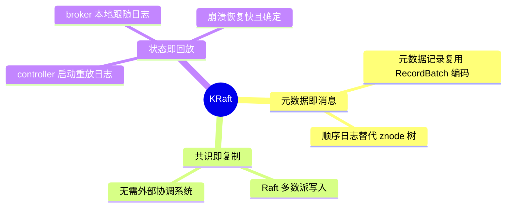

## 2. 总体架构

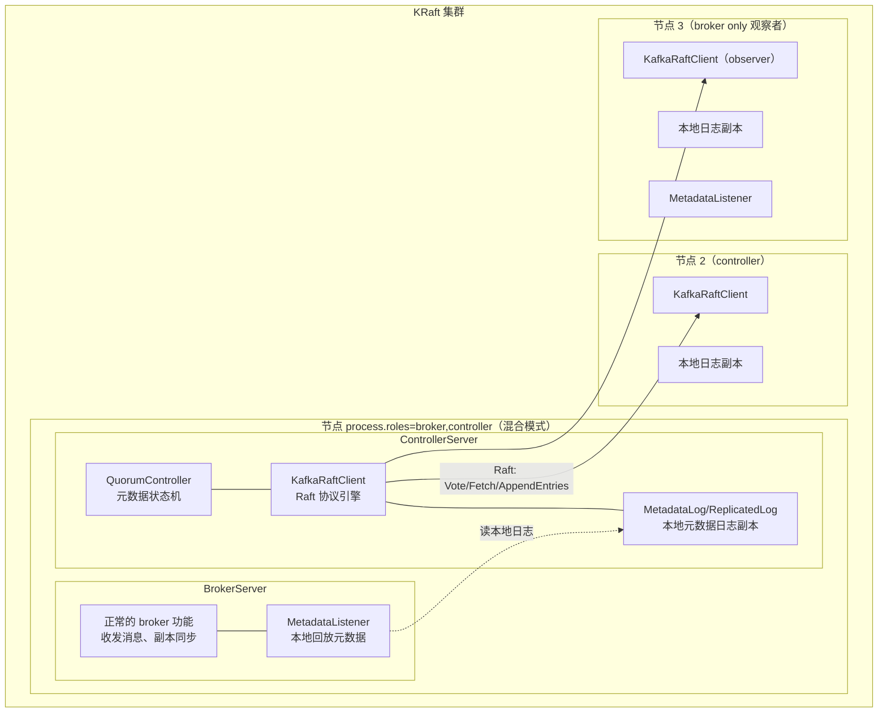

要点：

- **controller quorum** 由 `controller.quorum.voters` 指定的节点组成（通常 3/5 个），只有 voter 有选举权
- **纯 broker 节点**是 Raft **observer（观察者）**：只拉取日志副本、无投票权——相当于"每个 broker 都自带一个迷你 ZK 客户端的数据"，这是 broker 侧元数据获取快、且 controller 切换零感知的根本原因
- 混合模式（broker+controller 同节点）与分离模式（独立 controller）都支持

## 3. 模块分工与关键类

| 模块 | 关键类 | 职责 |
|---|---|---|
| `core` | `KafkaRaftServer` | 按角色组装进程 |
| `core` | `SharedServer` / `BrokerServer` / `ControllerServer` | 共享资源、broker 生命周期、controller 生命周期 |
| `core` | `KafkaRaftManager` | 在共享的 `NetworkProcessor` 上挂 Raft 通道，驱动 KafkaRaftClient |
| `raft` | `KafkaRaftClient<T>` | **Raft 协议引擎**：选举、日志复制、快照 |
| `raft` | `QuorumState` + 各 State 类 | 节点角色状态机（Unattached/Voted/Candidate/Follower/Leader/Resigned） |
| `raft` | `ReplicatedLog` / `KafkaNetworkChannel` / `FileBasedStateStore` | 日志抽象、网络、持久化投票状态到 `meta.properties`/quorum-state 文件 |
| `metadata` | `QuorumController` | **元数据状态机**：接收请求 → 生成记录 → 走 Raft 提交 → 回放应用 |
| `metadata` | `ReplicationControlManager` 等 12+ 个 ControlManager | 各领域状态（分区/broker/配置/ACL/SCRAM/配额/PID……） |
| `metadata` | `BrokerHeartbeatManager` | 基于 broker 心跳的存活检测（替代 ZK 临时节点） |
| `storage` | `KafkaMetadataLog` | 把 `__cluster_metadata` 当普通日志 segment 落盘 |

### 进程组装（KafkaRaftServer.scala:80-94）

```scala
// core/src/main/scala/kafka/server/KafkaRaftServer.scala
private val broker: Option[BrokerServer] =
  if (config.processRoles.contains(BrokerRole)) Some(new BrokerServer(sharedServer)) else None

private val controller: Option[ControllerServer] =
  if (config.processRoles.contains(ControllerRole))
    Some(new ControllerServer(sharedServer, KafkaRaftServer.configSchema, bootstrapMetadata))
  else None

override def startup(): Unit = {
  controller.foreach(_.startup())   // 先 controller
  broker.foreach(_.startup())       // 后 broker
}
override def shutdown(): Unit = {
  broker.foreach(_.shutdown())      // 先关 broker（controller 可能还要服务受控关闭）
  controller.foreach(_.shutdown())
}
```

与 ZK 模式的本质区别：`process.roles` 取代 `zookeeper.connect`，`node.id`（`KafkaConfig.nodeId`）成为每个节点在 Raft 组中的身份。

## 4. 核心之一：元数据日志（__cluster_metadata）

### 4.1 一切皆记录

Raft 复制的日志不是普通 topic，而是一个特殊的**无 replica 分区**：

```scala
// KafkaRaftServer.scala
object KafkaRaftServer {
  val MetadataPartition = new TopicPartition("__cluster_metadata", 0)
  val MetadataTopicId = Uuid.METADATA_TOPIC_ID   // 固定 UUID
}
```

每条元数据记录是 `(ApiMessage, version)` 对（`ApiMessageAndVersion`），**复用了 Kafka 消息格式的 RecordBatch 编码**。3.7 支持的记录类型（在 `QuorumController.replay()`，QuorumController.java:1479 可见完整分发表）：

| 记录类型 | 对应的管理操作 |
|---|---|
| `RegisterBrokerRecord` / `UnregisterBrokerRecord` / `FenceBrokerRecord` / `UnfenceBrokerRecord` | broker 注册/下线/隔离 |
| `BrokerRegistrationChangeRecord` | broker 心跳状态更新 |
| `TopicRecord` / `PartitionRecord` / `RemoveTopicRecord` / `PartitionChangeRecord` | topic/分区生命周期 |
| `ConfigRecord` | 动态配置变更 |
| `FeatureLevelRecord` / `ZkMigrationStateRecord` | feature 版本、迁移状态 |
| `ClientQuotaRecord` / `AccessControlEntryRecord` / `UserScramCredentialRecord` / `DelegationTokenRecord` | 配额/ACL/SCRAM/令牌 |
| `ProducerIdsRecord` | PID 块分配 |
| `BeginTransactionRecord` / `EndTransactionRecord` / `AbortTransactionRecord` | 元数据多记录原子事务（KIP-853） |
| `SnapshotHeaderRecord` / `SnapshotFooterRecord` | 快照边界 |

### 4.2 存储形态

`KafkaMetadataLog` 把元数据日志写到 `<log.dirs>/__cluster_metadata-0/`，与普通 topic 的 segment 结构完全一致（`.log` + `.index` + `.timeindex`），但：

- 没有 consumer group、没有副本机制（复制由 Raft 自己做）
- 头部有一个 `meta.properties`（cluster.id、node.id），启动时校验一致性
- 日志增长靠**快照截断**（见第 8 节），而非 retention 时间

## 5. 核心之二：Raft 共识实现（raft 模块）

### 5.1 与教科书 Raft 的差异

Kafka 的 Raft 是**为元数据定制的变体**：

| 特性 | 教科书 Raft | Kafka KRaft |
|---|---|---|
| 拉取模型 | Leader 推送 AppendEntries | **Follower 主动 Fetch 拉取**（复用 Kafka Fetch 协议） |
| 成员变更 | Joint consensus / 单节点变更 | 3.7 仍以静态 `controller.quorum.voters` 为主（KIP-853 引入动态 membership 的基础） |
| 日志匹配 | Index + Term | Offset + Epoch（完全对应 Kafka 概念） |
| 心跳 | AppendEntries 空心跳 | Broker 心跳（BrokerHeartbeatRequest）与 Raft Fetch 合并复用 |
| 快照 | InstallSnapshot RPC | Leader 生成快照，Follower 用普通 Fetch 从快照起点拉 |

### 5.2 状态机（QuorumState.java）

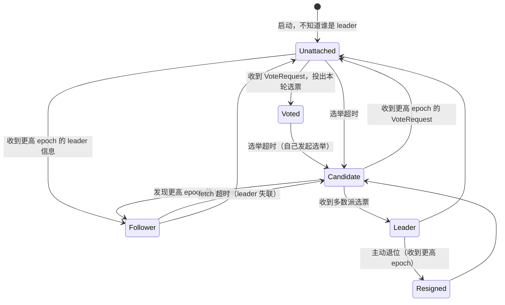

对应 `QuorumState.java` 的转换方法（QuorumState.java:109-432）：

```java
public void initialize(OffsetAndEpoch logEndOffsetAndEpoch)   // 启动恢复上次状态
public void transitionToUnattached(int epoch)                 // 失去 leader 联系
public void transitionToVoted(int epoch, int candidateId)     // 已投票
public void transitionToCandidate()                           // 发起选举
public void transitionToFollower(int epoch, int leaderId)     // 认主
public <T> LeaderState<T> transitionToLeader(long epochStartOffset, BatchAccumulator<T> accumulator)
public void transitionToResigned(List<Integer> preferredSuccessors)  // 退位
```

**关键持久化**：投票状态通过 `FileBasedStateStore` 写入 `quorum-state` 文件（记录 epoch、leader、投票对象），防止重启后同一节点在同一 epoch 内投两票（Raft 安全性要求）。

### 5.3 选举流程

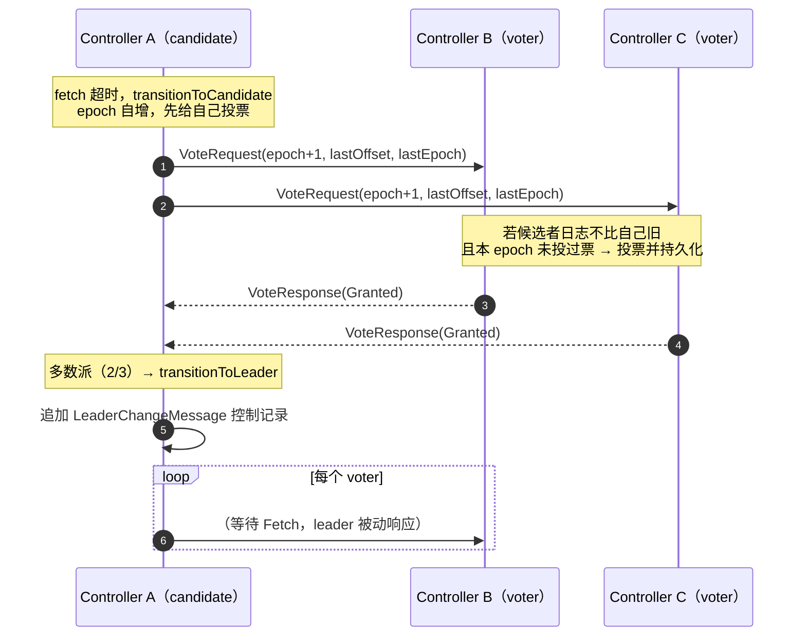

选举安全性由"**日志最新的候选者才能赢**"保证：`VoteRequest` 携带候选者的 `(lastOffset, lastEpoch)`，voter 只给日志不落后于自己的候选者投票（`handleVoteRequest` 中的比较逻辑）。

### 5.4 日志复制：Fetch 拉取模型

Leader 不推送数据，而是各 Follower **主动 Fetch**（与普通 consumer 的 fetch 请求同一个 API，只是打到 `__cluster_metadata-0` 分区）：

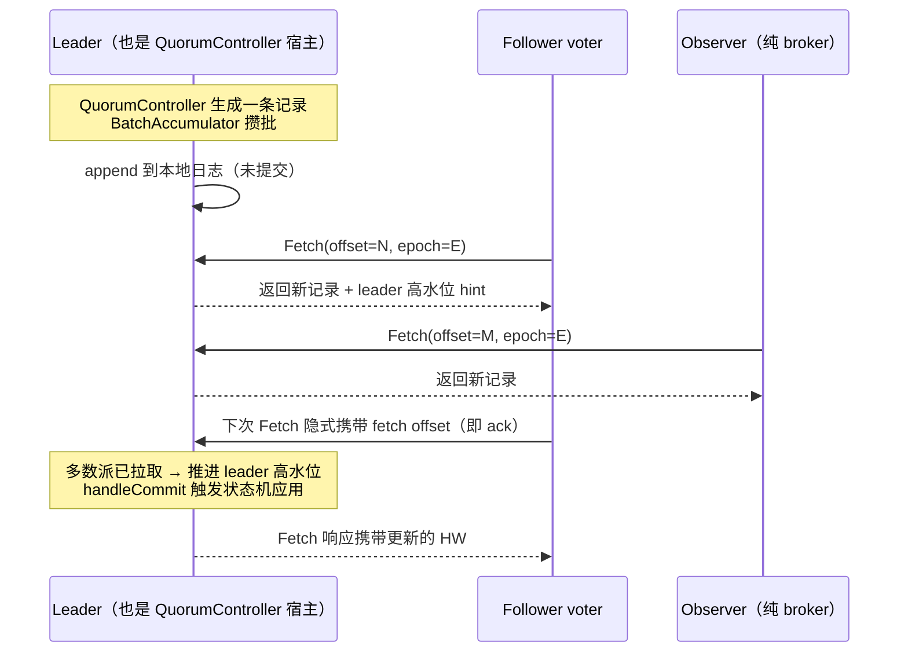

`KafkaRaftClient` 主循环（简化）：

```java
// raft/.../KafkaRaftClient.java（结构示意）
private long pollFollower(long currentTimeMs) { ... }        // :2064 follower 路径
// leader 路径：pollLeader()
//   1. maybeAppend(appends)          —— 把 accumulator 攒的记录写本地日志
//   2. 对每个 voter 维护 FollowerState.nextFetchOffset
//   3. 收到 Fetch 响应处理：handleFetchResponse(...)       // :1089
//      - 检查 epoch/offset 匹配
//      - 多数派推进 → 高水位 = min(多数派 follower 的 fetch offset)
//      - 高水位越过记录 → listener.handleCommit(reader) 通知 QuorumController
// 投票：handleVoteResponse(...)                              // :594
```

## 6. 核心之三：QuorumController 状态机（metadata 模块）

### 6.1 单线程事件队列 + 回放

`QuorumController`（QuorumController.java:179）是**事件驱动的单线程状态机**（类似 KRaft 版的 KafkaController，但用 Java 重写）：

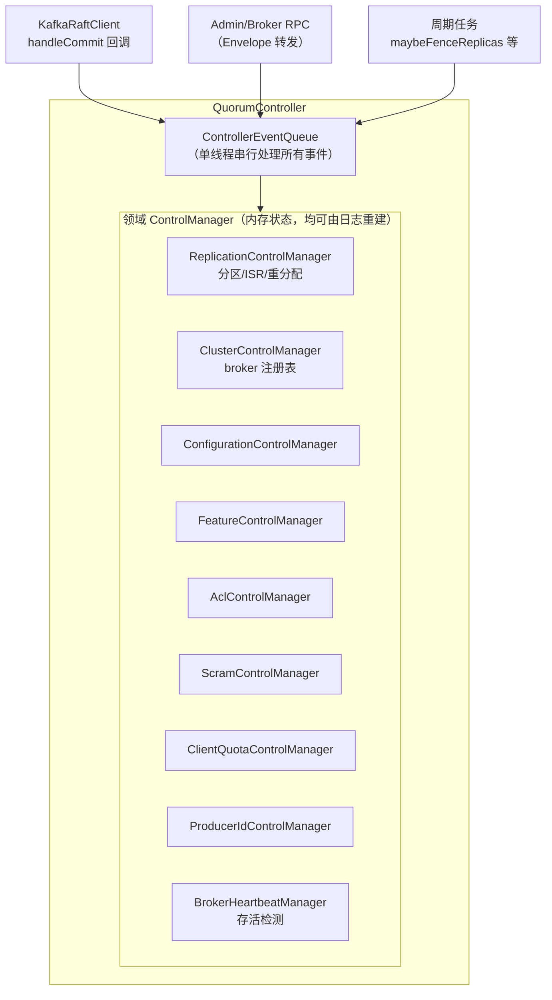

### 6.2 一条元数据记录的一生（handleCommit 与 replay）

`QuorumController.handleCommit`（QuorumController.java:1054）与 `replay`（QuorumController.java:1479）：

```java
// QuorumController.java:1054 —— Raft 提交后回调
public void handleCommit(BatchReader<ApiMessageAndVersion> reader) {
    appendRaftEvent("handleCommit[baseOffset=" + reader.baseOffset() + "]", () -> {
        while (reader.hasNext()) {
            Batch<ApiMessageAndVersion> batch = reader.next();
            // Leader 路径：记录生成时已用 generateEventRecord 预演过（replay 过一遍），
            // 提交后只需推进 offset 状态
            if (isActive()) { offsetControl.handleCommitBatch(batch); }
            else {
                // Standby 路径：回放日志重建内存状态
                batch.records().forEach(message ->
                    replay(message.message(), Optional.empty(), recordOffset));
            }
        }
    });
}

// QuorumController.java:1479 —— 按记录类型分发给对应 ControlManager
private void replay(ApiMessage message, Optional<OffsetAndEpoch> snapshotId, long offset) {
    if (message instanceof RegisterBrokerRecord)
        clusterControl.replay((RegisterBrokerRecord) message, offset);
    else if (message instanceof TopicRecord)
        replicationControl.replay((TopicRecord) message);
    else if (message instanceof PartitionChangeRecord)
        replicationControl.replay((PartitionChangeRecord) message);
    else if (message instanceof ConfigRecord)
        configurationControl.replay((ConfigRecord) message);
    // ... 共 20+ 种类型
}
```

**"生成即预演"是精妙之处**：Active controller 处理 CreateTopics 请求时，先在内存中"预演"出要写的 `TopicRecord`/`PartitionRecord` 并立即 replay（拿到最新状态用于响应），然后异步经 Raft 提交；提交成功后 offset 落定，standby 侧靠回放同样的记录达到相同状态。**所有节点的状态 = 日志回放结果，天然一致**。

### 6.3 存活检测：Broker 心跳取代 ZK 临时节点

ZK 模式靠"临时节点消失"判断 broker 下线；KRaft 中 broker 周期性发 `BrokerHeartbeatRequest` 给 controller：

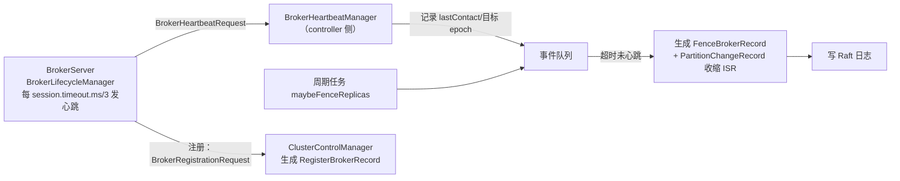

隔离（fence）一个 broker 也是一个普通的元数据变更：写一条 `FenceBrokerRecord` → Raft 多数派提交 → 所有节点回放。与 ZK 模式"controller 在内存里直接改状态再异步下发"相比，**变更顺序有全局共识，不存在脑裂窗口**。

## 7. 核心之四：Broker 如何消费元数据

ZK 模式 broker 要连 ZK 读 znode；KRaft 模式 broker（含 controller 节点上的 BrokerServer）只是 Raft **observer**，用 `MetadataListener` 本地回放：

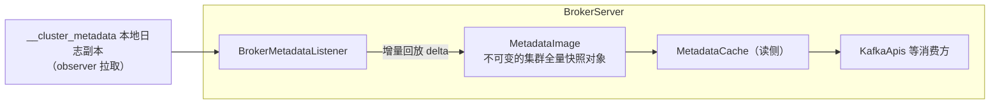

- `BrokerMetadataListener` 持有 `LogContext`，从上次回放位置读增量日志，应用到 `MetadataImage`（`metadata/.../MetadataImage.java`）
- `MetadataImage` 是**不可变对象**，每次变更整体替换，读侧无锁
- broker 需要的 LeaderAndIsr 语义（谁该领导哪个分区）由 `ReplicationControlManager` 写入的 `PartitionChangeRecord` 驱动，broker 回放后自己决定本机分区角色
- 尚未追上日志的 broker 拒绝服务（`metadata.log.max.record.ms` 超过则自我隔离），保证"不基于过期元数据做决策"——解决 ZK 模式脑裂问题的落地手段

## 8. 快照机制

日志无限增长不可行，KRaft 用**快照**截断：

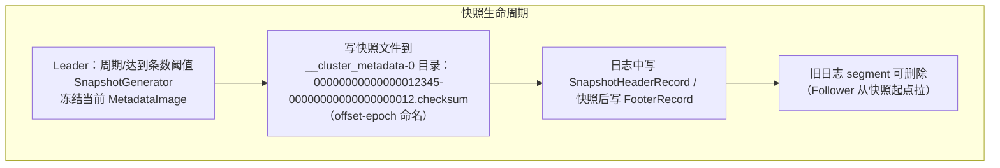

- 快照本身是**自包含的 MetadataImage 序列化**（KIP-778 起支持自描述格式）
- 新加入/落后太多的 follower 从快照 offset 开始 Fetch，无需全量历史
- controller 重启恢复：`QuorumController.newActivate()` 先加载最新快照，再回放之后的增量日志

## 9. 完整生命周期时序

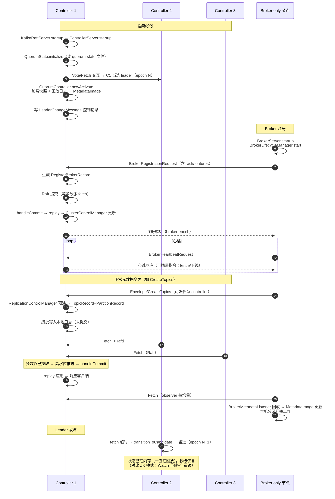

## 10. 与 ZK 模式的实现级对比

| 关注点 | ZK 模式实现 | KRaft 实现 |
|---|---|---|
| 元数据载体 | znode 树（各节点 JSON 格式各异） | 统一 RecordBatch 日志（ApiMessage + 版本） |
| 选举 | 抢注 `/controller` 临时节点（ZAB） | Raft 选举（日志最新者胜，`VoteRequest`） |
| 提交语义 | 写 znode 成功 ≠ observer 可见（Watch 异步） | 多数派拉取 → 高水位推进，显式 commit 点 |
| broker 存活 | ZK session 断开 → 临时节点删除 | `BrokerHeartbeatManager` 超时 → FenceBrokerRecord |
| 元数据消费 | broker 连 ZK 读 + Watch 重注册 | broker 本地日志副本 + 回放（无外部依赖） |
| controller 恢复 | Watch 重建 + 全量读 znode（慢） | 加载快照 + 回放增量（快且确定） |
| 状态一致性 | controller 内存为准，需与 ZK 对齐 | 日志为准，所有副本回放同一日志 |
| 原子多变更 | ZK Multi 事务（跨 znode） | 元数据事务记录（Begin/End/AbortTransactionRecord，KIP-853） |
| 运维组件 | Kafka + ZooKeeper 两套 | 仅 Kafka 一套 |

## 11. 总结

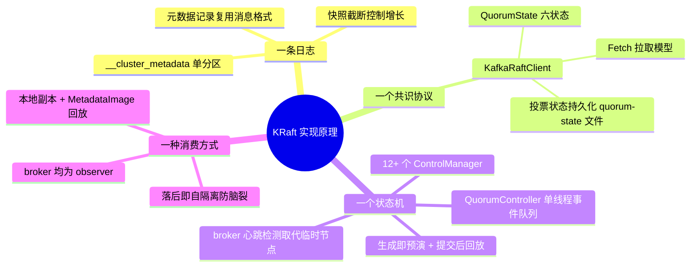

**一句话**：KRaft 把 ZooKeeper 的三个原语（临时节点=选举与存活、znode=存储、Watch=通知）统一替换为"一条 Raft 复制的元数据日志"——选举是选主，存储是追加，通知是回放；由此获得单一事实源、确定性恢复和百万分区扩展能力。
