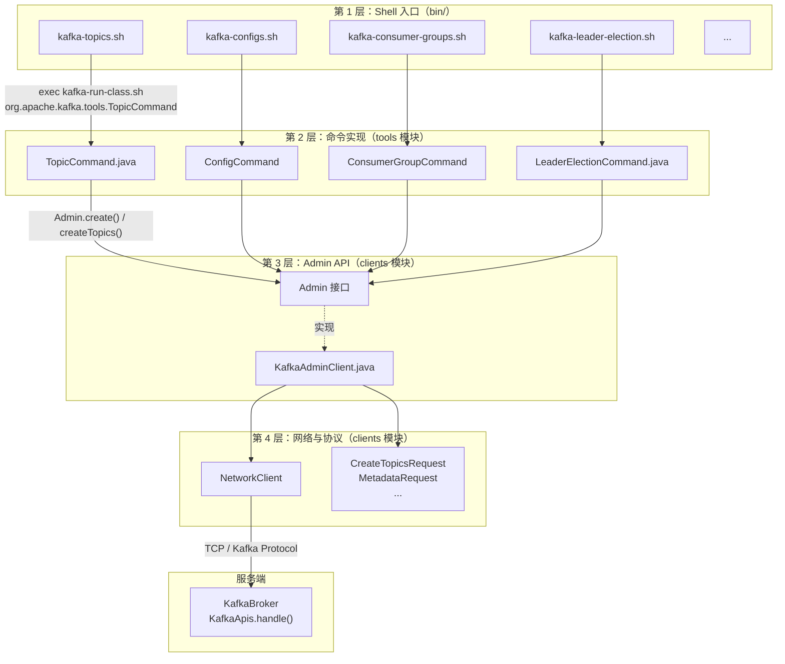
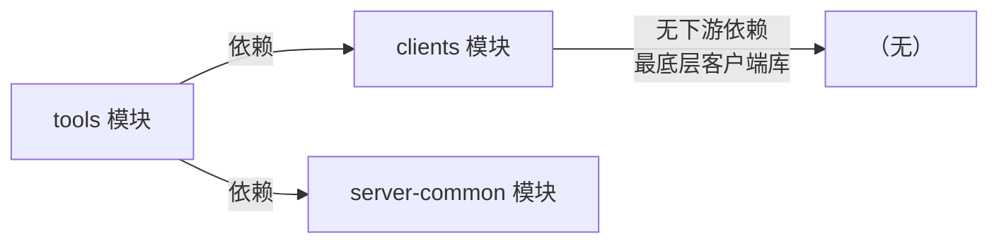
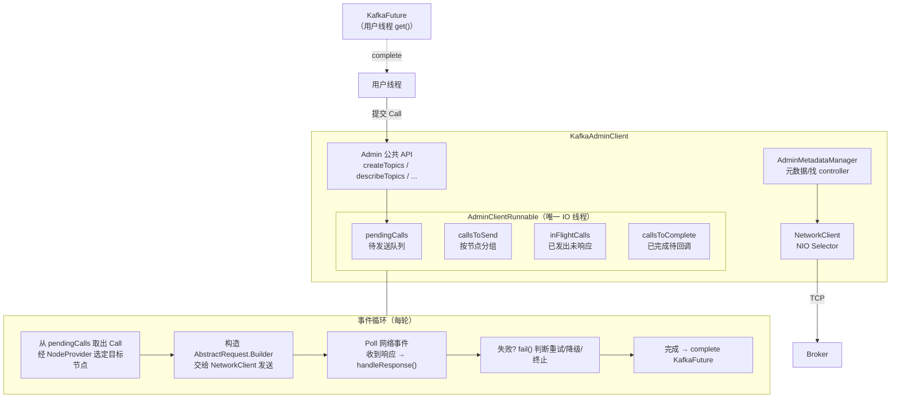
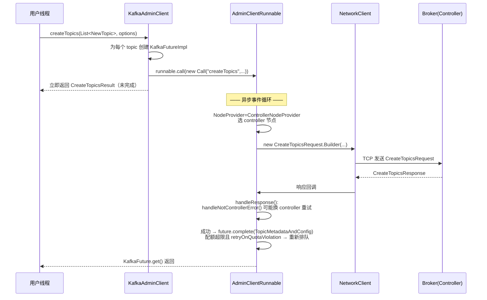
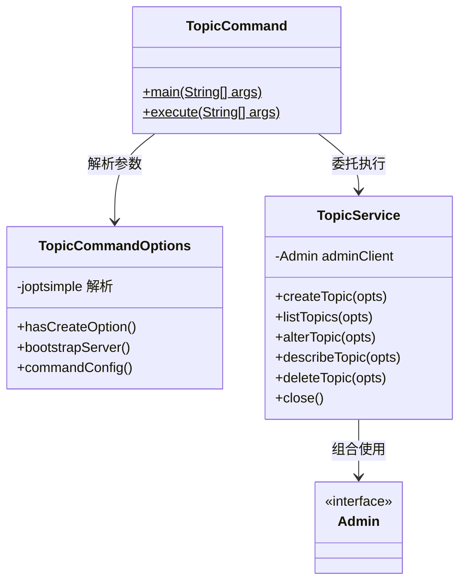
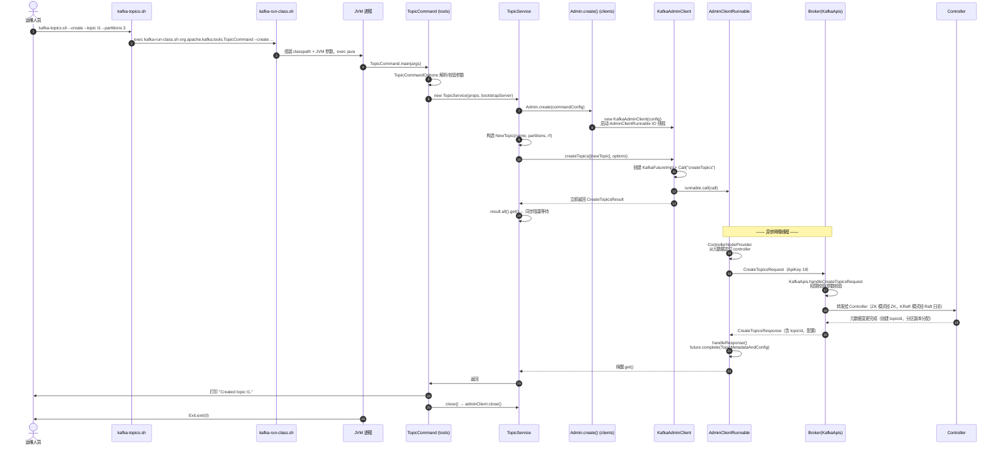
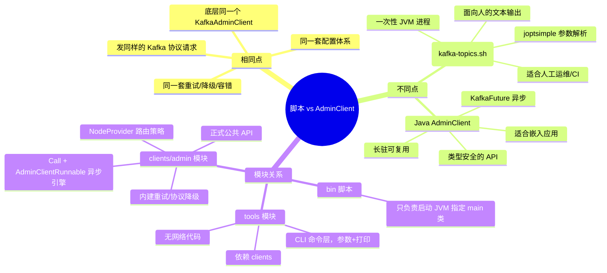

# Kafka 运维脚本与 AdminClient 关系深度解析

> 基于 Kafka 3.7.0 源码分析
> 涉及模块：`bin/`（脚本）、`tools`（命令实现）、`clients`（AdminClient 协议实现）

---

## 目录

1. [总体架构关系](#1-总体架构关系)
2. [四层结构详解](#2-四层结构详解)
3. [运维脚本 vs Java AdminClient 对比](#3-运维脚本-vs-java-adminclient-对比)
4. [tools 模块与 clients/admin 模块的关联与区别](#4-tools-模块与-clientsadmin-模块的关联与区别)
5. [KafkaAdminClient 工作流程与实现原理](#5-kafkaadminclient-工作流程与实现原理)
6. [tools 模块工作流程（以 TopicCommand 为例）](#6-tools-模块工作流程以-topiccommand-为例)
7. [端到端时序图：kafka-topics.sh --create](#7-端到端时序图kafka-topics-sh---create)
8. [关键代码分析](#8-关键代码分析)
9. [总结](#9-总结)

---

## 1. 总体架构关系

一句话概括：**运维脚本只是壳，tools 模块是命令层，clients 中的 admin 模块是协议层，三者是逐层包装的关系。**



**核心事实：用户在 Java 代码中使用 `KafkaAdminClient` 与运维脚本执行到的是同一个类、同一套协议。** 区别只在于外面包了什么。

---

## 2. 四层结构详解

### 2.1 bin/ 脚本层 —— 纯粹的启动壳

以 `bin/kafka-topics.sh` 为例，全文只有一行有效代码：

```bash
# bin/kafka-topics.sh:17
exec $(dirname $0)/kafka-run-class.sh org.apache.kafka.tools.TopicCommand "$@"
```

它做的事情：
- 调用 `kafka-run-class.sh`，传入**全限定类名** `org.apache.kafka.tools.TopicCommand` 和原始参数
- `exec` 替换当前进程，脚本本身不产生额外开销

`kafka-run-class.sh` 负责统一的 JVM 启动逻辑：
- 组装 classpath（`kafka-tools*.jar` + `kafka-clients*.jar` + 依赖）
- 设置 JVM 内存参数（默认 `KAFKA_HEAP_OPTS=-Xmx512M`）
- 处理 Windows 批处理等价物、JMX、日志配置
- `exec java ... org.apache.kafka.tools.TopicCommand "$@"` 启动 main 方法

> 注意：3.7.0 中 `TopicCommand` 的包名是 `org.apache.kafka.tools`（已从早期版本的 `kafka.admin.TopicCommand` Scala 类迁移为 tools 模块的 Java 类，见 KAFKA-14556 等一系列"命令行工具 Java 化"改造）。

### 2.2 tools 模块 —— 命令层（参数解析 + 结果打印）

`tools` 是一个**独立的 Gradle 模块**，职责单一：

| 职责 | 说明 |
|---|---|
| 参数解析 | 用 joptsimple 解析 `--create --topic xxx` 这类 CLI 参数 |
| 语义校验 | 例如校验副本因子范围、分区数 > 0 |
| 组合调用 | 一个 CLI 动作可能组合多次 Admin API 调用 |
| 输出格式化 | 把 `TopicDescription` 等对象渲染成人读的文本 |
| 进程退出码 | `Exit.exit(code)`，供 shell 脚本判断成功失败 |

**tools 模块没有任何网络代码**，它不直接跟 Broker 通信。

### 2.3 clients 模块中的 admin 包 —— 协议层

路径：`clients/src/main/java/org/apache/kafka/clients/admin/`

| 关键类 | 作用 |
|---|---|
| `Admin` | 对外接口（3.7 起是接口，含 `AdminClient` 废弃别名） |
| `AdminClientConfig` | 配置（bootstrap.servers、安全、超时、重试） |
| `KafkaAdminClient` | **唯一正式实现**，所有工具和脚本的最终归宿 |
| `AdminMetadataManager` | 元数据管理，追踪 controller 位置、集群节点 |
| `*Options / *Result` | 每个操作的选项与异步结果封装 |

### 2.4 服务端 —— 协议处理

Broker 侧 `KafkaApis.handle()`（`core/src/main/scala/kafka/server/KafkaApis.scala:184` 附近的分发逻辑）将 `CreateTopics`、`DeleteTopics`、`Metadata` 等 ApiKey 路由到对应 handler，最终由 Controller（ZK 模式的 KafkaController 或 KRaft 模式的 QuorumController）执行元数据变更。

---

## 3. 运维脚本 vs Java AdminClient 对比

| 维度 | kafka-topics.sh 等脚本 | Java 中使用 KafkaAdminClient |
|---|---|---|
| 底层实现 | **完全相同**（同一个 `KafkaAdminClient`） | 同左 |
| 进程模型 | 一次性进程，执行完 JVM 退出 | 长驻进程，可复用连接与元数据缓存 |
| 典型使用者 | 运维人员、部署脚本、CI/CD | 应用程序、管控平台（Kafka UI、Cruise Control） |
| 结果形态 | 打印文本 + 退出码 | `KafkaFuture<CreateTopicsResult>` 等可编程对象 |
| 功能覆盖 | 每个脚本只暴露自己那部分能力 | 全量 Admin API（含脚本没有的能力，如 `listOffsets`、`alterUserScramCredentials`） |
| 资源开销 | 每次 JVM 冷启动 + 建连 + 拉元数据（秒级） | 一次建连后毫秒级调用 |
| 配置方式 | `--command-config client.properties` 文件 | 代码中传 Properties/Map，便于与密钥管理系统集成 |
| 线程模型 | 无需关心 | Admin 实例线程安全，应全局共享；需显式 `close()` |

**结论：协议层无任何区别，区别全部在"包装方式"。**

---

## 4. tools 模块与 clients/admin 模块的关联与区别

### 4.1 依赖关系



- `tools/build.gradle` 显式依赖 `clients` —— tools 通过 `Admin.create()` 使用 clients
- `clients` **不依赖** tools —— 方向是单向的
- 这保证了 `kafka-clients` 可以独立发布给应用开发者，而不带任何 CLI 依赖（joptsimple 等）

### 4.2 职责边界对比

| | tools 模块 | clients/admin 模块 |
|---|---|---|
| 定位 | 面向"人"的 CLI 命令集合 | 面向"程序"的正式公共 API |
| 输入 | `String[] args`（joptsimple） | 类型安全的 Java 对象（`NewTopic` 等） |
| 输出 | `System.out.println` 文本 | `KafkaFuture` 异步结果 |
| 状态 | 无状态，跑完即退 | 有状态（连接池、元数据缓存、重试队列） |
| 稳定性承诺 | 文本输出格式不保证兼容 | 严格遵守 API/协议二进制兼容承诺 |
| 例子 | `TopicCommand`、`ClusterTool`、`GetOffsetShell` | `Admin.create()`、`createTopics()`、`describeCluster()` |

### 4.3 例外情况（并非所有脚本都走 AdminClient）

有少数"重工具"不经过 Admin API，直接用底层客户端或自有协议：

| 脚本 | 途径 |
|---|---|
| `kafka-console-producer.sh` / `console-consumer.sh` | 直接用 `KafkaProducer`/`KafkaConsumer` |
| `kafka-producer-perf-test.sh` | 直接用 Producer |
| `kafka-replica-verification.sh` | 底层 fetch 协议自行实现 |
| `kafka-storage.sh`（格式化 KRaft 元数据） | 直接调 `MetadataRecordSerde`/`KafkaRaftServer` 内部工具，本地操作 |
| `kafka-dump-log.sh` | 直接读本地日志文件，不联网 |

---

## 5. KafkaAdminClient 工作流程与实现原理

### 5.1 内部架构

`KafkaAdminClient` 是一个**异步事件驱动**的客户端，内部结构与 Producer/Consumer 类似但更简单：



### 5.2 Call 抽象 —— 核心设计

`KafkaAdminClient` 中每个管理操作都被建模为一个 **`Call`**（`KafkaAdminClient.java:835`），它是自带重试逻辑的一次 RPC 任务：

```java
// KafkaAdminClient.java:835
abstract class Call {
    private final String callName;
    private final long deadlineMs;        // 绝对截止时间
    private final NodeProvider nodeProvider;  // 决定发给谁（controller/任意节点/最空节点）
    protected int tries;                  // 已重试次数

    // 三要素：构造请求 / 处理响应 / 处理失败
    abstract AbstractRequest.Builder<?> createRequest(int timeoutMs);
    abstract void handleResponse(AbstractResponse abstractResponse);
    abstract void handleFailure(Throwable throwable);
}
```

**`NodeProvider` 策略**是 AdminClient 的精妙设计——不同管理操作需要发给不同节点：

| NodeProvider | 目标 | 使用场景 |
|---|---|---|
| `ControllerNodeProvider` | 当前 controller | 创建/删除 topic 等元数据变更 |
| `LeastLoadedNodeProvider` | 请求最少的 broker | `describeCluster`、`listTopics` |
| `ConstantNodeProvider` | 指定节点 | 定向操作某个 broker |

### 5.3 失败处理与重试（Call.fail，KafkaAdminClient.java:885）

```java
final void fail(long now, Throwable throwable) {
    // 1. 客户端正在关闭 → 直接失败
    if (runnable.closing) { handleFailure(throwable); return; }

    // 2. UnsupportedVersionException → 尝试协议降级，且不计入重试次数
    if (throwable instanceof UnsupportedVersionException &&
             handleUnsupportedVersionException(...)) {
        runnable.pendingCalls.add(this);   // 重新排队
        return;
    }
    nextAllowedTryMs = now + retryBackoff.backoff(tries++);

    // 3. 超过 deadline → 超时失败
    if (calcTimeoutMsRemainingAsInt(now, deadlineMs) <= 0) { ... }

    // 4. 非可重试异常（如 InvalidTopicException）→ 直接失败
    if (!(throwable instanceof RetriableException)) {
        handleFailure(throwable); return;
    }
    // 5. 重试次数耗尽 → 超时失败
    if (tries > maxRetries) { ... }
    // 6. 否则指数退避后重试
    maybeRetry(now, throwable);
}
```

这解释了 AdminClient 的鲁棒性来源：**controller 切换（`NotControllerException`）、版本不匹配、限流（`ThrottlingQuotaExceededException`）全部被内建处理**——这也是上层 CLI 工具代码非常薄的原因。

### 5.4 典型操作：createTopics 的异步管道



---

## 6. tools 模块工作流程（以 TopicCommand 为例）

### 6.1 类结构

`TopicCommand`（`tools/src/main/java/org/apache/kafka/tools/TopicCommand.java`）拆成三部分：



### 6.2 执行流程

`execute()`（TopicCommand.java:96）：

```java
static void execute(String... args) throws Exception {
    TopicCommandOptions opts = new TopicCommandOptions(args);
    // 创建 AdminClient（把 --bootstrap-server 塞进配置）
    TopicService topicService = new TopicService(opts.commandConfig(), opts.bootstrapServer());
    try {
        if (opts.hasCreateOption())      topicService.createTopic(opts);
        else if (opts.hasAlterOption())  topicService.alterTopic(opts);
        else if (opts.hasListOption())   topicService.listTopics(opts);
        else if (opts.hasDescribeOption()) topicService.describeTopic(opts);
        else if (opts.hasDeleteOption()) topicService.deleteTopic(opts);
    } finally {
        topicService.close();   // 关闭 AdminClient
    }
}
```

### 6.3 TopicService 如何组合 Admin API

`createTopic()`（TopicCommand.java:449）展示了 tools 层"翻译"的角色：

```java
public void createTopic(CommandTopicPartition topic) throws Exception {
    // ── CLI 特有的语义校验（协议层不做）──
    if (topic.replicationFactor.filter(rf -> rf > Short.MAX_VALUE || rf < 1).isPresent())
        throw new IllegalArgumentException("The replication factor must be between 1 and " + Short.MAX_VALUE);
    if (topic.partitions.filter(p -> p < 1).isPresent())
        throw new IllegalArgumentException("The partitions must be greater than 0");

    // ── 参数对象化：NewTopic 是 Admin API 的输入类型 ──
    NewTopic newTopic = topic.hasReplicaAssignment()
        ? new NewTopic(topic.name, topic.replicaAssignment)                       // 手工指定副本分配
        : new NewTopic(topic.name, topic.partitions, topic.replicaAssignmentRF);  // 自动分配
    newTopic.configs(configsMap);   // --config 转成 map

    // ── 调用 Admin API，同步等待 ──
    CreateTopicsResult createResult = adminClient.createTopics(
        Collections.singleton(newTopic),
        new CreateTopicsOptions().retryOnQuotaViolation(false));
    createResult.all().get();

    System.out.println("Created topic " + topic.name + ".");   // CLI 特有：打印
}
```

`alterTopic()`（TopicCommand.java:490）则展示了**一个 CLI 动作组合多个 Admin 调用**：

```
--alter --partitions 6
   ├─ 1. adminClient.listTopics()          （模式匹配 topic 名）
   ├─ 2. adminClient.describeTopics()      （查当前分区数，算出新增分区）
   └─ 3. adminClient.createPartitions()    （真正扩分区）
```

`describeTopic()` 更典型：`describeTopics` + `describeConfigs` + `listPartitionReassignments` 三个 API 并行调用，再由 `printPartitionDescription` 渲染出 CLI 用户看到的表格。

---

## 7. 端到端时序图：kafka-topics.sh --create



---

## 8. 关键代码分析

### 8.1 脚本层：bin/kafka-topics.sh:17

```bash
exec $(dirname $0)/kafka-run-class.sh org.apache.kafka.tools.TopicCommand "$@"
```

- `exec`：用子命令替换当前 shell 进程，减少一层进程
- 类名硬编码 —— **shell 层与 tools 层唯一的耦合点就是这个 main 类名**

### 8.2 tools 层：TopicService 的 AdminClient 工厂（TopicCommand.java:433）

```java
private static Admin createAdminClient(Properties commandConfig, Optional<String> bootstrapServer) {
    if (bootstrapServer.isPresent()) {
        commandConfig.put(AdminClientConfig.BOOTSTRAP_SERVERS_CONFIG, bootstrapServer.get());
    }
    return Admin.create(commandConfig);   // ← 与用户 Java 代码完全相同的入口
}
```

`Admin.create()` 是静态工厂，内部根据配置实例化 `KafkaAdminClient`（`AdminDataProvider` 在 3.7 中进一步分层）。**这行代码就是"脚本即 AdminClient"的直接证据。**

### 8.3 clients 层：createTopics 的 Future 管道（KafkaAdminClient.java:1741）

```java
public CreateTopicsResult createTopics(final Collection<NewTopic> newTopics,
                                       final CreateTopicsOptions options) {
    // 1. 每个 topic 一个 future（部分成功部分失败可分别感知）
    final Map<String, KafkaFutureImpl<TopicMetadataAndConfig>> topicFutures = new HashMap<>();
    ...
    // 2. 名字不合法的 topic 直接失败 future，不发网络请求
    if (topicNameIsUnrepresentable(newTopic.name())) {
        future.completeExceptionally(new InvalidTopicException(...));
    }
    // 3. 构造 Call 并提交到 IO 线程队列
    final Call call = getCreateTopicsCall(options, topicFutures, topics, ...);
    runnable.call(call, now);
    // 4. 立即返回 —— 全异步
    return new CreateTopicsResult(new HashMap<>(topicFutures));
}
```

### 8.4 clients 层：Call 的请求构造与响应处理（KafkaAdminClient.java:1766）

```java
return new Call("createTopics", deadline, new ControllerNodeProvider()) {
    @Override
    public CreateTopicsRequest.Builder createRequest(int timeoutMs) {
        return new CreateTopicsRequest.Builder(
            new CreateTopicsRequestData()
                .setTopics(topics)          // CreatableTopicCollection
                .setTimeoutMs(timeoutMs)
                .setValidateOnly(options.shouldValidateOnly()));  // 支持 dry-run 校验
    }

    @Override
    public void handleResponse(AbstractResponse abstractResponse) {
        handleNotControllerError(abstractResponse);   // controller 切换→自动换节点重试
        ...
        if (error.is(Errors.THROTTLING_QUOTA_EXCEEDED)) {
            if (options.shouldRetryOnQuotaViolation()) {
                retryTopics.add(...);                // 配额超限→可配置为重试
            } else {
                future.completeExceptionally(quotaExceededException);
            }
        } else if (error.isFailure()) {
            future.completeExceptionally(error.exception());  // 如 TopicExistsException
        } else {
            future.complete(new TopicMetadataAndConfig(     // 正常完成
                result.topicId(), result.numPartitions(),
                result.replicationFactor(), topicConfig));
        }
    }
};
```

**值得注意**：`handleNotControllerError` 是所有走 controller 的 Call 的公共逻辑——收到 `NOT_CONTROLLER` 错误时，会请求刷新元数据并重新选择 controller 节点重试，上层完全无感知。

### 8.5 配置项如何影响行为

`AdminClientConfig` 关键配置（脚本通过 `--command-config`、Java 代码通过 Properties 传入，**同一套**）：

| 配置 | 默认 | 作用 |
|---|---|---|
| `bootstrap.servers` | 无 | 初始连接点（仅用于拉取元数据，后续自动发现全集群） |
| `request.timeout.ms` | 30000 | 单次 RPC 超时（即 Call 的 deadline 基准） |
| `retries` | 5 | Call 失败重试上限（配合指数退避） |
| `retry.backoff.ms` | 100 | 重试退避起点 |
| `default.api.timeout.ms` | 60000 | 整个操作（含全部重试）的总超时 |
| `client.dns.lookup` | use_all_dns_lookup | 多 IP 场景的解析策略 |
| SASL/SSL 系列 | - | 安全认证，两种方式完全通用 |

---

## 9. 总结



**选型建议**：

- 临时运维、问题排查、部署期初始化 → 脚本
- 应用内动态管理 topic、自建管控平台、定时巡检 → `Admin` API（全局单例、注意 `close()`）
- 大规模生产集群运维 → 基于 Admin API 的生态工具（Cruise Control、Kafka UI）
