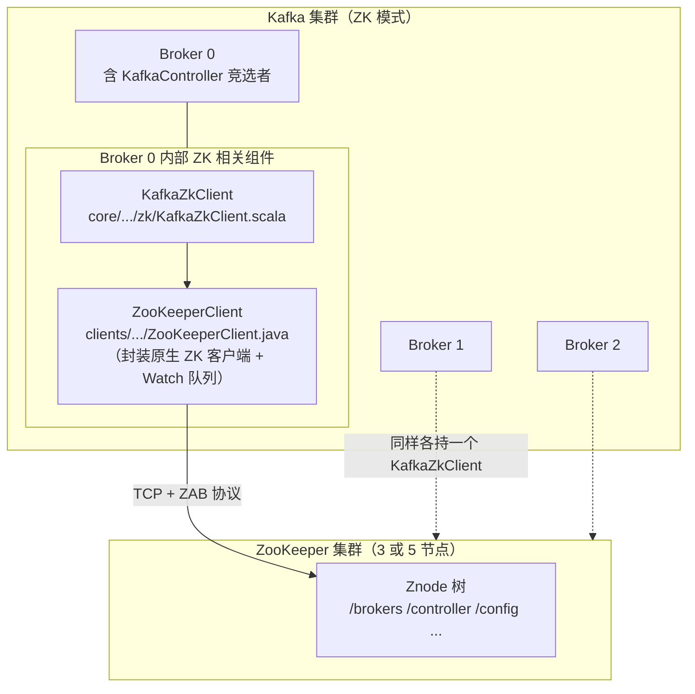
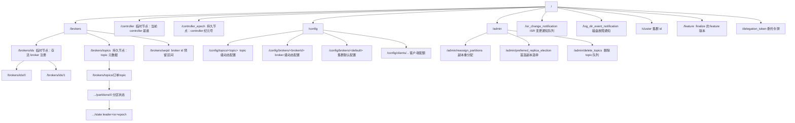
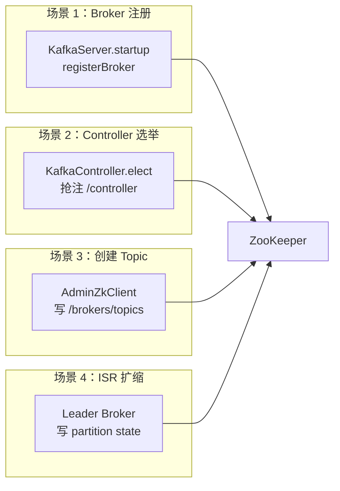
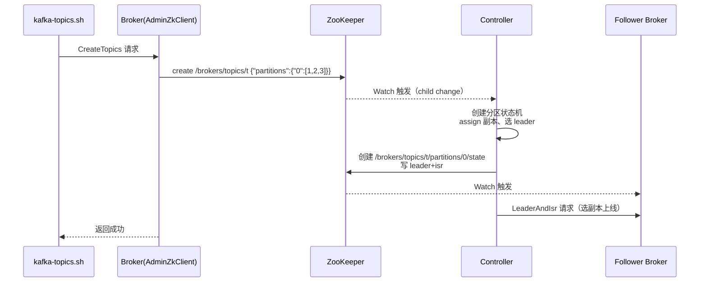
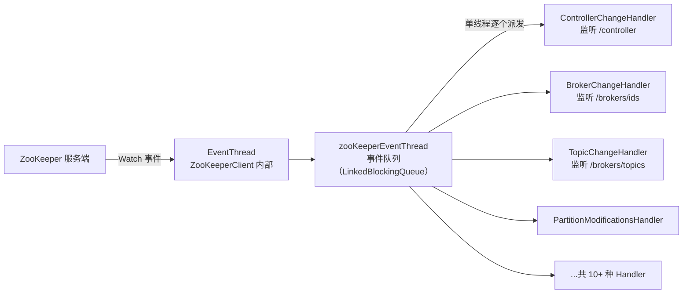
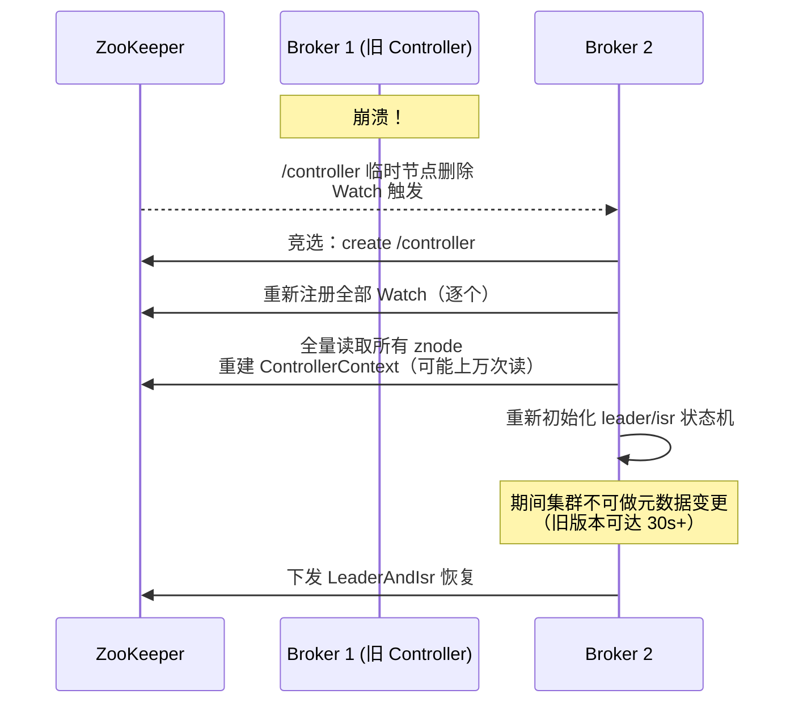
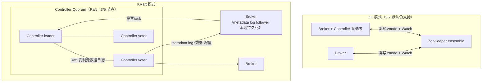
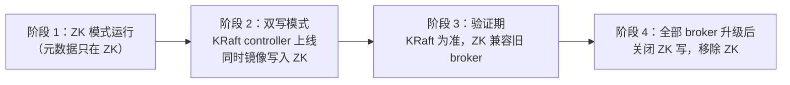
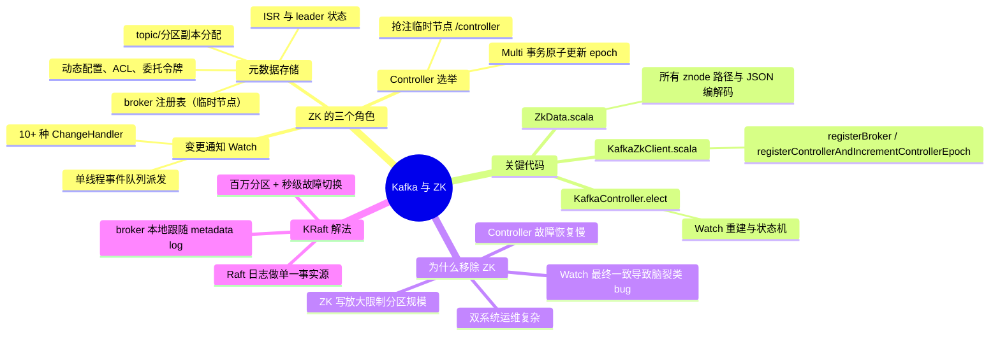

# Kafka 与 ZooKeeper 交互机制深度解析

> 基于 Kafka 3.7.0 源码分析（ZK 模式）
> 涉及模块：`core`（KafkaServer、KafkaController、KafkaZkClient、ZkData）、`clients`（ZooKeeperClient）

---

## 目录

1. [Kafka 与 ZK 的整体交互架构](#1-kafka-与-zk-的整体交互架构)
2. [ZK 中存储的数据与目录结构](#2-zk-中存储的数据与目录结构)
3. [关键交互场景与代码分析](#3-关键交互场景与代码分析)
4. [Watch 机制：Kafka 如何感知变化](#4-watch-机制kafka-如何感知变化)
5. [为什么移除 ZooKeeper —— KRaft](#5-为什么移除-zookeeper--kraft)
6. [KRaft 架构与 ZK 模式对比](#6-kraft-架构与-zk-模式对比)
7. [ZK → KRaft 迁移](#7-zk--kraft-迁移)
8. [总结](#8-总结)

---

## 1. Kafka 与 ZK 的整体交互架构

ZooKeeper 模式下（3.7.0 仍是默认支持的两种模式之一），ZK 承担三个角色：**元数据存储、Controller 选举、变更通知（Watch）**。注意：**消息数据从不经过 ZK**，ZK 里只有元数据。



关键分层（自上而下）：

| 层 | 类 | 位置 | 职责 |
|---|---|---|---|
| 业务层 | `KafkaServer` / `KafkaController` / `ZkAdminManager` | `core/.../server、controller` | 决定"什么时候读写什么" |
| 语义层 | `KafkaZkClient` + `ZkData.scala` + `AdminZkClient` | `core/.../zk/` | 每个 znode 的路径、JSON 编解码、重试 |
| 通信层 | `ZooKeeperClient` | `clients/.../common/` | 原生 ZK 客户端封装、Watch 事件排队、请求去重 |

## 2. ZK 中存储的数据与目录结构

所有 znode 的**路径与编解码**集中定义在 `core/src/main/scala/kafka/zk/ZkData.scala`。Broker 启动时通过 `createTopLevelPaths()`（KafkaZkClient.scala:1772）确保顶层路径存在。

### 2.1 完整目录树



### 2.2 各节点详解（数据格式 + 节点类型 + 生产者）

| ZNode | 类型 | 内容（JSON） | 谁写入 |
|---|---|---|---|
| `/brokers/ids/{id}` | **临时(EPHEMERAL)** | `{"version":5,"host":..,"port":..,"endpoints":[...],"rack":..,"timestamp":..,"features":{..}}` | 每个 Broker 启动时 `registerBroker` |
| `/brokers/topics/{topic}` | 持久 | `{"version":1,"partitions":{"0":[1,2,3],...},"topic_id":..}` | Controller 创建 topic 时 |
| `/brokers/topics/{t}/partitions/{p}/state` | 持久 | `{"controller_epoch":12,"leader":1,"version":1,"leader_epoch":3,"isr":[1,2,3]}` | **Leader Broker**（ISR 扩缩时） |
| `/controller` | **临时(EPHEMERAL)** | `{"version":2,"brokerid":0,"timestamp":...}` | Controller 选举成功者 |
| `/controller_epoch` | 持久 | 纯数字，如 `42` | 新 Controller |
| `/config/topics/{topic}` 等 | 持久 | `{"version":1,"config":{"retention.ms":"86400000"}}` | `kafka-configs.sh`（AlterConfigs） |
| `/admin/reassign_partitions` | 持久 | `{"version":1,"partitions":[{"topic":"t","partition":0,"replicas":[2,3]}]}` | `kafka-reassign-partitions.sh` |
| `/admin/delete_topics` | 持久 | 子节点为待删 topic 名 | `kafka-topics.sh --delete` |
| `/isr_change_notification/xxx` | 持久顺序节点 | 内容为发生 ISR 变化的分区列表 | Leader Broker |
| `/cluster/id` | 持久 | `{"version":1,"id":"xxx"}` | 首个启动的 Broker 生成 |
| `/consumers/*`（旧版） | 持久 | **3.7 已废弃**，offset 迁移到 `__consumer_offsets` 内部 topic | — |

**临时节点是关键设计**：Broker 与 ZK 的会话断开（崩溃/网络分区）后，`/brokers/ids/{id}` 和 `/controller` 自动消失，Controller 通过 Watch 感知，无需心跳检测逻辑。

## 3. 关键交互场景与代码分析

### 3.1 场景总览



### 3.2 场景一：Broker 启动注册（写 `/brokers/ids/{id}`）

入口在 `KafkaServer.scala:404`：

```scala
// core/src/main/scala/kafka/server/KafkaServer.scala:404
val brokerEpoch = zkClient.registerBroker(brokerInfo)
```

实现（`KafkaZkClient.scala:104`）：

```scala
def registerBroker(brokerInfo: BrokerInfo): Long = {
  val path = brokerInfo.path                                    // /brokers/ids/{brokerId}
  // 关键：EPHEMERAL 临时节点 —— 会话断开自动删除，这就是"存活检测"的全部实现
  val stat = checkedEphemeralCreate(path, brokerInfo.toJsonBytes)
  info(s"Registered broker ${brokerInfo.broker.id} at path $path ...")
  stat.getCzxid    // 用 znode 创建事务 id 作为 brokerEpoch
}
```

节点内容编码在 `ZkData.scala:154`（`BrokerIdZNode.encode`）——把 `endpoints`（即 `advertised.listeners`）、rack、features 等序列化为 JSON。**客户端从任意 Broker 拿到的 broker 列表，源头就是这个 znode。**

### 3.3 场景二：Controller 选举（抢占 `/controller`）

这是 ZK 模式最经典的用法——**用"创建临时节点"实现分布式锁**。`KafkaController.elect()`（KafkaController.scala:1547）：

```scala
private def elect(): Unit = {
  activeControllerId = zkClient.getControllerId.getOrElse(-1)
  if (activeControllerId != -1) return   // 已有 controller，退出竞选

  try {
    // 原子操作：Multi 事务同时【创建 /controller（临时）】+【/controller_epoch +1】
    val (epoch, epochZkVersion) =
      zkClient.registerControllerAndIncrementControllerEpoch(config.brokerId)
    controllerContext.epoch = epoch
    controllerContext.epochZkVersion = epochZkVersion
    activeControllerId = config.brokerId
    onControllerFailover()             // 上任：注册各路 Watch、初始化状态机
  } catch {
    case e: ControllerMovedException => maybeResign()  // 抢锁失败，别人当选
    ...
  }
}
```

`registerControllerAndIncrementControllerEpoch`（KafkaZkClient.scala:118）核心是 **ZK Multi 事务**保证原子性：

```scala
// 两个写操作打包成一个原子事务，且带乐观锁版本（expectedControllerEpochZkVersion）
val response = retryRequestUntilConnected(
  MultiRequest(Seq(
    CreateOp(ControllerZNode.path,                       // /controller
             ControllerZNode.encode(controllerId, timestamp),
             defaultAcls(ControllerZNode.path),
             CreateMode.EPHEMERAL),                      // 临时节点 = 分布式锁
    SetDataOp(ControllerEpochZNode.path,                 // /controller_epoch
              ControllerEpochZNode.encode(newControllerEpoch),
              expectedControllerEpochZkVersion))))       // CAS：版本不匹配则失败
```

**多 Broker 并发抢注时**，ZK 保证只有一个 `Create` 成功，失败方收到 `NODEEXISTS` → 抛 `ControllerMovedException` → 放弃竞选。Controller 崩溃后临时节点消失，其余 Broker 的 Watch 被触发，重新竞选。

### 3.4 场景三：创建 Topic（Controller 写 `/brokers/topics/{t}`）

`kafka-topics.sh --create` → `AdminZkClient.createTopic`：

```scala
// core/src/main/scala/kafka/zk/AdminZkClient.scala（节选逻辑）
// 1. 计算副本分配（机架感知）
val brokerMetadatas = getBrokerMetadatas(rackAwareMode, assignedBrokerList)
val replicaAssignment = assignReplicasToBrokers(brokerMetadatas, partitions, replicationFactor)
// 2. 写 /brokers/topics/{topic}：{"partitions":{"0":[1,2,3],...},"topic_id":...}
zkClient.createTopicPartitionAssignmentRaw(topic, assignment)
```

之后流程：



### 3.5 场景四：ISR 收缩/扩张（Leader Broker 写 state）

ISR 变更**由分区的 Leader Broker 直接写 ZK**（不是 Controller）：

- Leader 发现 follower 落后超时（`replica.lag.time.max.ms`）→ 从 ISR 剔除
- follower 追上 → 重新加入 ISR

每次变更都会向 `/isr_change_notification` 追加一个顺序节点，Controller Watch 到后通知元数据刷新，让客户端尽快看到收缩后的 ISR。这是 ZK 模式**写放大**的典型：高频小写操作全部打到 ZK。

## 4. Watch 机制：Kafka 如何感知变化

`ZooKeeperClient`（clients 模块）把原生 ZK 的 Watcher 回调**单线程串行化**，避免乱序：



Controller 上任时（`onControllerFailover`）注册的监听器与触发动作：

| Watch | 触发场景 | Controller 响应 |
|---|---|---|
| `/controller` | Controller 挂掉（临时节点删除） | 所有 Broker 竞选，触发重选举 |
| `/brokers/ids` | Broker 上/下线 | `onBrokerStartup` / `onBrokerFailure`：重分配 leader、迁移分区 |
| `/brokers/topics` | 新建/删除 topic | 更新元数据缓存、下发 LeaderAndIsr |
| `/brokers/topics/{t}/partitions` | 分区数变化 | 初始化新分区状态 |
| `/admin/reassign_partitions` | 手动重分配 | `onPartitionReassignment` 状态机 |
| `/admin/delete_topics` | 删除 topic | 通知相关 broker 下线分区、删日志 |
| `/isr_change_notification` | ISR 变化 | 更新元数据并广播给 broker |

**注意 Watch 的一次性语义**：ZK 的 Watch 触发后即失效，每个 Handler 处理完事件后必须**重新注册**，这个"处理-重注册"窗口内的丢失风险由 Controller 定期 `resync`（对比全量状态）兜底——这正是 ZK 模式复杂性的来源之一。

## 5. 为什么移除 ZooKeeper —— KRaft

社区在 KIP-500 中提出 KRaft（Kafka Raft），动机全部来自 ZK 模式的结构性缺陷：

| 痛点 | ZK 模式的表现 | KRaft 的解法 |
|---|---|---|
| **架构复杂** | 两套系统、两套部署运维、两套安全配置 | 自包含，Kafka 自己管元数据 |
| **扩展性瓶颈** | 元数据全量存 znode，集群规模被限制在数千分区；Controller 故障切换需数秒~数十秒（重新初始化全部 Watch、重建状态机） | 元数据走 Raft 日志，支持百万分区，leader 切换秒级 |
| **Watch 的最终一致问题** | Broker 可能读到旧元数据做决策，历史上一系列脑裂类 bug（如 `replica lag` 误判）的根源 | Raft 日志有明确的 committed offset，所有节点按 log 应用状态，确定性更强 |
| **写放大** | 每个 Leader Broker 直接写 ZK（ISR 变更、分区状态），ZK 成为写热点 | 元数据变更统一走 controller quorum，broker 只读本地 metadata log 副本 |
| **额外组件成本** | ZK 集群至少 3 节点，资源与学习成本 | controller 复用 broker 节点（或独立部署） |
| **元数据双写不一致** | ZK 与 broker 内存/磁盘状态需人工对齐（`kafka-metadata-quorum` 排障） | 单一事实源：Raft log 快照 |

时序对比——Controller 故障切换：



KRaft 下同样的切换只是 Raft leader election——broker 已经通过 metadata log **持续跟随**状态，新 leader 无需"重建世界观"。

## 6. KRaft 架构与 ZK 模式对比



| 维度 | ZK 模式 | KRaft 模式 |
|---|---|---|
| 元数据存储 | znode 树（小文件 + Watch） | `__cluster_metadata` Raft 日志（消息格式复用 RecordBatch） |
| Controller 选举 | ZK 临时节点抢占 | Raft 选举（日志新者胜） |
| Broker 获取元数据 | 连 ZK 读 znode + Watch 推送 | 从 quorum 同步 metadata log，**本地有完整副本** |
| 配置方式 | `zookeeper.connect=...` | `process.roles=broker,controller` + `controller.quorum.voters=...` |
| 元数据变更入口 | 任意 broker 写 znode → controller Watch | 全部走 controller 的 `Envelope`/Admin API |
| 故障恢复 | Watch 重建 + 全量读 ZK | 新 leader 从已 committed 日志继续 |

3.7.0 中的代码入口分流（`KafkaServer.scala` 附近）：

```scala
// config.processRoles 决定启动哪种服务器
if (config.processRoles != ZkConfigs.NULL) {
    // KRaft：KafkaRaftServer，元数据由 raft 包的 KafkaRaftManager 驱动
    new KafkaRaftServer(...)
} else {
    // ZK 模式：KafkaServer，即本文分析的全部路径
    ...
    val brokerEpoch = zkClient.registerBroker(brokerInfo)   // KafkaServer.scala:404
    _kafkaController = new KafkaController(config, zkClient, ...)
}
```

## 7. ZK → KRaft 迁移

3.7.0 提供生产可用的 **ZK → KRaft 双写迁移**（`ZkMigrationClient`，core/.../zk/ZkMigrationClient.scala）：



迁移期间 KRaft controller 生成 `ZkMigrationLeadershipState`，把元数据变更同时推给 ZK（供未升级 broker 读取），保证任意时刻集群可用。

## 8. 总结



**一句话**：ZK 模式用"临时节点 = 锁/存活检测 + Watch = 消息总线 + znode = 数据库"三个原语搭起了元数据系统，但三者的组合态（Watch 重建窗口、读写时序）制造了大量边界 bug 和扩展性天花板；KRaft 用一条 Raft 日志把三个角色统一成单一事实源，这是移除 ZK 的全部理由。
