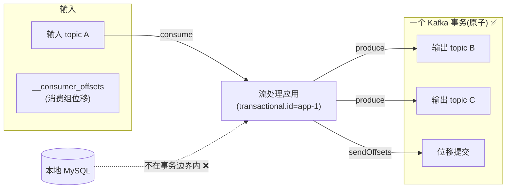
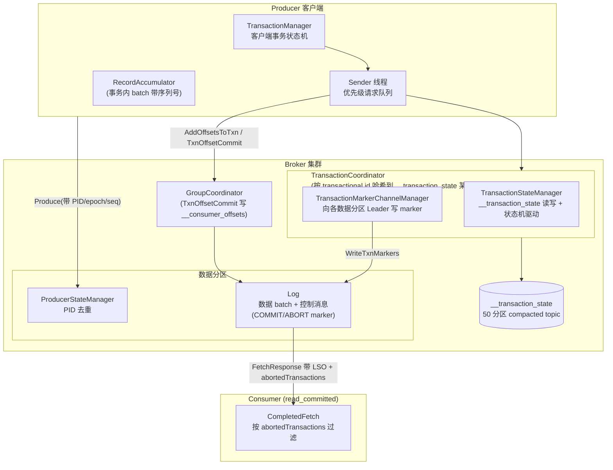
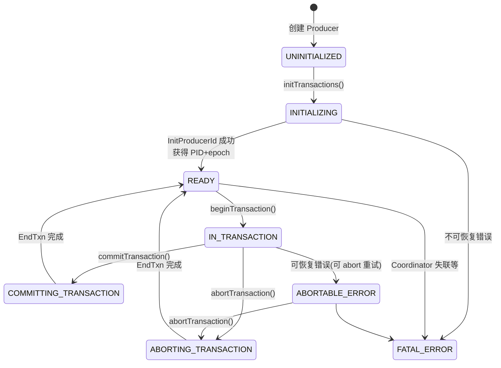
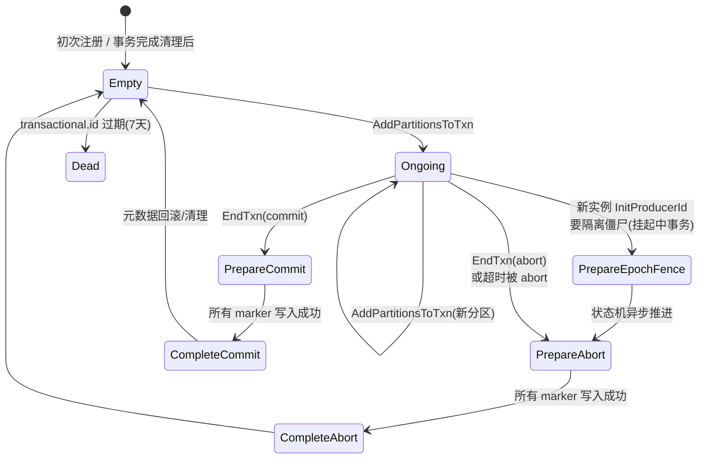
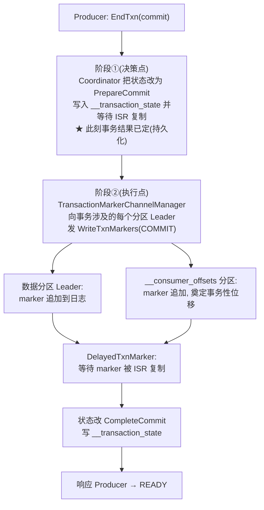
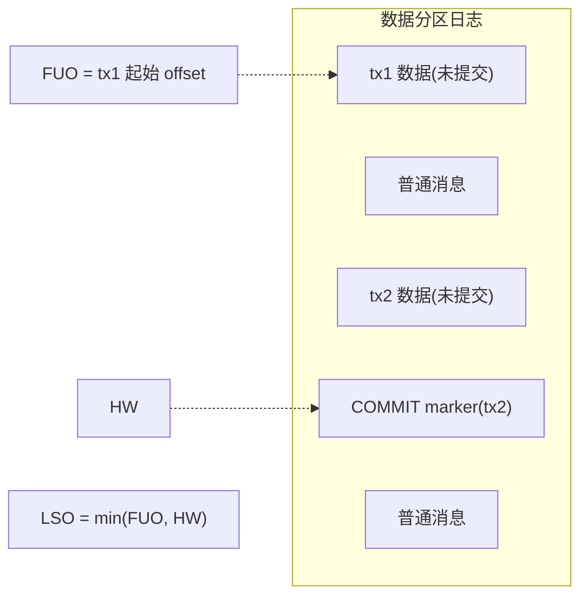
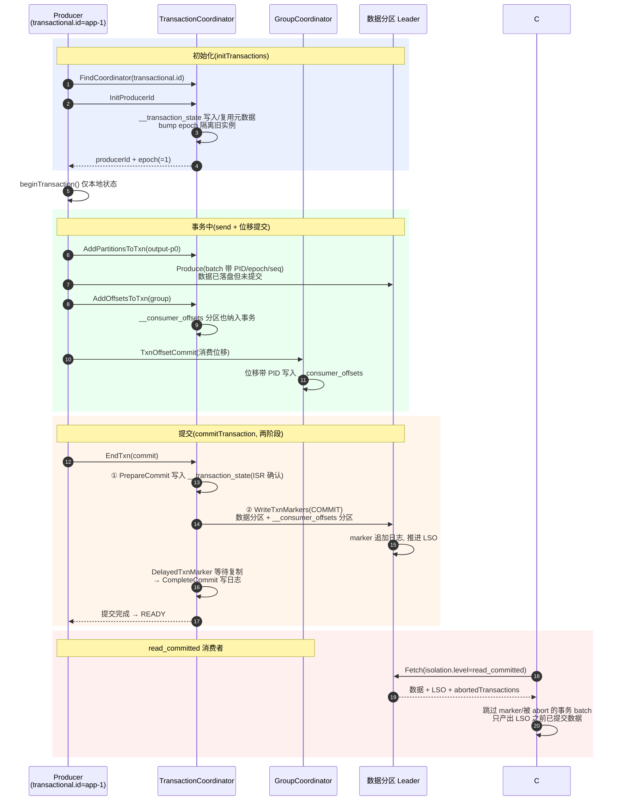
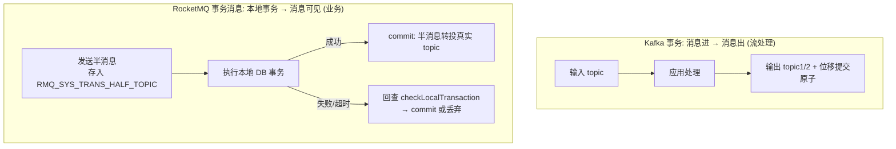

# Kafka 事务深度源码分析 —— 原理、执行流程与应用场景

> 基于源码目录 `D:\workspace\java_projects\source_projects\kafka-3.7.0` 的深度分析。
> 涵盖:幂等生产者、事务状态机(客户端/服务端)、`__transaction_state`、控制消息、两阶段提交、read_committed 过滤、KIP-890 新协议、僵尸隔离,以及与 RocketMQ 事务消息的对比。
> 所有架构图、类图、时序图、流程图均以 Mermaid 呈现(图内不含代码行号)。

---

## 目录

1. [Kafka 事务是什么](#1-kafka-事务是什么)
2. [实现基石:幂等生产者(Idempotent Producer)](#2-实现基石幂等生产者idempotent-producer)
3. [整体架构](#3-整体架构)
4. [客户端事务实现(TransactionManager)](#4-客户端事务实现transactionmanager)
5. [服务端事务协调者(TransactionCoordinator)](#5-服务端事务协调者transactioncoordinator)
6. [事务日志 __transaction_state](#6-事务日志-__transaction_state)
7. [控制消息与两阶段提交](#7-控制消息与两阶段提交)
8. [Broker 日志层:LSO 与 Abort 索引](#8-broker-日志层lso-与-abort-索引)
9. [消费端:read_committed 过滤](#9-消费端read_committed-过滤)
10. [完整执行流程时序](#10-完整执行流程时序)
11. [异常与恢复场景](#11-异常与恢复场景)
12. [KIP-890(3.7 新特性):事务协议简化](#12-kip-89037-新特性事务协议简化)
13. [应用场景](#13-应用场景)
14. [与 RocketMQ 事务消息的对比](#14-与-rocketmq-事务消息的对比)
15. [关键配置与源码文件索引](#15-关键配置与源码文件索引)

---

## 1. Kafka 事务是什么

Kafka 0.11 引入事务,核心目标是 **Exactly-Once 语义(EOS)**,保证范围全部在 Kafka 内部:

1. **原子多写**:一个事务内发送到多个 topic/分区的消息,要么全部对消费者可见,要么全部不可见
2. **produce 原子性**:一次发送的批次不出现"半截"(配合幂等,断线重连也不会重复)
3. **消费-处理-生产闭环**:`sendOffsetsToTransaction` 把消费位移提交纳入同一事务,实现"读 A 处理写 B + 提交 A 的位移"三者原子——这是 Kafka Streams exactly-once 的基石

**它不是**"本地数据库事务与发消息的一致性"(那是 RocketMQ 事务消息的目标,见第 14 节)。Kafka 事务不会回查你的本地事务。

使用方式:

```java
producer.initTransactions();              // 获取 PID, 隔离僵尸实例
producer.beginTransaction();
producer.send(new ProducerRecord("output", value));
producer.sendOffsetsToTransaction(offsets, groupMetadata); // 消费位移入事务
producer.commitTransaction();             // 或 abortTransaction()
```



## 2. 实现基石:幂等生产者(Idempotent Producer)

事务建立在幂等之上(`enable.idempotence=true` 是事务的前提),先搞懂三个概念:

| 概念 | 说明 |
|---|---|
| **PID**(Producer ID) | Broker 在 `InitProducerId` 时分配的 64 位 ID,对客户端透明 |
| **epoch**(生产者纪元) | 16 位版本号,每次 `InitProducerId` / 长事务重启 +1,用于隔离僵尸 |
| **sequence**(序列号) | 客户端为 **(PID, 分区)** 维度维护的单调递增序列,batch 头携带首/尾序列号 |

**Broker 端去重**(`storage/src/main/java/org/apache/kafka/storage/internals/log/ProducerStateManager.java` + `ProducerStateEntry.java`):

- 每个 log 分区维护 `ProducerStateManager`:PID → `ProducerStateEntry`(lastSeq、epoch、lastOffset,**最多缓存 5 个最近 batch 的元数据**)
- 追加时 `LogValidator` 校验序列号:
  - `newSeq == lastSeq + 1` → 正常
  - `newSeq <= lastSeq` → 调 `findDuplicateBatch()`:若与缓存中某 batch 的首尾序列完全一致(重试到达)→ **静默跳过并返回原 offset**;否则 `DUPLICATE_SEQUENCE_NUMBER` / `OUT_OF_ORDER_SEQUENCE_NUMBER` 错误
  - epoch 不匹配 → `PRODUCER_FENCED`(僵尸被隔离)

这样解决了"acks=all 时 broker 已写入但 ack 丢失 → 客户端重试 → 重复"的经典问题。但幂等只保证**单分区、单会话**(PID 重启会变),跨分区原子性就交给事务。

## 3. 整体架构



**协调者定位**:`transactional.id` 哈希到 `__transaction_state`(默认 50 分区)的某分区,该分区的 **Leader 副本所在 Broker** 即该事务的 Coordinator——与消费组的 `__consumer_offsets` 机制同构,`FindCoordinator` 请求完成定位。

## 4. 客户端事务实现(TransactionManager)

文件:`clients/src/main/java/org/apache/kafka/clients/producer/internals/TransactionManager.java`

### 4.1 客户端状态机



状态机的严格校验保证 API 误用尽早失败(未 begin 就 send、事务中 begin 等)。

### 4.2 关键拦截逻辑

- **send() 拦截**:每条 send 前,`TransactionManager.maybeAddPartitionToTransaction(tp)` 把目标分区加入 `pendingPartitionsInCurrentTxn`(首次出现时),由 Sender 异步发 `AddPartitionsToTxn` 注册到 Coordinator——**分区必须先注册再写入**,否则 Coordinator 无法知道要往哪些分区写 marker
- **序列号分配**:事务模式下每 batch 携带 `(PID, epoch, baseSeq..lastSeq)`,序列号在 `TransactionManager` 中按分区维护,`pendingBatches` 记录在飞 batch 以支持重试复用同序列号
- **sendOffsetsToTransaction(offsets, groupMetadata)**:包装成 `AddOffsetsToTxn` + `TxnOffsetCommit` 两步:先向 Coordinator 注册 `__consumer_offsets` 的对应分区("消费位移提交本身也是一个事务写"),再把具体位移发送给 GroupCoordinator
- **Epoch 用尽**:epoch 达到 `Short.MAX_VALUE - 1` 时,`InitProducerId` 请求携带现有 PID 请求**换新 PID**(而非从 0 重新分配),防止 epoch 回绕破坏隔离

### 4.3 Sender 的优先级请求队列

`Sender.java` 保证事务控制请求按正确顺序优先发送:

```text
FIND_COORDINATOR(0) → INIT_PRODUCER_ID(1) → ADD_PARTITIONS_OR_OFFSETS(2) → END_TXN(3) → EPOCH_BUMP(4)
```

普通 Produce 请求排在事务控制请求之后,确保"分区注册完成于数据写入之前、EndTxn 完成于下一事务数据之前"。

## 5. 服务端事务协调者(TransactionCoordinator)

文件:`core/src/main/scala/kafka/coordinator/transaction/TransactionCoordinator.scala`

(注:Kafka 3.7 中事务协调者**仍在 Broker 侧**、状态仍存 `__transaction_state`,未迁入 KRaft Controller。)

### 5.1 服务端事务状态机(TransactionMetadata.scala)

8 个状态与迁移矩阵:



每次状态迁移前 `TransactionMetadata` 都检查 `validPreviousStates`(如 PrepareCommit 只能来自 Ongoing),并在 `__transaction_state` 持久化成功后才在内存中生效——**以日志为准的故障恢复模型**。

### 5.2 核心处理方法

| 方法 | 职责 |
|---|---|
| `handleFindCoordinator` | 按 transactional.id 哈希返回 Coordinator Broker |
| `handleInitProducerId` | 分配/复用 PID;bump epoch 隔离旧实例;若旧事务 Ongoing → 先走 abort 流程 |
| `handleAddPartitionsToTxn` | 校验 epoch、把分区加入事务元数据;3.7 新增 **v4 校验版本**(见第 12 节) |
| `handleAddOffsetsToTxn` | 把 `__consumer_offsets` 的目标分区也加入事务分区集 |
| `handleTxnOffsetCommit` | 转发 GroupCoordinator,位移**带 PID/epoch 写入 `__consumer_offsets`**(同样被 marker 支配) |
| `handleEndTransaction` | 两阶段提交入口(见第 7 节) |

`TransactionStateManager` 负责:加载/切换 `__transaction_state` 分区 Leadership 时的元数据恢复(`loadTransactionMetadata`)、事务超时扫描(`abortTimedOutTransactions`,每 `transaction.abort.timed_out.interval.ms`=10s 扫一次,超 `transaction.timeout.ms` 的事务被主动 abort)。

## 6. 事务日志 __transaction_state

定义于 `core/.../transaction/TransactionLog.scala`:

- **普通 compacted topic,50 分区**,`transaction.state.log.min.isr`(默认 2)
- **Key**:`transactionalId`(string)
- **Value**(v0):

```text
producerId             int64
producerEpoch          int16
transactionTimeoutMs   int32
transactionStatus      int8    // 0=Empty 1=Ongoing 2=PrepareCommit 3=PrepareAbort
                               // 4=CompleteCommit 5=CompleteAbort 6=Dead 7=PrepareEpochFence
lastUpdateTimestampMs  int64
transactionStartTimestampMs int64
transactionPartitions  array  // [{topic, [partitionIds]}]
```

- 事务完成一段时间后写 **tombstone**(compaction 删除),防止状态膨胀;`transactional.id.expiration.ms`(默认 7 天)后整个 entry 过期清理
- **coordinator 故障切换 = 新 Leader 重放日志重建内存元数据**,对 PrepareCommit/PrepareAbort 的"悬挂事务"继续推进 marker(见第 11 节)

## 7. 控制消息与两阶段提交

**控制消息(Control Batch)** 是事务原子性的实现本质:COMMIT/ABORT marker 作为特殊 batch 写入**数据日志本身**(`ControlRecordType.java`:ABORT=0、COMMIT=1,另有 LEADER_CHANGE/SNAPSHOT_HEADER/FOOTER 用于 KRaft)。消费者靠 marker 区间判断可见性——**没有分布式锁,没有 2PC 的经典资源管理器,靠日志内的标记约定**。

`TransactionCoordinator` 收到 `EndTxn` 后的两阶段:



细节:
- 阶段① 持久化后,即使 Coordinator 崩溃,新 Coordinator 重放日志发现 PrepareCommit,会**继续**写 marker——决策不会丢失也不会翻转
- `DelayedTxnMarker`(purgatory 延时操作)等待 marker 被 ISR 复制,确保 `transaction.state.log.min.isr` 级别的可靠性后才标记完成
- abort 路径完全对称,marker 类型为 ABORT,且分区 Leader 会把该事务的 `(PID, firstOffset)` 追加进 **aborted index**(见第 8 节)

## 8. Broker 日志层:LSO 与 Abort 索引

文件:`core/src/main/scala/kafka/log/UnifiedLog.scala`、`storage/.../log/ProducerStateManager.java`

- **FUO(first unstable offset)**:分区内**最早一个未完成事务的起始 offset**(由 `ProducerStateManager` 追踪进行中事务的 firstOffset)
- **LSO(Last Stable Offset)= min(FUO, HW)**:`read_committed` 消费者最多只能读到 LSO——**长事务会阻塞其起始点之后的所有数据被提交读**(Kafka 事务最著名的性能代价)
- 事务 abort 后,Leader 在日志目录写 `.txnindex` 文件(**AbortedTxn index**,按 segment 维护),内容为 `(PID, firstOffset, lastOffset, lastStableOffset)` 四元组
- Fetch 请求(`isolation.level=read_committed`)到达时,Broker 扫描 fetch 范围内的 `.txnindex` + 内存 `abortedTransactions`,把 `{producerId, firstOffset}` 列表随 FetchResponse 一起返回



## 9. 消费端:read_committed 过滤

文件:`clients/src/main/java/org/apache/kafka/clients/consumer/internals/CompletedFetch.java`

消费侧的过滤完全是**客户端本地判断**,Broker 不改数据(日志里未提交/已回滚的数据原样存在):

1. FetchResponse 携带 `lastStableOffset` 与 `abortedTransactions:[{producerId, firstOffset}]`(按 offset 有序)
2. 消费者逐 batch 解析:
   - **控制 batch**(COMMIT/ABORT marker)→ 直接跳过,不投递给用户
   - **事务 batch**:
     - `consumeAbortedTransactionsUpTo(nextFetchOffset)` 先把 abort 列表推进到当前位点,构建"已中止 producer 集合"
     - `isBatchAborted()`:batch 的 producerId 命中集合 且 batch firstOffset ≥ 该 abort 的 firstOffset → **整批跳过**(直接推进 nextFetchOffset,不产出记录)
     - 未中止的事务 batch:只有其 offset < LSO 时才产出(marker 已写,事务结局已定)
3. `READ_UNCOMMITTED`(默认)则不过滤,读到什么算什么(marker 也会被跳过但不做事务过滤)

## 10. 完整执行流程时序

一次完整的"消费-处理-生产"事务:



## 11. 异常与恢复场景

| 场景 | 机制 |
|---|---|
| **Producer 崩溃后重启**(同 transactional.id) | `InitProducerId` → epoch+1 → 旧 epoch 的一切请求被 Broker 拒绝(`PRODUCER_FENCED`)——**僵尸隔离**;若旧事务 Ongoing,Coordinator 先置 `PrepareEpochFence` 主动 abort |
| **Producer 永久挂了** | Coordinator 超时扫描(`transaction.timeout.ms`,默认 60s,broker 上限 `transaction.max.timeout.ms`=15min)→ 主动 abort 并写 ABORT marker |
| **Coordinator 所在 Broker 崩溃** | `__transaction_state` 分区选主 → 新 Leader 重放日志恢复内存元数据 → 对 PrepareCommit/PrepareAbort 悬挂事务**继续**写 marker(方向不会翻转,因为阶段①已持久化) |
| **数据分区 Leader 崩溃** | marker 未写入 → Coordinator 重试 WriteTxnMarkers(DelayedTxnMarker);数据 batch 未复制即丢 → 客户端靠序列号重试且不重复 |
| **消费者读到未提交数据** | 不可能越过 LSO;读到已 abort 数据则按 abortedTransactions 过滤 |
| **epoch 回绕** | epoch 接近 `Short.MAX_VALUE` 时换新 PID(`InitProducerId` 携带旧 PID),而非从 0 开始 |

**僵尸隔离的本质**:旧实例可能因 GC 停顿/网络分区"复活",它持有的 (PID, 旧epoch) 的任何 Produce/AddPartitionsToTxn/EndTxn 都会被 epoch 校验直接拒绝——事务的线性化点由 epoch 决定。

## 12. KIP-890(3.7 新特性):事务协议简化

Kafka 3.7 落地了 KIP-890 第一阶段("EducatedProducer / New AddPartitionsToTxn"):

**旧协议痛点**:`AddPartitionsToTxn` 必须发给 **Coordinator 单点**,Coordinator 再与各分区 Leader 逐个验证 epoch——大事务(几百分区)时 Coordinator 成为吞吐瓶颈,且存在锁竞争。

**3.7 新协议**(`transaction.version=2` + `AddPartitionsToTxnRequest v4+`):

1. Producer **直接把分区列表发给每个目标分区所在的 Broker**(并行,不经过 Coordinator)
2. Broker 侧新增 `handleVerifyPartitionsInTransaction`:验证 (PID, epoch) 是否仍在事务中(内存 producer state 检查)
3. Coordinator 只在事务**开始时**(第一个 AddPartitionsToTxn)登记一次,后续分区不再逐一回 Coordinator

收益:大事务初始化从 O(分区数) 串行 RPC 变为并行,Coordinator 竞争显著降低。(注:3.7 中新协议默认关闭,`transaction.version` 由特性开关控制,完整量变在 4.x 收尾。)

## 13. 应用场景

1. **Kafka Streams Exactly-Once**(最正统的用法):`processing.guarantee=exactly_once_v2`,每次 `commit.interval.ms` 一个事务,把"读输入 topic → 处理 → 写输出 topic / 状态变更日志 / changelog → 提交位移"打包为原子单元
2. **流式 ETL / CDC 管道**:Kafka Connect 源连接器把"读外部系统 + 写 Kafka + 提交位点"做成事务,故障恢复不丢不重
3. **聚合计算**:聚合窗口内多 topic 写入要么全部生效要么全部回滚
4. **跨 topic 的事件一致性发布**:一个业务动作要写多个 topic(订单事件 + 通知事件 + 审计事件)时保证原子

**不适合的场景**:需要与外部系统(数据库、RPC)做分布式事务——Kafka 事务边界不含它们,请用 Transactional Outbox + Debezium/CDC 模式,或改用 RocketMQ 事务消息语义。

## 14. 与 RocketMQ 事务消息的对比

两者都叫"事务",但目标、机制、适用面完全不同:

| 维度 | Kafka 事务 | RocketMQ 事务消息 |
|---|---|---|
| **目标** | 跨分区原子写 + 消费位移绑定(流处理 EOS) | 本地事务与发消息的最终一致 |
| **保证范围** | 仅 Kafka 内部(topic/分区 + `__consumer_offsets`) | 本地 DB 事务与 Broker 消息可见性 |
| **实现机制** | Coordinator + 两阶段 + 日志内控制 marker + epoch 隔离 | 半消息(先写隐藏 topic)+ **事务回查** |
| **回查本地事务状态** | **无**——从不询问业务方 | **有**——`checkLocalTransaction`(默认最多 15 次) |
| **回滚语义** | ABORT marker,数据仍在日志但消费者不可见 | 半消息直接删除/废弃,消费者从未见过 |
| **消费侧感知** | 需 `isolation.level=read_committed`,LSO 限制读取进度 | 无需任何配置,半消息天然不可见 |
| **性能代价** | LSO 阻塞、marker 写放大、Coordinator 状态机 | 半消息一次额外存储 + 回查线程 |
| **事务时长** | 秒级最佳(长事务阻塞 LSO) | 支持较长本地事务(回查兜底) |
| **典型框架** | Kafka Streams / Connect | 业务系统解耦(下单扣库存发积分) |



**选型一句话**:流式管道的精确一次 → Kafka 事务;业务库事务与消息的一致 → RocketMQ 事务消息(或 Kafka + Outbox 模式)。

## 15. 关键配置与源码文件索引

### 配置

| 配置 | 默认 | 说明 |
|---|---|---|
| `enable.idempotence` | true(3.0+) | 幂等,事务前提 |
| `transactional.id` | — | 事务实例身份,跨重启保持 |
| `transaction.timeout.ms` | 60s | 客户端事务超时(被 Coordinator 主动 abort 的阈值) |
| `transaction.max.timeout.ms` | 15min | Broker 允许的上限 |
| `transactional.id.expiration.ms` | 7 天 | 空闲 transactional.id 过期 |
| `transaction.state.log.num.partitions` | 50 | `__transaction_state` 分区数 |
| `transaction.state.log.min.isr` | 2 | 事务日志写入 ISR 要求 |
| `transaction.abort.timed_out.interval.ms` | 10s | 超时事务扫描周期 |
| `isolation.level`(消费者) | read_uncommitted | read_commit ted 才有事务语义 |
| `max.in.flight.requests.per.connection` | ≤5 | 事务/幂等要求(重排序会破坏序列号) |

### 源码文件索引

| 模块 | 文件 |
|---|---|
| 客户端事务状态机 | `clients/src/main/java/org/apache/kafka/clients/producer/internals/TransactionManager.java` |
| 客户端网络驱动 | `clients/.../producer/internals/Sender.java` |
| 控制消息类型 | `clients/.../common/record/ControlRecordType.java` |
| 消费侧过滤 | `clients/.../consumer/internals/CompletedFetch.java` |
| 事务协调者 | `core/src/main/scala/kafka/coordinator/transaction/TransactionCoordinator.scala` |
| 状态管理/日志 | `core/.../transaction/TransactionStateManager.scala`、`TransactionMetadata.scala`、`TransactionLog.scala` |
| Marker 下发 | `core/.../transaction/TransactionMarkerChannelManager.scala`、`TransactionMarkerRequestManager.scala` |
| 幂等/去重 | `storage/src/main/java/org/apache/kafka/storage/internals/log/ProducerStateManager.java`、`ProducerStateEntry.java` |
| LSO/事务索引 | `core/src/main/scala/kafka/log/UnifiedLog.scala`、`storage/.../log/AbortedTxn.java` |
| Broker 配置 | `core/src/main/scala/kafka/server/KafkaConfig.scala` |
