# Kafka 副本同步机制深度源码解析（基于 3.7.0）

> 涉及核心源码：
> - `core/src/main/scala/kafka/server/AbstractFetcherThread.scala`
> - `core/src/main/scala/kafka/server/ReplicaFetcherThread.scala` / `ReplicaFetcherManager.scala`
> - `core/src/main/scala/kafka/server/LocalLeaderEndPoint.scala` / `LeaderEndPoint.scala`
> - `core/src/main/scala/kafka/cluster/Partition.scala` / `Replica.scala`
> - `core/src/main/scala/kafka/server/ReplicaManager.scala`
> - `core/src/main/scala/kafka/server/DelayedProduce.scala` / `DelayedFetch.scala`
> - `storage/src/main/java/org/apache/kafka/storage/internals/epoch/LeaderEpochFileCache.java`

---

## 一、整体架构概览

Kafka 副本同步采用 **Pull（拉取）模型**：每个 Follower 副本向 Leader 副本发送 Fetch 请求拉取消息，而不是 Leader 主动推送。

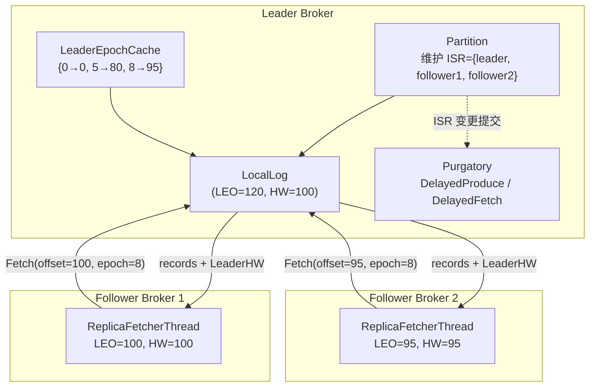

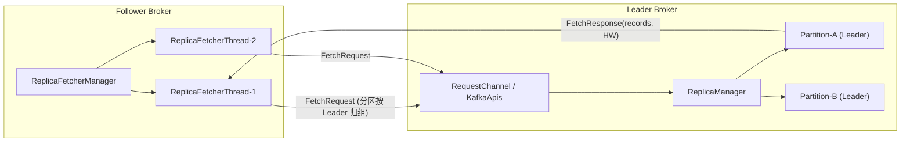

关键角色：

| 组件 | 职责 |
|---|---|
| `ReplicaFetcherManager` | 为每个 Broker 创建若干 `ReplicaFetcherThread`，管理分区到线程的映射 |
| `ReplicaFetcherThread` | 继承 `AbstractFetcherThread`，实现从 Leader 拉取、截断、写入本地日志 |
| `AbstractFetcherThread` | 通用拉取循环框架：截断检查 → 构建 Fetch → 处理响应（也用于 consumer/事务等） |
| `Partition` / `Replica` | 维护 LEO、HW、ISR、Leader Epoch 等状态 |
| `DelayedProduce` / `DelayedFetch` | purgatory（炼狱）延迟操作，实现 `acks=all` 等待与消费者长轮询 |

---

## 二、副本角色切换：becomeLeaderOrFollower

### 2.1 入口

Leader 变更（controller 通过 `LeaderAndIsr` 请求或 KRaft 的 `AlterPartition` 提交）后，Broker 端 `ReplicaManager.becomeLeaderOrFollower()` 被触发（`ReplicaManager.scala:1995` 附近），核心分两步：

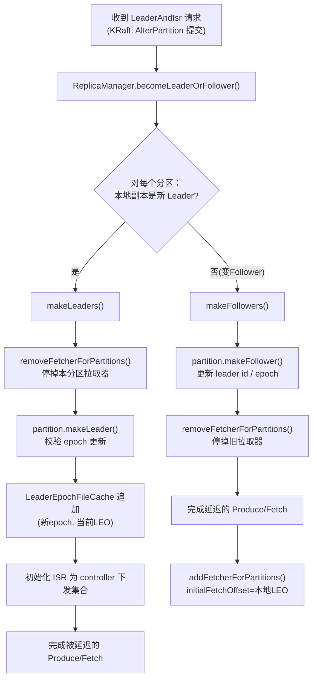

### 2.2 makeLeaders 流程（ReplicaManager.scala:2285 附近）

1. **停止该分区的拉取器**：`replicaFetcherManager.removeFetcherForPartitions(partitions)`——自己是 Leader，不再拉取；
2. 调用 `partition.makeLeader()`：
   - 校验请求中的 leader epoch 比本地新（防止过期请求）；
   - 更新 partition 的 leader epoch，并记录 `leaderEpochStartOffset`（该 epoch 开始时的 LEO）；
   - 在 `LeaderEpochFileCache` 中追加 `(新epoch, 当前LEO)` 条目；
   - 重新初始化 ISR 为 controller 下发的集合。
3. 尝试完成被延迟的 Produce/Fetch 请求。

### 2.3 makeFollowers 流程（ReplicaManager.scala:2367 附近）

1. `partition.makeFollower()`：更新 leader id、epoch，本地副本转为 Follower；
2. `removeFetcherForPartitions()` 停掉旧拉取器；
3. 完成所有延迟的 Produce/Fetch 请求（角色变了，之前等待的请求需重新判定）；
4. **为新的 Follower 分配/启动拉取线程**：`replicaFetcherManager.addFetcherForPartitions()`，初始拉取偏移由 `initialFetchOffset(log)` 决定（基于本地 LEO）。

> 拉取线程数由 `num.replica.fetchers`（默认 5... 实际默认 1，生产常调大）控制，分区按 Leader Broker 维度分配到不同线程，避免单线程瓶颈。

---

## 三、Follower 拉取主循环（AbstractFetcherThread）

### 3.1 doWork：截断优先于拉取

```scala
// AbstractFetcherThread.scala:111 附近
override def doWork(): Unit = {
  maybeTruncate()   // 1. 先做日志截断检查
  maybeFetch()      // 2. 再拉取数据
}
```

**为什么截断优先**：Leader 可能已经切换，Follower 本地日志末尾可能包含"孤儿数据"（旧 Leader 未同步到新 ISR 的消息，即 unclean 场景残留）。必须先对齐，否则后续拉取会出现数据分叉。

Follower 拉取主循环整体流程图：

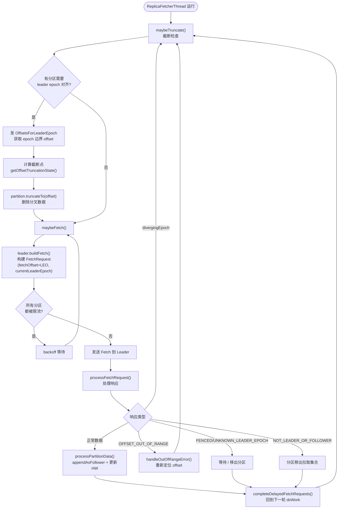

### 3.2 截断流程与 Leader Epoch（KIP-101 / KIP-279）

`maybeTruncate()` → `truncateToEpochEndOffsets()`：

1. Follower 从本地日志取**最新 leader epoch**（`latestEpoch()`，读取 `LeaderEpochFileCache`）；
2. 向 Leader 发送 **OffsetsForLeaderEpoch 请求**（`fetchEpochEndOffsets()`），询问"我这个 epoch 结束时的 offset 是多少"；
3. Leader 端（`LocalLeaderEndPoint.fetchEpochEndOffsets()` → `partition.lastOffsetForLeaderEpoch()`）查自己的 epoch cache 返回 `(epoch, endOffset)`；
4. Follower 根据 `getOffsetTruncationState()`（`AbstractFetcherThread.scala:565` 附近）计算截断点：

| Leader 返回情况 | Follower 动作 |
|---|---|
| `UNDEFINED_EPOCH_OFFSET` | 截断到本地 HW（follower 全新/无缓存） |
| follower 未知该 epoch（落后多个 epoch） | 用自己已知的最大 epoch 的 endOffset，截断到 `min(followerLEO, leaderOffset)` |
| 正常返回 | 截断到 `min(followerLEO, leaderEndOffset)` |

5. `truncate()` → `partition.truncateTo(offset)` 实际执行日志删除（超出 offset 的 segment 部分被丢弃）。

**Leader Epoch 解决了什么问题**（对比纯 HW 截断）：
- 旧的 HW 机制下，Follower 重启后只能截断到 HW，可能丢失已写入但未过 HW 的合法数据（造成数据丢失的 "replication 场景 bug"）；
- Epoch 机制下，Follower 精确询问 Leader "每个 epoch 边界处的 offset"，只截断真正分叉的数据，并且解决**副本永久不一致**与**重启后 Leader 选举数据丢失**两类问题。

截断 + 拉取同步的完整时序图：

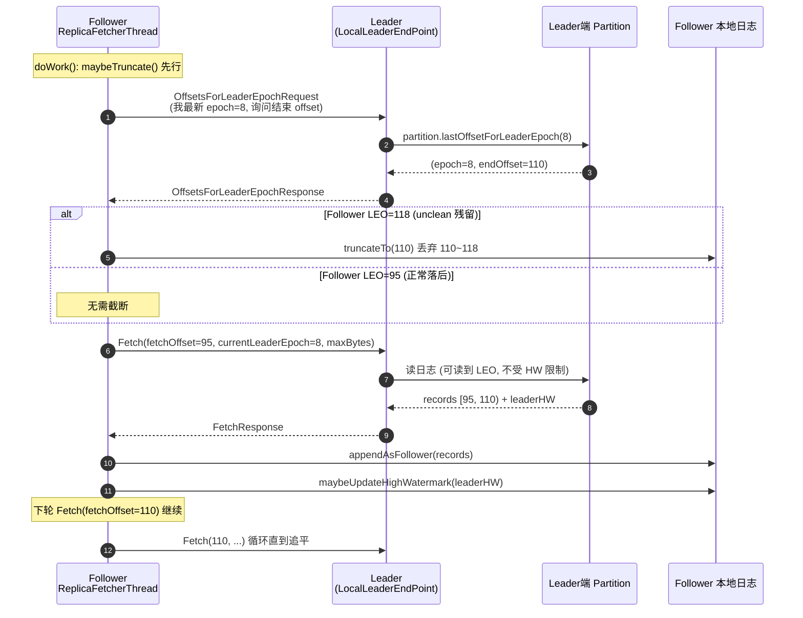

### 3.3 构建与发送 Fetch 请求

`maybeFetch()` → `leader.buildFetch()`（`LocalLeaderEndPoint.scala:164`），构建 `FetchRequest.PartitionData`，关键字段：

- `fetchOffset`：上次拉取结束位置（即本地 LEO）；
- `currentLeaderEpoch`：**Follower 已知的 Leader epoch**（用于 Leader 端校验，若过期返回 `FENCED_LEADER_EPOCH`，防止从旧 Leader 拉到脏数据）；
- `logStartOffset`：用于日志保留判断；
- `maxBytes`：受 `replica.fetch.max.bytes` 限制。

同时受**复制配额**（`replication.quota.window.num` 等，Leader 端 `QuotaFactory` 违约检测）约束：`buildFetch` 中若分区处于限流中，会跳过本次拉取。

### 3.4 processFetchRequest：处理响应（AbstractFetcherThread.scala:309 附近）

对每个分区的响应分支处理：

| 错误/状态 | 处理 |
|---|---|
| 正常数据 | 交给 `processPartitionData()` 写入本地日志 |
| `divergingEpoch`（KIP-279） | Leader 发现 Follower 的 epoch 落后，返回分叉点；Follower 标记分区需截断，下轮循环执行 |
| `OFFSET_OUT_OF_RANGE` | `handleOutOfRangeError()`（:718 附近）重新定位 offset（见 3.6） |
| `UNKNOWN_LEADER_EPOCH` / `FENCED_LEADER_EPOCH` | Follower 的 epoch 比 Leader 还新/过期 → 等待重新同步 |
| `NOT_LEADER_OR_FOLLOWER` | 自己已不是 Leader → 分区移出拉取集合 |

### 3.5 processPartitionData：写入本地日志（ReplicaFetcherThread.scala:103 附近）

```scala
// 关键步骤（简化）
if (fetchOffset != log.logEndOffset) throw IllegalStateException  // 严格校验
partition.appendRecordsToFollowerOrFutureReplica(records, ...)    // 追加到本地日志
log.maybeUpdateHighWatermark(partitionData.highWatermark)         // 用 Leader 的 HW 更新本地 HW
log.maybeIncrementLogStartOffset(leaderLogStartOffset)            // 对齐日志起始偏移
```

要点：
1. **Follower 的 HW 来自 Leader 响应中携带的 HW 值**（Leader 会把 ISR 最小 LEO 作为 HW 随 Fetch 响应返回），Follower 自己从不"计算" HW，只是接收并单调递增更新（`maybeUpdateHighWatermark` 保证不回退）；
2. 写入走 `UnifiedLog.appendAsFollower()`，与生产者写入（`appendAsLeader`）不同：**不分配 offset、不更新 producer epoch 相关分配逻辑**，直接按 Leader 已分配好的 offset 追加。

### 3.6 handleOutOfRangeError：偏移越界的两种场景

Follower 请求的 `fetchOffset` 超出 Leader 日志范围时：

1. **Unclean Leader 选举场景**：Follower（旧 Leader 的同步者）LEO > 新 Leader LEO → 拿 Leader 的 `logEndOffset`，**截断到 Leader 的 LEO**，丢弃多出来的消息；
2. **数据被删除场景**：Follower 落后太多，本地日志起始位点比 Leader 的 log start offset 还旧（或 fetchOffset < Leader logStartOffset）→ 直接从 Leader 的 `logStartOffset` 重新拉取（必要时截断本地日志）。

---

## 四、Leader 端：ISR 维护与 HW 推进（Partition.scala）

### 4.1 LEO 与 HW 的关系

- **LEO（Log End Offset）**：每个副本本地日志下一条待写入的 offset；
- **HW（High Watermark）**：**ISR 中所有副本（含 Leader）LEO 的最小值**，是"已成功复制到所有同步副本"的分界线；消费者最多只能读到 HW。

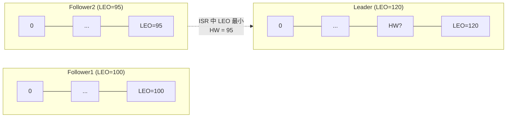

HW 的推进与消费边界示意：

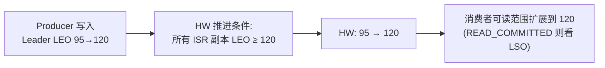

### 4.2 updateFollowerFetchState：Follower 拉取时 Leader 记录状态

Leader 处理 Follower 的 Fetch 请求时（`ReplicaManager.fetchMessages` → `Partition.updateFollowerFetchState`）：

1. 校验 `fetchOffset`：
   - `fetchOffset > leaderLEO` → 返回 `OFFSET_OUT_OF_RANGE`；
   - `fetchOffset + fetchedBytes == leaderLEO` → 更新该副本的 **`lastCaughtUpTimeMs`**（追上 Leader 了）；
   - `fetchOffset >= leaderHW` → 该 Follower 追上了 HW；
2. 记录 `lastFetchTimeMs`；
3. 调用 **`maybeExpandIsr()`** 尝试把该 Follower 加入 ISR。

### 4.3 ISR 扩容：maybeExpandIsr（Partition.scala:1006 附近）

Follower 满足以下条件即加入 ISR（`isFollowerInSync()`，:1037 附近）：

```
followerLEO >= leaderHW                      // 追上了高水位
&& followerLEO >= leaderEpochStartOffset     // 确保拉过了当前 epoch 的起点（KIP-797）
&& isReplicaIsrEligible()                    // broker 存活/未被 fencing（KRaft 校验 broker epoch）
```

满足则进入 `PendingExpandIsr` 状态，并通过 `AlterPartitionManager` 向 controller（KRaft）提交新的 ISR，controller 持久化到 metadata log 后返回，状态变为 `CommittedPartitionState`（ZK 模式下写入 `/brokers/topics/.../state` znode）。**提交是异步的**，因此存在 pending 状态锁保护。

ISR 扩容时序图（KRaft 模式）：

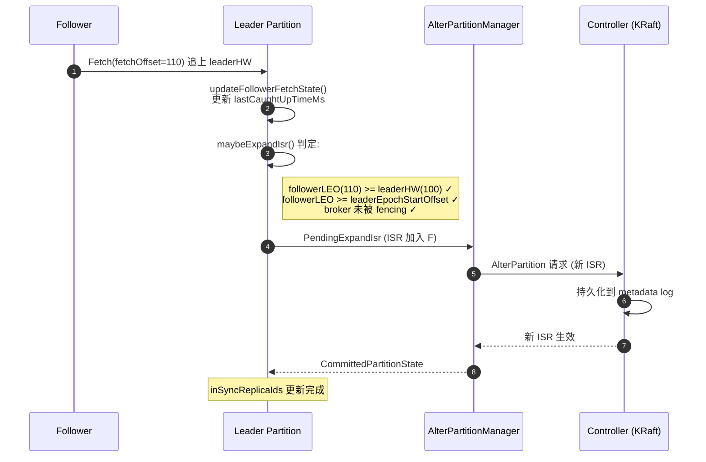

### 4.4 ISR 收缩：maybeShrinkIsr（Partition.scala:1227 附近）

由 `ReplicaManager` 上的定时任务驱动，周期为 `replica.lag.time.max.ms / 2`（默认 30000/2 = 15s），对每个分区调用 `maybeShrinkIsr()` → `getOutOfSyncReplicas()`：

判定某副本落后（`isFollowerOutOfSync()`，:1271 附近）的依据是 **`isCaughtUp`**：

```scala
def isCaughtUp(leaderEndOffset, currentTimeMs, replicaMaxLagMs): Boolean =
  leaderEndOffset == logEndOffset ||              // 已完全追上
  currentTimeMs - lastCaughtUpTimeMs <= replicaMaxLagMs  // 最近 replicaLagTimeMaxMs 内追上过一次
```

区分两种落后者：
- **Stuck follower**：长时间没有发 Fetch（网络/进程故障）；
- **Slow follower**：一直在 Fetch 但始终追不上 Leader 的 LEO。

任一情况超过 `replica.lag.time.max.ms`（默认 30s）→ 移出 ISR（同样走 `PendingShrinkIsr` → controller 提交流程）。

ISR 收缩流程图：

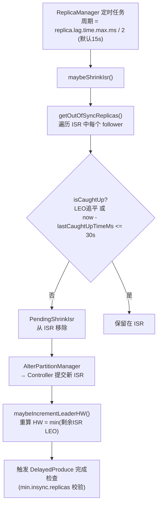

PartitionState 状态机（ISR 变更的生命周期）：

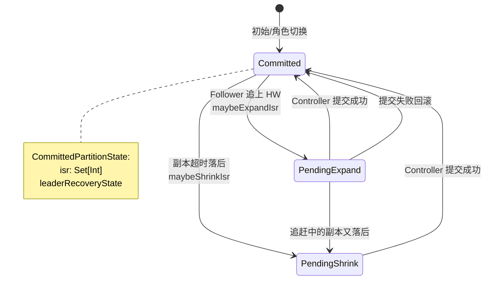

> 注意：判断依据是**时间**而非消息数（旧版本 0.9 之前用 `replica.lag.max.messages`，因流量突增易误判已废弃）。

### 4.5 HW 推进：maybeIncrementLeaderHW（Partition.scala:1150 附近）

在**Leader 本地写入完成**和**收到 Follower Fetch（更新其 LEO）**时都会尝试推进 HW：

```
newHW = min(所有"同步副本"的 LEO)
```

细节：
1. 只有 ISR 收缩后仍满足条件才会推进（若 ISR 过小，HW 停滞，配合 `min.insync.replicas` 起保护作用）；
2. "同步副本"采用 **maximal ISR**：ISR ∪ 正在追赶（满足 `isCaughtUp`）的副本（KIP-497，避免 ISR 收缩瞬间 HW 回退、导致消费者读到的数据"消失"）；
3. HW 推进后会触发 `DelayedFetch` / `DelayedProduce` 的完成检查。

---

## 五、acks=all 的写入等待：DelayedProduce

### 5.1 写入路径

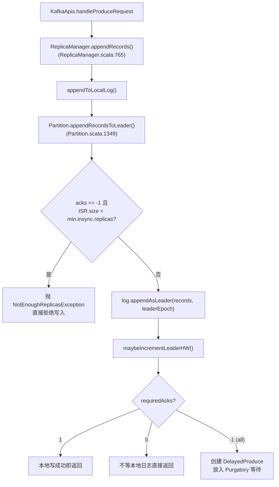

### 5.2 DelayedProduce 的完成条件（DelayedProduce.scala:91 附近 `tryComplete`）

对请求中每个分区，满足任一即完成：
1. 分区不再是 Leader / 副本下线 → 返回 `NOT_LEADER_OR_FOLLOWER` 等错误；
2. **`partition.checkEnoughReplicasReachOffset(requiredOffset)`**：**ISR 中所有副本的 LEO 都 ≥ 该批消息的结束 offset**——即消息已被整个 ISR 复制；
3. 超时（`request.timeout.ms`）→ 视 acks 配置返回成功或失败。

事件驱动：每个 Follower 的 Fetch 到来导致其 LEO 增长 → 触发 `DelayedProduce` 的完成检查，无需轮询。

```
Producer(acks=all) ──produce──▶ Leader 写入 (LEO 95→120)
                                  │
                                  ├── Follower1 fetch → LEO=120 ✅
                                  └── Follower2 fetch → LEO=120 ✅
                                         │
                          HW: 95 ──▶ 120 ──▶ DelayedProduce 完成，响应 Producer
```

用完整时序图呈现 acks=all 的端到端等待过程：

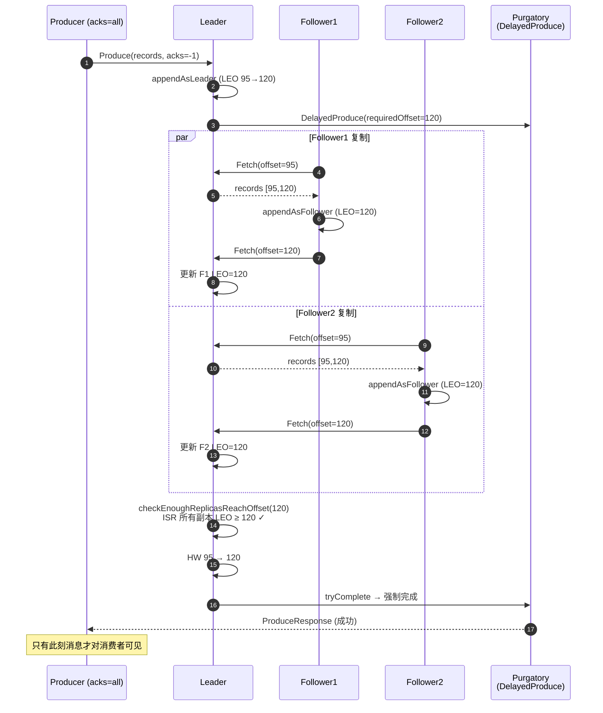

---

## 六、消费者读请求与 HW：DelayedFetch

`KafkaApis.handleFetchRequest` → `ReplicaManager.fetchMessages()`：

1. 根据 `isolation.level` 决定可读上界（`DelayedFetch.scala:85` 附近）：

| 隔离级别 | 可读上界 |
|---|---|
| `READ_UNCOMMITTED`（默认） | **highWatermark** |
| `READ_COMMITTED` | **lastStableOffset**（HW 与最早未完成事务 offset 的较小者） |
| 副本拉取（内部） | logEndOffset（Follower 可以读到 LEO，方便快速追上并计入 ISR 判定） |

2. 若当前数据不足（`endOffset <= fetchOffset` 且未满足 `minBytes`/`maxWaitMs`），将请求封装为 `DelayedFetch` 挂入 purgatory，等待 Follower 拉取推进 HW 后被唤醒。

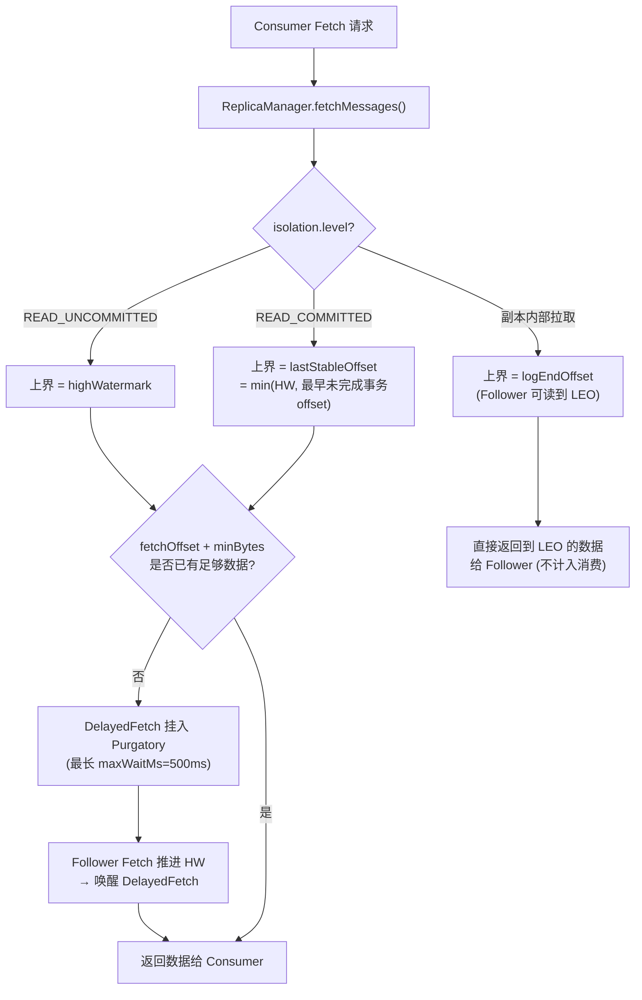

这就是**消费者永远读不到未同步（超过 HW）消息**的底层原因——保证在 acks=all 语义下，消费者读到的消息不会因 Leader 切换而丢失。

---

## 七、Leader Epoch 文件与故障恢复细节

### 7.1 LeaderEpochFileCache

位置：`storage/src/main/java/org/apache/kafka/storage/internals/epoch/LeaderEpochFileCache.java`，每个分区一个 `.log` 目录旁的 `leader-epoch-checkpoint` 文件，内容为 `(epoch, startOffset)` 序列：

```
0 0
5 80
8 95
```

- `makeLeader` 时追加 `(newEpoch, 当前LEO)`；
- 每次日志截断/删除时同步裁剪 epoch cache（保证 cache 与日志一致）。

### 7.2 一次完整的故障切换时间线

```
T0: Leader A(epoch=8) LEO=120, HW=100
    Follower B LEO=110 (ISR), Follower C LEO=95 (ISR)
T1: A 宕机。C 险些落后，但 lastCaughtUpTimeMs 在 30s 内，仍在 ISR
T2: Controller 选举 B 为 Leader(epoch=9)，ISR={B,C}
T3: C 的 ReplicaFetcherThread 向 B 发 Fetch(带 currentLeaderEpoch=8)
    → B 返回 FENCED_LEADER_EPOCH / divergingEpoch
    → C 发送 OffsetsForLeaderEpoch(epoch=8)
    → B 回答 "epoch 8 结束于 110"（B 视角 epoch9 起点是110）
    → C 发现自己 LEO=95 < 110，无需截断，直接从 95 继续拉取
    → 若 C 的 LEO 曾是 118（unclean 场景残留），则截断到 110，丢弃 110~118
T4: C 追上 B 的 HW → maybeExpandIsr → ISR={B,C} 恢复
```

对应的故障切换时序图：

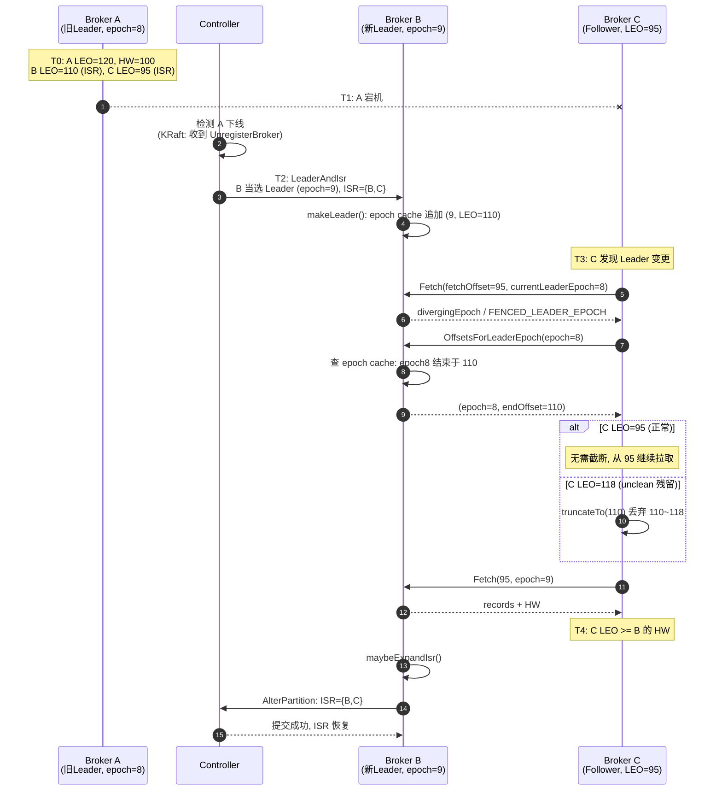

---

## 八、关键配置汇总

| 参数 | 默认值 | 作用 |
|---|---|---|
| `replica.lag.time.max.ms` | 30000 | 副本未在此时间内追上 Leader 即被移出 ISR；也是 ISR 收缩任务周期的一半基准 |
| `min.insync.replicas` | 1 | `acks=all` 写入要求的最小 ISR 数，不满足则抛 `NotEnoughReplicasException` |
| `num.replica.fetchers` | 1 | 每个 Broker 的 Follower 拉取线程数 |
| `replica.fetch.max.bytes` | 1MB | 单分区单次拉取上限（软限制） |
| `replica.fetch.response.max.bytes` | 10MB | 整个 Fetch 响应大小上限 |
| `replica.fetch.wait.max.ms` | 500 | Leader 端 Fetch 请求等待数据的最大时间（长轮询） |
| `unclean.leader.election.enable` | false | 是否允许非 ISR 副本当 Leader（允许则可能丢数据） |
| `unclean.leader.election.auto.enable`（3.7 新增 KIP-951） | false | 是否允许 controller 自动执行 unclean 选举 |

---

## 九、总结：一图串联全流程

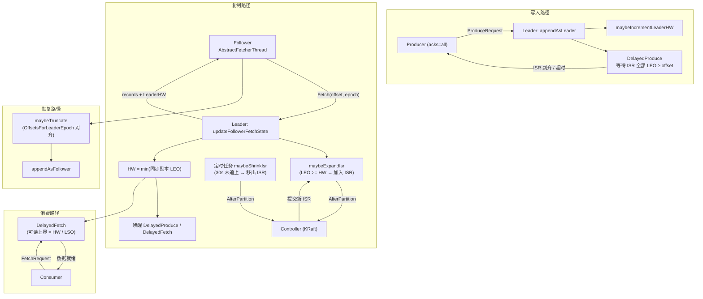

**核心设计思想**：
1. **Pull 模型**让 Follower 自己控制节奏，天然支持限流与背压；
2. **Leader Epoch + checkpoint** 替代纯 HW 截断，消除数据不一致与丢失；
3. **ISR 动态伸缩**在一致性与可用性间取得平衡（对比 Quorum/多数派：Kafka 只需 ISR=1 也可写入，配合 `min.insync.replicas` 可调）；
4. **purgatory 延迟操作**将写等待/读等待事件化，避免轮询开销。
