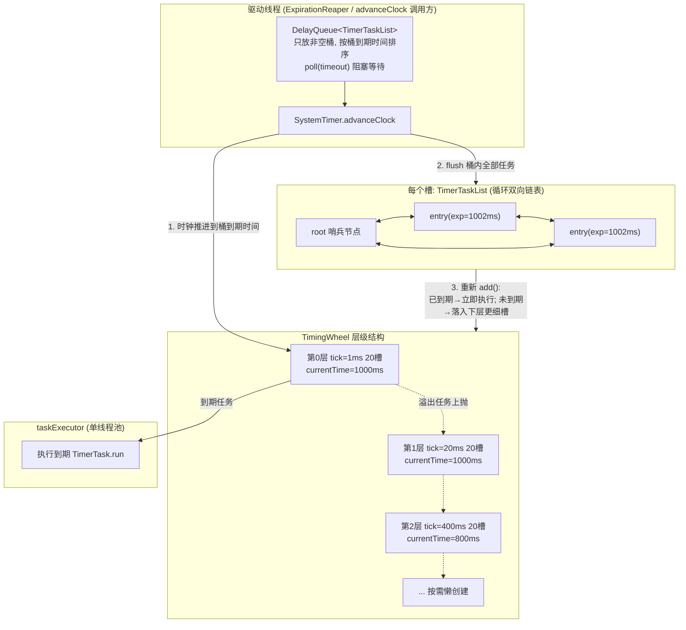
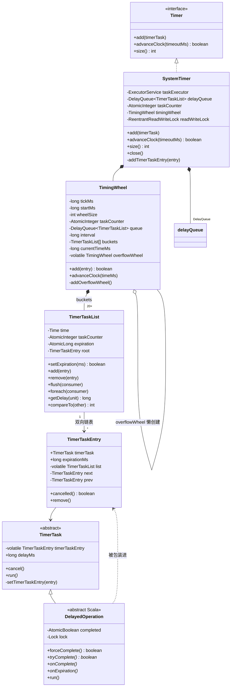
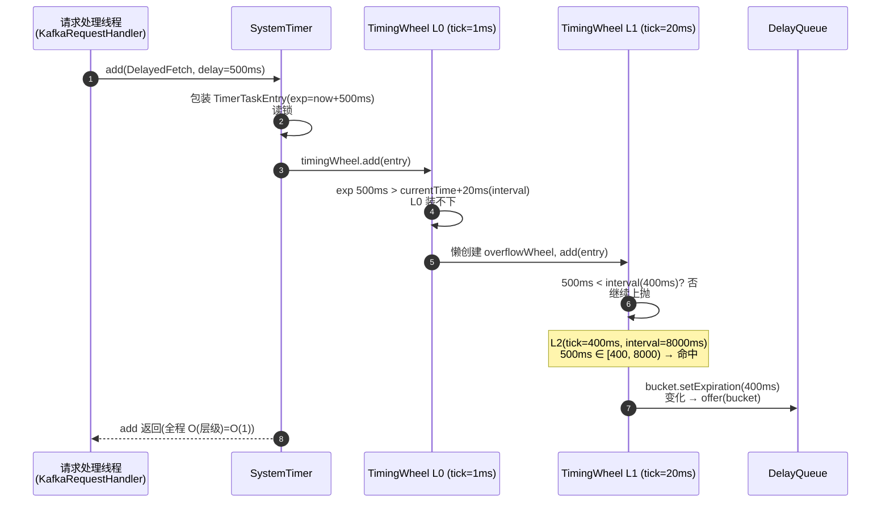
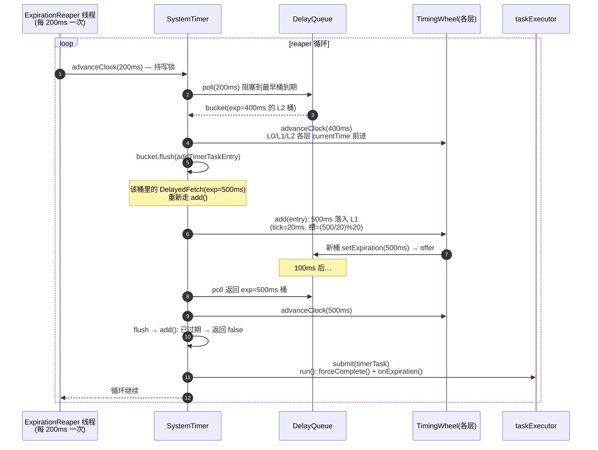
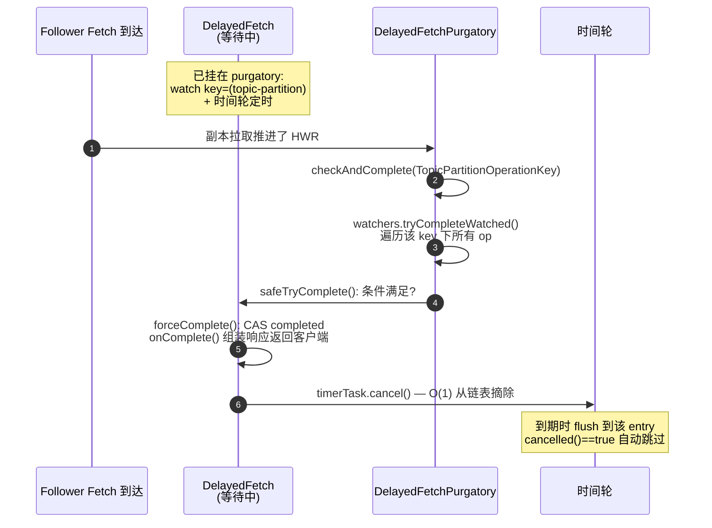
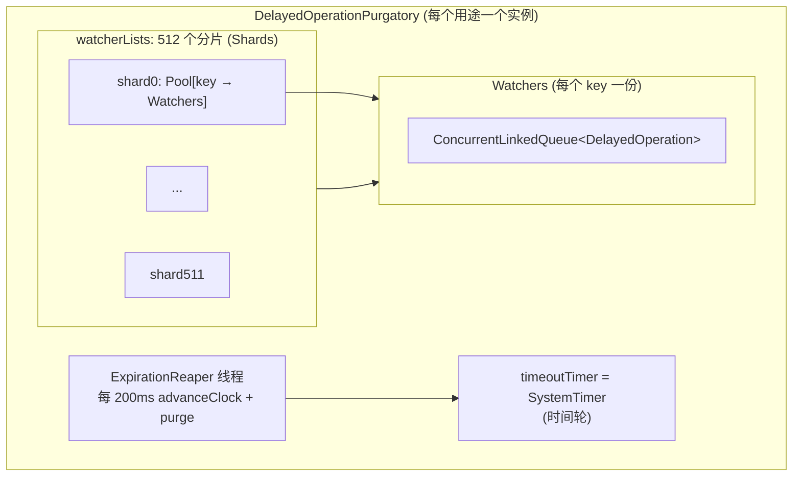

# Kafka 时间轮(Timing Wheel)实现原理深度源码分析

> 基于源码目录 `D:\workspace\java_projects\source_projects\kafka-3.7.0` 的深度分析。
> 涵盖:层级时间轮算法原理、`server-common` 中 timer 包的 Java 实现、DelayedOperationPurgatory(炼狱)的应用集成、与 Netty HashedWheelTimer 的对比。
> 所有架构图、类图、时序图、流程图均以 Mermaid 呈现(图内不含代码行号)。

---

## 目录

1. [为什么需要时间轮](#1-为什么需要时间轮)
2. [整体设计](#2-整体设计)
3. [类图关系](#3-类图关系)
4. [核心源码剖析](#4-核心源码剖析)
   - 4.1 Timer / SystemTimer
   - 4.2 TimingWheel —— 层级时间轮本体
   - 4.3 TimerTaskList —— 桶(循环双向链表)
   - 4.4 TimerTaskEntry / TimerTask —— 任务与条目
   - 4.5 并发控制全景
5. [完整工作流程](#5-完整工作流程)
6. [应用:DelayedOperationPurgatory 炼狱机制](#6-应用delayedoperationpurgatory-炼狱机制)
7. [其他使用方](#7-其他使用方)
8. [对比 Netty HashedWheelTimer](#8-对比-netty-hashedwheeltimer)
9. [设计精髓总结](#9-设计精髓总结)

---

## 1. 为什么需要时间轮

Broker 有大量"延时等待、条件满足提前完成"的操作:Fetch 请求等待 `min.bytes`/`max.wait.ms`、Produce 等待 ISR 副本 ack、消费者心跳/JoinGroup 超时……单机可能有**百万级**并发延时任务。

常见方案对比:

| 方案 | 插入 | 删除/取消 | 到期扫描 | 问题 |
|---|---|---|---|---|
| `PriorityQueue`(按到期时间排序) | O(log n) | O(n) 找元素 | O(1) 取堆顶 | 大量任务时插入/删除退化 |
| 每任务一个 `ScheduledThreadPoolExecutor` | — | — | — | 百万级线程/调度对象,开销巨大 |
| 纯轮询扫描链表 | O(1) | O(1) | O(n) 每轮全扫 | CPU 浪费 |
| **层级时间轮** | **O(1)** | **O(1)** | **摊还 O(1)** | 复杂度换来极致性能 |

Kafka 时间轮(源自 George Varghese 1987 年论文的 Hierarchical Timing Wheel + Hashed Wheel 思想)做到:

- **插入 O(1)**:一次哈希定位桶 + 链表头插入
- **取消 O(1)**:每个任务持有 Entry 引用,双向链表摘除
- **不空转**:借助 `DelayQueue` 只在"最近的桶到期"时才醒来,没有每 tick 轮询整轮

## 2. 整体设计

Kafka 时间轮 = **层级时间轮(多级轮盘)** + **DelayQueue 驱动** + **单线程执行器**。

默认参数(`SystemTimer` 构造):`tickMs=1ms`,`wheelSize=20`:

| 层级 | tickMs | 覆盖范围 interval = tickMs×20 |
|---|---|---|
| 第 0 层 | 1ms | 20ms |
| 第 1 层 | 20ms | 400ms |
| 第 2 层 | 400ms | 8000ms |
| 第 3 层 | 8000ms | 160000ms |
| ... | ×20 | ×20 |

**不用单个大轮盘的原因**:若想用单个 512 槽、tick=1ms 的轮盘覆盖 24h,槽会重叠严重(同槽任务到期时间相差甚远),且到期精度浪费。层级化用"每层 20 个槽"就指数级覆盖任意时长——空间 O(层级×20) 极小。

**为什么还要 DelayQueue**:轮盘本身不知道"什么时候该走下一步"。朴素做法是每 tick 醒一次轮转——tick=1ms 时每秒空转 1000 次。Kafka 的做法:只有**真正有任务的桶**才放进 `DelayQueue<TimerTaskList>`(桶自身实现 `Delayed` 接口),驱动线程 `poll(timeout)` 阻塞到"最早有任务的桶到期",醒来才 `advanceClock`。**没有任务的 tick 完全零开销**。



## 3. 类图关系

全部位于 `server-common/src/main/java/org/apache/kafka/server/util/timer/`(3.x 中已从 Scala 迁移为纯 Java 实现):



**职责一句话**:
- `TimerTask`:延时任务(含 `delayMs`),持有自己的 Entry 引用以支持 O(1) 取消
- `TimerTaskEntry`:任务在链表中的载体,记录绝对到期时间,双向链表节点
- `TimerTaskList`:一个槽/桶,循环双向链表 + 整桶到期时间(实现 `Delayed` 以进 DelayQueue)
- `TimingWheel`:一层轮盘,溢出任务递归交给上层轮盘
- `SystemTimer`:门面,组合时间轮 + DelayQueue + 执行线程池,负责驱动时钟

## 4. 核心源码剖析

### 4.1 Timer / SystemTimer

文件:`server-common/.../util/timer/Timer.java`、`SystemTimer.java`

`Timer` 接口只有三个方法:`add` / `advanceClock` / `size`,刻意保持极简。

`SystemTimer` 关键点:

```java
// 构造默认值
public SystemTimer(String executorName) {
    this(executorName, 1L, 20, Time.SYSTEM.hiResClockMs());
}
```

- **读写锁保护时钟推进**:`add()` 持读锁(允许多线程并发加任务),`advanceClock()` 持写锁(推进时钟+迁移任务期间独占)。这是"加任务多、推进少"负载下的正确倾斜。
- **add 流程**:
  1. 先 `timerTask.cancel()` 语义检查,包装成 `TimerTaskEntry`(构造器里会调用 `timerTask.setTimerTaskEntry`,若任务已在别的轮上则先移除——防止重复入轮);
  2. `addTimerTaskEntry`:`timingWheel.add(entry)`,返回 `false` 表示**已过期**,直接 `taskExecutor.submit(timerTask)` 立即执行。
- **advanceClock 流程**(核心驱动):
  ```java
  // 伪代码(原文件 advanceClock 方法)
  writeLock.lock();
  try {
      TimerTaskList bucket = delayQueue.poll(timeoutMs, MILLISECONDS);
      while (bucket != null) {
          timingWheel.advanceClock(bucket.getExpiration()); // 1. 推进轮盘
          bucket.flush(entry -> addTimerTaskEntry(entry));  // 2. 桶内任务全部重插
          bucket = delayQueue.poll();                       // 3. 继续取下一个到期桶
      }
  } finally { writeLock.unlock(); }
  ```
- `close()`:关闭单线程 `taskExecutor`。

### 4.2 TimingWheel —— 层级时间轮本体

文件:`server-common/.../util/timer/TimingWheel.java`(文件头部 Javadoc 有完整的算法说明,值得一读)

**字段**:
- `tickMs`:本层一格代表的时长(第 0 层 1ms;上层 = 下层 interval)
- `wheelSize`:槽数(20)
- `interval = tickMs × wheelSize`:本层能覆盖的最大时长(20ms)
- `currentTimeMs`:本层当前时间(构造时对齐到 `startMs - startMs % tickMs` 的整数倍刻度)
- `overflowWheel`:上层轮盘,`volatile` + `synchronized addOverflowWheel()` **双重检查锁懒创建**——大多数场景没有长延时任务,第 0/1 层就够了,上层轮盘根本不分配

**add 逻辑**(最核心的 30 行):

```java
// 伪代码(原文件 add 方法)
public boolean add(TimerTaskEntry entry) {
    if (entry.cancelled()) return false;              // 已取消,不入轮
    long expiration = entry.expirationMs;
    if (expiration < currentTimeMs + tickMs)          // 已到期
        return false;                                  // 交给调用方立即执行
    if (expiration < currentTimeMs + interval) {      // 本层装得下
        long virtualId = expiration / tickMs;
        TimerTaskList bucket = buckets[(int) (virtualId % wheelSize)];
        bucket.add(entry);                             // O(1) 挂链表
        if (bucket.setExpiration(virtualId * tickMs))  // 桶到期时间变化了
            queue.offer(bucket);                       // 才(重新)入 DelayQueue
        return true;
    }
    // 装不下 → 上抛到 overflow wheel(递归)
    addOverflowWheel();
    return overflowWheel.add(entry);
}
```

**细节精髓**:
- **`bucket.setExpiration()` 返回是否变化**:同一个桶(槽)会被不同"轮次"复用——`expiration=1002ms` 和 `1022ms` 都落在第 0 层 2 号槽,但相差一整圈。桶被复用时若到期时间变了,必须重新 offer 进 DelayQueue(DelayQueue 按 offer 时的 getDelay 快照排序,不变则不重复入队)。
- **`virtualId * tickMs` 对齐**:桶的到期时间是该槽覆盖时间片的**起点**,桶内各任务实际到期时间可能略晚(tick 粒度内的误差),由"flush 后重插"自愈。

**advanceClock 逻辑**:

```java
public void advanceClock(long timeMs) {
    if (timeMs >= currentTimeMs + tickMs) {
        currentTimeMs = timeMs - (timeMs % tickMs);   // 对齐刻度,只前进
        if (overflowWheel != null)
            overflowWheel.advanceClock(currentTimeMs); // 递归推进上层
    }
}
```

注意:`advanceClock` **本身不动任何桶**——它只更新刻度。桶的清空由 `SystemTimer.advanceClock` 中的 `bucket.flush` 完成。上层的时钟推进是为了让上层到期桶 flush 出的任务在重插时能被下层 `add` 正确接收。

### 4.3 TimerTaskList —— 桶(循环双向链表)

文件:`server-common/.../util/timer/TimerTaskList.java`

- **哨兵 root 节点**:`root.next = root.prev = root`(空表自环),插入永远挂在 `root.prev` 之后(表尾),O(1)。
- **`expiration` 用 `AtomicLong`,`setExpiration` 是 CAS**:支持"桶复用时更新到期时间"的并发安全。
- **`flush(consumer)`**:synchronized 方法,把链表整体摘下、逐个交给 consumer、`expiration` 重置为 `-1`(Long.MAX_VALUE 语义,不再参与 DelayQueue 排序)。
- **`getDelay`/`compareTo`**:实现 `Delayed`,以**桶的到期时间**为准——DelayQueue 里排的是"哪个桶先到期"。
- **`add` 的双重锁**:先 `synchronized(this)`(桶)再 `synchronized(entry)`。原因:entry 可能在被 add 的同时被并发 remove(cancel),锁序统一"先桶后条目"防止死锁;entry.remove() 内部还有**自旋重试**应对 CAS 竞争。

### 4.4 TimerTaskEntry / TimerTask

文件:`TimerTaskEntry.java`、`TimerTask.java`

- **`TimerTask` 持有 `timerTaskEntry` 引用**(volatile),`cancel()` 即 `entry.remove()` —— 这是 **O(1) 取消**的关键:不需要遍历任何队列找自己。
- **`setTimerTaskEntry`**:任务被包装进新 Entry 时,先把自己从旧 Entry(旧轮/旧桶)移除——保证**同一任务不会同时存在于两个位置**。
- **`cancelled()` 的巧妙定义**:`timerTask.getTimerTaskEntry() != this` 即视为取消。任务被摘除(完成/取消/迁移)后,旧 Entry 自然失效,轮盘 flush 到它时自动跳过。
- `TimerTaskEntry` 同时是链表节点(`next/prev` 包级私有),避免为每个任务额外分配节点对象——**任务、节点、到期时间三元合一**。

### 4.5 并发控制全景

| 操作 | 线程 | 同步手段 |
|---|---|---|
| `timer.add()` | 请求处理线程(多) | 读锁 + 桶/条目 synchronized |
| `advanceClock()` | Reaper 线程(单) | 写锁(与所有 add 互斥) |
| `entry.remove()`(任务取消) | 任意线程 | synchronized + 自旋重试 |
| `bucket.setExpiration` | add 线程 / flush 线程 | CAS(AtomicLong) |
| 过期任务执行 | `taskExecutor`(单线程) | 任务级 `DelayedOperation.lock` |

一个精妙的解耦:**轮盘推进与任务执行分离**。flush 只是把任务重新喂回 `add()`,真正执行交给 executor;所以 advanceClock 的临界区很短,不会因为某个任务的 `onExpiration()` 慢而卡住整个轮盘。

## 5. 完整工作流程

### 5.1 任务加入(以 DelayedFetch 超时 500ms 为例)



### 5.2 时钟推进与任务迁移(级联回落)



**级联回落**是层级时间轮的灵魂:长延时任务先粗放在高层(如 L2 的 400ms 槽),高层桶到期时不执行任务,而是 flush 重插——此时剩余延时变短,自然落入更下层更精细的槽,直到最终落到 L0 到期执行。**每次迁移只发生 O(1) 次/任务/层级跨度,摊还代价极低**。

### 5.3 条件满足提前完成(Purgatory 的正路径)



**这正是 Purgatory 存在的意义**:超时只是兜底,绝大多数任务靠外部事件(Fetch 满足 minBytes、Produce 收齐 acks)提前完成。时间轮里的 entry 变成"僵尸"也没关系,`cancelled()` 检查 + 定期 purge 清理。

## 6. 应用:DelayedOperationPurgatory 炼狱机制

文件:`core/src/main/scala/kafka/server/DelayedOperation.scala`(类 `DelayedOperation` + `DelayedOperationPurgatory`)

**炼狱 = 时间轮(超时兜底)+ Watchers 多键索引(事件触发)**,是时间轮在 Broker 内的最大消费者:



**关键设计**:

1. **512 分片降低锁竞争**(常量 `Shards = 512`):key 按 hash 分片到 `WatcherList`,每个分片一把 `ReentrantLock`。海量 key(每个分区一个)并发 watch/check 时几乎不碰撞。
2. **`tryCompleteElseWatch(operation, watchKeys)`**(核心入口):
   - 先尝试 `safeTryComplete()`——**注册前先试一次完成**,避免"满足条件的请求被白白挂起";
   - 未完成则挂到所有 watch key 上(一个 Fetch 请求 watch 它涉及的所有分区);
   - 再加进时间轮;处理"注册过程中恰好被完成"的竞态(重复检查)。
3. **`checkAndComplete(key)`**(事件触发方):外部事件(如分区 HWR 推进)调用,遍历该 key 的 Watchers,对每个 op 调 `tryComplete()`。
4. **僵尸清理**:被提前完成的 op 仍留在 Watchers 队列和轮盘里(取消了但未摘除)。`estimatedTotalOperations - 实际延迟数 > purgeInterval`(默认 1000)时触发 `purgeCompleted()` 全量清扫——**用"懒清理 + 阈值触发"替代"每次完成即删除"的高频同步开销**。

**Broker 中的主要 Purgatory 实例**(`ReplicaManager.scala` 及各协调器):

| Purgatory | 延时操作 | 超时来源 | watch key |
|---|---|---|---|
| producePurgatory | `DelayedProduce` | `request.timeout.ms`(acks=all 等待 ISR) | TopicPartition |
| fetchPurgatory | `DelayedFetch` | `fetch.max.wait.ms`(默认 500ms,等 minBytes) | TopicPartition |
| deleteRecordsPurgatory | `DelayedDeleteRecords` | deleteRecords 超时 | TopicPartition |
| electLeaderPurgatory | `DelayedElectLeader` | 选主超时 | TopicPartition |
| remoteFetchPurgatory | `DelayedRemoteFetch` | 层级存储远端拉取超时 | TopicPartition |
| GroupCoordinator | `DelayedJoin` | rebalance timeout(等全部成员入组) | GroupJoinKey(groupId) |
| GroupCoordinator | `DelayedHeartbeat` | session timeout(成员存活检测) | MemberKey(groupId, memberId) |
| — | `DelayedFuture` | ACL 异步 Authorizer 等待 | — |

以最常见的 `DelayedFetch` 为例,`tryComplete()` 的判断:**任一分区有足够数据(≥minBytes)、或分区出现错误(非 leader/下线)、或心跳会话过期**,满足即完成返回。

## 7. 其他使用方

- **RaftManager**:`new SystemTimer("raft-expiration-executor")`(`kafka/raft/RaftManager.scala`),处理 Raft 选举超时等。
- **GroupCoordinator 心跳/会话**:`BrokerServer` 中 `new SystemTimer("group-coordinator")` 包一层 `SystemTimerReaper` 管理。
- **客户端明确不用时间轮**:`clients` 模块的 `NetworkClient` 超时(`request.timeout.ms`、`reconnect.backoff` 等)用的是**基于 poll 循环的简单 `org.apache.kafka.common.utils.Timer` 倒计时检查**(每次 poll 更新 deadline、逐请求检查),因为客户端同时挂起的请求量小(≤5 in-flight),轮询足够,引入时间轮反而增加线程负担。

## 8. 对比 Netty HashedWheelTimer

两者同源(George Varghese 论文思想),但取舍不同:

| 维度 | Kafka SystemTimer | Netty HashedWheelTimer |
|---|---|---|
| **结构** | **多层级**时间轮(每层 20 槽,逐层 ×20) | **单层**时间轮(默认 512 槽,可配) |
| **覆盖时长** | 理论无上限(层级无限扩展,懒创建) | 单轮覆盖 = tickDuration×512(默认 100ms tick → ~51s),超长延时任务在**额外的 DelayQueue** 里暂存,tick 推进时再 transfer 进轮 |
| **槽实现** | 循环双向链表 + 哨兵 root | 循环双向链表 + 哨兵(Set/HashSet 早期版本,后改链表) |
| **到期驱动** | 桶自身实现 `Delayed`,**只有非空桶**进 DelayQueue,`poll(timeout)` 精确阻塞到桶到期 | 同样用 DelayQueue,但 Netty 放的是**每个未到期任务的超时包装 `HashedWheelTimeout`**;worker 线程 `waitForNextTick()` 按 tickDuration 计算下次唤醒 |
| **tick 推进方式** | 由**外部调用方**驱动(Reaper 每 200ms 调 advanceClock;poll 超时参数兜底) | worker 线程**固定节拍**自我驱动(checkDeadline + sleep 精确到 tick) |
| **任务执行** | 独立单线程 `taskExecutor` | worker 线程内**同步**执行(任务慢会拖慢 tick,建议业务自行异步) |
| **取消语义** | task.cancel → entry O(1) 摘除;僵尸由 purgatory purge | timeout.cancel → CAS 状态改 CANCELLED,链表节点置 STUCCEEDED 标记,transfer 时跳过 |
| **时钟精度** | 第 0 层 1ms;高层槽粒度变粗,由回落迁移补偿 | 全程统一 tickDuration(默认 100ms) |
| **并发模型** | add 多线程(读锁)/ advance 单线程(写锁) | add 任意线程(锁 start 瞬间 + DelayQueue 暂存);tick 推进仅 worker 单线程 |
| **典型负载** | Broker 百万级延时请求,生命周期短、大量提前取消 | 网络连接超时、空闲检测,量级小、时长范围集中 |

**本质差异一句话**:Netty 是"**单层大轮盘 + 固定节拍 + 长任务外挂 DelayQueue**",简单、自驱动、适合通用网络超时;Kafka 是"**层级轮盘 + 事件驱动推进(非空桶入队)** + 执行与推进分离 + 上层 Purgatory 分片/懒清理",为 Broker 百万级短延时、高取消率、需提前完成的高压场景做了全套优化。

Kafka 内部甚至还有一个更轻量的单层时间轮变体:`clients` 模块长期使用的实现(后由 KAFKA-15671 等演进)思路与 Netty 接近——印证了两种形态各有适用面。

## 9. 设计精髓总结

1. **层级化换空间**:20 槽/层、逐层 ×20,5 层就覆盖 320 万秒,内存只需 100 个桶对象。
2. **DelayQueue 反转职责**:不是"时间轮到点检查",而是"有任务的桶到点叫醒时间轮"——空转归零。
3. **桶复用 + CAS expiration**:槽是复用的,桶到期时间是动态的;`setExpiration` 返回值决定是否重新入队,精细控制 DelayQueue 一致性。
4. **任务-节点-取消 三合一**:TimerTask 持 Entry 引用、Entry 即链表节点、`cancelled()` 用引用相等判断,取消 O(1) 且旧 Entry 自然失效,无需显式清理。
5. **flush 重插实现级联回落**:不需要指针下移算法,复用 add 逻辑,同一任务自然从高层落到低层,直到到期。
6. **推进与执行分离**:advanceClock 临界区只做迁移,执行丢给 executor,慢任务不阻塞轮盘。
7. **读写锁倾斜**:add(高频、多线程)读锁,advance(低频、单线程)写锁。
8. **懒创建 + 懒清理**:overflowWheel 双检锁按需创建;Purgatory 僵尸 Watchers 用阈值触发的 purge 批量清扫——处处体现"热路径最小化同步开销"。

### 附录:关键源码文件索引

| 文件 | 位置(server-common/src/main/java/org/apache/kafka/server/util/timer/) |
|---|---|
| 定时器接口 | `Timer.java` |
| 门面实现 | `SystemTimer.java` |
| 层级时间轮 | `TimingWheel.java` |
| 桶(循环双向链表) | `TimerTaskList.java` |
| 链表条目 | `TimerTaskEntry.java` |
| 延时任务抽象 | `TimerTask.java` |
| 炼狱机制 | `core/src/main/scala/kafka/server/DelayedOperation.scala` |
| 典型延时操作 | `core/.../server/DelayedFetch.scala`、`DelayedProduce.scala`、`kafka/coordinator/group/DelayedJoin.scala`、`DelayedHeartbeat.scala` |
| 单测 | `server-common/src/test/java/org/apache/kafka/server/util/timer/TimerTest.java` 等 |
