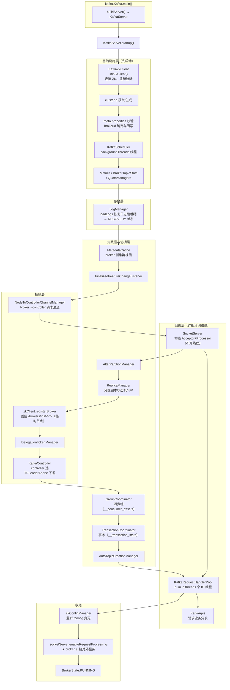
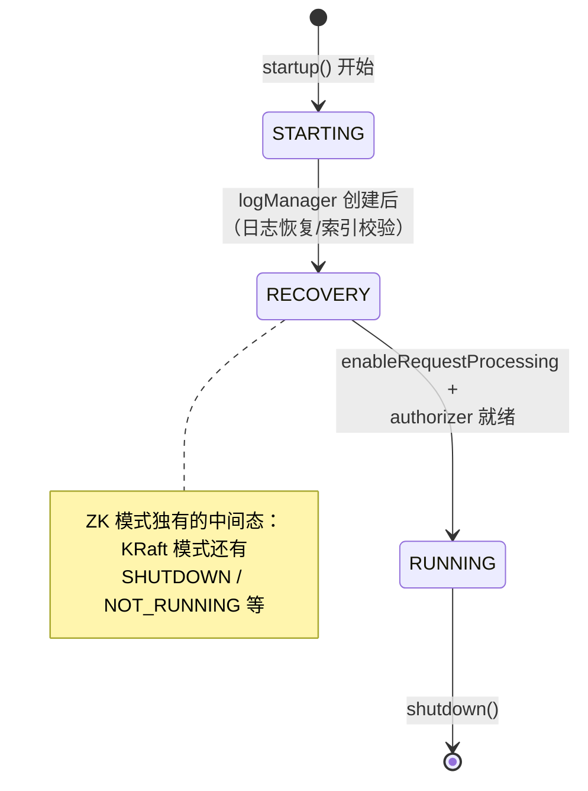
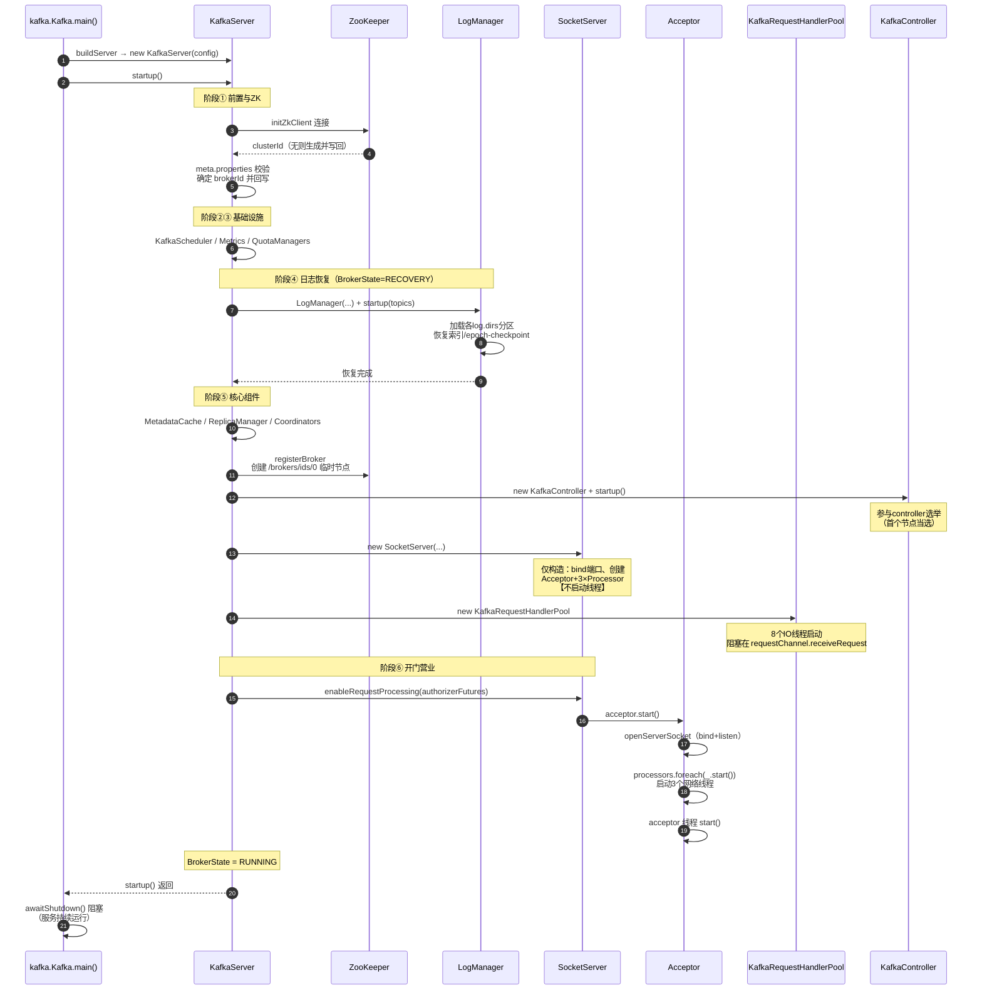
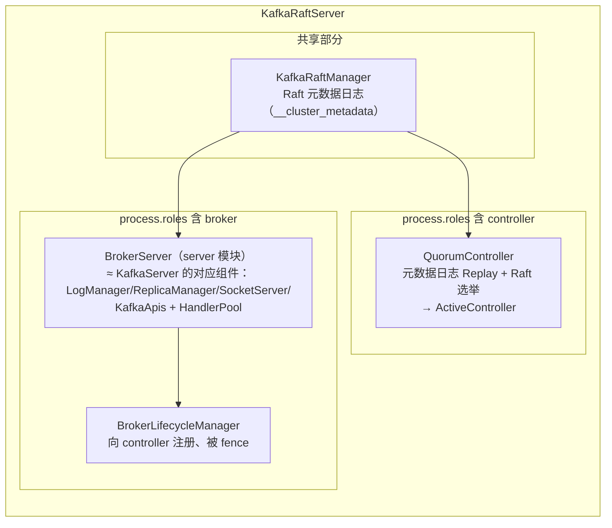

# Kafka 3.7.0 服务端启动流程（源码深度解析）

> 基于 Kafka **3.7.0** 源码，以 ZooKeeper 模式（`config/server.properties`）为主线，末尾附 KRaft 模式差异。
> 核心源码：
> - `core/src/main/scala/kafka/Kafka.scala`（main 入口）
> - `core/src/main/scala/kafka/server/KafkaServer.scala`（启动编排，核心在 `startup()` 方法）
> - `core/src/main/scala/kafka/network/SocketServer.scala`（网络层）
> - `core/src/main/scala/kafka/server/KafkaRequestHandler.scala`（IO 线程池）

---

## 目录

1. [入口：kafka.Kafka.main()](#1-入口kafkakafkamain)
2. [模式判定：ZooKeeper 还是 KRaft](#2-模式判定zookeeper-还是-kraft)
3. [启动整体架构图](#3-启动整体架构图)
4. [KafkaServer.startup() 全阶段拆解](#4-kafkaserverstartup-全阶段拆解)
5. [BrokerState 状态机](#5-brokerstate-状态机)
6. [完整启动时序图](#6-完整启动时序图)
7. [网络层启动细节](#7-网络层启动细节)
8. [KRaft 模式的差异](#8-kraft-模式的差异)
9. [关键设计要点](#9-关键设计要点)
10. [调试断点指引](#10-调试断点指引)

---

## 1. 入口：kafka.Kafka.main()

`Kafka.scala` 的 main 非常薄，只做三件事：解析参数、构造 server、启动并等待：

```scala
// Kafka.scala（简化）
def main(args: Array[String]): Unit = {
  // 1. 解析命令行：server.properties + 可选 --override
  val serverProps = getPropsFromArgs(args)

  // 2. 构造 KafkaConfig → 按 process.roles 决定构造哪种 server
  val server = buildServer(serverProps)   // KafkaServer（ZK）或 KafkaRaftServer（KRaft）

  // 3. 注册 shutdown 钩子（SIGTERM 时优雅关闭）
  Runtime.getRuntime.addShutdownHook(new Thread("kafka-shutdown-hook") {
    override def run(): Unit = server.shutdown()
  })

  try server.startup()                    // ★ 所有启动逻辑的入口
  catch { case e: Throwable => fatal(...); System.exit(1) }  // 失败退出码 1

  server.awaitShutdown()                  // main 线程阻塞在 CountDownLatch
}
```

注意 `server.startup()` 若抛异常，进程以**退出码 1** 退出——这就是本地调试时 `finished with non-zero exit value 1` 的来源（参数缺失/端口占用/配置非法都会走到这）。

`buildServer` 的分派依据：

```scala
if (config.requiresZookeeper) new KafkaServer(...)
else                          new KafkaRaftServer(...)
```

## 2. 模式判定：ZooKeeper 还是 KRaft

判定只看一个配置（`KafkaConfig`）：

```scala
def requiresZookeeper: Boolean = processRoles.isEmpty
```

| `process.roles` | 模式 | server 类 |
|---|---|---|
| 未设置 | ZooKeeper（本文主线） | `KafkaServer` |
| `broker` / `controller` / `broker,controller` | KRaft | `KafkaRaftServer` |

两份配置文件对应：`config/server.properties`（ZK，依赖 `zookeeper.connect`）与 `config/kraft/server.properties`（KRaft，有 `process.roles`/`node.id`/`controller.quorum.voters`）。

互斥校验：KRaft 模式不允许配置 `zookeeper.connect`；ZK 模式必须配置它。

## 3. 启动整体架构图

`KafkaServer.startup()` 依次创建并启动的全部组件（依赖关系自下而上）：



## 4. KafkaServer.startup() 全阶段拆解

`startup()` 的执行顺序严格编排，可分六个阶段：

### 阶段①：前置检查与 ZooKeeper

```scala
if (isShuttingDown.get) throw ...      // 防止关闭中重复启动
if (startupComplete.get) return        // 幂等
val canStartup = isStartingUp.compareAndSet(false, true)  // CAS 防并发启动
_brokerState = BrokerState.STARTING

initZkClient(time)                     // 连接 ZK（含 SASL/超时配置）
configRepository = new ZkConfigRepository(...)  // topic 配置仓库
_clusterId = getOrGenerateClusterId(zkClient)   // 读取 /cluster_id，无则生成
```

### 阶段②：brokerId 与元数据文件

```scala
// 加载各 log.dirs 下的 meta.properties
val initialMetaPropsEnsemble = new MetaPropertiesEnsemble.Loader()...
initialMetaPropsEnsemble.verify(Optional.of(_clusterId), verificationId, ...)  // 校验
config.brokerId = getOrGenerateBrokerId(initialMetaPropsEnsemble)
// brokerId 优先级：broker.id 配置 > meta.properties 中已持久化的值 > 生成随机值
// 然后把 clusterId/brokerId 回写进 meta.properties
config.dynamicConfig.initialize(...)   // 从 ZK /config/brokers/&lt;id&gt; 加载动态配置
```

**这一步失败即启动失败**——clusterId 不匹配（换了 ZK 但用了旧 log.dirs）、brokerId 冲突等都在此抛异常。

### 阶段③：调度器、指标、配额

```scala
kafkaScheduler = new KafkaScheduler(config.backgroundThreads); kafkaScheduler.startup()  // 后台线程池
metrics = Server.initializeMetrics(config, time, clusterId)
_brokerTopicStats = new BrokerTopicStats(...)
quotaManagers = QuotaFactory.instantiate(...)            // 客户端/副本配额
logDirFailureChannel = new LogDirFailureChannel(config.logDirs.size)
```

### 阶段④：日志恢复（RECOVERY）——最耗时

```scala
_logManager = LogManager(config, errorLogDirs, configRepository, kafkaScheduler, ...)
_brokerState = BrokerState.RECOVERY
logManager.startup(zkClient.getAllTopicsInCluster())
// 内部：按 log.dirs 加载所有分区目录 → 恢复 .log/.index/.timeindex
//      恢复 leader-epoch checkpoint、清理中断的 swap 文件、重建损坏索引
//      broker 数据量大时，这一步占启动时间的大头
```

### 阶段⑤：核心组件依次启动

按依赖顺序（每个组件都有 `startup()`，详见上文架构图编号）：

| 顺序 | 组件 | 职责 |
|---|---|---|
| 1 | `MetadataCache` | 集群元数据缓存（broker 侧视图） |
| 2 | `FinalizedFeatureChangeListener` | 监听 ZK feature 版本 |
| 3 | `NodeToControllerChannelManager` | broker→controller 请求通道 |
| 4 | `SocketServer` | **只构造**（见第7节） |
| 5 | `AlterPartitionManager` | 分区 LeaderAndIsr 变更 |
| 6 | `ReplicaManager` | 副本管理、ISR 扩缩 |
| 7 | `registerBroker` | **在 ZK 创建 `/brokers/ids/<id>` 临时节点**（session 断开自动摘除，即"存活注册"） |
| 8 | `DelegationTokenManager` | 委托令牌 |
| 9 | `KafkaController` | controller 选举参与者 |
| 10 | `GroupCoordinator` | 消费组协调 + `__consumer_offsets` |
| 11 | `TransactionCoordinator` | 事务 + `__transaction_state` |
| 12 | `AutoTopicCreationManager` | 自动建 topic |
| 13 | `Authorizer` | 鉴权器（**启动产出 authorizerFutures**） |
| 14 | `KafkaApis` + `KafkaRequestHandlerPool` | 业务层 + `num.io.threads` 个 IO 线程 |
| 15 | `ZkConfigManager` | 监听 `/config` 动态配置变更 |

### 阶段⑥：对外服务

```scala
socketServer.enableRequestProcessing(authorizerFutures)  // ★ 正式开张
// 等待所有 authorizer future 完成（鉴权未就绪前不处理请求）
CompletableFuture.allOf(authorizerFutures.values.toSeq: _*).join()

_brokerState = BrokerState.RUNNING
startupComplete.set(true)
AppInfoParser.registerAppInfo(...)                        // 注册 JMX mbean
```

## 5. BrokerState 状态机

启动全程通过 `_brokerState` 对外暴露状态（JMX / `kafka-broker-api-versions` 可见）：



## 6. 完整启动时序图



## 7. 网络层启动细节

3.7 的网络层启动是**两段式**（详见《Kafka网络通信架构与请求处理流程.md》第3节），要点：

| 步骤 | 时机 | 动作 |
|---|---|---|
| `new SocketServer()` | 阶段⑤ | 对每个 listener `createDataPlaneAcceptorAndProcessors`：构造 Acceptor、创建 `num.network.threads` 个 Processor、`openServerSocket`（**bind 但不 start**；端口=0 时构造期即 bind 以读临时端口） |
| handler 池 | 阶段⑤ | IO 线程启动，空转等请求 |
| `enableRequestProcessing` | 阶段⑥ | 等 authorizer future → `acceptor.start()` → 启动 Processor 线程 + Acceptor 线程 |

**为什么要两段式**：源码注释写明——"Delay starting processors until the end of the initialization sequence to ensure that credentials have been loaded before processing authentications"。即端口可以先绑定（让客户端能建 TCP 连接排队），但**鉴权凭据加载完成前不处理任何请求**；`enableRequestProcessing` 内部等 `authorizerFutures` 完成才 `acceptor.start()`。

## 8. KRaft 模式的差异

`KafkaRaftServer`（`core/.../server/KafkaRaftServer.scala`）的对应结构：



关键差异：

| 维度 | ZK 模式 | KRaft 模式 |
|---|---|---|
| 元数据存储 | ZooKeeper znode | Raft 日志 `__cluster_metadata` |
| broker 注册 | `/brokers/ids/<id>` 临时节点（存活即注册） | `BrokerLifecycleManager` 向 controller 发 RegisterBroker，**可被 fence** |
| controller 选举 | ZK 临时节点抢占（KafkaController） | Raft 选举（QuorumController） |
| 配置加载 | ZKConfigManager 监听 /config | 元数据日志 replay（broker 启动需先追平日志才 unfence） |
| 网络层 | 相同的 SocketServer 两段式 | 相同，controller 端口用 `ListenerType.CONTROLLER` 分支 |

## 9. 关键设计要点

1. **幂等与防并发**：`startupComplete` 原子标志 + `isStartingUp` CAS，保证 `startup()` 可安全地只执行一次。
2. **顺序编排的原则**：日志先恢复（数据就绪）→ 再注册到 ZK（对外可见）→ 最后开网络处理；反过来会出现"客户端已能发现 broker 但数据未就绪"的窗口。
3. **临时节点 = 存活探测**：`registerBroker` 用 ZK 临时节点，broker 进程死亡时 session 超时自动摘除，无需显式注销——这是 ZK 模式故障检测的根基（KRaft 用心跳 + fence 替代）。
4. **brokerId 持久化**：首次生成的 brokerId 写进 `meta.properties`，重启后保持不变（除非 `broker.id` 显式配置或删除该文件）。
5. **失败即退出**：启动链任何一步抛异常都会传播到 `Kafka.main`，进程退出码 1。
6. **RECOVERY 的可见性**：日志恢复期间 broker 在 ZK 上尚不可见（注册发生在恢复之后），客户端不会把请求路由过来。

## 10. 调试断点指引

IDEA 运行 `Kafka.main()`（参数 `config/server.properties`，JDK 11）：

| 观察目标 | 断点位置 | 看什么 |
|---|---|---|
| 模式分派 | `Kafka.scala` `buildServer` | `config.requiresZookeeper` |
| 启动幂等 | `KafkaServer.scala` `startup()` 开头 | `isStartingUp.compareAndSet` |
| ZK 连接 | `initZkClient` 调用处 | 连接串、sessionTimeout |
| brokerId 决策 | `getOrGenerateBrokerId` | meta.properties 内容、生成的 id |
| 日志恢复 | `LogManager.startup` / `loadLogs` | 恢复的分区数、耗时 |
| ZK 注册 | `zkClient.registerBroker` | brokerInfo、返回的 epoch |
| 网络构造 | `SocketServer` 构造方法 | Acceptor/Processor 创建、端口 bind |
| **开门时刻** | `SocketServer` 的 `enableRequestProcessing` | authorizerFutures、acceptor.start() |
| 状态切换 | `_brokerState` 赋值处 | 从 RECOVERY → RUNNING |

**典型启动日志对照**（log4j 输出）：

```
[KafkaServer id=0] started (kafka.server.KafkaServer)          ← startup 完成
Awaiting socket connections on 0.0.0.0:9092.                   ← Acceptor bind 成功
Enabling request processing.                                   ← enableRequestProcessing
```

看到第三行，broker 才真正开始处理请求。

---

## 附：一句话总结

**ZK 模式启动 = "连 ZK → 定身份 → 恢复日志（RECOVERY）→ 依次拉起副本/协调器/控制器组件 → 注册到 ZK → 网络层两段式开门（enableRequestProcessing）→ RUNNING"**，全程由 `KafkaServer.startup()` 单线程编排、严格有序，任一环节失败即整体退出。
