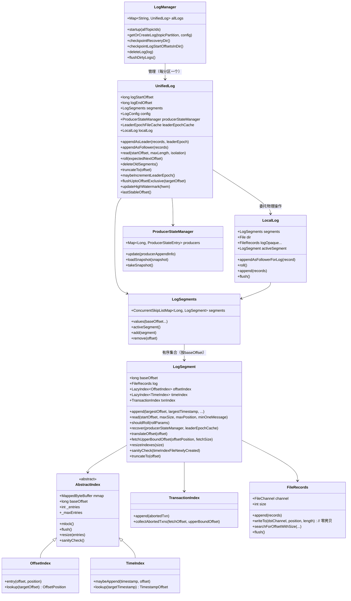
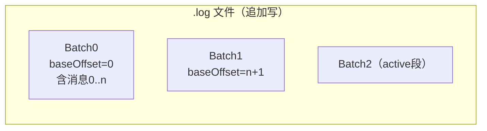
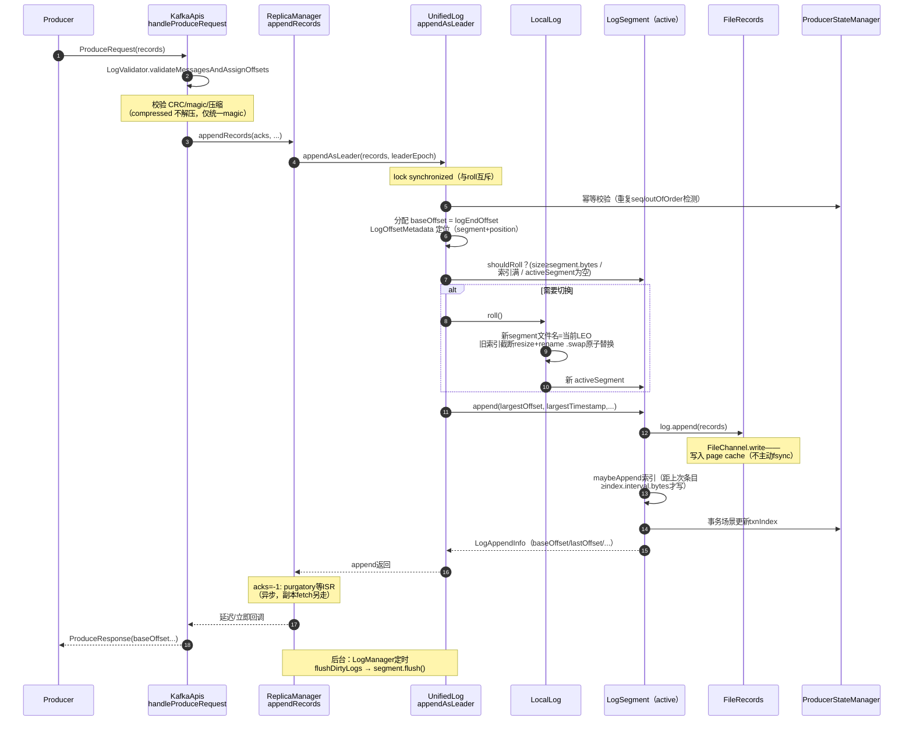
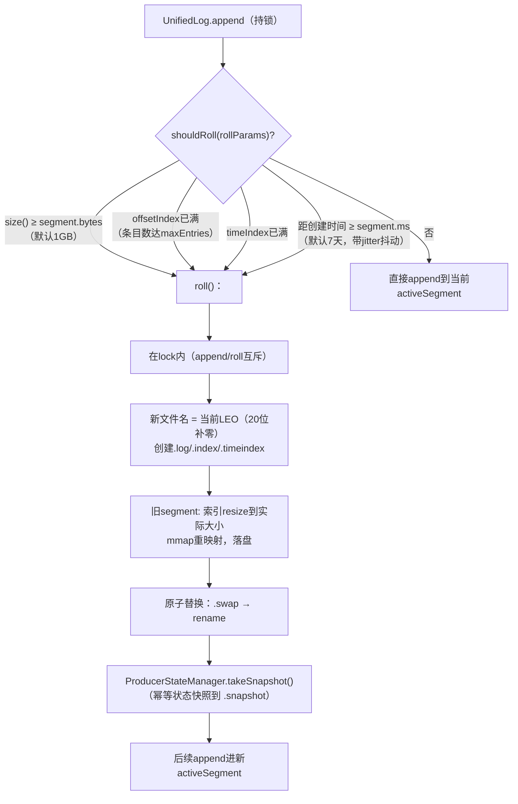
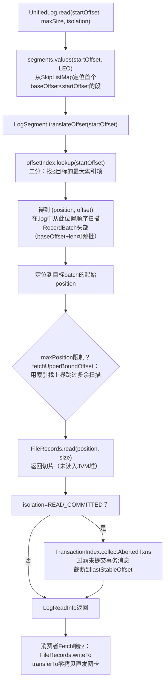
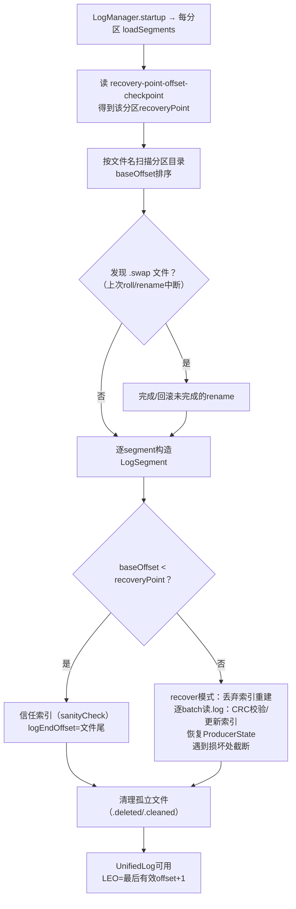
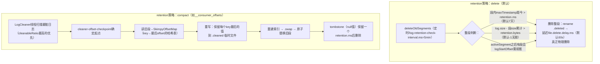

# Kafka 3.7.0 消息存储机制深度解析（源码级）

> 基于 Kafka **3.7.0** 源码（ZooKeeper 模式）。核心源码分布：
> - `core/src/main/scala/kafka/log/`：`LogManager.scala`、`UnifiedLog.scala`、`LocalLog.scala`、`LogLoader.scala`、`LogCleaner.scala`
> - `storage/src/main/java/org/apache/kafka/storage/internals/log/`：`LogSegment.java`、`OffsetIndex.java`、`TimeIndex.java`、`TransactionIndex.java`、`AbstractIndex.java`、`LogSegments.java`、`ProducerStateManager.java`、`LogValidator.java`
> - `clients/src/main/java/org/apache/kafka/common/record/`：`FileRecords.java`、`MemoryRecords.java`、`DefaultRecordBatch.java`（消息格式）
>
> 文中示例使用真实的本地数据目录 `kafka-logs/test-topic01-0`。

---

## 目录

1. [存储目录结构（真实示例）](#1-存储目录结构真实示例)
2. [各类文件详解](#2-各类文件详解)
3. [Log 整体架构（类图）](#3-log-整体架构类图)
4. [消息的磁盘格式：RecordBatch v2](#4-消息的磁盘格式recordbatch-v2)
5. [写入路径：一条消息如何落盘](#5-写入路径一条消息如何落盘)
6. [Segment 切换（Roll）机制](#6-segment-切换roll机制)
7. [索引结构：为什么是稀疏索引](#7-索引结构为什么是稀疏索引)
8. [读取路径：从 offset 到字节](#8-读取路径从-offset-到字节)
9. [刷盘与恢复：checkpoint 体系](#9-刷盘与恢复checkpoint-体系)
10. [日志保留与清理：Delete 与 Compact](#10-日志保留与清理delete-与-compact)
11. [关键配置](#11-关键配置)
12. [调试断点指引](#12-调试断点指引)

---

## 1. 存储目录结构（真实示例）

本地 broker 的 `log.dirs`（你的配置）下的实际结构：

```
kafka-logs/                                  ← log.dirs
├── meta.properties                          ← 目录级元数据（clusterId/brokerId/nodeId）
├── cleaner-offset-checkpoint                ← LogCleaner 全局进度
├── log-start-offset-checkpoint              ← 每个分区 logStartOffset 的检查点
├── recovery-point-offset-checkpoint         ← 每个分区 flush 进度的检查点
├── replication-offset-checkpoint            ← 每个分区 highWatermark 的检查点
├── test-topic01-0/                          ← 分区目录 = {topic}-{partition}
│   ├── 00000000000000000000.log             ← 消息数据（segment）
│   ├── 00000000000000000000.index           ← offset → 物理位置 索引
│   ├── 00000000000000000000.timeindex       ← timestamp → offset 索引
│   ├── leader-epoch-checkpoint              ← leader 纪元变更历史
│   └── partition.metadata                   ← 分区的 topicId/partition（KRaft 相关）
└── topic_01-0/
    └── ...（同上）
```

几个一眼可见的事实：

- **文件名 = 该 segment 的 baseOffset（20 位零填充）**，`00000000000000000000` 表示这个 segment 覆盖从 offset 0 开始的消息；
- `00000000000000000000.index` 和 `.timeindex` 都是 **10485760 字节（10MB）**——这是**预分配**的大小（`segment.index.bytes.max` 默认 10MB），实际只用了极少部分，segment 关闭（roll）时才截断到实际用量（你看到的 891 字节 log 对应的索引条目极少）；
- `.log` 只有 891 字节——你测试发送的几条消息（每批一个 RecordBatch，批头 61B + 记录）都还在第一个 active segment 里；
- 没有事务消息，所以**没有** `00000000000000000000.txnindex`（详见下表）。

## 2. 各类文件详解

### 2.1 分区目录内（每个 segment 一组）

| 文件 | 产生条件 | 作用 | 格式 |
|---|---|---|---|
| `{baseOffset}.log` | 总是 | 消息数据本体，追加写 | RecordBatch 序列（见第4节） |
| `{baseOffset}.index` | 总是 | **偏移量索引**：相对 offset → log 文件内物理位置 | 定长 4B+4B 条目，稀疏 |
| `{baseOffset}.timeindex` | 总是 | **时间戳索引**：timestamp → 相对 offset，支撑按时间查找/保留 | 定长 8B+4B 条目，稀疏 |
| `{baseOffset}.txnindex` | 事务 topic（`transactional.id` 使用者写入后） | 记录**已中止事务**的 (pid, firstOffset, lastOffset, lastStableOffset)，供消费者做 READ_COMMITTED 过滤 | 变长条目 |
| `{baseOffset}.snapshot` | 启用幂等/事务时 | **ProducerStateManager 快照**：每个 segment 滚动/关闭时持久化该段结束时的 producer 状态（pid→最后5次写入的元数据），用于重启后恢复幂等去重窗口 | 二进制 |
| `leader-epoch-checkpoint` | 总是（leader 或被 follower 追随时） | `(epoch, startOffset)` 列表：每次 leader 变更追加一条。**副本一致性核心**——follower 重启后用它向 leader 询问该 epoch 的 HW，避免数据不一致 | 文本 |
| `partition.metadata` | 总是 | `(version, topicId, partition)`，KRaft/迁移用 | 文本 |

### 2.2 log.dirs 根目录下（broker 级检查点）

| 文件 | 内容 | 作用 |
|---|---|---|
| `meta.properties` | clusterId、brokerId | 启动时校验"这套数据属于这个集群/这个 broker"，不匹配直接拒绝启动 |
| `recovery-point-offset-checkpoint` | 每分区已 flush 到的 offset | **重启恢复边界**：此 offset 之后的数据视为可能未完整刷盘，需要 recover 校验 |
| `replication-offset-checkpoint` | 每分区的 highWatermark | 重启时恢复 HW，避免回退 |
| `log-start-offset-checkpoint` | 每分区的 logStartOffset | 重启时恢复日志起点（保留删除可能推进过它） |
| `cleaner-offset-checkpoint` | 每个被 compact 的 topic-partition 已清理到的 offset | LogCleaner 重启续跑 |

## 3. Log 整体架构（类图）



**职责分层**（3.7 的一个重要变化：`Log` 更名 `UnifiedLog` 并与 `LocalLog` 分层，物理操作下沉到 `storage` 模块以便 ZK/KRaft 复用）：

| 类 | 层 | 职责 |
|---|---|---|
| `LogManager` | broker 级 | 启动时加载/恢复所有分区日志；后台任务（flush/检查点/删除）调度 |
| `UnifiedLog` | 分区级 | **逻辑视图**：append/read/roll/删除/truncate/leaderEpoch/HW/LSO 的编排，持有锁（`lock`）串行化 append 与 roll |
| `LocalLog` | 分区级 | **物理执行**：segment 文件的创建、rename（.swap）、删除、flush |
| `LogSegments` | 分区级 | `ConcurrentSkipListMap[baseOffset → LogSegment]`，有序 segment 集合 |
| `LogSegment` | 段级 | 一个 `.log` + 配套索引的封装；append/read/recover |
| `FileRecords` | 文件级 | `FileChannel` 包装，支持**零拷贝** `writeTo`（`transferTo`） |

## 4. 消息的磁盘格式：RecordBatch v2

`.log` 文件就是一个个 **RecordBatch 顺序排列**的字节流——**网络收到的 `records` 字段原样落盘**（序列化/反序列化免了，这也是 Kafka 高吞吐的关键之一）：



单个 RecordBatch（magic=2，v2 格式）的布局：

```
┌─ baseOffset: int64 ────────────────────────────┐
│ batchLength: int32                              │
│ partitionLeaderEpoch: int32（broker侧回填）      │
│ magic: int8 = 2                                 │
│ crc: int32（attributes→批尾的校验和）            │
│ attributes: int16                               │
│   ├ bit0-2 压缩类型(0=NONE/GZIP/SNAPPY/LZ4/ZSTD)│
│   ├ bit3 timestampType(0=CreateTime)            │
│   ├ bit4 isTransactional                        │
│   ├ bit5 isControl(CommitTxn/AbortTxn标记批)     │
│   └ bit6 hasDeleteHorizon                       │
│ lastOffsetDelta: int32                          │
│ firstTimestamp / maxTimestamp: int64 ×2         │
│ producerId: int64 / producerEpoch: int16        │
│ baseSequence: int32（幂等序号）                  │
│ recordsCount: int32                             │
├─ Record × N（zigzag varint 编码）────────────────┤
│  length │ attributes │ timestampDelta │          │
│  offsetDelta │ keyLen+key │ valueLen+value │     │
│  headersLen+headers                             │
└─────────────────────────────────────────────────┘
```

源码对应：`DefaultRecordBatch.writeHeader()` 写批头；`DefaultRecord.writeTo()` 写单条记录。**磁盘格式 == 网络格式**，Producer 攒的批直接整块存储。

## 5. 写入路径：一条消息如何落盘



**append 的关键细节（`UnifiedLog.append` 私有方法，内部 `lock synchronized`）：**

1. **写日志前先决定要不要 roll**——因为 append 需要 `LogOffsetMetadata`（segment + 物理位置），roll 之后位置全部变化；
2. **offset 分配在 broker 侧**：`nextOffsetMetadata` 记录当前 LEO，batch 的 baseOffset 就取它，随后 += 记录数；
3. **写入 page cache 即返回成功**——`append` 不 fsync！真正的刷盘由 `LogManager` 后台任务 `flushDirtyLogs`（`log.flush.interval.messages` / `log.flush.interval.ms`，默认无限即交给 OS）完成；
4. **`LogAppendInfo`** 携带 baseOffset/lastOffset/firstTimestamp/maxTimestamp/logAppendTime 等回传给响应。

## 6. Segment 切换（Roll）机制

`LogSegment.shouldRoll(rollParams)` 的四个触发条件（任一满足）：



**为什么要 roll**：单个文件无限增长会导致——索引跨度不可控、保留删除只能整段进行、恢复时间线性变长。1GB 的段配合稀疏索引是权衡结果。

## 7. 索引结构：为什么是稀疏索引

### 7.1 两种索引条目格式

```
OffsetIndex（4B + 4B 定长）             TimeIndex（8B + 4B 定长）
┌───────────────┬──────────┐          ┌─────────────┬──────────┐
│ relativeOffset│ position │          │ timestamp   │ relativeOffset│
│ = offset-base │（log文件 │          │ （int64）    │ = offset-base│
│   （int32）   │  偏移int32）│        └─────────────┴──────────┘
└───────────────┴──────────┘
```

- **relativeOffset 用相对值**：4 字节 int32 相对 segment baseOffset 的差，省 4 字节且天然防止单 segment 跨度超 int32（`LogSegmentOffsetOverflowException` 的来源）；
- 索引文件是**预分配 10MB mmap**（所以你看到 10485760 字节），roll 时 `resize` 截断并 `mlock` 锁内存防 swap。

### 7.2 稀疏性：`index.interval.bytes = 4096`

不是每条消息都有索引项——**每写入 4096 字节（默认）消息数据，才追加一条索引**：

```mermaid
flowchart LR
    subgraph log[".log（逻辑视图）"]
        m1[msg0@pos0] --- m2[msg1@pos89] --- m3[msg2@pos150]
        m3 --- m4["...4096B后..."] --- m5["msgK@pos4096 ★写索引"]
    end
    subgraph index[".index（稀疏）"]
        i1["relOffset=0 → pos=0"]
        i2["relOffset=K → pos=4096"]
    end
    m1 -.->|定位时二分| i1
    m5 -.-> i2
```

**查 msg2（位于两条索引之间）**：二分索引找到 ≤2 的最大索引项（relOffset=0, pos=0），然后从 `.log` 的 pos=0 **顺序扫描**几百字节找到目标——用"小范围顺序读"换"索引体积缩小 1/N"。这是 Kafka 吞吐与磁盘占用的核心权衡之一。

## 8. 读取路径：从 offset 到字节

消费者 `Fetch` 请求到达后的定位流程（`UnifiedLog.read` → `LogSegment.read`）：



**零拷贝**：日志读取的响应路径上，`.log` 文件内容经 `FileChannel.transferTo` 直接从 page cache 送到 socket，**不经过 JVM 堆**——避免了内核态/用户态两次拷贝，是 broker 端 fetch 高性能的基石（代价是数据未压缩落盘时才最划算）。

## 9. 刷盘与恢复：checkpoint 体系

### 9.1 正常运行的写/刷盘节奏

```
append → page cache（立即返回）
  └─ LogManager 后台 flushDirtyLogs（定时任务）
       └─ 只 flush 到 recoveryPoint 之前的脏段
            └─ segment.flush()：log/索引 mmap.force() + FileChannel.force
                 └─ 更新 recovery-point-offset-checkpoint
```

### 9.2 重启恢复（`LogLoader.loadSegments` / `LogSegment.recover`）



**核心思想**：`recoveryPoint` 之前的数据"承诺已刷盘"，直接信任；之后的**以 `.log` 为准重建索引**（`.log` 是 source of truth，索引只是加速结构，随时可重建——所以索引损坏从来不是灾难）。

`leader-epoch-checkpoint` 的作用场景：follower 重启后拿着自己的 `(epoch, offset)` 列表向 leader 发 **OffsetsForLeaderEpoch** 请求，leader 回复该 epoch 末尾的 LEO，follower 据此截断自己 epoch 不一致的尾部——这是 KIP-101 解决"副本发散"的机制。

## 10. 日志保留与清理：Delete 与 Compact

每个分区二选一（`cleanup.policy=delete|compact`），由 `LogManager` 后台任务（`deleteOldSegments`）或 `LogCleaner` 独立线程池执行：



**Delete 整段删除的原因**：稀疏索引使"删除单条消息"不可行（索引全部失效），保留粒度只能是 segment——这也是 roll 大小与删除粒度的耦合点。

**Compact 的场景**：`__consumer_offsets`（消费组提交位点）、`__transaction_state`、Kafka Streams 的 changelog——每个 key 只关心最新值。两阶段实现保证崩溃安全：先写 `.cleaned`，全部成功后 rename `.swap` 原子替换。

## 11. 关键配置

| 配置 | 默认值 | 作用 | 源码落点 |
|---|---|---|---|
| `log.dirs` | /tmp/kafka-logs | 数据目录（多个=JBOD 分散） | LogManager |
| `log.segment.bytes` | 1GB | 单 segment 大小上限，触发 roll | `LogSegment.shouldRoll` |
| `log.segment.ms` | 7天 | 段最大存活时间（带 jitter） | 同上 |
| `log.index.interval.bytes` | 4096 | 索引稀疏度：每多少字节消息写一条索引 | `LogSegment.append` |
| `log.index.size.max.bytes` | 10MB | 索引预分配上限（即你看到的10485760） | `AbstractIndex` |
| `log.flush.interval.messages` / `.ms` | Long.MaxValue / 无限 | 强制刷盘阈值（默认交给OS） | `LogManager.flushDirtyLogs` |
| `log.retention.hours`（=retention.ms） | 168（7天） | delete 策略时间保留 | `deleteOldSegments` |
| `log.retention.bytes` | -1 | delete 策略大小保留 | 同上 |
| `cleanup.policy` | delete | delete / compact | LogCleaner 分派 |
| `min.insync.replicas` | 1 | acks=-1 的 ISR 下限（可靠性，非存储但相关） | ReplicaManager |
| `message.max.bytes` | ~1MB | 单批上限 | LogValidator |
| `log.cleaner.min.cleanable.ratio` | 0.5 | 脏比例达此值才 compact | LogCleaner |

## 12. 调试断点指引

| 观察目标 | 断点位置 | 看什么 |
|---|---|---|
| 写入入口 | `UnifiedLog.appendAsLeader` → 私有 `append` | nextOffsetMetadata、lock 竞争 |
| segment 追加 | `LogSegment.append` | largestOffset、position、`maybeAppend` 索引稀疏逻辑 |
| roll 决策 | `LogSegment.shouldRoll` | size/索引条目/时间四条件 |
| roll 执行 | `LocalLog.roll` | 新文件名（=LEO）、.swap rename |
| offset 索引 | `OffsetIndex.lookup` / `entry` | mmap、二分、relativeOffset |
| 读取定位 | `LogSegment.translateOffset` | 索引项→顺序扫描 |
| 零拷贝 | `FileRecords.writeTo` | `transferTo` 参数 |
| 启动恢复 | `LogLoader.loadSegments`、`LogSegment.recover` | recoveryPoint、索引重建 |
| 保留删除 | `UnifiedLog.deleteOldSegments` | 谓词判断、.deleted rename |
| 幂等状态 | `ProducerStateManager.update` | 重复 seq 检测 |

**动手实验建议**（用你现有的 test-topic01-0）：

1. 用十六进制查看器打开 `00000000000000000000.log`，对照第4节批头格式逐字节读出 baseOffset/batchLength/magic/crc——891 字节正好是你几次测试发送的批；
2. 向 topic 写满 `index.interval.bytes`（4096B）后，用 `kafka-dump-log.sh --files 00000000000000000000.log --print-data-log` 看批头与消息内容；
3. 改小 `log.segment.bytes`（如 1024）重启再写消息，观察第二个 segment `0000000000000000000X.log` 出现、旧索引文件截断变小；
4. `log.retention.minutes=1` + `segment.ms=60000`，观察整段被删除的完整过程。

---

## 附：一句话总结

**Kafka 的存储 = "分目录（topic-partition）+ 分段文件（segment）+ 追加写（.log 即网络字节流）+ 稀疏索引（offset/timeindex，可重建）+ 检查点（recovery/HW/LE 贯穿副本与恢复）+ 整段清理（delete/compact）"**——一切设计都围绕"顺序 I/O、页缓存、零拷贝"三个硬件友好的原则，索引只是加速结构而非事实来源。
