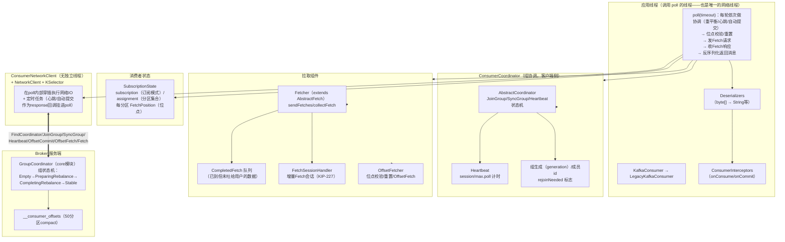
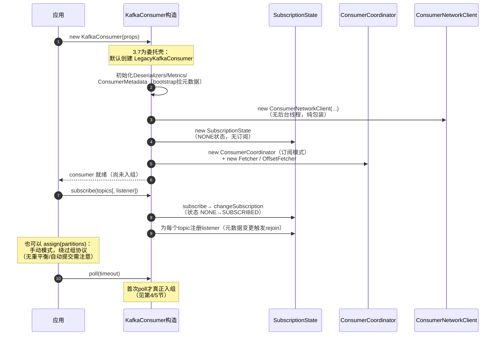
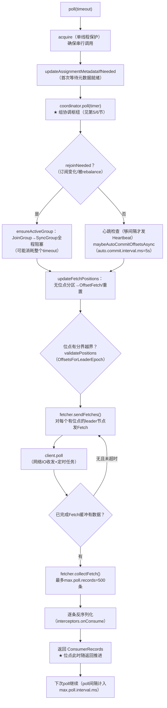
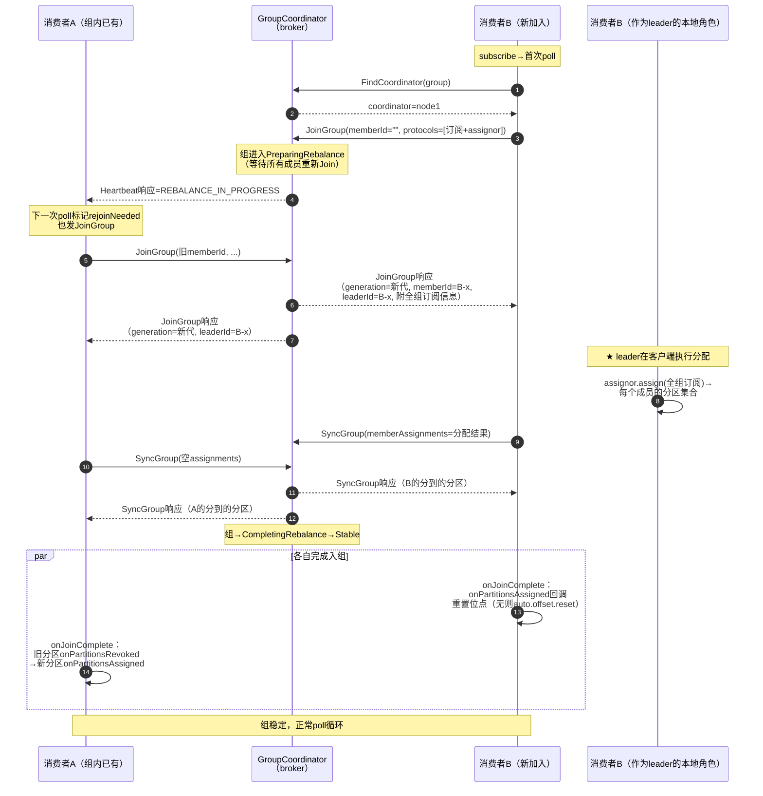
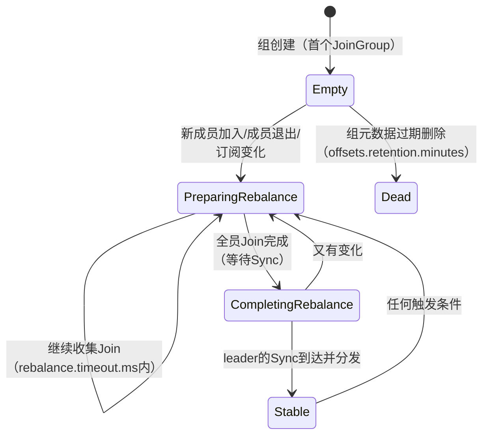
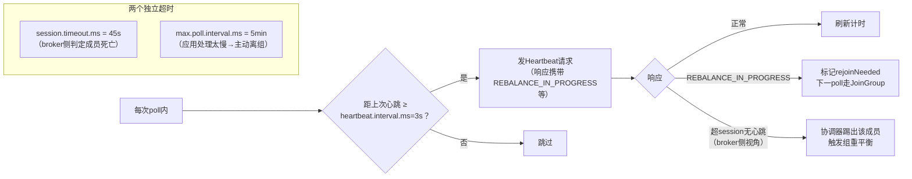
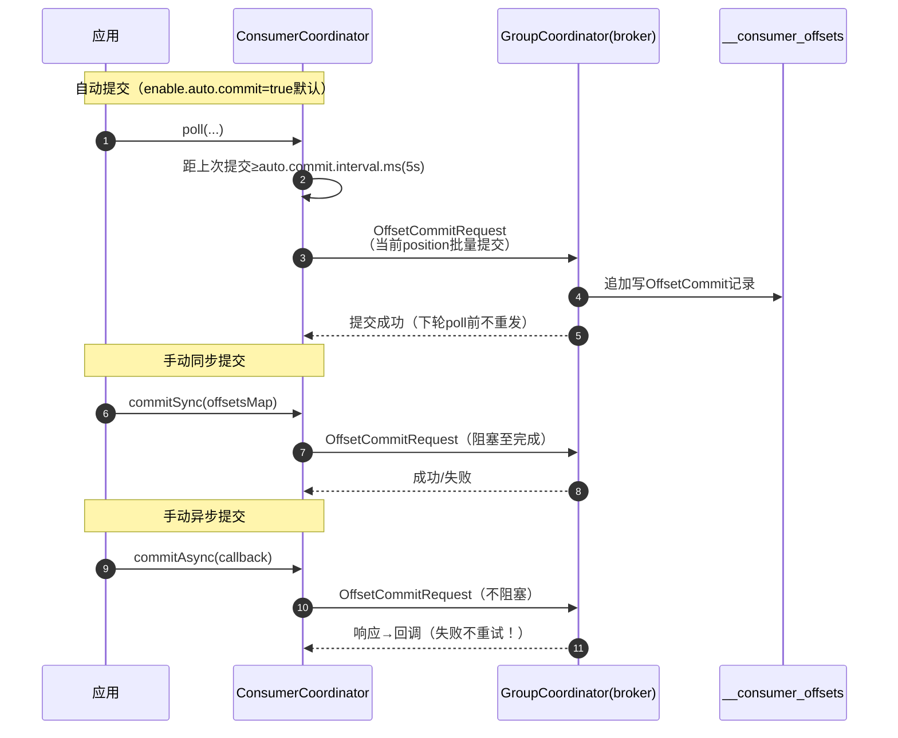
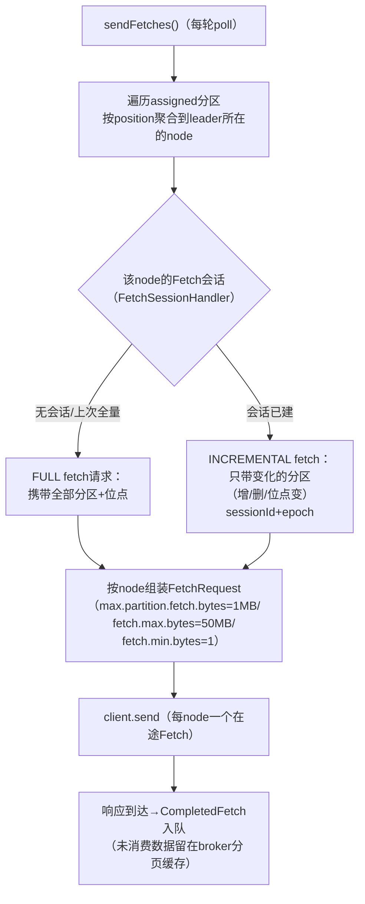
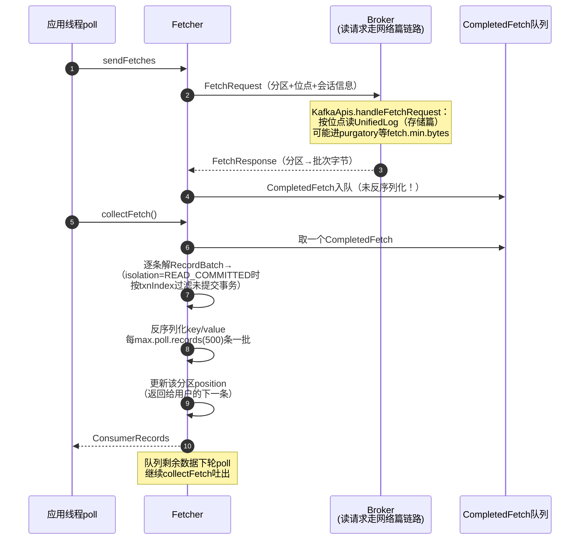
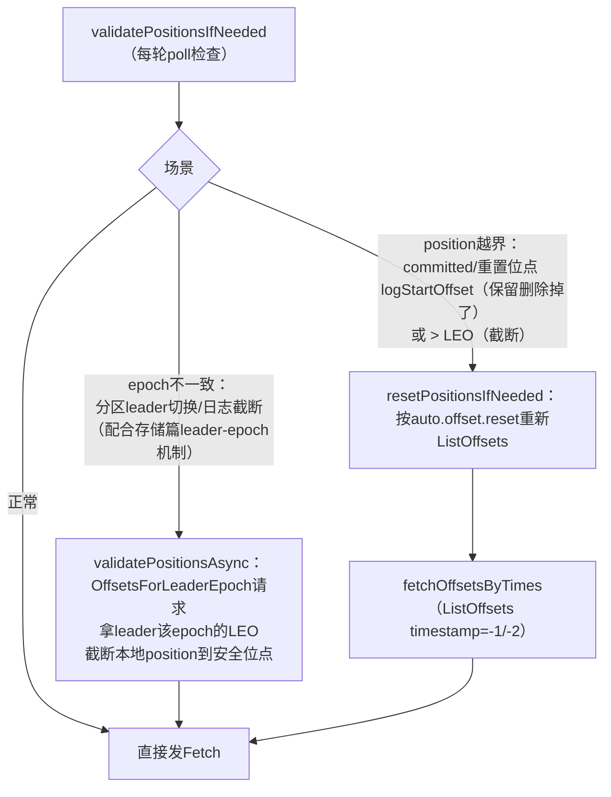

# Kafka 3.7.0 消费者工作流程深度解析（源码级）

> 基于 Kafka **3.7.0**，源码均在 `clients` 模块 `org.apache.kafka.clients.consumer`：
> - `KafkaConsumer.java`（门面，3.7 起为委托壳：默认委托 `LegacyKafkaConsumer`；KIP-848 的 `AsyncKafkaConsumer` 为早期预览，本文以默认实现为主线）
> - `internals/LegacyKafkaConsumer.java`、`ConsumerNetworkClient.java`、`SubscriptionState.java`
> - `internals/ConsumerCoordinator.java` + `AbstractCoordinator.java`（消费组协调/重平衡）
> - `internals/Fetcher.java`、`AbstractFetch.java`、`CompletedFetch.java`、`FetchSessionHandler.java`（拉取）
> - `internals/OffsetFetcher.java`、`SubscriptionState`（位点管理）
> - 服务端对应：`GroupCoordinator`（core 模块）、`__consumer_offsets`

---

## 目录

1. [总体架构](#1-总体架构)
2. [消费者组协议基础](#2-消费者组协议基础)
3. [启动与订阅流程](#3-启动与订阅流程)
4. [poll() 主循环：一切的中枢](#4-poll-主循环一切的中枢)
5. [重平衡全流程](#5-重平衡全流程)
6. [心跳与存活检测](#6-心跳与存活检测)
7. [offset 管理](#7-offset-管理)
8. [拉取消息：Fetcher 与 Fetch 会话](#8-拉取消息fetcher-与-fetch-会话)
9. [位点重置与越界恢复](#9-位点重置与越界恢复)
10. [关键配置](#10-关键配置)
11. [调试断点指引](#11-调试断点指引)

---

## 1. 总体架构

消费者同样是"后台 + 前台"协作，但与生产者不同：**消费者没有独立网络线程**（Legacy 实现），网络 I/O 与重平衡都嵌在用户线程的 `poll()` 调用内（`ConsumerNetworkClient` 包装）。

**与生产者的关键差异对照：**

| 维度 | 生产者 | 消费者（Legacy 实现） |
|---|---|---|
| 网络线程 | 独立 Sender 线程 | 无——IO 内嵌在 `poll()` |
| 双线程解耦 | RecordAccumulator | 无缓冲区——`poll()` 内同步完成收发 |
| 拉/推 | 推（broker 被动写响应） | **拉（consumer 主动 Fetch）** |
| 组概念 | 无 | 消费组（成员/代/协调器） |

## 2. 消费者组协议基础

理解一切流程的前提，是这几个概念：

| 概念 | 内容 | 源码体现 |
|---|---|---|
| **组协调器** | broker 端组件，每组一个（按 `Math.abs(group.hashCode()) % 50` 定位 `__consumer_offsets` 的分区，该分区 leader 所在 broker 即协调器） | `FindCoordinator` 请求 |
| **组成员** | 每个消费者实例（memberId） | JoinGroup 时分配 |
| **组代 generation** | 一次重平衡产生一个代（generationId + memberAssignment 协议版本） | `Generation` 类 |
| **leader 成员** | 第一个加入组的成员，**在客户端执行分配算法**（不是 broker！） | `onLeaderElected` |
| **分配策略** | `partition.assignment.strategy`：RangeAssignor（默认）/ CooperativeStickyAssignor 等 | `ConsumerPartitionAssignor` |
| **组状态机**（broker 侧） | Empty → PreparingRebalance → CompletingRebalance → Stable | `GroupCoordinator` |

分区分配发生在 **leader 消费者的客户端**：所有成员把订阅信息经 JoinGroup 上报协调器，协调器只做"收集+转发"，leader 通过 SyncGroup 拿到全组订阅后本地跑 assignor，把结果作为 SyncGroup 响应分发。

## 3. 启动与订阅流程

要点：

- 构造函数只做准备（含首次 bootstrap 元数据拉取），**不建连不入组**；
- `subscribe()` 记录订阅 + RebalanceListener，标记 `rejoinNeeded`；
- `assign()` 是另一条路：**自管理分区**，无组协调（除非开启自动提交仍会入组提交）；

## 4. poll() 主循环：一切的中枢

Legacy 消费者把"协调、位点、拉取、反序列化"全部编排进一次 `poll()`：

**两个极易被忽略的语义：**

1. **位点推进发生在"返回给用户"时**——不是收到网络数据时。`CompletedFetch` 缓冲里的数据若用户没消费（poll 返回的 records），位点不变；
2. **poll 间隔即心跳的"应用侧存活"**——两次 `poll()` 的间隔若超过 `max.poll.interval.ms`（5min），消费者主动离组（` LeavingGroup`），哪怕 broker 侧心跳线程没死（Legacy 的心跳也在 poll 里，所以其实是 poll 停了心跳也停）。

## 5. 重平衡全流程

### 5.1 触发条件

| 来源 | 场景 |
|---|---|
| 成员变化 | 新成员加入 / 成员退出（close/crash→session超时） |
| 订阅变化 | `subscribe` 的 topic 列表变化 / topic 分区数增加（正则订阅自动感知） |
| 被动 | 协调器通知：`Heartbeat` 响应携带 `REBALANCE_IN_PROGRESS` / JoinGroup 响应 `FENCED` 等 |
| 应用侧 | poll 间隔超 `max.poll.interval.ms` 主动离组 |

### 5.2 完整时序（新成员加入触发）

### 5.3 Eager vs Cooperative（KIP-429）

上图为 **Eager（全域回收再分配）**：每次重平衡**所有成员先 revoke 全部分区**，STW 窗口大。`CooperativeStickyAssignor` 则：

- 只 revoke **实际要迁移**的分区，其余分区持续消费；
- 一轮重平衡可能拆成两代（先收敛"谁让出哪些"，再最终分配）；
- 响应协议不变，靠 assignor 的增量语义实现。

### 5.4 broker 侧组状态机

## 6. 心跳与存活检测

**两个超时不要混淆**：

- `session.timeout.ms` 判定的是**网络/进程级死亡**（心跳停了）；
- `max.poll.interval.ms` 判定的是**应用级假死**（poll 停了=处理太慢）——触发的是消费者**主动**离组（防止"活着但没能力消费"的成员占着分区）。

**静态成员（KIP-345）**：配置 `group.instance.id` 后，成员短暂重启（session 超时窗口内）不触发重平衡，协调器按 instanceId 恢复身份——适合容器滚动重启场景。

## 7. offset 管理

### 7.1 位点的三层含义

| 概念 | 含义 | 存储 |
|---|---|---|
| `FetchPosition`（position） | **消费位置**：下一条要拉的 offset | 仅内存（SubscriptionState） |
| committed offset | **提交位置**：组在该分区的确认进度 | `__consumer_offsets` |
| log end offset | 分区最新位点 | broker |

### 7.2 `__consumer_offsets` 内部格式

该 topic 50 个分区、compact 清理，存储的 value 是若干 key-value 记录：

| 记录类型 | key | value |
|---|---|---|
| OffsetCommit | `group+topic+partition` | offset/leaderEpoch/metadata/commitTimestamp |
| GroupMetadata | `group` | 成员列表/generation/协议（重平衡恢复用） |
| Tombstone | 同上（null value） | 删除标记（组过期/offset删除） |

**组→协调器的路由**：`__consumer_offsets` 分区号 = `Math.abs(group.hashCode()) % 50`，该分区 leader 即该组的协调器 broker——所有 JoinGroup/OffsetCommit 都发往它。

### 7.3 提交流程

**语义警告**：自动提交的是**poll 返回时的 position**——若拉回的消息还没处理完就提交了，崩溃后重置到 committed 会**重复消费**；反之手动提交在处理后，则崩溃时可能**丢失**（处理完未提交）。Kafka 默认语义是 **at-least-once（重复不丢失）**。

### 7.4 位点初始化（新组/位点过期）

入组成功、拿到分区但**无 committed offset** 时按 `auto.offset.reset`：

| 值 | 行为 |
|---|---|
| `latest`（默认） | ListOffsets(timestamp=-1) → 从分区末尾开始 |
| `earliest` | ListOffsets(timestamp=-2) → 从 logStartOffset 开始 |
| `none` | 抛 `NoOffsetForPartitionException` |

## 8. 拉取消息：Fetcher 与 Fetch 会话

### 8.1 请求构建（AbstractFetch.prepareFetchRequests）

### 8.2 增量 Fetch 会话（KIP-227）

broker 为每个会话缓存"上次发的分区集合"（`FetchMetadata` 缓存，上限 `max.incremental.fetch.session.cache.slots`=1000）。客户端 `FetchSessionHandler` 只发**差异**——几百分区只变更一两个时，请求体从 KB 级降到几十字节；broker 响应也只带**有新数据的分区**。

### 8.3 数据落地路径

**背压机制**：`fetch.max.wait.ms`(500ms) + `fetch.min.bytes`(1B) 控制 broker 端等待聚合；`max.poll.records`(500) 控制单次给应用吐多少——应用处理慢 → poll 间隔拉长 → position 推进慢 → 下次 Fetch 从旧位点继续，**天然背压**（超过 max.poll.interval 则离组）。

## 9. 位点重置与越界恢复

两种"position 失效"场景（`OffsetFetcher`）：

`OffsetOutOfRange` 错误响应也会触发 C 路径——这是消费一个已被 delete 保留策略清掉的历史消息时的典型现象。

## 10. 关键配置

| 配置 | 默认值 | 作用 | 阶段 |
|---|---|---|---|
| `group.id` | — | 组标识（订阅模式必须） | 协调 |
| `bootstrap.servers` | — | 入口 | 建连 |
| `enable.auto.commit` | true | 自动提交 | offset |
| `auto.commit.interval.ms` | 5s | 自动提交间隔 | offset |
| `auto.offset.reset` | latest | 无位点时的策略（latest/earliest/none） | offset |
| `session.timeout.ms` / `heartbeat.interval.ms` | 45s / 3s | broker 判死 / 心跳节奏 | 存活 |
| `max.poll.interval.ms` | 5min | 应用处理超时上限（超过主动离组） | 存活 |
| `max.poll.records` | 500 | 单次 poll 返回上限 | 拉取 |
| `fetch.min.bytes` / `fetch.max.wait.ms` | 1B / 500ms | broker 端聚合阈值 | 拉取 |
| `fetch.max.bytes` / `max.partition.fetch.bytes` | 50MB / 1MB | 响应大小上限（总/单分区） | 拉取 |
| `partition.assignment.strategy` | RangeAssignor | 分配策略（含 CooperativeSticky） | 重平衡 |
| `isolation.level` | read_uncommitted | read_committed 过滤未提交事务 | 拉取 |
| `group.instance.id` | 无 | 静态成员（KIP-345，免重启rebalance） | 重平衡 |

**可靠性调优组合**：手动 `commitSync`（处理完后）+ `max.poll.records` 调小（缩短处理窗口）+ CooperativeSticky（降低重平衡影响面）。

## 11. 调试断点指引

| 观察目标 | 断点位置 | 看什么 |
|---|---|---|
| 委托结构 | `KafkaConsumer` 构造 → `LegacyKafkaConsumer` | 3.7 双实现 |
| 订阅 | `SubscriptionState.subscribe` | 订阅模式/RebalanceListener |
| 入组 | `AbstractCoordinator.ensureActiveGroup` → `sendJoinGroupRequest` | FindCoordinator→JoinGroup |
| leader 分配 | `AbstractCoordinator.onLeaderElected` | **客户端执行 assignor** |
| 分发结果 | `SyncGroupResponseHandler.handle` | 自己分到的分区 |
| 入组完成 | `ConsumerCoordinator.onJoinComplete` | listener 回调、位点初始化 |
| poll 枢纽 | `LegacyKafkaConsumer.poll` | 协调→位点→拉取顺序 |
| 心跳 | `AbstractCoordinator.hasHeartbeatExpired` / `HeartbeatRequestManager`（异步版） | 节奏与 REBALANCE 通知 |
| 自动提交 | `ConsumerCoordinator.maybeAutoCommitOffsetsAsync` | 5s 节奏 |
| 位点提交 | `OffsetCommitRequest` 发送处 | 提交内容=当前 position |
| 位点重置 | `OffsetFetcher.resetPositionsIfNeeded` | auto.offset.reset 分支 |
| Fetch 构建 | `AbstractFetch.prepareFetchRequests` + `FetchSessionHandler` | 增量会话 epoch |
| 响应解析 | `CompletedFetch` / `Fetcher.collectFetch` | 500 条上限、position 推进 |
| 事务过滤 | `CompletedFetch` 中 isolation 相关 | READ_COMMITTED |

**动手实验建议**：

1. 两个 IDEA 实例跑同一 `group.id` 的消费者，在 `onLeaderElected` 断点观察分配结果与 generation 递增；
2. `enable.auto.commit=false`，对比 `commitSync` 前后用 `kafka-consumer-groups.sh --describe` 看 CURRENT-OFFSET 是否前移；
3. 向已消费的 topic 手动改 `auto.offset.reset=earliest` + 删除组（`--delete-offsets`），观察 `resetPositionsIfNeeded` 触发；
4. poll 循环里 `Thread.sleep(6*60*1000)`（> max.poll.interval），观察主动离组日志与重平衡。

---

## 附：一句话总结

**消费者 = "poll() 单线程总控：先组协调（JoinGroup/SyncGroup/心跳/自动提交）→ 再位点校验（OffsetFetch/重置/Epoch截断）→ 再拉取（增量Fetch会话）→ 反序列化返回并推进 position"**——一切服务端状态（组、代、提交位点）都在 broker 侧的 `GroupCoordinator` + `__consumer_offsets`，客户端只持有内存视图；重平衡由 leader 成员在**客户端**跑分配算法，broker 只做协调与转发。
