# Kafka 3.7.0 生产者发送消息流程深度解析（源码级）

> 基于 Kafka **3.7.0**，源码均在 `clients` 模块：
> - `clients/src/main/java/org/apache/kafka/clients/producer/KafkaProducer.java`（门面 + send）
> - `clients/src/main/java/org/apache/kafka/clients/producer/internals/`：
>   `RecordAccumulator.java`、`ProducerBatch.java`、`BufferPool.java`、`Sender.java`、
>   `ProducerMetadata.java`、`TransactionManager.java`、`BuiltInPartitioner.java`、`StickyPartitionCache.java`
> - `clients/src/main/java/org/apache/kafka/clients/NetworkClient.java`、`clients/.../network/Selector.java`（KSelector）
>
> 示例沿用 `ProducerTest`：`send(new ProducerRecord<>("test-topic01", "k1", "hello kafka")).get()`

---

## 目录

1. [总体架构：双线程模型](#1-总体架构双线程模型)
2. [send() 主流程（应用线程）](#2-send-主流程应用线程)
3. [RecordAccumulator：生产者缓冲区](#3-recordaccumulator生产者缓冲区)
4. [BufferPool：内存池](#4-bufferpool内存池)
5. [分区选择与粘性分区](#5-分区选择与粘性分区)
6. [Sender 线程主循环](#6-sender-线程主循环)
7. [元数据（ProducerMetadata）](#7-元数据producermetadata)
8. [NetworkClient：请求收发与连接管理](#8-networkclient请求收发与连接管理)
9. [响应处理、重试与幂等](#9-响应处理重试与幂等)
10. [close() 与优雅关闭](#10-close-与优雅关闭)
11. [端到端时序总图](#11-端到端时序总图)
12. [关键配置](#12-关键配置)
13. [调试断点指引](#13-调试断点指引)

---

## 1. 总体架构：双线程模型

KafkaProducer 是**双线程**设计：业务线程只做"攒批"（微秒级），网络 I/O 全部交给一个后台 `Sender` 线程，两者通过 `RecordAccumulator`（并发队列）解耦。

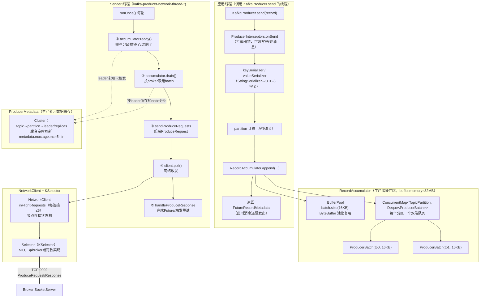

**各组件一句话职责：**

| 组件 | 职责 |
|---|---|
| `KafkaProducer` | 门面：校验、拦截器、序列化、分区、入队 |
| `RecordAccumulator` | 缓冲区核心：分区→批次队列，攒批（batch.size / linger.ms） |
| `ProducerBatch` | 一批消息的封装（内部 `MemoryRecordsBuilder` 写 RecordBatch v2 格式） |
| `BufferPool` | 16KB batch 缓冲池化，避免 GC 抖动 |
| `Sender` | 后台 I/O 线程：drain→组请求→poll→处理响应 |
| `ProducerMetadata` | 集群元数据缓存，分区→broker 路由的依据 |
| `NetworkClient` + `Selector` | 与 broker 的连接管理、请求收发、响应配对（correlationId） |
| `TransactionManager` | 事务/幂等状态机（enable.idempotence 默认开启，3.x） |

## 2. send() 主流程（应用线程）

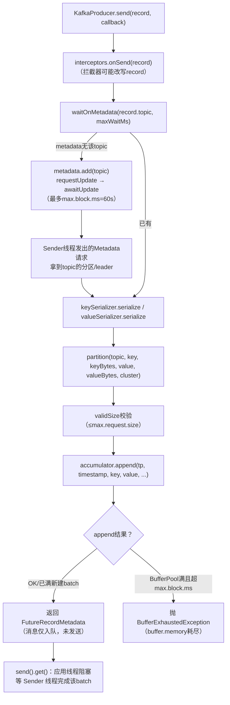

**关键认知：`send()` 返回 ≠ 消息已发送**——只是进了缓冲区。真正的网络发送由 Sender 异步完成，`Future.get()` 才能确认结果。这就是 KafkaProducer 高吞吐的根基：业务线程的 `send()` 成本极低（序列化 + 入队，微秒级）。

## 3. RecordAccumulator：生产者缓冲区

### 3.1 数据结构

```java
// RecordAccumulator 的核心字段
private final ConcurrentMap<TopicPartition, Deque<ProducerBatch>> batches;
private final BufferPool free;      // buffer.memory 池
private final IncompleteBatches incomplete;
```

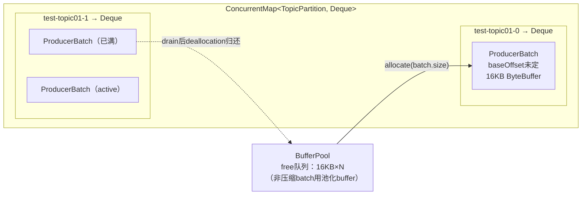

### 3.2 append 的逻辑（RecordAccumulator.append）

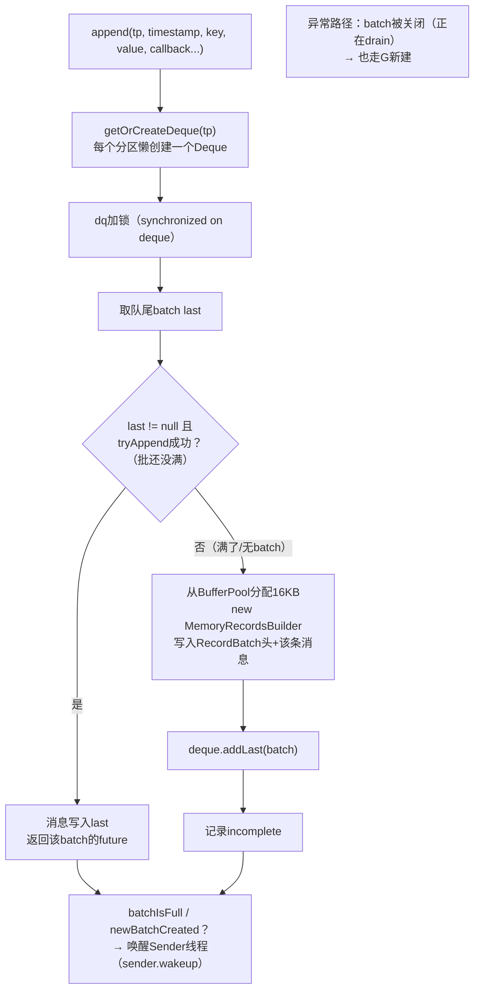

细节：

- **一个分区的消息永远追加到队尾 batch**（tryAppend），队头只被 Sender drain——双端各司其职，天然无锁冲突（分区内的 deque 锁粒度）；
- `RecordAppendResult.abortIfNewBatch`、`batchIsFull` 等标志决定是否唤醒 Sender；
- **压缩场景不使用 BufferPool**（压缩 buffer 大小不定，直接 allocate，batch 关闭后 GC 回收）。

### 3.3 batch 何时"就绪"（ready 的判定）

Sender 每轮调 `accumulator.ready(metadata, now)`，一个**分区**就绪的条件（满足其一）：

1. 队头 batch **写满**（`batch.size` = 16KB）；
2. 队头 batch **滞留超过 `linger.ms`**（默认 0，即立刻发送——你本地测试就是这个行为）；
3. batch 已被重试标记（立即重发）；
4. 有 batch 内存不足被 abort 过（`flush` 场景）。

结果 `ReadyCheckResult` 含：就绪分区集合 + **unknownLeaderTopics**（元数据缺失的 topic）+ nextReadyCheckDelayMs（ Sender 的 poll 超时依据）。

## 4. BufferPool：内存池

`buffer.memory`（默认 32MB）中，**只有等于 `batch.size` 的请求才走池化**：

| 操作 | 行为 |
|---|---|
| `allocate(size)` | size == batch.size → 从 `free` 队列取一块复用；否则堆上新建 |
| 池耗尽 | 调用线程**阻塞等待**（`max.block.ms` = 60s 超时抛 `BufferExhaustedException`） |
| `deallocate(buffer, size)` | batch 被 Sender 完成处理后归还（压缩 batch 直接丢弃给 GC） |
| `nonBlockingAvailableSize` | 池内可用量监控 |

设计动机：高频分配/释放 16KB 堆外/堆内 buffer 会带来 GC 压力，池化后稳态下**零分配**。

## 5. 分区选择与粘性分区

3.7 的 `KafkaProducer.partition`（`BuiltInPartitioner`）逻辑：

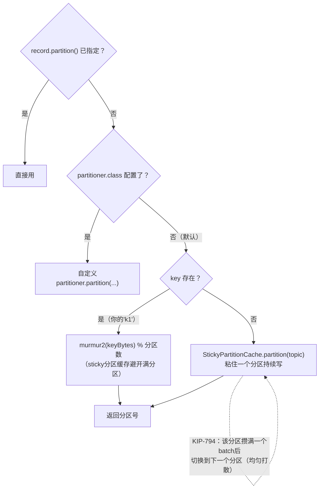

- **有 key**：`Utils.toPositive(Utils.murmur2(keyBytes)) % numPartitions`——同 key 恒定同分区（保序的前提）；
- **无 key**：粘性分区（3.3 起的 KIP-794 增强版）——不再每条消息轮换分区，而是粘住一个分区写满一个 batch 再切换，**减少小 batch、提高压缩率**，同时仍保证长期均匀。

## 6. Sender 线程主循环

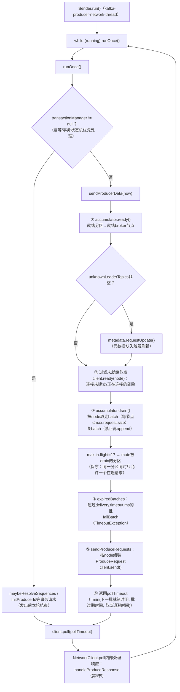

**drain 的细节**（`RecordAccumulator.drain`）：

- 遍历每个就绪 node 的其 leader 所在的所有分区，从各自 deque **队头**取 batch；
- 取出的 batch 被 `close()`（应用线程此后无法 append，只能新建后继 batch）；
- `max.in.flight.requests.per.connection=5`（默认）时，同 node 最多 5 个请求在途；配置为 1 且 `enable.idempotence=true` 时通过 **mute 分区**保证严格顺序；
- 单节点一次 drain 的总大小 ≤ `max.request.size`。

## 7. 元数据（ProducerMetadata）

`ProducerMetadata` 继承 `Metadata`，是"哪些分区、leader 在哪个 broker"的客户端缓存：

| 场景 | 行为 |
|---|---|
| `send()` 遇到未知 topic | `metadata.add(topic)` + `requestUpdate`，`awaitUpdate` 阻塞应用线程（≤ max.block.ms） |
| Sender 发现 unknownLeaderTopics | `requestUpdate(false)`，本轮先发 Metadata 请求 |
| 定时刷新 | `metadata.max.age.ms`（5min）后台更新 |
| 分区 leader 变更 | 收到 `NOT_LEADER_OR_FOLLOWER` 等错误 → `requestUpdate`，下一轮按新 leader 重路由 |
| 批量失效 | producer 侧响应处理发现 topic 元数据过期 → 相关 in-flight batch 重排入队 |

**`ProducerMetadata` 特有的"批次时间窗"优化**：记录每个 topic 的 `lastBatchCreatedTime`——topic 有活跃批次时（`metadataIdleMs` 内发过数据）,元数据更新可以更快满足，避免长时间等待。

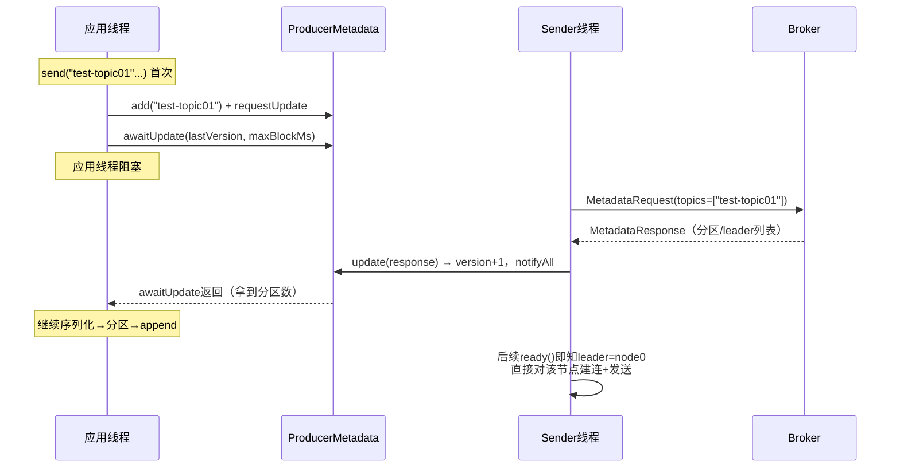

## 8. NetworkClient：请求收发与连接管理

`NetworkClient` 在 Sender 线程上下文里执行，包装 `KSelector`（与 broker 端 Processor 复用同一个 `Selector` 实现）：

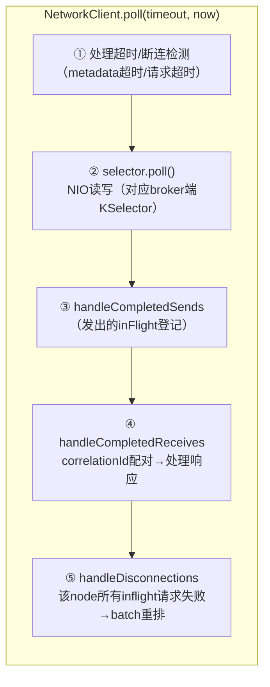

- **连接状态机**：`node.ready()` 内部 `initiateConnect` 异步建连，`isReady` 才允许 send；连接失败按 `reconnect.backoff.ms`（指数退避到 `reconnect.backoff.max.ms`）重试；
- **请求配对**：`correlationId` 严格递增，响应按序到达（broker 端顺序保证），`inFlightRequests` 按 node 维护 ≤ `max.in.flight.requests.per.connection`；
- **DNS/多节点**：bootstrap.servers 只是"入口"——拉到元数据后，producer 直连各分区 leader 所在节点，与 bootstrap 列表无关。

## 9. 响应处理、重试与幂等

### 9.1 响应处理（Sender → ProducerBatch → Future）

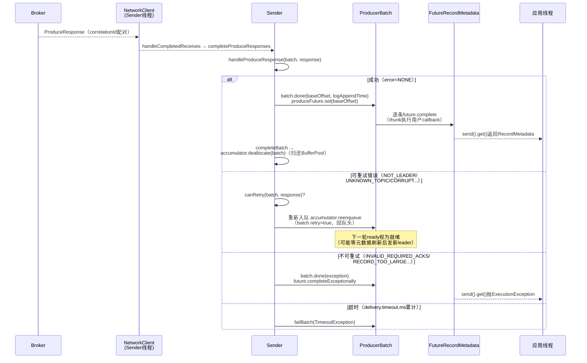

### 9.2 重试的关键细节

- **重试次数**：`retries`（默认 `Integer.MAX_VALUE`，3.0 起），由 `delivery.timeout.ms`（120s，含攒批+首次发送+所有重试）统一兜底；
- **重排入队**：失败的 batch `reenqueue` 回**队头**，保持分区顺序；
- **批拆分**：若 batch 重试时超过 `max.request.size`（元数据变更/压缩率变化），`splitAndReenqueue` 拆成多个小批——3.0 后对用户透明；
- **退避**：可重试错误按 `retry.backoff.ms`（100ms）延迟。

### 9.3 幂等（enable.idempotence=true，3.x 默认）

| 机制 | 实现 |
|---|---|
| broker 去重窗口 | 每个分区维护 `(producerId, baseSequence)`，`ProducerStateManager` 记录每个 pid 最近 5 个 batch 的元数据，重复 seq 拒收（`DUPLICATE_SEQUENCE_NUMBER` 静默成功） |
| producer 侧 | `TransactionManager` 分配递增 sequence，重试时**复用原 sequence**（不是新批），broker 才能识别为同一批 |
| 严格顺序 | `max.in.flight ≤ 5` 且 broker 按序响应，配合重试重排，保证**单分区不乱序不重复** |
| InitProducerId | 幂等模式启动时 Sender 自动向 broker 申请 producerId（broker 侧持久化到 `.snapshot`） |

## 10. close() 与优雅关闭

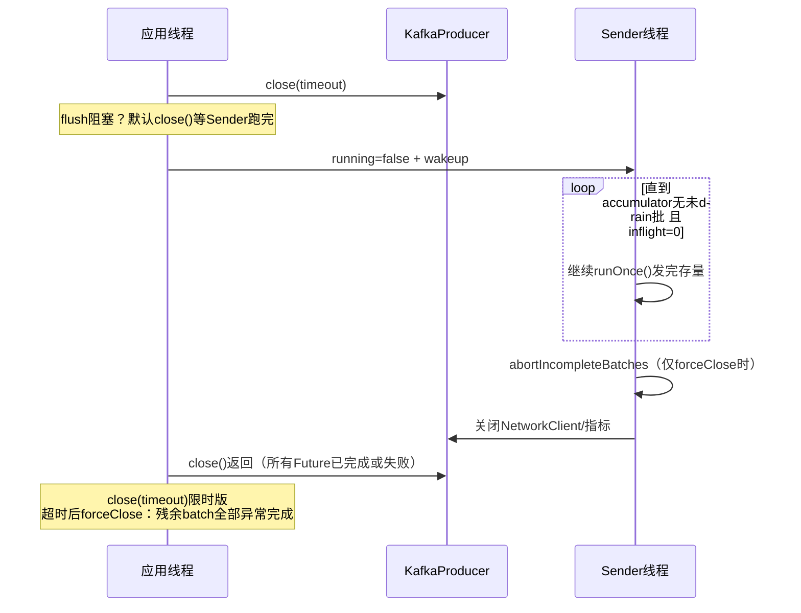

`close()` 默认无限等待发完存量（`Long.MAX_VALUE`）；`close(timeout)` 超时走 forceClose 路径，`abortIncompleteBatches` 让所有未完成 Future 抛异常——**保证 Future 终态化**，不会出现"程序退出了 send().get() 还挂着"。

## 11. 端到端时序总图

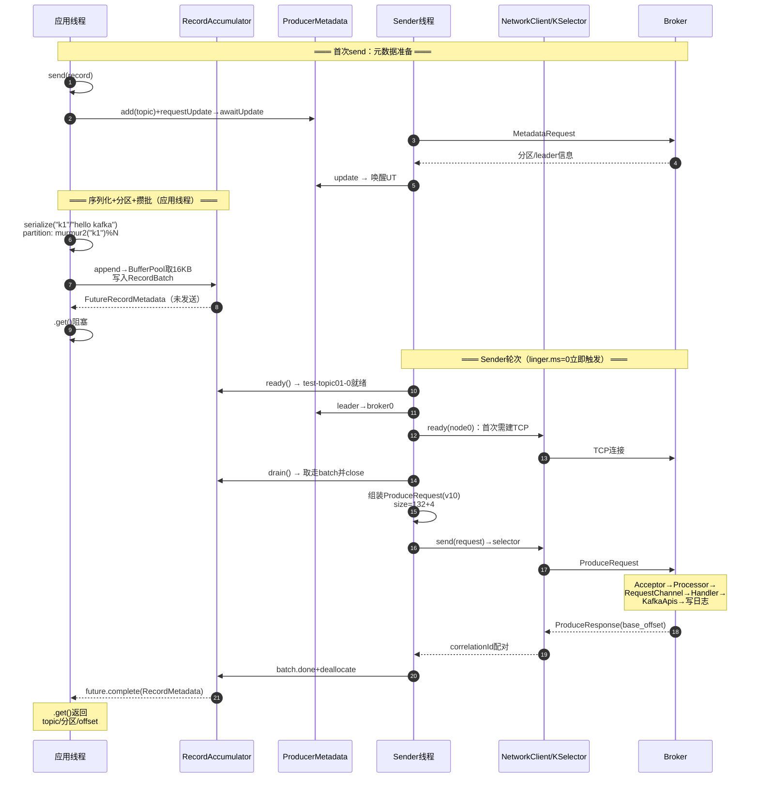

## 12. 关键配置

| 配置 | 默认值 | 作用 | 阶段 |
|---|---|---|---|
| `bootstrap.servers` | — | 入口地址（仅用于首次元数据） | 建连 |
| `key/value.serializer` | — | 序列化器 | send |
| `buffer.memory` | 32MB | 缓冲区总大小，耗尽+超时抛 `BufferExhaustedException` | append |
| `batch.size` | 16KB | 单批大小上限；**也是池化buffer规格** | append/ready |
| `linger.ms` | 0 | 批滞留时间（0=立即发，调大提高攒批率） | ready |
| `partitioner.class` | 内置（3.7中DefaultPartitioner已标记弃用） | 分区策略（key murmur2 / 粘性） | partition |
| `max.block.ms` | 60s | 元数据获取+BufferPool等待的总阻塞上限 | send |
| `max.request.size` | 1MB | 单请求上限（批组总大小） | drain |
| `retries` / `delivery.timeout.ms` | MAX / 120s | 重试次数 / 总时限兜底 | 响应 |
| `retry.backoff.ms` | 100ms | 重试退避 | 响应 |
| `acks` | all（3.0起） | 0/1/all 可靠性等级 | 协议 |
| `enable.idempotence` | true（3.0起） | 幂等：pid+sequence | 协议 |
| `max.in.flight.requests.per.connection` | 5 | 单连接在途请求数（=1+幂等→严格保序） | NetworkClient |
| `compression.type` | none | none/gzip/snappy/lz4/zstd（批级压缩） | append |
| `metadata.max.age.ms` | 5min | 元数据强制刷新周期 | metadata |
| `request.timeout.ms` | 30s | 单请求超时 | NetworkClient |

**性能/可靠性调优的常见杠杆**：吞吐 → 增大 `batch.size` + `linger.ms` + 压缩；时延 → `linger.ms=0`（默认）+ `acks=1`；可靠 → `acks=all` + `retries` + 幂等（3.x 默认即最可靠配置）。

## 13. 调试断点指引

| 观察目标 | 断点位置 | 看什么 |
|---|---|---|
| send 主流程 | `KafkaProducer.send` / `doSend` | 拦截器、序列化、分区计算 |
| 元数据等待 | `ProducerMetadata.awaitUpdate` / `Sender` 发 MetadataRequest | 首次 send 的阻塞唤醒 |
| 攒批 | `RecordAccumulator.append` → `tryAppend` | 队尾批复用 vs 新建 |
| 内存池 | `BufferPool.allocate` / `deallocate` | free 队列、availableMemory |
| 分区选择 | `BuiltInPartitioner.partition` | murmur2、粘性缓存 |
| 就绪判定 | `RecordAccumulator.ready` | linger/满批逻辑 |
| 取批组包 | `RecordAccumulator.drain` → `Sender.sendProduceRequests` | 队头取出、ProduceRequest 组装 |
| 网络收发 | `NetworkClient.poll` / `Selector.poll` | 与 broker 端 KSelector 对称 |
| 响应回调 | `Sender.completeBatch` / `ProducerBatch.done` | 成功路径 + 重试分支 |
| 幂等申请 | `TransactionManager` 的 InitProducerId 相关 | producerId/epoch |
| 优雅关闭 | `KafkaProducer.close` / `Sender.run` 尾部 | 存量发完 + Future 终态化 |

**与你的 ProducerTest 对应的观察点**：

1. 首次 `send()` 在 `awaitUpdate` 断点停下——能看到应用线程等元数据；Resume 后 `drain` 断点命中——linger.ms=0 使批立即就绪；
2. `handleProduceResponse` 断点看 `baseOffset`（即 `recordMetadata.offset()` 的来源）；
3. 把 `linger.ms` 改成 100 再连续 send 5 条，在 `drain` 处观察一个 batch 里 5 条消息（RecordBatch 的 records>1）；
4. `enable.idempotence=false` 与 `true` 各跑一次，对比 `Sender.runOnce` 里 TransactionManager 分支是否进入。

---

## 附：一句话总结

**生产者发送 = 业务线程"序列化→分区→攒批进缓冲区"（微秒级返回 Future）+ Sender 线程"就绪判定→按 leader 取批→组装请求→NIO 收发→响应完成 Future / 失败重排"**——`send()` 与实际发送彻底解耦，`buffer.memory` 是反压边界，元数据是路由依据，幂等序列号是"至少一次升级到精确一次（单分区）"的关键。
