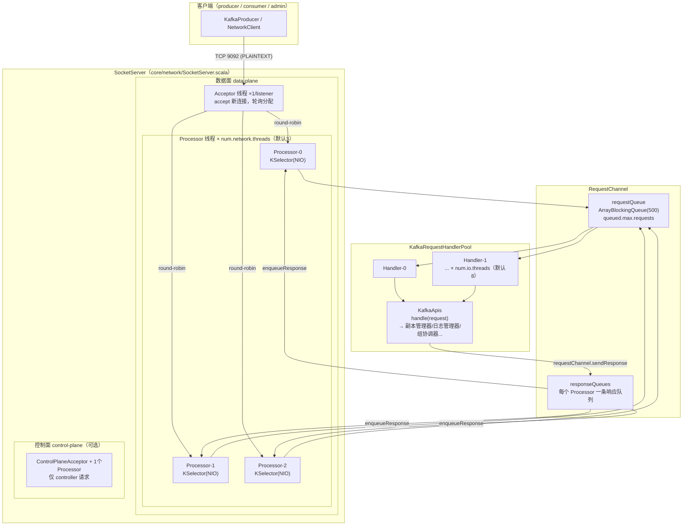
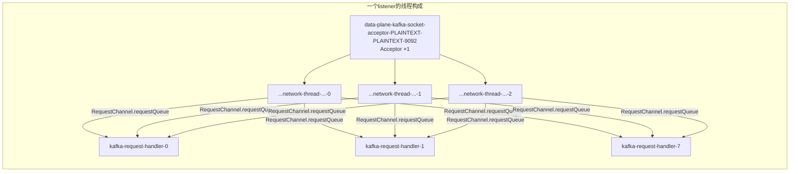
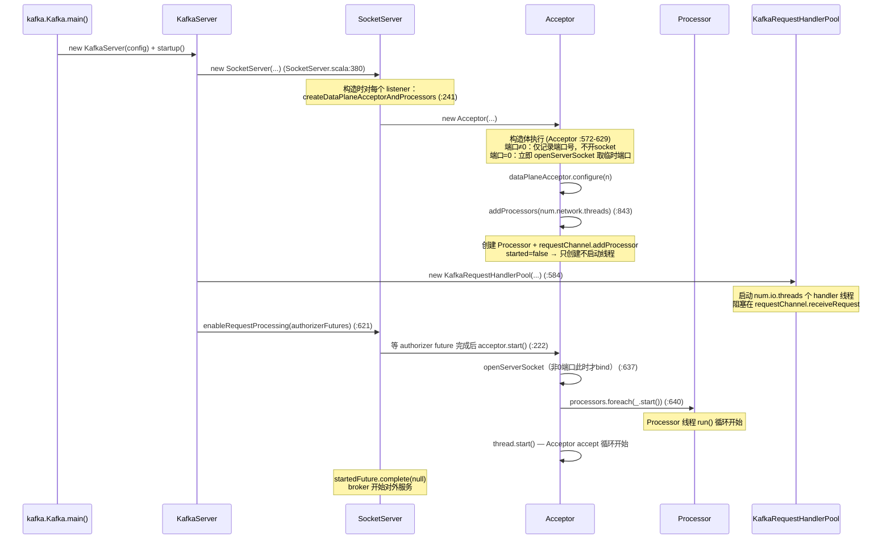
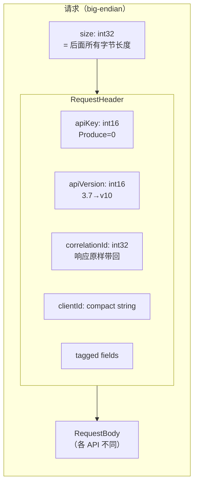
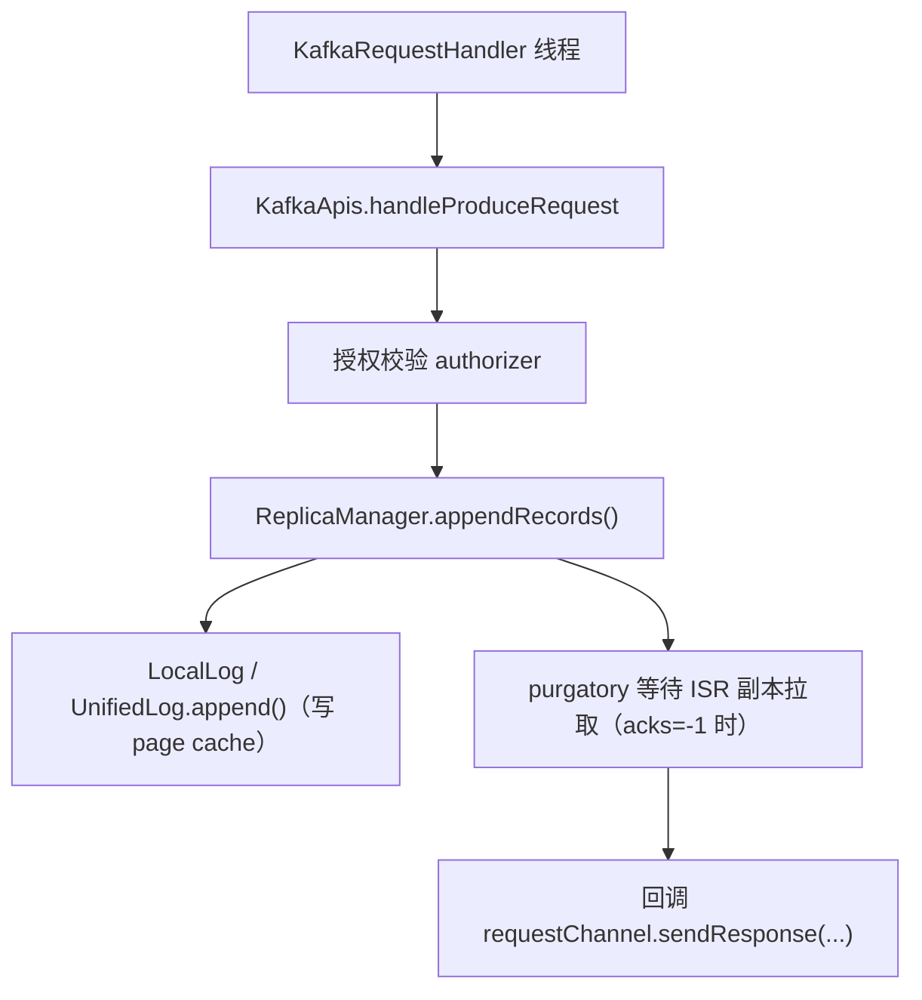
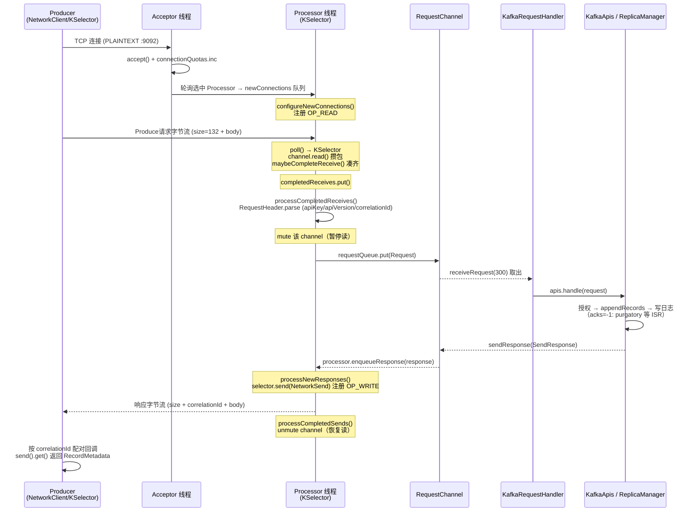
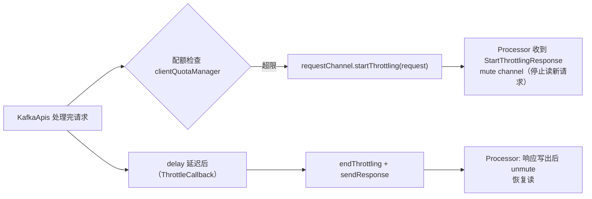
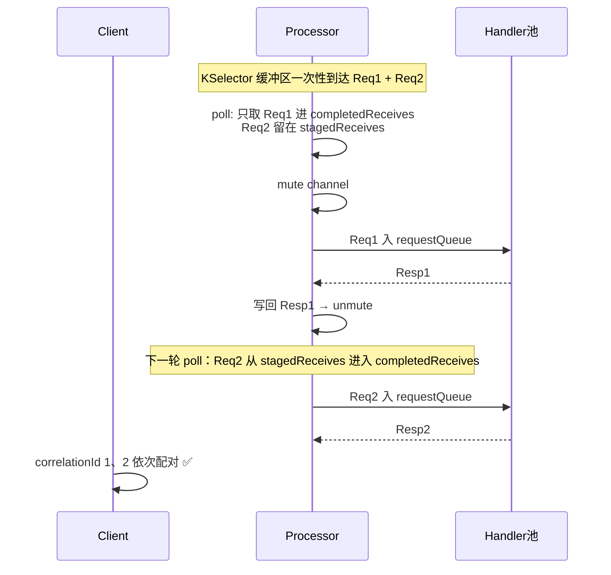
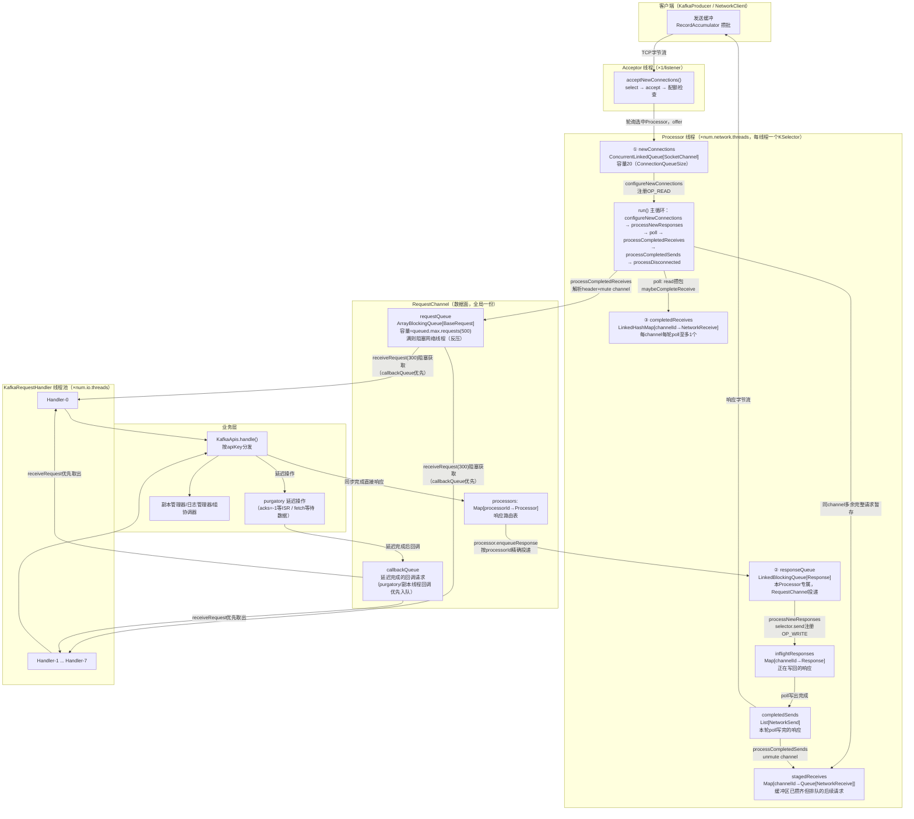
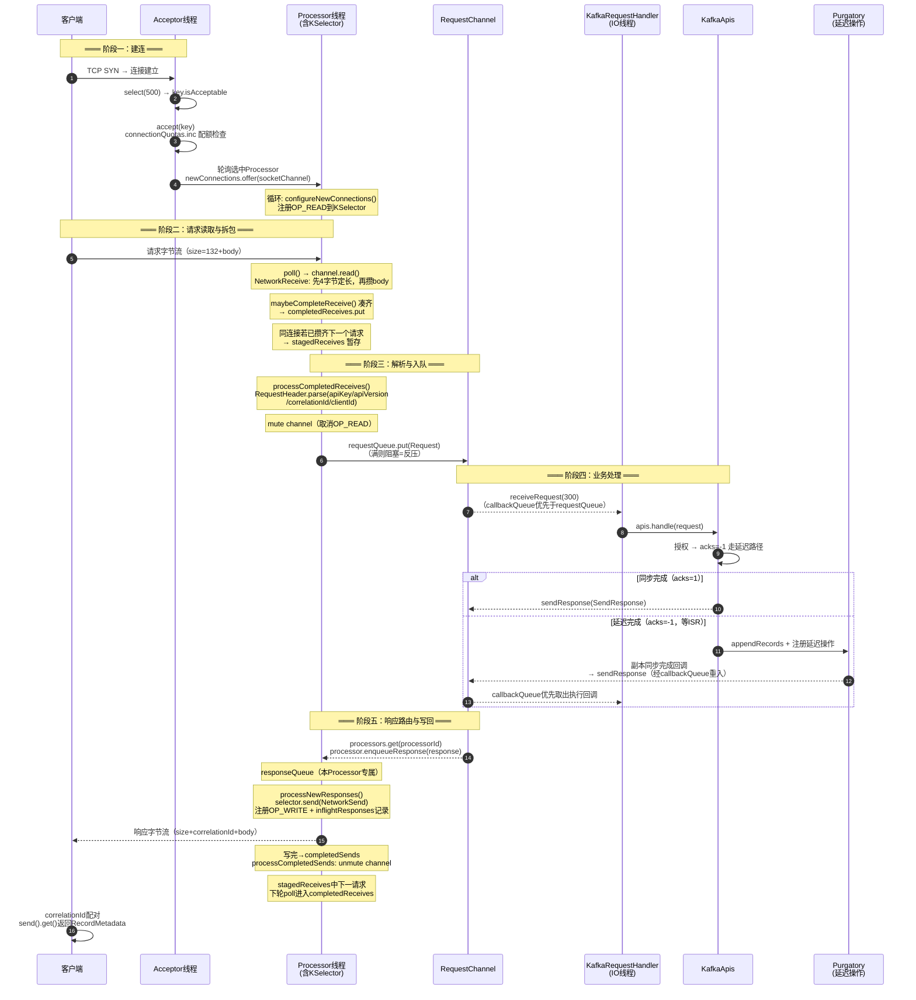

# Kafka 3.7.0 网络通信架构与请求处理流程（源码深度解析）

> 基于 Kafka **3.7.0** 源码，ZooKeeper 模式（`config/server.properties`）。
> 涉及的核心源码文件：
> - `core/src/main/scala/kafka/network/SocketServer.scala`（网络层核心）
> - `core/src/main/scala/kafka/network/RequestChannel.scala`（请求/响应通道）
> - `core/src/main/scala/kafka/server/KafkaServer.scala`（Broker 启动）
> - `core/src/main/scala/kafka/server/KafkaRequestHandler.scala`（IO 线程）
> - `core/src/main/scala/kafka/server/KafkaApis.scala`（请求业务处理）
> - `clients/src/main/java/org/apache/kafka/common/network/Selector.java`（KSelector，clients 模块）
> - `clients/src/main/java/org/apache/kafka/common/network/NetworkReceive.java`（拆包）

---

## 目录

1. [总体架构](#1-总体架构)
2. [线程模型](#2-线程模型)
3. [Broker 启动流程（网络层视角）](#3-broker-启动流程网络层视角)
4. [SocketServer：网络层入口](#4-socketserver网络层入口)
5. [Acceptor：接收连接](#5-acceptor接收连接)
6. [Processor：网络读写核心](#6-processor网络读写核心)
7. [KSelector 与协议拆包](#7-kselector-与协议拆包)
8. [请求的线上格式](#8-请求的线上格式)
9. [RequestChannel：请求队列与响应路由](#9-requestchannel请求队列与响应路由)
10. [KafkaRequestHandler：IO 线程与业务处理](#10-kafkarequesthandlerio-线程与业务处理)
11. [一条 Produce 请求的完整时序](#11-一条-produce-请求的完整时序)
12. [响应回写与流量控制（Throttling）](#12-响应回写与流量控制throttling)
13. [顺序保证的关键设计](#13-顺序保证的关键设计)
14. [关键配置项](#14-关键配置项)
15. [调试断点指引](#15-调试断点指引)
16. [整体流程图（含全部队列）](#16-整体流程图含全部队列)
17. [整体时序图（单请求全链路）](#17-整体时序图单请求全链路)

---

## 1. 总体架构

Kafka Broker 的网络层采用经典的 **「Reactor 多反应器」** 模型：一个 Acceptor 接收连接，多个 Processor 处理网络 I/O，一个共享请求队列衔接业务线程池。



**分层职责一句话总结：**

| 层 | 类 | 职责 |
|---|---|---|
| 接入层 | `Acceptor` | `ServerSocketChannel.accept()`，把连接轮询分给 Processor |
| 网络 I/O 层 | `Processor` + `KSelector` | NIO 读写、协议拆包/封包、限流执行 |
| 队列层 | `RequestChannel` | 解耦网络线程与业务线程；按 processor 路由响应 |
| 业务层 | `KafkaRequestHandler` + `KafkaApis` | 反序列化后的请求处理、写日志、副本同步 |

---

## 2. 线程模型



- **Acceptor**：每 listener 1 个，非守护线程（`KafkaThread.nonDaemon`，SocketServer.scala:627），保证优雅关闭。
- **Processor（网络线程）**：数量 = `num.network.threads`（默认 3），线程名形如 `data-plane-kafka-network-thread-0-PLAINTEXT-PLAINTEXT-0`。**可动态调整**（`num.network.threads` 是动态配置，经 `Reconfigurable` 机制走 `addProcessors`/`removeProcessors`）。
- **KafkaRequestHandler（IO 线程）**：数量 = `num.io.threads`（默认 8），从 `RequestChannel` 阻塞式取请求，执行 `KafkaApis.handle()`。
- **监听器隔离**：数据面（data-plane）与控制面（control-plane，`control.plane.listener.name` 配置时启用）各有一套 Acceptor/Processor，互不干扰，保证 controller 请求不被海量数据请求阻塞。

---

## 3. Broker 启动流程（网络层视角）

Kafka 3.7 与旧版本（<3.0）的重要差异：**没有 `socketServer.startup()`**，改为「构造时建数据结构 → `enableRequestProcessing` 延后启动线程」。



**为什么端口打开要推迟到 `enableRequestProcessing`？**（Acceptor :600-603 注释）

- 端口非 0 时，socket 推迟到 `start()` 打开，避免"端口可连但服务未就绪"的窗口误导就绪探测（如 K8s readiness probe）；
- 端口配置为 0（临时端口）时例外：必须构造时就 bind，才能从 `serverChannel.socket().getLocalPort()` 读出真实端口用于注册。

**`enableRequestProcessing`（SocketServer.scala:199）的核心逻辑：** 每个 Acceptor 等待对应 listener 的 **Authorizer 启动完成**（`authorizerFutures`），完成后 `acceptor.start()`——即鉴权插件就绪之前，broker 可以接受 TCP 连接但不处理请求。

---

## 4. SocketServer：网络层入口

`SocketServer` 是整个网络层的容器，一个 broker 只有一个实例（`KafkaServer.scala:133`）。

关键成员：

```scala
// SocketServer.scala
private[network] val dataPlaneAcceptors = new ConcurrentHashMap[EndPoint, DataPlaneAcceptor]()  // :99
val dataPlaneRequestChannel = new RequestChannel(maxQueuedRequests, ...)                        // :100
private[network] var controlPlaneAcceptorOpt: Option[ControlPlaneAcceptor] = None              // :102
```

**构造时的初始化（:171-176）：**

```scala
if (apiVersionManager.listenerType.equals(ListenerType.CONTROLLER)) {
  config.controllerListeners.foreach(createDataPlaneAcceptorAndProcessors)
} else {
  config.controlPlaneListener.foreach(createControlPlaneAcceptorAndProcessor)
  config.dataPlaneListeners.foreach(createDataPlaneAcceptorAndProcessors)
}
```

即：按 `listeners` 配置为每个 listener 创建一个 `DataPlaneAcceptor`；`listeners` 支持多协议多端口（如 `PLAINTEXT://:9092,SSL://:9093`），每个 listener 一套 Acceptor + N 个 Processor。

---

## 5. Acceptor：接收连接

**类定义（:572）：** `abstract class Acceptor(...) extends Runnable with Logging`，子类 `DataPlaneAcceptor` / `ControlPlaneAcceptor`。

### 5.1 accept 循环

```scala
// Acceptor.run() 核心循环（:742 acceptNewConnections，简化）
private def acceptNewConnections(): Unit = {
  val ready = nioSelector.select(500)          // 原生 NIO selector，500ms 超时
  if (ready > 0) {
    // 遍历就绪的 SelectionKey
    if (key.isAcceptable) {
      accept(key).foreach { socketChannel =>   // accept + 配额检查
        var retriesLeft = synchronized(processors.length)
        var processor: Processor = null
        do {
          retriesLeft -= 1
          processor = synchronized {                        // :761-766
            // 先取模防越界（processors 数量可动态缩减），原子取出
            currentProcessorIndex = currentProcessorIndex % processors.length
            processors(currentProcessorIndex)
          }
          currentProcessorIndex += 1
        } while (!assignNewConnection(socketChannel, processor, retriesLeft == 0))
        // ↑ 目标 Processor 的 newConnections 队列满时，换下一个重试
      }
    }
  }
}
```

### 5.2 轮询分配的并发安全

为什么取 Processor 要 `synchronized`（:761-766）？因为 **`num.network.threads` 支持运行时动态修改**：

- 配置变更线程执行 `addProcessors` / `removeProcessors`（:843 / :660，均为 `synchronized` 方法）增删 `processors` 数组；
- Acceptor 线程同时在做 `currentProcessorIndex % processors.length`——不锁会竞态越界（如索引 3 对上缩容后的 2 个元素）。

**先取模再取**保证索引越界时被拉回合法范围，配合锁内读 `processors.length`，原子地完成"校正 + 取元素"。

### 5.3 连接配额与拒绝

`accept(key)`（:782）返回 `Option[SocketChannel]`：

```scala
try {
  connectionQuotas.inc(endPoint.listenerName, socketChannel.socket.getInetAddress, blockedPercentMeter)
  configureAcceptedSocketChannel(socketChannel)   // 设置 send/recv buffer 等
  Some(socketChannel)                             // ✅ 接受
} catch {
  case e: TooManyConnectionsException => ...; None   // 该 IP 超过 max.connections.per.ip → 拒绝
  case e: ConnectionThrottledException => ...; None  // 被限流 → 拒绝
}
```

---

## 6. Processor：网络读写核心

Processor 是网络层最复杂的组件，**每个 Processor 持有一个 `KSelector`（Kafka 封装的 NIO Selector）**，管理分配给它的所有连接。

### 6.1 主循环（run，:1003-1030）

```scala
override def run(): Unit = {
  while (shouldRun.get()) {
    configureNewConnections()   // ① 注册 Acceptor 分来的新连接（OP_READ 注册到 KSelector）
    processNewResponses()      // ② 从响应队列取响应，注册 OP_WRITE / 处理限流指令
    poll()                     // ③ selector.poll() —— 真正的 NIO select + 读写
    processCompletedReceives() // ④ 处理完整到达的请求 → 解析 header → 入 RequestChannel
    processCompletedSends()    // ⑤ 处理已写完的响应 → unmute channel（允许读下一个请求）
    processDisconnected()      // ⑥ 处理断连
    closeExcessConnections()   // ⑦ 关闭超额/被限流冻结的连接
  }
}
```

这七步的顺序本身就是协议语义的一部分：先挂新连接和响应的注册事件，再 poll 一次拿数据，然后消化结果。

### 6.2 新连接的注册（configureNewConnections，:1279）

Acceptor 只是把 `SocketChannel` 放进 Processor 的 `newConnections` 并发队列；Processor 在循环开头取出，设置非阻塞模式，`selector.register(id, socketChannel)` 注册 `OP_READ`。

### 6.3 请求的解析与入队（processCompletedReceives，:1125）

```scala
selector.completedReceives.forEach { receive =>
  val header = parseRequestHeader(receive.payload)   // RequestHeader.parse + apiEnabled 校验 (:1116)
  ...
  val nowNanos = time.nanoseconds()
  val context = new RequestContext(header, ...)      // 含 connectionId、listener、安全协议
  val req = RequestChannel.Request(processor = id, context = context, ...)
  requestChannel.sendRequest(req)                    // → requestQueue.put
  // 若该 channel 还有 staged receives（缓冲区里已攒着的下一个请求），稍后处理
}
```

### 6.4 channel 的 mute/unmute 机制

Processor 对每个连接采用 **"同一时刻只处理一个在途请求"** 的策略：

- 请求入队时 **mute**（取消 OP_READ）该 channel——防止响应还没写回就又读下一请求导致响应乱序；
- 响应写完后（`processCompletedSends`）**unmute**（恢复 OP_READ），此时缓冲区里 staged 的下一个请求才有机会进入 `completedReceives`。

这是 Kafka **同连接请求按序处理、按序响应** 的实现基石（详见[第13节](#13-顺序保证的关键设计)）。

---

## 7. KSelector 与协议拆包

`Processor` 内部的 `new KSelector(...)`（SocketServer.scala:982）是 import 重命名（:43）：

```scala
import java.nio.channels.{Selector => NSelector, _}                    // JDK 原生 → NSelector
import org.apache.kafka.common.network.{..., Selector => KSelector}    // Kafka 封装 → KSelector
```

`KSelector`（`clients/.../network/Selector.java`）包装了原生 `java.nio.channels.Selector`，同时被 **broker 端（Processor）和客户端（NetworkClient）复用**，提供：

- `KafkaChannel` 生命周期管理（创建/注册/关闭/鉴权握手）；
- 读：socket → `NetworkReceive`；写：`NetworkSend` → socket；
- 空闲连接检测（`connections.max.idle.ms`）、断连处理、metrics。

### 7.1 关键集合

```java
// Selector.java
private final LinkedHashMap<String, NetworkReceive> completedReceives;  // :109 本轮poll完成的请求
private final List<NetworkSend> completedSends;                         // 本轮poll写完的响应
```

`completedReceives` 唯一的添加入口是 `addToCompletedReceives`（:1050），两个调用点：

1. **正常路径（:674-682）**：
   ```java
   long bytesReceived = channel.read();                        // 字节攒进 NetworkReceive
   NetworkReceive receive = channel.maybeCompleteReceive();    // 凑齐一个完整请求？
   if (receive != null) addToCompletedReceives(channel, receive, currentTimeMs);
   ```
2. **重鉴权期间的响应（:566-569）**。

### 7.2 拆包：NetworkReceive 的两段式

TCP 是无消息边界的字节流，Kafka 用**长度前缀**定界，`NetworkReceive` 的实现：

```java
this.size = ByteBuffer.allocate(4);      // 先只给 4 字节缓冲
// readFrom:
//   第一步：攒够 4 字节 → 解出 int32 大端长度 N
//   第二步：按 N 分配 buffer，继续攒 N 字节
//   N > maxReceiveSize(socket.request.max.bytes) → InvalidReceiveException 断连（防 OOM）
```

这也是 `maybeCompleteReceive()` 判断"请求是否完整"的依据。

---

## 8. 请求的线上格式



以 `ProducerTest`（topic=`test-topic01`, key=`k1`, value=`hello kafka`）为例，**Produce v10**（与 v9 编码相同，KIP-951）：

```
┌─ RequestHeader（20B）────────────────────────┐
│ apiKey=0(2B) apiVersion=10(2B) correlationId(4B)│
│ clientId="producer-1"(1+10B) tagged(1B)     │
├─ Body（112B）────────────────────────────────┤
│ transactional_id=null(1B) acks=-1(2B) timeout=30000(4B) │
│ topics(1B)                                   │
│  └ name="test-topic01"(1+13B) tagged(1B)     │
│     └ partitions(1B)                         │
│        └ index: int32(4B)                    │
│        └ records: compact bytes(1B + 81B)    │
│           └ RecordBatch                      │
│              批头61B(offset8+len4+epoch4+magic1│
│              +crc4+attr2+lastOffsetDelta4     │
│              +ts8+maxTs8+pid8+epoch2+seq4+cnt4)│
│              记录20B(len1+attr1+tsDelta1      │
│              +offsetDelta1+keyLen1+"k1"2      │
│              +valLen1+"hello kafka"11+hdr1)   │
│ tagged(1B)                                   │
└──────────────────────────────────────────────┘
size字段值 = 20 + 112 = 132；线上总字节 = 4 + 132 = 136
```

**协议版本的协商**：客户端启动时发 ApiVersions 请求（apiKey=18）拿到 broker 支持范围，双方取交集最高版 → 3.7 client + 3.7 broker = Produce **v10**。

协议的权威定义在 `clients/src/main/resources/common/message/*.json`（如 `ProduceRequest.json`），构建时生成 `ProduceRequestData` 等 Java 类。

---

## 9. RequestChannel：请求队列与响应路由

`RequestChannel`（:354）是网络线程与业务线程的**解耦点**，同时承担**响应路由**。

```scala
class RequestChannel(val queueSize: Int, ...) {
  private val requestQueue = new ArrayBlockingQueue[BaseRequest](queueSize)  // :362，默认500
  private val processors = new ConcurrentHashMap[Int, Processor]()           // processorId → Processor

  def sendRequest(request: RequestChannel.Request): Unit =
    requestQueue.put(request)                          // :390-391，队列满则阻塞网络线程（反压）

  private[network] def sendResponse(response: Response): Unit = {
    ...
    val processor = processors.get(response.processor)  // :464 按 processorId 找回网络线程
    if (processor != null) processor.enqueueResponse(response)  // :468 放入该 Processor 的响应队列
  }
}
```

**五种响应类型**（`processNewResponses` :1052-1079 的 match）：

| 类型 | 含义 | Processor 的动作 |
|---|---|---|
| `SendResponse` | 正常响应 | `selector.send(new NetworkSend(...))` 注册 OP_WRITE（:1100） |
| `NoOpResponse` | 无需响应（如 acks=0 的 produce） | 直接 unmute channel 继续读下一请求 |
| `CloseConnectionResponse` | 出错主动断连 | `close(channelId)` |
| `StartThrottlingResponse` | 限流开始 | mute channel |
| `EndThrottlingResponse` | 限流结束 | 尝试 unmute |

注意路由细节：`Request` 对象记录了来源 `processor` id，响应不是广播，而是**精确送回当初接收该请求的那个 Processor**——因为只有它持有那条连接。

---

## 10. KafkaRequestHandler：IO 线程与业务处理

```scala
// KafkaRequestHandler.scala :105-160，简化
def run(): Unit = {
  while (running) {
    val req = requestChannel.receiveRequest(300)   // :114 阻塞最多300ms
    req match {
      case request: RequestChannel.Request =>
        apis.handle(request, requestLocal)          // :160 → KafkaApis.handle
      case RequestChannel.ShutdownRequest =>
        ...  // 优雅关闭信号
    }
  }
}
```

`KafkaApis.handle()` 按 `apiKey` 分发到 `handleProduceRequest` / `handleFetchRequest` / `handleListOffsetsRequest` 等。以 Produce 为例：



对 `acks=-1` 的延迟操作：`KafkaApis` 先返回，响应由 purgatory 中副本同步完成后经回调发出——响应可能**不经过**发起请求的那个 handler 线程，但 `RequestChannel.sendResponse` 内部的 processor 路由保证它回到正确的 Processor。

---

## 11. 一条 Produce 请求的完整时序



---

## 12. 响应回写与流量控制（Throttling）

### 12.1 回写路径

```scala
// Processor.sendResponse (:1088-1103)
if (openOrClosingChannel(connectionId).isDefined) {
  selector.send(new NetworkSend(connectionId, responseSend))   // 注册 OP_WRITE
  inflightResponses += (connectionId -> response)              // 写完后在 processCompletedSends 里消费
}
```

`NetworkSend` 同样是 `4字节size + body` 的封包，响应头只含 `correlationId`——客户端用它配对请求。

### 12.2 配额限流

Broker 支持按 clientId/user 的带宽配额（`quota.producer.default` 等）。超限的处理不是丢弃，而是**延迟**：



即：**限流的本质是 mute + 延迟响应**，让客户端的请求自然在 TCP/客户端侧排队，从而平滑地把速率压下来。

---

## 13. 顺序保证的关键设计

Kafka 保证：**同一条 TCP 连接上的请求严格按序处理、按序响应**。三个机制协同：

1. **`completedReceives` 每 channel 每轮 poll 至多一个**（Selector.java:1051-1052 直接抛 `IllegalStateException`）
   ——多余的已读字节停留在 `stagedReceives`，等本轮请求处理完再进入。防止一个 channel 的两个请求被两个 handler 线程并发处理导致响应乱序。

2. **请求入队时 mute、响应写完后 unmute**（Processor）
   ——处理期间不再从该连接读新请求，天然串行。

3. **`correlationId` 配对**
   ——响应按请求顺序写回，客户端按序配对（NetworkClient 的 inflight 请求列表）。



---

## 14. 关键配置项

| 配置 | 默认值 | 作用 | 对应源码 |
|---|---|---|---|
| `listeners` | `PLAINTEXT://:9092` | 监听的协议://host:port，可多个 | SocketServer 构造 :171-176 |
| `advertised.listeners` | 同 listeners | 告知客户端的连接地址 | — |
| `num.network.threads` | 3 | 每 listener 的 Processor 数（**动态**） | `addProcessors` :843 / `configure` :523 |
| `num.io.threads` | 8 | KafkaRequestHandler 数（动态） | KafkaRequestHandlerPool :197 |
| `queued.max.requests` | 500 | requestQueue 容量，满则阻塞网络线程（反压） | RequestChannel :362 |
| `socket.request.max.bytes` | 104857600 | 单请求上限（防 OOM） | Processor `socketRequestMaxBytes` |
| `connections.max.idle.ms` | 600000 | 空闲连接超时（KSelector 检测） | Processor :867 |
| `max.connections` | 2147483647 | broker 总连接上限 | connectionQuotas |
| `max.connections.per.ip` | 2147483647 | 每 IP 上限，超出抛 TooManyConnectionsException | Acceptor.accept :782 |
| `control.plane.listener.name` | 无 | 控制面 listener（隔离 controller 流量） | SocketServer :174 |
| `socket.listen.backlog.size` | 50 | TCP backlog | openServerSocket :718 |

**三级线程模型回顾**：`num.network.threads`（网络读写）与 `num.io.threads`（业务）的比例是容量规划的核心——前者瓶颈在 SSL/大消息 I/O，后者瓶颈在日志写入与副本处理。

---

## 15. 调试断点指引

在 IDEA 中 debug `Kafka.main()`（参数 `config/server.properties`，JDK 11）时的推荐断点：

| 观察目标 | 断点位置 | 看什么 |
|---|---|---|
| 端口打开时机 | `Acceptor.start()` SocketServer.scala:631 | `openServerSocket`、`processors.foreach(_.start())` |
| 连接分配 | `Acceptor.acceptNewConnections` :742 | 轮询选中的 Processor、配额检查 |
| 请求拆包 | `NetworkReceive.readFrom`（clients） | 4 字节 size → 132 的解析过程 |
| 请求解析 | `Processor.parseRequestHeader` :1116 | apiKey/apiVersion=10/correlationId/clientId |
| 请求入队 | `RequestChannel.sendRequest` :390 | Request 对象（含 processor id、context） |
| 业务处理 | `KafkaApis.handleProduceRequest` | `produceRequest.data()` 全字段树 |
| 响应路由 | `RequestChannel.sendResponse` :431 | 响应类型、找到的 processor |
| 响应写回 | `Processor.processNewResponses` :1047 | `selector.send(NetworkSend)` |
| 顺序保证 | `Selector.addToCompletedReceives` :1050 | stagedReceives / mute 状态 |

**辅助手段**：

- `config/log4j.properties` 中 `kafka.request.logger=DEBUG` —— 每个请求的结构化日志（含完整 header/body 摘要）；
- Wireshark（PLAINTEXT 才可解析）：`tcp.port == 9092`，Kafka dissector 可直接展示各字段；Follow TCP Stream 可见 `00 00 00 84`（132）的请求边界；
- 线程面板：`jstack` 或 IDEA Debugger → Threads，验证 `...socket-acceptor-...`、`...network-thread-...-0/1/2`、`kafka-request-handler-0..7` 的存在。

---

## 16. 整体流程图（含全部队列）

以一条请求的完整生命周期为主线，标出每一段衔接所使用的队列/缓冲：



**队列职责速查表：**

| 队列 | 所属 | 生产者 → 消费者 | 容量/语义 |
|---|---|---|---|
| `newConnections` | Processor | Acceptor → Processor | 并发无界，`assignNewConnection` 队列满时换下一个 Processor 重试 |
| `stagedReceives` | KSelector | poll 读出 → 下一轮消费 | 同 channel 后续完整请求暂存（顺序保证核心） |
| `completedReceives` | KSelector | `channel.read()` → Processor | 单轮poll结果，channel 维度至多1个 |
| `requestQueue` | RequestChannel | Processor → Handler | **ArrayBlockingQueue(500)**，唯一的有界反压点 |
| `callbackQueue` | RequestChannel | purgatory/副本回调 → Handler | 延迟完成的请求优先重新入队处理 |
| `responseQueue` | Processor（每线程一个） | RequestChannel → Processor | handler 线程投递响应（跨线程），Processor 循环消费 |
| `inflightResponses` | Processor | 注册写事件 → 写完确认 | 防止响应未写完就 unmute |
| `completedSends` | KSelector | poll 写出 → Processor | 处理发送完成回调 + unmute |

## 17. 整体时序图（单请求全链路）



**时序图与源码的对应关系：**

| 阶段 | 源码入口 |
|---|---|
| 建连 | `Acceptor.acceptNewConnections`（SocketServer.scala:742）→ `assignNewConnection`（:768） |
| 读取拆包 | `Selector.poll` → `attemptRead`（Selector.java:674-682） |
| 解析入队 | `Processor.processCompletedReceives`（SocketServer.scala:1125）→ `RequestChannel.sendRequest`（:390） |
| 业务处理 | `KafkaRequestHandler.run`（KafkaRequestHandler.scala:105）→ `KafkaApis.handle` |
| 响应路由 | `RequestChannel.sendResponse`（:431）→ `Processor.enqueueResponse` |
| 响应写回 | `Processor.processNewResponses`（:1047）→ `processCompletedSends`（:1179） |

## 附：三层模型速记

```
Acceptor（1×listener）—— 接
    ↓ round-robin
Processor（N=network.threads）—— 读写 + 拆包/封包 + mute/unmute
    ↓ RequestChannel.requestQueue（500）
KafkaRequestHandler（M=io.threads）—— KafkaApis 业务
    ↑ processor.enqueueResponse（按 processorId 精确路由）
响应沿原路写回，correlationId 配对
```
