# Kafka 3.7.0 身份认证与权限认证深度源码分析

> 基于源码目录 `D:\workspace\java_projects\source_projects\kafka-3.7.0` 的深度分析。
> 涵盖:SASL 身份认证、SSL/TLS 认证、ACL 授权(ZK 版 `AclAuthorizer` 与 KRaft 版 `StandardAuthorizer`)、网络层集成全链路。
> 所有架构图、时序图、流程图均以 Mermaid 呈现。

---

## 目录

1. [总体安全架构](#1-总体安全架构)
2. [身份认证(Authentication)](#2-身份认证authentication)
   - 2.1 安全协议与 ChannelBuilder 体系
   - 2.2 SASL 认证机制总览
   - 2.3 SASL 服务端认证状态机(SaslServerAuthenticator)
   - 2.4 SASL 客户端认证状态机(SaslClientAuthenticator)
   - 2.5 完整握手时序图
   - 2.6 JAAS 配置体系
   - 2.7 PLAIN 机制实现
   - 2.8 SCRAM 机制实现(RFC 5802)
   - 2.9 GSSAPI/Kerberos 机制
   - 2.10 OAUTHBEARER 机制
   - 2.11 Delegation Token(委托令牌)
   - 2.12 重建认证(Re-authentication)
   - 2.13 SSL/TLS 双向认证与 Principal 映射
3. [权限认证(Authorization)](#3-权限认证authorization)
   - 3.1 核心数据模型
   - 3.2 Authorizer 接口
   - 3.3 ZK 版 AclAuthorizer
   - 3.4 KRaft 版 StandardAuthorizer(KIP-801)
   - 3.5 ACL 匹配算法与 Deny-Override 语义
   - 3.6 API 请求 → 操作/资源映射
   - 3.7 ACL 管理接口(CreateAcls/DeleteAcls/DescribeAcls)
   - 3.8 Super Users 与默认策略
4. [网络层全链路集成](#4-网络层全链路集成)
5. [一次 Fetch 请求的完整安全链路](#5-一次-fetch-请求的完整安全链路)
6. [关键配置速查表](#6-关键配置速查表)

---

## 1. 总体架构

Kafka 的安全体系分为两层,**认证(Authentication)解决"你是谁",授权(Authorization)解决"你能做什么"**:

- **身份认证层**:发生在连接建立阶段(网络层),由 `ChannelBuilder` → `TransportLayer` + `Authenticator` 完成,产出 `KafkaPrincipal`(主体)。
- **权限认证层**:发生在每个请求处理阶段(业务层),由 `KafkaApis`/`AuthHelper` 调用 `Authorizer` 对 `RequestContext + Action` 做 ACL 匹配。

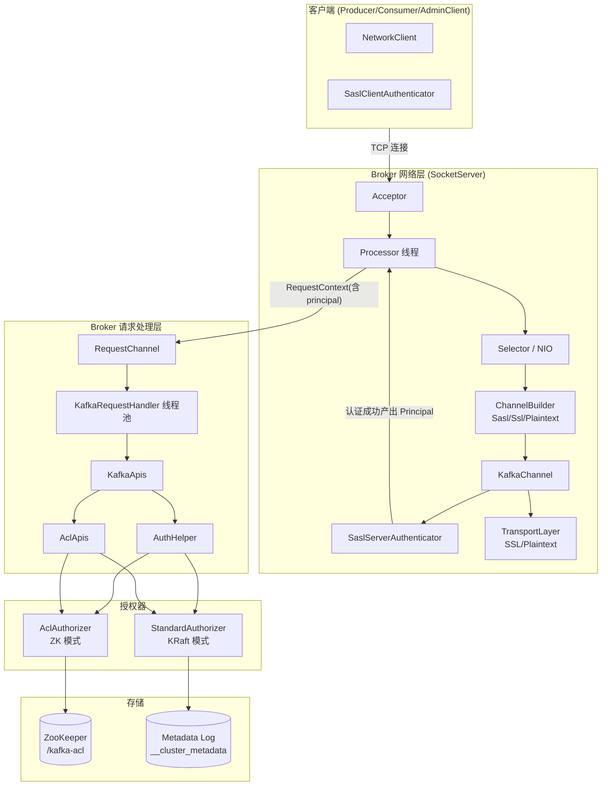

**两套授权器并存的原因**:Kafka 3.7 同时支持 ZooKeeper 模式与 KRaft 模式。KIP-801 引入的 `StandardAuthorizer` 将 ACL 存入元数据日志(`__cluster_metadata`),通过 Raft 复制到所有 Broker/Controller,不再依赖 ZK Watch 机制。

---

## 2. 身份认证(Authentication)

### 2.1 安全协议与 ChannelBuilder 体系

Broker 通过 `listeners` 配置多个监听器,每个监听器绑定一个安全协议。网络层根据协议选择对应的 `ChannelBuilder` 实现来构建通道。

`SocketServer.scala:964-974` 中 Processor 通过 `ChannelBuilders.serverChannelBuilder(...)` 创建服务端通道构建器:

| 安全协议 | ChannelBuilder | 传输层 | 认证器 |
|---|---|---|---|
| PLAINTEXT | `PlaintextChannelBuilder` | `PlaintextTransportLayer` | 无(匿名 Principal) |
| SSL | `SslChannelBuilder` | `SslTransportLayer` | TLS 双向认证 |
| SASL_PLAINTEXT | `SaslChannelBuilder` | `PlaintextTransportLayer` | `SaslServerAuthenticator` |
| SASL_SSL | `SaslChannelBuilder` | `SslTransportLayer` | TLS + `SaslServerAuthenticator` |

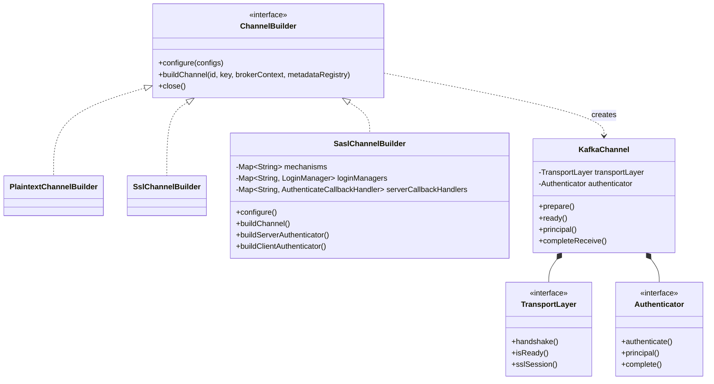

`SaslChannelBuilder` 关键实现(文件 `clients/src/main/java/org/apache/kafka/common/network/SaslChannelBuilder.java`):

- `configure()`(line 141):解析 SASL 机制列表、创建每个机制的 `LoginManager`(GSSAPI→`KerberosLogin`,OAUTHBEARER→`OAuthBearerRefreshingLogin`,其余→`DefaultLogin`),以及每个机制的服务端回调处理器。
- `buildServerAuthenticator()`(line 266):**为每一条新连接**创建一个独立的 `SaslServerAuthenticator`。
- 传输层选择(line 254-263):`SASL_SSL` 时构造 `SslTransportLayer`(先做 TLS 握手再做 SASL),否则用明文传输层。
- 回调处理器注册(line 308-327):PLAIN→`PlainServerCallbackHandler`,SCRAM→`ScramServerCallbackHandler`(走 `CredentialCache`),OAUTHBEARER→`OAuthBearerUnsecuredValidatorCallbackHandler`(生产使用 secured 包的 `OAuthBearerValidatorCallbackHandler`)。
- 重建认证配置(line 329-338):读取 `connections.max.reauth.ms`(支持 `listener.name.<name>....` 前缀),按机制构建过期时间表。

### 2.2 SASL 认证机制总览

Kafka 3.7 支持的 SASL 机制(定义于 `clients/src/main/java/org/apache/kafka/common/config/SaslConfigs.java` 与 `ScramMechanism.java`):

| 机制 | 原理 | 凭证存储 | 安全性 |
|---|---|---|---|
| GSSAPI | Kerberos 票据(KRB5) | KDC | 高,需 Kerberos 基础设施 |
| PLAIN | 用户名/口令明文(需 TLS 保护) | `listener...plain.sasl.jaas.config` 或动态 `User:` 配置 | 低(必须配 SASL_SSL) |
| SCRAM-SHA-256/512 | RFC 5802 挑战-应答,口令不传输 | ZK `/config/users/<user>` 或 KRaft 元数据日志 | 高 |
| OAUTHBEARER | JWT Bearer Token,JWKS 验签 | 外部 OAuth2/OIDC 服务器 | 高 |
| DelegationToken | 基于 PLAIN/SCRAM 通道传递 HMAC 令牌 | ZK `/security/delegation_tokens` | 中(可续期/撤销) |

SCRAM 机制参数(`ScramMechanism.java:30-105`):SHA-256/SHA-512 哈希 + HMAC,迭代次数 4096(最小)~ 16384(最大)。

### 2.3 SASL 服务端认证状态机(SaslServerAuthenticator)

文件:`clients/src/main/java/org/apache/kafka/common/security/authenticator/SaslServerAuthenticator.java`

**核心状态枚举(line 106-115)**:

```java
enum SaslState {
    INITIAL_REQUEST,               // 首个包:可能是 GSSAPI token、SaslHandshake 或 ApiVersions
    HANDSHAKE_OR_VERSIONS_REQUEST, // 中间态:SaslHandshake 或 ApiVersions
    HANDSHAKE_REQUEST,             // 收到 ApiVersions 后,等待 SaslHandshake
    AUTHENTICATE,                  // SASL token 交换
    COMPLETE,                      // 认证成功
    FAILED,                        // 认证失败
    REAUTH_PROCESS_HANDSHAKE,      // 重建认证起始态
    REAUTH_BAD_MECHANISM           // 重建认证机制错误
}
```

**关键方法**:

| 方法 | 行号 | 职责 |
|---|---|---|
| `authenticate()` | 248-306 | 主状态机,由 `KafkaChannel.prepare()` 在 Processor I/O 循环中反复驱动 |
| `handleKafkaRequest()` | 500-557 | 识别认证阶段的 Kafka 协议请求(ApiVersions/SaslHandshake/SaslAuthenticate) |
| `handleHandshakeRequest()` | 559-575 | 校验客户端请求的机制是否在服务端支持列表中 |
| `handleApiVersionsRequest()` | 582-596 | 返回 ApiVersions,协商 SaslHandshake/SaslAuthenticate 版本 |
| `handleSaslToken()` | 419-498 | 调用 `saslServer.evaluateResponse()` 执行真正的机制认证 |
| `setSaslState()` | 376-392 | 状态迁移(写完成后再切 pending 状态) |
| `principal()` | — | 认证完成后返回 `saslServer.getAuthorizationID()` 构造的 `KafkaPrincipal` |

**服务端状态机**:

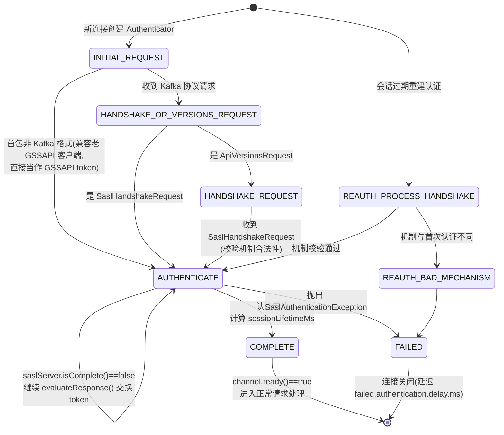

**兼容性设计要点**:
- **ApiVersions 先行**:现代客户端先发 v0 的 `ApiVersionsRequest` 以协商 `SaslHandshake`/`SaslAuthenticate` API 版本(决定是否使用 Kafka 协议帧封装 token)。
- **GSSAPI 回退**:若首包无法解析为 Kafka 请求头,则认为是 0.9 之前的客户端直接发来的 GSSAPI token,直接走 GSSAPI 认证(`handleKafkaRequest()` 内的 fallback 分支)。
- `enableKafkaSaslAuthenticateHeaders`:SaslAuthenticate v1+ 时 token 用 Kafka 协议头封装,便于携带错误信息与会话过期时间。

### 2.4 SASL 客户端认证状态机(SaslClientAuthenticator)

文件:`clients/src/main/java/org/apache/kafka/common/security/authenticator/SaslClientAuthenticator.java`

**状态枚举(line 91-105)**,共 12 个状态:

```java
SEND_APIVERSIONS_REQUEST,                   // 发送 ApiVersions
RECEIVE_APIVERSIONS_RESPONSE,               // 等待响应
SEND_HANDSHAKE_REQUEST,                     // 发送 SaslHandshake
RECEIVE_HANDSHAKE_RESPONSE,                 // 等待响应
INITIAL,                                    // 发送首个 SASL token
INTERMEDIATE,                               // 挑战-应答循环
CLIENT_COMPLETE,                            // 客户端侧完成
COMPLETE,                                   // 认证完成
FAILED,
REAUTH_PROCESS_ORIG_APIVERSIONS_RESPONSE,   // 重建认证:复用首次的 ApiVersions
REAUTH_SEND_HANDSHAKE_REQUEST,
REAUTH_RECEIVE_HANDSHAKE_OR_OTHER_RESPONSE,
REAUTH_INITIAL
```

**关键实现细节**:

- **保留 Correlation ID(line 125-137)**:SASL 请求使用 `Integer.MAX_RESERVED_CORRELATION_ID - 7` 到 `Integer.MAX_VALUE` 区间的保留 ID。这是重建认证的关键设计——**连接上可能有正常业务请求在飞,SASL 认证响应通过保留 ID 区分,互不干扰**。
- `createSaslClient()`(line 214-229):通过 `Subject.doAs()` 以 JAAS 登录 Subject 身份创建 `SaslClient`(Kerberos 场景下使用客户端票据)。
- `sendSaslClientToken()`(line 432-451):根据协商结果决定是否加 Kafka 协议头。
- 客户端同样由 `NetworkClient`/`Selector` 的 `poll()` → `channel.prepare()` 驱动。

### 2.5 完整握手时序图

以 SCRAM 为例,从 TCP 建连到认证完成:

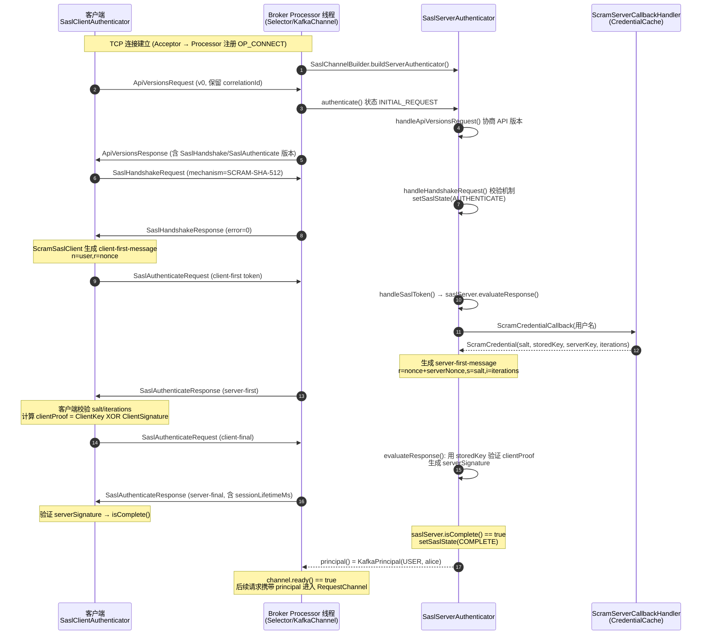

### 2.6 JAAS 配置体系

JAAS(Java Authentication and Authorization Service)是 SASL 的配置底座。Kafka 通过 `JaasContext` 解析两种配置方式:

**方式一:JVM 静态配置(`-Djava.security.auth.login.config`)**

```text
KafkaServer {
    org.apache.kafka.common.security.plain.PlainLoginModule required
    username="admin"
    password="admin-secret"
    user_admin="admin-secret"
    user_alice="alice-secret";
};
```

**方式二:Broker 动态配置(推荐,按 listener + mechanism 前缀隔离)**

```text
listener.name.sasl_ssl.scram-sha-256.sasl.jaas.config = \
    org.apache.kafka.common.security.scram.ScramLoginModule required;
```

前缀处理逻辑(由 `ListenerName.saslMechanismPrefix(mechanism)` 生成,`SaslChannelBuilder.java:311-313` 使用),实现**同一 Broker 不同监听器、不同机制使用完全独立的登录模块与回调处理器**。

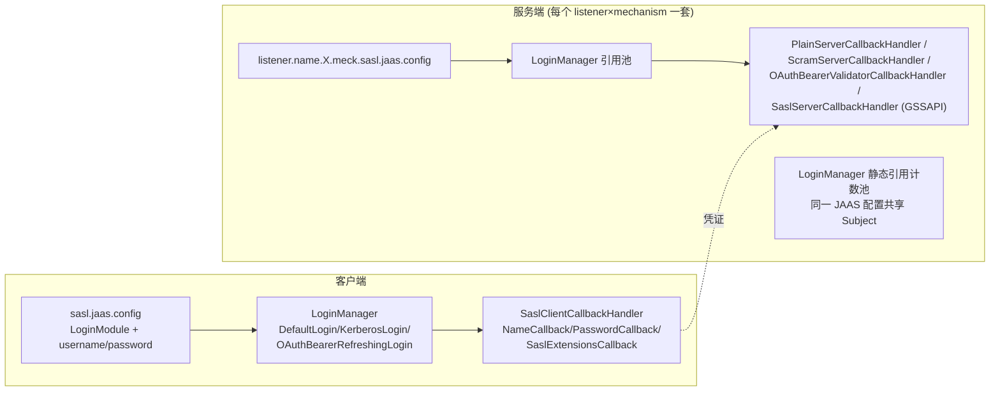

**LoginManager 池化**:Kafka 用静态 Map 缓存 `LoginManager`(按 JAAS 配置内容键),引用计数复用,避免重复执行 Kerberos 登录/OAuth 刷新等昂贵操作。

### 2.7 PLAIN 机制实现

- 服务端:`PlainSaslServer`(JDK SASL 框架之外 Kafka 自实现)解析 token 格式 `authzid\0authcid\0passwd`,调用 `PlainServerCallbackHandler`:
  - 优先从 **JAAS 动态用户表**(`user_<name>=<password>` 配置项)校验;
  - 其次(配置开启时)从 ZK `/config/users/<user>` 读取动态 PLAIN 凭证。
- 客户端:`PlainSaslClient` 由 `SaslClientCallbackHandler` 的 `NameCallback`/`PasswordCallback` 提供凭证。
- **安全警告**:PLAIN 在网络上传输明文口令(仅 base64),生产环境必须搭配 `SASL_SSL`。

### 2.8 SCRAM 机制实现(RFC 5802)

SCRAM(Salted Challenge Response Authentication Mechanism)核心:**口令永不在线传输**,双方基于 PBKDF2 派生密钥互相验证。

**凭证结构**(`clients/src/main/java/org/apache/kafka/common/security/scram/ScramCredential.java`):

```java
public class ScramCredential {
    private final byte[] salt;        // 16 字节随机盐
    private final byte[] storedKey;   // H(ClientKey) — 服务端存,用于验客户端
    private final byte[] serverKey;   // HMAC(SaltedPassword, "Server Key") — 服务端存,用于自证
    private final int iterations;     // PBKDF2 迭代次数
}
```

**密钥派生**(`clients/.../scram/internals/ScramFormatter.java`):

| 方法 | 行号 | 公式 |
|---|---|---|
| `hi()` | 75-87 | PBKDF2-HMAC-SHA(password, salt, iterations) |
| `saltedPassword()` | 93-95 | `Hi(password, salt, i)` |
| `clientKey()` | 97-99 | `HMAC(saltedPassword, "Client Key")` |
| `storedKey()` | 101-103 | `H(clientKey)` |
| `serverKey()` | 144-146 | `HMAC(saltedPassword, "Server Key")` |
| `clientProof()` | 127-132 | `clientKey XOR HMAC(storedKey, authMessage)` |
| `serverSignature()` | 148-151 | `HMAC(serverKey, authMessage)` |

**SCRAM 挑战-应答流程**:

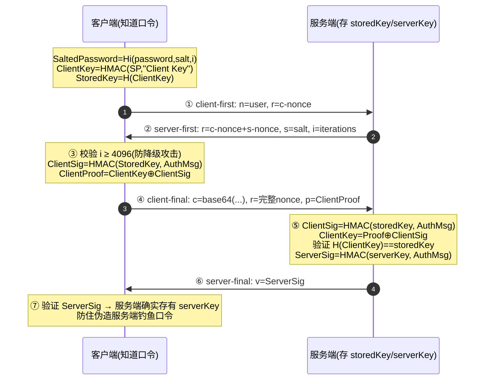

**凭证存储与动态管理**:
- ZK 模式:ZNode `/config/users/<user>`,格式(`ScramCredentialUtils.java:43-53`):
  `SCRAM-SHA-512=[iterations=8192,salt=...,stored_key=...,server_key=...]`
- KRaft 模式:通过 `AlterUserScramCredentials` API 写入元数据日志(`UserScramCredentialRecord`)。
- 运维通过 AdminClient 增删改查:`AdminClient.alterUserScramCredentials()` / `describeUserScramCredentials()`(无需重启 Broker)。

### 2.9 GSSAPI/Kerberos 机制

- 客户端:`KerberosLogin`(继承 `AbstractLogin`)定期用 keytab 执行 `kinit` 刷新 TGT;`Subject.doAs()` 内创建 `SaslClient`,通过 TGS 获取 Broker 服务票据 `kafka/<host>@REALM`。
- 服务端:`SaslServerCallbackHandler` 处理 `AuthorizeCallback`,把 Kerberos 完整主体映射为短名(如 `alice@REALM → alice`),映射规则由 `sasl.kerberos.principal.to.local.rules` 控制(正则替换规则链,默认 `DEFAULT` 规则)。
- 原生 GSSAPI 支持(`SaslChannelBuilder.java:365-393`):`sun.security.jgss.native=true` 时把 `GSSCredential` 挂到 Subject 供本地库使用。

### 2.10 OAUTHBEARER 机制

- 客户端登录:`OAuthBearerLoginModule` + `OAuthBearerRefreshingLogin`,按过期时间**提前刷新** JWT(可配置 JWKS/OIDC 端点或 unsecured 模式)。
- 服务端验证:`OAuthBearerValidatorCallbackHandler`(`clients/.../oauthbearer/secured/OAuthBearerValidatorCallbackHandler.java`,line 104-277):
  1. 从 `sasl.oauthbearer.jwks.endpoint.url` 拉取 JWKS 公钥集;
  2. `RefCountingVerificationKeyResolver`(line 115)按 kid 缓存并引用计数复用验证密钥,密钥轮换时自动刷新;
  3. 验证 JWT 签名、`exp`(含时钟偏差容忍)、`sasl.oauthbearer.expected.audience`、`sasl.oauthbearer.expected.issuer`;
  4. 校验通过后 `OAuthBearerValidatorCallback.token principal` 从 JWT claim(默认 `sub`)提取。
- 生产建议使用 `secured` 包实现,`OAuthBearerUnsecuredJws` 仅用于测试。

### 2.11 Delegation Token(委托令牌)

解决"重客户端(如 Spark/Connect)持有长期密码"的问题:认证过的用户可换取短生命周期的 HMAC 令牌。

- 结构(`clients/.../token/delegation/DelegationToken.java:30-80`):`TokenInformation`(owner、签发/过期时间、max lifetime、renewers)+ `hmac`(HMAC-SHA256 签名)。
- 令牌密钥:从 Broker 配置的 `delegation.token.master.key`(或 ZK 存储的密钥)派生,所有 Broker 可独立验证 HMAC,无需集中查询。
- 传递方式:作为 `SCRAM-SHA-256/512` 机制的用户名(`tokenid_<hex>`)+ HMAC 作为密码完成认证(即 token 复用 SCRAM 挑战应答通道)。
- 服务端管理(`core/.../server/DelegationTokenManager.scala`):令牌元数据存于 ZK `/security/delegation_tokens/<tokenId>`;支持 `CreateDelegationToken/Renew/Expire/Describe` 四个 API,受 `CREATE_TOKENS/RENEW/DESCRIBE` 权限控制,且只允许 owner / renewer / super-user 操作。

### 2.12 重建认证(Re-authentication)

配置 `connections.max.reauth.ms`(>0 时启用)。会话到期后**连接不关闭**,而是在原连接上重新执行 SASL 握手:

**服务端**(`SaslServerAuthenticator.java`):
- 从 `REAUTH_PROCESS_HANDSHAKE` 状态开始;
- 机制必须与首次认证相同,否则进入 `REAUTH_BAD_MECHANISM` 拒绝;
- **Principal 不得改变**(line 652-659 校验),防止借重建认证换身份;
- 会话寿命计算(line 677-716):
  `sessionLifetimeMs = min(凭证到期时间 - 当前, connectionsMaxReauthMs)`,并通过 SaslAuthenticate 响应带给客户端。

**客户端**(`SaslClientAuthenticator.java`):
- 复用首次的 ApiVersions 结果(`REAUTH_PROCESS_ORIG_APIVERSIONS_RESPONSE`);
- 在会话寿命的 **85%~95% 加随机抖动**触发重建(line 688-692),防止大量连接同时重建造成风暴;
- 保留 Correlation ID 区分飞行中的业务请求与 SASL 请求(见 2.4)。

**过期强制执行**:Processor 线程在 `processCompletedReceives()`(`SocketServer.scala:1136`)中检查 `channel.serverAuthenticationSessionExpired(nowNanos)`,过期连接直接关闭并计入 `expiredConnectionsKilledCount` 指标。

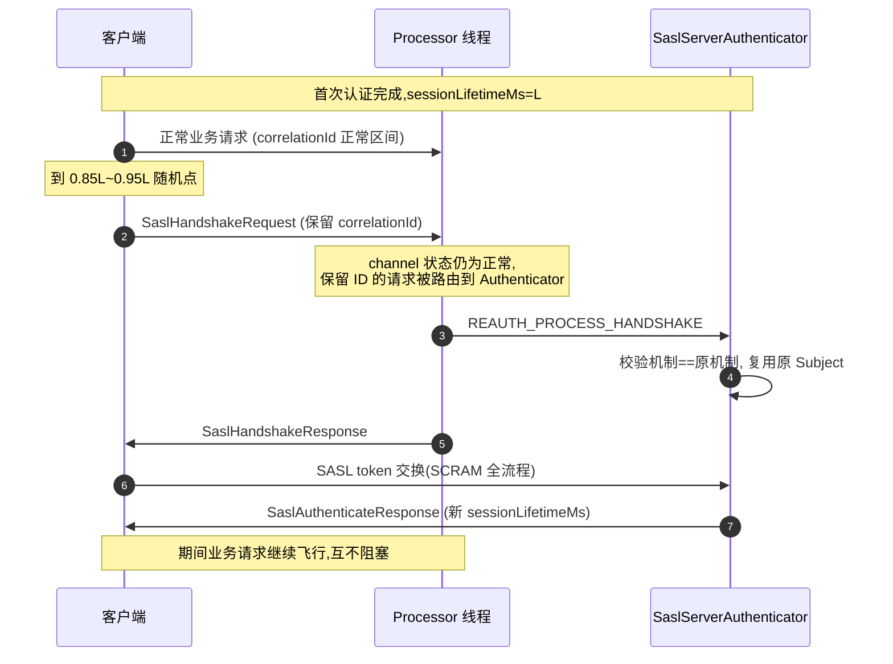

### 2.13 SSL/TLS 双向认证与 Principal 映射

- TLS 握手在 `KafkaChannel.prepare()`(line 174-178)中先于 SASL 执行:`transportLayer.handshake()` → `SslTransportLayer` 包装的 `SSLEngine` 完成握手。
- 双向 TLS(客户端证书)即可独立完成身份认证(SSL 协议,无需 SASL)。
- **Principal 构建**(`clients/.../security/authenticator/DefaultKafkaPrincipalBuilder.java:54-113`):

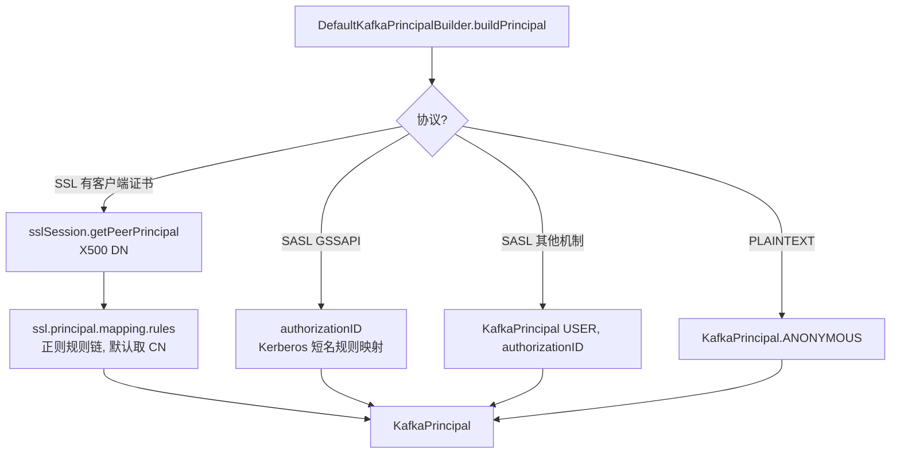

- SASL_SSL 场景下 `SaslServerAuthenticator`(line 310)会取 `SslTransportLayer.sslSession()`,Principal 可融合证书信息(如 OAUTHBEARER 扩展中携带证书 DN)。
- 认证失败的连接不会立刻关闭:`failed.authentication.delay.ms`(KafkaChannel line 189-190)让攻击者拿到错误前先完成更多协议交互,增大其成本,同时让合法客户端能收到明确的错误码。

---

## 3. 权限认证(Authorization)

### 3.1 核心数据模型

均位于 `clients/src/main/java/org/apache/kafka/common/{acl,resource}/`:

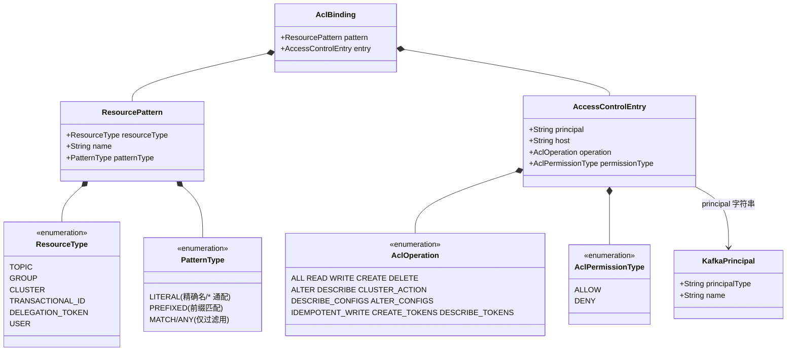

一条 ACL 语义示例:
`Principal=User:alice, Host=10.0.0.1, Operation=READ, PermissionType=ALLOW, Resource=TOPIC:payments-*, PatternType=PREFIXED`
—— 表示来自 10.0.0.1 的 alice 可以读所有以 `payments-` 开头的 topic。

### 3.2 Authorizer 接口

文件:`clients/src/main/java/org/apache/kafka/server/authorizer/Authorizer.java`(接口从 `Reconfigurable` 扩展,支持动态重配置)。

| 方法 | 职责 | 调用方 |
|---|---|---|
| `start(AuthorizerServerInfo)` | 启动,返回每个 listener 的就绪 Future | Broker/Controller 启动流程 |
| `authorize(ctx, List<Action>)` | **同步批量授权**,返回每个 Action 的 `AuthorizationResult` | 请求处理热路径 |
| `createAcls(ctx, bindings)` | 异步批量创建 ACL | AclApis.handleCreateAcls |
| `deleteAcls(ctx, filters)` | 异步批量删除 ACL | AclApis.handleDeleteAcls |
| `acls(filter)` | 查询 ACL | AclApis.handleDescribeAcls |
| `authorizeByResourceType(ctx, op, resourceType)` | 按"资源类型整体"授权(用于避免逐资源授权的 O(n) 开销,如 ListOffsets/Fetch 的 authorizedOperations 计算) | KafkaApis 多处 |

`Action` 携带:操作、资源引用、资源计数(如分区数,用于审计日志)、`logIfAllowed/logIfDenied` 审计标记。

### 3.3 ZK 版 AclAuthorizer

文件:`core/src/main/scala/kafka/security/authorizer/AclAuthorizer.scala`

**存储布局**(ZK ZNode):

| ZK 路径 | 内容 |
|---|---|
| `/kafka-acl/{ResourceType}/{ResourceName}` | LITERAL 类型的 ACL(JSON 数组) |
| `/kafka-acl-extended/prefixed/{ResourceType}/{Prefix}` | PREFIXED 类型的 ACL |
| `/kafka-acl-changes/{changeSeq}` | ACL 变更通知(自增序号 ZNode) |
| `/kafka-acl-extended-changes/{changeSeq}` | 扩展类型变更通知 |

**内存缓存**(line 167-173):
- `aclCache: TreeMap[ResourcePattern, VersionedAcls]` —— 按(资源类型, 模式类型, **倒序**资源名)排序的有序缓存;
- `resourceCache: HashMap[ResourceTypeKey, HashSet[String]]` —— 反向索引,加速 `acls(filter)` 全量扫描;
- 一把 `ReentrantReadWriteLock` 保护。

**变更传播机制**(关键设计——为什么用"通知 ZNode"而不是直接 Watch ACL 节点):

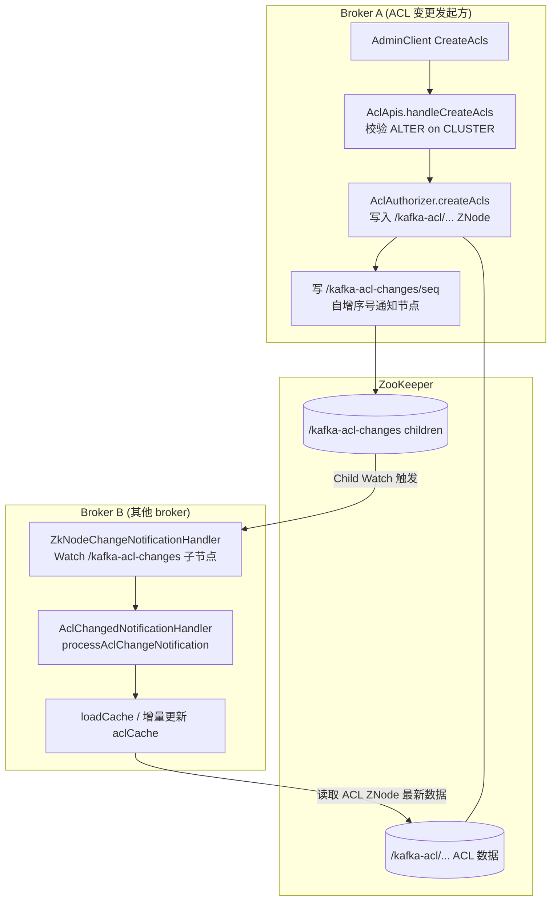

采用"通知节点 + 重新读取数据"而非直接 Watch 数据节点:一是 Watch 只触发一次,通知序号可判断是否遗漏;二是新增 pattern 类型无需新增 Watch。

**ZkAclStore 抽象**:3.7 中 AclAuthorizer 内部用 `ZkAclStore`(`core/.../zk/ZkData.scala`)按 patternType 分路由,统一了 LITERAL/PREFIXED 的读写接口。

### 3.4 KRaft 版 StandardAuthorizer(KIP-801)

文件:`metadata/src/main/java/org/apache/kafka/metadata/authorizer/StandardAuthorizer.java` 及配套类。

**架构:ACL 作为元数据记录存入 `__cluster_metadata`,经 Raft 复制,Broker/Controller 通过快照+增量日志回放构建本地缓存。**

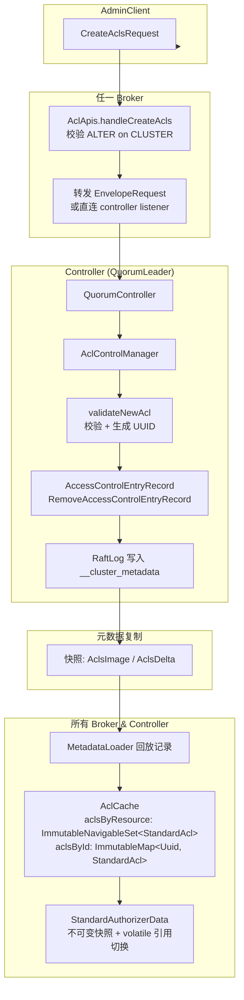

**关键组件**:

| 组件 | 文件 | 职责 |
|---|---|---|
| `StandardAuthorizer` | `metadata/.../authorizer/StandardAuthorizer.java` | 实现 `Authorizer`,`completeSnapshot`/`replay`/`close` 实现 `MetadataListener`,随元数据日志实时更新 |
| `AclControlManager` | `metadata/.../controller/AclControlManager.java` | Controller 侧:校验新 ACL、生成 UUID、产出 `AccessControlEntryRecord`/`RemoveAccessControlEntryRecord`,状态存于 `TimelineHashMap`(支持快照回滚) |
| `AclCache` | `metadata/.../authorizer/AclCache.java` | 不可变双索引缓存:`aclsByResource`(按 resourceType+**倒序**resourceName+patternType 排序的 `ImmutableNavigableSet`)、`aclsById` |
| `StandardAuthorizerData` | `metadata/.../authorizer/StandardAuthorizerData.java` | 核心授权计算、super users、默认策略;每次更新生成新不可变实例,volatile 切换,读路径完全无锁 |
| `StandardAcl` | `metadata/.../authorizer/StandardAcl.java` | 记录型 ACL(带 Uuid) |

**为什么资源名倒序?** 前缀匹配的精髓:`NavigableSet.headSet(resourceName, ...)` 从给定资源名开始**向前**扫描,资源名倒序排列后,前缀相同的资源天然相邻,扫描到公共前缀耗尽即可停止(`matchesUpTo()`,line 370),前缀匹配近似 O(log n + 命中数)。

### 3.5 ACL 匹配算法与 Deny-Override 语义

**通用决策规则(两个 Authorizer 一致)**:

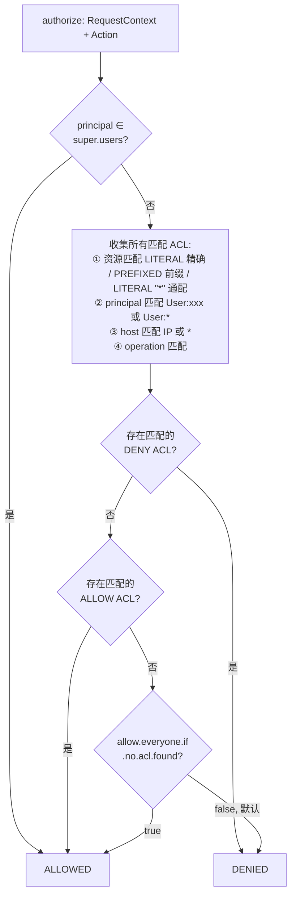

**操作继承(仅 ALLOW 生效,DENY 不继承)**(`StandardAuthorizerData.java:440-447`):
- `READ/WRITE/DELETE/ALTER` 隐含 `DESCRIBE`;
- `ALTER_CONFIGS` 隐含 `DESCRIBE_CONFIGS`;
- `ALL` 匹配一切操作。

即授予 `WRITE` 的用户自动可 `DESCRIBE`(否则"能写不能看"会破坏很多客户端语义);但 DENY 精确匹配,防止 DENY 意外扩大。

**StandardAuthorizerData.findAclRule()(line 314)匹配细节**:
1. principal:精确匹配 + `User:*` 通配(line 472);
2. host:精确匹配 + `*` 通配(line 496);
3. 资源名:LITERAL 精确 / PREFIXED 前缀(利用有序集扫描提前终止);
4. 依次检查 DENY → ALLOW → 默认规则。

**AclAuthorizer.matchingAcls()(line 536)**:TreeMap 的 `range()` 按 (type, patternType, 倒序 name) 定位,先查 LITERAL 再查 PREFIXED,叠加 LITERAL `*` 通配。

### 3.6 API 请求 → 操作/资源映射

每个 Kafka API 在 `KafkaApis`/`ControllerApis` 中被映射为授权检查。授权辅助类 `core/src/main/scala/kafka/server/AuthHelper.scala`:

| 方法(line) | 用途 |
|---|---|
| `authorize()`(43) | 单/批量授权,返回布尔 |
| `authorizeClusterOperation()`(57) | CLUSTER 资源操作 |
| `filterByAuthorized()`(115) | **按授权过滤资源列表**(如只返回有权 READ 的 topic,对客户端透明) |
| `partitionSeqByAuthorized()` | 序列二分(部分授权场景) |
| `authorizedOperations()` | 计算 Describe 响应中的授权操作位图 |

**典型 API 映射表**(`KafkaApis.scala` / `AclApis.scala`):

| API | 资源 | 操作 | 位置 |
|---|---|---|---|
| Produce | TOPIC | WRITE | KafkaApis.scala:606 |
| Produce(事务) | TRANSACTIONAL_ID | WRITE | KafkaApis.scala:593 |
| Fetch(消费者) | TOPIC | READ | KafkaApis.scala:789 |
| Fetch(follower) | CLUSTER | CLUSTER_ACTION | KafkaApis.scala:766 |
| Metadata/DescribeTopics | TOPIC | DESCRIBE | KafkaApis.scala:1316 |
| CreateTopics | CLUSTER + TOPIC | CREATE | KafkaApis.scala:1324 |
| OffsetCommit/Fetch | GROUP | READ | KafkaApis.scala:1431/1478 |
| JoinGroup/SyncGroup/Heartbeat | GROUP | READ | — |
| CreateAcls | CLUSTER | ALTER | AclApis.scala:82 |
| DeleteAcls | CLUSTER | ALTER | AclApis.scala:138 |
| DescribeAcls | CLUSTER | DESCRIBE | AclApis.scala:59 |
| CreateDelegationToken | USER(自己)/DELEGATION_TOKEN | CREATE_TOKENS | — |
| AlterConfigs | TOPIC/CLUSTER | ALTER_CONFIGS | — |
| DeleteRecords | TOPIC | DELETE | — |
| ElectLeader/AlterPartition | CLUSTER | ALTER/CLUSTER_ACTION | ControllerApis |

**授权失败错误码**(`AclEntry.scala:99`):按资源类型返回 `TOPIC_AUTHORIZATION_FAILED(29)`、`GROUP_AUTHORIZATION_FAILED(30)`、`CLUSTER_AUTHORIZATION_FAILED(31)`、`TRANSACTIONAL_ID_AUTHORIZATION_FAILED(51)`、`DELEGATION_TOKEN_AUTHORIZATION_FAILED(61)`,客户端可精确感知被拒原因。

### 3.7 ACL 管理接口

`core/src/main/scala/kafka/server/AclApis.scala`:

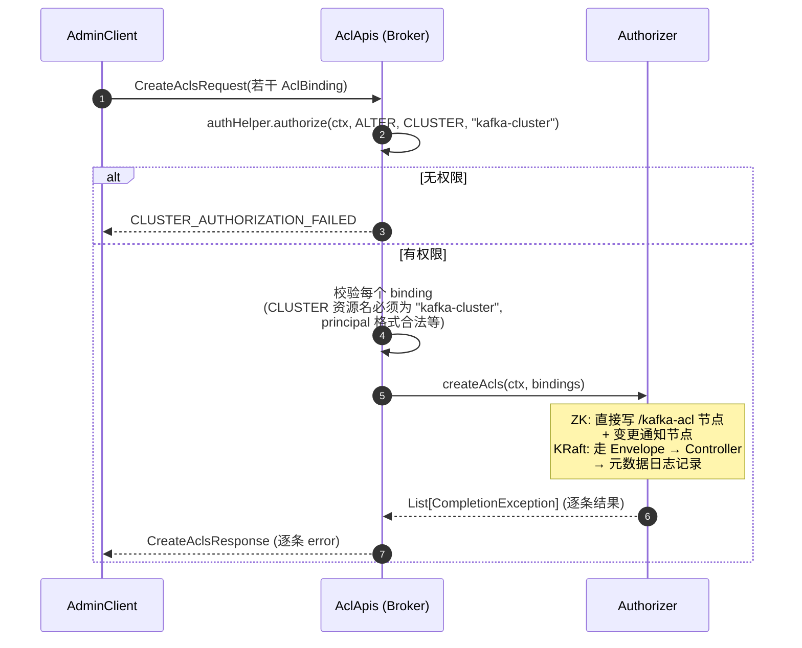

DeleteAcls 类似:授权 `ALTER on CLUSTER` 后按 `AclBindingFilter` 匹配删除,响应中返回每条 filter 匹配删除的 ACL 集合。DescribeAcls 仅需 `DESCRIBE on CLUSTER`。

### 3.8 Super Users 与默认策略

- `super.users=User:alice;User:bob`(分号分隔):匹配者**跳过一切 ACL 检查、优先级高于 DENY**(AclAuthorizer.scala:528 / StandardAuthorizerData.java:241)。注意 broker 间通信主体通常也配为 super user,否则内部请求会被自身 ACL 拦截。
- `allow.everyone.if.no.acl.found`(默认 `false`):无任何匹配 ACL 时允许还是拒绝。默认拒绝(安全默认),设为 true 时相当于"未配置即公开",仅建议在无 ACL 的过渡期使用。

---

## 4. 网络层全链路集成

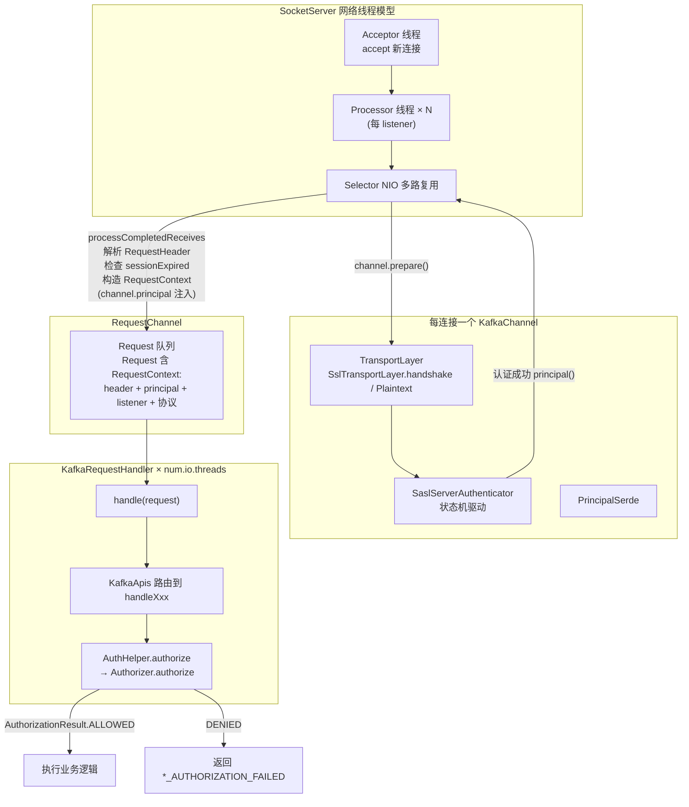

**几个关键源码位置**(`core/src/main/scala/kafka/network/SocketServer.scala`):

- line 964-974:Processor 按 listener 创建服务端 ChannelBuilder;
- line 1125 `processCompletedReceives()`:每条接收到的请求
  1. 解析 RequestHeader;
  2. line 1136:`channel.serverAuthenticationSessionExpired(nowNanos)` —— 重建认证会话过期即断连;
  3. line 1143-1145:用 `channel.principal()` 构造 `RequestContext`;
  4. line 1147-1161:构造 `RequestChannel.Request` 入队并 mute 通道(防止同连接乱序);
- `KafkaChannel.prepare()`(KafkaChannel.java:174):驱动 TLS 握手 + SASL 认证;`channel.ready()`(line 194)只在认证 COMPLETE 后返回 true,未就绪通道的业务请求被缓冲。

**Principal 流转全景**:认证器产出 → `KafkaChannel.principal()` → `RequestContext.principal` → `KafkaApis` → `AuthHelper` → `Authorizer.authorize(AuthorizableRequestContext, ...)`。

---

## 5. 一次 Fetch 请求的完整安全链路

以消费者 `alice` 通过 SASL_SSL + SCRAM + ACL 拉 `payments-*` topic 为例:

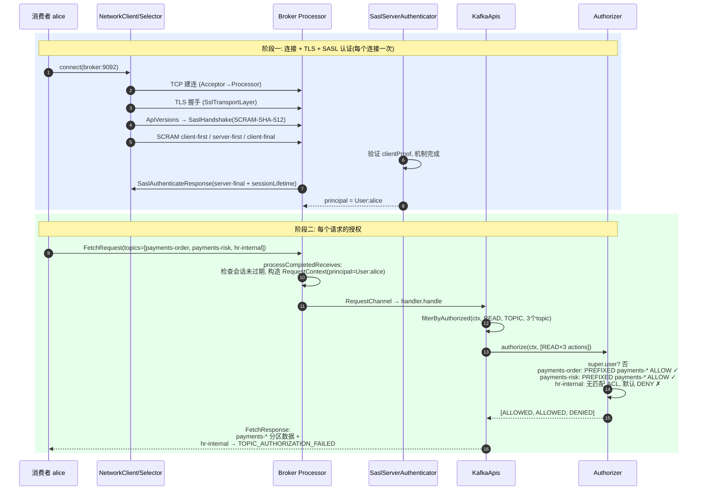

---

## 6. 关键配置速查表

### 认证

| 配置 | 作用 |
|---|---|
| `listeners` / `advertised.listeners` | 监听器及协议(`SSL`/`SASL_PLAINTEXT`/`SASL_SSL`) |
| `security.inter.broker.protocol` | broker 间通信协议 |
| `sasl.enabled.mechanisms` | listener 上启用的 SASL 机制列表 |
| `listener.name.<l>.<mech>.sasl.jaas.config` | 按 listener×机制 的 JAAS 配置 |
| `sasl.kerberos.principal.to.local.rules` | Kerberos 主体 → 短名映射 |
| `ssl.client.auth` | SSL 双向认证(required/requested/none) |
| `ssl.principal.mapping.rules` | X500 DN → principal 映射 |
| `connections.max.reauth.ms` | 启用重建认证的会话寿命 |
| `failed.authentication.delay.ms` | 认证失败延迟断连 |
| `delegation.token.master.key` | 委托令牌 HMAC 主密钥 |
| `sasl.oauthbearer.jwks.endpoint.url` | OAuth JWKS 端点 |

### 授权

| 配置 | 作用 |
|---|---|
| `authorizer.class.name` | `kafka.security.authorizer.AclAuthorizer`(ZK)或 `org.apache.kafka.metadata.authorizer.StandardAuthorizer`(KRaft) |
| `super.users` | 超级用户,绕过一切 ACL(优先于 DENY) |
| `allow.everyone.if.no.acl.found` | 无匹配 ACL 时默认放行(默认 false) |

### 常用运维命令

```bash
# 创建 SCRAM 凭证
kafka-configs --bootstrap-server ... --alter \
  --add-config 'SCRAM-SHA-512=[password=alice-secret]' \
  --entity-type users --entity-name alice

# 查看/创建 ACL
kafka-acls --bootstrap-server ... --list
kafka-acls --bootstrap-server ... --add \
  --allow-principal User:alice --operation READ --topic 'payments-' --resource-pattern-type prefixed
```

---

## 附录:关键源码文件索引

| 模块 | 文件 |
|---|---|
| SASL 服务端 | `clients/src/main/java/org/apache/kafka/common/security/authenticator/SaslServerAuthenticator.java` |
| SASL 客户端 | `clients/.../security/authenticator/SaslClientAuthenticator.java` |
| 回调处理器 | `clients/.../security/authenticator/SaslServerCallbackHandler.java`、`SaslClientCallbackHandler.java` |
| Principal 构建 | `clients/.../security/authenticator/DefaultKafkaPrincipalBuilder.java` |
| Channel 构建 | `clients/src/main/java/org/apache/kafka/common/network/SaslChannelBuilder.java` |
| 通道/传输层 | `clients/.../network/KafkaChannel.java`、`SslTransportLayer.java`、`PlaintextTransportLayer.java` |
| SCRAM | `clients/.../security/scram/ScramCredential.java`、`internals/ScramFormatter.java`、`ScramCredentialUtils.java` |
| OAuth | `clients/.../security/oauthbearer/secured/OAuthBearerValidatorCallbackHandler.java` |
| 委托令牌 | `clients/.../security/token/delegation/DelegationToken.java`、`core/.../server/DelegationTokenManager.scala` |
| 网络层 | `core/src/main/scala/kafka/network/SocketServer.scala`、`RequestChannel.scala` |
| 授权入口 | `core/src/main/scala/kafka/server/KafkaApis.scala`、`AuthHelper.scala`、`AclApis.scala` |
| ZK 授权器 | `core/src/main/scala/kafka/security/authorizer/AclAuthorizer.scala` |
| KRaft 授权器 | `metadata/src/main/java/org/apache/kafka/metadata/authorizer/StandardAuthorizer.java`、`StandardAuthorizerData.java`、`AclCache.java` |
| Controller 侧 ACL 管理 | `metadata/src/main/java/org/apache/kafka/controller/AclControlManager.java` |
| ACL 领域模型 | `clients/src/main/java/org/apache/kafka/common/acl/*`、`org/apache/kafka/common/resource/*` |
| Authorizer SPI | `clients/src/main/java/org/apache/kafka/server/authorizer/Authorizer.java` |
