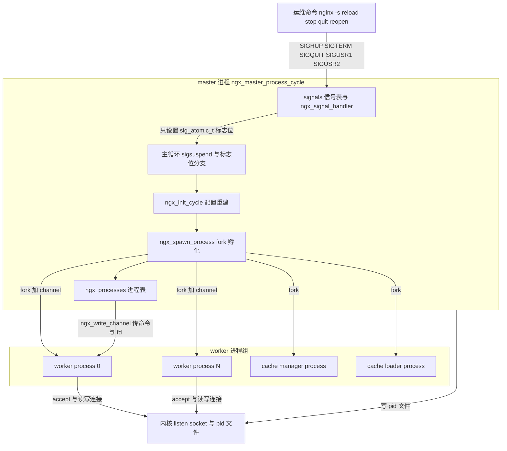
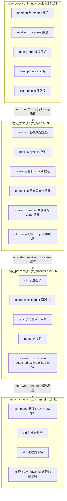
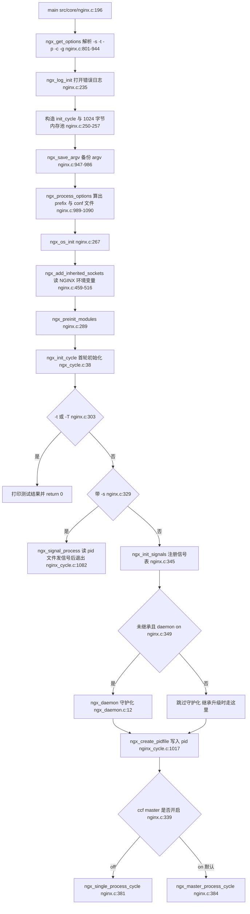
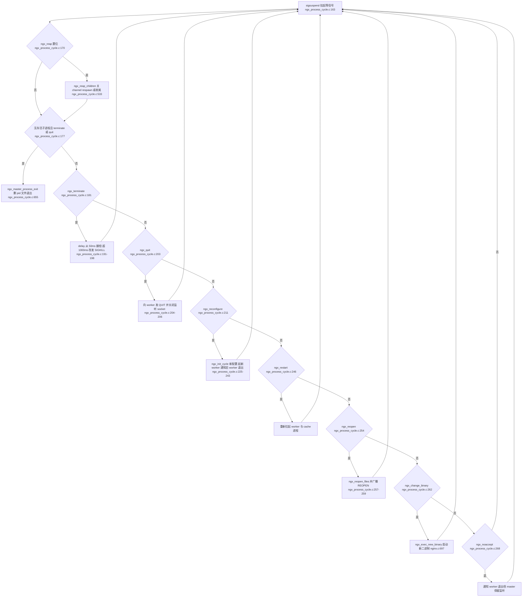
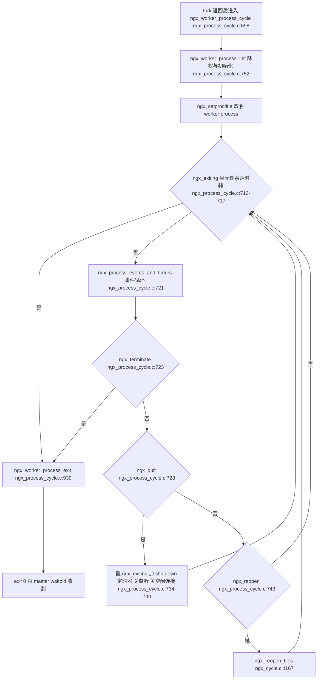
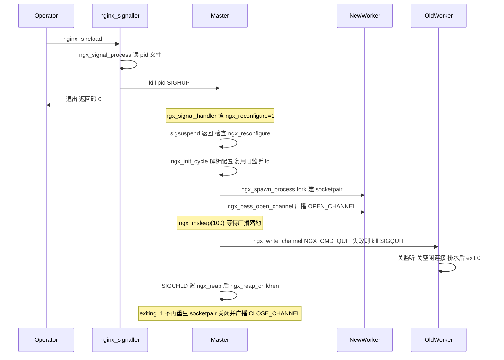
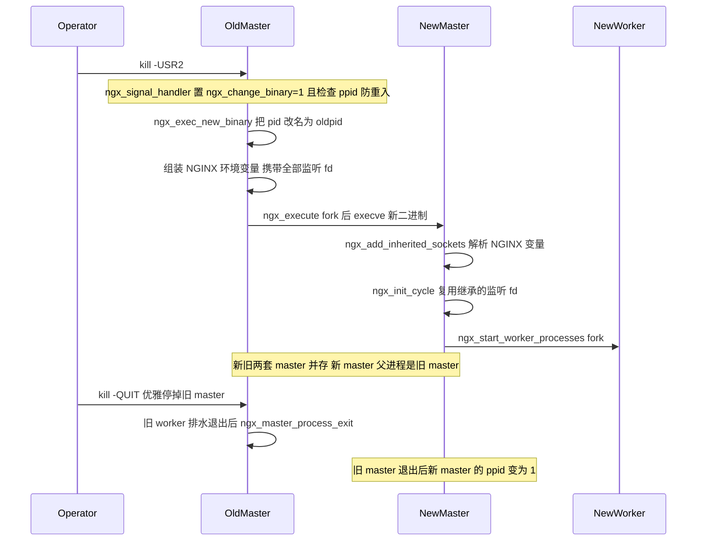

# 进程模型与启动流程（master/worker/热升级）（基于 nginx-1.27.0 源码）

> **导读**：读完本文你将掌握：nginx 从敲下 `nginx` 命令到 master/worker 双进程模型跑起来的每一步系统调用；`ngx_init_cycle` 如何做到"新配置先全部就绪、再原子切换"；reload 与热升级（binary upgrade）的完整信号时序；master 与 worker 之间那条用 `socketpair` + `SCM_RIGHTS` 搭起来的通道协议；以及 worker 降权、rlimit、CPU 亲和性的确切执行顺序。所有结论均落到具体源码行号。
>
> **前置阅读建议**：熟悉 C 语言 `fork/exec/sigaction/sigsuspend` 语义；了解 nginx 模块机制（`ngx_module_t` 的 `create_conf/init_conf/init_process` 回调链）；对 Unix domain socket 与 `sendmsg/recvmsg` 控制消息有基本概念。
>
> **涉及源码清单**（本文行号全部来自 nginx-1.27.0 真实源码）：
> - `src/core/nginx.c`（main 与命令行处理、`ngx_exec_new_binary`）
> - `src/core/ngx_cycle.c`（`ngx_init_cycle`、pid 文件、`ngx_reopen_files`）
> - `src/os/unix/ngx_daemon.c`（守护化）
> - `src/os/unix/ngx_process.c`（`ngx_spawn_process`、信号表与信号处理）
> - `src/os/unix/ngx_process.h`（`ngx_process_t` 进程表）
> - `src/os/unix/ngx_process_cycle.c`（master/worker 主循环、channel 处理）
> - `src/os/unix/ngx_channel.c`（通道读写与 fd 传递）
> - `src/os/unix/ngx_setproctitle.c`（进程标题改写）

## 1. 本模块在 nginx 中的位置与职责

nginx 的进程模型层是整个系统的"骨架"：它不解析 HTTP，不管理 buffer，而是负责**进程的生、死、变**——生（`fork` 出 worker/cache 进程）、死（信号驱动的优雅退出与 `waitpid` 收割）、变（reload 换配置、热升级换二进制）。它的上游是 `main()` 的命令行与配置层，下游是事件模块（`ngx_process_events_and_timers`）和所有业务模块的 `init_process` 回调。



图解：所有控制指令（无论来自终端信号还是 `-s` 子命令）最终都汇聚为 `ngx_signal_handler` 对一组 `sig_atomic_t` 全局标志位的置位；master 主循环被 `sigsuspend` 唤醒后逐个消费这些标志位，需要动配置时调用 `ngx_init_cycle`，需要动进程时调用 `ngx_spawn_process`，并通过 `ngx_processes` 进程表和 channel 与 worker 通信。worker 只做一件事：跑事件循环，接连接、处理请求。

这一层的关键源码分布在四个文件里：`src/core/nginx.c:196-388` 的 `main()` 负责"决定我是谁"（signaller/master/single）；`src/core/ngx_cycle.c:38-940` 的 `ngx_init_cycle` 负责"世界长什么样"（配置、文件、socket、共享内存）；`src/os/unix/ngx_process.c` 负责"孩子怎么生、信号怎么来"；`src/os/unix/ngx_process_cycle.c` 负责"主循环怎么转"。

## 2. 核心数据结构精讲

### 2.1 ngx_cycle_t：一个"运行时宇宙"

`struct ngx_cycle_s` 定义于 src/core/ngx_cycle.h:39-86。所谓 cycle，就是"某一份配置对应的完整运行时快照"：配置解析产物、打开的文件、共享内存、监听 socket 全部挂在这个结构上。reload 的本质就是构造一个新 cycle、把旧 cycle 里仍需要的资源"继承"过来、再逐步销毁旧 cycle。

| 字段 | 类型 | 含义 | 本文相关行为 |
|---|---|---|---|
| `conf_ctx` | `void ****` | 三级指针数组，按模块索引存放各模块配置 | src/core/ngx_cycle.c:198-202 分配；`ngx_get_conf` 宏从它取配置 |
| `pool` | `ngx_pool_t *` | 本 cycle 的内存池，销毁 cycle 即销毁池 | src/core/ngx_cycle.c:69-73 创建，NGX_CYCLE_POOL_SIZE 见 ngx_cycle.h:16-18 |
| `log` / `new_log` | `ngx_log_t *` / `ngx_log_t` | 旧日志指针与新日志本体 | src/core/ngx_cycle.c:409-410 解析完成后切到 `new_log` |
| `files` / `files_n` / `connections` 等 | 连接池字段 | fd 到 `ngx_connection_t` 的映射 | worker 初始化时使用 |
| `modules` / `modules_n` | `ngx_module_t **` | 本 cycle 生效的模块数组 | src/core/ngx_cycle.c:225-228 经 `ngx_cycle_modules` 拷贝 |
| `listening` | `ngx_array_t` | 监听 socket 数组（元素 `ngx_listening_t`） | src/core/ngx_cycle.c:183-192 初始化；503-616 做继承匹配 |
| `paths` | `ngx_array_t` | cache path 数组，决定 cache manager/loader 是否启动 | src/os/unix/ngx_process_cycle.c:361-371 扫描 `manager/loader` 标志 |
| `open_files` | `ngx_list_t` | 需要打开的文件（各种日志） | src/core/ngx_cycle.c:363-407 统一以 append 方式打开 |
| `shared_memory` | `ngx_list_t` | 共享内存 zone 列表 | src/core/ngx_cycle.c:413-500 分配与跨 cycle 复用 |
| `old_cycle` | `ngx_cycle_t *` | 指向旧 cycle，是"继承"的来源 | src/core/ngx_cycle.c:83；master 首轮后置 NULL（769-775） |
| `conf_file/conf_param/conf_prefix/prefix/error_log/lock_file/hostname` | `ngx_str_t` | 路径与主机名 | src/core/ngx_cycle.c:85-122 从 old_cycle 拷贝，205-222 取主机名 |

### 2.2 ngx_core_conf_t：core 模块配置

定义于 src/core/ngx_cycle.h:89-122，由 `ngx_core_module_create_conf`（src/core/nginx.c:1093-1135）分配、`ngx_core_module_init_conf`（src/core/nginx.c:1138-1264）补默认值。它是进程模型所有决策的来源。

| 字段 | 含义 | 对应指令 | 读取位置 |
|---|---|---|---|
| `daemon` | 是否守护化 | `daemon on/off` | src/core/nginx.c:349 `if (!ngx_inherited && ccf->daemon)` |
| `master` | 是否启用 master/worker 模型 | `master_process on/off` | src/core/nginx.c:339 |
| `worker_processes` | worker 数量 | `worker_processes auto` | src/os/unix/ngx_process_cycle.c:130 |
| `user/group/username` | worker 降权目标 | `user nginx nginx;` | src/os/unix/ngx_process_cycle.c:799-829 |
| `rlimit_nofile/rlimit_core` | worker 资源上限 | `worker_rlimit_nofile` 等 | src/os/unix/ngx_process_cycle.c:777-797 |
| `priority` | worker nice 值 | `worker_priority` | src/os/unix/ngx_process_cycle.c:770-775 |
| `cpu_affinity/cpu_affinity_n/cpu_affinity_auto` | 亲和性掩码 | `worker_cpu_affinity` | src/core/nginx.c:1498-1549 `ngx_get_cpu_affinity` |
| `pid/oldpid` | pid 文件路径 | `pid logs/nginx.pid;` | src/core/nginx.c:1167-1183 生成 oldpid（追加 `.oldbin`） |
| `env/environment` | 子进程环境 | `env VAR=value;` | src/core/nginx.c:519-652 `ngx_set_environment` |
| `timer_resolution/shutdown_timeout` | 定时精度/退出超时 | 同名指令 | src/core/ngx_cycle.c:1422-1437 设置退出强制定时器 |

### 2.3 ngx_process_t：进程表元素

定义于 src/os/unix/ngx_process.h:22-36，全局数组 `ngx_processes[NGX_MAX_PROCESSES]`（上限 1024，src/os/unix/ngx_process.h:47）定义于 src/os/unix/ngx_process.c:36。**fork 之后子进程继承整张表**，这是 worker 能"认识兄弟进程"的基础。

| 字段 | 含义 |
|---|---|
| `pid` | 子进程号；`-1` 表示槽位空闲 |
| `status` | `waitpid` 收割到的 status 原始值 |
| `channel[2]` | 该子进程专属的 Unix socketpair 两端 fd |
| `proc` | 子进程入口函数（`ngx_spawn_proc_pt`，src/os/unix/ngx_process.h:20），如 `ngx_worker_process_cycle` |
| `data` | 传给入口函数的参数（worker 编号等） |
| `name` | 进程名，用于日志与 proctitle |
| `respawn:1` | 异常退出后是否自动拉起 |
| `just_spawn:1` | 刚拉起的进程，发信号时跳过 |
| `detached:1` | 脱管进程（如热升级 exec 出的新二进制），master 不再管理 |
| `exiting:1` | 已被通知退出 |
| `exited:1` | 已被 waitpid 收割 |

`ngx_spawn_process` 的第五个参数 `respawn` 用负数常量编码这些位（src/os/unix/ngx_process.h:49-53）：`NGX_PROCESS_NORESPAWN(-1)`、`NGX_PROCESS_JUST_SPAWN(-2)`、`NGX_PROCESS_RESPAWN(-3)`、`NGX_PROCESS_JUST_RESPAWN(-4)`、`NGX_PROCESS_DETACHED(-5)`；传非负数则表示"在指定槽位重生"。

### 2.4 ngx_channel_t：master/worker 消息协议

定义于 src/os/unix/ngx_channel.h:17-22，命令常量定义于 src/os/unix/ngx_process_cycle.h:16-20。



图解：`ngx_core_conf_t` 是静态决策输入（fork 几个、降到哪个用户、pid 文件在哪）；`ngx_cycle_t` 是运行时资源容器，reload 时新旧 cycle 通过 `old_cycle` 指针"接力"；`ngx_process_t` 数组是 master 的进程台账，每个元素绑定一条 socketpair；`ngx_channel_t` 是跑在这条 socketpair 上的 16 字节定长消息头，真正的"大件"（如监听 fd）通过 `SCM_RIGHTS` 辅助数据携带。

## 3. 初始化流程

从 `main()` 进入 master 循环的完整路径如下（所有行号已核实）：



图解：流程呈"漏斗"形状——前半段（`ngx_get_options` 到 `ngx_init_cycle`）是所有身份（测试配置的短命进程、发信号的信使进程、真正的 master）都要走的公共路径；`-t/-s` 两个出口提前分流；只有走到最后才分叉出 single 与 master 两种循环。注意 **daemon 化发生在 `ngx_init_cycle` 之后**：这样配置解析失败的报错仍能打到终端（此时 stderr 尚未被重定向），而 pid 文件在 daemon 化之后写（nginx.c:363-365），写入的才是最终 master 的 pid——这正是 `ngx_init_cycle` 里"首轮不写 pid 文件"注释（src/core/ngx_cycle.c:328-331）的原因。

三个容易被忽略的细节：

1. `ngx_save_argv`（src/core/nginx.c:947-986）除了备份 argv，还把 `ngx_os_environ = environ`（:983）留作 `ngx_set_environment` 构造新环境的母本。
2. `ngx_process_options` 会把 conf 文件路径回推出 `conf_prefix`（src/core/nginx.c:1061-1070），这就是为什么 `include relative.conf` 总是相对 conf 文件所在目录解析。
3. `ngx_add_inherited_sockets` 只在环境变量 `NGINX`（src/core/nginx.h:22）存在时生效，它是热升级的入口伏笔，见第 5.2 节。

## 4. 核心执行流程/状态机

### 4.1 master 主循环：一个"信号驱动 + 标志位消费"的状态机

`ngx_master_process_cycle`（src/os/unix/ngx_process_cycle.c:73-275）先把十种信号整体屏蔽（:87-102），再在 `sigsuspend(&set)`（:163）处用**空集合**临时放行所有信号等待其到来；信号处理函数只置标志位，主循环醒来后按固定优先级逐个消费：



图解：这是一台**只进不退**的消费机器——每轮从 `sigsuspend` 醒来，自上而下检查一遍标志位（每个命中分支都会先清零标志），再回到 `sigsuspend`。分支顺序本身就是优先级：`reap`（收尸）最先，因为后续所有判断都依赖"谁还活着"；`terminate/quit` 都要等 `!live` 才真正退出（:177-179），保证 master 永远最后一个死；`reconfigure` 在 `ngx_new_binary` 非零时有特殊语义（:214-221，热升级后新 master 收到 HUP 不重建 cycle，只补齐 worker）。`ngx_terminate` 分支的 `delay` 指数退避（50ms→100ms→200ms…）是给 worker 的宽限时间，超过 1 秒直接 `SIGKILL` 兜底。

### 4.2 worker 循环与它的两条退出路径

`ngx_worker_process_cycle`（src/os/unix/ngx_process_cycle.c:698-749）：



图解：worker 有两条退出路径。**立即退出**：收到 `SIGTERM`/`SIGINT` 或 channel `NGX_CMD_TERMINATE`，`ngx_terminate` 直接进 `ngx_worker_process_exit`，在途请求被硬切。**优雅退出**：收到 `SIGQUIT`/channel `NGX_CMD_QUIT`，先置 `ngx_exiting=1`、关监听 socket、关空闲连接（:734-740），然后继续跑事件循环"排水"在途请求；每轮循环检查 `ngx_event_no_timers_left() == NGX_OK`（:713），即没有任何定时器事件剩余时才真正退出。若配置了 `worker_shutdown_timeout`，`ngx_set_shutdown_timer`（src/core/ngx_cycle.c:1422-1437）会在此刻挂一个强制定时器，到期由 `ngx_shutdown_timer_handler`（src/core/ngx_cycle.c:1440-1470）把残余连接的 `read->handler` 强行调起来触发关闭，防止排水无限拖延。

### 4.3 一次 reload 的状态迁移总结

1. `SIGHUP` → `ngx_reconfigure=1`（src/os/unix/ngx_process.c:364-367）。
2. master 构造新 cycle（src/os/unix/ngx_process_cycle.c:225）：新监听 socket 在此**打开**（新配置新增的端口）、旧 socket 在此**继承**（未变化的端口复用 fd）。
3. 以 `NGX_PROCESS_JUST_RESPAWN` 起 worker（src/os/unix/ngx_process_cycle.c:234-235），每个新 worker 带 `just_spawn=1`。
4. `ngx_msleep(100)` 等 channel 广播落地（:239），随后 `ngx_signal_worker_processes(QUIT)`（:242-243）——旧 worker（`just_spawn=0`）收到优雅退出通知，新 worker 因 `just_spawn` 被跳过（src/os/unix/ngx_process_cycle.c:485-488）。
5. 旧 worker 逐个 `exit(0)`；`SIGCHLD` 触发 `ngx_reap`；`ngx_reap_children` 因其 `exiting=1` 不予重生（src/os/unix/ngx_process_cycle.c:593-597），回收 socketpair 并向幸存者广播 `NGX_CMD_CLOSE_CHANNEL`（:566-590）。
6. 若配置里改了 `pid` 路径，新 pid 文件在 `ngx_init_cycle` 内创建并删除旧文件（src/core/ngx_cycle.c:326-346）。

## 5. 关键时序图

### 5.1 reload（`nginx -s reload`）完整时序



图解：三处细节最值得咀嚼。其一，`-s reload` 是一个**独立短命进程**：它在 `ngx_init_cycle` 中走到 src/core/ngx_cycle.c:314-316 就提前返回（`ngx_process == NGX_PROCESS_SIGNALLER`），随后 `ngx_signal_process`（src/core/ngx_cycle.c:1082-1133）从 pid 文件读出 master pid，经 `ngx_os_signal_process`（src/os/unix/ngx_process.c:631-648）按 `signals[]` 表把信号名翻译成信号号再 `kill`。其二，向旧 worker 发 QUIT 时**优先走 channel、失败才退化 kill**（src/os/unix/ngx_process_cycle.c:496-524），channel 方式还能顺带携带 fd。其三，master 对旧 worker 标记 `exiting=1`，这个标志让 `ngx_reap_children` 拒绝重生它们，worker 才能真正减少。

### 5.2 热升级（binary upgrade，`kill -USR2`）完整时序



图解：热升级的精髓是"**fd 靠环境变量，可靠性靠 oldpid 文件**"。旧 master 在 `ngx_exec_new_binary`（src/core/nginx.c:697-798）里先把 `nginx.pid` 改名成 `nginx.pid.oldbin`（:769-779）——若改名失败则放弃升级；再把所有监听 fd 拼成 `NGINX=3;5;...` 塞进新进程环境（:720-738，跳过 `ignore` 的 socket，:732-734）；然后以 `NGX_PROCESS_DETACHED` 方式 fork+execve（src/os/unix/ngx_process.c:261-281）。新二进制从零执行 `main()`，`ngx_add_inherited_sockets` 先把 fd 逐个登记进 `init_cycle.listening` 并置 `inherited=1`（src/core/nginx.c:475-505、513），`ngx_set_inherited_sockets` 再为它们补齐 sockaddr 等元数据（:515）；配置解析把新配置的监听追加进 `cycle->listening` 后，`ngx_init_cycle` 的匹配段（src/core/ngx_cycle.c:503-599）把 sockaddr 相同的继承 fd 直接赋给新条目（:531-534），配置中新增的端口则标 `open=1` 走正常 socket/bind/listen；`ngx_open_listening_sockets` 跳过 `fd != -1` 的条目（src/core/ngx_connection.c:477-479），绝不会重复 bind。新 master 因 `ngx_inherited` 不再 daemon 化（src/core/nginx.c:357-359），作为旧 master 的子进程存在；worker 由新 master fork 而来，监听 fd 天然继承，无需 channel 传 fd。收尾阶段：确认新 master 正常后由运维向**旧 master** 发 `SIGQUIT`；若新 master 意外退出，旧 master 在 `ngx_reap_children` 中把 `oldpid` 改名回 `pid`（src/os/unix/ngx_process_cycle.c:617-637）并在必要时置 `ngx_restart=1` 重新拉起 worker（:246-252），实现自动回滚。

### 5.3 通道消息一览（与命令集对应）

| 命令 | 值 | 发送方 | 接收方效果 |
|---|---|---|---|
| `NGX_CMD_OPEN_CHANNEL` | 1（src/os/unix/ngx_process_cycle.h:16） | master 起新进程后广播（src/os/unix/ngx_process_cycle.c:403-406） | 各进程把新兄弟的 pid 与 channel[0] 记入本地进程表（src/os/unix/ngx_process_cycle.c:1065-1066） |
| `NGX_CMD_CLOSE_CHANNEL` | 2 | master 回收退出子进程时广播（src/os/unix/ngx_process_cycle.c:543-544） | 关闭本地持有的对端 channel[0]（src/os/unix/ngx_process_cycle.c:1076-1081） |
| `NGX_CMD_QUIT` | 3 | `ngx_signal_worker_processes(QUIT)` | 置 `ngx_quit=1`，worker 优雅退出（src/os/unix/ngx_process_cycle.c:1047-1049） |
| `NGX_CMD_TERMINATE` | 4 | terminate 分支 | 置 `ngx_terminate=1`，worker 立即退出（:1051-1053） |
| `NGX_CMD_REOPEN` | 5 | reopen 分支 | 置 `ngx_reopen=1`，worker 重开日志（:1055-1057） |

## 6. 源码逐段精读

本节是全文主体。每一小节按"签名 → 逐块逻辑 → 关键行 → 易错点"展开。

### 6.1 main()：从命令行到循环入口

签名：`int main(int argc, char *const *argv)`，src/core/nginx.c:196-388。

逐块逻辑：

- **选项与环境准备**（src/core/nginx.c:206-233）：`ngx_debug_init`、`ngx_strerror_init`、`ngx_get_options`（解析失败直接 `return 1`）；若 `-v/-V/-h` 只打印信息退出（:216-222，`-V` 会继续走到 `-t` 逻辑，因为 `if (!ngx_test_config)`）。随后 `ngx_time_init`、记录 `ngx_pid = ngx_getpid()`（:232）。
- **最早的日志**（:235-238）：`ngx_log_init` 用 `ngx_prefix` 与 `ngx_error_log` 打开错误日志——此刻内存池还没有，log 是静态结构。
- **init_cycle 骨架**（:245-257）：`init_cycle` 清零后只填 `log` 与 1024 字节的 pool。注释写得很直白："init_cycle->log is required for signal handlers and ngx_process_options()"。
- **argv 与路径**（:259-265）：`ngx_save_argv` 备份命令行（proctitle 与热升级重 exec 都要用），`ngx_process_options` 把 `-p/-c/-g` 落到 `init_cycle` 的 prefix/conf_file/conf_param 字段。
- **OS 层与模块预初始化**（:267-291）：`ngx_os_init`（取 pagesize、cacheline、初始化事件引擎外壳）、`ngx_crc32_table_init`、`ngx_slab_sizes_init`（依赖 pagesize，故排在 os_init 后，见 :279-283 注释）、`ngx_add_inherited_sockets`、`ngx_preinit_modules`（给静态模块编 index，不解析配置）。
- **第一轮 ngx_init_cycle**（:293-301）：真正干活的地方，见 6.7-6.9。
- **三个提前出口**：`-t`（:303-327，`-T` 还会 dump 全部配置到 stdout）；`-s`（:329-331，`ngx_signal_process` 后返回）；`ngx_os_status`（:333）把版本信息写进日志。
- **身份判定**（:337-341）：`ccf->master && ngx_process == NGX_PROCESS_SINGLE` 时把全局 `ngx_process` 升级为 `NGX_PROCESS_MASTER`（初始值 0 即 `NGX_PROCESS_SINGLE`，常量表见 src/os/unix/ngx_process_cycle.h:23-27）。
- **信号与守护化**（:343-361）：先 `ngx_init_signals`（保证 daemon 出来的子进程继承 handler），再 `if (!ngx_inherited && ccf->daemon) ngx_daemon(...)`；`ngx_inherited` 时直接补 `ngx_daemonized = 1`。
- **收尾三件事**（:363-385）：写 pid 文件；`ngx_log_redirect_stderr` 把 stderr 指到 error log 后关闭内置 log 的 fd（:371-376）、置 `ngx_use_stderr = 0`（此后配置报错不再打终端）；最后按身份进入 `ngx_single_process_cycle` 或 `ngx_master_process_cycle`。

易错点：

- `ngx_daemon` 之后执行流**仍在原进程里继续**，只是原进程已经变成了 fork 出来的子进程；很多人误以为 daemon 化后 `main` 不再往下走。
- `-t` 模式下 `ngx_init_cycle` 内部也会写 pid 文件（src/core/ngx_cycle.c:320-325，测试模式以 CREATE_OR_OPEN 方式打开但**不写内容**，见 src/core/ngx_cycle.c:1048-1054 的 `!ngx_test_config` 判断），用于验证 `pid` 指令路径可写。

### 6.2 ngx_get_options：手写选项解析器

签名：`static ngx_int_t ngx_get_options(int argc, char *const *argv)`，src/core/nginx.c:801-944。

逐块逻辑：外层 `for (i = 1; i < argc; i++)` 逐个参数，内层 `while (*p)` 支持 `-ptpq` 式粘写（每个字符都走一遍 switch）。`-p/-e/-c/-g/-s` 都兼容 `-cvalue` 与 `-c value` 两种写法（先看当前串剩余部分，再看下一个 argv，如 :848-860）。`-s` 只接受 `stop/quit/reopen/reload` 四个词（:920-927），命中后置 `ngx_process = NGX_PROCESS_SIGNALLER`（:925）——这个身份在 `ngx_init_cycle` 里有专门的提前返回（src/core/ngx_cycle.c:314-316）。

易错点：`-s` 与 `-t` 可以共存但无意义；`-s` 的合法值列表硬编码，传 `SIGUSR2` 名字是不行的——热升级必须直接向 master 发 `USR2` 信号。

### 6.3 ngx_process_options：路径归一化

签名：`static ngx_int_t ngx_process_options(ngx_cycle_t *cycle)`，src/core/nginx.c:989-1090。

逐块逻辑：`-p` 前缀补尾斜杠（:999-1007）；未指定 `-p` 且编译期无 `NGX_PREFIX` 时用 `ngx_getcwd` 取当前目录（:1018-1035）；conf 文件默认 `NGX_CONF_PATH`，再经 `ngx_conf_full_name` 转绝对路径（:1057-1059）；然后**从 conf 文件路径反推 `conf_prefix`**（:1061-1070，取最后一个路径分隔符之前的部分）。`-g` 参数存入 `cycle->conf_param`（:1080-1083），在 `ngx_init_cycle` 里先于配置文件解析（src/core/ngx_cycle.c:278）。

易错点：`-g` 的指令优先级最高，重复定义同名 main 级指令会报 duplicate；`-e stderr` 会被规整为空字符串（src/core/nginx.c:874-876），表示错误日志走 stderr。

### 6.4 ngx_daemon：70 行完成守护化

签名：`ngx_int_t ngx_daemon(ngx_log_t *log)`，src/os/unix/ngx_daemon.c:12-71。

```c
switch (fork()) {
case -1:
    ngx_log_error(NGX_LOG_EMERG, log, ngx_errno, "fork() failed");
    return NGX_ERROR;

case 0:
    break;

default:
    exit(0);
}

ngx_parent = ngx_pid;
ngx_pid = ngx_getpid();

if (setsid() == -1) {
    ngx_log_error(NGX_LOG_EMERG, log, ngx_errno, "setsid() failed");
    return NGX_ERROR;
}
```
（src/os/unix/ngx_daemon.c:17-35）

逐块逻辑：

- **fork 双生**（:17-27）：父进程 `exit(0)` 让 shell 立即返回；子进程继续。此时 `ngx_pid` 还是父进程旧值，先把它赋给 `ngx_parent` 再刷新 `ngx_pid`（:29-30）——这两个全局变量此后用于 `F_SETOWN` 与信号防重入判断。
- **脱离控制终端**（:32-35）：`setsid()` 使子进程成为新会话首进程，失去控制 tty。
- **umask(0)**（:37）：让后续 `open/mkdir` 的权限完全由 nginx 自己控制（日志、pid、cache 目录）。
- **stdio 重定向**（:39-54）：打开 `/dev/null` 并 `dup2` 到 stdin、stdout；注意 **stderr 未被重定向**——:56-61 的 `dup2(STDERR_FILENO)` 被包在 `#if 0` 里，stderr 保持原样，因为 stderr 稍后由 `ngx_log_redirect_stderr` 按配置指到 error log（src/core/nginx.c:367-369）。
- **关闭多余 fd**（:63-68）：仅当 `/dev/null` 的 fd 大于 `STDERR_FILENO`（即没被 dup2 用掉）才关闭。

易错点：`fork` 后父进程退出会让子进程短期成为孤儿，由 init 收养——这是守护化语义的一部分；另外 daemon 化**不关闭**除 0/1/2 以外的继承 fd（此刻监听 socket 还没创建，无需清理）。

### 6.5 ngx_add_inherited_sockets：热升级的接生婆

签名：`static ngx_int_t ngx_add_inherited_sockets(ngx_cycle_t *cycle)`，src/core/nginx.c:459-516。

- **探测环境变量**（:466-470）：`getenv(NGINX_VAR)` 取不到就直接返回 `NGX_OK`——普通启动的默认路径，零开销。
- **解析 fd 列表**（:475-505）：先以 10 个元素预分配 `cycle->listening`，再以 `:` 和 `;` 两个分隔符切分（:483，冒号兼容更早版本格式），每个数字 `ngx_atoi` 后 push 进数组并置 `ls->fd = s; ls->inherited = 1;`（:502-503）。非法数字只打 EMERG 日志并忽略剩余（:486-490）——继承失败比拒绝启动更可取，因为旧 master 还活着。
- **收尾**（:513-515）：置 `ngx_inherited = 1`（此后 main 不再 daemon 化，src/core/nginx.c:357-359），调 `ngx_set_inherited_sockets` 为每个继承 fd 做 `getsockname/getsockopt` 补齐 sockaddr、addr_text、backlog 等元数据，供 `ngx_init_cycle` 的 sockaddr 匹配段使用（src/core/ngx_cycle.c:527-534）。

易错点：此刻配置尚未解析，"继承列表"与"配置列表"的合并在 `ngx_init_cycle` 内完成——继承条目充当匹配段里的 `old_cycle` 侧，新配置删掉的端口会因匹配失败而被关闭（src/core/ngx_cycle.c:707-737）。热升级想删端口，应先 reload 再 USR2。

### 6.6 ngx_set_environment：环境的两种构造模式

签名：`char **ngx_set_environment(ngx_cycle_t *cycle, ngx_uint_t *last)`，src/core/nginx.c:519-652。

- **TZ 兜底**（:537-555）：`env` 指令没配 TZ 时自动补一个 `"TZ"`，保证 worker 与 helper 的日志时间戳不漂移。
- **两种模式**（:577-598）：`last == NULL`（worker 初始化路径，src/os/unix/ngx_process_cycle.c:763 调用）时新数组挂到 pool cleanup 上管理（:586-598），末尾 `environ = env` 直接替换进程环境（:646-649）；`last != NULL`（热升级 exec 路径，`ngx_exec_new_binary` :715 调用）时只把新增变量个数写入 `*last` 返回，envp 由调用方拼好后交给 execve，**绝不动当前进程的 environ**。
- **变量展开**（:600-644）：`env VAR=value` 用字面值；`env VAR`（无等号）到 `ngx_os_environ`（`ngx_save_argv` 保存的原始环境，src/core/nginx.c:983）里找同名项继承。
- **释放策略**（:655-694）：`ngx_cleanup_environment` 在池销毁时若发现 `environ == env` 仍被使用，按注释 "the only option is to leak it"（:662-668）故意泄漏，宁可泄漏也不悬空。

易错点：`env` 指令的值在 `ngx_set_env`（src/core/nginx.c:1330-1357）里按第一个 `=` 切分名字与值，只写 `env PATH` 时 `var->len` 截到等号前，展开逻辑才有意义。

### 6.7 ngx_init_cycle（上）：构造与配置解析

签名：`ngx_cycle_t *ngx_init_cycle(ngx_cycle_t *old_cycle)`，src/core/ngx_cycle.c:38-940。这是 nginx 最长的单函数之一，按时间轴分四段讲。

**第一段：搭骨架（:57-228）**。刷新时区与缓存时间（:57-64）；`ngx_create_pool(NGX_CYCLE_POOL_SIZE)`（:69）；`ngx_pcalloc` 出 cycle 本体并记录 `old_cycle`（:75-83）；从 old_cycle 拷贝 prefix/conf_file/conf_param 等字符串（:85-122）——reload 时这些就是"默认继承值"，配置里没写的沿用旧值；初始化 `paths/open_files/shared_memory/listening` 等容器，容量按 old_cycle 现有元素数预分配（:125-195，如 `n = old_cycle->listening.nelts ? ... : 10`，:183）；分配 `conf_ctx`（:198-202）；取小写主机名（:205-222）。

**第二段：模块配置两遍走（:231-312）**。先对所有 `NGX_CORE_MODULE` 类型模块调 `create_conf`（:231-246，产出放进 `conf_ctx[index]`）；然后组装 `ngx_conf_t`（:252-272，`module_type = NGX_CORE_MODULE`、`cmd_type = NGX_MAIN_CONF` 限定只接受 main 上下文指令）；`ngx_conf_param` 先解析 `-g` 参数（:278-282），`ngx_conf_parse` 再解析配置文件（:284-288）；解析成功后逐模块调 `init_conf`（:295-312）。`senv = environ`（:249）的保存与三处失败回滚（:279、:285、:307）保证解析失败时环境指针不被污染——源码未注释具体诱因，行为上可确认的是"失败即恢复"（具体是哪条指令会改动 environ，待验证）。

**第三段：信使短路（:314-316）**：

```c
if (ngx_process == NGX_PROCESS_SIGNALLER) {
    return cycle;
}
```

`-s` 进程只需要解析出 `ccf->pid` 路径，后面的 pid/文件/共享内存/监听一概不做，避免信使进程误开端口或锁文件。

**init_conf 之后的 pid 文件逻辑（:318-346）**：`-t` 模式建 pid 文件验证路径；reload（`!ngx_is_init_cycle(old_cycle)`，宏见 src/core/ngx_cycle.h:125）时，若新旧 `pid` 路径不同则新建并删除旧文件（:335-345）——reload 改 pid 路径的支持就在这几行。

易错点：`ngx_init_cycle` 失败时返回 NULL，master 循环里直接 `continue` 保留旧 cycle（src/os/unix/ngx_process_cycle.c:226-229），所以 **reload 失败不影响线上服务**——旧配置继续跑，这是 nginx 高可用的关键一环。

### 6.8 ngx_init_cycle（中）：文件、共享内存、监听

**打开文件（:363-407）**：遍历 `cycle->open_files`（各模块在配置期通过 `ngx_conf_open_file` 登记的访问日志等），逐个以 append 模式打开（:383-386），失败即 `goto failed`；非 Windows 平台补 `fcntl(FD_CLOEXEC)`（:400-406）防止 fd 泄漏给 exec 出的新二进制。随后 `cycle->log` 切到 `new_log`（:409-410）。

**共享内存（:413-500）**：对每个 zone，先在 old_cycle 的 zone 列表里找同名、同 tag、同 size 且未标 `noreuse` 的旧 zone（:441-483），命中则直接搬 `shm.addr` 并以旧 data 调 `init`（:464-479）——这就是 reload 时 rate limit、ssl session cache 等共享区数据不丢的原因；未命中则 `ngx_shm_alloc` 分配、`ngx_init_zone_pool` 初始化 slab（:485-491，函数体 src/core/ngx_cycle.c:951-1014，在内存头部放 `ngx_slab_pool_t` 并建锁），最后调模块自己的 `init` 回调（:493-495）。

**监听 socket 继承（:503-616）**：这是 reload 不掉连接的核心。先给旧 listening 全部清 `remain`（:505-509）；然后新旧两两做 `ngx_cmp_sockaddr` 匹配（:527-529），匹配成功则**新条目直接继承旧 fd**（:531-534：`nls[n].fd = ls[i].fd`、`inherited` 传递、旧条目标 `remain=1`），backlog 变化会标 `listen=1` 触发重 listen（:536-538）；没匹配上的新 socket 标 `open=1`（:586-598）。old_cycle 没有监听（首轮启动或热升级）时全部标 `open=1`（:601-616）。接着 `ngx_open_listening_sockets`（:618-620，实现在 src/core/ngx_connection.c:407-533，对 `fd != -1` 的条目直接跳过，:477-479）只真正 socket/bind/listen 新 fd；`ngx_configure_listening_sockets`（:622-624）再统一套 `SO_REUSEADDR`、`TCP_DEFER_ACCEPT`、`reuseport` 等选项。

易错点：reload 时**删除**一个 server 块端口，master 会在收尾段关闭该旧 fd（:705-737）；但若 worker 还握着这个 fd 的 accept 事件，旧 worker 退出前连接仍可能被它收走——行为正常但值得知晓。

### 6.9 ngx_init_cycle（下）：模块提交、旧资源回收与回滚

**提交（:627-638）**：stderr 重定向到 error log（:629-631）；`ngx_init_modules` 调所有模块的 `init_module` 回调（:635-638）——注意这只在**每代进程**里执行一次，失败直接 `exit(1)`（此时旧 cycle 已无法保证一致性）。

**旧资源清理（:641-765）**：反向三步——释放新 cycle 不再引用的旧共享内存（:645-702，`ngx_shm_free`）；关闭不再使用的旧监听 fd（:707-737，Unix domain socket 还会删 socket 文件，:722-734）；关闭不再使用的旧打开文件（:742-765，跳过 stderr fd）。

**旧 cycle 墓地（:769-816）**：master 首轮（`ngx_is_init_cycle(old_cycle)`）或 `ngx_process == NGX_PROCESS_MASTER` 时直接销毁旧池返回（:769-775）；否则（即 **worker 内 reload** 或单进程模式）旧 cycle 不能立刻销毁——它上面的连接可能还在用，于是把 old_cycle 推入 `ngx_old_cycles` 数组，挂一个 30 秒的 `ngx_cleaner_event` 定时器（:805-814），由 `ngx_clean_old_cycles`（src/core/ngx_cycle.c:1365-1419）等所有连接关完再真正 `ngx_destroy_pool`。

**失败回滚（:819-939）**：`failed` 标签下恢复 environ、关闭本 cycle 已打开的文件、释放本 cycle 新分配的共享内存、关闭本 cycle 新开的监听 socket，最后销毁两个池。顺序与提交段严格互逆，保证"要么全成、要么全退"。

### 6.10 ngx_spawn_process：fork 的全部仪式

签名：`ngx_pid_t ngx_spawn_process(ngx_cycle_t *cycle, ngx_spawn_proc_pt proc, void *data, char *name, ngx_int_t respawn)`，src/os/unix/ngx_process.c:86-258。

**槽位选择（:94-110）**：`respawn >= 0` 表示"复活到指定槽位"（`ngx_reap_children` 的重生路径传槽号）；否则从头找 `pid == -1` 的空闲槽；表满（1024）报错返回。

**建通道（:113-181）**：非 DETACHED 进程先建 socketpair（:117-122），两端都设非阻塞（:129-143）；然后是两步关键的 ioctl/fcntl：

```c
on = 1;
if (ioctl(ngx_processes[s].channel[0], FIOASYNC, &on) == -1) { ... }

if (fcntl(ngx_processes[s].channel[0], F_SETOWN, ngx_pid) == -1) { ... }
```
（src/os/unix/ngx_process.c:145-158）

`FIOASYNC` 让 `channel[0]` 在可读（对端写入）时产生异步通知，`F_SETOWN` 把通知投递给 `ngx_pid`——此刻是 master 自己。这样 worker 若通过 channel 回写，master 能收到 `SIGIO`（信号表里有 SIGIO→`ngx_sigio`，src/os/unix/ngx_process.c:74、397-399）。两端再打 `FD_CLOEXEC`（:160-174），防止热升级 exec 时泄漏 channel fd。最后 `ngx_channel = channel[1]`（:176）——fork 之后子进程读命令用的就是它。DETACHED 进程两端置 -1（:178-181），没有通道。

**fork（:183-204）**：`ngx_process_slot = s` 先记录槽号（子进程靠它知道"我是谁"），随后是整个函数的枢纽：

```c
pid = fork();

switch (pid) {

case -1:
    ngx_log_error(NGX_LOG_ALERT, cycle->log, ngx_errno,
                  "fork() failed while spawning \"%s\"", name);
    ngx_close_channel(ngx_processes[s].channel, cycle->log);
    return NGX_INVALID_PID;

case 0:
    ngx_parent = ngx_pid;
    ngx_pid = ngx_getpid();
    proc(cycle, data);
    break;

default:
    break;
}
```
（src/os/unix/ngx_process.c:186-204）

子进程更新 `ngx_parent/ngx_pid` 后直接调用入口函数 `proc(cycle, data)`——`ngx_worker_process_cycle` 在里面跑死循环**不会返回**；父进程落下登记。

**登记（:206-257）**：`ngx_processes[s].pid = pid`、`exited = 0`（:208-209）；若 `respawn >= 0` 到此即返回（:211-213，重生路径保留原有 proc/data/name/标志）；否则补齐 `proc/data/name/exiting`（:215-218），再按 respawn 常量设置三个位（:220-251）；`ngx_last_process` 扩容（:253-255）。

易错点：

- fork 失败要 `ngx_close_channel` 回收刚建的 socketpair（:193），否则 fd 泄漏。
- `NGX_PROCESS_JUST_SPAWN` 与 `NGX_PROCESS_JUST_RESPAWN` 的唯一区别是 respawn 位（:228-244），`just_spawn` 位在 `ngx_signal_worker_processes` 里用于"跳过新生儿"（src/os/unix/ngx_process_cycle.c:485-488）。
- 子进程入口函数必须**自己不返回**；返回后父进程代码会继续执行造成灾难（子进程也会走到登记段）。

### 6.11 signals[] 信号表与 ngx_init_signals

表定义 src/os/unix/ngx_process.c:39-83，结构 `ngx_signal_t` 见 :14-19（信号号、名字、`-s` 别名、handler）。非 Windows 下信号号宏来自 src/core/ngx_config.h:60-71：

```c
#define NGX_SHUTDOWN_SIGNAL      QUIT
#define NGX_TERMINATE_SIGNAL     TERM
#define NGX_NOACCEPT_SIGNAL      WINCH
#define NGX_RECONFIGURE_SIGNAL   HUP
...
#define NGX_REOPEN_SIGNAL        USR1
#define NGX_CHANGEBIN_SIGNAL     USR2
```

表内容：HUP→reload、USR1→reopen、WINCH→noaccept、TERM→stop、QUIT→quit、USR2→changebin、SIGALRM/SIGINT/SIGIO/SIGCHLD→handler，SIGSYS/SIGPIPE→`SIG_IGN`（:70-82，忽略是为了防止往已关闭的 socket 写时进程被误杀）。

`ngx_init_signals`（:284-315）逐项 `sigaction`：有 handler 的用 `SA_SIGINFO` 三参形式（:293-295），无 handler 的设 `SIG_IGN`（:297-299）。`main` 在 daemon 化之前调用它（src/core/nginx.c:345-347），保证守护子进程继承全部 handler。

`ngx_os_signal_process`（:631-648）是 `-s` 信使的另一半：按 `sig->name` 匹配 `stop/quit/reopen/reload` 别名，`kill(pid, signo)`。

### 6.12 ngx_signal_handler：只置标志位，不干实事

签名：`static void ngx_signal_handler(int signo, siginfo_t *siginfo, void *ucontext)`，src/os/unix/ngx_process.c:318-467。

函数体三步：保存 errno（:328，信号打断主流程不能破坏 errno）、查表（:330-334）、`ngx_time_sigsafe_update()`（:336，信号安全地刷时间缓存供日志时间戳使用）。随后**按进程类型分流**：

master/single（:342-406）：

| 信号 | 置位 | 行号 |
|---|---|---|
| QUIT | `ngx_quit = 1` | :346-349 |
| TERM/SIGINT | `ngx_terminate = 1` | :351-355 |
| WINCH（仅 daemon 化时） | `ngx_noaccept = 1` | :357-362 |
| HUP | `ngx_reconfigure = 1` | :364-367 |
| USR1 | `ngx_reopen = 1` | :369-372 |
| USR2 | `ngx_change_binary = 1`（带防重入检查） | :374-391 |
| SIGALRM/SIGIO/SIGCHLD | `ngx_sigalrm/ngx_sigio/ngx_reap` | :393-403 |

USR2 的防重入（:375-387）值得逐字读：

```c
case ngx_signal_value(NGX_CHANGEBIN_SIGNAL):
    if (ngx_getppid() == ngx_parent || ngx_new_binary > 0) {
        action = ", ignoring";
        ignore = 1;
        break;
    }
    ngx_change_binary = 1;
```

两种"忽略"场景：新二进制 master 收到 USR2 时它的父进程（旧 master）还没退出（`getppid() == ngx_parent`）；或本进程已经升级过一次（`ngx_new_binary > 0`）。连续两次 `kill -USR2` 因此是安全的。

worker/helper（:408-441）：QUIT→`ngx_quit`；TERM/SIGINT→`ngx_terminate`；USR1→`ngx_reopen`；WINCH 在 daemon 化时折叠为 `ngx_debug_quit = 1` 后**贯穿**到 QUIT（:412-417，调试用途）；HUP/USR2/SIGIO 一律忽略（:434-438）——配置与二进制的变更只属于 master。

最后打日志（:444-453，带发送方 pid）、USR2 忽略时补一条 CRIT 解释（:455-460）、SIGCHLD 顺手收割（:462-464 `ngx_process_get_status`）、恢复 errno（:466）。

易错点：handler 里**绝不调用** `malloc/printf` 等非异步信号安全函数；所有复杂动作都推迟到主循环消费标志位时进行。这是理解 nginx 进程模型的钥匙。

### 6.13 ngx_process_get_status：waitpid 循环与互斥锁救援

签名：`static void ngx_process_get_status(void)`，src/os/unix/ngx_process.c:470-561。

逐块逻辑：`waitpid(-1, &status, WNOHANG)` 循环收割（:482-518），处理三种异常返回——`0` 无子进程退出即返回；`-EINTR` 重试；`-ECHILD` 在 Solaris/FreeBSD 的重复投递场景下只记 INFO（:500-513，注释解释了原因）。收割到的 pid 在进程表里匹配并置 `status/exited=1`（:524-531）；按 `WTERMSIG/WEXITSTATUS` 记录退出原因（:533-549）；**退出码 2 的进程自动取消 respawn**（:551-557，worker init 失败会 `exit(2)`，无限重生只会刷日志）；最后 `ngx_unlock_mutexes(pid)`（:559）。

`ngx_unlock_mutexes`（:564-608）做两件事：若死者持有 accept 互斥锁则 `ngx_shmtx_force_unlock`（:577-579）；遍历所有共享内存 zone 强解 slab 锁（:586-607）。否则异常退出的 worker 会把共享锁永远带进坟墓，其余 worker 全部阻塞在 `ngx_shmtx_lock` 上。

### 6.14 ngx_master_process_cycle：主循环精读

签名：`void ngx_master_process_cycle(ngx_cycle_t *cycle)`，src/os/unix/ngx_process_cycle.c:73-275。

**信号屏蔽（:87-104）**：把 SIGCHLD/SIGALRM/SIGIO/SIGINT/十种业务信号全部 `sigprocmask(SIG_BLOCK)`，随后 `sigemptyset(&set)` **清空集合**。这是本函数最精妙的设计：信号平时被屏蔽，主循环体内不会被信号打断；`sigsuspend(&set)` 用空集合等待——所有信号只能在 `sigsuspend` 挂起期间递送，handler 执行完毕 `sigsuspend` 返回时屏蔽集自动恢复。标志位的读写天然无竞争。

**进程标题（:107-125）**：拼接 `"master process " + argv` 后 `ngx_setproctitle`（实现见 6.28）。

**拉起第一批进程（:128-132）**：`ngx_start_worker_processes(cycle, ccf->worker_processes, NGX_PROCESS_RESPAWN)` + `ngx_start_cache_manager_processes(cycle, 0)`。

**终止退避（:140-159）**：`delay` 非 0 时设置 `ITIMER_REAL`，到期 `SIGALRM` 唤醒循环；每收到一次 `ngx_sigalrm`，`delay *= 2`（:141-145）。

**消费段（:170-273）**已在 4.1 的流程图逐分支讲解，此处补三个行号细节：

- terminate 分支的 `sigio = ccf->worker_processes + 2`（:191）是"再等 N 轮"的计数器，防止每轮循环都重复向 worker 发 TERM（:186-189 每轮 `sigio--` 抵消一次）。
- quit 分支发完 QUIT 后立刻 `ngx_close_listening_sockets`（:204-206）——master 自己不再持有监听引用，worker 端也随后关闭，新连接从此被内核 RST/拒绝，加速排水。
- reconfigure 分支里 `ngx_msleep(100)`（:239）是个工程妥协：给新 worker 的 channel 注册留时间，避免紧接着的 QUIT 广播跑到尚未注册读事件的 channel 上（channel 缓冲 16 字节消息虽小，但广播顺序依赖此延迟，注释 "allow new processes to start"）。

### 6.15 ngx_single_process_cycle：无 master 的退化形态

签名：`void ngx_single_process_cycle(ngx_cycle_t *cycle)`，src/os/unix/ngx_process_cycle.c:278-332。

`master_process off` 时从 main 进入这里（src/core/nginx.c:380-381），进程自己兼任 worker。与 master 循环的三点差异：

- **不屏蔽信号**：没有 sigprocmask/sigsuspend 组合，信号随时打断，标志位在事件循环里消费（:297-300）——单进程模型下 handler 与事件处理并发，所以 `master_process off` 只建议调试用。
- **init_process 直接拉满**：逐模块回调失败 `exit(2)`（:288-295），没有 master 兜底重试。
- **自己处理全部分支**：terminate/quit 走 `ngx_master_process_exit` 收尾（:302-311）；reconfigure 原地 `ngx_init_cycle` 后切换 `ngx_cycle`（:313-324）——没有新旧 worker 并存，在途请求可能被掐断；reopen 重开文件时 `user` 传 -1（:329）。

### 6.16 ngx_start_worker_processes 与 ngx_pass_open_channel

签名一：`static void ngx_start_worker_processes(ngx_cycle_t *cycle, ngx_int_t n, ngx_int_t type)`，src/os/unix/ngx_process_cycle.c:335-349。循环 n 次 `ngx_spawn_process(cycle, ngx_worker_process_cycle, (void *)(intptr_t) i, "worker process", type)`，**每 spawn 一个立即广播一次 OPEN_CHANNEL**（:347）——而非 spawn 完统一广播，保证后 spawn 的进程在收到广播时，前面进程的 channel 已在各进程表中就绪。

签名二：`static void ngx_pass_open_channel(ngx_cycle_t *cycle)`，src/os/unix/ngx_process_cycle.c:395-428。构造 `ngx_channel_t`：`command=OPEN_CHANNEL`、`pid/slot` 取刚 spawn 的槽、`fd = channel[0]`（:401-406）；向进程表中**所有活着的其他进程**的 channel[0] 写出（:408-427，排除自己、空槽、无通道者）。接收方在 `ngx_channel_handler` 里把这对 pid/fd 记入自己的表副本（:1065-1066），于是任意 worker 都能找到任意兄弟的"门牌号"。

cache manager/loader 的拉起逻辑（:352-392）：扫描 `cycle->paths`，有 `manager` 回调才拉 manager（RESPAWN 或 reload 时的 JUST_RESPAWN），有 `loader` 回调才拉 loader（respawn 时 JUST_SPAWN，否则 NORESPAWN——loader 加载完缓存就 `exit(0)` 退出，src/os/unix/ngx_process_cycle.c:1190，无需重生）。

### 6.17 ngx_signal_worker_processes：channel 优先，kill 兜底

签名：`static void ngx_signal_worker_processes(ngx_cycle_t *cycle, int signo)`，src/os/unix/ngx_process_cycle.c:431-530。

先把三种业务信号映射成 channel 命令（:446-464）：QUIT→`NGX_CMD_QUIT`、TERM→`NGX_CMD_TERMINATE`、USR1→`NGX_CMD_REOPEN`；`NGX_BROKEN_SCM_RIGHTS` 平台直接置 0 走 kill。遍历进程表的跳过规则（:481-494）：`detached`（热升级新二进制）与空槽跳过；`just_spawn` 清位后跳过（reload 时保护刚起的新 worker）；已 `exiting` 的对 QUIT 重复通知无意义，跳过。然后先尝试 channel 写（:496-507），成功且非 REOPEN 则置 `exiting = 1`；channel 失败退化 `kill`（:512-524），`ESRCH` 时把槽标为 `exited` 并置 `ngx_reap = 1` 让下一轮循环立刻收割（:517-521）。

易错点：REOPEN 不置 `exiting`（:501-503 的 `signo != REOPEN` 判断），否则滚动日志会把 worker 误标记成正在退出。

### 6.18 ngx_reap_children：收尸、重生与回滚

签名：`static ngx_uint_t ngx_reap_children(ngx_cycle_t *cycle)`，src/os/unix/ngx_process_cycle.c:533-652。返回值 `live` 表示是否还有活着的子进程。

对每个 `exited` 的槽：

1. 非 detached 者：`ngx_close_channel` 关 socketpair 并清空两端 fd（:566-569），向所有幸存进程广播 `CLOSE_CHANNEL`（:571-590，让它们删掉对死者的门牌号）。
2. 若 `respawn && !exiting && !ngx_terminate && !ngx_quit`（:593-597）：

```c
if (ngx_processes[i].respawn
    && !ngx_processes[i].exiting
    && !ngx_terminate
    && !ngx_quit)
{
    if (ngx_spawn_process(cycle, ngx_processes[i].proc,
                          ngx_processes[i].data,
                          ngx_processes[i].name, i)
        == NGX_INVALID_PID)
    { ... }
```
（src/os/unix/ngx_process_cycle.c:593-607）

原槽重生（第五参传槽号 i，:598-601），再广播新进程的 OPEN_CHANNEL（:610），`live = 1`。**worker 崩溃自动重启就在这里**。
3. 若死者是热升级的新二进制（`pid == ngx_new_binary`，:617）：把 `oldpid` 改名回 `pid`（:622-624）、清 `ngx_new_binary`；若之前用 WINCH 停过 worker（`ngx_noaccepting`），置 `ngx_restart = 1`（:632-636）让本循环后段重新拉起 worker——**热升级失败自动回滚**。
4. 表压缩（:639-644）：最后一个槽退出直接 `ngx_last_process--`，中间槽置 `pid = -1` 留作复用。

遍历中未退出的 `exiting` 或非 detached 进程都记 `live = 1`（:646-648），供主循环判断"孩子死光了没有"。

### 6.19 两条退出收尾：ngx_master_process_exit 与 ngx_worker_process_exit

master 侧：`static void ngx_master_process_exit(ngx_cycle_t *cycle)`，src/os/unix/ngx_process_cycle.c:655-695。顺序：删 pid 文件（:660）→ 逐模块 `exit_master`（:664-668）→ 关监听（:670）→ 把日志数据拷贝到静态的 `ngx_exit_cycle/ngx_exit_log/ngx_exit_log_file` 三件套（:680-690）→ `ngx_destroy_pool` → `exit(0)`（:692-694）。三件套的存在理由写在注释里（:672-677）：池销毁后若再收到信号，handler 仍要有一份合法 log 可写。

worker 侧：`static void ngx_worker_process_exit(ngx_cycle_t *cycle)`，src/os/unix/ngx_process_cycle.c:939-997。顺序：逐模块 `exit_process`（:945-949）→ `ngx_exiting && !ngx_terminate` 时全表扫描残留连接，发现未关闭的业务 socket 记 ALERT 并置 `ngx_debug_quit`（:951-966）——这是"排水是否排干净"的自检，出现该日志说明有连接泄漏或被卡住 → `ngx_debug_quit` 触发 `ngx_debug_point`（:968-971，行为由 `debug_points` 指令决定，src/os/unix/ngx_process.c:611-628）→ 同 master 的静态日志兜底 → `exit(0)`（:996）。

易错点：`ngx_debug_point` 默认（`debug_points off`）什么都不做；只有显式配置 `stop`（raise SIGSTOP）或 `abort` 才生效——它是给 gdb 抓现场用的开关，不要在生产误开。

### 6.20 ngx_worker_process_cycle：排水逻辑

签名：`static void ngx_worker_process_cycle(ngx_cycle_t *cycle, void *data)`，src/os/unix/ngx_process_cycle.c:698-749。

入口先置身份：`ngx_process = NGX_PROCESS_WORKER; ngx_worker = worker;`（:703-704，worker 编号是 spawn 时传入的下标 i）；随后 `ngx_worker_process_init`（:706）、改名（:708）、进入 4.2 讲过的循环。`ngx_quit` 分支的四连招（:734-740）：`ngx_exiting = 1`、`ngx_set_shutdown_timer(cycle)`（挂 `worker_shutdown_timeout` 强制退出定时器）、`ngx_close_listening_sockets`、`ngx_close_idle_connections`（关闭 keepalive 空闲连接），再处理一遍 `ngx_posted_events` 防丢失。此后事件循环里 `ngx_event_no_timers_left() == NGX_OK`（:713）——所有定时器事件耗尽，意味着没有在途请求——才调用 `ngx_worker_process_exit`（:939-997：跑各模块 `exit_process` 回调、检查残留 socket、必要时 `ngx_debug_point`、换静态 exit log、销毁池、`exit(0)`）。

### 6.21 ngx_worker_process_init：降权与逐模块初始化

签名：`static void ngx_worker_process_init(ngx_cycle_t *cycle, ngx_int_t worker)`，src/os/unix/ngx_process_cycle.c:752-936。参数 `worker` 为槽内编号；cache manager/loader 传 -1，跳过编号相关步骤。

执行顺序严格如下（顺序本身就是语义）：

1. `ngx_set_environment`（:763-766）：按 `env` 指令构造干净环境并替换 `environ`。
2. `setpriority(PRIO_PROCESS, 0, ccf->priority)`（:770-775）：仅 `worker >= 0` 生效。
3. `setrlimit(RLIMIT_NOFILE)`（:777-786）与 `setrlimit(RLIMIT_CORE)`（:788-797）。
4. **降权三步**（:799-829）：`geteuid() == 0` 时先 `setgid(ccf->group)`（失败 fatal `exit(2)`），再 `initgroups(ccf->username, ccf->group)` 补齐附属组（失败仅告警），后 `setuid(ccf->user)`（失败 fatal）。`transparent` 代理场景在 setgid 前后穿插 `PR_SET_KEEPCAPS` 与 `capset(CAP_NET_RAW)`（:813-822、:831-850），保住 raw socket 能力。
5. CPU 亲和性（:853-859）：`ngx_get_cpu_affinity(worker)` 返回掩码后 `ngx_setaffinity`（Linux 实现 `sched_setaffinity(0, sizeof(cpu_set_t), cpu_affinity)`，src/os/unix/ngx_setaffinity.c:47-51；auto 模式的"第 n 个 worker 分第 n 个置位 CPU"逻辑在 src/core/nginx.c:1515-1536）。
6. `prctl(PR_SET_DUMPABLE, 1)`（:861-870）：让 setuid 之后仍能产生 coredump。
7. `chdir(working_directory)`（:872-879）。
8. `sigprocmask(SIG_SETMASK, 空集)`（:881-886）：解除 fork 继承来的阻塞集，worker 的事件循环依赖信号可达。
9. `srandom(pid ^ sec ^ msec)`（:888-889）：为每个 worker 播不同的随机种子。
10. **逐模块 `init_process` 回调**（:891-898）：事件模块在这里初始化事件引擎、HTTP 模块在这里建连接池，失败 fatal。
11. **通道清理**（:900-923）：子进程继承了整张进程表的 socketpair——先关掉其他槽的 `channel[1]`（别人家的读端，:900-918），再关自己槽的 `channel[0]`（master 的写端，:920-923）。此后自己只留 `ngx_channel`（channel[1]，读端）与兄弟们的 channel[0]（写端）。
12. `ngx_add_channel_event(cycle, ngx_channel, NGX_READ_EVENT, ngx_channel_handler)`（:929-935）：把通道注册进事件循环，失败 fatal。

易错点：`initgroups` 在 `setgid` 之后、`setuid` 之前——`initgroups` 内部要读 `/etc/group` 并需要权限，`setuid` 之后再调就晚了；rlimit 必须在 `setrlimit` 时进程仍有足够权限（`RLIMIT_NOFILE` 的硬上限受 root 限制），所以也排在降权前。

### 6.22 ngx_channel_handler：worker 侧命令分发

签名：`static void ngx_channel_handler(ngx_event_t *ev)`，src/os/unix/ngx_process_cycle.c:1000-1085。

先处理 `timedout`（:1007-1010，事件模块的超时误唤醒直接吞掉）；然后 `ngx_read_channel` 循环读（:1016-1040）：`NGX_ERROR` 时在 epoll 下 `ngx_del_conn` 并 `ngx_close_connection`（:1022-1030，对端关闭 channel 表现为读返回 0→`NGX_ERROR`）；`NGX_AGAIN` 退出等下次事件；`eventport` 平台读一次要重新挂事件（:1032-1036）。命令分发（:1045-1083）：QUIT/TERMINATE/REOPEN 置对应全局标志；OPEN_CHANNEL 与 CLOSE_CHANNEL 维护本地进程表副本：

```c
case NGX_CMD_OPEN_CHANNEL:

    ngx_log_debug3(NGX_LOG_DEBUG_CORE, ev->log, 0,
                   "get channel s:%i pid:%P fd:%d",
                   ch.slot, ch.pid, ch.fd);

    ngx_processes[ch.slot].pid = ch.pid;
    ngx_processes[ch.slot].channel[0] = ch.fd;
    break;
```
（src/os/unix/ngx_process_cycle.c:1059-1067）

收到 OPEN_CHANNEL 后，本进程把新兄弟的 pid 与其 channel[0] 写入自己表副本的 `ch.slot` 槽（:1065-1066）——从此任何 worker 都能"点对点"找到任意兄弟；CLOSE_CHANNEL 则关掉本地持有的该槽 channel[0] 并置 -1（:1076-1081）。

易错点：读循环里 `ngx_read_channel` 返回的字节数必须 >= `sizeof(ngx_channel_t)`（src/os/unix/ngx_channel.c:145-149），消息是定长协议，流式 socketpair 不存在粘包拆包问题。

### 6.23 ngx_write_channel / ngx_read_channel：SCM_RIGHTS 传 fd

签名：`ngx_int_t ngx_write_channel(ngx_socket_t s, ngx_channel_t *ch, size_t size, ngx_log_t *log)`，src/os/unix/ngx_channel.c:13-92。

发送侧（:22-69）：`ch->fd != -1` 时在 `msghdr` 的控制数据里填一条 `SCM_RIGHTS` 辅助消息，fd 值经 `ngx_memcpy(CMSG_DATA(&cmsg.cm), &ch->fd, sizeof(int))` 放入（:53，注释解释了为何不用强转赋值——gcc 4.4 严格别名警告）；`fd == -1` 则不带控制数据。`sendmsg` 出错时 `EAGAIN` 翻译为 `NGX_AGAIN`（:81-89），其余记 ALERT 返回 `NGX_ERROR`。

接收侧 `ngx_read_channel`（src/os/unix/ngx_channel.c:95-195）：`recvmsg` 返回 0 视为对端关闭→`NGX_ERROR`（:140-143）；不足一条消息→`NGX_ERROR`（:145-149）；仅当 `ch->command == NGX_CMD_OPEN_CHANNEL` 才从控制数据提取 fd（:153-173），并检查 `MSG_TRUNC|MSG_CTRUNC`（:175-178）。

`ngx_add_channel_event`（:198-240）把 channel fd 包成 `ngx_connection_t`（`rev->channel = 1` 标记，:219-220），epoll 下走 `ngx_add_event`，select/poll 走 `ngx_add_conn`。`ngx_close_channel`（:243-253）关两端。

### 6.24 ngx_cache_manager_process_cycle：helper 进程的骨架

签名：`static void ngx_cache_manager_process_cycle(ngx_cycle_t *cycle, void *data)`，src/os/unix/ngx_process_cycle.c:1088-1136。

与 worker 循环的四点差异：身份置 `NGX_PROCESS_HELPER`（:1100，注释解释了必须赶在关监听 socket 之前置位，否则 Unix domain 监听文件会被误删）；主动 `ngx_close_listening_sockets`（:1102，helper 不接客）；连接池砍到 512 并以 `worker = -1` 调 `ngx_worker_process_init`（:1105-1107，跳过优先级与亲和性）；`ngx_use_accept_mutex = 0`（:1115）。业务由定时器事件驱动：manager 每 60 秒轮询各 path 的 `manager` 回调，取最小下次唤醒时间（:1140-1165）；loader 在启动 60 秒后一次性遍历 `loader` 回调然后 `exit(0)`（:1168-1191），因此 master 以 `NORESPAWN` 拉起它（:387-389），以 `JUST_SPAWN` 重拉（reload 后只补一次，:389）。

### 6.25 pid 文件三函数与 ngx_reopen_files

`ngx_create_pidfile(ngx_str_t *name, ngx_log_t *log)`，src/core/ngx_cycle.c:1017-1062。入口守卫 `ngx_process > NGX_PROCESS_MASTER` 直接返回（:1026-1028），worker/helper 永不写 pid 文件；测试模式用 CREATE_OR_OPEN 不截断、正常模式 TRUNCATE（:1035），内容是 `%P%N`（:1049-1051）。

`ngx_delete_pidfile(ngx_cycle_t *cycle)`，src/core/ngx_cycle.c:1065-1079。热升级进行中（`ngx_new_binary` 非零）删 oldpid 文件，否则删 pid 文件（:1073）。

`ngx_signal_process(ngx_cycle_t *cycle, char *sig)`，src/core/ngx_cycle.c:1082-1133。`-s` 信使的主逻辑：打开 pid 文件、去尾部 CR/LF、`ngx_atoi` 出 pid（:1109-1129），交给 `ngx_os_signal_process`（src/os/unix/ngx_process.c:631-648）按 `signals[]` 表的 `name` 字段（"stop"/"quit"/"reopen"/"reload"）翻译成信号号后 `kill`。

`ngx_reopen_files(ngx_cycle_t *cycle, ngx_uid_t user)`，src/core/ngx_cycle.c:1167-1288。先调 `flush` 回调冲缓冲（:1193-1195）；append 模式开新 fd（:1197-1198）；master 传入 `ccf->user` 时对每个文件补 `chown/chmod`（:1211-1261），保证 worker 降权后仍可写；`FD_CLOEXEC`（:1263-1275）；最后关旧 fd、换新 fd（:1278-1284）并重定向 stderr（:1287）。单个文件打开失败只告警不中断（:1204-1208）——滚动日志时坏一个 access log 不能拖垮整个 reopen。worker 侧调用传 -1（src/os/unix/ngx_process_cycle.c:746），跳过 chown 段。

### 6.26 ngx_exec_new_binary：热升级的核心一跳

签名：`ngx_pid_t ngx_exec_new_binary(ngx_cycle_t *cycle, char *const *argv)`，src/core/nginx.c:697-798。

五步：

1. 组 `ngx_exec_ctx_t`（:708-712）：path/argv 用 `ngx_argv`（`ngx_save_argv` 备份的**原始命令行**，含 `-c` 等）。
2. 构造环境（:714-754）：`ngx_set_environment(cycle, &n)` 拿到基础环境（`last` 非 NULL 表示只为 exec 准备、不替换 `environ`，src/core/nginx.c:577-583），再拼 `NGINX=fd;fd;...`（:728-738，`ls[i].ignore` 的 socket 不传）；`NGX_SETPROCTITLE_USES_ENV` 平台追加 300 字节 `SPARE=XXXX...`（:742-752），给新进程的 proctitle 预留改写空间（与 6.28 呼应）。
3. **pid 文件改名**（:769-779）：`ngx_rename_file(pid, oldpid)`，失败则整体放弃升级返回 `NGX_INVALID_PID`——保证任意时刻 pid 文件指向一个真实存在的 master。
4. `ngx_execute(cycle, &ctx)`（:781）：即 `ngx_spawn_process(..., NGX_PROCESS_DETACHED)`（src/os/unix/ngx_process.c:261-266），子进程入口 `ngx_execute_proc` 一行 `execve(ctx->path, ctx->argv, ctx->envp)`（:274-281）。DETACHED 使旧 master 不给新进程建通道、不 respawn、`ngx_signal_worker_processes` 跳过它。
5. 失败回滚（:783-792）：execve 失败（`ngx_execute` 返回无效 pid，fork 失败时）把 `oldpid` 改名回 `pid`。

易错点：`execve` 成功后子进程映像被替换，`ngx_execute_proc` 不会返回；`exit(1)` 只在 execve 失败路径执行，父进程稍后从 `waitpid` 里看到退出码 2 之外的非零码（实际是 1，因 `ngx_processes[i].respawn` 对 DETACHED 为 0，不会触发 :551-557 的日志）。

### 6.27 ngx_get_cpu_affinity：auto 与手动两种分配

签名：`ngx_cpuset_t *ngx_get_cpu_affinity(ngx_uint_t n)`，src/core/nginx.c:1498-1549。`n` 是 worker 编号。

- **手动掩码**（:1538-1542）：`cpu_affinity_n > n` 取第 n 个掩码，否则复用最后一个——掩码数与 worker 数不等时，多余的 worker 全挤在最后一批核上，与 `ngx_core_module_init_conf` 的 WARN（src/core/nginx.c:1153-1162）呼应。
- **auto 模式**（:1515-1536）：在第 0 个掩码（`auto` 解析时填入全部 CPU，src/core/nginx.c:1436-1439）里数第 n 个置位并做成单核掩码——worker 0 绑 CPU0、worker 1 绑 CPU1，依此类推；掩码耗尽返回 NULL（:1524-1527），调用方跳过绑定。

易错点：返回值指向函数内 `static` 变量 `result`（:1506），**不可跨调用持有**；调用方（src/os/unix/ngx_process_cycle.c:853-859）立即传给 `ngx_setaffinity`，符合约定。

### 6.28 ngx_setproctitle：改进程名的黑魔法

签名：`ngx_int_t ngx_init_setproctitle(ngx_log_t *log)`（src/os/unix/ngx_setproctitle.c:34-75）与 `void ngx_setproctitle(char *title)`（:78-133），仅 `NGX_SETPROCTITLE_USES_ENV` 平台（Linux/Darwin/Solaris，见 src/os/unix/ngx_setproctitle.h:22-45）有实体。

原理（:14-28 的大段注释）：Linux/Solaris 上 argv 区与 environ 区连续排布。`ngx_init_setproctitle` 把 environ 整体搬进 `ngx_alloc` 的新内存并把 `environ[i]` 指过去（:43-70），从而把 argv 起点到原 environ 末尾的全部空间腾出来当"标题缓冲区"，边界记在 `ngx_os_argv_last`。`ngx_setproctitle` 则把 `argv[1] = NULL`、向 `argv[0]` 处覆盖写入 `"nginx: " + title` 并用 `NGX_SETPROCTITLE_PAD` 填充剩余空间（:90-129；Linux 上 PAD 是 `\0`，ps 显示为短标题）。`ngx_exec_new_binary` 里那 300 字节 SPARE 环境变量，就是为新二进制进程在 environ 搬家后预留的可写空间。

FreeBSD 等有原生 `setproctitle(3)` 的平台直接宏替换（src/os/unix/ngx_setproctitle.h:16-17），整套黑魔法不参与编译。

### 6.29 两个小函数：ngx_debug_point 与 ngx_os_signal_process

**`void ngx_debug_point(void)`**，src/os/unix/ngx_process.c:611-628。按 `debug_points` 指令取值分支：`NGX_DEBUG_POINTS_STOP` 执行 `raise(SIGSTOP)` 把自己挂起等 gdb 附着（:621-623）；`NGX_DEBUG_POINTS_ABORT` 直接 `ngx_abort` 生成 core（:625-627）。它的调用点遍布关键路径：worker 排水后发现残留连接（src/os/unix/ngx_process_cycle.c:968-971）、事件循环的异常分支等。注意 `debug_points` 是 main 级指令（src/core/nginx.c:86-91），生产环境误开 `stop` 会让进程无声无息地冻住——现象恰是"worker 数量够但并发归零"。

**`ngx_int_t ngx_os_signal_process(ngx_cycle_t *cycle, char *name, ngx_pid_t pid)`**，src/os/unix/ngx_process.c:631-648。`-s` 信使的最后一步：遍历 `signals[]`，按 `sig->name`（表初始化时 "stop"/"quit"/"reopen"/"reload" 四个别名，见 :42-63 的第三个字段）匹配后 `kill(pid, sig->signo)`（:638）；未匹配返回 1，`ngx_signal_process` 据此给 shell 返回非零。这个设计让"命令行别名 → 信号号"的映射只有一处真源（`signals[]` 表），master 与信使共用同一张表，不会出现别名对不上号的漂移。

**调试观测速查**：把 `error_log` 开到 debug 后，与本文直接相关的核心日志行有——master 每轮 `sigsuspend`（src/os/unix/ngx_process_cycle.c:161）、唤醒后的 `wake up, sigio %i`（:167-168）、收尸 `reap children`（:172）、终止退避 `termination cycle: %M`（:147-148）；channel 侧的 `channel %d:%d`（建通道，src/os/unix/ngx_process.c:124-127）、`pass channel s:%i pid:%P fd:%d to ...`（广播，src/os/unix/ngx_process_cycle.c:417-421）、`channel command: %ui`（收到命令，:1042-1043）。排障时按"信号名 → 标志位 → 消费分支 → channel 命令"的链条对照这些日志，即可定位卡在哪一环。

## 7. 设计思想与权衡

**1. 信号 handler 只置标志 + sigsuspend 主循环**。替代方案是 handler 里直接干活，但 `ngx_init_cycle` 这类重活绝不可能在异步信号上下文里安全执行；标志位方案让信号只做"登记"，主循环做"消费"。配合 6.12 讲的"平时屏蔽、sigsuspend 空集放行"手法，连标志位竞态都消除了。代价是控制面延迟一轮循环（微秒级，可忽略）。

**2. reload 采用"新 cycle 全就绪再切换"而非原地重载**。`ngx_init_cycle` 在返回前把配置解析、文件打开、共享内存分配、socket bind/listen 全部完成，任何一步失败都走 `failed` 回滚（src/core/ngx_cycle.c:819-939），master 循环里 `continue` 用旧配置继续跑（src/os/unix/ngx_process_cycle.c:226-229）。若像很多服务器那样"先关旧的再开新的"，配置写错一行就会导致服务中断。代价是 reload 瞬间双份资源（新旧 worker 并存），以及监听 fd 只能继承不能重新 bind（端口被新 socket 抢走会失败——继承机制恰好规避）。

**3. 进程间控制面用 socketpair+SCM_RIGHTS，而非共享内存或纯信号**。channel 三个能力是信号给不了的：携带 fd（OPEN_CHANNEL 传递兄弟的门牌）、有序可靠（QUIT/TERMINATE/REOPEN 不丢不重）、可扩展（未来加命令只需加枚举）。代价是每个进程多一批 fd 与一次读事件。nginx 保留了 kill 兜底（src/os/unix/ngx_process_cycle.c:512-524），说明作者很清楚控制面的可用性优先于优雅性。

**4. 热升级用环境变量传监听 fd**。备选方案是 Unix socket 传 fd 或写临时文件，环境变量方案零额外 IPC：fork 继承 fd 表 + `execve` 保留环境，一步到位；`NGINX` 变量的解析在 `ngx_add_inherited_sockets` 中容错（非法数字忽略剩余，src/core/nginx.c:482-511）。代价是 fd 号必须小于 `RLIMIT_NOFILE` 且进程环境大小受限——对监听 socket 数量来说绰绰有余。

**5. master 永远最后死、worker 永远可重生**。`!live && (terminate || quit)` 才退出（:177-179）、`exit(2)` 禁止重生（src/os/unix/ngx_process.c:551-557）、accept 互斥锁强解（:577-579），三条规则合起来保证：任何 worker 瞬间死亡都不影响整体可用性，master 死亡是唯一的服务终止事件。

**6. 与替代实现的对比**。Apache prefork/worker 的管理进程重建模型与 nginx 类似，但 reload 语义弱（模块配置多在启动期固化）；lighttpd 单进程多线程模型没有热升级能力；nginx 用"cycle 快照 + fd 继承 + 进程表复制"三个原语把配置热更、二进制热更、故障自愈统一成同一套 fork/信号/通道机制，复杂度集中在 `ngx_init_cycle` 一处，收益是全生命周期的一致性。

## 8. 配置项与调优映射

下表把指令、命令行参数与代码落点一一对应（指令登记处均为 src/core/nginx.c:42-157 的 `ngx_core_commands[]`）：

| 指令/参数 | 作用 | 代码落点 |
|---|---|---|
| `daemon on/off` | 是否 fork 守护进程 | src/core/nginx.c:349-355；ngx_daemon.c:12 |
| `master_process on/off` | 关闭后进入 single 模式 | src/core/nginx.c:339-341、380-385 |
| `worker_processes auto/N` | worker 数量，`auto` 取 `ngx_ncpu` | src/core/nginx.c:1566-1569；拉起在 ngx_process_cycle.c:130 |
| `user user group` | worker 降权目标 | 解析 src/core/nginx.c:1267-1327；执行 ngx_process_cycle.c:799-829 |
| `worker_priority -20..19` | worker nice 值 | ngx_process_cycle.c:770-775 |
| `worker_rlimit_nofile` | worker fd 上限 | ngx_process_cycle.c:777-786 |
| `worker_rlimit_core` | coredump 大小上限 | ngx_process_cycle.c:788-797 |
| `worker_cpu_affinity auto/掩码` | CPU 亲和性 | 解析 src/core/nginx.c:1400-1495；分配 1498-1549；执行 ngx_process_cycle.c:853-859 |
| `worker_shutdown_timeout` | 优雅退出强制超时 | src/core/ngx_cycle.c:1422-1437、1440-1470 |
| `timer_resolution` | 事件循环定时精度（SIGALRM 频率） | ngx_process_cycle.c:58-63 定义；事件模块消费 |
| `pid path` | pid 文件路径 | src/core/nginx.c:1167-1183；写入 ngx_cycle.c:1017-1062 |
| `lock_file path` | accept 互斥锁文件（无原子操作平台） | src/core/nginx.c:1215-1259；ngx_cycle.c:1136-1164 |
| `working_directory` | worker 工作目录 | ngx_process_cycle.c:872-879 |
| `env VAR` | 定制子进程环境 | 解析 src/core/nginx.c:1330-1357；执行 519-652 |
| `debug_points stop/abort` | 调试断点行为 | src/os/unix/ngx_process.c:611-628 |
| `-s stop/quit/reopen/reload` | 信使模式发信号 | src/core/nginx.c:908-930；ngx_cycle.c:1082-1133 |
| `-t/-T/-q` | 配置测试/dump/静默 | src/core/nginx.c:303-327 |
| `-p/-c/-g/-e` | 前缀/配置文件/全局指令/错误日志 | src/core/nginx.c:989-1090、848-878 |
| SIGWINCH（无 `-s` 别名） | 停止 accept 但保留 master | src/os/unix/ngx_process.c:357-362；ngx_process_cycle.c:268-273 |

调优建议：

- **`worker_processes auto`** 在非 CPU 密集反代下未必最优：worker 数超过 CPU 核数会放大 accept 互斥竞争与上下文切换；磁盘 IO 密集型可适当调高。
- **`worker_rlimit_nofile`** 应大于"每 worker 并发连接 × 每连接平均 fd 占用 + 缓冲"，并小于系统 `fs.nr_open`；reload 后 worker 才生效（setrlimit 在 worker init 里）。
- **`worker_shutdown_timeout`** 强烈建议设置：长连接/慢请求会无限拖住排水，默认 0 表示不设防（src/core/nginx.c:1146）。
- **`worker_cpu_affinity auto`** 适合 NUMA 敏感场景；手动掩码时 nginx 允许掩码数与 worker 数不等，多余 worker 用最后一个掩码（src/core/nginx.c:1153-1162 有 WARN）。
- 调试进程模型时 `daemon off; master_process off;` 单进程模式 + `error_log ... debug` 能看到 `sigsuspend`、`channel command` 等核心 debug 日志（src/os/unix/ngx_process_cycle.c:161、1042-1043）。

## 9. 自测题

**Q1：`-t` 模式下 `ngx_init_cycle` 为什么也会创建 pid 文件？会不会覆盖线上 pid 文件？**
答：会创建（src/core/ngx_cycle.c:320-325），目的是验证 `pid` 指令的路径可写。不会覆盖内容：`ngx_create_pidfile` 只在 `!ngx_test_config` 时写 pid 字符串（src/core/ngx_cycle.c:1048-1054），测试模式只以 CREATE_OR_OPEN 方式打开再关闭。

**Q2：为什么 nginx 的 daemon 化不重定向 stderr？**
答：src/os/unix/ngx_daemon.c:56-61 中 `dup2(fd, STDERR_FILENO)` 被 `#if 0` 掉，stderr 保留原样；随后 `ngx_log_redirect_stderr`（src/core/nginx.c:367-369）按 error log 配置决定 stderr 的去向。若提前重定向到 /dev/null，error log 指向 stderr 的部署将静默丢日志。

**Q3：reload 时新 worker 如何拿到监听 fd？热升级时又是如何拿到的？**
答：reload 时 fd 根本没有换——新旧 cycle 的 `ngx_listening_t` 在 `ngx_init_cycle` 里按 sockaddr 匹配后直接复用旧 fd（src/core/ngx_cycle.c:527-534），worker 由 master fork 出来天然继承。热升级时旧 master 把 fd 编号拼进 `NGINX` 环境变量（src/core/nginx.c:728-738），新 master 在 `ngx_add_inherited_sockets` 里解析登记（src/core/nginx.c:482-516），新 worker 同样靠 fork 继承。

**Q4：`ngx_signal_handler` 里为什么一行"实事"都不干？如果直接在 handler 里调用 `ngx_init_cycle` 会怎样？**
答：信号 handler 只能调用异步信号安全函数，而 `ngx_init_cycle` 涉及 malloc、文件 IO、日志写盘，全部非安全，可能死锁或破坏堆。所以 handler 只置 `sig_atomic_t` 标志位（src/os/unix/ngx_process.c:340-441），实际动作延迟到 master 主循环在 `sigsuspend` 返回后执行（src/os/unix/ngx_process_cycle.c:139-274）。

**Q5：连续执行两次 `kill -USR2` 会发生什么？**
答：第二次被忽略。`ngx_signal_handler` 在 `ngx_getppid() == ngx_parent || ngx_new_binary > 0` 时拒绝置位（src/os/unix/ngx_process.c:374-391）：旧 master 已记 `ngx_new_binary`，新 master 的 ppid 仍是旧 master。旧 master 退出后新 master 才能再次升级。

**Q6：worker 崩溃后谁把它拉起来？什么情况下不拉？**
答：`SIGCHLD` 置 `ngx_reap`，master 循环调 `ngx_reap_children`，满足 `respawn && !exiting && !ngx_terminate && !ngx_quit` 时以原槽号重生（src/os/unix/ngx_process_cycle.c:593-614）。三种不拉：master 正在让它退出（exiting）、正在整体停止、或它以退出码 2 死亡——后者在 `ngx_process_get_status` 里被取消 respawn（src/os/unix/ngx_process.c:551-557），因为 `exit(2)` 通常意味着 init 失败，重生只会死循环。

**Q7：`ngx_worker_process_init` 中 setgid/initgroups/setuid 的顺序能换吗？**
答：不能。必须先 `setgid`（组权限一旦放弃就取不回），`initgroups` 需要读 `/etc/group` 的权限所以要在 `setuid` 之前（src/os/unix/ngx_process_cycle.c:799-829），最后 `setuid`。rlimit 与亲和性也排在降权前，因为部分操作需要 root 特权。

**Q8：`ngx_signal_worker_processes` 为什么优先走 channel 而不是直接 kill？**
答：channel 消息有序、可靠且可携带 fd，还避免 master 被 SIGIO/信号风暴打扰；更重要的是 channel 投递与 `exiting` 状态机精确联动（src/os/unix/ngx_process_cycle.c:496-507）。kill 作为兜底，仅当 channel 写失败（如 worker 尚未注册读事件）时使用（:512-524），ESRCH 时顺势标记收割。

**Q9：reload 改了 `pid` 指令的路径，新旧 pid 文件如何交接？**
答：`ngx_init_cycle` 发现新旧 `ccf->pid` 不同则写新文件并删除旧文件（src/core/ngx_cycle.c:326-346）。热升级场景不同：旧 master 先把 pid 改名为 oldpid（src/core/nginx.c:769-779），新 master 写新 pid；`ngx_delete_pidfile` 依据 `ngx_new_binary` 决定删哪个（src/core/ngx_cycle.c:1065-1079）；新二进制失败退出时旧 master 把 oldpid 改名回 pid（src/os/unix/ngx_process_cycle.c:617-637）。

**Q10：worker 的 channel 读端 fd 是哪一个？它的写端去了哪里？**
答：读端是 `ngx_channel`，即本槽 `channel[1]`（fork 前在 master 里赋值，src/os/unix/ngx_process.c:176）。写端 `channel[0]` 属于 master，worker 在初始化时主动关掉自己槽的 channel[0]（src/os/unix/ngx_process_cycle.c:920-923），同时关掉其他槽的 channel[1]（:900-918）；worker 保留兄弟槽的 channel[0] 作为写端。这样任何一端关闭，另一端都能通过读返回 0 感知（src/os/unix/ngx_channel.c:140-143）。

---

**总结**：nginx 的进程模型是一个以"信号置位 + 主循环消费"为控制面、以"socketpair + SCM_RIGHTS"为数据面、以"cycle 快照 + fd 继承"为状态面的三层架构。`main()` 决定身份，`ngx_init_cycle` 构造世界，`ngx_spawn_process` 繁衍进程，`ngx_master_process_cycle` 的八分支循环调度一切变化——reload 与热升级不过是这套原语的两个组合应用。理解了 `ngx_process_t` 表如何被 fork 复制、标志位如何安全穿越信号上下文，nginx 其余的"魔法"（滚动日志不掉连接、升级二进制不丢请求）都会变成必然结论。
