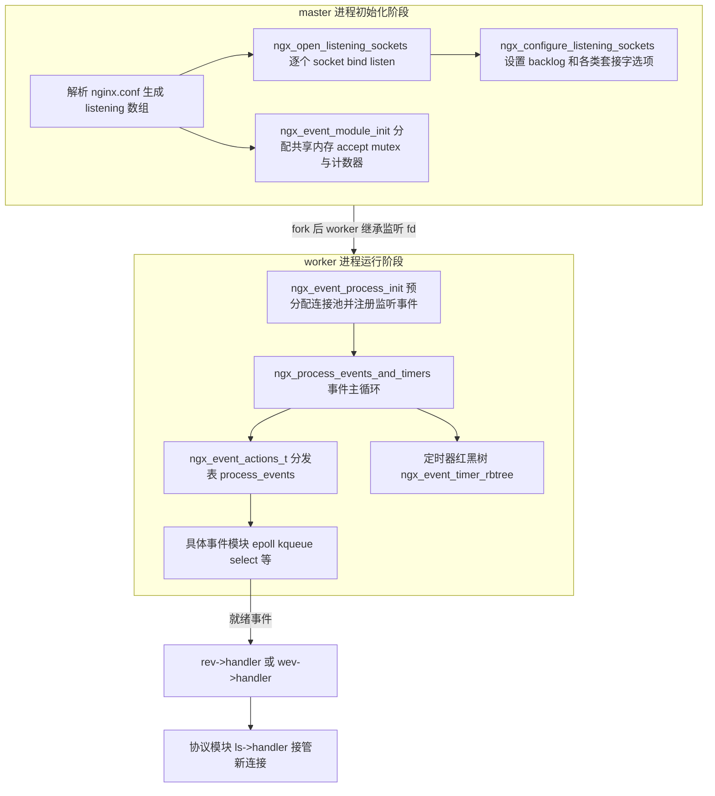
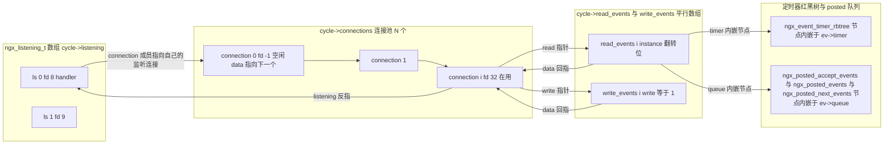
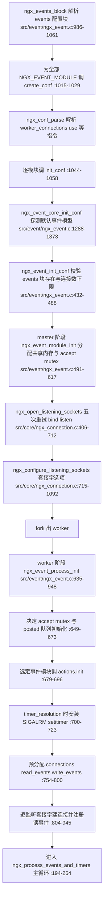
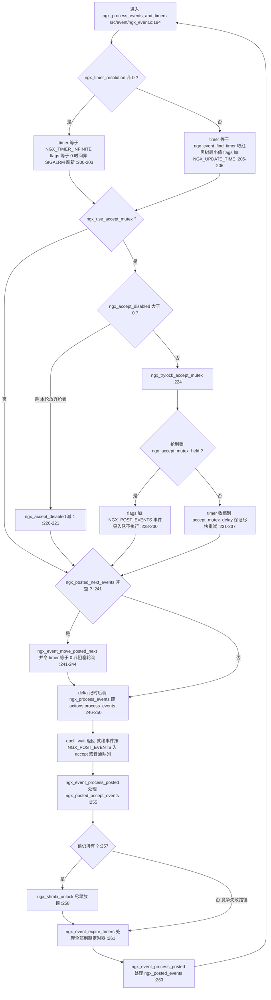
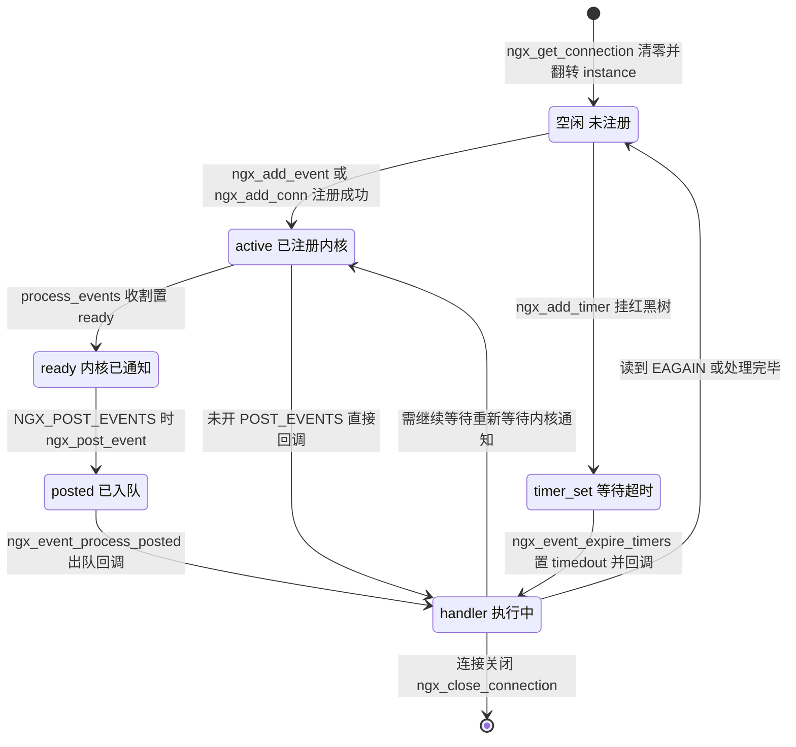
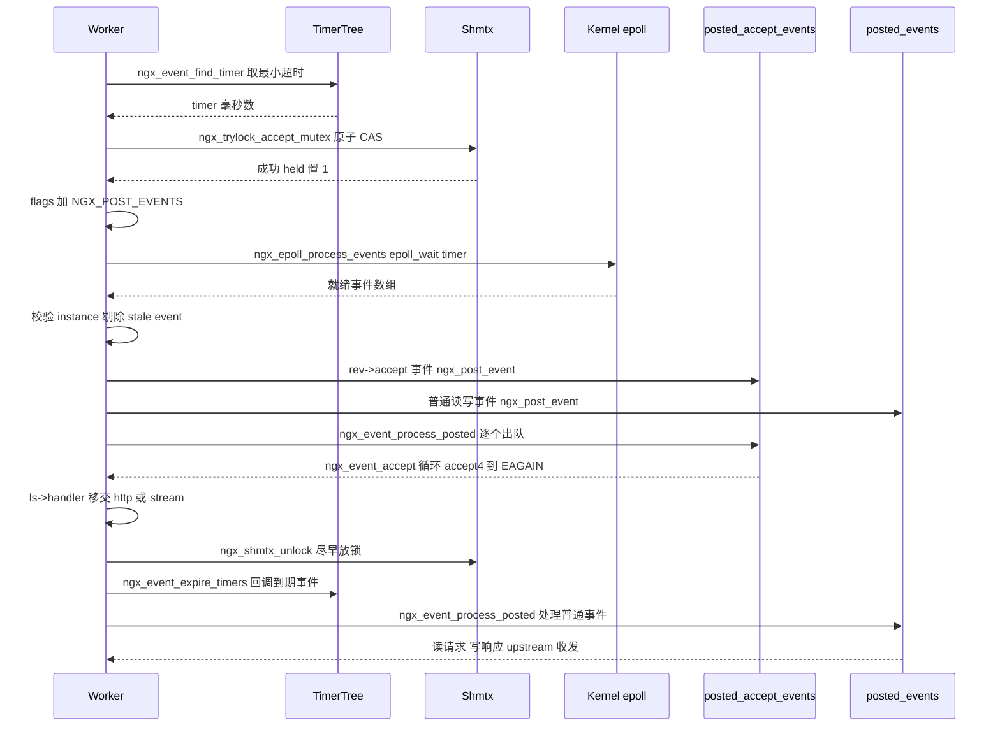

# 事件驱动框架与连接管理（基于 nginx-1.27.0 源码）

> **导读**：读完本文你将掌握——
> 1. `ngx_event_t` 与 `ngx_connection_t` 的全字段语义、二者互指关系以及监听套接字 `ngx_listening_t` 如何把它们串成一张网；
> 2. `ngx_event_actions_t` 事件分发表与 `ngx_event_flags` 能力位如何屏蔽 select/poll/epoll/kqueue/eventport 的差异，ET 与 LT 下 `ngx_handle_read_event`/`ngx_handle_write_event` 的 add/del 策略差异；
> 3. 事件模型探测优先级、`ngx_event_process_init` 的连接池预分配与监听事件注册；
> 4. 全文灵魂——`ngx_process_events_and_timers` 逐行精讲：timer 计算、`accept_mutex` 争锁、`NGX_POST_EVENTS` 与 accept/普通两条 posted 队列的处理顺序；
> 5. 三种惊群方案（accept_mutex / SO_REUSEPORT / EPOLLEXCLUSIVE）在代码中的精确落点；
> 6. 监听套接字完整生命周期（创建、open、configure、reload 继承、关闭），以及 UDP `recvmsg` 伪连接与主动连接 `ngx_event_connect_peer`。
>
> **前置阅读建议**：了解 `ngx_cycle_t`/内存池（`ngx_palloc.c`）与红黑树（`ngx_rbtree.c`）的基本接口；知道 master/worker 多进程模型与 reload 流程梗概。
>
> **涉及源码清单**（本文所有行号均来自对下列文件的真实通读）：
> - `src/event/ngx_event.c`（1373 行）
> - `src/event/ngx_event.h`（533 行）
> - `src/event/ngx_event_accept.c`（572 行）
> - `src/event/ngx_event_connect.c`（435 行）
> - `src/event/ngx_event_posted.c`（60 行）与 `src/event/ngx_event_posted.h`（50 行）
> - `src/event/ngx_event_udp.c`（590 行）
> - `src/event/ngx_event_timer.c`（126 行）
> - `src/core/ngx_connection.c`（1625 行）
> - `src/core/ngx_connection.h`（236 行）
> - 交叉引用：`src/event/modules/ngx_epoll_module.c`、`src/http/ngx_http.c`、`src/core/ngx_cycle.c`

---

## 1. 本模块在 nginx 中的位置与职责

事件驱动框架是 nginx 所有并发能力的地基。它向下封装操作系统的事件通知机制（epoll、kqueue、select、poll、/dev/poll、eventport、IOCP），向上为 HTTP、stream、mail 等协议模块提供统一的两样东西：**一个描述"某文件描述符上发生了什么"的对象 `ngx_event_t`**，和**一个描述"一次网络会话"的对象 `ngx_connection_t`**。

它的职责边界非常清晰：

- **master 阶段**（`ngx_init_cycle` 内）：创建/继承监听套接字（`ngx_open_listening_sockets`，src/core/ngx_connection.c:406-712）、按配置设置套接字选项（`ngx_configure_listening_sockets`，src/core/ngx_connection.c:715-1092）、分配进程间共享的 accept 互斥锁（`ngx_event_module_init`，src/event/ngx_event.c:491-617）。
- **worker 阶段**（每个 worker 进程内）：预分配连接池（`ngx_event_process_init`，src/event/ngx_event.c:635-948），然后进入永不停歇的主循环 `ngx_process_events_and_timers`（src/event/ngx_event.c:194-264）。
- **协议模块侧**：accept 到的新连接通过 `ls->handler(c)`（src/event/ngx_event_accept.c:313）移交，HTTP 注入 `ngx_http_init_connection`（src/http/ngx_http.c:1823）、stream 注入 `ngx_stream_init_connection`（src/stream/ngx_stream.c:1002）、mail 注入 `ngx_mail_init_connection`（src/mail/ngx_mail.c:326）。



**图解**：master 负责"把 socket 弄好"，worker 负责"把 socket 用起来"。两条链路在 `cycle->listening` 数组上汇合：master 阶段写入 `fd` 与套接字选项，worker 阶段为每个 `fd` 创建一个 `ngx_connection_t` 并把其读事件的 `handler` 设为 `ngx_event_accept` 或 `ngx_event_recvmsg`（src/event/ngx_event.c:894-903）。

---

## 2. 核心数据结构精讲

### 2.1 `ngx_event_t`：一次 I/O 可能性的全部状态

定义于 src/event/ngx_event.h:30-138。它描述"某个 fd 的读方向或写方向"，一个连接恒有两个事件对象（`c->read`、`c->write`）。

| 字段 | 行号 | 类型 | 含义精讲 |
|---|---|---|---|
| `data` | :31 | `void *` | 事件归属者指针。对连接事件恒指向 `ngx_connection_t *c`（src/core/ngx_connection.c:1231-1232）；对定时器辅助事件可指向任意上下文 |
| `write` | :33 | 位域 1 bit | 1 表示写事件，0 表示读事件。`ngx_get_connection` 中对写事件置 1（src/core/ngx_connection.c:1234） |
| `accept` | :35 | 位域 | 监听套接字的读事件才为 1（src/event/ngx_event.c:828）。事件模块用它决定事件进哪条 posted 队列（src/event/modules/ngx_epoll_module.c:895-896） |
| `instance` | :38 | 位域 | **陈旧事件检测位**。每次 `ngx_get_connection` 取出事件时翻转一次（src/core/ngx_connection.c:1220-1226）；epoll 把它编码进 `data.ptr` 最低位（src/event/modules/ngx_epoll_module.c:621），回来时比对（:839-854） |
| `active` | :44 | 位域 | 事件已注册进内核事件表。epoll 在 `epoll_ctl` 成功后置 1（src/event/modules/ngx_epoll_module.c:633） |
| `disabled` | :46 | 位域 | 已注册但被临时禁用（配合 kqueue 的 `EV_DISABLE`） |
| `ready` | :49 | 位域 | 内核已通知"现在可以读/写了"。handler 消费完数据后清 0 |
| `oneshot` | :51 | 位域 | 事件为一次性（kqueue `EV_ONESHOT`、eventport），处理完需要重新 add |
| `complete` | :54 | 位域 | aio 操作完成标志 |
| `eof` / `error` | :56-57 | 位域 | 对端关闭/发生错误 |
| `timedout` | :59 | 位域 | 定时器超时。`ngx_event_expire_timers` 置 1 后调 handler（src/event/ngx_event_timer.c:90-94），accept 事件借此区分"真有连接"与"只是被唤醒"（src/event/ngx_event_accept.c:37-43） |
| `timer_set` | :60 | 位域 | 该事件的 `timer` 节点在定时器红黑树中。防止重复 add/del 定时器 |
| `delayed` | :62 | 位域 | 被 limit_req 等模块故意延迟处理 |
| `deferred_accept` | :64 | 位域 | 监听 socket 开启了 TCP_DEFER_ACCEPT，accept 返回时必有数据（src/event/ngx_event.c:830-832） |
| `pending_eof` | :67 | 位域 | kqueue/EPOLLRDHUP 报告"对端已关但数据可能还没读完" |
| `posted` | :69 | 位域 | 已挂在某条 posted 队列上，防止重复入队（宏 `ngx_post_event`，src/event/ngx_event_posted.h:17-28） |
| `closed` | :71 | 位域 | 连接已关闭。process_init 初始化时全部置 1（src/event/ngx_event.c:769-772） |
| `channel` / `resolver` | :74-75 | 位域 | 标记事件属于 master-worker channel 或 resolver，用于退出时清理 |
| `cancelable` | :77 | 位域 | 可被放弃的定时器（`ngx_event_no_timers_left` 检查，src/event/ngx_event_timer.c:112-121） |
| `available` | :101 | `int` | kqueue 下是可读字节数/待 accept 数；其他平台 accept 事件中承载 `multi_accept` 语义（src/event/ngx_event_accept.c:47-49） |
| `handler` | :103 | 函数指针 | 事件回调。整个框架的"业务入口" |
| `index` | :110 | `ngx_uint_t` | select/poll 模块中该 fd 在 fd_set/pollfd 数组中的下标，初始 `NGX_INVALID_INDEX`（0xd0d0d0d0，:16；赋值见 src/core/ngx_connection.c:1228-1229） |
| `log` | :112 | `ngx_log_t *` | 日志对象，accept 后指向连接自己的 log |
| `timer` | :114 | `ngx_rbtree_node_t` | 内嵌红黑树节点，key 为超时时刻 `ngx_current_msec + timer` |
| `queue` | :117 | `ngx_queue_t` | 内嵌双向链表节点，用于挂三条 posted 队列 |

### 2.2 `ngx_connection_t`：一次网络会话

定义于 src/core/ngx_connection.h:124-203。

| 字段 | 行号 | 含义精讲 |
|---|---|---|
| `data` | :125 | 空闲时作 freelist 的 next 指针（src/core/ngx_connection.c:791、:1243）；被协议模块复用为请求链等 |
| `read` / `write` | :126-127 | 指向该连接的一对 `ngx_event_t`，**连接与事件互指的核心** |
| `fd` | :129 | 套接字描述符，-1 表示未使用/已关闭（:794） |
| `recv` / `send` / `recv_chain` / `send_chain` | :131-134 | I/O 函数指针，accept 时统一设为 OS 抽象层 `ngx_os_io` 的实现（src/event/ngx_event_accept.c:208-211）；UDP 场景换成 `ngx_udp_recv`/`ngx_udp_send_chain`（src/event/ngx_event_udp.c:238-240） |
| `listening` | :136 | 反向指回监听对象，协议模块靠 `c->listening->servers` 找到端口级配置 |
| `sent` | :138 | 已发送字节数统计 |
| `log` | :140 | 连接私有日志（从 `ls->log` 拷贝再改造，src/event/ngx_event_accept.c:206-214） |
| `pool` | :142 | 连接内存池，尺寸来自 `ls->pool_size`（:159） |
| `type` | :144 | `SOCK_STREAM` 或 `SOCK_DGRAM`（:153；UDP 伪连接为 `SOCK_DGRAM`，src/event/ngx_event_udp.c:209） |
| `sockaddr` / `socklen` / `addr_text` | :146-148 | 对端地址三元组，日志与访问控制都靠它 |
| `proxy_protocol` | :150 | PROXY protocol 解析结果 |
| `quic` / `ssl` / `udp` | :152-160 | 协议扩展对象指针；UDP 伪连接的 `udp` 指向 `ngx_udp_connection_t`（rbtree 节点 + 收包缓冲） |
| `local_sockaddr` / `local_socklen` | :162-163 | 本端地址。TCP 直接借用 `ls->sockaddr`（src/event/ngx_event_accept.c:218-219）；UDP wildcard 时从 IP_PKTINFO cmsg 恢复真实目的地址（src/event/ngx_event_udp.c:133-151） |
| `buffer` | :165 | 协议模块预读缓冲（SSL 握手、PROXY protocol） |
| `queue` | :167 | 通用链表节点。reusable 连接挂 `cycle->reusable_connections_queue`（src/core/ngx_connection.c:1361-1362），upstream keepalive 池也复用它 |
| `number` | :169 | 全局原子自增的连接序号（src/event/ngx_event_accept.c:260） |
| `start_time` / `requests` | :171-172 | 连接起始时刻与已处理请求数（EPOLLEXCLUSIVE 重排用，src/event/ngx_event_accept.c:459） |
| `buffered:8` | :174 | 低 4 位是 `NGX_LOWLEVEL_BUFFERED` 标志（0x0f，:119-121），标记 SSL/HTTP2 等用户态缓冲仍有数据 |
| `log_error:3` | :176 | `ngx_connection_log_error_e`（:95-102），决定 `ngx_connection_error` 对常见错误降级到 info 还是保留 alert（src/core/ngx_connection.c:1590-1620） |
| `timedout`/`error`/`destroyed`/`pipeline` | :178-181 | 状态位 |
| `idle`/`reusable`/`close`/`shared` | :183-186 | `idle` 供 `ngx_close_idle_connections` 扫描（:1437-1445）；`reusable` 供连接耗尽时回收（:1372-1426）；`close` 是异步关闭请求；`shared` 标记 UDP 伪连接共享监听 fd，关闭时绝不 `close(fd)`（:1308-1310） |
| `sendfile`/`sndlowat`/`tcp_nodelay:2`/`tcp_nopush:2` | :188-191 | 发送路径优化状态，`NGX_TCP_NODELAY_UNSET/SET/DISABLED` 三态（:105-109） |
| `need_last_buf`/`need_flush_buf` | :193-194 | 输出链最后一块 buffer 语义 / UDP 立即 flush 语义（src/event/ngx_event_udp.c:242） |
| `sendfile_task` | :201 | 线程池异步 sendfile 任务（NGX_THREADS） |

### 2.3 `ngx_listening_t`：监听套接字

定义于 src/core/ngx_connection.h:18-92。关键字段：`fd`（:19）、`sockaddr/socklen/addr_text`（:21-24）、`type`（:26）、`backlog`（:28，默认 `NGX_LISTEN_BACKLOG`，Linux 为 511，见 src/os/unix/ngx_linux_config.h:111）、`handler`（:38，协议模块注入的入口回调）、`servers`（:40，协议模块端口级配置）、`connection`（:50，监听 socket 自己的连接对象）、`rbtree/sentinel`（:52-53，UDP 会话表）、`worker`（:55，reuseport 分配给哪个 worker）、以及一整组位标志：`inherited`（:62，reload 继承）、`listen`（:64）、`reuseport/add_reuseport`（:73-74）、`deferred_accept/delete_deferred/add_deferred`（:78-80）、`accept_filter`（:82）。

### 2.4 互指关系与内存布局

worker 启动时 `ngx_event_process_init` 一次性分配三个平行数组：`cycle->connections`、`cycle->read_events`、`cycle->write_events`（src/event/ngx_event.c:754-783），下标一一对应，再用单链表把全部 `ngx_connection_t` 串成空闲池（:785-800）。



**图解**：三个数组按下标刚性配对，`ngx_get_connection` 从空闲链头摘一个连接（src/core/ngx_connection.c:1193-1204），把配对事件的 `instance` 位翻转、`index` 重置、`data` 回指（:1220-1234）；`ngx_free_connection` 只做一次头插就还回池中（:1240-1250）。**没有任何逐连接的 malloc/free**——这是 nginx 百万连接下内存开销恒定的根源。

三个事件指针字段是理解全框架的钥匙：
- `c->read`/`c->write` → 事件（"我关心什么"）；
- `ev->data` → 连接（"这是谁的 fd"，handler 第一行几乎都是 `c = ev->data`）；
- `c->listening` → 监听对象（"这个连接从哪个端口来"）。

---

## 3. 初始化流程



**图解**：配置解析阶段（A-F）确定"用哪个事件模型、开多少连接"；master 阶段（G-I）完成跨进程资源：共享内存中的锁与计数器、监听 fd；worker 阶段（K-P）完成本进程资源：三数组连接池、定时器红黑树、每个监听 fd 的读事件注册。任何一步失败要么 config 报错退出，要么 `exit(2)`（:690-693）。

需要注意：**1.27.0 的 `ngx_event_process_init` 中没有任何线程池初始化调用**（全文通读确认无 `ngx_init_threads`/`ngx_thread_pool_init`），线程池由 `ngx_thread_pool_module` 自身的 `init_process` 回调完成；老版本 nginx 曾在事件模块初始化里拉起线程，现已解耦。

---

## 4. 核心执行流程：ngx_process_events_and_timers 主循环

这是全文的灵魂。每个 worker 的整个生命周期就是在反复执行这一个函数（由 `ngx_worker_process_cycle` 驱动）。



**图解（顺序即正确性）**：
1. **先算 timer 再争锁**：抢锁失败的 worker 必须把 `epoll_wait` 的阻塞上限压到 `accept_mutex_delay`（默认 500ms，src/event/ngx_event.c:1370），否则它可能睡过下一次锁释放，造成 accept 停摆。
2. **`NGX_POST_EVENTS` 的意义**：持锁 worker 把"处理事件"推迟到出内核之后——监听读事件进 `ngx_posted_accept_events`，其余进 `ngx_posted_events`（src/event/modules/ngx_epoll_module.c:894-898、:926-927）。这样 epoll 批量收割与逐个处理解耦。
3. **accept 队列先于解锁**：accept 事件必须在持锁期间处理完（:255），这是 mutex 方案串行化 accept 的保证；随后立刻 `ngx_shmtx_unlock`（:257-259），**宁可让普通事件和定时器等一会，也不多持锁一微秒**。
4. **定时器在放锁之后、普通 posted 之前**（:261-263）：超时处理可能关闭连接，先做能减少普通 posted 事件处理中碰到已关闭连接的概率。
5. `ngx_posted_next_events` 是"下一轮立即执行"队列：`ngx_event_move_posted_next` 把其中事件标记 `ready=1, available=-1` 并整体并入 `ngx_posted_events`（src/event/ngx_event_posted.c:39-60），同时强制 `timer=0` 让本轮 `epoll_wait` 立即返回。投稿方包括写过滤器（src/http/ngx_http_write_filter_module.c:335）、输出链（src/core/ngx_output_chain.c:790）、SSL 重试（src/event/ngx_event_openssl.c:2297）。

用状态机描述一个 `ngx_event_t` 在一轮循环中的生命周期：



**图解**：`instance` 位每次进出空闲池都翻转一次，所以内核中残留的旧事件（fd 被复用前的）回来时 `rev->instance != instance`，被 epoll 模块识别为 stale event 直接丢弃（src/event/modules/ngx_epoll_module.c:844-854）——这是 nginx 不依赖 fd 序号回收仍能正确工作的关键。

---

## 5. 关键时序图：持锁 worker 的一轮完整循环



**图解**：每一跳都有函数名可查。两处顺序是设计精髓——accept 队列处理完才放锁（持锁窗口 = accept 处理时间）；定时器与普通事件都放在放锁之后（它们耗时不可控，不能占用全局 accept 窗口）。而抢锁失败的 worker 在第 2 步就分流：不置 `NGX_POST_EVENTS`，其 `epoll_wait` 返回后**直接在内核收割循环里同步执行 handler**（src/event/modules/ngx_epoll_module.c:900-902），且 timer 被压到 `accept_mutex_delay`，很快回来再抢。

---

## 6. 源码逐段精读

### 6.1 `ngx_process_events_and_timers`——主循环逐行精读

签名：`void ngx_process_events_and_timers(ngx_cycle_t *cycle)`（src/event/ngx_event.c:194-264）。

**第一段：timer 与 flags 的两种模式（:200-217）**

```c
    if (ngx_timer_resolution) {
        timer = NGX_TIMER_INFINITE;
        flags = 0;

    } else {
        timer = ngx_event_find_timer();
        flags = NGX_UPDATE_TIME;
```

两种时间管理策略二选一：
- **signal 模式**：`timer_resolution` 指令开启后，worker 用 `setitimer(ITIMER_REAL)` 周期性收到 SIGALRM（安装见 `ngx_event_process_init` :700-723），信号处理器只置一个标志 `ngx_event_timer_alarm = 1`（`ngx_timer_signal_handler`，:622-630，注意是 async-signal-safe 的最小实现）。此时 `epoll_wait` 可以无限阻塞，时间戳在每次系统调用返回后由 epoll 模块统一刷新（src/event/modules/ngx_epoll_module.c:804-806 检查 `ngx_event_timer_alarm`）。好处是高并发下不必每次循环都走 `clock_gettime`。
- **默认模式**：每次循环用 `ngx_event_find_timer()`（src/event/ngx_event_timer.c:32-50）从定时器红黑树取最小 key 与 `ngx_current_msec` 的差值，并把 `NGX_UPDATE_TIME` 交给事件模块在 `epoll_wait` 返回后刷新时间。树空则返回 `NGX_TIMER_INFINITE`（:38-40）。

Win32 分支（:208-216）因信号机制缺失，把无限等待截断为 500ms，保证 master 的 channel 消息不被饿死。

**第二段：accept_mutex 争锁（:219-239）**

```c
    if (ngx_use_accept_mutex) {
        if (ngx_accept_disabled > 0) {
            ngx_accept_disabled--;

        } else {
            if (ngx_trylock_accept_mutex(cycle) == NGX_ERROR) {
                return;
            }

            if (ngx_accept_mutex_held) {
                flags |= NGX_POST_EVENTS;

            } else {
                if (timer == NGX_TIMER_INFINITE
                    || timer > ngx_accept_mutex_delay)
                {
                    timer = ngx_accept_mutex_delay;
                }
            }
        }
    }
```

四个分支精确对应四种负载状态：
1. `ngx_use_accept_mutex == 0`：多 worker 且未开锁（或单 worker、或 EPOLLEXCLUSIVE/reuseport 已接管），跳过全部争锁逻辑。
2. `ngx_accept_disabled > 0`：本进程连接数已接近上限（公式见 6.5 节），**每轮循环自减 1 作为"冷却"**，冷却期内完全不参与争锁，把新连接让给更空闲的兄弟进程。
3. 抢到锁：本轮只有我 accept。`NGX_POST_EVENTS` 让监听事件先进队列，避免在 epoll 收割循环的半路就执行 accept——那样一条连接的处理时间会拉长整个收割窗口。
4. 没抢到：`epoll_wait` 的睡眠上限收缩为 `accept_mutex_delay`。若不收缩，持锁者 accept 完立刻放锁，而本 worker 还要睡完原本的超时才能回来抢，吞吐出现锯齿。

**第三段：posted_next 队列提前消费（:241-244）**

```c
    if (!ngx_queue_empty(&ngx_posted_next_events)) {
        ngx_event_move_posted_next(cycle);
        timer = 0;
    }
```

`ngx_event_move_posted_next`（src/event/ngx_event_posted.c:39-60）遍历 `ngx_posted_next_events`，把每个事件 `ev->ready = 1; ev->available = -1;`，然后整条链表拼接到 `ngx_posted_events` 头部并重新初始化自己。`timer = 0` 强制本轮 `epoll_wait` 不阻塞。用途：调用方（如写过滤器发现 `buffered` 未清空，src/http/ngx_http_write_filter_module.c:335）希望"这轮事件处理完就立刻再试一次写"，但又不能在本轮 handler 栈内递归执行。

**第四段：收割与三段式处理（:246-263）**

```c
    delta = ngx_current_msec;

    (void) ngx_process_events(cycle, timer, flags);

    delta = ngx_current_msec - delta;
    ...
    ngx_event_process_posted(cycle, &ngx_posted_accept_events);

    if (ngx_accept_mutex_held) {
        ngx_shmtx_unlock(&ngx_accept_mutex);
    }

    ngx_event_expire_timers();

    ngx_event_process_posted(cycle, &ngx_posted_events);
```

`delta` 记录本轮收割耗时（调试日志 :252-253 输出 `timer delta`）。之后是严格四步：
1. **处理 accept 队列**（持锁状态下）；
2. **立刻放锁**；
3. **到期定时器**（`ngx_event_expire_timers`，src/event/ngx_event_timer.c:53-96：循环取红黑树最小节点，key 不大于当前时间则摘除、`timer_set=0`、`timedout=1`、调 handler；一旦最小节点未到期立即返回）；
4. **处理普通 posted 队列**。

易错点：普通 posted 事件 handler 里可能 add 新的 posted 事件（例如 upstream 再投递读事件），`ngx_event_process_posted` 用 `while (!ngx_queue_empty(posted))`（src/event/ngx_event_posted.c:24）不断从队头取、`ngx_delete_posted_event` 摘链（先清 `posted` 位再 `ngx_queue_remove`，src/event/ngx_event_posted.h:31-37）再调 `ev->handler(ev)`（:34），天然支持处理中追加。但**若 handler 关闭了连接而连接的另一个事件还在队列里**，靠 `ngx_close_connection` 中的 `ngx_delete_posted_event`（src/core/ngx_connection.c:1288-1294）把对方从队列摘除来保证安全。

### 6.2 `ngx_handle_read_event` / `ngx_handle_write_event`——ET 与 LT 的 add/del 策略

签名：`ngx_int_t ngx_handle_read_event(ngx_event_t *rev, ngx_uint_t flags)`（src/event/ngx_event.c:267-344）、`ngx_int_t ngx_handle_write_event(ngx_event_t *wev, size_t lowat)`（:347-429）。它们是协议模块读完/写完数据后"下一步该怎么等"的统一决策点。

**读事件三分支（:282-339）**：

- **`NGX_USE_CLEAR_EVENT`（epoll ET、kqueue EV_CLEAR）**：

```c
        if (!rev->active && !rev->ready) {
            if (ngx_add_event(rev, NGX_READ_EVENT, NGX_CLEAR_EVENT)
                == NGX_ERROR)
```
  只在"既没注册、也没就绪"时补注册一次。ET 模式下注册是**常驻**的：内核只在状态沿（新数据到达/对端关闭）通知，worker 读到 EAGAIN 后 `rev->ready` 清 0、`rev->active` 保持 1，下次数据到来内核再报，无需任何 `epoll_ctl`。这就是边缘触发的零系统调用收益。
- **`NGX_USE_LEVEL_EVENT`（select/poll/devpoll）**：两个对称动作——`!active && !ready` 时 add（:300-308）；`active && (ready || NGX_CLOSE_EVENT)` 时 del（:310-318）。水平触发下"没读完的数据"会让 select 每轮都报告，若 worker 决定暂不读（比如延迟读、连接保活挂起），必须**摘除**事件，否则空转。`NGX_CLOSE_EVENT` 传入 del 是关闭路径的快捷方式（对 select/poll 意味着只改用户态 fd_set 不发系统调用，语义见 src/event/ngx_event.h:270-281 的注释）。
- **`NGX_USE_EVENTPORT_EVENT`（Solaris event ports）**：天然 oneshot——`!active && !ready` 补挂（:324-330）；`oneshot && ready` 摘除（:332-338）。每次通知消耗掉注册，必须重新挂。

**写事件（:347-429）**：结构与读事件完全对称，外加 `lowat` 处理（:360-364）：

```c
    if (lowat) {
        if (ngx_send_lowat(c, lowat) == NGX_ERROR) {
            return NGX_ERROR;
        }
    }
```

`ngx_send_lowat`（:951-983）：kqueue 平台直接 `c->write->available = lowat` 启用 `NOTE_LOWAT`（内核在可写字节数超过低水位才通知，:956-963）；其他平台对 socket 设一次 `SO_SNDLOWAT` 并用 `c->sndlowat` 标志防止重复 setsockopt（:965-981）。

易错点：CLEAR 分支的条件是 `!active && !ready` 的**与**。若 `ready==1`（上次通知还没消费），绝不能重复 add——epoll 下重复 ADD 会 EEXIST 报错；而 LT 分支依赖 `ready` 判断是否要摘除。理解这两个位域的配对语义是读懂所有协议模块事件处理的前提。

### 6.3 `ngx_event_module_init`——共享内存与 accept 锁的诞生

签名：`static ngx_int_t ngx_event_module_init(ngx_cycle_t *cycle)`（src/event/ngx_event.c:491-617）。这是 `ngx_event_core_module` 的 `init_module` 回调（:184），只在 master（及单进程模式）初始化时执行。

逐块：
- 取出 `ecf` 并打印"using the xxx event method"（:502-508）；
- `ngx_timer_resolution = ccf->timer_resolution`（:512）；
- `getrlimit(RLIMIT_NOFILE)` 若小于 `worker_connections` 则告警（:514-538）；
- `ccf->master == 0`（单进程模式）直接返回——单进程无需跨进程锁（:541-543）；`ngx_accept_mutex_ptr` 非空说明 reload 已建过，直接返回（:545-547）；
- 分配共享内存，**每项占 128 字节避免伪共享**（`cl = 128`，:552）：

```c
    size = cl            /* ngx_accept_mutex */
           + cl          /* ngx_connection_counter */
           + cl;         /* ngx_temp_number */
```
- `ngx_shm_alloc` 挂名为 `nginx_shared_zone` 的 shm 段（:570-576）；
- 布局：第 0 槽 accept 锁，`ngx_accept_mutex.spin = (ngx_uint_t) -1` 表示纯自旋锁（不落文件信号量），`ngx_shmtx_create` 完成初始化（:580-588）；第 1 槽 `ngx_connection_counter` 并原子置 1（:590-592）；第 2 槽 `ngx_temp_number`（:598）；`NGX_STAT_STUB` 时第 3-9 槽是 7 个 stub 计数器（:604-614）。

设计权衡：锁与计数器放在同一块共享内存一次分配，reload 时通过 `ngx_accept_mutex_ptr` 非空检查保证**复用旧段**而不是重建——重建会让正在运行的旧 worker 与新 worker 各持一把锁。

### 6.4 `ngx_event_process_init`——worker 侧一次性的全部准备

签名：`static ngx_int_t ngx_event_process_init(ngx_cycle_t *cycle)`（src/event/ngx_event.c:635-948）。这是 `ngx_event_core_module` 的 `init_process` 回调（:185），每个 worker 进程启动时执行一次。

**块 1：accept 策略决策（:649-669）**

```c
    if (ccf->master && ccf->worker_processes > 1 && ecf->accept_mutex) {
        ngx_use_accept_mutex = 1;
        ...
    } else {
        ngx_use_accept_mutex = 0;
    }
```
mutex 方案需要三个条件同时成立：master 管理、多 worker、配置显式开启（1.27.0 中 `accept_mutex` 默认值为 0，见 `ngx_event_core_init_conf` :1369）。Windows 上一律关闭，注释给出的理由是"持锁进程若无法 accept 会死锁"（:658-667）。随后 `ngx_use_exclusive_accept = 0` 复位（:669）。

**块 2：posted 队列与定时器（:671-677）**——三条队列 `ngx_posted_accept_events`/`ngx_posted_next_events`/`ngx_posted_events` 初始化；`ngx_event_timer_init` 建红黑树。

**块 3：装配事件模块（:679-696）**——遍历模块表找到 `ctx_index == ecf->use` 的事件模块，调 `module->actions.init(cycle, ngx_timer_resolution)`；epoll 模块在此建 epfd、分配事件数组、把 `ngx_event_actions` 整表换成本模块实现、设置 `ngx_event_flags`（src/event/modules/ngx_epoll_module.c:369-377）。失败 `exit(2)`，因为 worker 没有事件框架无法存活。

**块 4：timer_resolution 信号化（:700-723）**——`sigaction(SIGALRM)` + `setitimer(ITIMER_REAL)`，仅当事件模块自身不支持 `NGX_USE_TIMER_EVENT`（如 kqueue 可用内核定时器，src/event/ngx_event.h:253-257）。

**块 5：`NGX_USE_FD_EVENT` 的文件表（:725-741）**——poll/devpoll 需要按 fd 直接索引连接，预分配 `cycle->files` 数组，尺寸取 `RLIMIT_NOFILE`。

**块 6：连接池三数组与空闲链（:754-800）**

```c
    cycle->connections =
        ngx_alloc(sizeof(ngx_connection_t) * cycle->connection_n, cycle->log);
```
读事件数组初始化 `closed=1, instance=1`（:769-772），写事件 `closed=1`（:781-783）。随后**倒序**构建空闲单链表（:785-797）：`c[i].data = next` 从最后一个元素往头串，最终 `cycle->free_connections` 指向下标 0，`free_connection_n = connection_n`。倒序保证链表顺序为 0→1→…→N-1，连接分配从低下标开始。

**块 7：逐监听套接字注册（:804-945）**，每个 `ls[i]`：
- reuseport 套接字只由属主 worker 处理：`if (ls[i].reuseport && ls[i].worker != ngx_worker) continue;`（:807-810）；
- `ngx_get_connection(ls[i].fd, ...)` 从池中取一个连接作为**监听连接**，`c->listening = &ls[i]; ls[i].connection = c;`（:813-823）；
- 读事件打标：`rev->accept = 1`，`rev->deferred_accept = ls[i].deferred_accept`（:825-832）；
- **reload 收尾**：非 IOCP 且存在 `cycle->old_cycle` 时，若 `ls[i].previous` 非空，把**旧 cycle 的读事件**从内核事件表删除（带 `NGX_CLOSE_EVENT`）并把旧连接 `fd` 置 -1（:834-854）。原因：reload 后 fd 数值不变但 `cycle->connections` 数组是新的，旧 epoll 注册的 `data.ptr` 指向旧数组对象，不删就是悬垂指针；
- handler 分派（:894-903）：

```c
        if (c->type == SOCK_STREAM) {
            rev->handler = ngx_event_accept;

#if (NGX_QUIC)
        } else if (ls[i].quic) {
            rev->handler = ngx_quic_recvmsg;
#endif
        } else {
            rev->handler = ngx_event_recvmsg;
        }
```
- 注册顺序体现三种惊群方案优先级：reuseport 套接字**无条件注册**（:905-913，每 worker 独占 socket，无竞争）；开 accept_mutex 时**暂不注册**（:917-919，等抢到锁后由 `ngx_enable_accept_events` 补挂）；epoll 且多 worker 时走 `NGX_EXCLUSIVE_EVENT`（:921-937）；否则普通 `ngx_add_event`（:939-941）。

### 6.5 `ngx_trylock_accept_mutex` 与 `ngx_accept_disabled` 负载均衡

签名：`ngx_int_t ngx_trylock_accept_mutex(ngx_cycle_t *cycle)`（src/event/ngx_event_accept.c:327-362）。

```c
    if (ngx_shmtx_trylock(&ngx_accept_mutex)) {
        ...
        if (ngx_accept_mutex_held && ngx_accept_events == 0) {
            return NGX_OK;
        }

        if (ngx_enable_accept_events(cycle) == NGX_ERROR) {
            ngx_shmtx_unlock(&ngx_accept_mutex);
            return NGX_ERROR;
        }

        ngx_accept_events = 0;
        ngx_accept_mutex_held = 1;

        return NGX_OK;
    }
    ...
    if (ngx_accept_mutex_held) {
        if (ngx_disable_accept_events(cycle, 0) == NGX_ERROR) {
            return NGX_ERROR;
        }

        ngx_accept_mutex_held = 0;
    }
```

逻辑精读：
- **抢到锁**：若上一轮就持锁且没有失锁又得锁（`ngx_accept_events` 标志，用于锁易主后重挂事件），什么都不用做——事件还挂着；否则把所有监听读事件 `ngx_add_event` 挂回内核（`ngx_enable_accept_events`，:365-387，跳过 `c->read->active` 已挂的）。
- **没抢到**：若上一轮是持锁方（说明锁刚被别人抢走——例如时间片轮转或 worker 重启），要把自己的监听事件**摘下来**（`ngx_disable_accept_events`，:390-427，用 `NGX_DISABLE_EVENT` 尽量走内核的禁用而非删除；reuseport 套接字除非 `all=1` 否则跳过，:406-417）。这样保证**任意时刻只有一个 worker 的监听事件在内核里**，从根上消除 accept 惊群。
- 锁本体是共享内存上的原子 CAS 自旋锁（`ngx_shmtx_trylock`，实现位于 src/core/ngx_shmtx.c，本文不展开），`spin = -1` 表示自旋而非文件锁（src/event/ngx_event.c:581）。

**`ngx_accept_disabled` 负载均衡公式**（src/event/ngx_event_accept.c:139-140，UDP 同款 :200-201）：

```c
        ngx_accept_disabled = ngx_cycle->connection_n / 8
                              - ngx_cycle->free_connection_n;
```

即 `disabled = connection_n/8 - free_connection_n`：
- `free_connection_n > connection_n/8`（空闲超过 12.5%）→ `disabled < 0`，积极参加争锁；
- 空闲跌破阈值 → `disabled > 0`，此后**每轮主循环减 1**（src/event/ngx_event.c:220-221），期间不争锁。由于每次 accept 后都会重算（:139-140），随着本进程连接释放、`free_connection_n` 回升，`disabled` 自然回到负值重新参战。
- EMFILE/ENFILE 的紧急刹车：`ngx_disable_accept_events(cycle, 1)` 连 reuseport 一起禁用，若持锁则放锁并置 `ngx_accept_disabled = 1`（:112-129），不持锁则给监听事件挂 `accept_mutex_delay` 定时器，超时回调入口 `if (ev->timedout)` 里 `ngx_enable_accept_events` 恢复（:37-43）。

这是一个**无中心协调器的自平衡方案**：繁忙 worker 用"冷却计数"自我 abstain，系统整体自动把 accept 机会让给空闲者。

### 6.6 `ngx_event_accept`——从内核队列到协议模块的完整搬运

签名：`void ngx_event_accept(ngx_event_t *ev)`（src/event/ngx_event_accept.c:20-324）。

**入口（:37-56）**：`ev->timedout` 说明是 EMFILE 冷却定时器到期，先恢复全部监听事件；非 kqueue 时 `ev->available = ecf->multi_accept`——这个字段同时是"还要不要继续 accept"的循环条件。kqueue 由内核直接给出待 accept 数量（`available` 的 kqueue 语义，src/event/ngx_event.h:86-99）。

**accept 循环（:58-319）**，`do {...} while (ev->available)`：

- **系统调用选择（:61-69）**：优先 `accept4(..., SOCK_NONBLOCK)` 一步完成 accept+非阻塞；失败且 `errno == ENOSYS` 时置 `use_accept4 = 0`、`ngx_inherited_nonblocking = 0`，`continue` 回退到 `accept()` + 显式 `ngx_nonblocking`（:185-204 会因此补设非阻塞）。
- **EAGAIN 即出口（:74-78）**：正常结束循环。
- **错误分级（:80-87）**：`ECONNABORTED` 降为 ERR（三次握手完成后被 RST，属正常网络现象）；`EMFILE/ENFILE` 升为 CRIT（fd 耗尽，系统级问题）。
- **kqueue 的 ECONNABORTED 处理（:102-110）**：`ev->available--` 后若还有余量 `continue`——kqueue 的 available 是精确计数，一条夭折连接也要扣账。
- **EMFILE 处理（:112-130）**：见 6.5 节。
- **连接构造流水线（:139-313）**，顺序固定且每步失败都走 `ngx_close_accepted_connection`（:481-503：`ngx_free_connection` 还池 → `c->fd=-1` → `close(fd)` → 销毁内存池 → `ngx_stat_active` 减一）：

```c
        ngx_accept_disabled = ngx_cycle->connection_n / 8
                              - ngx_cycle->free_connection_n;

        c = ngx_get_connection(s, ev->log);
        ...
        c->pool = ngx_create_pool(ls->pool_size, ev->log);
        ...
        c->sockaddr = ngx_palloc(c->pool, socklen);
```
  1. 重算 `disabled`（此时新连接已入账）；
  2. `ngx_get_connection` 摘空闲连接、翻转 instance；
  3. 建连接内存池（尺寸来自 `ls->pool_size`，由 http 模块的 `connection_pool_size` 指令在配置阶段赋值，见 src/http/ngx_http.c:1826）；
  4. 拷贝对端地址（:169-175）；
  5. 分配并初始化连接私有 log：`*log = ls->log` 拷贝监听日志模板，再在 :310-311 清掉 `log->data/log->handler`——因为监听期的 `ngx_accept_log_error`（:506-511，输出 "while accepting new connection on %V"）只适用于 accept 阶段；
  6. 装 I/O 函数指针（:208-211）、`c->listening = ls`、`local_sockaddr` 借用 `ls->sockaddr`（:217-219）；
  7. AF_UNIX 特判禁用 tcp_nodelay/nopush（:221-230）;
  8. `wev->ready = 1`——**新连接天然可写**（:235）；`deferred_accept` 时 `rev->ready = 1`（内核已把数据攥着才让 accept 返回，:241-246）；
  9. `c->number = ngx_atomic_fetch_add(ngx_connection_counter, 1)`（:260）与 `start_time`（:262）；
  10. `addr_ntop` 时生成可读的 `c->addr_text`（:268-282）；
  11. **注册事件**（:303-308）：

```c
        if (ngx_add_conn && (ngx_event_flags & NGX_USE_EPOLL_EVENT) == 0) {
            if (ngx_add_conn(c) == NGX_ERROR) {
```
  非 epoll 模块（kqueue/eventport 等）用 `ngx_add_conn` 一次性挂读写两个方向；epoll 走另一个路径——**`ngx_add_conn` 不会被调用**，因为 `ngx_epoll_add_connection` 已在别处……准确地说：epoll 下这里跳过 add_conn，读写事件的首次注册推迟到协议模块调用 `ngx_handle_read_event`/`ngx_handle_write_event` 时按需进行（CLEAR 分支的 `!active && !ready` 条件命中后 add）。epoll 的 `ngx_epoll_add_connection`（src/event/modules/ngx_epoll_module.c:701-721，一次性 `EPOLLIN|EPOLLOUT|EPOLLET|EPOLLRDHUP` 并把 instance 编码进 `data.ptr`）主要用于**主动连接**场景（见 6.11 节）。
  12. **移交协议模块**：`ls->handler(c)`（:313）。

- **循环收尾（:315-323）**：kqueue 下 `ev->available--`；循环结束后，EPOLLEXCLUSIVE 场景调用 `ngx_reorder_accept_events(ls)`（:321-323，见 6.7）。

**"监听 ctx 切换注入"的落点**：`ls->handler` 在配置阶段由各协议模块写入——HTTP 为 `ngx_http_add_listening` 中的 `ls->handler = ngx_http_init_connection; ls->servers = hport;`（src/http/ngx_http.c:1781、:1823），stream/mail 同理（src/stream/ngx_stream.c:1002、src/mail/ngx_mail.c:326）。`ls->servers` 指向端口级配置数组（如 `ngx_http_port_t`），`ngx_http_init_connection` 用 `c->listening->servers` 找到默认 server 并初始化 HTTP 请求上下文。**事件框架对协议零感知，只负责把 `c` 递过去**——这是 nginx 分层解耦的教科书式实现。

### 6.7 `ngx_reorder_accept_events`——EPOLLEXCLUSIVE 的补丁

签名：`static void ngx_reorder_accept_events(ngx_listening_t *ls)`（src/event/ngx_event_accept.c:432-476，`NGX_HAVE_EPOLLEXCLUSIVE` 编译开关）。

```c
    if (c->requests++ % 16 != 0
        && ngx_accept_disabled <= 0)
    {
        return;
    }

    if (ngx_del_event(c->read, NGX_READ_EVENT, NGX_DISABLE_EVENT)
        == NGX_ERROR)
    ...
    if (ngx_add_event(c->read, NGX_READ_EVENT, NGX_EXCLUSIVE_EVENT)
        == NGX_ERROR)
```

注释直接点明问题：Linux 上 `EPOLLEXCLUSIVE` 通常只唤醒**最先把这个监听 socket 加入 epoll 的那个进程**，导致连接向第一个 worker 集中（:437-443 的源码注释）。nginx 的对策：每处理 16 个请求（`c->requests++ % 16 == 0`）或本进程连接吃紧（`ngx_accept_disabled > 0`）时，把监听事件禁用再以 EXCLUSIVE 方式重挂——重新排队后其他 worker 有机会成为"被优先唤醒者"。这是把内核调度缺陷用应用层抖动来摊平的典型手法。

### 6.8 连接池管理：`ngx_get_connection` / `ngx_free_connection` / `ngx_close_connection` / `ngx_drain_connections`

`ngx_get_connection(ngx_socket_t s, ngx_log_t *log)`（src/core/ngx_connection.c:1174-1237）逐行：
- `cycle->files` 非空时校验 fd 上限（:1183-1189）；
- `ngx_drain_connections`——先还债再取连接（:1191）；
- 空闲链头摘除（:1193-1204）：

```c
    c = ngx_cycle->free_connections;
    if (c == NULL) {
        ngx_log_error(NGX_LOG_ALERT, log, 0,
                      "%ui worker_connections are not enough",
                      ngx_cycle->connection_n);
        return NULL;
    }
    ngx_cycle->free_connections = c->data;
    ngx_cycle->free_connection_n--;
```
- 保存 `rev/wev` 指针 → `ngx_memzero` 整个连接 → 恢复指针（:1210-1218）；
- **instance 翻转**（:1220-1226）：`instance = rev->instance; ... rev->instance = !instance; wev->instance = !instance;` 读写事件必须同步翻转，保证陈旧检测一致；
- `index = NGX_INVALID_INDEX`、`rev->data = wev->data = c`、`wev->write = 1`（:1228-1234）。

`ngx_free_connection`（:1240-1250）仅三行：头插空闲链、计数加一、清 `files[]` 映射。

`ngx_close_connection(c)`（:1253-1338）是所有关闭的必经之路，顺序讲究：
1. `c->fd == -1` 直接报"already closed"返回（:1260-1263）；
2. 摘读写定时器（:1265-1271）；
3. 非共享连接从内核摘事件：优先 `ngx_del_conn`（epoll 等的整连接删除），否则分别 del 读写事件，均带 `NGX_CLOSE_EVENT`（:1273-1286）；
4. **从 posted 队列摘除两个事件**（:1288-1294）——防止 6.1 节所述的"队列里残留已关闭连接事件"；
5. `closed = 1`、`ngx_reusable_connection(c, 0)`（:1296-1299）；
6. 还池、保存 fd、`c->fd = -1`（:1303-1306）；
7. `c->shared`（UDP 伪连接）直接返回**不 close fd**——fd 属于监听 socket（:1308-1310）；
8. `close(fd)`，对 `ECONNRESET/ENOTCONN` 按 `c->log_error` 降级日志级别（:1312-1337）。

`ngx_drain_connections(cycle)`（:1372-1426）：当 `free_connection_n <= connection_n/16` 且存在 reusable 连接时，取 `n = max(min(32, reusable/8), 1)` 个**最久未用**的 reusable 连接（从 `reusable_connections_queue` 队尾取，:1402-1403），置 `c->close = 1` 后**直接调用其 `c->read->handler(c->read)`**（:1408-1409）——让协议模块自己走正常关闭流程（它会看到 `close` 标志主动结束请求）。若一个都没还出来，对最后一个再推一次（:1412-1425）。这是 `worker_connections` 耗尽前 nginx 的自救通道，日志 "worker_connections are not enough, reusing connections"（:1388-1391）即来源于此。

`ngx_reusable_connection`（:1341-1369）维护 `cycle->reusable_connections_queue` 双向链表与计数；HTTP keepalive 空闲连接被标记 reusable，紧急时即可被 drain 掉。

### 6.9 监听套接字生命周期

**创建（配置阶段）**：`ngx_create_listening`（src/core/ngx_connection.c:19-95）把 sockaddr 拷进池、生成 `addr_text`、初始化 UDP 会话红黑树（:76）、`backlog = NGX_LISTEN_BACKLOG`（:82）、`fd = -1`。

**打开（master，`ngx_init_cycle` 调用）**：`ngx_open_listening_sockets`（:406-712）：
- 外层 **5 次重试循环**，每次失败 sleep 500ms（:425、:700-703）——容忍旧实例尚未退出造成的 `EADDRINUSE`；
- `ls[i].add_reuseport` 的过渡逻辑（:439-474）：从"无 reuseport"平滑切到"多 socket reuseport"，必须先给**旧 socket** 补上 `SO_REUSEPORT`/`SO_REUSEPORT_LB`，否则新旧 socket 无法共存于同一地址；
- 跳过 `inherited`（reload 场景 fd 已在手里，:481-488）；
- `ngx_socket` 创建 → `SO_REUSEADDR`（:500-516）→ reuseport 时设 `SO_REUSEPORT` 或 `SO_REUSEPORT_LB`（:520-563）→ IPv6 设 `IPV6_V6ONLY`（:568-581）→ 非阻塞（:585-599）→ `bind`（:604-627，EADDRINUSE 记 failed 继续重试）→ AF_UNIX `chmod 0666`、test 模式即删（:631-649）→ STREAM 才能 `listen(s, backlog)`（:657-687），DGRAM 跳过 listen（:652-655）。

**配置选项（master，紧随其后）**：`ngx_configure_listening_sockets`（:715-1092）把 listen 指令族翻译成 setsockopt：`SO_RCVBUF/SO_SNDBUF`（:731-750）、`SO_KEEPALIVE`（:753-764）、`TCP_KEEPIDLE/KEEPINTVL/KEEPCNT`（:768-812，对应 `so_keepalive=60s:10s:6`）、`SO_SETFIB`（:816-825，FreeBSD FIB）、`TCP_FASTOPEN`（:829-838）、**backlog 变更重发 listen()**（:856-865，reload 时 backlog 变化靠 `nls[n].listen = 1` 触发，src/core/ngx_cycle.c:536-538）、**deferred accept**（:872-955）：FreeBSD 走 `SO_ACCEPTFILTER` 增删（:876-915），Linux 走 `TCP_DEFER_ACCEPT`——开启时 value 固定传 1 秒（:921-947，注释解释：无法得知连接在队列里等了多久，宁短勿长）；wildcard UDP 设 `IP_RECVDSTADDR`/`IP_PKTINFO`/`IPV6_RECVPKTINFO` 以恢复真实目的地址（:957-1016）；QUIC 的 MTU 探测（:1018-1088）。

**继承（reload）**：master 重新 `ngx_init_cycle` 时，对地址相同的旧监听项**直接复用 fd** 并挂 `previous` 链（src/core/ngx_cycle.c:527-534）：

```c
                    nls[n].fd = ls[i].fd;
                    nls[n].inherited = ls[i].inherited;
                    nls[n].previous = &ls[i];
                    ls[i].remain = 1;
```
随后 `ngx_set_inherited_sockets`（src/core/ngx_connection.c:134-403）对新 cycle 的每个 fd `getsockname` 重建地址信息（:163-215），再 `getsockopt` 反向探测 `SO_TYPE/SO_RCVBUF/SO_SNDBUF`（:221-255）、`SO_REUSEPORT_LB`/`SO_REUSEPORT`（:278-312）、`TCP_FASTOPEN`（:318-339）、`SO_ACCEPTFILTER`（:341-372）、`TCP_DEFER_ACCEPT`（:374-399），把运行时状态还原到 `ngx_listening_t`。worker 侧的衔接是 6.4 节块 7 的旧事件删除（src/event/ngx_event.c:834-854）。**这条 previous 链保证 reload 期间端口零抖动：旧 worker 带着旧 cycle 继续服务存量连接，新 worker 接管 accept。**

**关闭**：`ngx_close_listening_sockets`（src/core/ngx_connection.c:1095-1171）逐个：epoll 下因 OpenVZ 内核怪癖要**显式** del 事件（:1122-1131），其他平台带 `NGX_CLOSE_EVENT`；`ngx_free_connection` 归还监听连接；`close(fd)`；AF_UNIX 且非升级交接（`ngx_new_binary == 0`）时删除 socket 文件（:1150-1165）。

### 6.10 UDP：`ngx_event_recvmsg` 与"伪连接"

签名：`void ngx_event_recvmsg(ngx_event_t *ev)`（src/event/ngx_event_udp.c:24-348）。UDP 监听 socket 的读事件 handler（注册见 src/event/ngx_event.c:901-903）。

**入口与 accept 完全同构**（:46-65）：timedout 恢复、`multi_accept`、取 `ls`。

**收包循环（:67-347）**：

- **recvmsg 全家桶**（:68-87）：静态 64KB 缓冲（:40），`msg_name` 收对端地址；wildcard 监听时附加 cmsg 控制缓冲（:79-85）以接收 `IP_PKTINFO` 等目的地址信息；
- **截断即丢**（:103-109）：

```c
        if (msg.msg_flags & (MSG_TRUNC|MSG_CTRUNC)) {
            ngx_log_error(NGX_LOG_ALERT, ev->log, 0,
                          "recvmsg() truncated data");
            continue;
        }
```
  报文大于 64KB 或控制信息溢出，无法完整还原，直接丢弃——UDP 语义下截断包等同垃圾；
- **Linux AF_UNIX 未绑定对端的 socklen==0 修补**（:118-128）；
- **wildcard 目的地址还原**（:133-151）：遍历 cmsg 调 `ngx_get_srcaddr_cmsg`，把 `local_sockaddr` 从 0.0.0.0 改成真实目的 IP——这决定了后续"会话"按四元组还是五元组区分；
- **查会话表**（:153-194）：`ngx_lookup_udp_connection`（:508-580）在 `ls->rbtree` 中按 **crc32(对端 sockaddr [, 本端 sockaddr if wildcard])** 找既有会话。命中则**复用监听 fd 上的这次收包**：

```c
            c->udp->buffer = &buf;

            rev->ready = 1;
            rev->active = 0;

            rev->handler(rev);
```
  把静态缓冲挂到 `c->udp->buffer`，置 `ready=1/active=0`（让 `ngx_handle_read_event` 不会去重复挂事件），同步调用协议模块读 handler；handler 内 `ngx_recv` 实为 `ngx_udp_shared_recv`（:368-390）——它不碰 socket，只把 `udp->buffer` 拷走并清 `ready`。返回后恢复 `active=1`（:190-191）；
- **新建伪连接**（:196-339）：与 TCP accept 流水线几乎相同，但有三处本质差异——`c = ngx_get_connection(lc->fd, ...)` 用的是**监听 fd**（:203）；`c->shared = 1`（:208，关闭时绝不 close 这个 fd，见 6.8 节第 7 步）；`c->recv = ngx_udp_shared_recv; c->need_flush_buf = 1`（:238-242）。首包数据先拷进 `c->buffer`（:261-267），再把会话插入 rbtree（`ngx_insert_udp_connection`，:446-490：crc32 为 key、`key.data` 存原始 sockaddr 供碰撞时 memcmp 二次确认，:420-421；清理钩子 `ngx_delete_udp_connection` 挂 pool cleanup，:477-483），最后同样 `ls->handler(c)` 交给协议模块（:339）；
- **kqueue 精确计数**（:343-345）：`ev->available -= n` 继续消费剩余数据报。

这套设计让上层 HTTP/3、stream UDP 代理把无连接的 UDP 看成"每客户端一条连接"：地址由 `recvmsg` 的 `msg_name` 充当，发送用 `sendto`/`sendmsg`（`ngx_udp_send`/`ngx_udp_send_chain`），会话表让 keepalive/超时/日志体系全部复用 TCP 的连接基建。

### 6.11 主动连接：`ngx_event_connect_peer`

签名：`ngx_int_t ngx_event_connect_peer(ngx_peer_connection_t *pc)`（src/event/ngx_event_connect.c:20-331）。upstream（proxy/fastcgi/grpc…）发起后端连接的统一入口。

逐段：
- `pc->get(pc, pc->data)`（:34-37）：负载均衡器选一个 peer，失败即返回（如所有后端 down）；
- `ngx_socket` 创建、`ngx_get_connection` 取连接、`SO_RCVBUF`/`SO_KEEPALIVE`、`ngx_nonblocking`（:41-93）；
- 本地绑定（:95-158）：`proxy_bind`/`proxy_bind $remote_addr transparent` 场景。透明代理按平台设 `IP_TRANSPARENT`/`IP_BINDANY`/`SO_BINDANY`（`ngx_event_connect_set_transparent`，:336-426）；`IP_BIND_ADDRESS_NO_PORT` 让内核延后选源端口以提升端口复用率（:109-131）；Linux 上 DGRAM 带端口的本地绑定需 `SO_REUSEADDR`（:135-150）；
- 按 type 装 I/O 指针（:160-184）：STREAM 用 `ngx_recv/ngx_send/ngx_recv_chain/ngx_send_chain` 且 `sendfile = 1`；DGRAM 用 `ngx_udp_recv/ngx_udp_send_chain` 且 `need_flush_buf = 1`；
- **先注册再 connect**（:200-204）：

```c
    if (ngx_add_conn) {
        if (ngx_add_conn(c) == NGX_ERROR) {
            goto failed;
        }
    }
```
  epoll 下 `ngx_epoll_add_connection` 一次挂 `EPOLLIN|EPOLLOUT|EPOLLET|EPOLLRDHUP`（src/event/modules/ngx_epoll_module.c:701-721），读写双向 active；
- **connect() 结果三分类**（:209-250）：成功 → 立即可用；`EINPROGRESS` → 正常异步路径；其余错误按"可换节点重试"分级——`ECONNREFUSED`（Linux 上 UNIX 套接字 listen 队列满还会给 `EAGAIN`，:222-235 的注释）、`ECONNRESET`、`ENETDOWN` 等网络类错误降为 ERR 级并返回 **`NGX_DECLINED`**（:242-248），upstream 收到后 try next peer；其他错误 CRIT 级返回 `NGX_ERROR`；
- **返回值约定**（:252-264）：`add_conn` 可用时——`EINPROGRESS` 返回 `NGX_AGAIN`（调用方应设写 handler 与超时定时器，等 `wev` 可写后用 `getsockopt(SO_ERROR)` 确认，那是 upstream 模块的职责）；connect 直接成功则 `wev->ready = 1` 返回 `NGX_OK`；
- 无 `add_conn` 的模块（IOCP 特殊路径 :267-289；select/poll 类走 :291-317：先挂读事件，`EINPROGRESS` 再挂写事件，`NGX_USE_CLEAR_EVENT` 用 CLEAR 否则 LEVEL——LT 模式下未连接成功前写事件会持续触发，所以必须区分）。

### 6.12 posted 队列机制：三条队列各自的用途

定义（src/event/ngx_event_posted.c:13-15）与操作宏（src/event/ngx_event_posted.h:17-37）：

| 队列 | 初始化 | 谁投递 | 何时处理 | 用途 |
|---|---|---|---|---|
| `ngx_posted_accept_events` | src/event/ngx_event.c:671 | 事件模块收割时 `rev->accept` 为真的监听事件（src/event/modules/ngx_epoll_module.c:895-898） | 每轮**放锁之前**（:255） | 保证 accept 串行化且持锁窗口最小 |
| `ngx_posted_events` | :673 | 所有普通读写事件（:895-898 的 else 分支、:926-927），以及业务模块主动 `ngx_post_event`（如 src/http/ngx_http_request.c:345） | 每轮**放锁与定时器之后**（:263） | 延迟执行耗时业务，缩短持锁窗口；也是"同一事件本轮回调过、下轮再跑"的重入缓冲 |
| `ngx_posted_next_events` | :672 | 写过滤器、输出链、SSL 等需要"下一轮立即重试"的场景（src/http/ngx_http_write_filter_module.c:335、src/core/ngx_output_chain.c:790、src/event/ngx_event_openssl.c:2297、src/event/modules/ngx_freebsd_sendfile_chain.c:271） | **下一轮开头**搬入 `ngx_posted_events`（:241-244 + src/event/ngx_event_posted.c:39-60） | 精确的一轮延迟语义，配合 `timer=0` 实现"本轮收割完立刻执行" |

`ngx_event_process_posted`（:18-36）的循环骨架已在 6.1 节分析。一个精妙细节：`ngx_post_event` 宏只在 `!ev->posted` 时入队（:19-21），同一事件重复投递安全；而 handler 执行前先 `ngx_delete_posted_event` 清位（:32-34），因此 handler 内再次 `ngx_post_event` 自己是合法且常见的手法（实现"继续处理但让出当前队列循环"）。

### 6.13 事件模型探测优先级：`ngx_event_core_init_conf` 与 `ngx_event_use`

自动选择逻辑（src/event/ngx_event.c:1288-1373）的源码顺序值得逐行读：

```c
#if (NGX_HAVE_EPOLL) && !(NGX_TEST_BUILD_EPOLL)

    fd = epoll_create(100);

    if (fd != -1) {
        (void) close(fd);
        module = &ngx_epoll_module;

    } else if (ngx_errno != NGX_ENOSYS) {
        module = &ngx_epoll_module;
    }

#endif
```
- **运行时探测**：编译期有 epoll 还不够（如交叉编译到老内核容器），真调一次 `epoll_create(100)`（:1304）；`ENOSYS`（内核根本没有该 syscall）才放弃，其他 errno 仍选 epoll（:1306-1312）——因为内核临时资源不足也不代表模型不可用；
- 随后 `#if` 块依序覆盖 `module`：devpoll（:1316-1320）→ kqueue（:1322-1326）→ select **仅在前面全空时**兜底（:1328-1334）→ 都没有则遍历模块表取第一个非 event_core 的事件模块（:1336-1353）→ 仍无则 "no events module found" 退出（:1355-1358）。

注意覆盖方向：**源码靠后的 `#if` 会覆盖靠前的**。各平台实际编译出的宏集合互斥（Linux 只有 epoll+select，BSD 只有 kqueue+select），所以真实效果是：Linux → epoll（探测失败则 select）；FreeBSD/macOS → kqueue；Solaris → epoll（若编译启用）否则 devpoll。这是"按编译目标收敛"而非单纯"源码顺序优先"的设计，阅读时不能只看代码排列。

显式 `use epoll;` 指令走 `ngx_event_use`（:1090-1150）：按名字匹配模块，写 `ecf->use = ctx_index`；单进程模式下禁止与旧配置不同（:1125-1139），因为事件模型无法平滑切换。

`ngx_event_init_conf`（:432-488）做两件收尾：配置里没有 `events{}` 块直接报错（:441-445）；`worker_connections` 不得小于 `监听数 + 1`——每个监听 socket 要占一条连接，另加一条给 channel（:447-460）。此外 `NGX_HAVE_REUSEPORT` 时对开了 `reuseport` 的监听项按 worker 数克隆（:462-485 → `ngx_clone_listening`，src/core/ngx_connection.c:98-131，克隆体 `ls->worker = n`）。

### 6.14 `ngx_event_actions_t` 与 `ngx_event_flags`——抽象层的全部

分发表（src/event/ngx_event.h:166-183）共 10 个槽位：

| 槽位 | 语义 | 典型实现（epoll） |
|---|---|---|
| `add` | 挂单方向事件 | `ngx_epoll_add_event`，按 `flags` 拼上 `EPOLLET`(NGX_CLEAR_EVENT)/`EPOLLEXCLUSIVE`（:614-620） |
| `del` | 摘单方向事件 | `ngx_epoll_del_event`，`NGX_CLOSE_EVENT` 时直接置 `active=0` 不发 syscall（:657-659） |
| `enable`/`disable` | 恢复/临时禁用（kqueue 的 EV_ENABLE/DISABLE 专用语义） | epoll 下与 add/del 等价 |
| `add_conn` | 一次挂连接读写双向 | `ngx_epoll_add_connection`（:701-721） |
| `del_conn` | 整连接摘除 | `ngx_epoll_del_connection`（:724 起） |
| `notify` | 跨线程/跨模块唤醒事件循环 | epoll 用 eventfd（:383-428） |
| `process_events` | **一轮事件收割** | `ngx_epoll_process_events`（:800 起） |
| `init`/`done` | 模块建立/销毁 | 建 epfd 与事件数组 / 关闭 |

上层通过宏调用（:400-411）：`ngx_process_events`、`ngx_add_event`、`ngx_add_conn`、`ngx_notify` 等，协议模块**从不**直接 include epoll 头。

能力位 `ngx_event_flags`（:196-268）逐位：`NGX_USE_LEVEL_EVENT`(0x1) 水平触发需读完；`NGX_USE_ONESHOT_EVENT`(0x2) 通知后自动摘除；`NGX_USE_CLEAR_EVENT`(0x4) 边缘/清除语义；`NGX_USE_KQUEUE_EVENT`(0x8) 有 eof/errno/available 精确信息；`NGX_USE_LOWAT_EVENT`(0x10) 支持低水位；`NGX_USE_GREEDY_EVENT`(0x20) 要求读到 EAGAIN（epoll，:222-225）；`NGX_USE_EPOLL_EVENT`(0x40)；`NGX_USE_FD_EVENT`(0x400) 需要进程级 fd 表；`NGX_USE_TIMER_EVENT`(0x800) 模块自带定时器；`NGX_USE_EVENTPORT_EVENT`(0x1000)；`NGX_USE_VNODE_EVENT`(0x2000)。epoll 模块组合为 `CLEAR|GREEDY|EPOLL`（src/event/modules/ngx_epoll_module.c:371-377）。

另一组是**传给 add/del 的 flags**：`NGX_CLOSE_EVENT`(1)、`NGX_DISABLE_EVENT`(2)、`NGX_FLUSH_EVENT`(4)（:281-292），kqueue 下分别重映射为 `EV_EOF/EV_DISABLE/EV_ERROR`（:320-334）——利用 kqueue 保留位避免与内核 flag 冲突，注释写得很清楚。

事件常量也按平台重定义：epoll 下 `NGX_READ_EVENT = EPOLLIN|EPOLLRDHUP`、`NGX_CLEAR_EVENT = EPOLLET`、`NGX_ONESHOT_EVENT` 故意设为 `0x70000000` 占位（epoll 无 ONESHOT 需求，:347-357）；`NGX_EXCLUSIVE_EVENT = EPOLLEXCLUSIVE`（:359-361）。

---

## 7. 设计思想与权衡

**1. 事件对象内嵌 vs 外挂表**。select/poll 时代 nginx 需要 fd→event 映射（`index` + `cycle->files`），epoll/kqueue 用 `data.ptr` 直接携带连接指针。nginx 的 `ngx_event_t` 同时保留了两种机制的字段（`index`、`instance`），一套结构兼容所有后端，代价是每个事件多几十字节。

**2. instance 位的陈旧事件免疫**。内核事件表里残留"已关闭 fd"的通知是所有事件框架的噩梦。nginx 不去精确清理内核态（对 epoll，close fd 会自动摘除，但对 kqueue/select 不一定及时），而是让**每次连接进出空闲池都翻转 instance**，回来对不上号的直接丢弃（src/event/modules/ngx_epoll_module.c:844-854）。用 1 bit 换掉了复杂的世代号管理。

**3. 三种惊群方案是三代演进而非并列选项**：
- **accept_mutex**（最老）：任意时刻只允许一个 worker 挂监听事件。彻底无惊群，但引入锁开销与"锁竞争失败的 worker 睡 500ms"的延迟代价，且高负载下 disabled 冷却会让端口短暂无人 accept。1.11.3 起默认关闭；
- **SO_REUSEPORT**：每个 worker 独立 socket、独立 accept 队列，内核做哈希分流（FreeBSD 12 的 `SO_REUSEPORT_LB` 做负载均衡分流，代码在 src/core/ngx_connection.c:283-295、:449-474、:520-563 三处都做了 LB 优先适配）。零锁、扩展性最好，代价是 reload 时新旧 socket 共存需要 `add_reuseport` 过渡（:439-474），且内核哈希对短连接分流不均；
- **EPOLLEXCLUSIVE**：多 worker 同挂一个 epoll 等待集，内核保证只唤醒一个（需 Linux 4.5+）。无锁且比 mutex 延迟低，但存在"最先注册者得利"的偏斜，nginx 用每 16 个请求重挂一次的 reorder 补丁（src/event/ngx_event_accept.c:432-476）。

**4. posted 队列是"把系统调用与业务处理解耦"的枢纽**。持锁 worker 必须最小化持锁时间，于是把"收割"与"处理"拆开；普通事件延后处理又能让 accept 优先。三条队列本质上是三个不同优先级、不同锁语义的执行上下文。

**5. 连接池零分配**。三数组 + 空闲链让 accept 路径只有 `ngx_create_pool`/`ngx_palloc` 两次分配（连接池与 sockaddr），`ngx_get_connection` 本身 O(1) 且无系统调用。对比"每连接 malloc/free"的模型，在高 pps 下避免了分配器锁与碎片。

**6. ET 与 LT 并存的策略层**。nginx 不赌单一模式：`ngx_handle_read_event` 把差异收敛在框架内，协议模块只需在"读完/没读完/想暂停读"时调用同一接口。这是用一层薄抽象同时吃到 ET 的低 syscall 与 LT 的简单性。

**替代方案对比**：把事件循环放进线程池（如某些 Java 服务器）会引入锁与上下文切换，nginx 选择"worker 进程即事件循环 + 单线程无锁"的极简并发；libuv/Node 的风格是把所有回调都走 ready 队列，nginx 只在持锁与延迟语义需要时入队，其余直接在收割循环内联执行，减少一次队列往返。

---

## 8. 配置项与调优映射

| nginx.conf 指令 | 代码落点 | 调优建议 |
|---|---|---|
| `worker_connections` | 解析 src/event/ngx_event.c:1064-1087；分配 :754-800；下限校验 :447-460；耗尽告警 src/core/ngx_connection.c:1195-1200 | 每监听至少 +1 条连接；配合 `ulimit -n`（越界告警 :514-538）；被动 drains 见 :1372-1426，日志出现 "reusing connections" 即说明该调大 |
| `use epoll;` | src/event/ngx_event.c:1090-1150 | 一般交给自动探测；单进程模式不可换 |
| `multi_accept on;` | :137-142 → `ev->available` src/event/ngx_event_accept.c:47-49 | EPOLLEXCLUSIVE/reuseport 高 pps 下可减少唤醒次数；kqueue 下无效（内核自带计数） |
| `accept_mutex on/off;` | 开关 :144-149、默认值 :1369、决策 :649-656 | Linux 多核默认 off，用 EPOLLEXCLUSIVE 或 reuseport；只有老内核或 FreeBSD 老版本才值得开 |
| `accept_mutex_delay 500ms;` | :151-156、默认 :1370、使用 :231-237 与 :128 | 抢锁失败者的重试周期；调小提高抢占及时性但增加空转 |
| `debug_connection` | :158-163、:1153-1254、src/event/ngx_event_accept.c:516-570 | 仅 --with-debug 构建，按 CIDR 开关 DEBUG 日志 |
| `timer_resolution` | src/event/ngx_event.c:512、信号安装 :700-723 | 高并发小包场景设 100ms 可省大量 gettimeofday；过低会拖慢超时精度 |
| `worker_processes` | :649（mutex 条件）、:921-925（EPOLLEXCLUSIVE 条件）、src/core/ngx_connection.c:115-126（reuseport 克隆数） | reuseport 模式下即 socket 克隆数 |
| `listen ... backlog=N` | `ls->backlog` 默认 511（Linux，src/os/unix/ngx_linux_config.h:111）；listen src/core/ngx_connection.c:657-687、reload 变更 :856-865 | 突发握手量大（如 SYN 洪泛恢复期）调到 4096+；注意 somaxconn 上限 |
| `listen ... reuseport` | 克隆 src/event/ngx_event.c:462-485；setsockopt src/core/ngx_connection.c:520-563；worker 过滤 src/event/ngx_event.c:807-810 | 最推荐的惊群方案；reload 共存靠 :439-474 |
| `listen ... deferred on;` | `TCP_DEFER_ACCEPT` value=1 src/core/ngx_connection.c:919-951；事件标记 src/event/ngx_event.c:830-832、src/event/ngx_event_accept.c:241-246 | accept 返回时必有数据，省一次空唤醒；对纯上传无益 |
| `listen ... accept_filter=...`（FreeBSD） | `SO_ACCEPTFILTER` src/core/ngx_connection.c:876-915 | httpready/dataready，配合 deferred |
| `listen ... so_keepalive=60s:10s:6` | 字段 src/core/ngx_connection.h:31-35；setsockopt src/core/ngx_connection.c:753-812 | 死链清理；注意与 HTTP 层 keepalive_timeout 分工 |
| `listen ... fastopen=N` | `TCP_FASTOPEN` src/core/ngx_connection.c:829-838 | TFO 队列长度；需内核与客户端支持 |
| `listen ... rcvbuf/sndbuf` | :731-750 | 一般不动；QUIC/高带宽时考虑 |
| `ipv6only=on/off` | `IPV6_V6ONLY` :568-581；字段 src/core/ngx_connection.h:70-72 | 双栈行为 |
| `tcp_nodelay`（http 层） | `ngx_tcp_nodelay` src/core/ngx_connection.c:1521-1561 | 三态机 `NGX_TCP_NODELAY_UNSET/SET/DISABLED` |
| `send_lowat`（kqueue） | `ngx_send_lowat` src/event/ngx_event.c:951-983 | 仅 `NGX_USE_KQUEUE_EVENT`/`NOTE_LOWAT` 生效 |

---

## 9. 自测题

**Q1：`ngx_event_t.instance` 为什么每次连接从空闲池取出时都要翻转？翻转后 `c->read` 与 `c->write` 是否独立取值？**

答案：见 6.8 节。翻转是为了识别内核事件表中残留的陈旧通知——epoll 把 instance 编码进 `data.ptr` 最低位（src/event/modules/ngx_epoll_module.c:621），事件返回时与 `rev->instance` 比对（:844），不一致即说明该事件属于"上一个使用这块内存的连接"，直接丢弃。两个事件的 instance **同步翻转**：`ngx_get_connection` 先读 `rev->instance`，再用同一个取反值赋给两个事件（src/core/ngx_connection.c:1220-1226），保证一致性。

**Q2：`ngx_process_events_and_timers` 中，为什么抢锁失败要把 `timer` 压到 `accept_mutex_delay`，而不是保持原值？**

答案：见 6.1 节第二段。若保持原值（可能是 NGX_TIMER_INFINITE），本 worker 会睡过持锁者放锁的时机，accept 能力在锁空闲期间被浪费；压到 delay（默认 500ms，src/event/ngx_event.c:1370）保证每个 worker 至少以该频率醒来重试抢锁（:231-237）。

**Q3：持锁 worker 的 `NGX_POST_EVENTS` 打开后，监听事件与普通事件分别进了哪条队列？处理顺序为什么必须是"accept 队列 → 放锁 → 定时器 → 普通队列"？**

答案：监听读事件（`rev->accept == 1`）进 `ngx_posted_accept_events`，其余进 `ngx_posted_events`（src/event/modules/ngx_epoll_module.c:895-898、:926-927）。顺序见 6.1 节第四段：accept 必须持锁处理完毕以维持全局串行；放锁后先跑定时器（可能关连接，缩小后续处理的失效面），最后普通事件因为耗时长、可能再投递新事件，绝不能占用持锁窗口（src/event/ngx_event.c:255-263）。

**Q4：写出 `ngx_accept_disabled` 的公式，并说明它如何让繁忙 worker 自动让出 accept 机会。**

答案：`disabled = connection_n / 8 - free_connection_n`（src/event/ngx_event_accept.c:139-140）。空闲连接少于总量 1/8 时变正，此后每轮主循环自减 1 且不参与争锁（src/event/ngx_event.c:220-221），相当于一段冷却期；每次 accept 后重算，随着连接释放自动恢复参战。EMFILE 时还会强制置 1 立即进入冷却（:125）。

**Q5：`ngx_handle_read_event` 在 ET（NGX_USE_CLEAR_EVENT）与 LT（NGX_USE_LEVEL_EVENT）下的 add/del 条件分别是什么？为什么 LT 下"active 且 ready"要 del？**

答案：ET：仅 `!active && !ready` 时 add 一次，之后常驻，无需 del（src/event/ngx_event.c:282-295）。LT：`!active && !ready` 时 add；`active && (ready || NGX_CLOSE_EVENT)` 时 del（:296-319）。因为水平触发下未消费的数据会让事件每轮都报，若模块决定暂不读，必须摘除否则空转烧 CPU。

**Q6：reload 时监听 fd 是怎么在新旧 cycle 之间交接的？worker 侧为什么还要删一次旧事件？**

答案：master 在 `ngx_init_cycle` 中按 sockaddr 匹配新旧监听项，直接把旧 fd 赋给新项并挂 `previous` 指针（src/core/ngx_cycle.c:527-534）；backlog 或 accept filter 变化会打上 `listen`/`add_deferred` 等补丁标志（:536-559）。worker 侧 `ngx_event_process_init` 里，若 `ls[i].previous` 存在，要把**旧 cycle 读事件数组里的那个事件**从内核摘除并把旧连接 fd 置 -1（src/event/ngx_event.c:834-854）——因为内核里残留的注册指向旧 cycle 的内存，fd 数值虽然没变，事件对象已经是两套。

**Q7：`SO_REUSEPORT`、`SO_REUSEPORT_LB`、`EPOLLEXCLUSIVE` 三者在 nginx 源码中各自的落点在哪里？优先级如何？**

答案：reuseport 克隆在 `ngx_event_init_conf`/`ngx_clone_listening`（src/event/ngx_event.c:462-485、src/core/ngx_connection.c:98-131），setsockopt（含 LB 优先）在 open 阶段（src/core/ngx_connection.c:520-563，继承探测 :278-312，过渡 :439-474），worker 只注册自己的 socket 且绕过 accept mutex（src/event/ngx_event.c:807-810、:905-913）。EPOLLEXCLUSIVE 在 `ngx_event_process_init` 中 epoll 且 `worker_processes > 1` 时启用（:921-937），配套 `ngx_reorder_accept_events` 每 16 个请求重挂（src/event/ngx_event_accept.c:432-476）。同一监听项上 reuseport 优先（先 continue 跳过了 exclusive 分支）；`accept_mutex` 开启时 exclusive 不参与（注册在 mutex 判断之后）。FreeBSD 的 LB 变体在三处 setsockopt/getsockopt 中都优先于普通 `SO_REUSEPORT`。

**Q8：UDP "伪连接"的 fd 是谁的？它凭什么不会被 close？首包数据放在哪里？**

答案：`ngx_event_recvmsg` 对新会话调 `ngx_get_connection(lc->fd, ...)`，fd 就是监听 socket 的（src/event/ngx_event_udp.c:203），因此 `c->shared = 1`（:208）。`ngx_close_connection` 见 `c->shared` 直接返回不执行 `close(fd)`（src/core/ngx_connection.c:1308-1310）。首包数据在 `ngx_event_recvmsg` 里拷进 `c->buffer`（:261-267）；同会话后续包不走 socket，而是把静态缓冲挂 `c->udp->buffer` 后由 `ngx_udp_shared_recv` 原地交付（:172-194、:368-390）。会话按 crc32(sockaddr[,local]) 存于 `ls->rbtree`（:446-490、:508-580）。

**Q9：`ngx_event_connect_peer` 返回 `NGX_DECLINED` 与 `NGX_AGAIN` 分别代表什么？哪些 errno 会导致 DECLINED？**

答案：`connect()` 立即成功返回 `NGX_OK`；`EINPROGRESS` 返回 `NGX_AGAIN`，调用方需挂写事件等可写后再确认；`ECONNREFUSED/ECONNRESET/ENETDOWN/ENETUNREACH/EHOSTDOWN/EHOSTUNREACH`（以及 Linux 上 UNIX 套接字队列满时的 `EAGAIN`）返回 `NGX_DECLINED`——连接已关、可换下一个后端（src/event/ngx_event_connect.c:209-248）；其余错误 `NGX_ERROR`。

**Q10：`ngx_posted_next_events` 与直接 `ngx_post_event(ev, &ngx_posted_events)` 有什么语义区别？强制 `timer=0` 是为什么？**

答案：普通 posted 队列在本轮末尾处理；`ngx_posted_next_events` 在**下一轮开头**被 `ngx_event_move_posted_next` 搬入普通队列且事件被置 `ready=1, available=-1`（src/event/ngx_event_posted.c:39-60），实现精确的"延迟一轮"语义——适合"本轮所有 handler 都跑完再重试写"的场景（如缓冲未清空的写过滤器）。`timer=0`（src/event/ngx_event.c:241-244）让本轮 `epoll_wait` 立即返回，保证这些事件在本轮收割后立刻被执行，而不是陪着一个长 timer 睡过去。
