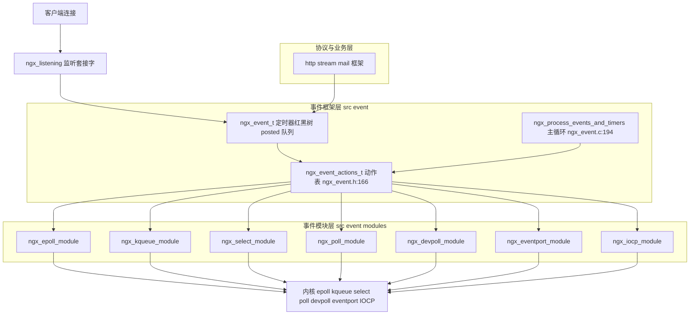
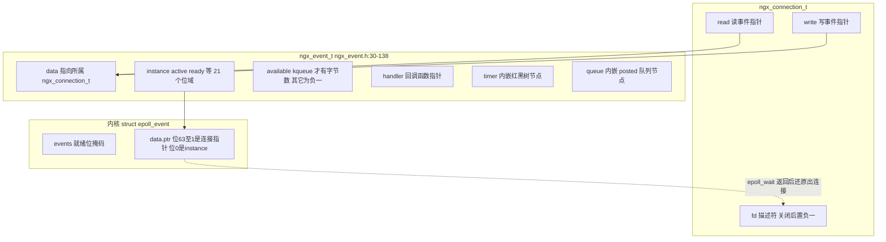
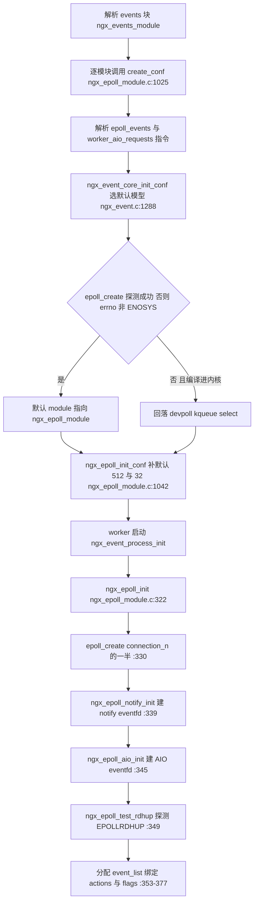
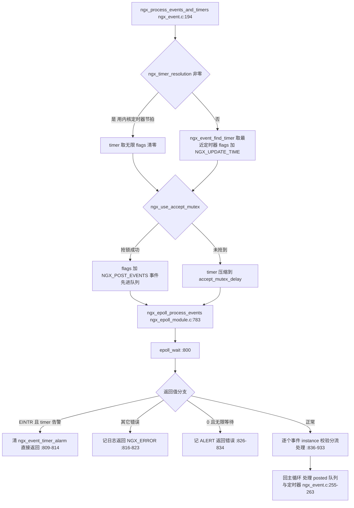
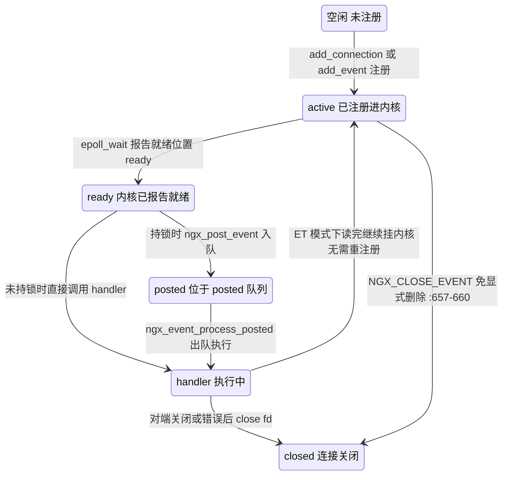

# epoll 模块精讲与多路复用器对比（基于 nginx-1.27.0 源码）

> **导读**：读完本文你将掌握——
>
> 1. nginx 事件模块的统一抽象 `ngx_event_actions_t` 是如何用一张虚函数表把 epoll、kqueue、select、poll、/dev/poll、eventport、IOCP 七种多路复用机制"抹平"的；
> 2. `ngx_epoll_module` 从 `create_conf` 到 `done` 的每一个函数在做什么、为什么这么做；
> 3. `data.ptr` 低位 `instance` 指针技巧如何用 1 个 bit 消灭"陈旧事件"这一异步网络编程经典难题；
> 4. `NGX_CLEAR_EVENT`（即 `EPOLLET`）在头文件中的真正落点，以及 nginx 选择边缘触发（ET）而非水平触发（LT）的完整代价收益账；
> 5. kqueue 的 `EV_CLEAR`/`EV_ONESHOT`/`EV_EOF` 与 epoll 概念的一一对应与不对应；
> 6. select/poll 的 LEVEL 语义为何导致"读不完要反复 add/del"和 O(n) 遍历；
> 7. /dev/poll、eventport、Windows IOCP 三种第三流派各自的思路；
> 8. 七种多路复用器的横向对比，以及 nginx 启动时挑选事件模型的优先级代码。
>
> **前置阅读建议**：先了解 `ngx_cycle_t` 初始化流程与模块ctx结构（`ngx_module_t`/`ngx_event_module_t`），再读本文；对 `epoll_create/epoll_ctl/epoll_wait` 系统调用的基本用法有概念即可，文中会结合源码展开。
>
> **涉及源码清单**（行号均来自 nginx-1.27.0 实测读取）：
>
> - `src/event/modules/ngx_epoll_module.c`（1051 行，本文主角）
> - `src/event/modules/ngx_kqueue_module.c`（722 行）
> - `src/event/modules/ngx_select_module.c`（424 行）
> - `src/event/modules/ngx_poll_module.c`（416 行）
> - `src/event/modules/ngx_devpoll_module.c`（561 行）
> - `src/event/modules/ngx_eventport_module.c`（650 行）
> - `src/event/modules/ngx_iocp_module.c`（379 行）
> - `src/event/ngx_event.h`（533 行）
> - 辅助引用：`src/event/ngx_event.c`、`src/event/ngx_event_accept.c`、`src/core/ngx_connection.c`、`src/core/ngx_open_file_cache.c`

---

## 1. 本模块在 nginx 中的位置与职责

nginx 是典型的事件驱动服务器：所有 I/O（收包、发包、accept、定时器、跨线程唤醒）都围绕"事件"组织。事件模块体系分两层：

- **框架层** `src/event/ngx_event.c` + `src/event/ngx_event.h`：定义事件对象 `ngx_event_t`、动作表 `ngx_event_actions_t`、主循环 `ngx_process_events_and_timers`、定时器红黑树、posted 事件队列。它不关心底层用的是哪种多路复用器。
- **模块层** `src/event/modules/`：七个互斥编译（部分共存但只选一个运行）的实现模块，各自实现同一套 `ngx_event_actions_t` 接口。`ngx_epoll_module.c` 是 Linux 上的主角。

epoll 模块的职责边界非常清晰，从它的模块上下文 `ngx_epoll_module_ctx`（src/event/modules/ngx_epoll_module.c:179-200）就能看出——它只提供 10 个动作函数：`add/del/enable/disable` 单事件、`add_conn/del_conn` 整连接注册、`notify` 跨线程唤醒、`process_events` 批量收割、`init/done` 生命周期。它**不做**协议解析、不碰缓冲区管理，甚至连 I/O 函数都只是"转接"——`ngx_epoll_init` 中一句 `ngx_io = ngx_os_io;`（src/event/modules/ngx_epoll_module.c:367）把全局 I/O 方法表指向 Linux 平台的 `recv/send` 封装，之后 HTTP 层的 `ngx_recv/ngx_send` 宏（src/event/ngx_event.h:416-422）就落到了普通系统调用上。



**图解**：这张架构图自上而下分四层。监听套接字与 HTTP 框架都不直接触碰内核多路复用器，它们只操作 `ngx_event_t` 对象；事件框架层通过 `ngx_event_actions_t` 这张运行期才赋值的函数表（`ngx_epoll_init` 在 src/event/modules/ngx_epoll_module.c:369 执行 `ngx_event_actions = ngx_epoll_module_ctx.actions;` 完成绑定）调用模块层；模块层再落到具体内核机制。同一时刻全进程只有一条路径被激活：哪个模块的 `init` 成功，动作表就指向谁。

---

## 2. 核心数据结构精讲

### 2.1 ngx_epoll_conf_t —— epoll 模块自己的配置

字段极少（src/event/modules/ngx_epoll_module.c:98-101）：

| 字段 | 类型 | 对应指令 | 默认值 | 作用 |
|---|---|---|---|---|
| `events` | `ngx_uint_t` | `epoll_events` | 512 | `epoll_wait` 的批量返回数组 `event_list` 大小 |
| `aio_requests` | `ngx_uint_t` | `worker_aio_requests` | 32 | Linux 原生文件 AIO `io_setup()` 的并发请求深度 |

`create_conf`（src/event/modules/ngx_epoll_module.c:1025-1039）把两者置为 `NGX_CONF_UNSET`，`init_conf`（src/event/modules/ngx_epoll_module.c:1042-1051）用 `ngx_conf_init_uint_value` 兜底为 512 和 32。这是 nginx 配置模块的标准"create 置 UNSET → 解析器覆盖 → init 补默认值"三段式。

### 2.2 ngx_event_s —— 一切的核心对象

`ngx_event_t`（src/event/ngx_event.h:30-138）是全 nginx 被触摸最频繁的结构体。逐字段看（位域共 21 个，取关键者）：

| 字段 | 类型/位宽 | 含义与谁在读写 |
|---|---|---|
| `data` | `void *` | 常态指向所属 `ngx_connection_t`；在 notify/AIO 语境下指向 handler 参数（如 `notify_event.data` 存回调，src/event/modules/ngx_epoll_module.c:769） |
| `write:1` | 位域 | 标记这是读事件还是写事件，`ngx_get_connection` 里对写事件置 1（src/core/ngx_connection.c:1234） |
| `accept:1` | 位域 | 监听套接字的读事件置 1，决定 posted 分流去 accept 队列（src/event/modules/ngx_epoll_module.c:895-896） |
| `instance:1` | 位域 | **防陈旧事件校验位**，注释原文 "used to detect the stale events in kqueue and epoll"（src/event/ngx_event.h:37-38），详见 6.9 节 |
| `active:1` | 位域 | 事件已交给内核观察；AIO 语境表示操作已提交（src/event/ngx_event.h:40-44） |
| `ready:1` | 位域 | 内核已报告就绪，handler 消费后清零 |
| `oneshot:1` | 位域 | kqueue `EV_ONESHOT` 语义标记（src/event/modules/ngx_kqueue_module.c:293） |
| `complete:1` | 位域 | AIO/IUO 操作完成标记（epoll 下 NGX_THREADS 时写事件也置它，src/event/modules/ngx_epoll_module.c:922-924） |
| `eof/error/timedout` | 位域 | 终态三兄弟：对端关闭/出错/超时 |
| `pending_eof:1` | 位域 | 注释 "the pending eof reported by kqueue, epoll or in aio chain"（src/event/ngx_event.h:66-67）：缓冲区还有数据但对端已关闭 |
| `timer_set` | 位域 | 挂在定时器红黑树上 |
| `posted:1` | 位域 | 已在 posted 队列中，防止重复投递 |
| `index` | `ngx_uint_t` | select/poll/devpoll 用来在用户态数组里定位自己，空闲值 `NGX_INVALID_INDEX = 0xd0d0d0d0`（src/event/ngx_event.h:16） |
| `available` | `int` | kqueue 就绪字节数；其它平台 `-1` 表示未知，须读到 EAGAIN（src/event/ngx_event.h:86-101） |
| `handler` | `ngx_event_handler_pt` | 事件回调，accept 读事件是 `ngx_event_accept`（src/event/ngx_event.c:895） |
| `timer` | `ngx_rbtree_node_t` | 内嵌红黑树节点而非指针，删除时无额外分配 |
| `queue` | `ngx_queue_t` | 内嵌双向链表节点， posted 队列用 |

注意 `available` 字段注释里的多平台分派（src/event/ngx_event.h:86-99）：kqueue 的 accept 场景它表示"等待 accept 的连接数"、读写场景表示字节数；epoll 恒为 -1。这正是 `NGX_USE_KQUEUE_EVENT` 能力位存在的意义——上层代码据此决定能否"按已知字节数一次读完"。

### 2.3 ngx_event_actions_t —— 七种多路复用器的统一接口

src/event/ngx_event.h:166-183：

```c
typedef struct {
    ngx_int_t  (*add)(ngx_event_t *ev, ngx_int_t event, ngx_uint_t flags);
    ngx_int_t  (*del)(ngx_event_t *ev, ngx_int_t event, ngx_uint_t flags);

    ngx_int_t  (*enable)(ngx_event_t *ev, ngx_int_t event, ngx_uint_t flags);
    ngx_int_t  (*disable)(ngx_event_t *ev, ngx_int_t event, ngx_uint_t flags);

    ngx_int_t  (*add_conn)(ngx_connection_t *c);
    ngx_int_t  (*del_conn)(ngx_connection_t *c, ngx_uint_t flags);

    ngx_int_t  (*notify)(ngx_event_handler_pt handler);

    ngx_int_t  (*process_events)(ngx_cycle_t *cycle, ngx_msec_t timer,
                                 ngx_uint_t flags);

    ngx_int_t  (*init)(ngx_cycle_t *cycle, ngx_msec_t timer);
    void       (*done)(ngx_cycle_t *cycle);
} ngx_event_actions_t;
```

十个槽位，每个模块按能力填空：epoll 全满（src/event/modules/ngx_epoll_module.c:184-199）；kqueue 的 `add_conn/del_conn` 填 NULL（src/event/modules/ngx_kqueue_module.c:86-87）；select/poll/devpoll/eventport 的 `add_conn` 均为 NULL；IOCP 更极端，只有 `add_event/del_conn/process_events/init/done`（src/event/modules/ngx_iocp_module.c:60-71）——因为完成模型里"注册"与"发起 I/O"是一回事。上层通过宏调用：`ngx_add_event`、`ngx_add_conn`、`ngx_notify`、`ngx_process_events`（src/event/ngx_event.h:400-408）。

### 2.4 epoll 模块的模块级静态状态

| 变量 | 定义处 | 作用 |
|---|---|---|
| `ep` | src/event/modules/ngx_epoll_module.c:133 | epoll 实例描述符，-1 表示未创建 |
| `event_list` / `nevents` | :134-135 | `epoll_wait` 出参数组及其容量 |
| `notify_fd` / `notify_event` / `notify_conn` | :137-141 | eventfd 唤醒通道三件套 |
| `ngx_eventfd` / `ngx_aio_ctx` | :145-146 | Linux 原生文件 AIO 的 eventfd 与 io_context |
| `ngx_use_epoll_rdhup` | :153-155 | 运行期探测 EPOLLRDHUP 是否可用的结果，全局导出 |

### 2.5 data.ptr 的位布局 —— 1 bit 的乾坤



**图解**：`ngx_connection_t` 拥有 `read`/`write` 两个 `ngx_event_t`，事件的 `data` 又指回连接，构成双向环。注册进内核时只塞一个指针：`(void *) ((uintptr_t) c | ev->instance)`（src/event/modules/ngx_epoll_module.c:621、706），把 1 bit 校验信息藏进指针的最低位。这个位之所以可用，是因为 `ngx_connection_t` 按缓存行对齐分配（`NGX_ALIGNMENT` 相关分配路径），最低位恒为 0；`epoll_wait` 返回后用 `& 1` 取出校验位、`& ~1` 还原指针（src/event/modules/ngx_epoll_module.c:839-840）。kqueue 用同样手法藏在 `udata` 里（src/event/modules/ngx_kqueue_module.c:427）。

---

## 3. 初始化流程

nginx 对事件模块的初始化横跨三个阶段：配置解析期（选模型、建配置）、master 期、worker 进程期（真正建内核对象）。完整链路如下：



**图解**：注意两个"探测"。第一处是配置期的 `epoll_create(100)` 试探（src/event/ngx_event.c:1302-1314）：nginx 的二进制可能在老内核上运行（头文件有 epoll 但内核没实现），所以不能只看编译宏，必须真调一次系统调用；返回 -1 且 `errno == ENOSYS` 才放行其它候选。第二处是 worker 期的 `ngx_epoll_test_rdhup`（src/event/modules/ngx_epoll_module.c:464-524）：EPOLLRDHUP 虽然编译期可测，但 nginx 仍用一个 socketpair 闭环实验实测——注册 `EPOLLET|EPOLLIN|EPOLLRDHUP`，关闭对端，等 5 秒看返回的 `ee.events` 是否带 EPOLLRDHUP，据此设置全局 `ngx_use_epoll_rdhup`（:501-502）。两处探测都体现了 nginx "不信任环境声明，只信任运行结果"的风格。

另有一个容易被忽略的细节：`ngx_epoll_init` 里 `if (ep == -1)` 的守卫（:329）意味着 eventfd、AIO 上下文只在进程生命周期内建一次；而 `event_list` 的重分配条件是 `nevents < epcf->events`（:353），即 reload 时若 `epoll_events` 调大才重新 `ngx_alloc`，调小不动——只增不减的伸缩策略避免了 reload 瞬间的内存抖动。

---

## 4. 核心执行流程/状态机

### 4.1 一次事件循环的宏观流程

外层主循环 `ngx_process_events_and_timers`（src/event/ngx_event.c:194-264）决定 timer 与 flags，再进入 epoll 模块的 `ngx_epoll_process_events`（src/event/modules/ngx_epoll_module.c:783-936）：



**图解**：`NGX_UPDATE_TIME` 是"顺便更新缓存时间"的授权——epoll_wait 返回后如果本次带着该 flag 或者 `ngx_event_timer_alarm` 置位，就调 `ngx_time_update()`（src/event/modules/ngx_epoll_module.c:804-806）。`NGX_POST_EVENTS` 则是"延迟处理"的授权：抢到 accept 互斥锁的 worker 让所有事件先排队，等 `epoll_wait` 批量返回后先处理 accept 队列、释放锁、再处理普通队列（src/event/ngx_event.c:255-263），保证"accept 完就放锁"的公平性。

### 4.2 单个事件的生命周期状态机



**图解**：关键在 `s4 --> s1` 这条边——ET 模式下 handler 处理完后只要连接没关，事件继续留在内核观察集合里，**不需要任何重注册系统调用**；而 LEVEL 模式（select/poll/devpoll）在 `s4` 之后必须经 `ngx_handle_read_event` 的 LEVEL 分支显式 `ngx_del_event`（src/event/ngx_event.c:310-318），读完想继续收才再 `ngx_add_event`（:300-308）。一减一加就是两次 fd 级操作，这是两种语义最直接的性能差异来源。

---

## 5. 关键时序图

以"worker 持有 accept 锁、一批事件到达"的最常见场景为例：

```mermaid
sequenceDiagram
    participant Loop as ngx_process_events_and_timers
    participant EP as ngx_epoll_process_events
    participant Kernel as Linux kernel
    participant Handler as rev.handler
    participant Queue as posted queues

    Loop->>Loop: ngx_trylock_accept_mutex 抢锁
    Note over Loop: 成功则 flags 加 NGX_POST_EVENTS
    Loop->>EP: ngx_process_events 传 timer 与 flags
    EP->>Kernel: epoll_wait ep event_list nevents timer
    Kernel-->>EP: 返回 k 个就绪事件
    EP->>EP: 取 data.ptr 低 1 位为 instance 再还原指针
    EP->>EP: 校验 c.fd 非 -1 且 rev.instance 匹配
    Note over EP: 不匹配则判定陈旧事件直接 continue
    EP->>EP: EPOLLRDHUP 置 rev.pending_eof
    EP->>Queue: 持锁路径 ngx_post_event 入 accept 或普通队列
    EP-->>Loop: 全部事件分拣完毕
    Loop->>Queue: ngx_event_process_posted 处理 accept 队列
    Loop->>Loop: ngx_shmtx_unlock 释放 accept 锁
    Loop->>Loop: ngx_event_expire_timers 到期定时器
    Loop->>Queue: ngx_event_process_posted 处理普通队列
    Queue->>Handler: 逐个出队执行 handler
    Handler-->>Queue: 读到 EAGAIN 清 rev.ready
```

**图解**：时序里有三个必须记牢的顺序约束。第一，`epoll_wait` 之后才更新缓存时间（src/event/modules/ngx_epoll_module.c:804-806），保证 handler 里看到的 `ngx_current_msec` 尽量新。第二，accept 队列先于普通队列处理、且处理完立即释放互斥锁（src/event/ngx_event.c:255-259）——普通连接的大量读事件不会拖延锁的流转。第三，handler 是在 posted 阶段而非 `epoll_wait` 返回现场执行的，这意味着 `epoll_wait` 循环体内做的只有"校验 + 置位 + 入队"三件轻活，重活全部后置。

---

## 6. 源码逐段精读

本节是全文主体。顺序：先把 epoll 模块自身的配置与生命周期函数讲完，再按"注册路径 → 收割路径 → 两条辅助通道（notify/AIO）→ ET 落点"的顺序拆 epoll；随后依次精读 kqueue、select、poll、devpoll、eventport、IOCP 的代表性函数；最后回到模型选择代码。

### 6.1 ngx_epoll_create_conf / ngx_epoll_init_conf —— 配置两段式

签名与实现（src/event/modules/ngx_epoll_module.c:1025-1051）：

```c
static void *
ngx_epoll_create_conf(ngx_cycle_t *cycle)
{
    ngx_epoll_conf_t  *epcf;

    epcf = ngx_palloc(cycle->pool, sizeof(ngx_epoll_conf_t));
    if (epcf == NULL) {
        return NULL;
    }

    epcf->events = NGX_CONF_UNSET;
    epcf->aio_requests = NGX_CONF_UNSET;

    return epcf;
}
```

逐块分析：

- `ngx_palloc(cycle->pool, ...)`：配置结构挂到 cycle 内存池，reload 销毁 cycle 时整体释放，无独立 free 逻辑，这是 nginx 配置结构的统一约定。
- 两个字段只置 `NGX_CONF_UNSET`，不做任何默认值假设。这保证后续能区分"用户没配"与"用户配了 0"——虽然这里 0 无意义，但 `ngx_conf_set_num_slot` 对负数/溢出有独立校验，UNSET 哨兵是通用做法。
- `init_conf` 全部逻辑就两行宏（src/event/modules/ngx_epoll_module.c:1047-1048）：`ngx_conf_init_uint_value(epcf->events, 512);` 与 `ngx_conf_init_uint_value(epcf->aio_requests, 32);`。展开后即"若仍为 UNSET 则赋默认值"。
- 易错点：`epoll_events` 只控制**单次 epoll_wait 的返回数组容量**，不是最大连接数；最大连接数由 `worker_connections` 控制（默认 512，`DEFAULT_CONNECTIONS` 定义于 src/event/ngx_event.c:13，应用见 :1360）。两者数值上巧合相等容易混淆。

### 6.2 ngx_epoll_module_ctx 与 ngx_epoll_commands —— 模块骨架

模块上下文（src/event/modules/ngx_epoll_module.c:179-200）分两部分：前三项是 `ngx_event_module_t` 通用头（名字、create_conf、init_conf），花括号内是 10 个动作函数。有两个编译分派值得注意：

- `notify` 槽：有 `NGX_HAVE_EVENTFD` 才填 `ngx_epoll_notify`，否则 NULL（:191-195）。运行期 `ngx_epoll_notify_init` 失败时还会被动态改成 NULL（:339-341），见 6.6 节。
- 命令表（:159-176）只注册两条：`epoll_events` 与 `worker_aio_requests`，都挂在 `NGX_EVENT_CONF` 上下文，即只能写在 `events{}` 块里。

### 6.3 ngx_epoll_init —— 创建 epoll 实例与三件套

核心函数（src/event/modules/ngx_epoll_module.c:322-380），分六块：

**第一块：epoll 实例。**

```c
    if (ep == -1) {
        ep = epoll_create(cycle->connection_n / 2);

        if (ep == -1) {
            ngx_log_error(NGX_LOG_EMERG, cycle->log, ngx_errno,
                          "epoll_create() failed");
            return NGX_ERROR;
        }
```

（src/event/modules/ngx_epoll_module.c:329-336）

- `size` 参数传 `connection_n / 2`：Linux 2.6.8 后该参数被内核忽略但必须大于 0，nginx 用"预期并发连接数的一半"作为初始提示，纯属历史兼容写法。
- `ep == -1` 守卫：nginx reload 会创建**新 worker 进程**，旧进程退出，因此正常情况下每个 worker 只走一次；守卫防御的是同一进程内二次初始化（如单元测试或异常 reload 流程）导致的描述符泄漏。
- 失败即 `NGX_ERROR`，worker 启动失败退出——epoll 建不起来没有任何降级余地，因为模型选择已在配置期定死。

**第二块：notify eventfd。** `ngx_epoll_notify_init(cycle->log)`（:339）失败时不终止启动，而是 `ngx_epoll_module_ctx.actions.notify = NULL;`（:340）——降级为"没有跨线程唤醒能力"。这个 wake 通道的服务对象是 `ngx_notify()` 宏（src/event/ngx_event.h:408），典型调用方是线程池完成通知：`ngx_thread_pool_handler` 通过它把"线程干完活了"这一事实从工作线程转交回事件循环线程。没有它，线程池任务完成后只能靠下一次 epoll_wait 的自然超时被收割，延迟最高会放大到 timer 值。

**第三块：AIO eventfd。** `ngx_epoll_aio_init(cycle, epcf)`（:345）见 6.5 节，失败同样软降级（`ngx_file_aio = 0`，src/event/modules/ngx_epoll_module.c:263）。

**第四块：EPOLLRDHUP 探测**（:349，函数体见 6.7 节末尾）。

**第五块：event_list 分配**（:353-365）：只在 `nevents < epcf->events` 时 free + 重新 alloc，容量 `sizeof(struct epoll_event) * epcf->events`，即默认 512 个内核事件槽位。

**第六块：动作表与能力位**（:367-377）：

```c
    ngx_io = ngx_os_io;

    ngx_event_actions = ngx_epoll_module_ctx.actions;

#if (NGX_HAVE_CLEAR_EVENT)
    ngx_event_flags = NGX_USE_CLEAR_EVENT
#else
    ngx_event_flags = NGX_USE_LEVEL_EVENT
#endif
                      |NGX_USE_GREEDY_EVENT
                      |NGX_USE_EPOLL_EVENT;
```

（src/event/modules/ngx_epoll_module.c:367-377）

- `NGX_HAVE_CLEAR_EVENT` 由构建系统按平台定义：auto/os/linux:53、auto/os/freebsd:71、auto/os/darwin:27、auto/unix:83 均有 `have=NGX_HAVE_CLEAR_EVENT . auto/have`。Linux 上必为真，因此 epoll 模块的能力位实际是 `NGX_USE_CLEAR_EVENT | NGX_USE_GREEDY_EVENT | NGX_USE_EPOLL_EVENT`。
- 三个能力位的消费方都是框架层：`NGX_USE_CLEAR_EVENT` 决定 `ngx_handle_read_event/write_event` 走"注册后不管"分支（src/event/ngx_event.c:282-294、366-379）；`NGX_USE_GREEDY_EVENT` 声明"必须读写到 EAGAIN"（src/event/ngx_event.h:222-225 的注释原文 "The event filter requires to do i/o operation until EAGAIN: epoll"）；`NGX_USE_EPOLL_EVENT` 用于 EPOLLEXCLUSIVE 判定（src/event/ngx_event.c:923）。

### 6.4 ngx_epoll_notify_init / notify_handler / notify —— 唤醒通道全链路

**初始化**（src/event/modules/ngx_epoll_module.c:385-428）：

```c
    notify_fd = eventfd(0, 0);
    ...
    notify_event.handler = ngx_epoll_notify_handler;
    notify_event.log = log;
    notify_event.active = 1;

    notify_conn.fd = notify_fd;
    notify_conn.read = &notify_event;
    notify_conn.log = log;

    ee.events = EPOLLIN|EPOLLET;
    ee.data.ptr = &notify_conn;
```

（节选自 src/event/modules/ngx_epoll_module.c:391-413）

- `eventfd(0, 0)`：初始计数 0、**阻塞**语义的 eventfd。blocking 没关系，因为注册的是 `EPOLLIN|EPOLLET`——计数从 0 变非 0 产生一次边沿，读走 8 字节计数后归零再产生下一次边沿。
- `data.ptr = &notify_conn` **不带 instance 位**：`notify_conn` 是模块级静态对象（:140），生命周期与进程等长、永不复用，不存在陈旧事件问题，所以无需校验位。这与 6.8 节连接注册形成对照。
- 失败路径（:415-425）会 `close(notify_fd)` 并返回 NGX_ERROR，调用方随即把 `actions.notify` 置 NULL，完成软降级。

**触发端 `ngx_epoll_notify`**（src/event/modules/ngx_epoll_module.c:764-778）：把 handler 存进 `notify_event.data`（:769），然后 `write(notify_fd, &inc, sizeof(uint64_t))` 写入常量 1。注意 `static uint64_t inc = 1;`（:767）——eventfd 的 write 语义是"把 8 字节整数累加进计数"，写 1 即"来一个通知"。任何线程都可以 write，这就是跨线程唤醒的实现：阻塞在 `epoll_wait` 的线程会立刻因 eventfd 可读而醒来。

**收割端 `ngx_epoll_notify_handler`**（src/event/modules/ngx_epoll_module.c:431-457）：

```c
    if (++ev->index == NGX_MAX_UINT32_VALUE) {
        ev->index = 0;

        n = read(notify_fd, &count, sizeof(uint64_t));
        ...
    }

    handler = ev->data;
    handler(ev);
```

（节选自 src/event/modules/ngx_epoll_module.c:439-456）

精妙点有二。其一，`read` **不是每次都执行**：`++ev->index` 复用了事件对象里 select 时代的 `index` 字段当计数器，每 2^32-1 次才真正 read 一次清空计数。由于 eventfd 计数只增不清会一直可读（level 语义残留），为什么敢不读？因为注册用了 EPOLLET——ET 下不读也不会重复唤醒，残留计数只影响下次边沿的"次数"，而这里只关心"有没有"，所以把 read 摊薄到近乎零开销，又保留了防止计数溢出回绕的兜底（到 MAX_UINT32 必清）。其二，`handler = ev->data; handler(ev);` 每次唤醒都可能换 handler——`ngx_epoll_notify` 每次调用都会重设 `notify_event.data`（:769），同一通道可服务不同子系统，这是"管道复用"设计。

### 6.5 ngx_epoll_aio_init 与 ngx_epoll_eventfd_handler —— Linux 原生文件 AIO 通道

**初始化**（src/event/modules/ngx_epoll_module.c:248-317）。为什么 nginx 绕开 libaio 直接 syscall？源码注释给了答案（:220-224）："the library header file supports eventfd() since 0.3.107 version only"——旧版 libaio 头文件没有 eventfd 支持，干脆自己 `syscall(SYS_io_setup, ...)`（:226-245 封装了 io_setup/io_destroy/io_getevents 三个裸系统调用）。

流程逐块：

1. `ngx_eventfd = eventfd(0, 0);`（:255-257），失败则 `ngx_file_aio = 0;` 返回——文件 AIO 降级为线程池或同步 I/O。
2. `ioctl(ngx_eventfd, FIONBIO, &n)`（:272-276）把 eventfd 设为非阻塞。与 notify eventfd 不同，这里必须非阻塞：AIO handler 里会**主动轮询式读**（见下），不能被阻塞 read 卡住事件循环。
3. `io_setup(epcf->aio_requests, &ngx_aio_ctx)`（:278-282）：AIO 深度来自 `worker_aio_requests` 指令（默认 32）。
4. 组装 `ngx_eventfd_conn` + `ngx_eventfd_event`，`ee.events = EPOLLIN|EPOLLET; ee.data.ptr = &ngx_eventfd_conn;`（:292-293）注册进 epoll——同样是静态对象、无 instance 位。
5. 失败路径层层回滚：`io_destroy` + `close`（:299-316）。

**收割端 `ngx_epoll_eventfd_handler`**（src/event/modules/ngx_epoll_module.c:941-1020）。一次 AIO 完成，内核把完成的请求数累加到 eventfd 计数，epoll 报 EPOLLIN，handler 被调起：

- `n = read(ngx_eventfd, &ready, 8);`（:955）读出"完成了几个"；非 8 字节都算异常（:961-974），EAGAIN 直接返回（非阻塞设置的用途所在）。
- `while (ready)` 循环里 `io_getevents(ngx_aio_ctx, 1, 64, event, &ts)`（:981）以零超时批量收割，每次最多 64 个 `struct io_event`（栈上数组，:950）。
- 对每个完成项：`e = (ngx_event_t *) (uintptr_t) event[i].data;`（:996）——AIO 提交时把 `ngx_event_t` 指针塞进 iocb 的 data 字段，这里原样取回；随后 `e->complete = 1; e->active = 0; e->ready = 1;`（:998-1000）三连置位，`aio->res = event[i].res;`（:1003）记录返回字节数或负错误码。
- 最后 `ngx_post_event(e, &ngx_posted_events);`（:1005）：AIO 完成一律走 posted 队列**而非当场执行**——文件 I/O 完成的回调（如 sendfile 收尾）可能耗时，不能阻塞在收割循环里影响后续 event 处理。
- `ready -= events; continue;`（:987-1008）保证一次唤醒把积压全部清空；`io_getevents` 返回 0 就收手（:1011-1013），返回 -1 记 ALERT 退出（:1015-1018）。

### 6.6 ngx_epoll_test_rdhup —— 用 5 秒实验买一个优化

src/event/modules/ngx_epoll_module.c:464-524。步骤：`socketpair(AF_UNIX, SOCK_STREAM, 0, s)`（:470）造一对互联套接字；以 `EPOLLET|EPOLLIN|EPOLLRDHUP` 注册 s[0]（:476-478）；`close(s[1])`（:484-489）制造"对端关闭"；`epoll_wait(ep, &ee, 1, 5000)`（:493）最多等 5 秒；若返回事件含 EPOLLRDHUP 则 `ngx_use_epoll_rdhup = 1`（:502）。失败路径一律记 ALERT 但**不阻断启动**（:513-523 关闭残留描述符）。这个全局开关让读路径在"对端已关但缓冲区尚有数据"场景能提前拿到 pending_eof 信号，少一次注定 EAGAIN 的 recv。

### 6.7 ngx_epoll_add_event / ngx_epoll_del_event —— 单事件注册与 ADD/MOD 决策

**add_event**（src/event/modules/ngx_epoll_module.c:578-639）：

```c
    c = ev->data;

    events = (uint32_t) event;

    if (event == NGX_READ_EVENT) {
        e = c->write;
        prev = EPOLLOUT;
#if (NGX_READ_EVENT != EPOLLIN|EPOLLRDHUP)
        events = EPOLLIN|EPOLLRDHUP;
#endif

    } else {
        e = c->read;
        prev = EPOLLIN|EPOLLRDHUP;
#if (NGX_WRITE_EVENT != EPOLLOUT)
        events = EPOLLOUT;
#endif
    }

    if (e->active) {
        op = EPOLL_CTL_MOD;
        events |= prev;

    } else {
        op = EPOLL_CTL_ADD;
    }
```

（src/event/modules/ngx_epoll_module.c:587-612）

逐块拆解：

- **变量 `e` 是"对方向事件"**：注册读事件时 `e = c->write`。epoll 的注册单位是 fd 而非"方向"，所以必须知道另一方向是否已注册。
- **ADD/MOD 决策**（:606-612）：对方向 `active` → fd 已在 epoll 集合里，只能 `EPOLL_CTL_MOD` 且 `events |= prev` 保留对方的方向位；否则 `EPOLL_CTL_ADD` 全新插入。这里没有 try-ADD-then-MOD 的回退逻辑，靠的就是 nginx 自己维护的 `active` 标志与内核集合严格同步——`ev->active` 在 add 成功后置 1（:633）、del 成功后置 0（:694）。
- **EPOLLEXCLUSIVE 分支**（:614-618）：

```c
#if (NGX_HAVE_EPOLLEXCLUSIVE && NGX_HAVE_EPOLLRDHUP)
    if (flags & NGX_EXCLUSIVE_EVENT) {
        events &= ~EPOLLRDHUP;
    }
#endif
```

（src/event/modules/ngx_epoll_module.c:614-618）

监听套接字以独占模式注册时（调用方：src/event/ngx_event.c:928，条件是 epoll 且 worker 进程数大于 1，见 :923-924）**必须剥掉 EPOLLRDHUP**。原因：EPOLLEXCLUSIVE 只对 EPOLLIN/EPOLLOUT 这类"请求事件"生效，若带上 RDHUP，每个 worker 都会收到对端关闭通知，独占的"惊群抑制"就失效了。这一行 `&= ~EPOLLRDHUP` 是nginx 处理 accept 惊群的核心细节之一。

- **flags 直通内核掩码**（:620）：`ee.events = events | (uint32_t) flags;`。`NGX_CLEAR_EVENT` 在 epoll 构建下就是 `EPOLLET`（src/event/ngx_event.h:353），所以"注册时带 ET"这一动作在此处与内核事件位合并完成。同样 `NGX_EXCLUSIVE_EVENT` 即 `EPOLLEXCLUSIVE`（:359-361）。而 `NGX_ONESHOT_EVENT` 在 epoll 构建下被故意定义为 `0x70000000`（src/event/ngx_event.h:354）——一个不属于任何内核事件位的值：epoll 不提供 nginx 可用的 oneshot 语义（真 `EPOLLONESHOT` 的定义在 :355-357 被 `#if 0` 注释掉），填垃圾值可以在误用时尽早暴露。oneshot 的真实使用场景是 open file cache 的 vnode 事件（src/core/ngx_open_file_cache.c:997 传入 `NGX_VNODE_EVENT` 与 `NGX_ONESHOT_EVENT`），而 `NGX_VNODE_EVENT` 仅在 kqueue 下是 `EVFILT_VNODE`、其余平台恒为 0（src/event/ngx_event.h:295-297、310-311）——vnode 事件是 kqueue 专属能力。
- **data.ptr 打包**（:621）：`ee.data.ptr = (void *) ((uintptr_t) c | ev->instance);`，读事件与写事件各自注册时都带上**同一个连接指针**但各自的 instance（同一连接的两个事件 instance 相同，`ngx_get_connection` 同时翻转两者，src/core/ngx_connection.c:1225-1226）。

**del_event**（src/event/modules/ngx_epoll_module.c:642-697）：

- `NGX_CLOSE_EVENT` 短路（:657-660）：fd 即将关闭，内核 epoll 会随 close 自动摘除，只清 `ev->active` 不发系统调用。该注释同样出现在 add_connection 的兄弟函数里（:730-734）。
- 反向决策与 add 对称（:673-682）：对方向 active → `EPOLL_CTL_MOD` 只留 `prev`（对方方向）+ flags；对方向不 active → `EPOLL_CTL_DEL`，`ee.events = 0; ee.data.ptr = NULL;`（DEL 调用内核忽略事件字段，置空是防御式写法）。
- `ee.data.ptr` 仍带 instance（:676）：MOD 时保持与 add 时一致的 ptr，避免同一 fd 在内核里的 u64 身份漂移引发无谓的校验错位。

### 6.8 ngx_epoll_add_connection / ngx_epoll_del_connection —— 连接级 ET 注册

**add_connection**（src/event/modules/ngx_epoll_module.c:700-721）：

```c
    ee.events = EPOLLIN|EPOLLOUT|EPOLLET|EPOLLRDHUP;
    ee.data.ptr = (void *) ((uintptr_t) c | c->read->instance);
    ...
    if (epoll_ctl(ep, EPOLL_CTL_ADD, c->fd, &ee) == -1) {
        ...
    }

    c->read->active = 1;
    c->write->active = 1;
```

（src/event/modules/ngx_epoll_module.c:705-718）

- **一次注册双向 + ET + RDHUP**：这是 accept 出来的新连接的标准姿势（调用链：`ngx_event_accept` → `ngx_add_conn`）。之后整个连接生命周期内**再无任何注册系统调用**，直到关闭。对比 6.7 的单事件注册：那条路径是给"非全双工注册"的特殊事件（监听套接字、connect 中的写事件等）用的，普通连接不走。
- instance 取 `c->read->instance`——读写事件 instance 恒等（同一次翻转），取谁都一样。
- 两个 `active` 都置 1（:717-718），与 add_event 单边置位形成区别：连接注册意味着两个方向同时被观察。

**del_connection**（src/event/modules/ngx_epoll_module.c:724-759）：`NGX_CLOSE_EVENT` 时仅清 active（:736-740）；否则 `EPOLL_CTL_DEL`（:745-753）。显式 DEL 的存在场景是"连接不关闭但暂时退出观察"（如配置变更路径），常规关闭连接一律走 CLOSE_EVENT 免调用路径。

### 6.9 ngx_epoll_process_events —— 收割主战场

函数签名（src/event/modules/ngx_epoll_module.c:783-784），总长 154 行，按执行序拆九段。

**段一：等待与时间**（:797-806）。`epoll_wait(ep, event_list, (int) nevents, timer);`（:800），timer 来自主循环计算的最近定时器剩余毫秒数或 `NGX_TIMER_INFINITE`。`err` 先存后用（:802），因为 `ngx_time_update()` 可能覆盖 errno——这是 nginx 系统调用错误处理的固定套路。

**段二：错误三分类**（:808-824）：

- `EINTR` 且 `ngx_event_timer_alarm` 置位：这是 `timer_resolution` 模式下 `setitimer(ITIMER_REAL)` 发出的 SIGALRM 打断了 wait，清标志直接返回，**不算错误**（:809-814）。
- 其余 EINTR（被信号打断但与定时器无关）：`level = NGX_LOG_INFO` 记日志后返回 NGX_ERROR，上层会重试（:816-822）。
- 其它 errno：`NGX_LOG_ALERT`，返回 NGX_ERROR（:818-823）。

**段三：0 事件守卫**（:826-834）：带超时的 wait 返回 0 属正常（超时到期，回去处理定时器）；**无限等待返回 0 是不可能事件**，直接 ALERT + NGX_ERROR——这是对内核异常或编程错误的防御。

**段四：instance 解包与首轮陈旧过滤**（:836-854）：

```c
    for (i = 0; i < events; i++) {
        c = event_list[i].data.ptr;

        instance = (uintptr_t) c & 1;
        c = (ngx_connection_t *) ((uintptr_t) c & (uintptr_t) ~1);

        rev = c->read;

        if (c->fd == -1 || rev->instance != instance) {
            /* the stale event from a file descriptor
               that was just closed in this iteration */
            ...
            continue;
        }
```

（src/event/modules/ngx_epoll_module.c:836-854，注释原文照录）

两道校验缺一不可：`c->fd == -1` 抓"连接已关但对象还在"（`ngx_close_connection` 会把 fd 置 -1）；`rev->instance != instance` 抓"连接对象已被复用给新连接"。后者原理见 6.10 节。

**段五：ERR/HUP 强制分派**（:862-873）：`revents |= EPOLLIN|EPOLLOUT;`——错误/挂起本身没有对应 handler，nginx 的策略是"至少让一个方向的活跃 handler 跑一次"，由它通过实际 I/O 感知错误（recv 返回 -1）并走正常错误清理流程。这避免了为 EPOLLERR 单独造一条分发路径。

**段六：读就绪分支**（:883-903）：

```c
        if ((revents & EPOLLIN) && rev->active) {

#if (NGX_HAVE_EPOLLRDHUP)
            if (revents & EPOLLRDHUP) {
                rev->pending_eof = 1;
            }
#endif

            rev->ready = 1;
            rev->available = -1;

            if (flags & NGX_POST_EVENTS) {
                queue = rev->accept ? &ngx_posted_accept_events
                                    : &ngx_posted_events;

                ngx_post_event(rev, queue);

            } else {
                rev->handler(rev);
            }
        }
```

（src/event/modules/ngx_epoll_module.c:883-903）

- `&& rev->active`：双保险，防止内核报了但 nginx 侧已 del 的事件被处理。
- `EPOLLRDHUP → pending_eof`：对端半关（发完 FIN）但本端缓冲区可能还有数据。读 handler 会先把数据读干净，读到 0/EAGAIN 时结合 `pending_eof` 直接判定对端关闭，**省掉一次注定失败的 recv 探测**；`ngx_use_epoll_rdhup` 未置位时该位置永远不会被设置（6.6 节探测）。
- `rev->available = -1`：字节数未知，配合 `NGX_USE_GREEDY_EVENT` 能力位，上层读循环会一直读到 EAGAIN（对比 kqueue 的 `ev->available = event_list[i].data;`，src/event/modules/ngx_kqueue_module.c:626，按已知字节数一次读）。
- **POST 分流**：accept 事件进 `ngx_posted_accept_events`，其余进 `ngx_posted_events`（:894-898）；无 POST 标志则当场 `rev->handler(rev)`（:901）。

**段七：写就绪分支与二次陈旧校验**（:905-932）：

```c
        wev = c->write;

        if ((revents & EPOLLOUT) && wev->active) {

            if (c->fd == -1 || wev->instance != instance) {
                ...
                continue;
            }

            wev->ready = 1;
#if (NGX_THREADS)
            wev->complete = 1;
#endif
```

（src/event/modules/ngx_epoll_module.c:905-924）

为什么写分支要**重新**校验一遍（:909-919）？因为同一个 `epoll_event` 可能同时携带 EPOLLIN 与 EPOLLOUT，段六的 `rev->handler` 执行过程中**可能已经把这条连接关掉了**——fd 置 -1 或连接被复用、instance 翻转。不重校验就会把写事件派发给已经易主的对象，这是"同一批事件内连接死亡"的经典窗口。`wev->complete = 1` 仅在 NGX_THREADS 下置位，供上层区分"写完成通知"。

**段八：写方向 POST/直派**（:926-931）：写事件只进 `ngx_posted_events`（无 accept 队列问题），或直接 `wev->handler(wev)`。

**段九：收尾**（:935）返回 NGX_OK。注意循环体内**没有任何 for 循环外的状态修改**，函数是纯收割器——所有重活都在 handler 或 posted 阶段。

### 6.10 instance 技巧与 ngx_get_connection 的翻转点

陈旧事件场景复现：同一轮 `epoll_wait` 返回的两个事件 A、B 指向同一连接；处理 A 时 handler 关闭连接并 `ngx_free_connection`；处理 B 时若不做校验，B 会操作一段已被复用的内存。nginx 的解法分两半：

- **翻转**：`ngx_get_connection` 从 free 链取连接时（src/core/ngx_connection.c:1210-1234）：

```c
    instance = rev->instance;

    ngx_memzero(rev, sizeof(ngx_event_t));
    ngx_memzero(wev, sizeof(ngx_event_t));

    rev->instance = !instance;
    wev->instance = !instance;
```

（src/core/ngx_connection.c:1220-1226）

内存清零后 instance 不归零而是**取反**：旧值 0 → 新值 1，旧值 1 → 新值 0。

- **校验**：注册进内核的 ptr 带旧 instance；复用后新注册（若有）带新 instance；而**还躺在 event_list 里的旧事件**带着旧 instance，与新 `rev->instance` 不等 → 判陈旧丢弃（src/event/modules/ngx_epoll_module.c:844、909）。kqueue（src/event/modules/ngx_kqueue_module.c:603-616）与 eventport（src/event/modules/ngx_eventport_module.c:510-523）用完全相同的手法。

为什么 select/poll 不需要？因为它们每轮从用户态数组重新扫描，不存在"内核预先递送一批事件"的窗口。这个对比也解释了 `instance` 字段注释为何点名 "kqueue and epoll"（src/event/ngx_event.h:37-38）。

### 6.11 NGX_CLEAR_EVENT=EPOLLET 的真正落点与 nginx 的 ET 账本

先厘清定义链：`NGX_CLEAR_EVENT` 是 nginx 的**平台无关标志名**，在 kqueue 构建下为 `EV_CLEAR`（src/event/ngx_event.h:331），在 epoll 构建下为 `EPOLLET`（:353），其余平台兜底为 0（:395-397）。它作为 `flags` 参数从上层传入 `ngx_add_event`，在 `ngx_epoll_add_event` 中与方向位一起并入内核掩码（src/event/modules/ngx_epoll_module.c:620）。**真正决定连接用不用 ET 的是注册点**：`ngx_epoll_add_connection` 无条件写死 `EPOLLET`（:705）；单事件路径由调用方决定——三个真实落点：

1. `ngx_handle_read_event` 的 CLEAR 分支：`ngx_add_event(rev, NGX_READ_EVENT, NGX_CLEAR_EVENT)`（src/event/ngx_event.c:287）；
2. `ngx_handle_write_event` 的 CLEAR 分支：`NGX_CLEAR_EVENT | (lowat ? NGX_LOWAT_EVENT : 0)`（src/event/ngx_event.c:372，lowat 仅 kqueue 生效）；
3. 主动连接：`ngx_event_connect` 里 `event = NGX_CLEAR_EVENT;`（src/event/ngx_event_connect.c:295），upstream 侧同样（src/http/ngx_http_upstream.c:538）。

**为什么选 ET**，用源码算三笔账：

- **系统调用账**：LEVEL 语义下"读不完要反复 add/del"——`ngx_handle_read_event` 的 LEVEL 分支在 `rev->active && rev->ready` 时 `ngx_del_event`（src/event/ngx_event.c:310-318），消费完想继续收再 `ngx_add_event`（:300-308）。每读一轮数据就是 1-2 次 `epoll_ctl`（或 select/poll 的集合操作）。ET 下事件注册一次（:282-294 只在 `!active && !ready` 时注册）直到关闭，稳态零注册调用。
- **惊群/自旋账**：LEVEL 下只要有数据未读，每次 wait 都会返回该 fd；ET 下只在"新数据到达的边沿"返回一次。配合 `NGX_USE_GREEDY_EVENT`（读到 EAGAIN 为止）保证不丢边沿——代价是 handler 必须循环读写，任何一处忘记读到 EAGAIN 都会"事件丢失、连接卡死"。这是 ET 把复杂度从内核转移到应用层的典型契约。
- **等待退路账**：EPOLLONESHOT 的 `#if 0`（src/event/ngx_event.h:355-357）说明 nginx 连"一次性注册"都没用：oneshot 需要每轮重注册，反而把 ET 省下的调用又花回去。kqueue 的 `EV_ONESHOT`（:330）是内核原生支持且无需重注册（kevent 返回时自动摘除，src/event/modules/ngx_kqueue_module.c:622-624 清 active 即可），所以 oneshot 在 kqueue 侧是真实能力、在 epoll 侧只是占位值。

### 6.12 ngx_kqueue 精读 —— 变更批处理与四类过滤器

**init**（src/event/modules/ngx_kqueue_module.c:116-227）：`kqueue()` 创建（:128）；`ngx_kqueue_notify_init` 用 `EVFILT_USER` 实现唤醒（:136-140，函数体 :232-256——`notify_kev.flags = EV_ADD|EV_CLEAR` 注册，触发时置 `NOTE_TRIGGER`，:251-253）。与 epoll 最大的结构差异：**双列表**。`change_list` 是用户态待提交变更队列，`event_list` 是收割数组（:44-46）。`ngx_event_flags` 初始为 `NGX_USE_ONESHOT_EVENT|NGX_USE_KQUEUE_EVENT|NGX_USE_VNODE_EVENT`（:182-184），注册 `EVFILT_TIMER` 后追加 `NGX_USE_TIMER_EVENT`（:186-206）——**定时器也能丢给内核**，`ngx_timer_resolution` 模式下内核节拍直接以 kevent 事件形式出现。

**ngx_kqueue_set_event**（:392-475）——批处理心脏：

```c
    if (nchanges >= max_changes) {
        ...
        if (kevent(ngx_kqueue, change_list, (int) nchanges, NULL, 0, &ts)
            == -1)
        ...
    }

    kev = &change_list[nchanges];

    kev->ident = c->fd;
    kev->filter = (short) filter;
    kev->flags = (u_short) flags;
    kev->udata = NGX_KQUEUE_UDATA_T ((uintptr_t) ev | ev->instance);
```

（src/event/modules/ngx_kqueue_module.c:405-427）

变更先进用户态队列，塞满（`kqueue_changes`，默认 512）才 flush 一次 kevent；每次 `ngx_kqueue_process_events` 开头把剩余 `nchanges` 作为 changelist 参数**与收割合并成一次系统调用**（:509-510、:536）。`udata` 同样藏 instance 位。单事件删除还有"变更尚未提交就撤销"的优化：`ngx_kqueue_del_event` 检查 `ev->index < nchanges` 且 udata 匹配，直接从 change_list 挖掉该槽并用尾槽填补（:347-367）——一次系统调用都省了。`NGX_DISABLE_EVENT` 映射为 `EV_DISABLE`（:379-384），被 `ngx_disable_accept_events` 用来临时静音监听套接字（src/event/ngx_event_accept.c:419-423）。

**ngx_kqueue_process_events**（:497-673）的过滤器分发（:598-658）是 epoll 没有的维度——kqueue 一个实例同时服务四类事件源：

| kqueue 过滤器 | 语义 | epoll 对应物 |
|---|---|---|
| `EVFILT_READ/WRITE` | 套接字读写 | `EPOLLIN/EPOLLOUT` |
| `EVFILT_VNODE` | 文件增删改 | 无（epoll 无 vnode 通知） |
| `EVFILT_AIO` | POSIX AIO 完成 | eventfd + io_getevents 手工轮询（6.5 节） |
| `EVFILT_TIMER` | 内核定时器节拍 | setitimer/SIGALRM 或用户态红黑树 |
| `EVFILT_USER` | 用户态触发（notify） | eventfd 写 1（6.4 节） |

READ/WRITE 分支里的三件套：`ev->available = event_list[i].data;`（:626，就绪字节数直接可用）；`EV_EOF` 时 `ev->pending_eof = 1; ev->kq_errno = event_list[i].fflags;`（:628-631，**连关闭原因 errno 都带出来了**，epoll 的 RDHUP 只能给布尔量）；`ev->oneshot` 时清 `active`（:622-624），对应 `EV_ONESHOT` 的"通知即摘除"，下次需重新 add。`EV_ERROR` 分支（:579-585）处理的是"变更提交本身失败"的回报——kevent 把 changelist 里的错误作为事件返回，与 epoll 的 EPOLLERR（对端错误）来源不同。instance 校验（:606-616）与 epoll 逐字节对应。

### 6.13 ngx_select 精读 —— fd_set 位图的极限

**数据组织**（src/event/modules/ngx_select_module.c:25-33）：两个 master `fd_set`（注册态）+ 两个 work `fd_set`（每轮拷贝）+ `event_index` 数组把 `nevents` 个槽位映射到 `ngx_event_t*`。select 没有内核侧"注册集合"，fd_set 就是注册集合本身，所以**每次等待都要全量拷贝**（:260-261 `work_read_fd_set = master_read_fd_set;`）。

**add_event**（:124-167）：查重（`ev->index != NGX_INVALID_INDEX`，:134-138）、读写方向与 `ev->write` 一致性校验（:140-147）、`FD_SET` 进 master 集合（:149-154）、维护 `max_fd`（:156-158）、事件追加进 `event_index`（:162-164）。

**process_events**（:210-352）关键三段：

- `max_fd == -1` 时全量重扫 event_index 求 max（:222-232）——del 掉最大 fd 后的惰性重建。
- **O(n) 全表扫描**（:311-342）：

```c
    for (i = 0; i < nevents; i++) {
        ev = event_index[i];
        c = ev->data;
        found = 0;

        if (ev->write) {
            if (FD_ISSET(c->fd, &work_write_fd_set)) {
```

（src/event/modules/ngx_select_module.c:311-317）

内核只返回 ready 计数，具体是谁要靠用户态逐项 `FD_ISSET` 问——`nevents` 个事件每个都问一次，这就是 O(n) 的本体；select 的内核实现内部还要再扫一遍 0..max_fd 的位图，两层 O(n)。所有命中事件一律 POST（:331-341），无直派路径。`ready != nready` 说明有 fd 报 ready 但 nginx 找不到对应事件，触发 `ngx_select_repair_fd_sets`（:344-349）。

- **EBADF 自愈**（:292-294、:355-400）：对 master 集合中每个 fd 调 `getsockopt(SO_TYPE)`，失败的 `FD_CLR` 掉（:371-378）——某些平台 fd 被 close 后 select 返回 EBADF 的兜底修复，代价是 O(max_fd) 次系统调用。

**上限**：`ngx_select_init_conf` 里 `cycle->connection_n > FD_SETSIZE` 直接 EMERG 拒绝启动（:416-421），fd_set 位图定长（通常 1024）是硬顶。

### 6.14 ngx_poll 精读 —— 一 fd 一表项的共享技巧

poll 的注册集合是用户态 `struct pollfd` 数组（src/event/modules/ngx_poll_module.c:24-25），无内核态注册：**每轮把整个数组传给 poll()**（:262）。`ngx_event_flags = NGX_USE_LEVEL_EVENT|NGX_USE_FD_EVENT`（:98）——后者表示"机制无 opaque 数据，只能靠 fd 查连接"（src/event/ngx_event.h:247-251 注释）。

**add_event 的共享表项**（src/event/modules/ngx_poll_module.c:113-162）：读事件注册时先看**对方向**（`e = c->write`，:130）是否已有表项——有则 `event_list[e->index].events |= (short) event;`（:157）把 POLLIN 位**合并**进既有表项，无则新开表项（:145-151）。一个 fd 在数组里至多占一项。

**del_event 的双向处理**（:165-235）：对方向无表项 → swap-remove（尾表项挪到空洞，:199-202），且**必须**通过 `ngx_cycle->files[event_list[nevents].fd]` 找到尾表项的主人修正它的 read/write 两个 index（:208-221）——poll 没有 ptr，挪动数组后索引要人肉回填。对方向有表项 → 只清位（:225-230），表项保留。

**process_events 的防御工事**（:238-401）：

- `POLLNVAL`（fd 非法）与未知 revents 记 ALERT（:317-327）。
- 表项 `fd == -1` 是 nginx 自己打的墓碑标记——遇到"奇怪事件"时置 -1 防止 CPU 自旋（:329-335、:347-351 的注释 "in the meantime we disable this event to avoid a CPU spinning"）。
- 连接定位走 `ngx_cycle->files[fd]`（:337），连接已关则记 ALERT 并禁用该表项（:339-354）。
- `POLLERR|POLLHUP|POLLNVAL` 同样强制 `revents |= POLLIN|POLLOUT;`（:356-364），与 epoll 段五同源。
- `ready--` 计数对账，扫够 ready 个就提前退出 for（:301、:390-393），最后 `ready != 0` 记 ALERT（:396-398）。

LEVEL 后果与 select 相同：读不完就要在 `ngx_handle_read_event` LEVEL 分支反复 del/add（src/event/ngx_event.c:296-318）。相比 select 的改进仅是：无 1024 上限、无 max_fd 重算、单数组可同时含读写位。

### 6.15 /dev/poll 精读 —— 内核态持久注册集合

Solaris 专有。设备节点 `open("/dev/poll", O_RDWR)` 得到 `dp`（src/event/modules/ngx_devpoll_module.c:126）。**注册=write()，等待=ioctl()**：

- `ngx_devpoll_set_event`（:290-336）：变更同样先进用户态 `change_list`（配 `change_index` 回溯事件，:53-56），满 32 条（默认值 :557）或遇 `NGX_CLOSE_EVENT` 时 `write(dp, change_list, n)` 批量提交（:324-333）；`ngx_devpoll_process_events` 开头还有一次兜底 flush（:360-369）。
- 等待：`dvp.dp_fds = event_list; dvp.dp_nfds = nevents; dvp.dp_timeout = timer; events = ioctl(dp, DP_POLL, &dvp);`（:371-374）。
- **POLLREMOVE 与方向恢复**（:240-287）：`POLLREMOVE` 一次摘掉整个 fd 的所有监听位，所以 del 读事件时要**再写一条**把对方向 POLLOUT 重新挂回去（:271-286 "restore the pair event if it exists"）——与 poll 模块"共享表项只清位"的精细度差距，正是 write 接口粒度太粗的代价。
- **幻影事件诊断**（:415-465）：收割到 fd 但 `ngx_cycle->files[fd]` 已空时，用 `ioctl(dp, DP_ISPOLLED, &pfd)` 反问内核"这个 fd 还在集合里吗"（:423），据此区分"幽灵回报"与"漏删残留"，后者强制 `POLLREMOVE` + close（:445-459）。事件模块里罕见的"反向查询"用法。
- 语义仍是 LEVEL（`NGX_USE_LEVEL_EVENT|NGX_USE_FD_EVENT`，:188），instance 校验以 `rev->instance` 在 handler 前后快照对比实现（:507-513），是 devpoll 版的防复用手段。

### 6.16 eventport 精读 —— 天生 one-shot 的完成通知

Solaris 10 引入。`port_create()` 建 port（src/event/modules/ngx_eventport_module.c:221），`port_associate(ep, PORT_SOURCE_FD, c->fd, events, user)` 注册（:344-351），`port_getn()` 批量收割（:463），`port_send()` 实现 notify（:425）。三个决定性特征：

- **天然 one-shot**：fd 事件被 port_getn 取走后关联**自动解除**，所以收割路径开头就把读写 active 清零（:557-558），重新关联由两个地方负责：accept 事件在收割处直接重挂（:578-592，持 accept 锁时先置 `ngx_accept_events = 1` 延后，:579-582）；普通读事件由 `ngx_handle_read_event` 的 EVENTPORT 分支在 `!rev->active && !rev->ready` 时重新 add（src/event/ngx_event.c:320-339）。`ev->oneshot = 1` 恒置（:354）。
- **内核定时器**：`timer_create(CLOCK_REALTIME, &sev, &event_timer)` + `SIGEV_PORT`（:247-270），到期事件以 `PORT_SOURCE_TIMER` 源出现在收割列表里，处理仅一句 `ngx_time_update(); continue;`（:499-502）——与 kqueue 的 EVFILT_TIMER 同思路。
- **user 源**：`PORT_SOURCE_USER` 直接回调 `ev->handler(ev)`（:608-612），notify 零额外描述符。
- instance 技巧在 `portev_user` 里（:344-345、:510-523），handler 后还要复查 `ev->closed || ev->instance != instance`（:573-575）——因为读 handler 可能已把连接关闭，后面若还有 POLLOUT 分支就会踩空。

### 6.17 ngx_iocp 精读 —— 完成模型：注册即发起

Windows IOCP 与前六者有本质区别：**它通知的不是"可以读写了"，而是"读写已经完成了"**。证据链：

- 专用 I/O 方法表（src/event/modules/ngx_iocp_module.c:91-100）：`ngx_overlapped_wsarecv`、`ngx_overlapped_wsasend_chain`——I/O 在事件到达**之前**就已投递给内核。
- `ngx_iocp_add_event`（:193-213）实际做的是 `CreateIoCompletionPort((HANDLE) c->fd, iocp, key, 0)` 把 fd 绑进完成端口并记 key（:206），不注册任何"方向"。
- 收割 `ngx_iocp_process_events`（:234-348）：`GetQueuedCompletionStatus` 取一个完成包（:251-252），`ovlp->event` 反查 `ngx_event_t`（:298，OVERLAPPED 结构内嵌在事件里，`ngx_event_ovlp_t` 见 src/event/ngx_event.h:21-25），按 key 分派：`NGX_IOCP_ACCEPT/NGX_IOCP_IO/NGX_IOCP_CONNECT`（:323-338），`ev->available = bytes`（:340）——**字节数是完成时就知道的**，无需读才知道。无需 instance 技巧：OVERLAPPED 随连接生死，不存在跨复用窗口。socket 关闭导致的 `ERROR_NETNAME_DELETED/ERROR_OPERATION_ABORTED` 静默吞掉（:303-316）。
- `del_connection` 是空函数（:216-231，CancelIo 的 `#if 0`），完成模型里"删除"由关闭句柄自然完成。
- 定时器另辟蹊径：独立线程 `Sleep(timer)` 循环调 `ngx_time_update()`（:158-178），注释解释了原因——"GetQueuedCompletionStatus() does not set a thread to alertable state"，waitable timer 用不上（:136-139）。
- 能力位 `NGX_USE_IOCP_EVENT`（:130）语义注释："Need to add socket or handle only once: i/o completion port"（src/event/ngx_event.h:243-245）——注册一次，终身有效。

### 6.18 事件模型选择优先级代码

`ngx_event_core_init_conf`（src/event/ngx_event.c:1288-1373），编译期宏层层覆盖：

```c
#if (NGX_HAVE_EPOLL) && !(NGX_TEST_BUILD_EPOLL)

    fd = epoll_create(100);

    if (fd != -1) {
        (void) close(fd);
        module = &ngx_epoll_module;

    } else if (ngx_errno != NGX_ENOSYS) {
        module = &ngx_epoll_module;
    }

#endif
```

（src/event/ngx_event.c:1302-1314）

随后 `NGX_HAVE_DEVPOLL` 无条件覆盖（:1316-1320）、`NGX_HAVE_KQUEUE` 无条件覆盖（:1322-1326）、select 只在前面全空时补位（:1328-1334）、仍为空则遍历模块表取第一个非 event_core 的事件模块（:1336-1353）。注意优先级是**编译产物反推的**：FreeBSD 同时有 kqueue 与 epoll 编译条件时 kqueue 胜出（后写覆盖先写）；Linux 上 epoll 探测失败且 errno 为 ENOSYS（内核无此系统调用）时才会落到 select。用户 `use epoll;` 指令最终通过 `ngx_conf_init_uint_value(ecf->use, module->ctx_index)`（:1363）合流，`use` 指令解析器（`ngx_event_use`，命令表 src/event/ngx_event.c:130-135）在解析期直接覆盖 `ecf->use` 与 `ecf->name`。同函数还定了另外几个默认值：`worker_connections` 默认 512（:1360，宏在 :13）、`multi_accept` 默认 off（:1368）、`accept_mutex` 默认 off（:1369，1.11.3 后改默认关闭，靠 REUSEPORT 与 EPOLLEXCLUSIVE 分摊 accept）、`accept_mutex_delay` 默认 500ms（:1370）。另有 `ngx_event_init_conf`（:432-488）负责校验 events 块存在性与 `worker_connections` 是否够覆盖监听套接字数（:447-460），与模型选择无关但同属事件配置收尾。

---

## 7. 设计思想与权衡

**1. 虚函数表 + 能力位，而非 if/else 大杂烩。** `ngx_event_actions_t`（src/event/ngx_event.h:166-183）把平台差异锁死在模块内部；框架层唯一的平台感知手段是 `ngx_event_flags` 位集（:192-268）。`ngx_handle_read_event`（src/event/ngx_event.c:267-344）是消费范例：CLEAR/LEVEL/EVENTPORT 三条分支加一个 IOCP 透传，新增复用器只需声明能力位。代价是每个模块必须自己把语义"演"成接口约定——比如 eventport 必须在收割处自己补重关联（src/event/modules/ngx_eventport_module.c:578-592）。

**2. ET + 贪婪读，把控制流换吞吐。** `NGX_USE_CLEAR_EVENT|NGX_USE_GREEDY_EVENT` 的组合是 nginx 高吞吐的基石：稳态下每连接每轮循环 0 次注册调用。它把"必须读到 EAGAIN"变成全局契约——违背它连接就会假死。nginx 用三层防线兜住：`available = -1` 强迫上层走贪婪路径；`pending_eof` 提前给终止信号；instance 校验兜住所有异常路径的对象安全。

**3. 陈旧事件：1 bit 换一整套锁。** 用指针低位藏校验位（src/event/modules/ngx_epoll_module.c:621、839-840）是零空间开销方案。替代方案要么每事件加代数字段（浪费 8 字节/事件），要么给事件处理加锁（性能不可接受），要么接受 use-after-free（不可接受）。nginx 还让它与 `c->fd == -1` 双保险（:844），分别覆盖"已关闭未复用"与"已复用"两个时间窗。

**4. 变更批处理是 kqueue/devpoll 的专属红利，epoll 没有。** kqueue 的 change_list（src/event/modules/ngx_kqueue_module.c:405-427）能把多次增删合并进一次 kevent；epoll 的 `epoll_ctl` 一次只能操作一个 fd，nginx 的补偿手段是**减少 ctl 频率**（ET 一次注册终身有效）而非合并调用。

**5. 完成模型（IOCP）与就绪模型（其余六个）的接口摩擦。** 就绪模型里"数据在内核缓冲区，收到通知再去读"；完成模型里"缓冲区先给内核，完成后还你"。nginx 用 `ev->complete` 位（src/event/modules/ngx_iocp_module.c:332）与 `ev->available=bytes`（:340）把两者统一到同一个 `ngx_event_t` 状态空间，上层 handler 无需感知模型差异。

**6. 软降级贯穿始终。** notify eventfd 失败 → `actions.notify = NULL`（src/event/modules/ngx_epoll_module.c:340）；AIO eventfd 失败 → `ngx_file_aio = 0`（:263）；EPOLLRDHUP 探测失败 → 全局开关保持 0（:502）。每一项能力缺失都不阻断启动，只损失对应优化——这与 epoll_create 失败即致命（:332-335）形成鲜明对比：**核心能力硬失败，增强能力软失败**。

---

## 8. 配置项与调优映射

| 指令 | 作用域 | 落点代码 | 调优建议 |
|---|---|---|---|
| `use epoll;` | events | 选择逻辑 src/event/ngx_event.c:1302-1334 | 一般不显式配，交给探测优先级 |
| `worker_connections 512;`（默认 512） | events | src/event/ngx_event.c:13、1360 | 同时决定 `epoll_create` 的 size 提示（connection_n/2，src/event/modules/ngx_epoll_module.c:330）与 event_index 等数组的规模 |
| `epoll_events 512;`（默认 512） | events | src/event/modules/ngx_epoll_module.c:161-166、1047 | 高并发短连接突发时可调大，单次 wait 收割更多事件；过大增加 `event_list` 内存（每项 12 字节级） |
| `worker_aio_requests 32;`（默认 32） | events | src/event/modules/ngx_epoll_module.c:168-173、1048 | Linux 原生文件 AIO（`aio on;` + sendfile 关闭）场景的 `io_setup` 深度 |
| `multi_accept` | events | src/event/ngx_event.h:433；消费于 accept 路径 | 配合 LEVEL 模型意义大，ET+EPOLLEXCLUSIVE 下通常保持 off |
| `accept_mutex`（默认 off） | events | src/event/ngx_event.c:1369；主循环消费 :219-239 | off 时 worker 间靠 EPOLLEXCLUSIVE（src/event/ngx_event.c:917-935）或 REUSEPORT 分摊 |
| `accept_mutex_delay 500ms`（默认） | events | src/event/ngx_event.c:1370；未抢锁时压缩 timer（:232-237） | 即"抢锁失败的最长重试间隔" |
| `timer_resolution` | main | 消费于 src/event/ngx_event.c:200-217、512 | 打开后走 SIGALRM/setitimer（epoll 下）或 EVFILT_TIMER（kqueue）/PORT_SOURCE_TIMER（eventport），代价是 EINTR 打断 wait |
| `kqueue_changes` / `kqueue_events`（默认各 512） | events | src/event/modules/ngx_kqueue_module.c:58-70、718-719 | change_list 批量容量与收割数组容量 |
| `devpoll_changes` / `devpoll_events`（默认各 32） | events | src/event/modules/ngx_devpoll_module.c:63-74、557-558 | 同上，write 批量与 DP_POLL 容量 |
| `eventport_events`（默认 32） | events | src/event/modules/ngx_eventport_module.c:163-168、647 | port_getn 收割容量 |
| `iocp_threads` / `post_acceptex` / `acceptex_read` | events | src/event/modules/ngx_iocp_module.c:30-49、374-376 | Windows 专用；`post_acceptex` 预投 AcceptEx 数量 |

一个反向提醒：`worker_connections` 超过 `RLIMIT_NOFILE` 只告警不拦截（src/event/ngx_event.c:519-535），运行期以 accept 失败的形式暴露，调大连接数前先核对该指令。

---

## 9. 自测题

**Q1：`ngx_epoll_add_event` 在什么条件下选择 `EPOLL_CTL_MOD` 而不是 `EPOLL_CTL_ADD`？MOD 时事件掩码如何构成？**
答：当**对方向**事件（注册读时是 `c->write`，注册写时是 `c->read`）的 `active` 为 1，说明该 fd 已在 epoll 集合中，只能 MOD；掩码为当前方向位 `|=` 对方向位（`prev`），再加 flags（src/event/modules/ngx_epoll_module.c:606-612、620）。

**Q2：为什么 `ngx_epoll_add_connection` 注册的 events 是 `EPOLLIN|EPOLLOUT|EPOLLET|EPOLLRDHUP` 四位合一？此后还需要再注册吗？**
答：连接注册采用"一次到位"策略：双向 + ET + 对端关闭通知一次写进内核（:705），此后整个连接生命周期不需要任何注册系统调用，直到 `NGX_CLOSE_EVENT` 免调用摘除（:736-740）。ET 保证后续数据到达仍会触发边沿。

**Q3：`data.ptr` 低位 instance 技巧解决什么问题？翻转发生在哪个函数？**
答：解决"epoll_wait 一次返回的一批事件中，某事件对应的连接在处理更早事件时被关闭并复用"的陈旧事件问题。翻转在 `ngx_get_connection`：`rev->instance = !instance; wev->instance = !instance;`（src/core/ngx_connection.c:1225-1226）。校验在 src/event/modules/ngx_epoll_module.c:839-844 与 909。

**Q4：`ngx_epoll_notify_handler` 为什么不每次都 read eventfd？**
答：它复用 `ev->index` 作模 2^32-1 计数器（:439），凑满一轮才 read 清零（:442-453）。因为注册用了 EPOLLET，不 read 也不会重复唤醒，只在真正需要防计数回绕时清一次，把 read 摊薄到近似零成本。

**Q5：EPOLLEXCLUSIVE 分支为什么要把 EPOLLRDHUP 从掩码中剥掉？**
答：独占模式只应抑制 accept 惊群；RDHUP 若保留，对端关闭会让**每个** worker 都被唤醒，破坏独占语义（src/event/modules/ngx_epoll_module.c:614-618）。调用前提是 epoll 且多 worker（src/event/ngx_event.c:923-924）。

**Q6：kqueue 的 `EV_EOF` 相比 epoll 的 `EPOLLRDHUP` 多给了什么信息？**
答：`EV_EOF` 时还带 `fflags` 中的 errno，nginx 存入 `ev->kq_errno`（src/event/modules/ngx_kqueue_module.c:628-631）；同时 `data` 字段直接给就绪字节数（:626）。epoll 侧 `available` 恒 -1，RDHUP 只是布尔 `pending_eof`（src/event/modules/ngx_epoll_module.c:886-892）。

**Q7：select 模型下 nginx 为什么读完数据要 del、想继续读又要 add？不这么做会怎样？**
答：select 是 LEVEL 语义（`NGX_USE_LEVEL_EVENT`，src/event/ngx_event.h:196），fd 未读完会每轮 select 都返回。nginx 的处理约定是 handler 消费完 ready 即 del（src/event/ngx_event.c:310-318），否则该 fd 会让每次 select 立即返回、事件循环空转（busy loop），表现为 CPU 100% 却无进展。

**Q8：poll 模块 del 一个方向的事件时，为什么可能需要回填 `c->read->index` 或 `c->write->index`？**
答：poll 表项用 swap-remove 删除：尾表项挪到空洞位（src/event/modules/ngx_poll_module.c:199-202），而尾表项对应事件的 `index` 记录的是旧位置，必须通过 `ngx_cycle->files[fd]` 找到它并同步修正（:208-221），否则下次 add/del 会定位到错误的表项。

**Q9：/dev/poll 的 `POLLREMOVE` 带来什么副作用？nginx 如何补救？**
答：它一次摘除 fd 上**全部**监听位；nginx 删读事件后会检查写事件是否 active，若 active 则再写一条 POLLOUT 关联恢复对方向（src/event/modules/ngx_devpoll_module.c:271-286）。

**Q10：IOCP 与 epoll 最本质的区别是什么？nginx 用哪些字段抹平差异？**
答：epoll 是就绪模型（通知"可以读写"），IOCP 是完成模型（通知"读写已完成"且带字节数）。nginx 用 `ev->complete` 标记完成态（src/event/modules/ngx_iocp_module.c:332）、`ev->available = bytes`（:340）直接携带传输字节数、`ovlp->event`（OVERLAPPED 内嵌于事件，src/event/ngx_event.h:21-25）反查事件对象，让上层 handler 以同一套 `ngx_event_t` 状态机工作。

**Q11（附加）：nginx 默认事件模型是怎么选出来的？若 Linux 内核不支持 epoll 但编译了 epoll 支持，行为如何？**
答：`ngx_event_core_init_conf` 先 `epoll_create(100)` 实测：成功、或失败但 errno 非 ENOSYS，都选 epoll；仅 ENOSYS（内核无此系统调用）才放行 devpoll/kqueue/select 候选（src/event/ngx_event.c:1302-1314、1316-1334）。可用 `use` 指令强制指定。

---

## 结语

七个事件模块共约 3700 行源码，实现的是同一个接口契约：`ngx_event_actions_t` 的十个函数、`ngx_event_t` 的状态位语义、posted 队列的分流规则。epoll 模块之所以值得精读，是因为它把"ET + instance 技巧 + 双 eventfd 侧通道"这三个最精巧的设计全部呈现；而把 kqueue、select、poll、devpoll、eventport、IOCP 并排读完后会发现，nginx 的接口抽象早在千行头文件里就为这些形态各异的机制预留了位置——理解了 `ngx_event_actions_t` 与 `ngx_event_flags`，任何新的事件源（比如 io_uring）都可以按同样的骨架接入。
