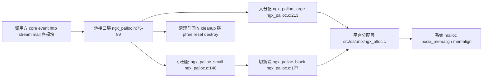
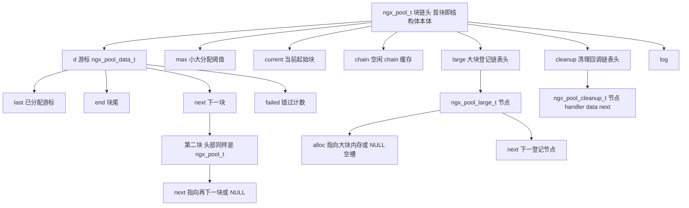
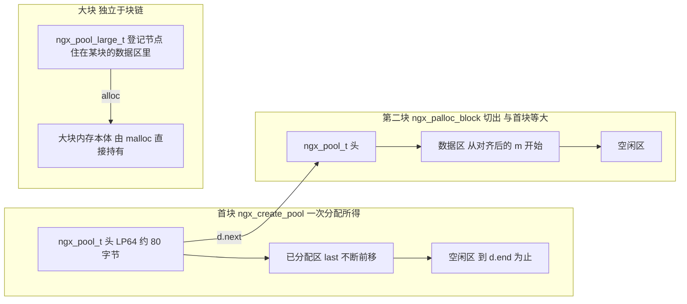
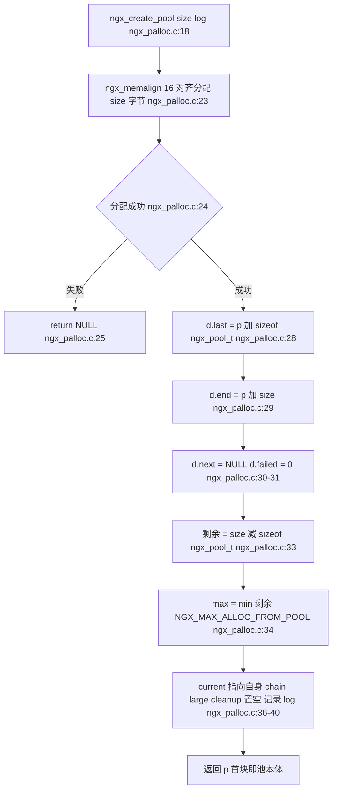
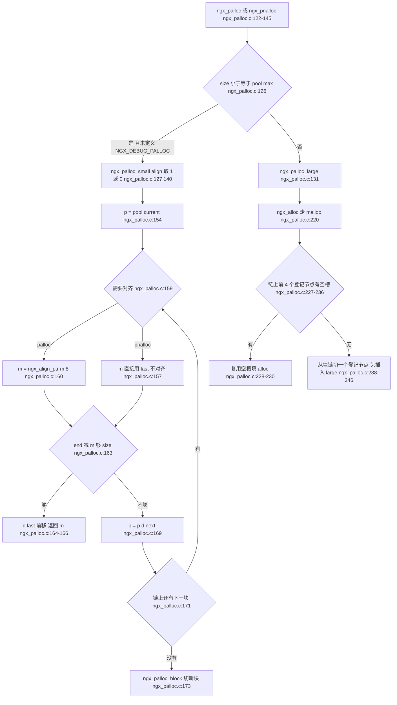
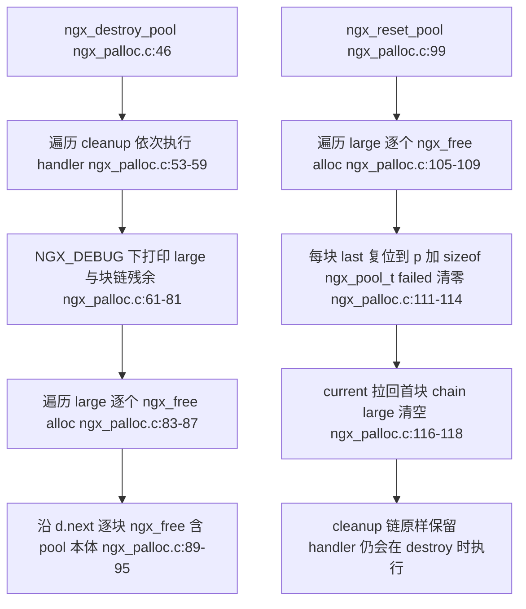
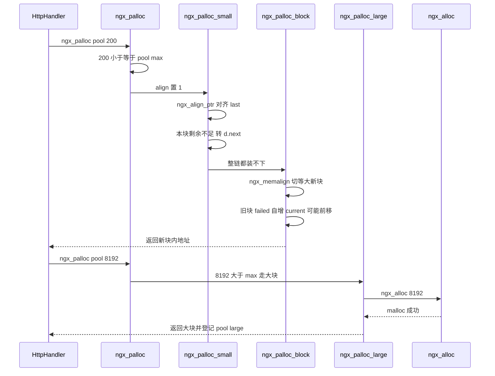
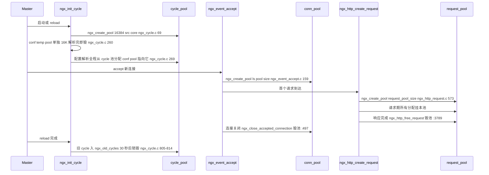

# 内存池 ngx_pool 精讲（基于 nginx-1.27.0 源码）

> **导读**：读完本文你将掌握——
> 1. `ngx_pool_t` 四个结构体（`ngx_pool_s` / `ngx_pool_data_t` / `ngx_pool_large_s` / `ngx_pool_cleanup_s`）每个字段的确切含义与内存布局；
> 2. `ngx_create_pool` 为什么"首块即 pool 结构体本体"，`max` 阈值如何计算；
> 3. `ngx_palloc` 与 `ngx_pnalloc` 的对齐差异，`ngx_palloc_small` 的 `current` 跳跃与 `failed` 计数如何把分配做到均摊 O(1)；
> 4. `ngx_palloc_block` 如何切出等大新块、`ngx_palloc_large` 如何用 `NGX_MAX_ALLOC_FROM_POOL` 阈值旁路大块、`ngx_pfree` 为什么只能释放大块；
> 5. `cleanup` 链的注册与执行顺序、临时文件自动清理回调的用法；
> 6. `ngx_reset_pool` 与 `ngx_destroy_pool` 的语义差异及各自适用场景；
> 7. connection pool、request pool、cycle/conf pool 三种生命周期的创建者与销毁者；
> 8. 为什么 nginx 热路径上几乎看不见 `free`——用源码论证 arena 模型相对逐对象 `malloc/free` 的优势。
>
> **前置阅读建议**：熟悉 C 语言指针运算与结构体内存对齐；了解 nginx 模块体系与 `ngx_log_t` 的基本用法；建议先读《进程模型与启动流程》（理解 cycle 生命周期）再读本文，第 1 节末尾给出了本文与该文档的衔接点。
>
> **涉及源码清单**（均已逐一通读核实，头文件存在性经 glob 确认）：
>
> | 文件 | 内容 | 说明 |
> | --- | --- | --- |
> | `src/core/ngx_palloc.h`（92 行） | 全部结构体、常量与 API 原型 | 本文主角的头文件 |
> | `src/core/ngx_palloc.c`（430 行） | 池的全部实现 | 本文主角 |
> | `src/os/unix/ngx_alloc.c`（90 行） | `ngx_alloc` / `ngx_calloc` / `ngx_memalign` | **注意：该文件不在 `src/core/` 下**，nginx 的基础内存分配是平台相关的，Unix 版在 `src/os/unix/`，Windows 版在 `src/os/win32/`（后者 44 行，无 `ngx_memalign` 实现，以宏退化） |
> | `src/os/unix/ngx_alloc.h`（45 行） | `ngx_free` 宏、`ngx_memalign` 声明与回退宏 | |
> | `src/os/win32/ngx_alloc.c` / `ngx_alloc.h` | Windows 平台对应实现 | 仅 `ngx_alloc` / `ngx_calloc` |
> | `src/core/ngx_config.h` | `NGX_ALIGNMENT`、`ngx_align`、`ngx_align_ptr` | 对齐宏出处 |
> | `src/core/ngx_cycle.c`、`src/core/nginx.c` | cycle 池 / 启动引导池的创建销毁点 | 第 3、5 节引用 |
> | `src/event/ngx_event_accept.c` | 连接池创建销毁点 | 第 5 节引用 |
> | `src/http/ngx_http_request.c`、`src/http/ngx_http.c`、`src/http/ngx_http_core_module.c` | 请求池与相关配置指令 | 第 5、8 节引用 |
> | `src/core/ngx_file.c` | 临时文件清理回调的注册点 | 第 6.11 节引用 |
>
> 全文引用格式为 `文件:起始行-结束行`，行号均来自本仓库实际文件内容。

---

## 1. 本模块在 nginx 中的位置与职责

`src/core/ngx_palloc.c` 与 `ngx_palloc.h` 实现了 nginx 的**区域内存池**（region/arena allocator）。它向上为所有模块提供 `ngx_palloc` / `ngx_pnalloc` / `ngx_pcalloc` / `ngx_pmemalign` / `ngx_pfree` 五个分配接口与 `ngx_pool_cleanup_add` 清理注册接口（原型集中声明于 `src/core/ngx_palloc.h:75-89`），向下调用平台层 `ngx_alloc` / `ngx_memalign`（`src/os/unix/ngx_alloc.c`）落到系统的 `malloc` / `posix_memalign` / `memalign`。

它的职责边界很清楚：**管"批量分配、批量归还"，不管"单对象归还"**。除大块外，从池里拿走的内存没有对应的逐个释放函数；统一释放由 `ngx_reset_pool`（复用）或 `ngx_destroy_pool`（销毁）完成。这一"分配廉价、释放整批"的取舍，是理解本文一切设计的钥匙。



**图解**：所有模块只认识第 2 层的池接口；小分配在池内块链上"切"内存，大分配穿透池直接到平台层；`ngx_palloc_block` 是小分配的兜底，负责向平台层再要一块；`cleanup` 链与 `reset/destroy` 构成回收侧。整个模块只有一个出入口依赖平台，因此移植时只需换 `src/os/*/ngx_alloc.c`。

**与启动流程的衔接**：启动早期 `src/core/nginx.c:254` 先建一个 1024 字节的引导池供 `init_cycle` 使用，随后 `ngx_init_cycle` 在 `src/core/ngx_cycle.c:69` 建出真正的 16K cycle 池——配置解析、模块初始化期间的一切分配几乎都挂在这两个池上，其生命周期详见第 5 节时序图。

---

## 2. 核心数据结构精讲

### 2.1 ngx_pool_data_t —— 每个块的"分配游标"

```c
/* src/core/ngx_palloc.h:49-54 */
typedef struct {
    u_char               *last;
    u_char               *end;
    ngx_pool_t           *next;
    ngx_uint_t            failed;
} ngx_pool_data_t;
```

| 字段 | 类型 | 含义 | 关键出处 |
| --- | --- | --- | --- |
| `last` | `u_char *` | 已分配区末尾，下一次分配从这里切出 | 初始化 `ngx_palloc.c:28`；推进 `ngx_palloc.c:164`、`199` |
| `end` | `u_char *` | 本块可用内存的终点（开区间） | `ngx_palloc.c:29`、`193` |
| `next` | `ngx_pool_t *` | 指向块链中下一块（注意类型是 `ngx_pool_t *`，因为每块头部都是完整的 `ngx_pool_t`） | `ngx_palloc.c:30`、`207` |
| `failed` | `ngx_uint_t` | 本块被分配请求"错过"（剩余空间不够）的次数，驱动 `current` 跳跃 | 初始化 `ngx_palloc.c:31`、`195`；自增判断 `ngx_palloc.c:202` |

四个字段构成一条**单向块链**：分配时沿 `next` 走，每块用 `last/end` 夹出剩余空间，`failed` 记录"错过"次数供链头跳跃优化（见 4.2）。

### 2.2 ngx_pool_s —— 池本体兼首块头

```c
/* src/core/ngx_palloc.h:57-65 */
struct ngx_pool_s {
    ngx_pool_data_t       d;
    size_t                max;
    ngx_pool_t           *current;
    ngx_chain_t          *chain;
    ngx_pool_large_t     *large;
    ngx_pool_cleanup_t   *cleanup;
    ngx_log_t            *log;
};
```

| 字段 | 类型 | 含义 | 关键出处 |
| --- | --- | --- | --- |
| `d` | `ngx_pool_data_t` | **首块**的分配游标——`ngx_pool_t` 本体同时就是块链第一块的头部 | `ngx_palloc.c:28-31` |
| `max` | `size_t` | 小/大分配判定阈值：`size <= max` 走块链，否则走大块旁路 | 计算 `ngx_palloc.c:33-34`；判定 `ngx_palloc.c:126`、`139` |
| `current` | `ngx_pool_t *` | 小分配的**起点块**，随 `failed` 计数只前进不后退 | 初始化 `ngx_palloc.c:36`；前移 `ngx_palloc.c:203`；复位 `ngx_palloc.c:116` |
| `chain` | `ngx_chain_t *` | 空闲 chain 节点缓存：`ngx_free_chain` 把不用的链节点挂回这里供 `ngx_alloc_chain_link` 复用 | 置空 `ngx_palloc.c:37`、`117`；使用者见 `src/core/ngx_buf.h` 中 `ngx_alloc_chain_link` |
| `large` | `ngx_pool_large_t *` | 大块登记链表头（头插法） | `ngx_palloc.c:245-246` |
| `cleanup` | `ngx_pool_cleanup_t *` | 清理回调链表头（头插法，销毁时后注册者先执行） | `ngx_palloc.c:332-334` |
| `log` | `ngx_log_t *` | 日志对象，失败时打 `EMERG` 级日志 | `ngx_palloc.c:40` |

以 x86-64（LP64）常见布局推算：`d` 为 4 个字段共 32 字节，后 6 个指针/`size_t` 共 48 字节，`sizeof(ngx_pool_t) = 80`。`NGX_MIN_POOL_SIZE` 即 `ngx_align(80 + 2 * sizeof(ngx_pool_large_t), 16) = 112` 字节（宏定义 `src/core/ngx_palloc.h:25-27`；具体数值随编译器而异，此处为推算值）。

### 2.3 ngx_pool_large_s —— 大块登记头

```c
/* src/core/ngx_palloc.h:41-46 */
typedef struct ngx_pool_large_s  ngx_pool_large_t;

struct ngx_pool_large_s {
    ngx_pool_large_t     *next;
    void                 *alloc;
};
```

| 字段 | 类型 | 含义 | 关键出处 |
| --- | --- | --- | --- |
| `next` | `ngx_pool_large_t *` | 串成单向链表 | `ngx_palloc.c:245` |
| `alloc` | `void *` | 指向真正的内存块；**为 `NULL` 表示"空槽"**（被 `ngx_pfree` 释放后留下），下次大分配可复用 | 赋值 `ngx_palloc.c:229`、`244`、`269`；置空 `ngx_palloc.c:287` |

大块内存本体由平台层 `ngx_alloc`/`ngx_memalign` 分配，**不占池内空间**；池内只保存这个 16 字节（LP64）的登记节点。`alloc == NULL` 的空槽复用机制见 6.5。

### 2.4 ngx_pool_cleanup_s 与 ngx_pool_cleanup_file_t —— "销毁时请帮我做事"

```c
/* src/core/ngx_palloc.h:34-38 */
struct ngx_pool_cleanup_s {
    ngx_pool_cleanup_pt   handler;
    void                 *data;
    ngx_pool_cleanup_t   *next;
};

/* src/core/ngx_palloc.h:68-72 */
typedef struct {
    ngx_fd_t              fd;
    u_char               *name;
    ngx_log_t            *log;
} ngx_pool_cleanup_file_t;
```

| 字段 | 类型 | 含义 | 关键出处 |
| --- | --- | --- | --- |
| `handler` | `ngx_pool_cleanup_pt`（函数指针，原型 `ngx_palloc.h:30`） | 销毁/执行时调用的回调；可置 `NULL` 表示"已执行过，跳过" | 执行 `ngx_palloc.c:54-58`；置空 `ngx_palloc.c:355` |
| `data` | `void *` | 回调参数；`size` 不为 0 时由 `ngx_pool_cleanup_add` 一并从池里分配 | `ngx_palloc.c:321-329` |
| `next` | `ngx_pool_cleanup_t *` | 串成链表，头插法 | `ngx_palloc.c:332` |
| `fd` / `name` / `log` | `ngx_pool_cleanup_file_t` 三字段 | 文件清理回调专用参数：要关的 fd、要删的文件名、打日志用的 log | 赋值 `src/core/ngx_file.c:212-214` |

### 2.5 关键常量

| 常量 | 值 | 出处 | 意义 |
| --- | --- | --- | --- |
| `NGX_MAX_ALLOC_FROM_POOL` | `ngx_pagesize - 1`（x86 上通常 4095） | `src/core/ngx_palloc.h:20` | 小/大分配分界；头文件注释说明其应为页大小减一，且"在 Windows NT 上可减少内核锁定页数" |
| `NGX_DEFAULT_POOL_SIZE` | `16 * 1024` | `src/core/ngx_palloc.h:22` | 默认池大小，cycle 池即此值（`src/core/ngx_cycle.h:16-18`） |
| `NGX_POOL_ALIGNMENT` | `16` | `src/core/ngx_palloc.h:24` | 池块整体的字节对齐，传给 `ngx_memalign` |
| `NGX_MIN_POOL_SIZE` | `ngx_align(sizeof(ngx_pool_t) + 2 * sizeof(ngx_pool_large_t), NGX_POOL_ALIGNMENT)` | `src/core/ngx_palloc.h:25-27` | 池大小的合法下限，被配置校验使用（见第 8 节） |
| `NGX_ALIGNMENT` | `sizeof(unsigned long)`（LP64 上为 8） | `src/core/ngx_config.h:96-98` | **数据**分配的对齐粒度，`ngx_palloc_small` 内使用 |

### 2.6 结构体关系图



**图解**：`ngx_pool_t` 是三种链的公共汇聚点——块链（`d.next`）管小内存，`large` 链管大内存的"户口"，`cleanup` 链管销毁前的收尾动作。`current` 是块链上的一个"游标缓存"，`max` 是小/大路径的路由开关。

### 2.7 内存布局图



**图解**：首块与后续块**等大**——`ngx_palloc_block` 用 `pool->d.end - (u_char *) pool` 算出首块总大小并照抄（`ngx_palloc.c:184-186`），因此"块链上每块容量一致"是该实现的重要不变量。大块内存本体不在任何块的 `last..end` 区间内，只通过登记节点的 `alloc` 指针挂名；登记节点本身（16 字节）反而是从块链上切出来的（`ngx_palloc.c:238`）。

---

## 3. 初始化流程：ngx_create_pool

`ngx_create_pool` 的独特之处：**一次 `ngx_memalign` 同时得到"管理结构"与"第一块可用内存"**——返回的指针既是要交给调用方的 `ngx_pool_t *`，也是块链首块的头。省掉了"先分配管理结构再分配第一块"的第二次分配，也让块链天然形成（首块头就是池本体）。



**图解与讲解**：

1. **对齐分配**（`ngx_palloc.c:23`）：`ngx_memalign(NGX_POOL_ALIGNMENT, size, log)`——池块整体按 16 字节对齐，头与数据都落在整齐边界上（为什么是 16 见 6.13）。
2. **游标初始化**（`ngx_palloc.c:28-31`）：`d.last` 跳过 80 字节（LP64）的头部，从头部之后开始切；`d.end` 钉在整块末尾。注意头部包含的是**完整** `ngx_pool_t`（不只是 `ngx_pool_data_t`），因为首块兼任池本体。
3. **max 计算**（`ngx_palloc.c:33-34`）：`size` 先减去头部大小，再与 `NGX_MAX_ALLOC_FROM_POOL`（页大小减一）取小。于是：
   - 16K 的 cycle 池：`max = min(16384 - 80, 4095) = 4095`；
   - 4096 的 request 池：`max = min(4096 - 80, 4095) = 4016`；
   - 512 的默认连接池（`64 * sizeof(void *)`，见第 8 节）：`max = min(432, 4095) = 432`。
   这保证任何 `size <= max` 的请求必然能被**某个新块**装下（新块数据区 ≥ `psize - sizeof(ngx_pool_data_t)`，而 `max ≤ psize - sizeof(ngx_pool_t)`），`ngx_palloc_block` 永不二度失败。
4. **指针自指**（`ngx_palloc.c:36`）：`p->current = p`，小分配从首块开始找。
5. **调用方决定的只有 `size` 与 `log`**：池多大、日志写给谁，全部由创建场景（连接池/请求池/cycle 池）传入——这正是第 5 节三种生命周期的分野。

---

## 4. 核心执行流程：分配路径与回收路径

### 4.1 分配主流程



**逐分支讲解**：

- **路由分支**：`ngx_palloc`/`ngx_pnalloc` 用 `size <= pool->max` 判定小大（`ngx_palloc.c:126`、`139`）。注意编译开关 `NGX_DEBUG_PALLOC`：定义后 `#if !(NGX_DEBUG_PALLOC)` 整段失效，**所有**分配强制走 `ngx_palloc_large`，用于调试定位池内内存被误写的问题（`ngx_palloc.c:125`、`138`；全树检索该宏仅此两处，构建脚本没有自动定义点，打开需自行加 `-D`，此为推断、待验证官方构建入口）。
- **current 起步**（`ngx_palloc.c:154`）：从 `pool->current` 而非链头开始遍历——这是均摊 O(1) 的关键（见 4.2）。
- **对齐分支**（`ngx_palloc.c:159-161`）：`palloc` 把 `m` 按 `NGX_ALIGNMENT`（LP64 上 8 字节）向上取整再检查；`pnalloc` 不取整，直接从 `last` 切。对齐只影响**本次**分配的起点，不影响 `last` 推进量的语义。
- **成功分支**（`ngx_palloc.c:163-167`）：先判 `(size_t)(p->d.end - m) >= size` 再推进 `p->d.last = m + size`。失败尝试**不推进** `last`，本块空间毫发无损。
- **切块分支**（`ngx_palloc.c:173`）：整条链都装不下才向平台层要新块，新块首分配即命中。
- **大块分支**：登记节点的"空槽复用 + 头插法"详见 6.5。

### 4.2 current 跳跃与 failed 计数（均摊 O(1) 的秘密）

`ngx_palloc_small` 从 `current` 开始沿链找，最坏情况是"链上每块都装不下"，此时会空走整条链再切新块——如果每次分配都这样空走，长链会让分配退化为 O(n)。`ngx_palloc_block` 里的计数机制解决了这一点：

- 每次切新块时，从 `current` 到链尾的**每个旧块** `failed++`（`ngx_palloc.c:201-205`）——"刚才这些块都装不下这次请求"；
- 某块累计错过次数的旧值大于 4 时（第 6 次错过），`pool->current = p->d.next`，游标永久越过它；
- 循环条件 `p->d.next` 在尾块处为假，**尾块不被计数**——它是最年轻的块，总该再给它机会。

代价：被跳过的块剩余空间成为"死空间"，直到 `reset`（`current` 复位回首块，`ngx_palloc.c:116`）或 `destroy` 才重见天日。这是典型的"用一点内存换均摊常数"。

### 4.3 回收路径对比



**图解**：两者的公共动作只有"释放所有大块"；分野在于块链——`destroy` 连块带头全部归还系统（第 6.9 节），`reset` 把块链**原封不动留着复用**，只重置游标。特别注意 `reset` **不碰 `pool->cleanup`**（对比 `ngx_palloc.c:116-118` 与结构体字段列表）：销毁前注册的清理回调在 reset 之后依然有效。场景差异与实例见 6.10。

---

## 5. 关键时序图

### 5.1 一次典型分配的两条路径



**图解**：同一调用入口因 `size` 与 `max` 的关系分流：200 字节在小分配路径上可能经历"本块不够 → 沿 `d.next` 找 → 全链不够 → 切新块"四级跳，但均摊后绝大多数分配停在第 1 级；8192 字节则一步旁路到 `malloc`，池内只留下 16 字节登记头。

### 5.2 三种池的生命周期总览



**图解**——三种池的"谁创建、谁销毁、活多久"：

| 池 | 大小来源 | 创建者 | 销毁者 | 寿命 |
| --- | --- | --- | --- | --- |
| **cycle pool** | `NGX_CYCLE_POOL_SIZE = 16K`（`src/core/ngx_cycle.h:16-18`） | `ngx_init_cycle`（`src/core/ngx_cycle.c:69`）；配置解析时 `conf.pool` 直接指向它（`src/core/ngx_cycle.c:269`），另有独立的 `conf.temp_pool`（:260） | 解析失败由 `ngx_destroy_cycle_pools` 立即销毁（`src/core/ngx_cycle.c:944-948`，先 temp 后主池）；reload 成功后旧 cycle 推入 `ngx_old_cycles`，由 30 秒定时器 `ngx_clean_old_cycles` 等其上连接全部关闭后才销毁（`src/core/ngx_cycle.c:805-814`） | 整个 worker 进程生命周期；旧 cycle 池跨 reload 延迟存活 |
| **connection pool** | `ls->pool_size`，HTTP 下等于 `connection_pool_size` 指令值（`src/http/ngx_http.c:1826`，默认见第 8 节；stream 模块硬编码 256，`src/stream/ngx_stream.c:1004`） | `ngx_event_accept` 接受连接时（`src/event/ngx_event_accept.c:159`） | `ngx_close_accepted_connection` 关连接时（`src/event/ngx_event_accept.c:496-498`） | 一个 TCP 连接的存活期，跨其上的所有 HTTP keep-alive 请求 |
| **request pool** | `cscf->request_pool_size`（`src/http/ngx_http_request.c:573`，默认 4096） | `ngx_http_create_request → ngx_http_alloc_request`（`src/http/ngx_http_request.c:528`、`534`、`560-584`），keep-alive 上的每个新请求都会新建（:3187、:3429） | `ngx_http_free_request` 响应完成后（`src/http/ngx_http_request.c:3786-3789`，先置 `r->pool = NULL` 防双关） | 单个 HTTP 请求；连接池比它长，请求池比它短 |

---

## 6. 源码逐段精读

本章是全文主体，逐函数拆解 `src/core/ngx_palloc.c`（全文 430 行）与平台层 `src/os/unix/ngx_alloc.c`。每个函数按"签名与语义 → 逐块逻辑 → 关键行 → 易错点"展开。

### 6.1 ngx_create_pool —— 首块即池本体

**签名**（`src/core/ngx_palloc.h:75`）：

```c
ngx_pool_t *ngx_create_pool(size_t size, ngx_log_t *log);
```

**逐块逻辑**（`src/core/ngx_palloc.c:18-43`）：

```c
/* src/core/ngx_palloc.c:23-34 */
    p = ngx_memalign(NGX_POOL_ALIGNMENT, size, log);
    if (p == NULL) {
        return NULL;
    }

    p->d.last = (u_char *) p + sizeof(ngx_pool_t);
    p->d.end = (u_char *) p + size;
    p->d.next = NULL;
    p->d.failed = 0;

    size = size - sizeof(ngx_pool_t);
    p->max = (size < NGX_MAX_ALLOC_FROM_POOL) ? size : NGX_MAX_ALLOC_FROM_POOL;
```

1. **对齐分配整块**（:23）：注意 `size` 是**整个池**的大小，不是"头部之外"的大小；`ngx_memalign` 保证返回地址 16 字节对齐。
2. **头部自嵌**（:28-29）：`d.last` 跳过 `sizeof(ngx_pool_t)`（LP64 上 80 字节），`d.end` 钉在 `p + size`。此后"池本体"与"首块头"是同一块内存，`p` 与 `p->d` 的关系即第 2.7 节布局图中的 S1。
3. **max 计算**（:33-34）：局部变量 `size` 被复用为"剩余数据区大小"，再与页大小减一取小。**易错点**：`size` 在这里已经被改写，函数后面不能再用它表示"池总大小"；且阈值是 `size < NGX_MAX_ALLOC_FROM_POOL`（严格小于），边界值恰好等于页大小减一时取后者，语义相同。
4. **链表头清零**（:36-40）：`current` 自指、`chain/large/cleanup` 置空、`log` 记录。没有任何字段留随机值，池处于" virgin "状态。

**易错点**：
- 传入的 `size` 小于 `NGX_MIN_POOL_SIZE`（112 字节，LP64）时不会在 `ngx_create_pool` 内报错，首块数据区被压到极限甚至不足；防线在配置层（`ngx_http_core_module.c:5331-5345` 要求池大小 ≥ `NGX_MIN_POOL_SIZE` 且为 16 的倍数），直接调用 API 的模块需自己把关。
- 首块的 `d.last` 跳过的是**完整** `ngx_pool_t` 头；而后续块的 `d.last` 只跳过 `sizeof(ngx_pool_data_t)`（见 6.4）——两处初始化不对称，读内存布局时不要混为一谈。

### 6.2 ngx_palloc 与 ngx_pnalloc —— 仅一个对齐位的差别

**签名**（`src/core/ngx_palloc.h:79-80`）：两者同型，`void *ngx_palloc(ngx_pool_t *pool, size_t size)` 与 `void *ngx_pnalloc(ngx_pool_t *pool, size_t size)`。

**逐块逻辑**（`src/core/ngx_palloc.c:122-132`）：

```c
/* src/core/ngx_palloc.c:122-132 */
void *
ngx_palloc(ngx_pool_t *pool, size_t size)
{
#if !(NGX_DEBUG_PALLOC)
    if (size <= pool->max) {
        return ngx_palloc_small(pool, size, 1);
    }
#endif

    return ngx_palloc_large(pool, size);
}
```

1. `ngx_palloc`：向 `ngx_palloc_small` 传 `align = 1`——返回地址按 `NGX_ALIGNMENT`（LP64 上 8 字节）对齐，适合存放 `uintptr_t`、指针、结构体等需要对齐的类型（:127）。
2. `ngx_pnalloc`：`align = 0`——"no-align"，按字节切，适合字符串等原始字节序列，省掉对齐缝隙（:140）。两者除这一个实参外完全镜像（:135-145）。
3. 超过 `pool->max` 一律旁路到 `ngx_palloc_large`（:131、:144）。

**易错点**：
- 名字里的 `p` 是 *pool* 而非 *page*；`n` 是 *non-aligned*。
- `pnalloc` 返回的地址**可能未对齐**，把结构体放进去（尤其在要求对齐的架构上）属于误用——结构体请用 `palloc`/`pcalloc`。
- 大块路径上 `palloc` 与 `pnalloc` **毫无区别**：对齐语义只在小分配路径存在（大块对齐由 `malloc`/`posix_memalign` 的平台保证兜底，见 6.12）。

### 6.3 ngx_palloc_small —— current 起步的块链扫描

**签名**（`src/core/ngx_palloc.c:12-13` 的 static 原型）：

```c
static ngx_inline void *ngx_palloc_small(ngx_pool_t *pool, size_t size,
    ngx_uint_t align);
```

**逐块逻辑**（`src/core/ngx_palloc.c:148-174`）：

```c
/* src/core/ngx_palloc.c:156-171 */
    do {
        m = p->d.last;

        if (align) {
            m = ngx_align_ptr(m, NGX_ALIGNMENT);
        }

        if ((size_t) (p->d.end - m) >= size) {
            p->d.last = m + size;

            return m;
        }

        p = p->d.next;

    } while (p);

    return ngx_palloc_block(pool, size);
```

1. **起点**（:154）：`p = pool->current`——不是链头！被 `failed` 计数淘汰的块从这里就被剪掉了。
2. **对齐**（:157-161）：仅当 `align` 为真才把候选地址向上取整到 8 字节（LP64）。
3. **判满与推进**（:163-167）：`(size_t)(p->d.end - m) >= size` 用无符号差值判断剩余空间；够则 `d.last = m + size` 一步切出，返回 `m`。**先判断后推进**，失败的试探不留下任何痕迹。
4. **换块**（:169）：本块不够，沿 `d.next` 试下一块——块链的存在意义就在于此：新块切出来之前，旧块的尾巴还能接着用。
5. **兜底**（:173）：`while (p)` 为假说明走到链尾仍未命中，交 `ngx_palloc_block` 切新块。

**易错点**：
- 对齐可能让"看似够"变成"不够"：`last` 对齐后与 `end` 的距离缩短，判断是在对齐**之后**做的（顺序正确，但心算剩余空间时容易漏掉这段 alignment padding）。
- 从 `current` 之前的块永远不会再被考虑（除非 reset），它们的剩余空间对外不可见。
- `ngx_palloc_small` 是 `static ngx_inline`，不进符号表，调试时无法直接断点——断点应打在 `ngx_palloc` 或 `ngx_palloc_block` 上。

### 6.4 ngx_palloc_block —— 等大新块与 failed 计数

**签名**（`src/core/ngx_palloc.c:14`）：`static void *ngx_palloc_block(ngx_pool_t *pool, size_t size);`

**逐块逻辑**（`src/core/ngx_palloc.c:177-210`）：

```c
/* src/core/ngx_palloc.c:184-199 */
    psize = (size_t) (pool->d.end - (u_char *) pool);

    m = ngx_memalign(NGX_POOL_ALIGNMENT, psize, pool->log);
    if (m == NULL) {
        return NULL;
    }

    new = (ngx_pool_t *) m;

    new->d.end = m + psize;
    new->d.next = NULL;
    new->d.failed = 0;

    m += sizeof(ngx_pool_data_t);
    m = ngx_align_ptr(m, NGX_ALIGNMENT);
    new->d.last = m + size;
```

1. **等大复制**（:184-186）：`psize` 是**首块**的总大小（含头部），新块照此再向 `ngx_memalign` 要一块——于是块链上每块容量一致（首块数据区比后续块少 `sizeof(ngx_pool_t) - sizeof(ngx_pool_data_t)` 这一段，因为首块头装了整个池结构）。
2. **新块头初始化**（:191-195）：新块的 `ngx_pool_t` 头里只有 `d` 三个字段有意义；`max/current/large/cleanup` 等字段**不初始化也不使用**——这些是"池级"字段，只有链头（首块）的才有效。这是个极易踩的坑：遍历块链时不要读非首块的头字段。
3. **数据区起步**（:197-198）：`m` 先跳过 `sizeof(ngx_pool_data_t)`——新块头只需要 32 字节游标区——再对齐到 8 字节（LP64）。
4. **本次分配即首分配**（:199）：`new->d.last = m + size`，新块把第一次分配直接记在 `last` 里，返回值就是这个 `m`（:209）。

```c
/* src/core/ngx_palloc.c:201-207 */
    for (p = pool->current; p->d.next; p = p->d.next) {
        if (p->d.failed++ > 4) {
            pool->current = p->d.next;
        }
    }

    p->d.next = new;
```

5. **failed 计数与 current 跳跃**（:201-205）：从 `current` 出发沿链把每个**非尾块**的 `failed` 自增；旧值大于 4（第 6 次错过）时 `pool->current` 前移到它的下一块。此后 `ngx_palloc_small` 不再光顾被跳过的块。
6. **接链**（:207）：循环结束时 `p` 是**原链尾**，`p->d.next = new` 把新块挂上。头插还是尾插？**尾插**——保持块的时间序，`current` 之后的链仍按创建顺序排列。

**易错点**：
- `p->d.failed++ > 4` 是后置自增：比较用的是旧值，所以是"第 6 次错过时跳跃"，不是第 5 次。
- 尾块（`p->d.next == NULL`）在本次循环里**不计 failed**——它刚被证明装不下，但代码给它豁免；下次切块时它就不再是尾块，开始正常计数。
- 新块大小取自首块，如果调用方创建池时给的 `size` 很小（比如引导池 1024，`src/core/nginx.c:254`），块链会由许多小块组成，链长随之增长——`failed` 跳跃机制正是为这种场景准备的。
- 顺带一提，文件末尾还留着一段 `#if 0` 的块缓存实验（`ngx_palloc.c:404-430`，`ngx_get_cached_block`，依赖从未实现的 `ngx_cycle->cache`），说明作者一度想给切块也加缓存，最终未启用——读源码时不要误以为是活代码。

### 6.5 ngx_palloc_large —— 大块旁路与空槽复用

**签名**（`src/core/ngx_palloc.c:15`）：`static void *ngx_palloc_large(ngx_pool_t *pool, size_t size);`

**逐块逻辑**（`src/core/ngx_palloc.c:213-249`）：

```c
/* src/core/ngx_palloc.c:220-236 */
    p = ngx_alloc(size, pool->log);
    if (p == NULL) {
        return NULL;
    }

    n = 0;

    for (large = pool->large; large; large = large->next) {
        if (large->alloc == NULL) {
            large->alloc = p;
            return p;
        }

        if (n++ > 3) {
            break;
        }
    }
```

```c
/* src/core/ngx_palloc.c:238-246 */
    large = ngx_palloc_small(pool, sizeof(ngx_pool_large_t), 1);
    if (large == NULL) {
        ngx_free(p);
        return NULL;
    }

    large->alloc = p;
    large->next = pool->large;
    pool->large = large;
```

1. **先要内存**（:220-223）：直接 `ngx_alloc`（底层 `malloc`，见 6.12），**不经过 `ngx_memalign`**——大块没有 16 字节硬对齐要求，对齐靠平台 `malloc` 的自然保证。
2. **空槽复用**（:225-236）：沿登记链找 `alloc == NULL` 的槽——那一定是被 `ngx_pfree` 释放过的节点；找到就原地填上返回。扫描上限由 `n++ > 3` 控制为**前 4 个节点**：登记链可能很长（每个大块一个节点），全扫会让大分配变慢，作者宁可多花 16 字节登记也不要 O(n) 扫描。
3. **登记**（:238-246）：没有空槽就从块链切一个 16 字节登记节点（注意这是递归使用小分配路径），失败则把刚 `malloc` 到的大块 `ngx_free` 掉、返回 `NULL`——**失败回滚要对称**。登记采用头插法（`large->next = pool->large; pool->large = large`），链序与分配时间相反。
4. 返回值是**大块内存本身**（`p`），不是登记节点。

**易错点**：
- 空槽复用只发生在"前 4 个节点"里：如果空槽恰好排在第 5 个以后，这次分配会新切一个登记节点，旧空槽继续闲置——链上可能出现多个 `alloc == NULL` 的槽，`destroy` 时 `if (l->alloc)` 判空跳过它们（`ngx_palloc.c:84-86`）。
- 大块与块链的关系是"挂名"而非"包含"：`ngx_destroy_pool` 释放大块与释放块链是两个独立循环。
- `ngx_palloc_large` 里没有对 `size == 0` 的特判，`malloc(0)` 的行为交由平台 C 库。

### 6.6 ngx_pmemalign —— 显式对齐的大块

**签名**（`src/core/ngx_palloc.h:82`）：`void *ngx_pmemalign(ngx_pool_t *pool, size_t size, size_t alignment);`

**逐块逻辑**（`src/core/ngx_palloc.c:252-274`）：

```c
/* src/core/ngx_palloc.c:258-271 */
    p = ngx_memalign(alignment, size, pool->log);
    if (p == NULL) {
        return NULL;
    }

    large = ngx_palloc_small(pool, sizeof(ngx_pool_large_t), 1);
    if (large == NULL) {
        ngx_free(p);
        return NULL;
    }

    large->alloc = p;
    large->next = pool->large;
    pool->large = large;
```

1. **按任意对齐要内存**（:258）：调用方指定 `alignment`（须为 2 的幂），底层走 `posix_memalign`/`memalign`（Unix）或退化为 `ngx_alloc`（Windows，见 6.12）。
2. **登记方式与 `ngx_palloc_large` 尾段完全一致**（:263-271）：头插进 `pool->large`。区别仅在于：它**不做空槽复用**——每次调用都新切一个登记节点（对比 6.5 的 :225-236），因为典型调用频度低，没必要优化。

**易错点**：
- `alignment` 必须是 2 的幂且满足平台库约束（POSIX 要求为 `sizeof(void *)` 的倍数），传非法值是未定义行为——`ngx_palloc.c` 未做校验。
- 它分配的内存同样能被 `ngx_pfree` 释放（登记在同一条链上），但**不走空槽复用路径回收登记节点本身**——节点占了就是占了，直到 destroy。

### 6.7 ngx_pfree —— 只能释放大块

**签名**（`src/core/ngx_palloc.h:83`）：`ngx_int_t ngx_pfree(ngx_pool_t *pool, void *p);`

**逐块逻辑**（`src/core/ngx_palloc.c:277-294`）：

```c
/* src/core/ngx_palloc.c:280-293 */
    ngx_pool_large_t  *l;

    for (l = pool->large; l; l = l->next) {
        if (p == l->alloc) {
            ngx_log_debug1(NGX_LOG_DEBUG_ALLOC, pool->log, 0,
                           "free: %p", l->alloc);
            ngx_free(l->alloc);
            l->alloc = NULL;

            return NGX_OK;
        }
    }

    return NGX_DECLINED;
```

1. **只扫大块登记链**（:282-291）：逐节点比对 `p == l->alloc`；命中则 `ngx_free` 内存本体并**把 `l->alloc` 置 `NULL`**——登记节点本身保留，成为 6.5 所述的"空槽"。
2. **两种返回**（:289、:293）：命中返回 `NGX_OK`；没找到返回 `NGX_DECLINED`——注意不是 `NGX_ERROR`：`p` 不在链上只说明"这不是大块"，调用方应理解为"池不管这块内存"，而非系统错误。

**易错点**：
- **小块地址传进来永远返回 `NGX_DECLINED`**：小块没有任何按地址索引的结构（块链只有 `last/end` 游标，无法定位某次分配的起点），这正是"池不支持单对象释放"的结构性原因。
- 释放后的地址**不会**被复用为小块空间：块链游标只增不减（reset 除外），空槽里留下的 16 字节登记头在下次大分配时可能被复用（6.5），但大块内存地址本身不会被二次分配。
- 典型调用方：HTTP 请求头大缓冲 `src/http/ngx_http_request.c:446`、`3219`，gzip 预分配 `src/http/modules/ngx_http_gzip_filter_module.c:459`，MP4 缓冲 `src/http/modules/ngx_http_mp4_module.c:634-651`，SSL 缓冲 `src/event/ngx_event_openssl.c:3225`——清一色是"偶尔需要提前分配一大块、用完即还"的场景。

### 6.8 ngx_pcalloc —— palloc 加清零

**签名**（`src/core/ngx_palloc.h:81`）：`void *ngx_pcalloc(ngx_pool_t *pool, size_t size);`

**逐块逻辑**（`src/core/ngx_palloc.c:297-308`）：

```c
/* src/core/ngx_palloc.c:297-308 */
void *
ngx_pcalloc(ngx_pool_t *pool, size_t size)
{
    void *p;

    p = ngx_palloc(pool, size);
    if (p) {
        ngx_memzero(p, size);
    }

    return p;
}
```

1. 纯组合：`ngx_palloc` + `ngx_memzero`，无任何池状态修改（:302-305）。
2. 失败时返回 `NULL`，调用方无需再判 `p != NULL` 之外的错误码。

**易错点**：
- 它走 `ngx_palloc`（对齐路径），清零长度是 `size` 而不含对齐缝隙——缝隙里的脏数据理论上存在，但缝隙不暴露给调用方，无碍。
- 大结构体（如 `ngx_http_request_t`，`src/http/ngx_http_request.c:578`）用它一次清零，比逐字段赋值省事且不易漏——这是池模型下"初始化即清零"的惯用法。

### 6.9 ngx_destroy_pool —— 三段式销毁，顺序不可换

**签名**（`src/core/ngx_palloc.h:76`）：`void ngx_destroy_pool(ngx_pool_t *pool);`

**逐块逻辑**（`src/core/ngx_palloc.c:46-96`）：

```c
/* src/core/ngx_palloc.c:53-59 */
    for (c = pool->cleanup; c; c = c->next) {
        if (c->handler) {
            ngx_log_debug1(NGX_LOG_DEBUG_ALLOC, pool->log, 0,
                           "run cleanup: %p", c);
            c->handler(c->data);
        }
    }
```

1. **第一段：先跑清理回调**（:53-59）。顺序是链表序——`cleanup` 链是**头插法**（`ngx_palloc.c:332-334`），所以**后注册的回调先执行**。`handler` 为 `NULL` 的节点被跳过（那是被 `ngx_pool_run_cleanup_file` 提前执行过的痕迹，见 6.11）。
2. **NGX_DEBUG 段**（:61-81）：仅调试构建有效，在释放前把大块与每块残余（`p->d.end - p->d.last`）打进日志。紧邻的注释（:63-66）解释了为什么不能把这段日志合并进释放循环：**`pool->log` 可能就是从这个池里分配的**，必须在 `pool` 本体被 `free` 之前用完它。
3. **第二段：释放大块**（:83-87）：遍历 `pool->large`，`if (l->alloc)` 跳过空槽后 `ngx_free`。在回调之后执行，因为回调（如文件清理）可能还要访问大块里的数据。
4. **第三段：释放块链**（:89-95）：

```c
/* src/core/ngx_palloc.c:89-95 */
    for (p = pool, n = pool->d.next; /* void */; p = n, n = n->d.next) {
        ngx_free(p);

        if (n == NULL) {
            break;
        }
    }
```

   注意释放顺序：`pool` 本体**第一个**被 `free`，然后才是后续块——循环先用局部变量 `n` 记下下一块地址，再释放当前块，避免了"释放后使用"。`free(NULL 头之后的每一块)` 都不依赖已释放内存。

**易错点**：
- 三段顺序不可换：回调要用池内数据 → 大块可能被回调引用 → 块链包含回调参数与 `pool->log` 本身。任何交换都可能造成 use-after-free。
- `destroy` 之后所有指针全部作废，包括其他模块缓存的 `pool->log`；`ngx_http_free_request` 在销毁前特意置 `r->pool = NULL` 并把日志上下文摘干净（`src/http/ngx_http_request.c:3773-3789`）。
- 没有任何"销毁后置空"的保护：double-destroy 是未定义行为，靠调用纪律保证。

### 6.10 ngx_reset_pool —— 保留骨架的复用复位

**签名**（`src/core/ngx_palloc.h:77`）：`void ngx_reset_pool(ngx_pool_t *pool);`

**逐块逻辑**（`src/core/ngx_palloc.c:99-119`）：

```c
/* src/core/ngx_palloc.c:105-118 */
    for (l = pool->large; l; l = l->next) {
        if (l->alloc) {
            ngx_free(l->alloc);
        }
    }

    for (p = pool; p; p = p->d.next) {
        p->d.last = (u_char *) p + sizeof(ngx_pool_t);
        p->d.failed = 0;
    }

    pool->current = pool;
    pool->chain = NULL;
    pool->large = NULL;
```

1. **大块照常释放**（:105-109）：大块是"旁路内存"，复用池时没有理由继续占着。
2. **块链全部保留**（:111-114）：每块 `d.last` 统一复位到 `p + sizeof(ngx_pool_t)`、`d.failed` 清零。注意一个微妙的不对称：后续块当初的 `last` 起点是 `块地址 + sizeof(ngx_pool_data_t)`（:197-198），reset 后变成 `块地址 + sizeof(ngx_pool_t)`——每块开头多让出 `sizeof(ngx_pool_t) - sizeof(ngx_pool_data_t)`（LP64 上 48 字节）死区。这段死区在 reset 语义下无人引用，安全只是略费；换来的好处是**循环体不需要区分首块与后续块**，代码只有一个版本。
3. **池级字段复位**（:116-118）：`current` 拉回首块（`failed` 计数历史清零）、`chain`/`large` 清空。
4. **cleanup 链不动**（对照 :116-118 可见没有 `pool->cleanup = NULL`）：销毁前注册的回调在后续 `destroy` 时仍会执行——如果调用方不想要它们，必须自己遍历摘除。

**与 destroy 的场景分野**：`reset` 适合"同一种工作反复做"的场合，池骨架（块链）一次建好反复填充。在 1.27.0 树内实际调用方是 geo 模块的配置解析：`src/http/modules/ngx_http_geo_module.c:660`、`666` 与 `src/stream/ngx_stream_geo_module.c:610`、`616` 在逐个 `server`/`geo` 块解析之间 `ngx_reset_pool(cf->pool)`，既保住先前注册的 cleanup，又避免反复建池销池。

**易错点**：
- reset 后小块地址全部失效（`last` 回卷），但**持有旧地址的回调/结构不会收到任何通知**——复用池的前提是"没有外部指针指向池内旧数据"，geo 模块能做到是因为每次 reset 前上一轮解析产物已迁移到 cycle 池。
- reset 不释放块链：若某轮工作把池撑出很多块，reset 后这些块全部保留，内存占用不回落。

### 6.11 cleanup 家族 —— 注册、提前执行、文件回调

**ngx_pool_cleanup_add**（`src/core/ngx_palloc.c:311-339`，签名 `ngx_palloc.h:86`）：

```c
/* src/core/ngx_palloc.c:316-334 */
    c = ngx_palloc(p, sizeof(ngx_pool_cleanup_t));
    if (c == NULL) {
        return NULL;
    }

    if (size) {
        c->data = ngx_palloc(p, size);
        if (c->data == NULL) {
            return NULL;
        }

    } else {
        c->data = NULL;
    }

    c->handler = NULL;
    c->next = p->cleanup;

    p->cleanup = c;
```

1. 从**同一个池**切出回调节点与可选的 `data` 块（:316、:321-329）——回调与其数据同生共死，这正是池模型的舒服之处。
2. 返回时 `handler` 尚为 `NULL`，由调用方随后填上（如 `src/core/ngx_file.c:209-214` 填 `ngx_pool_delete_file`/`ngx_pool_cleanup_file` 并写入 `fd/name/log`）。
3. **头插法**（:332-334）：`destroy` 时按链序执行 = **后注册先执行**（LIFO）。多个文件清理回调彼此独立，顺序无关紧要；但若回调间有依赖（先释放 A 才能释放 B），B 必须后注册。
4. `size` 为 0 时 `data` 为 `NULL`，调用方通常让回调操作外部对象。

**ngx_pool_run_cleanup_file**（`src/core/ngx_palloc.c:342-360`）：按 `fd` 查找 handler 恰为 `ngx_pool_cleanup_file` 的节点，**立即执行并把 `c->handler = NULL`**（:354-355）——之后 `destroy` 再遍历时该节点被 `if (c->handler)` 跳过，实现"提前注销但不释放节点"。调用方如 upstream 的临时文件收回逻辑（`src/http/ngx_http_upstream.c:3066`、`3139`）。注意它只处理 `ngx_pool_cleanup_file`（仅关 fd），`ngx_pool_delete_file`（删除文件）的节点不受影响——语义是"文件还在用，别删，只把已关闭的旧 fd 收掉"。

**ngx_pool_cleanup_file**（`src/core/ngx_palloc.c:363-375`）：把 `data` 还原为 `ngx_pool_cleanup_file_t *`，`ngx_close_file` 关闭 fd；关闭失败打 `ALERT` 级日志（:371-374），**不打断后续回调**。

**ngx_pool_delete_file**（`src/core/ngx_palloc.c:378-401`）：先 `ngx_delete_file` 删文件再 `ngx_close_file`（:388-400）。删除失败时特判 `NGX_ENOENT`（:389-394）——文件已不存在不算错误，只有其他 `errno` 才升级为 `CRIT`。**易错点**：这是"先删后关"——POSIX 语义下删除已打开文件是合法的（inode 延迟到关闭），Windows 上同名文件的删除时机由平台层 `ngx_delete_file` 语义决定，跨平台阅读时留意差异（此处源码未做平台分支，待验证 Windows 实际行为）。

**注册示例**（`src/core/ngx_file.c:187-214`，`ngx_create_tempfile`）：创建临时文件成功后立刻 `ngx_pool_cleanup_add(pool, sizeof(ngx_pool_cleanup_file_t))` 并按 `clean` 标志选择 `ngx_pool_delete_file` 或 `ngx_pool_cleanup_file`（:209）——临时文件因此获得"池销毁时必然不残留"的保证，调用它的模块（如 upstream body 落盘）无需手写清理代码。

### 6.12 平台层：ngx_alloc 与 ngx_memalign

**ngx_alloc**（`src/os/unix/ngx_alloc.c:17-31`）：

```c
/* src/os/unix/ngx_alloc.c:17-31 */
void *
ngx_alloc(size_t size, ngx_log_t *log)
{
    void  *p;

    p = malloc(size);
    if (p == NULL) {
        ngx_log_error(NGX_LOG_EMERG, log, ngx_errno,
                      "malloc(%uz) failed", size);
    }

    ngx_log_debug2(NGX_LOG_DEBUG_ALLOC, log, 0, "malloc: %p:%uz", p, size);

    return p;
}
```

1. 直包 `malloc`；失败打 **EMERG** 级日志——内存耗尽在 nginx 语义里近乎致命（:23-26）。
2. 成功与否都打 DEBUG 日志（:28），`--with-debug` 构建下可用它追踪每一次底层分配。

**ngx_calloc**（:34-46）：`ngx_alloc` + `ngx_memzero`，与 `ngx_pcalloc` 平行但属于**平台层**（不进池）。

**ngx_memalign 的三种形态**：
- `NGX_HAVE_POSIX_MEMALIGN`（:49-69）：`posix_memalign(&p, alignment, size)`，返回值是错误码而非指针，出错时置 `p = NULL` 并打 EMERG 日志（:57-63）。
- `NGX_HAVE_MEMALIGN`（:71-88）：`memalign(alignment, size)`，传统形态。
- 都没有时（`src/os/unix/ngx_alloc.h:29-37`）：`#define ngx_memalign(alignment, size, log) ngx_alloc(size, log)`——**对齐退化为不保证**；Windows 同样用宏退化（`src/os/win32/ngx_alloc.h:20`），所以 `ngx_create_pool` 在这两个平台上拿到的是普通 `malloc` 结果，16 字节对齐只依赖 C 库自身的分配粒度。
- `ngx_free` 是宏：`#define ngx_free free`（`src/os/unix/ngx_alloc.h:19`）——整条链路上没有自定义的释放器。

**平台全局量**：`ngx_pagesize` / `ngx_pagesize_shift` / `ngx_cacheline_size` 定义于此文件（:12-14），Unix 下由 `ngx_os_init` 经 `getpagesize()` 赋值（`src/os/unix/ngx_posix_init.c:53`），Windows 下取 `SYSTEM_INFO.dwPageSize`（`src/os/win32/ngx_win32_init.c:129`）。`NGX_MAX_ALLOC_FROM_POOL` 与 `ngx_align_ptr(m, NGX_ALIGNMENT)` 都间接依赖这些运行期值。

### 6.13 对齐宏：ngx_align 与 ngx_align_ptr

```c
/* src/core/ngx_config.h:100-102 */
#define ngx_align(d, a)     (((d) + (a - 1)) & ~(a - 1))
#define ngx_align_ptr(p, a)                                                   \
    (u_char *) (((uintptr_t) (p) + ((uintptr_t) a - 1)) & ~((uintptr_t) a - 1))
```

两个宏是同一个"向上取整到 2 的幂"算法的数值版与指针版：加 `a-1` 强制进位，再用 `~(a-1)` 清掉低位。

- **16 字节对齐（`NGX_POOL_ALIGNMENT`，`ngx_palloc.h:24`）用在块级**：`ngx_create_pool`（:23）与 `ngx_palloc_block`（:186）经 `ngx_memalign` 让每块的头与数据区都落在 16 字节边界。为什么选 16：其一，Unix 主路径 `posix_memalign` 要求对齐值为 2 的幂（平台 API 约定），16 满足且是 x86-64 上 `long double` 等 16 字节对齐类型所需的粒度（此为 ABI 层分析，源码注释未明说）；其二，缓存行为 64 字节，16 字节对齐保证相邻块头不跨缓存行对半——这两点中只有"2 的幂"是硬约束，"减少锁定页"则是头文件为 `NGX_MAX_ALLOC_FROM_POOL` 给出的另一条注释（`ngx_palloc.h:16-19`），注意不要张冠李戴。
- **8 字节对齐（`NGX_ALIGNMENT = sizeof(unsigned long)`，`ngx_config.h:96-98`）用在数据级**：`ngx_palloc_small` 内 `ngx_align_ptr(m, NGX_ALIGNMENT)`（:160）。平台字长对齐即可安全存放指针与整型，不必为字符串前的每一个小对象都付 16 字节粒度的对齐税。Solaris 平台另有覆盖定义（`src/os/unix/ngx_solaris_config.h:60`，取 `_MAX_ALIGNMENT`）。
- **易错点**：`ngx_align_ptr` 返回 `u_char *`，入参先转 `uintptr_t` 做位运算——对未对齐指针做 `(uintptr_t)` 往返是良定义的，但直接对 `p` 做算术则依赖实现；照抄宏而非自创写法是正解。

### 6.14 数值演算：一次完整生命周期的地址推演

前面讲了代码怎么走，这里把 LP64、页大小 4096 的典型场景代入具体数字，逐行验证每个偏移（所有偏移均可从前文引用的源码行推出；基地址为虚构示意值）。

**第一步：建池。** `ngx_create_pool(512, log)`（连接池默认场景，指令默认值见第 8 节）：

| 步骤 | 代码 | 结果 |
| --- | --- | --- |
| 分配 | `ngx_palloc.c:23` | `ngx_memalign` 返回 `0x7f000000`（16 字节对齐） |
| 首块数据区 | :28-29 | `d.last = 0x7f000000 + 80 = 0x7f000050`，`d.end = 0x7f000000 + 512 = 0x7f000200` |
| 阈值 | :33-34 | `max = min(512 - 80, 4095) = 432` |
| 起点块 | :36 | `current = 0x7f000000` |

**第二步：三次小分配，观察对齐缝隙。**

| 调用 | 过程 | 返回 | `last` 终值 |
| --- | --- | --- | --- |
| `ngx_palloc(pool, 64)` | `m = 0x7f000050`（`0x50` 已是 8 的倍数，对齐无位移，:160）；`end - m = 432 >= 64`（:163） | `0x7f000050` | `0x7f000090`（:164） |
| `ngx_pnalloc(pool, 10)` | `align = 0`，`m = 0x7f000090` 直接切（:157） | `0x7f000090` | `0x7f00009A` |
| `ngx_palloc(pool, 64)` | `m = ngx_align_ptr(0x7f00009A, 8) = 0x7f0000A0`（`0x9A=154` 进到 160） | `0x7f0000A0` | `0x7f0000E0` |

第二、三次分配之间浪费的 `0x9A → 0xA0` 共 6 字节，就是 `palloc` 相对 `pnalloc` 付出的对齐税——字符串用 `pnalloc` 省的就是它。

**第三步：首块耗尽，切新块。** 假设又分配到首块只剩 20 字节，此时 `ngx_palloc(pool, 64)`：

1. `ngx_palloc_small` 从 `current`（仍为首块）出发，`end - m = 20 < 64`，`p = p->d.next = NULL`（:169），循环结束；
2. 进入 `ngx_palloc_block`（:173）：`psize = 0x7f000200 - 0x7f000000 = 512`（:184），`ngx_memalign` 取回新块 `0x7f001000`（:186）；
3. 新块初始化：`d.end = 0x7f001200`（:193），数据区 `m = 0x7f001000 + 32 = 0x7f001020`（`0x020` 已对齐，:197-198 无位移），`d.last = 0x7f001060`（:199）；
4. failed 计数：循环从 `current` 走到链尾，首块 `failed: 0 → 1`（:202），随后 `p->d.next = 0x7f001000`（:207）接链，返回 `0x7f001020`。

**第四步：failed 跳跃的发生。** 此后每次"首块装不下"的分配都会让首块 `failed++`：第 1 次后为 1……第 5 次比较时旧值 4、`4 > 4` 为假、计为 5；**第 6 次**比较时旧值 5、`5 > 4` 为真，`pool->current` 越过首块指向 `0x7f001000`（:203）。从此小分配从第二块起步，首块剩余空间成为死空间，直到 `reset`（`current` 拉回，`ngx_palloc.c:116`）。

**第五步：大块与空槽。** `ngx_palloc(pool, 8192)`：

1. `8192 > 432`，走 `ngx_palloc_large`（:131）；`ngx_alloc` 返回 `0x55551000`（:220）；
2. 登记链为空，扫描循环不命中（:227-236），从块链切 16 字节登记节点（`ngx_palloc_small(pool, 16, 1)`，:238），头插入 `pool->large`（:244-246）；
3. `ngx_pfree(pool, 0x55551000)`：比对命中，`ngx_free` 后 `l->alloc = NULL`（:283-289），返回 `NGX_OK`；
4. 再次 `ngx_palloc(pool, 8192)`：扫描第一个节点即见 `alloc == NULL`，**原地复用空槽**（:228-230），不切新登记节点——"大块反复申请释放"的稳态由此零登记开销。

**第六步：销毁。** `ngx_destroy_pool`：先按链序（后注册先执行）跑 cleanup（:53-59）；再 `free` 所有 `alloc` 非空的登记项（:83-87）；最后从 `pool = 0x7f000000` 起沿 `d.next` 逐块 `free`——`0x7f000000` 与 `0x7f001000` 先后归还系统（:89-95），三次 `ngx_memalign`/`malloc` 的账目清零。

**演算揭示的三个定量事实**：其一，`max` 比池大小小 80 字节（LP64），这是"首块即本体"的固定开销；其二，`palloc` 每次最多浪费 `NGX_ALIGNMENT - 1 = 7` 字节对齐缝隙；其三，块链内存总量恒为 `size × 块数`，且被 `current` 跳过的块贡献"沉没空间"——三者共同决定了第 8 节各池大小指令的调优边界。

---

## 7. 设计思想与权衡

**1. 区域分配器 vs 逐对象 malloc/free。** 一次 HTTP 请求要产生几十上百个中小对象：请求结构、变量表、header 链、各模块 ctx、缓冲区……它们的生命周期高度同段（随请求开始而生、随请求结束而死）。逐对象 `malloc/free` 意味着：每对调用一次库锁竞争与堆元数据更新；任何一个对象漏 free 就是泄漏；释放顺序还得小心悬挂指针。池模型把释放折叠为一次 `ngx_destroy_pool`（`ngx_palloc.c:89-95` 的两个循环），分配退化为"改一个指针 + 判一次边界"（`ngx_palloc.c:163-164`），泄漏面收敛为"是否忘记 destroy"这一个布尔问题。代价是：小块不能单独归还，块内空间在池存活期内只增不减。

**2. 为什么热路径几乎没有 free。** 分配侧的 O(1) 来自 `last` 游标，但"释放"需要按地址反查归属——块链只有 `last/end` 游标，没有逐分配的元数据，**结构上就不可能按地址归还小块**。这不是疏忽而是设计：请求级生命周期下，"单独 free"几乎总是多余的。`ngx_pfree`（6.7）是唯一的例外通道，且被刻意限制在大块——大块是真正的稀缺资源（`gzip`、`SSL`、`mp4` 这类动辄数十 KB 的缓冲），提前归还才有意义，而 16 字节登记头留下的空槽（6.5）又让"分配-释放-再分配"的大块循环不产生登记节点碎片。热路径上真正的"free"是请求结束那一声 `ngx_destroy_pool`（`src/http/ngx_http_request.c:3789`）。

**3. current 跳跃：用空间换均摊常数。** 没有跳跃机制时，块链越长每次分配平均走的块数越多。`failed` 计数（6.4 的 :201-205）把"长期装不下的块"以 6 次为限踢出搜索路径，分配从"链长相关"变成"与活跃块数相关"。代价：被跳过块的剩余空间成为死空间。这是个概率上的赌注——负载稳定时被踢块的死空间很小（它们本来就快满了），负载抖动时可能浪费一些，但 reset/destroy 会全部收回。

**4. 等大块 + 首块即本体。** 首块一次 `ngx_memalign` 同时供出管理结构与数据区（6.1），省一次分配；后续块照抄首块大小（6.4 的 :184-186），让"切块"决策完全可预期：`max` 的计算（:33-34）保证任何合法小请求必能装进一个新块，`ngx_palloc_block` 不会失败在"块造好了还是放不下"上。替代方案（如按需增长块大小）会引入碎片与上界证明难题，nginx 选择了最笨也最稳的等大策略。

**5. 大块旁路的阈值选择。** `NGX_MAX_ALLOC_FROM_POOL = ngx_pagesize - 1`（`ngx_palloc.h:16-20`）：超过一页的分配放进程堆，块链只留页内请求。理由有二：头文件注释点明的 Windows 内核锁定页问题（:18）；更普遍的是——块链内存"整块生死"，若允许块链持有 1MB 缓冲，一个长连接池会长期占着峰值内存。旁路让"大而短命"的内存走 malloc 的细粒度回收，池只管"小而密集"的部分。

**6. reset 与 destroy 的分工。** `destroy` 是"析构"：连骨架带内存全部归还，还能触发清理回调；`reset` 是"清空容器"：骨架复用、数据清空、回调保留（6.10）。模板方法式的区分让 geo 这类"反复解析"场景零建池成本。反过来说，**reset 不能替代 destroy 的任何安全语义**——它不通知任何持有旧地址的人。

**7. 与通用分配器的对比。** jemalloc/tcmalloc 解决的是多线程竞争与跨线程碎片，靠线程缓存和 size class 换取通用性；nginx 是单线程事件循环（worker 内），对象生命周期天然按"连接/请求/cycle"分段，池直接以生命周期为索引，常数更小、代码不足 430 行。两者不冲突：池的底层仍是 `malloc`（`ngx_palloc.c:220`、`186`），只是把"何时释放"的决策从每个分配点抽离到了池的拥有者手里。局限也明确：池**非线程安全**（无任何锁，跨线程共享池需自担风险），且不能越池释放——把 A 池的内存挂到 B 池的 cleanup 上是经典事故。

---

## 8. 配置项与调优映射

nginx.conf 中与这段代码直接相关的指令（默认值均见 `src/http/ngx_http_core_module.c:3485-3488`）：

| 指令 | 生效点 | 默认值 | 关联源码 |
| --- | --- | --- | --- |
| `connection_pool_size`（http/server） | accept 时 `c->pool` 的大小：`ngx_http.c:1826` 赋给 `ls->pool_size`，`ngx_event_accept.c:159` 使用 | `64 * sizeof(void *)`，LP64 上 512 | 定义 `ngx_http_core_module.c:220-226` |
| `request_pool_size`（http/server） | 每请求 `r->pool` 的大小：`ngx_http_request.c:573` | 4096 | 定义 `ngx_http_core_module.c:227-232` |
| `http2_pool_size`（http/server） | HTTP/2 连接池 `h2c->pool`：`ngx_http_v2.c:252` | 4096 | 定义与校验 `ngx_http_v2_module.c:90-95`、`344`、`400-408` |
| stream 模块无对应指令 | stream 连接池硬编码 256 | 256 | `src/stream/ngx_stream.c:1004` |
| （无指令，编译期常量） | cycle 池 `NGX_CYCLE_POOL_SIZE` | `NGX_DEFAULT_POOL_SIZE` = 16K，可用编译定义覆盖 | `src/core/ngx_cycle.h:16-18` |

**合法性校验**：上述 size 类指令经 post 处理器 `ngx_http_core_pool_size`（`src/http/ngx_http_core_module.c:5331-5345`）检查——必须 ≥ `NGX_MIN_POOL_SIZE`（112，LP64）且为 `NGX_POOL_ALIGNMENT`（16）的倍数；HTTP/2 侧有同型校验（`ngx_http_v2_module.c:400-408`）。另有交叉校验：`large_client_header_buffers` 的单 buffer 大小不得小于 `connection_pool_size`（`ngx_http_core_module.c:3497-3500`）。

**调优建议**（均落到源码机制）：

1. **`connection_pool_size`**：决定连接级数据（首请求缓冲、`ngx_http_connection_t`、SSL 连接期对象等）的块容量。`max = size - 80`（6.1），512 的默认值意味着连接池内只有 432 字节的"免切块"额度，其余会切块或走大块。长连接且连接级分配偏大的场景（如大 `large_client_header_buffers`）可适当调大；盲目调大只会让每个空闲连接多占内存。
2. **`request_pool_size`**：4096 时 `max = 4016`（LP64），绝大多数请求头解析、变量赋值都在首块内完成，整请求零系统调用。调大到 8K/16K 只推迟第一次 `ngx_palloc_block`，而切块本身很廉价（一次 `ngx_memalign`），**不建议**为省切块而调大；调小到接近 112 反而让块链变长，恶化 `failed` 跳跃前的扫描。
3. **`http2_pool_size`**：HTTP/2 连接复用度远高于 HTTP/1，连接池要承载流级结构（`ngx_http_v2.c:252`），高并发流场景按活跃流数估算调大。
4. **大块行为不可由指令直接调节**：阈值钉在页大小（`ngx_palloc.h:20`），运行期由 `getpagesize()` 决定（`ngx_posix_init.c:53`）。想改变"多大算大块"只能改代码或换页大小——这是刻意的：让配置不触碰分配器核心参数。
5. **排查手段**：`--with-debug` 后 `malloc: %p:%uz`、`free: %p`、`run cleanup: %p` 等 DEBUG 日志（`ngx_alloc.c:28`、`ngx_palloc.c:69`、`285`、`336`）可完整回放池的分配销毁轨迹；`ngx_destroy_pool` 在 NGX_DEBUG 下还会打印每块残余字节数（`ngx_palloc.c:61-81`），据此可判断池大小是否失配。`-DNGX_DEBUG_PALLOC` 可强制全部分配走大块路径以隔离块链问题（`ngx_palloc.c:125`、`138`；树内无自动定义点，属手工调试手段）。

---

## 9. 自测题

**Q1：`ngx_create_pool` 为什么不单独分配管理结构？"首块即 pool 本体"带来什么不变量？**

答：`ngx_palloc.c:23` 一次 `ngx_memalign(NGX_POOL_ALIGNMENT, size, log)` 同时供出 `ngx_pool_t` 管理结构与第一块数据区（:28-29），省一次系统调用且让块链天然存在（首块头即池本体）。不变量：`pool` 指针同时是块链第一块的头地址，`pool->d.last/end` 描述首块数据区。

**Q2：一个 `request_pool_size 4096` 的池，`pool->max` 是多少（LP64）？**

答：`max = min(4096 - sizeof(ngx_pool_t), NGX_MAX_ALLOC_FROM_POOL) = min(4016, 4095) = 4016`（`ngx_palloc.c:33-34`）。注意先减头再比较，很多人会误答 4095。

**Q3：`ngx_palloc` 与 `ngx_pnalloc` 的差异落在哪一行？各自适合什么数据？**

答：仅实参不同——`align = 1` 对 `align = 0`（`ngx_palloc.c:127` 与 `140`）。`palloc` 在 `ngx_palloc_small` 内按 `NGX_ALIGNMENT`（LP64 上 8）对齐（:159-161），适合结构体与指针；`pnalloc` 按字节切，适合字符串等原始字节。大块路径两者无差别。

**Q4：`failed` 计数如何工作？一个块要被"错过"几次才会被 `current` 跳过？尾块为何不计？**

答：每次 `ngx_palloc_block` 切新块时，从 `current` 到链尾的每个非尾块 `failed++`（`ngx_palloc.c:201-205`）；比较用后置自增的旧值，旧值大于 4（即第 6 次错过）时 `pool->current = p->d.next`。尾块因循环条件 `p->d.next` 先判为假而不参与计数——它是最新块，保留机会；且新块正是挂在尾块之后（:207）。

**Q5：`ngx_palloc_block` 的新块头部为什么只初始化 `d` 的字段？新块数据区从哪里开始？**

答：块链上只有链头（首块）的池级字段（`max/current/large/...`）有意义，后续块的头只是"挂链的钩子"，写不写都不可读（`ngx_palloc.c:191-195` 只设 `d`）。数据区从 `块地址 + sizeof(ngx_pool_data_t)` 再对齐 8 字节处开始（:197-198），本次分配即首分配（:199）。

**Q6：`ngx_palloc_large` 的空槽复用条件与扫描上限是什么？登记节点从哪里分配？**

答：沿 `pool->large` 找 `alloc == NULL` 的节点（被 `ngx_pfree` 释放后留下的槽），最多扫前 4 个（`n++ > 3` 提前跳出，`ngx_palloc.c:225-236`）；没有空槽则用 `ngx_palloc_small` 从块链切一个 16 字节登记节点并头插入链（:238-246）。

**Q7：`ngx_pfree` 传入一个小块的地址会怎样？为什么它无法释放小块？**

答：遍历 `pool->large` 找不到匹配，返回 `NGX_DECLINED`（`ngx_palloc.c:293`）。小块没有按地址索引的元数据——块链只有 `last/end` 游标，单次分配的起点与长度在分配后即不可考，结构上不支持按地址归还；这是区域分配器的本质属性而非实现缺陷。

**Q8：`ngx_reset_pool` 与 `ngx_destroy_pool` 至少说出三处差异，并指出 reset 后 cleanup 回调的命运。**

答：destroy 依次执行 cleanup 回调 → 释放大块 → 释放整个块链含池本体（`ngx_palloc.c:53-95`）；reset 只释放大块、重置每块 `last/failed`、拉回 `current`，块链全部保留复用（:105-118）。第三处：destroy 后池指针作废，reset 后池可继续使用。reset **不清 `pool->cleanup`**（:116-118 无此赋值），已注册回调在日后 destroy 时仍会执行。

**Q9：`ngx_destroy_pool` 为什么必须先执行 cleanup 回调，再释放大块，最后释放块链？**

答：回调的 `data` 多半从池里分配（`ngx_palloc.c:321-329`），文件回调还要访问大块中的数据；而 `pool->log` 可能就住在本池内——释放前的 NGX_DEBUG 日志段注释明说了这一点（:63-66）。任何顺序交换都会产生 use-after-free。

**Q10：connection pool、request pool、cycle pool 分别由谁创建、谁销毁、活多久？**

答：connection pool——`ngx_event_accept` 在 accept 时创建（`src/event/ngx_event_accept.c:159`，大小 `ls->pool_size`），`ngx_close_accepted_connection` 销毁（:496-498），活一个 TCP 连接；request pool——`ngx_http_create_request → ngx_http_alloc_request` 每请求创建（`src/http/ngx_http_request.c:573`，大小 `request_pool_size`），`ngx_http_free_request` 在响应完成后销毁（:3786-3789），活一个 HTTP 请求；cycle pool——`ngx_init_cycle` 创建（`src/core/ngx_cycle.c:69`，16K），配置失败时由 `ngx_destroy_cycle_pools` 即刻销毁（:944-948），reload 成功后旧 cycle 池推入 `ngx_old_cycles` 由 30 秒定时器等连接清零后销毁（:805-814），活一个 worker 生命周期。

---

## 附：一页速查

| 你想…… | 用它 | 出处 |
| --- | --- | --- |
| 分配对齐的小对象 | `ngx_palloc` | `ngx_palloc.c:122` |
| 分配字节串 | `ngx_pnalloc` | `ngx_palloc.c:135` |
| 分配并清零 | `ngx_pcalloc` | `ngx_palloc.c:297` |
| 按任意对齐分配 | `ngx_pmemalign` | `ngx_palloc.c:252` |
| 归还大块 | `ngx_pfree`（仅大块） | `ngx_palloc.c:277` |
| 注册销毁回调 | `ngx_pool_cleanup_add` | `ngx_palloc.c:311` |
| 提前执行文件关闭回调 | `ngx_pool_run_cleanup_file` | `ngx_palloc.c:342` |
| 复用池 | `ngx_reset_pool` | `ngx_palloc.c:99` |
| 整池销毁 | `ngx_destroy_pool` | `ngx_palloc.c:46` |
