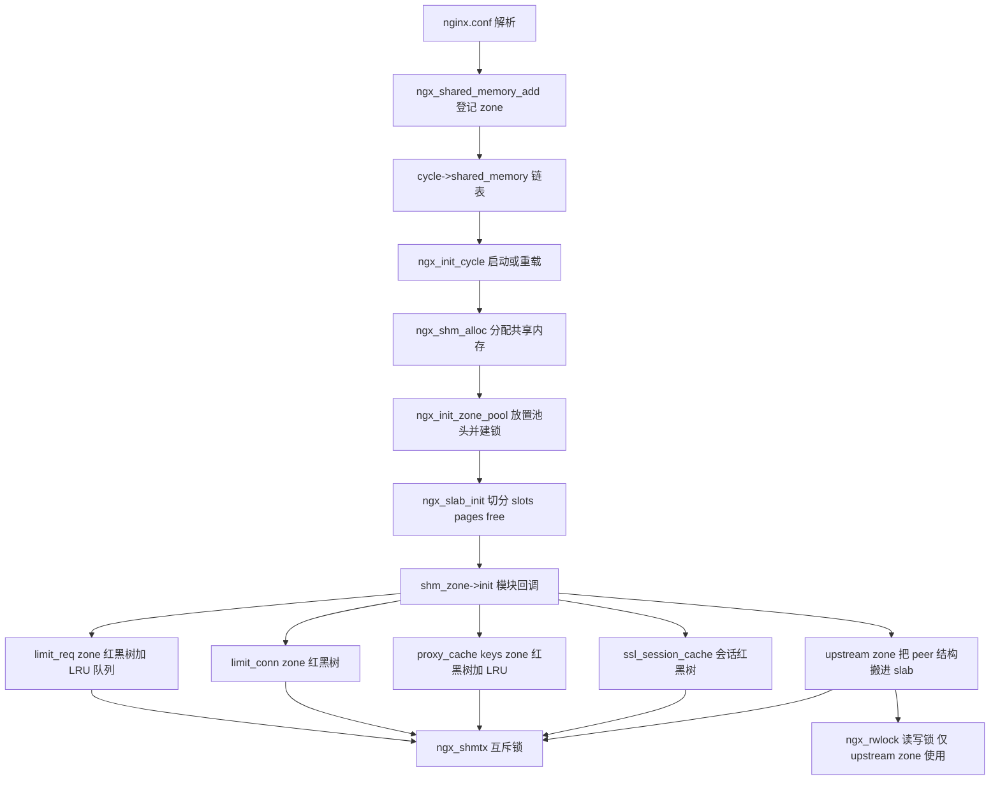
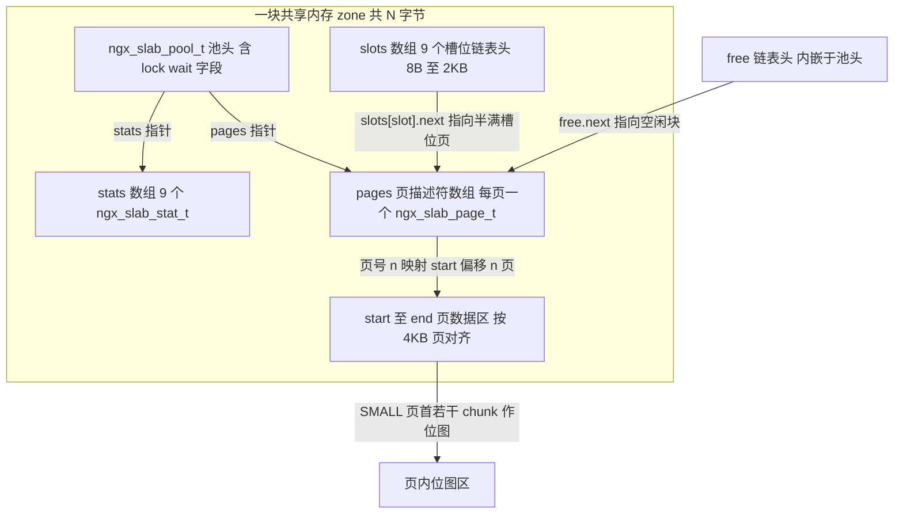
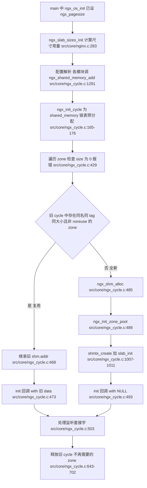
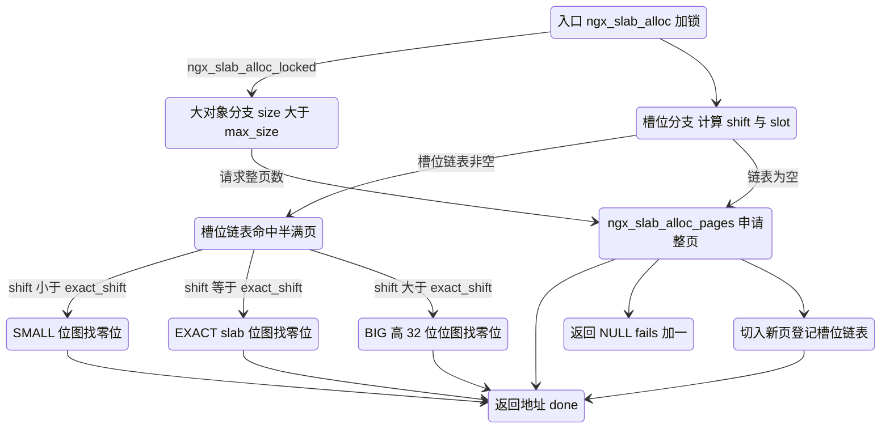
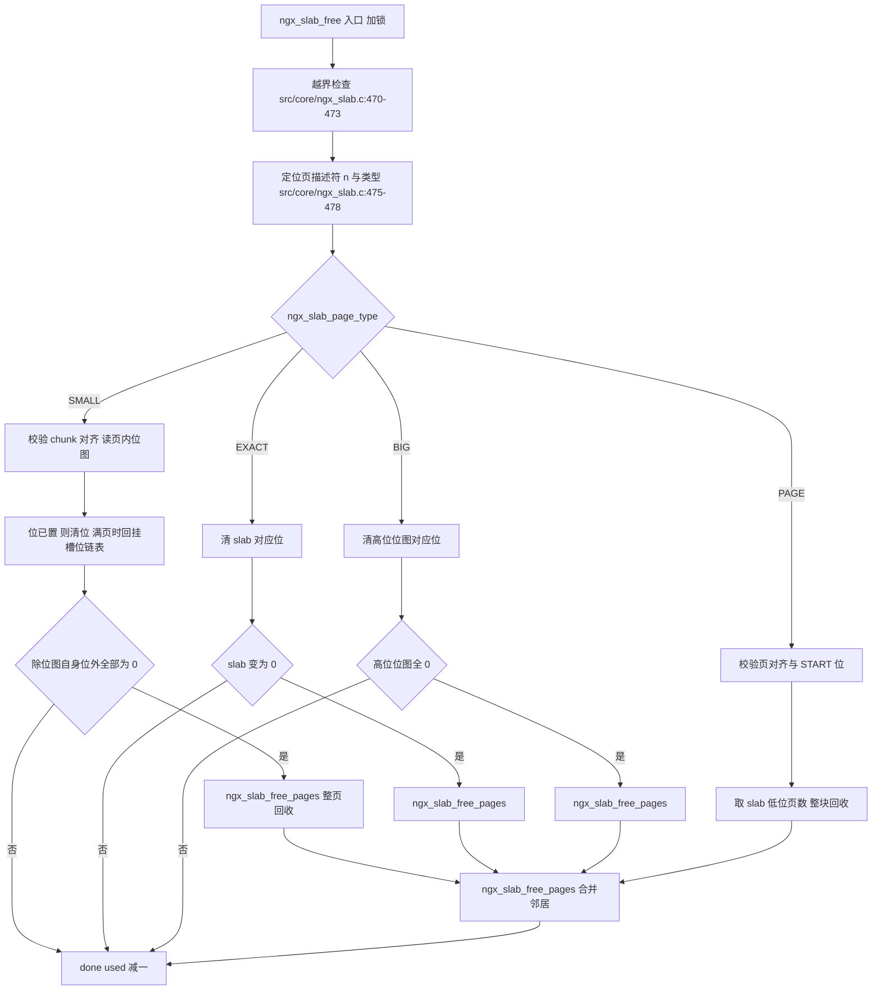
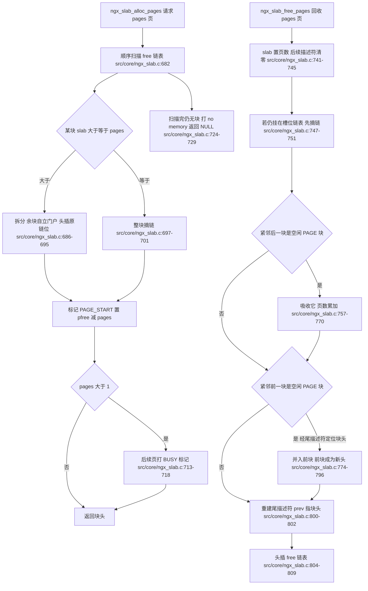
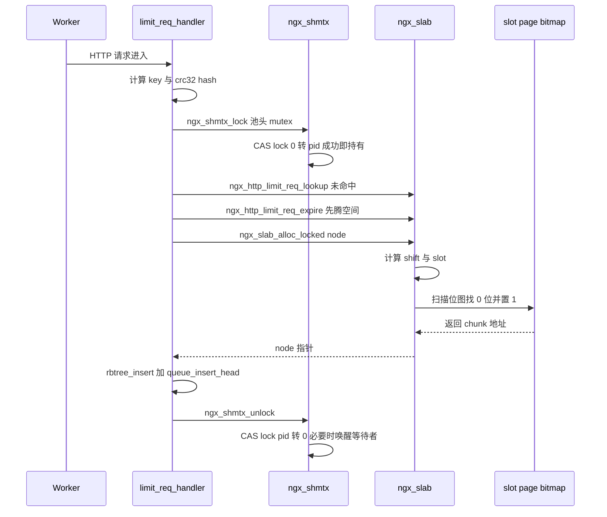
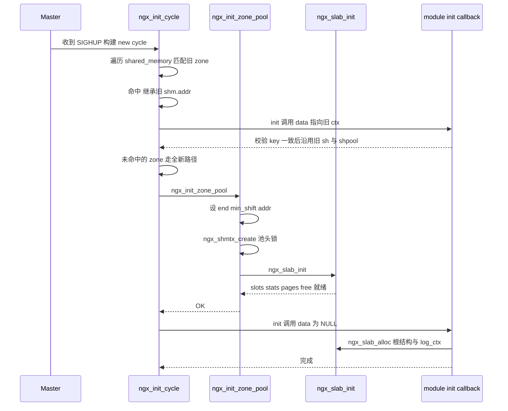

# slab 分配器与共享内存/锁体系（基于 nginx-1.27.0 源码）

> **导读**：读完本文你将掌握——nginx 如何在启动/重载流程中注册并分配一块共享内存；`ngx_slab_pool_t` 的池头、`pages[]` 描述符数组、`slots[]` 槽位链表与 `free` 空闲页块链表如何在同一段 `mmap` 内存中咬合；整页、连续多页、SMALL/EXACT/BIG 三类槽位小对象的分配与释放全路径；`ngx_shmtx` 用一条 CAS 指令、一个自旋上限与一个 POSIX 信号量后备构建跨进程互斥锁的完整细节；`ngx_spinlock`/`ngx_rwlock` 的适用边界；以及 x86 `lock cmpxchg`/`lock xadd` 原语如何成为这一切的地基。文中所有行号均来自对 nginx-1.27.0 源码的实际读取。
>
> **前置阅读建议**：已了解 nginx 多进程模型（master + worker，`ngx_init_cycle` 重载流程）；已了解 `ngx_log`/`ngx_palloc` 基础；对 CAS（compare-and-set）与内存屏障有初步概念。建议先读本系列 01《进程模型与启动流程》与 02《事件驱动框架与连接管理》。
>
> **涉及源码清单**（本文全部行号引用的出处，均已逐行通读）：
>
> | 文件 | 角色 |
> | --- | --- |
> | `src/core/ngx_slab.c`（817 行） | slab 分配器全部实现 |
> | `src/core/ngx_slab.h`（72 行） | `ngx_slab_pool_t`/`ngx_slab_page_t` 定义 |
> | `src/core/ngx_shmtx.c`（310 行） | 共享内存互斥锁（CAS + 自旋 + 信号量/文件锁后备） |
> | `src/core/ngx_shmtx.h`（49 行） | 锁结构定义 |
> | `src/core/ngx_spinlock.c`（53 行） | 通用自旋锁 |
> | `src/core/ngx_rwlock.c`（117 行） | 跨进程读写锁 |
> | `src/os/unix/ngx_shmem.c`（126 行） | mmap / SYSV shm 两种共享内存封装 |
> | `src/os/unix/ngx_shmem.h`（29 行） | `ngx_shm_t` 定义 |
> | `src/core/ngx_cycle.c`（1470 行，节选） | zone 注册、`ngx_init_cycle`、`ngx_init_zone_pool` |
> | `src/core/ngx_cycle.h`（节选） | `ngx_shm_zone_t` 定义 |
> | `src/os/unix/ngx_atomic.h`（313 行） | 原子操作分发层 |
> | `src/os/unix/ngx_gcc_atomic_x86.h`（127 行） | x86 内联汇编原子原语 |
> | `src/os/unix/ngx_process.h`（节选） | `ngx_sched_yield` 定义 |
> | `src/os/unix/ngx_files.c`（节选） | 文件锁后备 `ngx_lock_fd` 等 |
> | `src/core/nginx.c`（节选） | `ngx_slab_sizes_init` 调用时机 |
> | `src/event/ngx_event.c`、`src/event/ngx_event_accept.c`（节选） | accept mutex 使用点 |
> | `src/os/unix/ngx_process.c`（节选） | worker 崩溃后的强制解锁 |
> | `src/http/modules/ngx_http_limit_req_module.c`、`ngx_http_limit_conn_module.c` | 典型用户一/二 |
> | `src/http/ngx_http_file_cache.c` | 典型用户三：cache keys zone |
> | `src/event/ngx_event_openssl.c`（节选） | 典型用户四：ssl_session_cache |
> | `src/http/modules/ngx_http_upstream_zone_module.c`、`src/http/ngx_http_upstream_round_robin.h` | 典型用户五：upstream zone |

---

## 1. 本模块在 nginx 中的位置与职责

nginx 是多进程模型，worker 之间不共享堆内存。诸如"每个客户端 IP 当前限速状态"、"每个 upstream peer 的连接数"、"每条缓存条目的 key 索引"这类必须全进程视角一致的状态，只能放进一块所有进程都映射得到的内存——共享内存。本模块的职责链条是：

1. **注册**：配置解析阶段，各模块通过 `ngx_shared_memory_add`（src/core/ngx_cycle.c:1291-1362）把一条 `zone` 声明登记进 `cycle->shared_memory` 链表（链表成员见 src/core/ngx_cycle.h:68）。
2. **分配**：`ngx_init_cycle` 里对每个 zone 调 `ngx_shm_alloc`（src/core/ngx_cycle.c:485）拿到一段匿名共享内存。
3. **建池**：`ngx_init_zone_pool`（src/core/ngx_cycle.c:951-1014）在内存开头放一个 `ngx_slab_pool_t` 池头，创建互斥锁，再调 `ngx_slab_init`（src/core/ngx_slab.c:98-165）切分出槽位数组、页描述符数组与页数据区。
4. **回调**：模块的 `shm_zone->init` 回调（src/core/ngx_cycle.c:473 或 493）在 slab 就绪后执行，从 slab 里分配自己的红黑树哨兵、LRU 队列头等根结构。
5. **运行期**：worker 在请求路径上以 `ngx_shmtx_lock` + `*_locked` 系列函数读写 slab。



图解：这张图自上而下是"配置期 → 初始化期 → 运行期"三个阶段。前四层（注册、链表、init cycle、物理分配）在 master 进程中一次完成；`init` 回调之后的一切读写都发生在各 worker 中，全部汇聚到两把锁上：绝大多数模块共享 slab 池头里那把 `ngx_shmtx` 互斥锁，只有 upstream zone 额外引入读写锁细分保护。第 3 节将把这四个初始化层展开成带行号的流程图。

---

## 2. 核心数据结构精讲

### 2.1 ngx_shm_zone_t 与 ngx_shm_t —— zone 的"身份证"

```c
/* src/os/unix/ngx_shmem.h:16-26 */
typedef struct {
    u_char      *addr;
    size_t       size;
    ngx_str_t    name;
    ngx_log_t   *log;
    ngx_uint_t   exists;   /* unsigned  exists:1;  */
} ngx_shm_t;
```

| 字段 | 类型 | 含义 |
| --- | --- | --- |
| `addr` | `u_char *` | 本进程映射到的共享内存起始地址；各进程地址一致（见 2.6 与 6.17） |
| `size` | `size_t` | zone 总字节数 |
| `name` | `ngx_str_t` | zone 名，即指令里的 `zone` 名，跨 cycle 复用时的匹配键 |
| `log` | `ngx_log_t *` | 日志对象，`ngx_init_cycle` 会替换为 cycle 日志（src/core/ngx_cycle.c:436） |
| `exists` | `ngx_uint_t` | "共享内存对象已存在"标志；Unix 实现从不置位（src/os/unix/ngx_shmem.c 中无赋值），主要为 WIN32 handle 继承设计 |

```c
/* src/core/ngx_cycle.h:25-36 */
typedef struct ngx_shm_zone_s  ngx_shm_zone_t;

typedef ngx_int_t (*ngx_shm_zone_init_pt) (ngx_shm_zone_t *zone, void *data);

struct ngx_shm_zone_s {
    void                     *data;
    ngx_shm_t                 shm;
    ngx_shm_zone_init_pt      init;
    void                     *tag;
    void                     *sync;
    ngx_uint_t                noreuse;  /* unsigned  noreuse:1; */
};
```

| 字段 | 含义 |
| --- | --- |
| `data` | 模块上下文。配置期放 `ctx`，`init` 回调后通常指向共享内存中的根结构（如 limit_req 的 `ctx->sh`） |
| `shm` | 上面那五个物理属性 |
| `init` | init 回调：签名 `(zone, data)`；`data` 为旧 cycle 同名 zone 的 `data`，复用时非 NULL |
| `tag` | 模块身份指针（通常取 `&ngx_xxx_module`），防止两个模块抢同一个 zone 名 |
| `sync` | 1.27.0 中为保留字段，本仓库内未见 slab 路径使用（待验证其完整用途） |
| `noreuse` | 置 1 则 reload 时强制重建，不复用旧内存 |

### 2.2 ngx_slab_pool_t —— 池头，一切的起点

```c
/* src/core/ngx_slab.h:34-59 */
typedef struct {
    ngx_shmtx_sh_t    lock;

    size_t            min_size;
    size_t            min_shift;

    ngx_slab_page_t  *pages;
    ngx_slab_page_t  *last;
    ngx_slab_page_t   free;

    ngx_slab_stat_t  *stats;
    ngx_uint_t        pfree;

    u_char           *start;
    u_char           *end;

    ngx_shmtx_t       mutex;

    u_char           *log_ctx;
    u_char            zero;

    unsigned          log_nomem:1;

    void             *data;
    void             *addr;
} ngx_slab_pool_t;
```

| 字段 | 含义与去向 |
| --- | --- |
| `lock` | `ngx_shmtx_sh_t`，驻留共享内存的锁原子字（见 2.5），与 `mutex` 是"锁的存储"与"锁的句柄"关系 |
| `min_size` | 最小块尺寸，`1 << min_shift`；`min_shift` 被写死为 3（src/core/ngx_cycle.c:988），即 8 字节 |
| `min_shift` | 同上，槽位计算的分界常量 |
| `pages` | 页描述符数组首地址，第 n 项描述从 `start` 起第 n 个物理页 |
| `last` | `pages` 数组的尾后指针，页描述符合法下标的上界（src/core/ngx_slab.c:159） |
| `free` | 空闲页块链表头（注意：是**内嵌的** `ngx_slab_page_t`，不是指针），只使用其 `next`/`prev` 作链表指针 |
| `stats` | 每槽统计数组 `ngx_slab_stat_t[n]`（src/core/ngx_slab.c:127-128） |
| `pfree` | 当前空闲物理页总数，O(1) 回答"还剩多少页" |
| `start` / `end` | 页数据区起止；所有用户指针必须落在 `[start, end]`，越界即报错（src/core/ngx_slab.c:470-473） |
| `mutex` | `ngx_shmtx_t` 句柄，其 `lock`/`wait` 指针指回本结构开头的 `lock` 字段（src/core/ngx_shmtx.c:21,31） |
| `log_ctx` | 追加在 slab 报错日志后的字符串，由各模块 init 回调写入，如 `" in limit_req zone \"foo\""`（src/http/modules/ngx_http_limit_req_module.c:750-756） |
| `zero` / `log_nomem` | `log_ctx` 未设置时指向 `zero`（空串，src/core/ngx_slab.c:163-164）；`log_nomem` 控制"内存耗尽"日志只打一次 |
| `data` | 模块根结构指针（红黑树 + 队列头的宿主），是 `shm.exists` 复用路径的"再入口" |
| `addr` | 池头自身所在地址，用于校验"本进程映射地址 == 创建者映射地址"（src/core/ngx_cycle.c:961-962） |

### 2.3 ngx_slab_page_t —— 一个结构体吃遍五种角色

```c
/* src/core/ngx_slab.h:16-22 */
struct ngx_slab_page_s {
    uintptr_t         slab;
    ngx_slab_page_t  *next;
    uintptr_t         prev;
};
```

只有三个机器字，却要表达页的所有状态。`slab` 与 `prev` 都被按位复用，先看类型宏（src/core/ngx_slab.c:11-15）：

| 宏 | 值 | 语义 |
| --- | --- | --- |
| `NGX_SLAB_PAGE` | 0 | 整页/连续多页块 |
| `NGX_SLAB_BIG` | 1 | 大槽位页（chunk > 64 字节） |
| `NGX_SLAB_EXACT` | 2 | 精确槽位页（chunk == 64 字节） |
| `NGX_SLAB_SMALL` | 3 | 小槽位页（chunk < 64 字节，位图在页内） |

类型存放在 `prev` 的低 2 位（掩码 `NGX_SLAB_PAGE_MASK` 为 3，src/core/ngx_slab.c:47），其余位指向前驱节点；提取宏 `ngx_slab_page_type` / `ngx_slab_page_prev` 见 src/core/ngx_slab.c:47-50。64 位平台下各角色的字段语义（宏定义见 src/core/ngx_slab.c:29-41）：

| 角色 | `slab` | `next` | `prev` 低 2 位 | `prev` 其余位 |
| --- | --- | --- | --- | --- |
| 空闲页块头（挂在 free 链表） | 块内页数 | 链表中下一个节点 | 0 | 链表前驱节点（free 头或前一空闲块） |
| 已分配连续多页块头 | 页数 \| `0x8000000000000000`（`NGX_SLAB_PAGE_START`） | NULL | 0 | 0 |
| 已分配连续多页块的第 2..n 页 | `NGX_SLAB_PAGE_BUSY`（全 1） | NULL | 0 | 0 |
| SMALL 槽位页 | 低 4 位 = shift，其余无用 | 槽位链表下一页，满页时 NULL | 3 | 槽位链表头 `&slots[slot]` |
| EXACT 槽位页 | 64 位位图，每 chunk 1 位 | 同上 | 2 | 同上 |
| BIG 槽位页 | 低 4 位 = shift；高 32 位（从 bit32 起，`NGX_SLAB_MAP_SHIFT`=32）位图 | 同上 | 1 | 同上 |
| 空闲块的尾描述符（合并用） | 0（`NGX_SLAB_PAGE_FREE`） | NULL | 0 | **指向块头**（不变量，见 6.7） |

三个 derived 宏（src/core/ngx_slab.c:44-54）把描述符换算回地址：`ngx_slab_slots(pool)` 得槽位数组首址（紧跟池头），`ngx_slab_page_addr(pool, page)` 得"第 n 个描述符 → 第 n 个物理页起始地址"，是所有位图定位的基础。

### 2.4 ngx_slab_stat_t —— 每槽计数器

```c
/* src/core/ngx_slab.h:25-31 */
typedef struct {
    ngx_uint_t        total;
    ngx_uint_t        used;

    ngx_uint_t        reqs;
    ngx_uint_t        fails;
} ngx_slab_stat_t;
```

| 字段 | 含义 | 维护点 |
| --- | --- | --- |
| `total` | 该槽累计可分配 chunk 数（新页切入时增加，整页回收时扣减） | src/core/ngx_slab.c:365,381,397 与 535,573,613 |
| `used` | 当前已占用 chunk 数 | src/core/ngx_slab.c:249,291,322,369 等与 653 |
| `reqs` | 分配请求次数 | src/core/ngx_slab.c:218 |
| `fails` | 分配失败次数 | src/core/ngx_slab.c:409 |

在 1.27.0 仓库内 `grep "->stats\["` 只命中 `ngx_slab.c` 自身——核心代码只写不读，属于给监控/调试预留的计数器。

### 2.5 ngx_shmtx_sh_t 与 ngx_shmtx_t —— 锁的"存储"与"句柄"

```c
/* src/core/ngx_shmtx.h:16-37 */
typedef struct {
    ngx_atomic_t   lock;
#if (NGX_HAVE_POSIX_SEM)
    ngx_atomic_t   wait;
#endif
} ngx_shmtx_sh_t;


typedef struct {
#if (NGX_HAVE_ATOMIC_OPS)
    ngx_atomic_t  *lock;
#if (NGX_HAVE_POSIX_SEM)
    ngx_atomic_t  *wait;
    ngx_uint_t     semaphore;
    sem_t          sem;
#endif
#else
    ngx_fd_t       fd;
    u_char        *name;
#endif
    ngx_uint_t     spin;
} ngx_shmtx_t;
```

| 结构 | 定位 | 关键点 |
| --- | --- | --- |
| `ngx_shmtx_sh_t` | 必须放在**共享内存**里 | `lock` 原子字存**持有者 pid**（0 = 空闲）；`wait` 是"正在睡眠的等待者数"，供唤醒方决定是否 `sem_post` |
| `ngx_shmtx_t` | 各进程私有 | `lock`/`wait` 是指回共享内存的指针；`sem` 是本进程打开的信号量对象；`spin` 是自旋上限 |

对 slab 池而言，`ngx_shmtx_t mutex` 本身就嵌在池头里（src/core/ngx_slab.h:50），也就是嵌在共享内存里，所以 `sem_init(&mtx->sem, 1, 0)` 的 `pshared=1` 能真正跨进程生效（src/core/ngx_shmtx.c:33）。而 accept mutex 的 `ngx_accept_mutex` 是各进程的私有全局变量（src/event/ngx_event.c:52），`spin` 被设为 `(ngx_uint_t)-1`（src/event/ngx_event.c:581），`ngx_shmtx_create` 见到该值直接返回、不初始化 sem（src/core/ngx_shmtx.c:23-25）——它永远只被 `trylock`，从不睡眠。

### 2.6 共享内存 zone 的整体内存布局

以 64 位 Linux（`NGX_HAVE_POSIX_SEM`、4 KiB 页、`min_shift=3`）为例：



图解：五个区块从低地址到高地址依次排布——池头、槽位链表头数组（`ngx_slab_slots(pool)` 即池头之后，src/core/ngx_slab.c:44-45）、每槽统计、页描述符数组、页数据区。`ngx_slab_init` 用一条式子 `pages = (end - 描述符区起始) / (ngx_pagesize + sizeof(ngx_slab_page_t))`（src/core/ngx_slab.c:134）同时定出描述符数与数据区大小：**每管理一个页要付出 24 字节（64 位）描述符代价**，这与文件系统 inode 区/数据区的划分如出一辙。`start` 被强制对齐到页边界（src/core/ngx_slab.c:150-151），对齐损耗通过回缩 `pages` 计数消化（153-157）。池头字段各结构大小为示意值（`sem_t` 在 glibc x86_64 上约 32 字节，随 libc 实现而异，待验证），字段**顺序**以 src/core/ngx_slab.h:34-59 为准。

---

## 3. 初始化流程



图解与要点：

1. **尺寸常量先行**。`ngx_slab_sizes_init` 必须在 `ngx_os_init` 设好 `ngx_pagesize` 之后调用，src/core/nginx.c:279-283 的注释专门强调了这一依赖；它算出三个全局量（详见 6.1）。
2. **注册发生在配置解析期**。`ngx_shared_memory_add` 由各模块的 zone 指令回调调用，例如 limit_req 在 src/http/modules/ngx_http_limit_req_module.c:941-957 中注册并绑定 `init = ngx_http_limit_req_init_zone`。
3. **init 回调在 `ngx_init_cycle` 的"创建共享内存"步骤执行**（src/core/ngx_cycle.c:413-500），具体在监听套接字处理（:503 起）之前、`cycle->log` 替换（:409-410）之后。复用路径（:464-480）先继承旧 `shm.addr` 再以**旧 data** 调 `init`；全新路径（:485-495）依次 `ngx_shm_alloc` → `ngx_init_zone_pool` → 以 **NULL** 调 `init`。
4. **回滚与善后**。任一环节失败跳 `failed`，src/core/ngx_cycle.c:856-917 会释放本 cycle 新分配的 zone；成功路径最后释放旧 cycle 里没被复用的 zone（:643-702）。
5. **Unix 上 `shm.exists` 恒为 0**（src/os/unix/ngx_shmem.c 无赋值），因此"复用"只发生在同一 master 存活期间的 reload（地址直接继承）；master 重启必然重建池，缓存与限速状态清零。

---

## 4. 核心执行流程与状态机

### 4.1 分配主路径状态机



图解：进入 `ngx_slab_alloc_locked` 后只有两个一级分支——大于 `ngx_slab_max_size`（页大小一半，src/core/ngx_slab.c:90）走整页，否则进槽位。槽位分支又按 shift 与 `ngx_slab_exact_shift` 的大小关系分成 SMALL/EXACT/BIG 三个子分支（判断点在 src/core/ngx_slab.c:228/271/296）；三条子路径要么在现有半满页上点亮一个位后 `goto done`，要么落到 `ngx_slab_alloc_pages(pool, 1)` 申请全新页再切分登记（src/core/ngx_slab.c:332-405）。任何一级拿不到页都汇入 `p = 0; fails++`（src/core/ngx_slab.c:407-409）。

### 4.2 释放路径



图解：释放的第一个动作永远是用指针反查页描述符（`n = (p - start) >> pagesize_shift`，src/core/ngx_slab.c:475-476），再靠 `prev` 低 2 位分流到四种类型。SMALL 与 BIG 的"整页回收"判定是"除位图自身占用的位之外一个已分配位都不剩"（src/core/ngx_slab.c:521-531）；EXACT 更简单，slab 归零即回收（:567-571）；PAGE 类型直接取 `slab & ~NGX_SLAB_PAGE_START` 的页数整块回收（:638-640）。所有回收最终汇入 `ngx_slab_free_pages` 做邻居合并。

### 4.3 页块拆分与合并



图解：`alloc_pages` 是**顺序 first-fit**——沿 free 链表取第一个 `slab >= pages` 的块（src/core/ngx_slab.c:684），并非严格 best-fit；更大的块会被就地劈开，余块（`page[pages]`）顶替原块挂回链表（:687-695）。`free_pages` 每次只向前后各探一块，但只要空闲就吸附，碎片会随时间逐步聚合。两条路径共同维护一条关键不变量：**空闲块的最后一个描述符的 `prev` 指向块头**（分配拆分时由 :687 建立，释放时由 :800-802 重建），这正是向后合并能 O(1) 找到块头的秘密，详见 6.7。

---

## 5. 关键时序图

### 5.1 一次 limit_req 新 key 的分配（worker 内）



图解：这是共享内存使用最典型的节奏——**锁的粒度是整个 slab 池**（`ctx->shpool->mutex`，src/http/modules/ngx_http_limit_req_module.c:246-251），红黑树查找、过期淘汰、slab 分配全部在临界区内完成；`lookup` 内部分配失败还会先 `expire` 再重试一次（src/http/modules/ngx_http_limit_req_module.c:492-505）。锁的持有时间虽短但覆盖了整个"查 + 删 + 分"事务，这正是跨进程场景下保证红黑树一致性的最简做法。

### 5.2 reload 时 zone 复用与 init 回调（master 内）



图解：reload 有两条互斥支路。复用支路（src/core/ngx_cycle.c:464-480）**不会**再调 `ngx_slab_init`——旧池头、旧数据原封不动，模块回调只做兼容性校验（如 limit_req 校验 key 表达式未变，src/http/modules/ngx_http_limit_req_module.c:708-726）。全新支路（:485-495）必须依次完成"物理内存 → 池头与锁 → slab 元数据 → 模块根结构"四级初始化，任何一级失败都进 `failed` 回滚。注意回调拿到的 `data` 参数就是"旧 cycle 同名 zone 的 `shm_zone->data`"，这是模块跨代传递状态的唯一通道。

---

## 6. 源码逐段精读

本节是全文主体。每一小节按"签名 → 逐块逻辑 → 关键行 → 易错点"展开。

### 6.1 尺寸类常量：ngx_slab_sizes_init

```c
/* src/core/ngx_slab.c:85-95 */
void
ngx_slab_sizes_init(void)
{
    ngx_uint_t  n;

    ngx_slab_max_size = ngx_pagesize / 2;
    ngx_slab_exact_size = ngx_pagesize / (8 * sizeof(uintptr_t));
    for (n = ngx_slab_exact_size; n >>= 1; ngx_slab_exact_shift++) {
        /* void */
    }
}
```

**逐块逻辑**：

- `ngx_slab_max_size = pagesize/2`：超过页一半的请求一律按整页处理（4 KiB 页下即 2048）。这是"槽位"与"整页"的分界——比半页还大的 chunk 放进槽位页会浪费另一半。
- `ngx_slab_exact_size = pagesize / (8 * sizeof(uintptr_t))`：让 `slab` 的每一个 bit 恰好管一个 chunk 的尺寸。64 位平台 = 4096/64 = 64 字节，`ngx_slab_exact_shift` = 6。循环体是空的小技巧：`n >>= 1` 既做条件又做移位，`n` 从 64 折半到 0 恰好移 6 次，`exact_shift` 累加到 6。
- 这三个静态量是**全局**的（src/core/ngx_slab.c:80-82），不属于任何 pool，因此进程内所有 zone 共享同一套尺码。

**易错点**：该函数必须在 `ngx_os_init` 之后调用（依赖 `ngx_pagesize`，src/core/nginx.c:279-283）；若在更早的时机使用 slab，`ngx_slab_max_size` 还是 0，所有请求都会掉进整页分支。

### 6.2 池头布局：ngx_slab_init

```c
/* src/core/ngx_slab.c:98-165 */
void
ngx_slab_init(ngx_slab_pool_t *pool)
{
    ...
    pool->min_size = (size_t) 1 << pool->min_shift;

    slots = ngx_slab_slots(pool);
    ...
    n = ngx_pagesize_shift - pool->min_shift;

    for (i = 0; i < n; i++) {
        /* only "next" is used in list head */
        slots[i].slab = 0;
        slots[i].next = &slots[i];
        slots[i].prev = 0;
    }
    ...
```

**逐块逻辑**：

1. **入参约定**：`min_shift` 已由调用方写好——`ngx_init_zone_pool` 固定传 3（src/core/ngx_cycle.c:988），故 `min_size = 8`，槽位从 8 字节起步。函数开头 107 行把这层换算落进 `min_size`。
2. **槽位链表头初始化**（src/core/ngx_slab.c:116-123）：槽数 `n = pagesize_shift - min_shift` = 12 - 3 = 9，覆盖 shift 3..11（8B、16B、…、2KB）。空链表的特征是 `next` 指向**自己**——后面 `ngx_slab_alloc_locked` 判断 `page->next != page`（:226）正是利用这个约定判空。注释"only next is used in list head"点明：链表头只当 `next` 用，`slab`/`prev` 置零仅为整洁。
3. **统计数组**（:127-128）：紧跟槽位数组之后，`ngx_memzero` 清零。
4. **页描述符数量**（:134）：`pages = 剩余字节 / (ngx_pagesize + sizeof(ngx_slab_page_t))`——管理一页的成本是"一页数据 + 一个 24 字节描述符"，一次除法定下两个区的大小。
5. **free 链表初值**（:142-148）：整池就是一个大空闲块——`free.next = page`，`page->slab = pages`，`page->prev = &pool->free`。注意 `free` 是池头内嵌结构而非指针。
6. **数据区对齐**（:150-157）：`start` 对齐到页边界；对齐吞掉的字节按 `m = pages - 可用页数` 回缩，`page->slab` 与 `pool->last`、`pool->pfree` 同步修正（:159-160）。
7. **日志上下文**（:162-164）：`log_ctx` 先指向池头内 1 字节的 `zero`（空串），各模块 init 时再换成名实相符的字符串。

**易错点**：`ngx_slab_init` 只能在"新分配"的内存上调用；reload 复用路径绝不重跑它，否则 free 链表会指向已分配页。另外它**不负责** `mutex`——锁由 `ngx_init_zone_pool` 先建好（src/core/ngx_cycle.c:1007），顺序不能反，因为 `ngx_slab_junk`（:114，仅 `NGX_DEBUG_MALLOC` 下 memset 0xA5，src/core/ngx_slab.c:57-64）若在锁初始化前执行会破坏句柄。

### 6.3 加锁封装：ngx_slab_alloc / ngx_slab_calloc / ngx_slab_free

```c
/* src/core/ngx_slab.c:168-180 */
void *
ngx_slab_alloc(ngx_slab_pool_t *pool, size_t size)
{
    void  *p;

    ngx_shmtx_lock(&pool->mutex);

    p = ngx_slab_alloc_locked(pool, size);

    ngx_shmtx_unlock(&pool->mutex);

    return p;
}
```

**逐块逻辑**：三个带锁入口（`alloc` :168-180、`calloc` :420-432、`free` :449-457）全部是"锁池头 mutex → 调 `*_locked` 版本 → 解锁"的薄壳。`ngx_slab_calloc_locked`（:435-446）额外 `ngx_memzero(p, size)`。这套设计的意图是：**模块经常需要在同一把锁下连续做多个 slab 操作**（比如"分配节点 + 插红黑树"），此时应自己 `ngx_shmtx_lock` 然后调 `*_locked` 系列，避免反复加锁解锁；只有单发操作才用带锁版。

**易错点**：在已持锁的临界区内调 `ngx_slab_alloc`（非 locked 版）会**自死锁**——`ngx_shmtx_lock` 不是递归锁。limit_req 的做法是全程持锁调 `*_locked`（src/http/modules/ngx_http_limit_req_module.c:246-251、494）。

### 6.4 分配主干：ngx_slab_alloc_locked

签名 `void *ngx_slab_alloc_locked(ngx_slab_pool_t *pool, size_t size)`（src/core/ngx_slab.c:183-417）。整体分四段：大对象分支、槽位计算、既有半满页命中、新页切分。

#### 6.4.1 大对象分支

```c
/* src/core/ngx_slab.c:191-206 */
    if (size > ngx_slab_max_size) {

        ngx_log_debug1(NGX_LOG_DEBUG_ALLOC, ngx_cycle->log, 0,
                       "slab alloc: %uz", size);

        page = ngx_slab_alloc_pages(pool, (size >> ngx_pagesize_shift)
                                          + ((size % ngx_pagesize) ? 1 : 0));
        if (page) {
            p = ngx_slab_page_addr(pool, page);

        } else {
            p = 0;
        }

        goto done;
    }
```

页数 = `size >> pagesize_shift` 再对余数进一。拿到页后 `ngx_slab_page_addr` 直接由描述符反算地址（src/core/ngx_slab.c:52-54）。注意：大对象分配**不计入**任何 slot 的 `stats`（`reqs++` 在槽位分支里，:218）。

#### 6.4.2 槽位计算

```c
/* src/core/ngx_slab.c:208-221 */
    if (size > pool->min_size) {
        shift = 1;
        for (s = size - 1; s >>= 1; shift++) { /* void */ }
        slot = shift - pool->min_shift;

    } else {
        shift = pool->min_shift;
        slot = 0;
    }

    pool->stats[slot].reqs++;
```

`s = size - 1` 的移位循环算出 `ceil(log2(size))`：size 是 2 的幂时得 `log2(size)`，否则向上取整。例：size=100 → s=99 → 最高位 64 → shift=7 → 128 字节槽 `slot = 7-3 = 4`；size=9 → shift=4 → 16B 槽。size ≤ 8 归 0 号槽。之后 `reqs++`，随后三条路径共用一个判空惯用法：

```c
/* src/core/ngx_slab.c:223-226 */
    slots = ngx_slab_slots(pool);
    page = slots[slot].next;

    if (page->next != page) {
```

`page` 先取链表头自身；若 `page->next == page` 说明空链表（6.2 的初始化约定），跳过命中逻辑直接申请新页。

#### 6.4.3 SMALL 分支（shift < exact_shift，位图在页内）

```c
/* src/core/ngx_slab.c:230-247 */
            bitmap = (uintptr_t *) ngx_slab_page_addr(pool, page);

            map = (ngx_pagesize >> shift) / (8 * sizeof(uintptr_t));

            for (n = 0; n < map; n++) {

                if (bitmap[n] != NGX_SLAB_BUSY) {

                    for (m = 1, i = 0; m; m <<= 1, i++) {
                        if (bitmap[n] & m) {
                            continue;
                        }

                        bitmap[n] |= m;
                        ...
                        p = (uintptr_t) bitmap + i;
```

**逐块逻辑**：SMALL 页把自己的**页首若干 chunk 当位图**用。`map` 是位图占用的 `uintptr_t` 字数（4KiB 页、shift=3 时 512 chunk / 64 位 = 8 个字）。扫描两层循环：外层跳过全满的字（`NGX_SLAB_BUSY`），内层找第一个 0 位并置 1，`i` 最后被重用为字节偏移（:245-247 `i = (n*64 + i) << shift`），`p = bitmap + 偏移`。

当整页被点亮后（:251-264），把页从槽位链表摘下并转成"独占"形态：`page->next = NULL; page->prev = NGX_SLAB_SMALL`。此后该页不占链表，释放第一个 chunk 时再挂回去（free 路径 :500-508 与此对称）。

**位图自己占几个 chunk？** 新页初始化时（:338-341）：

```c
/* src/core/ngx_slab.c:336-351 */
            bitmap = (uintptr_t *) ngx_slab_page_addr(pool, page);

            n = (ngx_pagesize >> shift) / ((1 << shift) * 8);

            if (n == 0) {
                n = 1;
            }

            /* "n" elements for bitmap, plus one requested */

            for (i = 0; i < (n + 1) / (8 * sizeof(uintptr_t)); i++) {
                bitmap[i] = NGX_SLAB_BUSY;
            }

            m = ((uintptr_t) 1 << ((n + 1) % (8 * sizeof(uintptr_t)))) - 1;
            bitmap[i] = m;
```

`n` = 位图字节数折算成 chunk 数（"每 8 个 chunk 需 1 字节位图"）。shift=3：512 chunk 需 64 字节 = 8 个 8 字节 chunk，`n=8`；shift=5：128 chunk 需 16 字节 < 32 字节，`n=0` 兜底为 1（一个 chunk 32 字节，浪费 16 字节）。位图区被写成 `NGX_SLAB_BUSY` 或部分掩码 `m`——**位图占用的位永远显示为已分配**，这样分配扫描与空闲判定都无需特判。首个用户 chunk 是位图后的第 0 个（:367 `p = page_addr + (n << shift)`），`total += (pagesize>>shift) - n`（:365）。

**易错点**：SMALL 页的 `slab` 只存 shift（低 4 位），**不存**占用位图——占用状态全部在页内位图里；释放时反查位图的公式必须与分配时的初始化公式逐字一致（:512 与 :338），否则会把位图区误判为已分配 chunk。

#### 6.4.4 EXACT 分支（shift == exact_shift）

```c
/* src/core/ngx_slab.c:273-289 */
            for (m = 1, i = 0; m; m <<= 1, i++) {
                if (page->slab & m) {
                    continue;
                }

                page->slab |= m;

                if (page->slab == NGX_SLAB_BUSY) {
                    prev = ngx_slab_page_prev(page);
                    prev->next = page->next;
                    page->next->prev = page->prev;

                    page->next = NULL;
                    page->prev = NGX_SLAB_EXACT;
                }

                p = ngx_slab_page_addr(pool, page) + (i << shift);
```

64 字节 chunk 恰好让 `slab` 全 64 位当位图（每 chunk 1 位），**零额外开销**——这是"exact"的含义。全满时同样摘链转独占。新页初始化只需 `page->slab = 1`（点亮第 0 位）并登记链表（:375-379）。

#### 6.4.5 BIG 分支（shift > exact_shift）

```c
/* src/core/ngx_slab.c:298-311 */
            mask = ((uintptr_t) 1 << (ngx_pagesize >> shift)) - 1;
            mask <<= NGX_SLAB_MAP_SHIFT;

            for (m = (uintptr_t) 1 << NGX_SLAB_MAP_SHIFT, i = 0;
                 m & mask;
                 m <<= 1, i++)
            {
                if (page->slab & m) {
                    continue;
                }

                page->slab |= m;
```

chunk 大于 64 字节时每页 chunk 数不足 64，位图放不满 `slab`，于是**用高 32 位**（`NGX_SLAB_MAP_SHIFT`=32）：`mask` 先按 chunk 数生成低 32 位掩码再左移 32 位圈定合法位区间。`slab` 低 4 位照旧存 shift。全满判定是 `(page->slab & NGX_SLAB_MAP_MASK) == mask`（:311）。以 shift=7（128B chunk，每页 32 个）为例：位图占 bit32..bit63，全满时高位字恰为 `0xFFFFFFFF00000000`。

#### 6.4.6 兜底与失败

命中逻辑的末尾有一个"理论上不可达"的陷阱（src/core/ngx_slab.c:328-329）：如果链表里有页却一个可用位都没找到，说明元数据被破坏，`ngx_slab_error` 打 ALERT 并 `ngx_debug_point()`（默认空操作，调试构建下可断言）。`ngx_slab_alloc_pages(pool, 1)` 失败则 `p = 0` 并 `fails++`（:407-409）。所有成功路径都汇聚到 `done:` 标签打一条 `slab alloc: %p` 调试日志（:411-416）。

### 6.5 释放主干：ngx_slab_free_locked

签名 `void ngx_slab_free_locked(ngx_slab_pool_t *pool, void *p)`（src/core/ngx_slab.c:460-674）。

**入口防御**（:470-478）：

```c
/* src/core/ngx_slab.c:470-478 */
    if ((u_char *) p < pool->start || (u_char *) p > pool->end) {
        ngx_slab_error(pool, NGX_LOG_ALERT, "ngx_slab_free(): outside of pool");
        goto fail;
    }

    n = ((u_char *) p - pool->start) >> ngx_pagesize_shift;
    page = &pool->pages[n];
    slab = page->slab;
    type = ngx_slab_page_type(page);
```

指针 → 页号 → 描述符 → 类型，四步完成反查。**注意 `p > pool->end` 用的是 `>` 而非 `>=`**：`end` 是尾后地址，合法。但该检查挡不住"池内但非 chunk 起点"的野指针，后续靠对齐校验兜底。

**SMALL 分支**（:482-540）核心三步：

1. 对齐校验：`p & (size-1)` 非零即 `wrong_chunk`（:487-489）——slab 不会记录"这个指针来自哪次分配"，只能靠 chunk 尺寸对齐反推，因此**释放必须传分配时返回的原始指针**。
2. 定位位（:491-495）：`n = 页内偏移 >> shift`，`m = 1 << (n % 64)`，`bitmap = p & ~(pagesize-1)`（页首）。若位本来就是 0 → `chunk_already_free`（重复释放）。
3. 清位与回挂（:497-510）：若页当前是独占态（`page->next == NULL`），先挂回槽位链表头部再清位——顺序无所谓，但两条都要做。清位后（:512-531）判断整页是否可回收：

```c
/* src/core/ngx_slab.c:512-533 */
            n = (ngx_pagesize >> shift) / ((1 << shift) * 8);

            if (n == 0) {
                n = 1;
            }

            i = n / (8 * sizeof(uintptr_t));
            m = ((uintptr_t) 1 << (n % (8 * sizeof(uintptr_t)))) - 1;

            if (bitmap[i] & ~m) {
                goto done;
            }

            map = (ngx_pagesize >> shift) / (8 * sizeof(uintptr_t));

            for (i = i + 1; i < map; i++) {
                if (bitmap[i]) {
                    goto done;
                }
            }

            ngx_slab_free_pages(pool, page, 1);
```

判定式逐字对应 6.4.3 的初始化式：`n` 个位图 chunk 自身的位（必为 1）要用 `~m` 掩掉，`bitmap[i] & ~m` 检查"位图所在字里除位图自身外是否还有用户 chunk"；`i` 之后的字逐个查非零。全零才 `ngx_slab_free_pages(pool, page, 1)`——此时页还挂在槽位链表上，`free_pages` 里 `if (page->next)` 会先把它摘下来（:747-751）。

**EXACT 分支**（:542-578）：位偏移直接由页内偏移右移 `ngx_slab_exact_shift` 得到（:544-545）；`slab == NGX_SLAB_BUSY` 时先回挂链表（:555-563），清位后 `if (page->slab)` 非零则仅 `used--`（:567-569），归零才整页回收（:571）。

**BIG 分支**（:580-618）：位偏移 = `((p & (pagesize-1)) >> shift) + NGX_SLAB_MAP_SHIFT`（:589-590）；回收条件是高位位图清空 `(page->slab & NGX_SLAB_MAP_MASK) == 0`（:607）。

**PAGE 分支**（:620-645）：

```c
/* src/core/ngx_slab.c:622-644 */
        if ((uintptr_t) p & (ngx_pagesize - 1)) {
            goto wrong_chunk;
        }

        if (!(slab & NGX_SLAB_PAGE_START)) {
            ngx_slab_error(pool, NGX_LOG_ALERT,
                           "ngx_slab_free(): page is already free");
            goto fail;
        }

        if (slab == NGX_SLAB_PAGE_BUSY) {
            ngx_slab_error(pool, NGX_LOG_ALERT,
                           "ngx_slab_free(): pointer to wrong page");
            goto fail;
        }

        size = slab & ~NGX_SLAB_PAGE_START;

        ngx_slab_free_pages(pool, page, size);
```

三重防御：页对齐、START 位（防重复释放空闲块）、BUSY（防把多页块的第 2..n 页当块头释放）。`size = slab & ~START` 取回页数后整块回收，`ngx_slab_junk` 覆盖整块（:642，仅调试构建生效）。**PAGE 分支直接 `return` 而不经过 `done:`**（:644）——大对象不占用 slot 的 `used` 计数，与 6.4.1 的"不计数"对称。

**错误标签区**（:651-673）：`done:` 统一 `used--` 并 junk；`wrong_chunk` / `chunk_already_free` / `fail` 三级递进，全部只打日志不崩溃——共享内存的元数据一旦错乱，最好的行为是**带着报警继续跑**而不是把所有 worker 拖死。

### 6.6 页块分配：ngx_slab_alloc_pages

```c
/* src/core/ngx_slab.c:682-711 */
    for (page = pool->free.next; page != &pool->free; page = page->next) {

        if (page->slab >= pages) {

            if (page->slab > pages) {
                page[page->slab - 1].prev = (uintptr_t) &page[pages];

                page[pages].slab = page->slab - pages;
                page[pages].next = page->next;
                page[pages].prev = page->prev;

                p = (ngx_slab_page_t *) page->prev;
                p->next = &page[pages];
                page->next->prev = (uintptr_t) &page[pages];

            } else {
                p = (ngx_slab_page_t *) page->prev;
                p->next = page->next;
                page->next->prev = page->prev;
            }

            page->slab = pages | NGX_SLAB_PAGE_START;
            page->next = NULL;
            page->prev = NGX_SLAB_PAGE;

            pool->pfree -= pages;

            if (--pages == 0) {
                return page;
            }
```

**逐块逻辑**：

1. **first-fit 扫描**：从 `free.next` 走到链表头哨兵（`&pool->free`）为止，取第一个 `slab >= pages` 的块。这不是 best-fit——没有"挑最贴近需求者"的比较，链表也未按大小有序。为何可接受？slab 页块申请尺寸高度集中（绝大多数是 1 页，见各模块固定结构），first-fit 的 O(n) 平均很短，而 best-fit 需要额外的有序结构或逐块比较。
2. **拆分**（`page->slab > pages`）：余块 `page[pages]` 继承原块的链表位置（next/prev 原样搬过去，:690-695），`slab` 记剩余页数。**第 687 行是全文最精妙的一行**：`page[page->slab - 1].prev = &page[pages]`——把老块**最后一个描述符**的 prev 改指余块头。老块既然是空闲块，其尾描述符按不变量"空闲块尾描述符 prev → 块头"存储；块被劈开后，`page[pages..old-1]` 成为新余块，其尾描述符正是 `page[old-1]`，于是不变量对新块继续成立。这是给 6.7 向后合并预付的定金。
3. **标记**（:703-707）：块头 `slab = pages | NGX_SLAB_PAGE_START`，`next=NULL`（不在任何链表），`prev = NGX_SLAB_PAGE`（类型 0），`pfree` 扣减。
4. **BUSY 标记**（:713-718）：多页块的第 2..n 页描述符全部写成 `slab = NGX_SLAB_PAGE_BUSY`、`next = NULL`、`prev = NGX_SLAB_PAGE`。BUSY（全 1）保证释放时能把"中间页"与"块头"区分开（6.5 PAGE 分支的第三重防御）。
5. **失败**（:724-729）：`log_nomem` 时打一次 CRIT `"ngx_slab_alloc() failed: no memory"`。各模块 init 完成后通常把 `log_nomem` 关掉（如 limit_req 置 0，src/http/modules/ngx_http_limit_req_module.c:758），改为在自己的分配点打更精确的 ALERT（:501-502），避免日志风暴。

**易错点**：返回的是**块头描述符指针**，不是地址；调用方必须用 `ngx_slab_page_addr` 换算。多页分配的后续页在释放时必须以块头 + 完整页数归还，逐页释放会让 BUSY 页走进"already free"报错路径。

### 6.7 页块释放与合并：ngx_slab_free_pages

```c
/* src/core/ngx_slab.c:739-751 */
    pool->pfree += pages;

    page->slab = pages--;

    if (pages) {
        ngx_memzero(&page[1], pages * sizeof(ngx_slab_page_t));
    }

    if (page->next) {
        prev = ngx_slab_page_prev(page);
        prev->next = page->next;
        page->next->prev = page->prev;
    }
```

1. `page->slab = pages` 记录块大小；`pages--` 后剩余 count-1 个**后续描述符清零**（slab=0 即 `NGX_SLAB_PAGE_FREE`，prev=0）——这是"空闲块尾描述符"的另一种来源：多页空闲块的头由 `slab` 标识，中间与尾部全零。
2. `if (page->next)` 摘链：被整页回收的槽位页还挂在 slot 链表上（6.5 SMALL 分支回收时未摘），这里统一摘除。`ngx_slab_page_prev` 剥掉低 2 位类型后得到链表头（`&slots[slot]`）。

**向前合并**（:753-772）：`join = page + page->slab` 是紧邻的下一个描述符。三个条件缺一不可——`join < pool->last`（不出界）、`type(join) == NGX_SLAB_PAGE`（是整页角色，排除三种槽位页）、`join->next != NULL`（挂在 free 链表上才是空闲块头；已分配 PAGE 块头的 next 恒为 NULL）。命中则页数累加、join 摘链、`join->slab = NGX_SLAB_PAGE_FREE` 等清场。

**向后合并**（:774-798）——不变量兑现时刻：

```c
/* src/core/ngx_slab.c:774-783 */
    if (page > pool->pages) {
        join = page - 1;

        if (ngx_slab_page_type(join) == NGX_SLAB_PAGE) {

            if (join->slab == NGX_SLAB_PAGE_FREE) {
                join = ngx_slab_page_prev(join);
            }

            if (join->next != NULL) {
```

`join = page - 1` 是前一块的**最后一个描述符**。三种情形：

- 前一块是**单页空闲块**：`slab=1 ≠ FREE`，join 本身就是块头，`next != NULL` 成立 → 合并。
- 前一块是**多页空闲块**：尾描述符已被清零（slab=FREE），走 `join = ngx_slab_page_prev(join)`，其 prev 正是块头（由 6.6 拆分时的 :687 或本函数末尾 :800-802 建立）→ 合并。
- 前一块是**已分配 PAGE 块**：尾描述符是 BUSY 页（slab 全 1，prev=0），`slab == FREE` 不成立，join 原地不动，其 `next == NULL` → 不合并。

合并动作（:783-796）与向前对称：前块页数累加、摘链、`page` 自己清场、`page = join` 换头。

**收尾**（:800-809）：

```c
/* src/core/ngx_slab.c:800-809 */
    if (pages) {
        page[pages].prev = (uintptr_t) page;
    }

    page->prev = (uintptr_t) &pool->free;
    page->next = pool->free.next;

    page->next->prev = (uintptr_t) page;

    pool->free.next = page;
```

`page[pages].prev = page`：合并后的块横跨 `page[0..count-1]`，`pages` 恰为 count-1，故 `page[pages]` 是**尾描述符**，prev 指回块头——不变量重建完毕。最后头插 free 链表（LIFO，热块优先被复用，利于 cache 局部性）。

**易错点**：`if (pages)` 为 0 时（单页块、无合并）**不**写尾描述符——此时"尾"就是头本身，prev 被用作链表指针，不能覆盖。这正是该不变量"只对多页空闲块有意义"的边界。

### 6.8 锁的创建：ngx_shmtx_create / ngx_shmtx_destroy

```c
/* src/core/ngx_shmtx.c:18-43 */
ngx_int_t
ngx_shmtx_create(ngx_shmtx_t *mtx, ngx_shmtx_sh_t *addr, u_char *name)
{
    mtx->lock = &addr->lock;

    if (mtx->spin == (ngx_uint_t) -1) {
        return NGX_OK;
    }

    mtx->spin = 2048;

#if (NGX_HAVE_POSIX_SEM)

    mtx->wait = &addr->wait;

    if (sem_init(&mtx->sem, 1, 0) == -1) {
        ngx_log_error(NGX_LOG_ALERT, ngx_cycle->log, ngx_errno,
                      "sem_init() failed");
    } else {
        mtx->semaphore = 1;
    }

#endif

    return NGX_OK;
}
```

**逐块逻辑**：

- `mtx->lock` 永远指向共享内存里的原子字——句柄与存储分离，各进程各自持有一份句柄。
- `spin == -1` 是"纯 CAS 锁"标记：accept mutex 走这条路（src/event/ngx_event.c:581），`create` 提前返回，sem 永不初始化，`unlock` 里的调试日志也被跳过（:139-141）。accept mutex 每个事件循环只 `trylock` 一次（src/event/ngx_event_accept.c:330），从不阻塞，自然不需要后备睡眠。
- `spin = 2048`：自旋上限，指数退避的终值。
- `sem_init(&mtx->sem, 1, 0)`：**pshared=1** 的进程间信号量。对 slab 池，`mtx` 就在共享内存池头里（src/core/ngx_slab.h:50），sem 对象本身也跨进程共享；sem 初始化失败只是降级（`semaphore = 0`，退回纯自旋 + yield），不报致命错。
- `ngx_shmtx_destroy`（:46-59）对应 `sem_destroy`。

**值得注意**：slab 池的 `mutex` 在每次 `ngx_init_zone_pool` 都会重新 `create`——对全新 zone，池头内存是清零后的，`spin` 初值 0，正常走完初始化；对 reload 复用的 zone，`ngx_init_zone_pool` 直接 return（src/core/ngx_cycle.c:959-962），不会重复 create。

### 6.9 抢锁：ngx_shmtx_trylock 与 ngx_shmtx_lock

```c
/* src/core/ngx_shmtx.c:62-66 */
ngx_uint_t
ngx_shmtx_trylock(ngx_shmtx_t *mtx)
{
    return (*mtx->lock == 0 && ngx_atomic_cmp_set(mtx->lock, 0, ngx_pid));
}
```

`trylock` 是单发 CAS：锁字为 0（空闲）则换成**当前进程 pid**。把 pid 写进锁字是一切恢复能力的基础——持有者身份随锁存储，任何进程都能凭 pid 强解（6.10）。

```c
/* src/core/ngx_shmtx.c:76-96 */
    for ( ;; ) {

        if (*mtx->lock == 0 && ngx_atomic_cmp_set(mtx->lock, 0, ngx_pid)) {
            return;
        }

        if (ngx_ncpu > 1) {

            for (n = 1; n < mtx->spin; n <<= 1) {

                for (i = 0; i < n; i++) {
                    ngx_cpu_pause();
                }

                if (*mtx->lock == 0
                    && ngx_atomic_cmp_set(mtx->lock, 0, ngx_pid))
                {
                    return;
                }
            }
        }
```

**逐块逻辑**：

1. **快路径**：先读后 CAS。先 `*mtx->lock == 0` 可以在锁忙时避免一次昂贵的 `lock cmpxchg`（写操作会触发缓存行独占），这是读-检-CAS 的经典优化。
2. **指数退避自旋**：`n` 从 1 倍增到 `spin`（2048），每轮先 `ngx_cpu_pause()` n 次（x86 上是 `pause` 指令，见 6.14）再重试 CAS。pause 指令在超线程上让出执行资源、并避免内存序违例惩罚。
3. **单核不空转**：`ngx_ncpu > 1` 才自旋；单核上自旋只会白白耗尽时间片，直接落到让步逻辑。

**sem 后备**（:98-127）：

```c
/* src/core/ngx_shmtx.c:100-106 */
        if (mtx->semaphore) {
            (void) ngx_atomic_fetch_add(mtx->wait, 1);

            if (*mtx->lock == 0 && ngx_atomic_cmp_set(mtx->lock, 0, ngx_pid)) {
                (void) ngx_atomic_fetch_add(mtx->wait, -1);
                return;
            }
```

自旋耗尽后：`wait++` 登记"我要睡了"→ **再试一次 CAS**（覆盖"刚登记完锁就空了"的窗口，避免睡过一次免费的机会）→ 真的没抢到才 `sem_wait`（:111-121，EINTR 重试）→ 醒来 `continue` 回到快路径。`wait` 计数与 sem 令牌严格配对：`ngx_shmtx_wakeup` 只有成功把 `wait` 减 1 才 `sem_post`（:176-190），因此**令牌数 ≤ 等待者数**，不会出现无人认领的唤醒堆积，也不会丢唤醒——唯一代价是偶尔多睡一次（唤醒令牌发出后另一等待者抢先 CAS 成功，醒来重试后再次入睡），但那一次会被"登记后再 CAS"窗口大幅压缩。

`semaphore == 0`（sem_init 失败或平台不支持）则 `ngx_sched_yield()` 让出 CPU（:131；定义为 `sched_yield()` 或 `usleep(1)`，src/os/unix/ngx_process.h:71-75）。

### 6.10 解锁与救锁：ngx_shmtx_unlock / wakeup / force_unlock

```c
/* src/core/ngx_shmtx.c:136-161 */
void
ngx_shmtx_unlock(ngx_shmtx_t *mtx)
{
    if (mtx->spin != (ngx_uint_t) -1) {
        ngx_log_debug0(NGX_LOG_DEBUG_CORE, ngx_cycle->log, 0, "shmtx unlock");
    }

    if (ngx_atomic_cmp_set(mtx->lock, ngx_pid, 0)) {
        ngx_shmtx_wakeup(mtx);
    }
}


ngx_uint_t
ngx_shmtx_force_unlock(ngx_shmtx_t *mtx, ngx_pid_t pid)
{
    ...
    if (ngx_atomic_cmp_set(mtx->lock, pid, 0)) {
        ngx_shmtx_wakeup(mtx);
        return 1;
    }

    return 0;
}
```

`unlock` 的 CAS 语义是"只有**自己**（pid 匹配）才能放锁"——误用它人持有的锁会静默失败而非破坏锁字。`force_unlock(mtx, pid)` 是 master 的救命稻草：worker 异常退出时，`ngx_unlock_mutexes`（src/os/unix/ngx_process.c:564-608）先用 pid 强解 accept mutex（:577-579），再遍历所有 zone 对 `sp->mutex` 逐个强解（:600-606），并打出 `"shared memory zone ... was locked by %P"` 的 ALERT。没有这一步，崩溃 worker 持有的 slab 锁会让全体 worker 永久阻塞在 `sem_wait`/自旋里。

`ngx_shmtx_wakeup`（:164-196）只在 `semaphore` 模式工作：CAS 把 `wait` 减 1 成功才 `sem_post`，失败说明等待者在 `wait++` 与 CAS 重试之间被解锁者"顺手"唤醒过了（或已自行抢到锁撤单），无需多发令牌。

### 6.11 文件锁后备：NGX_HAVE_ATOMIC_OPS 为 0 的世界

当平台没有任何原子操作时，`ngx_shmtx.c` 的 `#else` 分支（src/core/ngx_shmtx.c:199-308）退化为**fcntl 文件锁**：`create` 打开锁文件后立即删除（unlink，:215-224，防止残留文件堆积），`trylock/lock/unlock` 分别走 `ngx_trylock_fd`（`fcntl F_SETLK`，src/os/unix/ngx_files.c:762-776）、`ngx_lock_fd`（`F_SETLKW`，:779-793）、`ngx_unlock_fd`（`F_UNLCK`，:796-809）。此模式下锁字不再存 pid，`force_unlock` 恒返回 0（:304-308）——文件锁随进程退出由内核自动释放，无需救锁。`ngx_init_zone_pool` 只有在这条路径下才需要生成锁文件名（src/core/ngx_cycle.c:991-1005 的 `#else` 支路）。现代 x86/ARM 平台都编译不到这里，但它是理解"锁可移植性"的参照系。

### 6.12 通用自旋锁：ngx_spinlock

```c
/* src/core/ngx_spinlock.c:20-41 */
    for ( ;; ) {

        if (*lock == 0 && ngx_atomic_cmp_set(lock, 0, value)) {
            return;
        }

        if (ngx_ncpu > 1) {

            for (n = 1; n < spin; n <<= 1) {

                for (i = 0; i < n; i++) {
                    ngx_cpu_pause();
                }

                if (*lock == 0 && ngx_atomic_cmp_set(lock, 0, ngx_pid)) {
                    return;
                }
            }
        }

        ngx_sched_yield();
    }
```

骨架与 `ngx_shmtx_lock` 完全同构（快路径 + 指数 pause + yield），差异有二：锁值由调用方指定（`value`，通常是 1 或 pid），且**没有** sem 后备——它是进程内/短临界区场景的锁（如 timer 框架），永不睡眠，调用方自行保证临界区足够短。顺带一提，`ngx_atomic.h:309-310` 还定义了更轻的单字 `ngx_trylock`/`ngx_unlock` 宏（写 0/1，无 pid 语义），用于连接计数等进程内原子标志，与 shmtx 是两套东西。

### 6.13 跨进程读写锁：ngx_rwlock

```c
/* src/core/ngx_rwlock.c:15-16 */
#define NGX_RWLOCK_SPIN   2048
#define NGX_RWLOCK_WLOCK  ((ngx_atomic_uint_t) -1)
```

锁字的取值域：0 = 无锁；`0xFFFF...FF`（-1）= 写锁；1..-2 = 读锁计数。写锁（:19-48）与读锁（:51-86）都是"快路径 CAS + 指数 pause + yield"的自旋循环：

- `ngx_rwlock_wlock`：CAS `0 → WLOCK`。
- `ngx_rwlock_rlock`：读旧值 `readers`，只要不是写锁就 CAS `readers → readers+1`——**CAS 失败会刷新 readers 再试**，读计数在并发下单调推进，无 ABA 问题（计数只增不减到相同值再被观察的场景不存在：每个 unlock 的 -1 都发生在对应的 rlock 之后）。
- `ngx_rwlock_unlock`（:89-97）：写锁走 CAS `WLOCK → 0`，读锁走 `fetch_add(-1)`。
- `ngx_rwlock_downgrade`（:100-106）：写锁原地降级为 1 个读锁——持写锁期间状态未变，降级无竞态。

**适用场景**：唯一内置用户是 upstream zone（`NGX_HTTP_UPSTREAM_ZONE`，src/http/ngx_http_upstream_round_robin.h:84-115 的宏包装）：`peers->rwlock` 用读锁保护"遍历选 peer"（每请求发生、几乎纯读），写锁保护"增删 peer/更新整表"；`peer->lock` 用写锁保护单个 peer 的计数与状态更新。无原子操作平台直接 `#error`（:111-115）——upstream zone 功能强依赖 CAS。与 shmtx 相比，rwlock 没有睡眠后备，要求临界区极短；换来的是读路径无互斥开销。

### 6.14 原子地基：ngx_gcc_atomic_x86.h 与 ngx_atomic.h

```c
/* src/os/unix/ngx_gcc_atomic_x86.h:37-52 */
static ngx_inline ngx_atomic_uint_t
ngx_atomic_cmp_set(ngx_atomic_t *lock, ngx_atomic_uint_t old,
    ngx_atomic_uint_t set)
{
    u_char  res;

    __asm__ volatile (

         NGX_SMP_LOCK
    "    cmpxchgl  %3, %1;   "
    "    sete      %0;       "

    : "=a" (res) : "m" (*lock), "a" (old), "r" (set) : "cc", "memory");

    return res;
}
```

**逐层拆解**：

- `cmpxchgl %3, %1`：x86 的比较交换——若 `%eax`（装载 `old`）等于内存操作数则写入 `%3`（`set`）并置 ZF，否则把内存值弹回 `%eax`。`sete %0` 把 ZF 转成 0/1 返回值。头文件开头的注释（src/os/unix/ngx_gcc_atomic_x86.h:15-35）手写了这条指令的伪代码与选 `"a"` 约束的原因。
- `NGX_SMP_LOCK`（:8-12）：多核构建才加 `lock;` 前缀。`lock` 前缀在 x86 上是**全序内存屏障**——shmtx 的 CAS 因此自带 acquire/release 语义，临界区内的共享内存读写不会被重排出去。
- `"memory"` clobber：阻止 **GCC** 把临界区内的访存移到 asm 之外。x86 硬件上普通写操作保持程序序（:119-124 的注释），所以 `ngx_memory_barrier()` 只需空 asm 禁编译器重排即可。
- `ngx_atomic_fetch_add`（:79-90）：`lock xaddl`，返回**旧值**。shmtx 的 `wait++`、rwlock 的读计数 `+1/-1` 全靠它。
- `ngx_cpu_pause()`（:127）：`.byte 0xf3, 0x90`——直接写 `pause` 指令的机器码，注释说明是兼容不支持该助记符的老汇编器。

**分发层**（src/os/unix/ngx_atomic.h）按平台选实现：GCC 内建 `__sync_bool_compare_and_swap`/`__sync_fetch_and_add`（:59-63，同样在 x86 上落地为 lock cmpxchg/xadd）、libatomic（:16-39）、Darwin OSAtomic（:74-121）等；i386/AMD64 的 GNU 分支分别 include `ngx_gcc_atomic_x86.h`（:160）与 `ngx_gcc_atomic_amd64.h`（:201）。`ngx_cpu_pause` 在 builtin 分支也有对应定义（:67-71）。完全没有原子操作时退化为非原子实现（:277-299），此时 slab 锁走 6.11 的文件锁路径。

**一处呼应**：`ngx_shmtx_trylock`/`ngx_spinlock` 里反复出现的 `*lock == 0 &&` 短路，正是为了避免在锁忙时执行带 `lock` 前缀的写指令——无锁竞争路径上，共享内存锁字所在的缓存行可以保持共享态（S），一旦执行写指令就要升级为独占态（E/M），跨核往返的代价远高于一次普通读。

### 6.15 共享内存的两种物理实现：ngx_shmem.c

```c
/* src/os/unix/ngx_shmem.c:14-28 */
#if (NGX_HAVE_MAP_ANON)

ngx_int_t
ngx_shm_alloc(ngx_shm_t *shm)
{
    shm->addr = (u_char *) mmap(NULL, shm->size,
                                PROT_READ|PROT_WRITE,
                                MAP_ANON|MAP_SHARED, -1, 0);

    if (shm->addr == MAP_FAILED) {
        ngx_log_error(NGX_LOG_ALERT, shm->log, ngx_errno,
                      "mmap(MAP_ANON|MAP_SHARED, %uz) failed", shm->size);
        return NGX_ERROR;
    }

    return NGX_OK;
}
```

`ngx_shm_alloc` 按编译期探测的能力三选一（同一文件内三段互斥实现）：

| 分支 | 条件 | 机制 | 特点 |
| --- | --- | --- | --- |
| `NGX_HAVE_MAP_ANON` | :12 起 | `mmap(MAP_ANON|MAP_SHARED)` | 现代主流；匿名映射，随进程组消亡自动回收 |
| `NGX_HAVE_MAP_DEVZERO` | :40 起 | `open("/dev/zero")` + `mmap` | 老系统替代；语义同 ANON，多一次 open/close |
| `NGX_HAVE_SYSVSHM` | :81 起 | `shmget(IPC_PRIVATE)` + `shmat` + `shmctl(IPC_RMID)` | SYSV 传统接口 |

SYSV 分支（:87-114）的细节值得品味：`shmget(IPC_PRIVATE, ...)` 创建私有段；`shmat` 挂接后**立即** `shmctl(IPC_RMID)` 标记删除——段在所有挂接者 detach 前仍然存活，但不再有内核命名残留，master 退出即彻底消失，避免了 SysV IPC 泄漏的经典问题。三种实现的 `ngx_shm_free` 分别是 `munmap`（:31-38, :72-79）与 `shmdt`（:117-124）。

**关于 fork 与 MAP_ANON**：`fork` 出的 worker 天然继承父进程的匿名共享映射——这正是"master 分配、worker 使用"能成立的原因；而 `exists` 标志在 Unix 上从不置位（对比 WIN32 实现会置位并触发 `ngx_init_zone_pool` 里的 remap 逻辑，src/core/ngx_cycle.c:959-985）。

### 6.16 zone 注册：ngx_shared_memory_add

```c
/* src/core/ngx_cycle.c:1312-1342 */
        if (name->len != shm_zone[i].shm.name.len) {
            continue;
        }

        if (ngx_strncmp(name->data, shm_zone[i].shm.name.data, name->len)
            != 0)
        {
            continue;
        }

        if (tag != shm_zone[i].tag) {
            ngx_conf_log_error(NGX_LOG_EMERG, cf, 0,
                            "the shared memory zone \"%V\" is "
                            "already declared for a different use",
                            &shm_zone[i].shm.name);
            return NULL;
        }

        if (shm_zone[i].shm.size == 0) {
            shm_zone[i].shm.size = size;
        }

        if (size && size != shm_zone[i].shm.size) {
            ngx_conf_log_error(NGX_LOG_EMERG, cf, 0,
                            "the size %uz of shared memory zone \"%V\" "
                            "conflicts with already declared size %uz",
                            size, &shm_zone[i].shm.name, shm_zone[i].shm.size);
            return NULL;
        }

        return &shm_zone[i];
```

**逐块逻辑**：按 name 线性查 `cycle->shared_memory` 链表。命中后三道闸门：

1. **tag 冲突即错**：同名 zone 已被别的模块占用（如把 limit_req 的 zone 名用到 limit_conn 上），直接 EMERG。
2. **size 惰性绑定**：`size == 0` 的注册是"引用"而非"定义"——例如 `limit_req zone=name` 复用 `limit_req_zone` 已定义的 zone 时传 0（src/http/modules/ngx_http_limit_req_module.c:987），这里补上首次的 size；此后再有人以不同 size 引用即报冲突。
3. 命中返回**已有**表项——同一 zone 允许多条指令绑定（一个 limit_req zone 可被多个 server/location 引用），共享同一个 `shm_zone` 与 `data`。

未命中则 `ngx_list_push` 新表项并初始化全部字段（:1345-1361，`init=NULL`、`noreuse=0`），`init` 由各模块随后填（如 :956）。

### 6.17 zone 池初始化：ngx_init_zone_pool

```c
/* src/core/ngx_cycle.c:987-1013 */
    sp->end = zn->shm.addr + zn->shm.size;
    sp->min_shift = 3;
    sp->addr = zn->shm.addr;

#if (NGX_HAVE_ATOMIC_OPS)

    file = NULL;

#else

    file = ngx_pnalloc(cycle->pool,
                       cycle->lock_file.len + zn->shm.name.len + 1);
    ...
#endif

    if (ngx_shmtx_create(&sp->mutex, &sp->lock, file) != NGX_OK) {
        return NGX_ERROR;
    }

    ngx_slab_init(sp);
```

**逐块逻辑**：池头就是共享内存的前 `sizeof(ngx_slab_pool_t)` 字节（`sp = (ngx_slab_pool_t *) zn->shm.addr`，:957）。函数做四件事：

1. **复用校验**（:959-985）：`shm.exists` 时（Unix 上不会发生；WIN32 handle 继承场景发生），检查 `sp == sp->addr`——池头里存的创建地址与本进程映射地址一致才放行；不一致则 WIN32 上尝试 `ngx_shm_remap` 到原地址（:965-977），仍失败报 EMERG。这个校验的意义：slab 内部全是**绝对指针**（`pages`、`start`、链表指针），映射地址一变全部作废。
2. **三字段赋值**（:987-989）：`end`、`min_shift=3`（决定 8 字节起步与 9 个槽）、`addr`。
3. **建锁**（:1007）：原子可用时 `file=NULL` 占位；否则生成 `<lock_file><zone名>` 文件名。`ngx_shmtx_create` 把句柄指向池头内的 `lock`/`wait` 字段。
4. **切池**（:1011）：`ngx_slab_init` 完成 6.2 的全部布局。

**顺序敏感点**：`min_shift` 必须在 `ngx_slab_init` 之前写入（init 首行就用它算 `min_size`，src/core/ngx_slab.c:107）；`mutex` 的 create 必须在 `ngx_slab_init` 之前（junk 填充会覆盖池头，见 6.2 易错点）。

---

## 7. 设计思想与权衡

**为什么自研 slab 而不用 malloc + 锁？** 进程间共享的不是堆而是映射段，glibc 的堆分配器无法跨进程工作；更本质的是，共享内存分配器的失败模式与用户态完全不同——元数据错乱会同时毒化所有进程，所以 slab 把防御性设计（类型标签、对齐校验、pid 锁字、force_unlock）做进了第一层，而把"坏掉就报警别崩"作为行为准则（6.5 的错误标签区）。

**一个结构体五种角色 vs 五个结构体**：`ngx_slab_page_t` 的三字段复用把每页元数据开销压到 24 字节（64 位）。代价是可读性——`prev` 低 2 位藏类型、`slab` 高低位拆字段、`next==NULL` 兼作"独占"标志，这些约定散落在宏（src/core/ngx_slab.c:11-54）与注释里。对比方案是给页结构加显式 `type` 字段，多 8 字节/页换来直白；nginx 选择了密度——对一个 10MB 的 zone，页描述符区就省下约 3MB。

**first-fit 而非 best-fit**：如 6.6 所析，页块申请尺寸高度集中（1 页占绝对多数），first-fit 免排序、免遍历比较，配合 LIFO 头插（:809）让刚释放的页立即被复用，局部性最好。真正的碎片治理交给释放时的双向合并（6.7），而非分配时的精挑细选。

**锁的层级**：nginx 没有给 slab 做每页/每槽细粒度锁，而是**每个 zone 一把 shmtx**。理由是共享内存临界区都极短（几百纳秒级操作），且模块行为是"锁一次、做完一组一致性操作"，粗粒度锁反而让模块免于手写多锁排序。upstream 是例外：它的"数据"（peer 表）远大于 slab 元数据操作，读多写少，才引入 rwlock 细分。代价则是 slab 成为热点 zone 的吞吐瓶颈——limit_req 大量 key 时，锁竞争表现为 CPU 在 pause 循环上空转，这也是实践中"拆多个小 zone"调优法的代码依据（见第 8 节）。

**自旋 + 信号量的混合策略**：纯自旋在长临界区上浪费 CPU，纯信号量在短临界区上多两次系统调用。nginx 的折中是"自旋 2048 次 pause 再睡"（src/core/ngx_shmtx.c:27,84），并让 `wait` 计数器充当唤醒记账本（6.9）。对比 futex 方案（Linux 原生：锁字即 futex 字，`FUTEX_WAIT` 直接在锁字上睡）：nginx 的 sem 后备需要额外的 `wait` 字段与配对逻辑，换来的是 POSIX 语义的跨平台一致性——它不依赖任何 OS 特有的 fast-path 系统调用。futex 的优势（少一次 `wait++` 原子操作、唤醒更精准）在这个 1.27.0 实现中未采用（`wait` 字段名为 wait，机制是 POSIX sem；待验证：更早期版本曾有无 sem 的纯 yield 实现）。

**pid 进锁字**：把持有者 pid 写进锁字（:65,78）是共享内存锁独有的设计——进程内锁无需身份，而共享内存锁必须回答"持有者死了怎么办"。答案就是 `force_unlock`（6.10）与 `ngx_unlock_mutexes`（src/os/unix/ngx_process.c:564-608）这套崩溃恢复协议；对比 pthread 互斥锁需要额外的 `robust list` 机制达成同样目标。

**reload 复用而非重建**：zone 以 name+tag+size+noreuse 四元组跨 cycle 匹配（src/core/ngx_cycle.c:464-466），复用时跳过全部初始化、直接以旧 data 调回调。这让缓存元数据（proxy_cache keys）、限速状态在 reload 后存活——但**不是免费的**：模块必须在 init 回调里自己校验新旧配置兼容性（limit_req 校验 key 表达式，:708-726；file cache 校验 path 与 levels，src/http/ngx_http_file_cache.c:98-111）。

---

## 8. 配置项与调优映射

| 指令 | 注册点 | slab 使用方式 | 调优要点 |
| --- | --- | --- | --- |
| `limit_req_zone size=...` | src/http/modules/ngx_http_limit_req_module.c:941-957 | 每个限速 key 一个红黑树节点 + LRU 队列成员，`ngx_slab_alloc_locked` 分配（:494-499），过期时 `free_locked`（:693） | 节点大小 = `offsetof(rbtree_node_t,color) + offsetof(lr_node,data) + key.len`（:488-490）；key 越短单 zone 容纳的 key 越多。zone 满时先 expire 强逐再重试（:492-505），表现为旧 key 被挤掉 |
| `limit_req`（引用 zone） | 同文件 :987（size=0 惰性绑定） | 共享已有 zone | 多条 limit_req 可共用一个 zone；key 表达式不可中途更换（init 校验，:708-726） |
| `limit_conn_zone` / `limit_conn` | src/http/modules/ngx_http_limit_conn_module.c:640-656 | 红黑树节点存连接计数，请求进入 `alloc_locked`（:234）、连接清理时 `free_locked`（:413） | node 尺寸同样随 key 长度增长；zone 太小会主动踢掉最旧节点 |
| `proxy_cache_path keys_zone=name:size` | src/http/ngx_http_file_cache.c:2691-2704 | 缓存条目元数据节点 `ngx_slab_calloc_locked`（:930,941）、LRU 淘汰 `free_locked`（:1709,2015）、`sh->size/count/watermark` 全在 slab 里 | keys_zone 只存 key 索引（不存文件内容）；zone 耗尽触发强制 LRU 清理（:1789-1851）。`max_size` 与 keys_zone 需按条目数 × ~100 字节估算 |
| `ssl_session_cache shared:SSL:10m` | src/http/modules/ngx_http_ssl_module.c:1091（mail :657、stream :1205 同理） | 会话红黑树 + 过期队列；session 存取全程 `ngx_shmtx_lock`（src/event/ngx_event_openssl.c:4036-4100） | 会话对象与 sess_id 两次 `alloc_locked`（:4047,4064），失败先 expire 再重试 |
| `upstream zone name:size` | src/http/modules/ngx_http_upstream_zone_module.c:105-111 | init 回调把 `peers/peer/sockaddr/name` 深拷贝进 slab（:193-241），运行期用 rwlock 保护 | 启用后 peers 可跨 worker 共享连接数与熔断状态；拷贝失败（zone 太小）返回 NGX_ERROR 启动失败 |
| `worker_processes` | 间接影响 `ngx_ncpu` | `ngx_ncpu > 1` 决定自旋是否发生（src/core/ngx_shmtx.c:82） | 单核容器里自旋自动退化为 yield |
| （无指令）`ngx_slab_stat_t` | src/core/ngx_slab.h:25-31 | 每槽 total/used/reqs/fails | 1.27.0 核心内无读取方（见 2.4）；第三方状态模块可借 `pool->stats` 做监控 |

**调优经验落到代码**：

1. **zone 大小估算**：先数 key 数量 × 节点开销（limit_req 节点 ≈ `sizeof(rbtree_node_t)`(40B) + `lr_node 头`(约 24B) + key 长度，再叠加 slab chunk 对齐到 2 的幂），留 30% 余量给位图与页碎片。`ngx_slab_alloc` 的 chunk 总是 2 的幂（6.4.2），100 字节的 key 会落到 128 槽——**key 长度跨过 2 的幂边界时浪费跳升**。
2. **锁竞争**：slab 每池一把锁，热点 zone 的瓶颈特征是 worker CPU 高但吞吐不涨（pause 自旋）。对策：按业务维度拆多个 zone（每个 zone 独立锁字与独立缓存行）。
3. **reload 与 noreuse**：改 size 即不复用（src/core/ngx_cycle.c:464-466 四元组匹配），缓存 key 索引与限速状态清零，注意冷启动风暴。
4. **内存耗尽的行为**：`log_nomem` 的 CRIT 只打一次（src/core/ngx_slab.c:724-727），模块 init 后普遍关闭它（如 :758），之后每次分配失败只打模块自己的 ALERT——监控应对 `"could not allocate node"` 类告警建阈值。

---

## 9. 自测题

**Q1：`ngx_slab_page_t` 只有三个字段，如何同时表达"空闲页块、槽位页、位图、链表节点、独占页"五种角色？**
答：三个字段全部按位/按值复用。类型存 `prev` 低 2 位（`ngx_slab_page_type`，src/core/ngx_slab.c:47）；`slab` 在 PAGE 角色存页数（分配后或上 `NGX_SLAB_PAGE_START`），在 EXACT 角色整体作位图，在 BIG 角色低 4 位存 shift、高 32 位作位图，在 SMALL 角色仅存 shift；`next` 非空表示在链表上，NULL 表示独占（满槽位页/已分配页块）。`prev` 其余位存链表前驱，空闲块场景下尾描述符的 prev 指向块头。

**Q2：`size=100`、4KiB 页、`min_shift=3` 的分配落在哪个槽？**
答：`shift` 循环（src/core/ngx_slab.c:208-211）对 `s=99` 折半计数得 `ceil(log2(100))=7`，`slot = 7-3 = 4`，即 128 字节槽。由于 100 不是 2 的幂，实际 chunk 尺寸 128，内嵌浪费 28 字节。

**Q3：SMALL 页为什么把位图放在页首 chunk 里？`shift=5` 时位图占几个 chunk？**
答：页内 chunk（≤32 字节）放不下独立的元数据区，让位图与数据同页可省一次额外索引。占 1 个 chunk：`n = (4096>>5) / (32*8) = 128/256 = 0`，兜底 `n=1`（src/core/ngx_slab.c:338-342），32 字节 chunk 里位图只用 16 字节，另 16 字节闲置；这也是初始化时要写部分掩码 `m`（:350-351）的原因。

**Q4：`ngx_slab_free_pages` 向后合并时如何 O(1) 找到前一空闲块的块头？**
答：依赖不变量"空闲块的最后一个描述符 prev 指向块头"。`join = page - 1` 恰是前块尾描述符：若它 slab==0（FREE，多页空闲块被清零的尾），则 `join = ngx_slab_page_prev(join)` 取回块头（src/core/ngx_slab.c:779-781）；若 slab==1（单页空闲块）它本身就是头。该不变量由拆分时的 `page[page->slab-1].prev = &page[pages]`（:687）与释放收尾的 `page[pages].prev = page`（:801）共同维护。

**Q5：shmtx 的锁字为什么存 pid 而不是 1？**
答：为了崩溃恢复。锁字即持有者身份，`unlock` 只有 pid 匹配才放锁（src/core/ngx_shmtx.c:143，防误放他人锁）；worker 异常退出后 master 遍历所有 zone 调 `ngx_shmtx_force_unlock(&sp->mutex, 死者pid)`（src/os/unix/ngx_process.c:600-606）精准解救，避免全体 worker 永久阻塞。

**Q6：sem 后备中 `wait` 计数与信号量令牌如何配对？为什么不丢唤醒？**
答：等待者先 `fetch_add(wait,1)` 再补一次 CAS（src/core/ngx_shmtx.c:101-106，覆盖"登记后锁恰好空出"的窗口，抢到则 `wait--` 撤单不睡）；唤醒方只有把 `wait` CAS 减 1 成功才 `sem_post`（:182-190）。因此令牌数恒 ≤ 等待者数，每个令牌都有一名在睡的等待者认领，`sem_post` 不会空转堆积，等待者也不会错过唯一一次解锁。

**Q7：accept mutex 的 `spin=-1` 意味着什么？为什么它可以不初始化信号量？**
答：见 src/event/ngx_event.c:581 与 src/core/ngx_shmtx.c:23-25——create 提前返回，sem 不建，unlock 的日志分支也跳过。因为 accept mutex 的使用模式只有 `ngx_shmtx_trylock`（src/event/ngx_event_accept.c:330），抢不到就跳过本轮 accept 事件，从不阻塞等待，自然不需要睡眠后备；锁句柄在各进程私有空间里，即使初始化 sem 也无法跨进程共享。

**Q8：`ngx_slab_alloc_pages` 是 best-fit 吗？如果不是，它是什么策略，为什么够用？**
答：不是。它是沿 free 链表的 first-fit（src/core/ngx_slab.c:682-684），取第一个 `slab >= pages` 的块并就地拆分。页块申请尺寸高度集中于 1 页，链表平均很短；LIFO 头插（:809）让刚释放的块最先被复用，局部性好。碎片问题由释放时的双向合并（:753-798）治理而非分配时挑选。

**Q9：reload 时 zone 何时复用、何时重建？init 回调的 `data` 参数是什么？**
答：`ngx_init_cycle` 对每个 zone 在旧 cycle 中按 name+tag+size+noreuse 匹配（src/core/ngx_cycle.c:464-466）：命中则继承旧 `shm.addr`（:468）、**不**调 `ngx_init_zone_pool`/`ngx_slab_init`，直接 `init(zone, 旧zone的data)`（:473）；否则 `ngx_shm_alloc` + `ngx_init_zone_pool` + `init(zone, NULL)`（:485-493）。`data` 是模块跨代传递状态的唯一通道（如 limit_req 的 `octx->sh/shpool`，src/http/modules/ngx_http_limit_req_module.c:722-723）。

**Q10：slab 的锁粒度多大？为什么 upstream zone 额外用 rwlock，而 limit_req 不用？**
答：slab 本身每池一把 `pool->mutex`（shmtx），保护 free 链表、槽位链表、位图与 stats 的所有操作；模块通常在持锁期间连红黑树/队列一起操作（limit_req 每请求一锁一事务，src/http/modules/ngx_http_limit_req_module.c:246-251）。upstream 的 peer 表是独立于 slab 元数据的大块共享数据，读多写少（每请求遍历选 peer 是纯读），rwlock 让读路径只做读计数原子加而无互斥（src/http/ngx_http_upstream_round_robin.h:86-115）；limit_req 的事务（查+删+分）本质是写事务，读写锁无收益，一把粗粒度 shmtx 反而更简单。另注意 upstream 的 slab 分配本身仍走 shmtx——rwlock 只保护业务数据，不保护分配器。

---

> **行号核对说明**：本文所有 `文件:行号` 引用均出自上表所列文件在 nginx-1.27.0 源码树中的实际内容；`sem_t` 具体尺寸、`ngx_shm_zone_t.sync` 的完整用途、早期版本 shmtx 演进史三处标注"待验证"，读者可按文中路径自行复核。
