# 基础数据结构（string/array/list/queue）（基于 nginx-1.27.0 源码）

> **导读**：读完本文你将掌握——
> 1. `ngx_str_t` 为什么用 `len + data` 而不以 `'\0'` 结尾，以及这一决定如何塑造了整个 nginx 的 API 姿势（含悬垂引用、拼接、比较的正确写法与常见坑）；
> 2. `ngx_snprintf/ngx_vslprintf` 的截断语义、手写整数转换、nginx 自定义格式符（`%V` `%M` `%T` `%uD` `%i` `%p` 等）的逐分支实现；
> 3. URI 转义/反转义的位图表 + 双遍扫描设计、base64 编解码的 77 哨兵表、`ngx_atoi/ngx_atofp/ngx_atosz/ngx_atoof/ngx_atotm` 的溢出防护；
> 4. `ngx_array_t` 的池上分配、**原地追加**与**2 倍扩容**两条路径、`nelts/nalloc` 的确切语义；
> 5. `ngx_list_t` 的 part 分段链设计，以及为什么 HTTP 头部容器"只追加、删除靠 `hash = 0` 标记"；
> 6. `ngx_queue_t` 侵入式双向循环链表、`offsetof` 容器手法、`ngx_queue_sort` 的自顶向下归并排序与 `ngx_queue_middle` 的快慢指针；
> 7. 以上结构在请求处理、事件驱动、配置解析、文件缓存中的真实落点（均给出 文件:行号）。
>
> **前置阅读建议**：先了解 `ngx_pool_t` 内存池的基本行为（`ngx_palloc.c` 的 `ngx_palloc_small` 指针 bump 分配），本文不展开内存池实现细节，但数组/列表的全部存储都建立在其上。
>
> **涉及源码清单**（均相对 nginx-1.27.0 根目录）：
> - `src/core/ngx_string.h`（238 行）、`src/core/ngx_string.c`（2104 行）
> - `src/core/ngx_array.h`（53 行）、`src/core/ngx_array.c`（141 行）
> - `src/core/ngx_list.h`（83 行）、`src/core/ngx_list.c`（63 行）
> - `src/core/ngx_queue.h`（115 行）、`src/core/ngx_queue.c`（106 行）
> - 关联引用：`src/core/ngx_palloc.c`、`src/core/ngx_hash.h`、`src/http/ngx_http_request.{h,c}`、`src/http/ngx_http.c`、`src/http/ngx_http_file_cache.c`、`src/http/modules/ngx_http_limit_req_module.c`、`src/event/ngx_event_posted.{h,c}`、`src/core/ngx_conf_file.{h,c}`、`src/core/ngx_cycle.c`

---

## 1. 本模块在 nginx 中的位置与职责

这四个文件构成 nginx 自建的"C 标准库替代层"中的**容器与字符串基础件**。nginx 不信任 libc 的部分能力（locale、以 `\0` 结尾的字符串、`qsort` 的不稳定排序、`printf` 的不可控格式符），于是在 `src/core/` 里自建了一整套：`ngx_string.*` 覆盖字符串与数值/转义编解码，`ngx_array.*`、`ngx_list.*` 覆盖顺序容器，`ngx_queue.*` 覆盖链式容器。它们的共同特征是：

- **零 malloc、依附内存池**：数组与列表的所有存储来自 `ngx_palloc`，生命周期跟随所在 pool，销毁时不逐个 free；
- **不追求泛型**：用 `void *elts + size` 表达"元素尺寸任意的连续数组"，用宏 + `offsetof` 表达"任意结构体挂链"；
- **面向网络字节流**：处处显式传长度，比较函数只做 7-bit ASCII 的大小写折叠（`src/core/ngx_string.c:629-633` 的注释明说）。

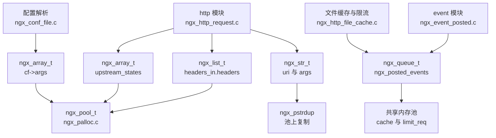

**图 1 解读**：上层功能模块只依赖这四组基础件，而四组基础件统一落在内存池上。HTTP 头部走 `ngx_list_t`，上游多次尝试的统计走 `ngx_array_t`（`ngx_http_request.h:396` 的 `upstream_states`），事件系统与缓存 LRU 走 `ngx_queue_t`（`src/event/ngx_event_posted.c:13-15`、`src/http/ngx_http_cache.h:150`）。URI/args 等一切协议字段是 `ngx_str_t` 视图，需要延寿时才 `ngx_pstrdup` 拷贝。也就是说：**理解这四件套，是读 nginx 任何业务模块的先决条件**。

---

## 2. 核心数据结构精讲

### 2.1 ngx_str_t：len + data 的字符串视图

字段定义在 `src/core/ngx_string.h:16-19`：

```c
typedef struct {
    size_t      len;
    u_char     *data;
} ngx_str_t;
```

| 字段 | 类型 | 语义 | 关键约束 |
|------|------|------|----------|
| `len` | `size_t` | 字节长度，**不含任何结尾符** | 可为 0；`data` 可为 NULL |
| `data` | `u_char *` | 指向字节序列 | **不保证 `data[len] == '\0'`**，但很多场景会顺手补一个 |

配套四个初始化宏（`src/core/ngx_string.h:40-44`）：`ngx_string(str)` 以字面量初始化（len 取 `sizeof(str)-1`）；`ngx_null_string` 给 `{0, NULL}`；`ngx_str_set(str, text)` / `ngx_str_null(str)` 用于给已存在的变量赋值。注意 `ngx_str_set` 是**多条语句宏**（无 `do { } while(0)` 包裹），必须整体加大括号使用，详见 6.1 节。

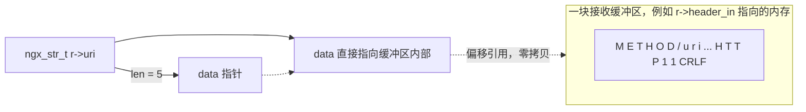

**图 2 解读**：`ngx_str_t` 通常**不拥有内存**，只是"缓冲区里一段字节的窗口"。解析器把 `data` 指到 `r->header_in` 内部即完成赋值（零拷贝），代价是 `ngx_str_t` 的有效性完全绑定在底层缓冲区的生命周期上——这正是悬垂引用类 bug 的根源（6.1 节展开）。

另一个值得记住的结构是 `ngx_variable_value_t`（`src/core/ngx_string.h:28-37`）：它把 `len` 压缩成 28 位 bit-field，腾出 4 个标志位 `valid/no_cacheable/not_found/escape`，专供变量系统（`r->variables`）在"值 + 元信息"一体化传递时节省 8 字节。

### 2.2 ngx_table_elt_t：HTTP 头部元素（list 的元素类型）

定义在 `src/core/ngx_hash.h:94-100`：

| 字段 | 类型 | 语义 |
|------|------|------|
| `hash` | `ngx_uint_t` | key 的小写哈希；**0 表示"此头部已被删除"**，输出过滤器据此跳过（`src/http/ngx_http_header_filter_module.c:430`） |
| `key` | `ngx_str_t` | 头部名（如 `Host`） |
| `value` | `ngx_str_t` | 头部值 |
| `lowcase_key` | `u_char *` | 池上分配的全小写 key，供哈希查找 |
| `next` | `ngx_table_elt_t *` | 同名多值头部的快速链（如多个 `Set-Cookie`） |

### 2.3 ngx_array_t：池上连续数组

定义在 `src/core/ngx_array.h:16-22`：

| 字段 | 类型 | 语义 | 易混点 |
|------|------|------|--------|
| `elts` | `void *` | 元素存储首地址（一块池内存） | 扩容换块后整体前移 |
| `nelts` | `ngx_uint_t` | **当前已用元素数** | push 返回槽位后由调用方逻辑填充，但计数在这里已 +1 |
| `size` | `size_t` | 单个元素字节数，创建后不变 | 由调用方传 `sizeof(T)` |
| `nalloc` | `ngx_uint_t` | **当前容量**（可容纳元素数） | 命名易误读成"已分配字节数" |
| `pool` | `ngx_pool_t *` | 依赖的池 | destroy/扩容都以它为准 |

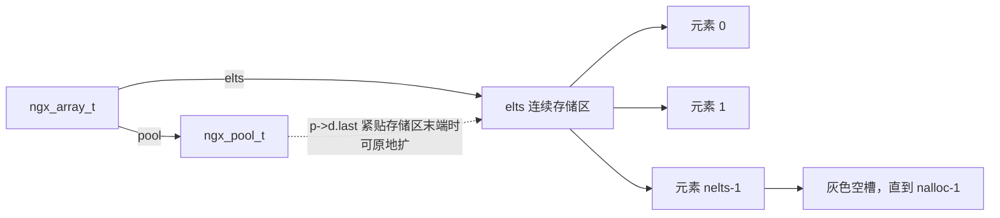

**图 3 解读**：`nelts` 是写指针，`nalloc` 是容量上限；数组存储区是池里的一块普通分配，唯一特权是——如果它恰好是池当前的分配末端（`elts + size*nalloc == p->d.last`），扩容可以**不搬数据、只前移池指针**（见 4.1 节流程图）。

### 2.4 ngx_list_t：分段（part）链表

定义在 `src/core/ngx_list.h:18-31`：

| 结构 | 字段 | 语义 |
|------|------|------|
| `ngx_list_part_t` | `elts` / `nelts` / `next` | 一段连续存储 + 已用数 + 下一 part |
| `ngx_list_t` | `last` | 指向**最后一个 part**（尾插 O(1) 的关键） |
| | `part` | **内嵌的第一个 part**（省一次池分配，非指针） |
| | `size` | 单元素字节数 |
| | `nalloc` | **每个 part 的容量**（不是整个 list 的） |
| | `pool` | 所属池 |

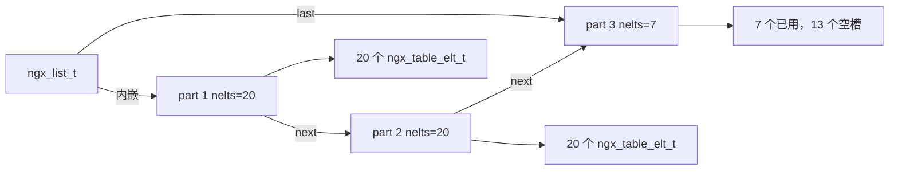

**图 4 解读**：与数组不同，list 扩容**永不搬移旧数据**——满了就再开一个 part 挂到链尾。这意味着：① 已有的元素地址永远稳定（HTTP 头部的 `ngx_table_elt_t *` 会被缓存进 `headers_in.host` 等快速指针，`src/http/ngx_http_request.h:186-235`，地址漂移会直接悬垂）；② 遍历必须按头文件注释给定的双层循环模式走（`src/core/ngx_list.h:55-77` 原文注释即示例代码）。

### 2.5 ngx_queue_t：侵入式双向循环链表

定义在 `src/core/ngx_queue.h:18-21`，只有两个指针：

```c
struct ngx_queue_s {
    ngx_queue_t  *prev;
    ngx_queue_t  *next;
};
```

| API（宏） | 位置 | 语义 |
|-----------|------|------|
| `ngx_queue_init(q)` | `ngx_queue.h:24-26` | `prev = next = q`，空队列自指 |
| `ngx_queue_empty(h)` | `ngx_queue.h:29-30` | `h == h->prev` |
| `ngx_queue_insert_head/insert_after` | `ngx_queue.h:33-40` | 头插（`insert_after` 是同一宏的别名） |
| `ngx_queue_insert_tail/insert_before` | `ngx_queue.h:43-50` | 尾插（`insert_before` 是别名：双向链表尾插 == 在哨兵前插） |
| `ngx_queue_head/last/sentinel` | `ngx_queue.h:53-62` | 首元/尾元/哨兵即头本身 |
| `ngx_queue_remove(x)` | `ngx_queue.h:75-87` | 摘链；DEBUG 版额外置 NULL 防二次摘链 |
| `ngx_queue_split(h, q, n)` | `ngx_queue.h:90-96` | 从 `q` 起把 `[q, 尾]` 切成新队列 `n` |
| `ngx_queue_add(h, n)` | `ngx_queue.h:99-103` | 把队列 `n` 拼接到 `h` 尾部 |
| `ngx_queue_data(q, type, link)` | `ngx_queue.h:106-107` | `offsetof` 反推宿主结构体指针 |

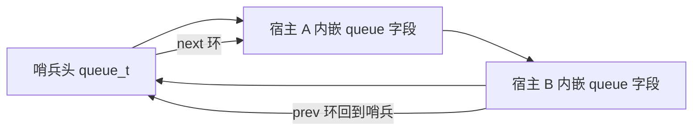

**图 5 解读**：节点是**侵入式**的——宿主结构体（`ngx_event_t`、`ngx_http_file_cache_node_t`、`ngx_http_limit_req_node_t`…）内嵌一个 `ngx_queue_t queue;` 字段，链表本身不分配任何节点内存；`ngx_queue_data` 用 `(u_char *)q - offsetof(type, link)` 把链针换回宿主指针。空队列的标志是哨兵自指，因此**哨兵必须先 `ngx_queue_init`**，漏初始化会让 `next/prev` 指向 NULL 而立刻段错误。

---

## 3. 初始化流程

三个容器的初始化都很薄：结构体本体可池上分配（`*_create`）也可栈/宿主内嵌（`*_init`）。以 HTTP 请求生命周期为背景：

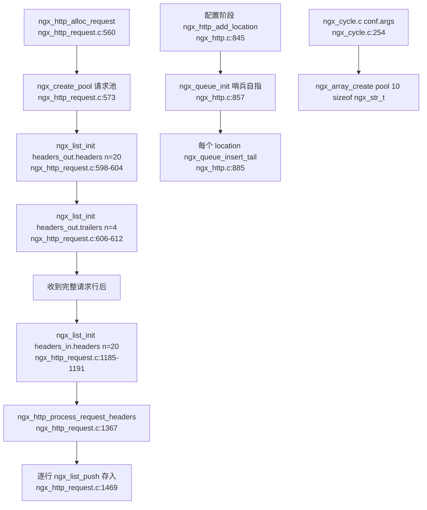

**图 6 解读**（逐节点）：
- 请求池在 `ngx_http_alloc_request` 中以 `cscf->request_pool_size`（默认 4096，`src/http/ngx_http_core_module.c:3487-3488`）创建（`src/http/ngx_http_request.c:573`），随后 `ngx_list_init(&r->headers_out.headers, r->pool, 20, sizeof(ngx_table_elt_t))`（`src/http/ngx_http_request.c:598-604`）——注意这里是**内嵌于 `headers_out` 的 list 直接 init**，不再多分配一个 list 结构体；
- `headers_in.headers` 的初始化被推迟到确认是 HTTP/1.x 之后（`src/http/ngx_http_request.c:1185-1191`），因为 0.9 简单请求没有头部；
- 配置阶段的 `location` 组织完全是队列玩法：`ngx_http_add_location` 先给哨兵 `ngx_queue_init`（`src/http/ngx_http.c:857`），再为每个 location 分配 `ngx_http_location_queue_t`（`src/http/ngx_http_core_module.h:455-463`）并 `ngx_queue_insert_tail`（`src/http/ngx_http.c:885`），全部挂在 `cf->temp_pool` 上；
- 配置指令参数数组在 `ngx_init_cycle` 里一次性建好：`conf.args = ngx_array_create(pool, 10, sizeof(ngx_str_t))`（`src/core/ngx_cycle.c:254`），字段声明见 `src/core/ngx_conf_file.h:118`。

---

## 4. 核心执行流程/状态机

### 4.1 ngx_array_push 的扩容决策（两条路径）

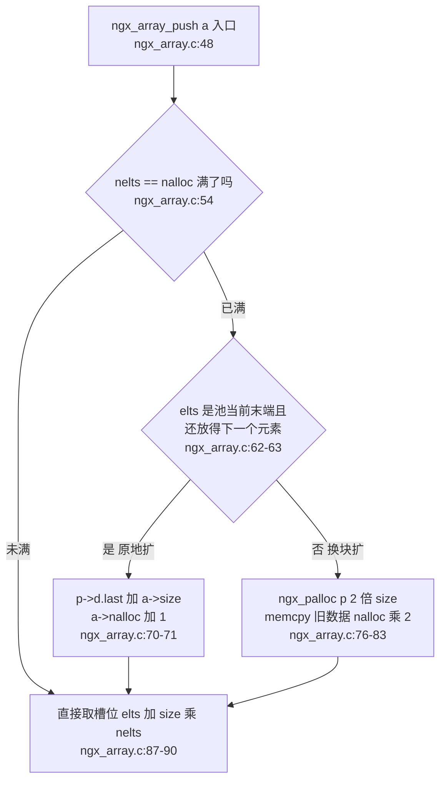

**图 7 解读**：
- **未满路径**：返回 `elts + size*nelts` 的裸地址并 `nelts++`（`src/core/ngx_array.c:87-90`）。调用方拿到的是**未构造的槽位**，必须立刻写满整个元素；`push` 可能触发扩容导致 `elts` 变化，因此**绝不能缓存上一次 push 的地址继续用**（例如 `ngx_http_upstream.c:673` 每次 `u->state = ngx_array_push(r->upstream_states)` 都重新取）。
- **原地扩路径**：条件 `(u_char *) a->elts + size == p->d.last && p->d.last + a->size <= p->d.end`（`src/core/ngx_array.c:62-63`）。它利用内存池"bump 指针"特性：若数组存储区是池的**最新一次分配**，向后多占一格即可，O(1) 且零拷贝。
- **换块扩路径**：`ngx_palloc(p, 2 * size)` 申请 2 倍容量（`src/core/ngx_array.c:76`），旧数据 `memcpy` 过去，`nalloc *= 2`（`src/core/ngx_array.c:81-83`）。旧的那块池内存**不回收**（池的分配不单独 free），这是用空间换代码简单性的典型取舍。
- `ngx_array_push_n`（`src/core/ngx_array.c:94-141`）是 n 元素版：新容量取 `2 * max(n, nalloc)`（`src/core/ngx_array.c:124`），其余逻辑同构。

### 4.2 ngx_list_push：part 满则续链

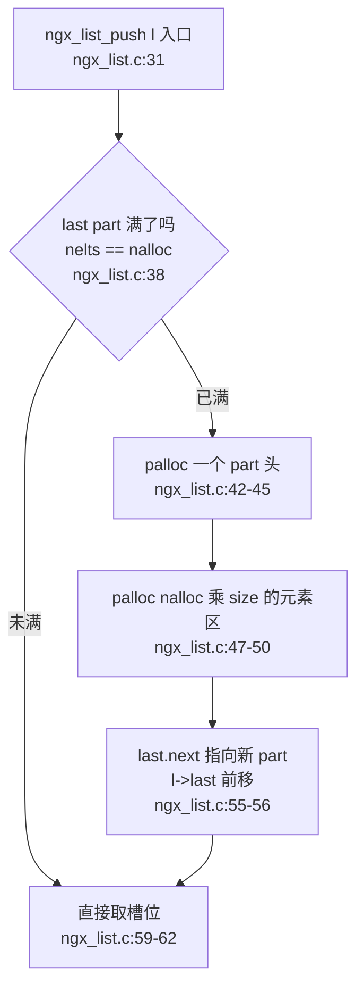

**图 8 解读**：`ngx_list_push` 永远只在**尾 part** 上取槽（`l->last` 保证 O(1)），满了就分配"part 头 + 元素区"两块池内存并续链（`src/core/ngx_list.c:42-56`）。对比 `ngx_array_push`：list 没有"原地扩"优化，也**从不搬移旧 part**——旧元素地址稳定是它的核心承诺。`nelts` 计数在 part 各自持有，遍历时要逐 part 判断（2.4 节图 4）。

### 4.3 ngx_unescape_uri 的三态状态机

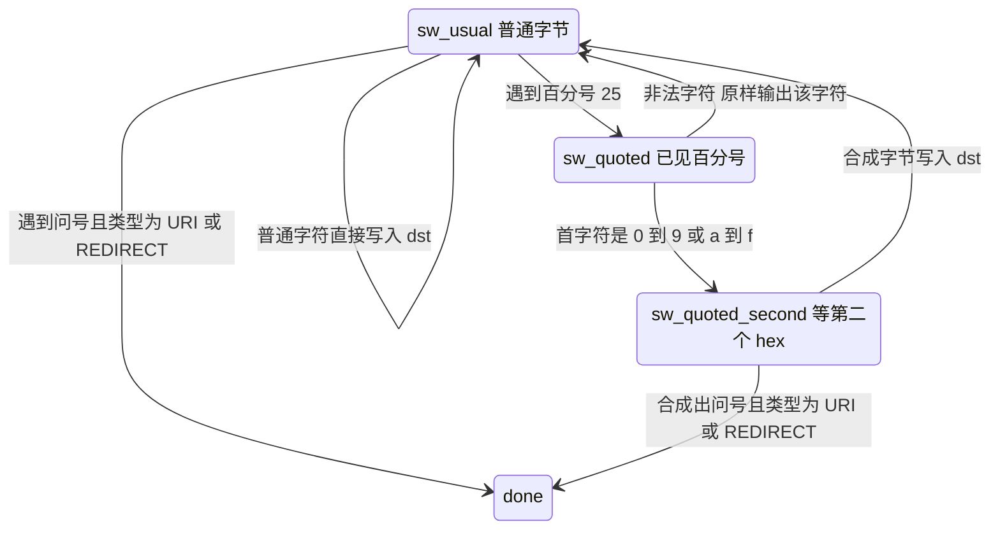

**图 9 解读**（对应 `src/core/ngx_string.c:1676-1803`）：
- 状态枚举在 `src/core/ngx_string.c:1680-1684`；`sw_usual` 下只有 `%` 触发状态切换（`1705-1708`），`?` 则按 type 直接 `goto done` 截断（`1698-1703`）——反转义到 query string 边界为止；
- `sw_quoted` 收第一个 hex 字符存进 `decoded`（`1715-1726`）；非 hex 视为"非法 quoted 字符"，**把该字符原样输出**并回 `sw_usual`（`1728-1733`）；
- `sw_quoted_second` 合成 `(decoded << 4) + 低位`（`1740-1741`）。`NGX_UNESCAPE_REDIRECT` 模式最讲究：合成结果若落在 `> '%' && < 0x7f` 之外，**重新转义输出** `%` 加原来两个字符（`1743-1751`），保证 redirect 目标的 URI 始终是合法形态；
- 出口统一把双向指针前移写回（`1799-1802`），所以函数用 `u_char **dst, u_char **src`——它是要被外部循环逐段调用的"流式"反转义。

---

## 5. 关键时序图：一个请求头从解析到存入 list

以 `Host: example.com` 这一行为例，覆盖"解析 → 入 list → 快速索引 → 标记删除"全链路：

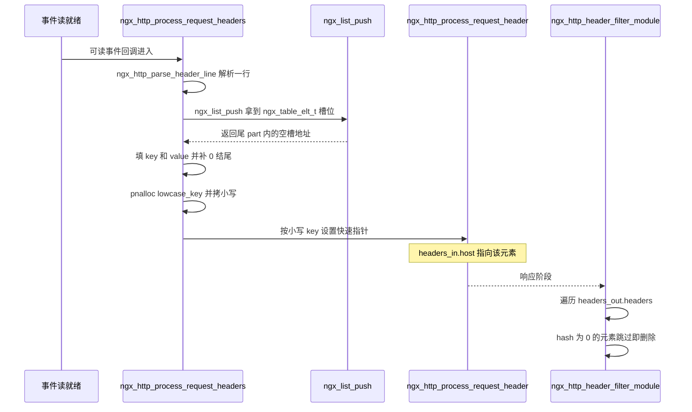

**图 10 解读**（每一跳的函数与出处）：
1. **解析**：`ngx_http_process_request_headers`（`src/http/ngx_http_request.c:1367`）循环调用解析器 `ngx_http_parse_header_line`，成功后记录 `header_name_start/header_end/header_start` 等游标（这些游标都指向 `r->header_in` 缓冲区内部）；
2. **入 list**：`h = ngx_list_push(&r->headers_in.headers)`（`src/http/ngx_http_request.c:1469`）；随后 `h->key.len = r->header_name_end - r->header_name_start; h->key.data = r->header_name_start; h->key.data[h->key.len] = '\0';`（`src/http/ngx_http_request.c:1477-1479`）——**len 照实写，末尾顺手补 `\0`**，这是 `ngx_str_t` 的经典姿势：字段视图对外"不依赖 `\0`"，但对内允许 `strlen` 式的调试便利。value 同理（`1481-1483`）；
3. **小写索引**：`h->lowcase_key = ngx_pnalloc(r->pool, h->key.len)`（`src/http/ngx_http_request.c:1485`），整数长度能整段小写加速的走 `r->lowcase_header` 缓存（`1491-1492`），否则逐字节折叠；之后 `ngx_http_process_request_header`（`1523`）把 `Host` 之类登记进 `headers_in.host` 等快捷指针（结构声明见 `src/http/ngx_http_request.h:186-235`），后续取头部 O(1)；
4. **删除即标记**：响应头过滤阶段 `if (header[i].hash == 0) continue;`（`src/http/ngx_http_header_filter_module.c:430`，请求头侧同理有 hash==0 的语义）。ngx_list 没有删除 API，模块要"删"一个已入列的头部，就把它 `hash` 置 0（如 `ngx_http_clear_content_length` 类宏的做法），元素原地躺着不参与输出——这是 7 节"为什么头部用 list"的伏笔。

---

## 6. 源码逐段精读

本节按"字符串 → 数值解析 → 转义 → base64 → array → list → queue"的顺序逐函数过一遍核心实现。每段给出签名、逐块逻辑、关键行号与易错点。

### 6.1 ngx_str_t 的配套函数与宏

**（1）ngx_strlow / ngx_tolower：只折叠 7-bit ASCII**

```c
/* src/core/ngx_string.c:22-31（节选） */
void
ngx_strlow(u_char *dst, u_char *src, size_t n)
{
    while (n) {
        *dst = ngx_tolower(*src);
        dst++;  src++;  n--;
    }
}
```

`ngx_tolower` 是宏 `((c >= 'A' && c <= 'Z') ? (c | 0x20) : c)`（`src/core/ngx_string.h:47-48`），不查 locale 表，非 ASCII 字节原样返回。所以 `ngx_strlow` **不是 UTF-8 感知的**——对多字节字符安全（高位字节不会被误改），但对非 ASCII 的"大小写"无能为力。HTTP 头部名、URI 小写化全靠它。

**（2）ngx_cpystrn：nginx 的 strncpy**

`src/core/ngx_string.c:50-71`。与 libc `strncpy` 的差别：src 按 `\0` 终止读；dst **永远补 `\0`**；返回值是**指向 dst 末尾 `\0` 的指针**（strncpy 返回 dst 起点），因此可以链式继续拼接。`while (--n)` 先减后判，保证最多写 n 字节（含结尾符）。

**（3）ngx_pstrdup：给 str 延寿**

```c
/* src/core/ngx_string.c:74-87（节选） */
u_char *
ngx_pstrdup(ngx_pool_t *pool, ngx_str_t *src)
{
    dst = ngx_pnalloc(pool, src->len);
    ...
    ngx_memcpy(dst, src->data, src->len);
    return dst;
}
```

只拷 `src->len` 字节、**不补 `\0`**（注意与 `ngx_cpystrn` 不同）。典型用法：某 `ngx_str_t` 指向配置文件缓冲区/请求缓冲区，而其生命周期需要跨越"缓冲区释放"时，用它在请求池/循环池上重新落一份。它是解决 2.1 节"视图悬垂"问题的标准动作。

**（4）ngx_str_set 宏的语句边界坑**

```c
/* src/core/ngx_string.h:42-43 */
#define ngx_str_set(str, text)                                               \
    (str)->len = sizeof(text) - 1; (str)->data = (u_char *) text
```

展开是**两条语句**。若写成无大括号的 `if (x) ngx_str_set(&s, "a"); else ...`，`else` 会落到 `data` 赋值那条语句上，编译报错甚至逻辑错乱。规范写法必须整体加大括号。`text` 还必须是**静态字符串字面量**（依赖 `sizeof`），传变量指针会编译失败，也算一层类型保护。

### 6.2 ngx_vslprintf：整个 printf 家族的唯一实现

`ngx_sprintf/ngx_snprintf/ngx_slprintf` 三个变参入口（`src/core/ngx_string.c:122-161`）全部委托给 `ngx_vslprintf(buf, last, fmt, args)`；`ngx_vsnprintf` 也是宏转换 `buf+max` 为 `last`（`src/core/ngx_string.h:158-159`）。三者的差别只在 `last` 的取法：

| 入口 | last | 用途 |
|------|------|------|
| `ngx_sprintf` | `(void *) -1`（`src/core/ngx_string.c:129`） | 无界，调用方自保证缓冲足够 |
| `ngx_snprintf` | `buf + max`（`src/core/ngx_string.c:143`） | max=缓冲区**总大小** |
| `ngx_slprintf` | 调用方显式 `last`（`src/core/ngx_string.c:157`） | 指针风格，多用于日志拼包 |

主循环（`src/core/ngx_string.c:164-481`）逐字符扫描：

```c
/* src/core/ngx_string.c:178-183（节选） */
while (*fmt && buf < last) {
    /*
     * "buf < last" means that we could copy at least one character:
     * the plain character, "%%", "%c", and minus without the checking
     */
    if (*fmt == '%') {
```

**关键语义 1——截断**：循环条件 `buf < last` 保证"至少还能写 1 字节"时继续尝试。写满后**静默截断**：不补 `\0`、不返回负值，返回值是"实际写到的位置"，调用方用 `p - buf` 得到已写字节数。所以 `ngx_snprintf(buf, max, ...)` 后必须自己 `buf[p-buf] = '\0'` 才得到 C 串。错误用法是 `ngx_snprintf(buf, sizeof(buf), "%V...", &v)` 后直接当 C 串传给 strlen——越界读。

**关键语义 2——标志解析**（`src/core/ngx_string.c:190-247`）：`0` 前缀 → 零填充；数字串 → width；随后 `u/m/x/X/./*/` 依次可组合，`u` 清符号位、`m` 表示"取该类型最大宽度"（仅 `%mi`/`%mA` 生效，见 `317-319`、`362-364`）、`x/X` 进入 hex 输出、`*` 从参数表取长度。

**关键语义 3——nginx 自定义格式符**。逐个看主 switch（`src/core/ngx_string.c:250-459`）：

| 格式符 | 位置 | 行为要点 |
|--------|------|----------|
| `%V` | `252-258` | 取 `ngx_str_t *`，走 `ngx_sprintf_str(buf, last, v->data, v->len, hex)`——**这是最常用的**，日志里 `"\"%V?%V\""` 即此（`src/http/ngx_http_request.c:2468`） |
| `%v` | `260-266` | 取 `ngx_variable_value_t *`，同样按 len 输出 |
| `%s` | `268-274` | C 串；若格式是 `%*s`，`slen` 来自参数（`237-240`），否则保持初始 `(size_t)-1`（`196`）表示"读到 `\0` 为止" |
| `%M` | `291-300` | `ngx_msec_t`；特例：值为 -1（"无超时"）时按**有符号 -1** 输出，否则按无符号输出 |
| `%T` | `286-289` | `time_t` 有符号输出 |
| `%uD` | `206-209` + `323-329` | `u` 置 `sign=0`，`D` 读 `u_int`——无符号 32 位 |
| `%i` | `310-321` | `ngx_int_t/ngx_uint_t`；`%mi` 时 width 取 `NGX_INT_T_LEN` 对齐 |
| `%O`/`%z`/`%L`/`%p` | `276-279`/`302-308`/`347-353`/`415-421` | off_t；size_t/ssize_t；64 位；指针（hex=2、零填充、宽度 `2*sizeof(void*)`） |
| `%Z`/`%N`/`%c`/`%%` | `430-447`/`423-428`/`449-453` | 写 `\0`；写换行（Win32 写 CRLF）；写字符；写 `%` |
| `%f` | `368-406` | 手工拆整数/小数两部分分别转数字，`frac = (uint64_t)((f-(double)ui64)*scale + 0.5)` 四舍五入，进位特判 `frac == scale`（`388-391`） |

有符号整数的负号处理在 switch 之后统一做（`src/core/ngx_string.c:461-469`）：`i64 < 0` 时先写 `-`，再对 `ui64 = (uint64_t) -i64` 转换。

**（1）ngx_sprintf_num：右往左填临时缓冲的数字转换**

```c
/* src/core/ngx_string.c:498-529（节选） */
p = temp + NGX_INT64_LEN;
if (hexadecimal == 0) {
    if (ui64 <= (uint64_t) NGX_MAX_UINT32_VALUE) {
        ui32 = (uint32_t) ui64;
        do {
            *--p = (u_char) (ui32 % 10 + '0');
        } while (ui32 /= 10);
    } else {
        do {
            *--p = (u_char) (ui64 % 10 + '0');
        } while (ui64 /= 10);
    }
}
```

三个要点：
- **32 位快速路径**（`src/core/ngx_string.c:502-523`）：值能装进 `uint32_t` 就走 32 位除法。注释（`504-517`）解释了动机——64 位除法在 x86 上会退化成 libc 的 `[u]divdi3/[u]moddi3` 调用，而 32 位 `/10` 会被编译成 `(i32 * 0xCCCCCCCD) >> 35` 的乘法移位，快一个量级。日志是热路径，这是实打实的性能工程；
- hex 路径（`531-548`）不用除法，`ui64 >>= 4` 配 `hex[]/HEX[]` 两张表（小写/大写）；
- **填充与安全拷贝**（`552-566`）：先按 `width` 补 `zero`（空格或 `'0'`）；真正拷贝前 `if (buf + len > last) len = last - buf;`（`562-564`）再 `ngx_cpymem`——**截断发生在数字串末尾而不是开头**，`%05d` 截断后也是"丢低位"而不是破坏对齐，调用方看到的一定是合法前缀。

**（2）ngx_sprintf_str：字符串输出的三种模式**

`src/core/ngx_string.c:570-625`。`len == (size_t)-1`（来自 `%s` 未给长度）时按 `\0` 终止逐字节拷（`579-582`）；有长度时 `len = ngx_min((size_t)(last-buf), len)` 限幅后整块 `ngx_cpymem`（`585-586`）；`%xV/%XV` 组合则把字符串逐字节十六进制展开（`589-621`），此时循环条件是 `buf < last - 1`——每输入 1 字节要写 2 字节，判断"还剩 ≥2 格"。易错点：对 `%V` 想十六进制打印时要写 `%XV` 而不是 `%V` 后接 hex 参数，hex 标志直接复用同一 fmt 位。

**易错点小结**：① 把 `ngx_snprintf` 当 `snprintf` 以为会补 `\0`——不会；② `%V` 传了 `ngx_str_t` 而不是指针（段错误）；③ 想输出 `size_t` 用了 `%d`——位数不匹配必须 `%uz`；④ 在**同一表达式**里连续两次 push 后复用旧指针（见 4.1）。

### 6.3 ngx_atoi 系列：无符号解析与溢出防护

全家共用同一骨架，以 `ngx_atoi` 为例（`src/core/ngx_string.c:966-991`）：

```c
/* src/core/ngx_string.c:975-988（节选） */
cutoff = NGX_MAX_INT_T_VALUE / 10;
cutlim = NGX_MAX_INT_T_VALUE % 10;
for (value = 0; n--; line++) {
    if (*line < '0' || *line > '9') {
        return NGX_ERROR;
    }
    if (value >= cutoff && (value > cutoff || *line - '0' > cutlim)) {
        return NGX_ERROR;
    }
    value = value * 10 + (*line - '0');
}
return value;
```

逐块讲解：
- **只接受纯数字**：`n` 字节内任何非数字立刻 `NGX_ERROR`。没有前导空白、没有符号、没有 `0x` 前缀——这些检查全部上移到各自的调用者（如配置槽函数、请求头解析）里；
- **cutoff/cutlim 前瞻溢出检查**（`src/core/ngx_string.c:983-985`）：在乘 10 之前判断——`value > cutoff` 必溢出；`value == cutoff` 且新数字 `> cutlim`（即 MAX 的个位）则溢出。这是教科书式的"先判后算"，天然防有符号溢出 UB；
- **错误码即 -1**：`NGX_ERROR` 定义为 -1。因为输入不允许负号，正常返回值 ≥ 0，所以 -1 无歧义；但调用方务必用 `== NGX_ERROR` 判断而不是 `<= 0`（`ngx_atoi("0", 1)` 合法返回 0）。

同族差异一览：

| 函数 | 位置 | 目标类型 | 溢出上限 | 真实用例 |
|------|------|----------|----------|----------|
| `ngx_atoi` | `src/core/ngx_string.c:966-991` | `ngx_int_t` | `NGX_MAX_INT_T_VALUE` | 各类头部/配置整数 |
| `ngx_atofp` | `src/core/ngx_string.c:996-1047` | 定点整数 | 同上 | 解析 `10.5` 且指定小数位数 point，返回 1050；小数点后位数必须精确对齐，多余/不足位都算错（`1038-1044` 补零、`1013-1015` point 耗尽即错） |
| `ngx_atosz` | `src/core/ngx_string.c:1050-1075` | `ssize_t` | `NGX_MAX_SIZE_T_VALUE` | `ngx_conf_set_size_slot` |
| `ngx_atoof` | `src/core/ngx_string.c:1078-1103` | `off_t` | `NGX_MAX_OFF_T_VALUE` | `Content-Length` 解析（`src/http/ngx_http_request.c:1982`）、上游 Content-Length（`src/http/ngx_http_upstream.c:4747`）、`ngx_parse_offset`（`src/core/ngx_parse.c:100`） |
| `ngx_atotm` | `src/core/ngx_string.c:1106-1131` | `time_t` | `NGX_MAX_TIME_T_VALUE` | `Keep-Alive: timeout=5` 的 timeout 解析（`src/http/ngx_http_request.c:2029`）、secure_link 的 expires（`src/http/modules/ngx_http_secure_link_module.c:137`） |
| `ngx_hextoi` | `src/core/ngx_string.c:1134-1169` | `ngx_int_t` | `NGX_MAX_INT_T_VALUE / 16` | hex 解析，允许大小写（`ch | 0x20` 归一，`1158`） |

注意 `ngx_atotm` 名字里的 "tm" 不是 `struct tm`——是 "to time_t"。真正的 HTTP 日期解析在 `ngx_http_parse_time`（另一文件），不要混淆。

### 6.4 ngx_escape_uri：位图 + 双遍扫描

函数本体 `src/core/ngx_string.c:1494-1673`。设计核心是**每种转义场景一张 `uint32_t[8]` 位图**（8×32=256 位覆盖全部字节值），第 `c` 位置 1 表示该字符需要转义。位图按 type 从 `map[]` 取（`src/core/ngx_string.c:1636-1637`）：

```c
/* src/core/ngx_string.c:1636-1640（节选） */
static uint32_t  *map[] =
    { uri, args, uri_component, html, refresh, memcached, memcached };

escape = map[type];
```

七种 type 与语义（常量定义 `src/core/ngx_string.h:199-205`）：`URI`（空格、`#`、`%`、`?` 等不允许，`1516-1532` 的表与注释）；`ARGS`（额外不许 `&`、`+`、`;`，`1534-1552`）；`URI_COMPONENT`（只剩 ALPHA/DIGIT/`-._~` 合法，`1554-1572`）；`HTML`/`REFRESH`/`MEMCACHED`/`MAIL_AUTH` 各有允许集。

**双遍扫描的公开约定**：`dst == NULL` 时**只数需要转义的字符个数**并返回（`src/core/ngx_string.c:1642-1657`）；`dst != NULL` 时执行逐字节 `%XX` 展开并返回写指针（`1659-1672`）。调用方因此形成固定两段式：

```c
/* src/http/modules/ngx_http_static_module.c:159（节选） */
escape = 2 * ngx_escape_uri(NULL, r->uri.data, r->uri.len, NGX_ESCAPE_URI);
```

`escape` 即"最坏多出的字节数"（每字符最多膨胀 2 字节），配合 `ngx_escape_uri(dst, ...)` 的返回值可精确拼分配。这个惯用法遍布十几个模块（`src/http/ngx_http_script.c:1148`、`src/http/modules/ngx_http_proxy_module.c:1192` 等）。

**判位技巧**：`escape[*src >> 5] & (1U << (*src & 0x1f))`（`1649`、`1660`）——高 3 位选 word，低 5 位选 bit。零分支、零查表循环，纯位运算。

**ngx_escape_html / ngx_escape_json**（`src/core/ngx_string.c:1806-1875`、`1878-1964`）是同构的"计数/写两段式"：html 只处理 `< > & "` 四字符（`&lt; &gt; &amp; &quot;`）；json 处理 `\ " ` 与控制字节，`\n \r \t \b \f` 用短转义，其余控制符输出 `\u00XX`（`1950-1956`）。

### 6.5 base64：77 哨兵反查表

编码侧 `ngx_encode_base64` / `ngx_encode_base64url`（`src/core/ngx_string.c:1186-1203`）只差一张 64 字符表（`+/` vs `-_`）和 padding 开关，公共实现 `ngx_encode_base64_internal`（`1206-1247`）：主体循环每 3 字节输出 4 个 6-bit 索引（`1217-1225`），尾部按剩余 1/2 字节分别补位（`1227-1244`），`padding=0` 时（base64url）不写 `=`。`dst->len` 由写指针差值回填（`1246`）——调用方需预先按 `ngx_base64_encoded_length` 宏分配（`src/core/ngx_string.h:186-187`）。

解码侧的巧思在**反查表**：`ngx_decode_base64` 的 `basis64[]`（`src/core/ngx_string.c:1253-1271`）是 256 项数组，合法字符位置存其 0..63 的值，**非法位置统一存 77**；`decode_base64url` 同构（`1277-1301`，`-`/`_` 换到 62/63 槽位）。

```c
/* src/core/ngx_string.c:1310-1322（节选） */
for (len = 0; len < src->len; len++) {
    if (src->data[len] == '=') {
        break;
    }
    if (basis[src->data[len]] == 77) {
        return NGX_ERROR;
    }
}
if (len % 4 == 1) {
    return NGX_ERROR;
}
```

预扫描（`1310-1318`）先验证全部字符合法并定位 padding 起点；`len % 4 == 1` 是**结构性错误**（剩余 1 个 6-bit 无法凑出任何完整 8-bit，`1320-1322`）；主体循环按 4 进 3 出（`1327-1334`），尾段按剩余 2/3 字符分别输出 1/2 字节（`1336-1342`）。真实用例：basic 认证解码（`src/http/ngx_http_core_module.c:1994`、`src/core/ngx_crypt.c:209`）、mail AUTH PLAIN/LOGIN（`src/mail/ngx_mail_handler.c:541` 起）、userid cookie（`src/http/modules/ngx_http_userid_filter_module.c:370`）。

易错点：解码是**自校验**的，但 `ngx_decode_base64(&dst, &src)` 要求 `dst.data` 预先按 `ngx_base64_decoded_length(src.len)` 分配好——它不会分配内存。

### 6.6 比较函数群：为什么不用 strcasecmp

`ngx_strcasecmp/ngx_strncasecmp`（`src/core/ngx_string.c:635-687`）自己手写而不调 libc，头部注释（`629-633`）给出理由：只服务 7-bit ASCII、避开 libc locale 开销、用 `ngx_uint_t` 而非 `u_char` 累加略快。实现里大小写折叠就是 `c1 = (c1 >= 'A' && c1 <= 'Z') ? (c1 | 0x20) : c1`（`644-645`）。

三个特化比较器体现了"**让 '.' 和 '/' 排最前**"的域排序思想：

- `ngx_dns_strcmp`（`895-923`）：比较 DNS 名时把 `.` 映射成 `' '`（ASCII 空格）再比（`918-919`），使 `example.com` 在字典序上"父域后置"，匹配上"更具体的名字优先"的查找习惯；
- `ngx_filename_cmp`（`926-963`）：把 `/` 映射成 `\0`（`956-957`），保证路径比较在**目录边界**处短路——`/a/bb` 与 `/a/b/c` 比较时，比较到 `/` 边界即可判定，避免 `/a/bb...` 被误判与 `/a/b` 前缀混同；
- `ngx_memn2cmp`（`870-892`）：比较两个**带长度的**内存块，短的是长的前缀时短的判小（`876-891` 的 `z` 记号），这正是前缀树/位置匹配需要的序。

配套查找：`ngx_strstrn/ngx_strcasestrn`（`730-776`）为"**已知长度 n 的静态子串**"设计——子串长度编译期已知时省去每次 strlen；`ngx_strlcasestrn`（`785-809`）进一步把被搜串的上界从 `\0` 改成显式 `last`（`792` 处 `last -= n` 提前缩界），适配二进制安全的请求缓冲区。

### 6.7 ngx_utf8_decode 族：多字节序列的解码与统计

返回值契约写在函数头注释（`src/core/ngx_string.c:1350-1357`）：`0x80-0x10ffff` 为合法码点；`0x110000-0xfffffffd` 为非法序列；`0xfffffffe` 为不完整序列；`0xffffffff` 为错误。首字节分档：

```c
/* src/core/ngx_string.c:1365-1397（节选） */
u = **p;
if (u >= 0xf8) {
    (*p)++;
    return 0xffffffff;
} else if (u >= 0xf0) {
    u &= 0x07;  valid = 0xffff;  len = 3;
} else if (u >= 0xe0) {
    u &= 0x0f;  valid = 0x7ff;  len = 2;
} else if (u >= 0xc2) {
    u &= 0x1f;  valid = 0x7f;   len = 1;
} else {
    (*p)++;
    return 0xffffffff;
}
if (n - 1 < len) {
    return 0xfffffffe;
}
```

逐块讲解：
- **首字节分档即长度**（`1367-1393`）：`>= 0xf8` 直接判错（5 字节及以上的"扩展序列"不支持）；`0xf0..0xf7` 是 4 字节序列、`0xe0..0xef` 3 字节、`0xc2..0xdf` 2 字节；`0x00..0xc1` 全部判错——注意 `0xc0/0xc1` 本可编码 2 字节，但它们只能产生**超长编码**（overlong），从首字节范围就排除了；
- **`valid` 与超长检测双保险**（`1375/1381/1387` + `1413-1417`）：每档的 `valid` 是该长度下合法码点的最小值减一（2 字节最小 0x80、3 字节最小 0x800、4 字节最小 0x10000），解码完成后 `if (u > valid) return u;` 否则仍按错误处理——仅靠首字节分档挡不住"用 3 字节编码一个 ASCII"这类超长序列；
- **continuation 字节校验**（`1401-1411`）：后续字节必须 `>= 0x80`，否则错误；**长度不足**返回 `0xfffffffe`（`1395-1397`），供流式解码器（如 charset 过滤器保存半截序列等下一包，`src/http/modules/ngx_http_charset_filter_module.c:729`）区分"坏了"与"还没到齐"。

`ngx_utf8_length`（`src/core/ngx_string.c:1421-1445`）统计"字符数"，但有一个宽容的降级：

```c
/* src/core/ngx_string.c:1438-1441（节选） */
if (ngx_utf8_decode(&p, last - p) > 0x10ffff) {
    /* invalid UTF-8 */
    return n;
}
```

一旦遇到非法序列**直接返回原始字节数 n**（`1438-1441`）。语义是：这个结果只用于"估计显示宽度"（autoindex 按 utf_len 做列对齐，`src/http/modules/ngx_http_autoindex_module.c:496`），宁可当字节算也不能算小，否则表格会错位。`ngx_utf8_cpystrn`（`1448-1491`）则按**字符数**截断拷贝并补 `\0`，遇到非法序列 break（`1477-1480`），autoindex 目录列表用它防 HTML 注入式截断（`src/http/modules/ngx_http_autoindex_module.c:579`）。易错点：头注释明说 `ngx_utf8_decode()` 只解码**两字节及以上**序列（`src/core/ngx_string.c:1351`），单字节 ASCII 不应传入。

### 6.8 ngx_array.c 全函数精读

**ngx_array_create / ngx_array_init**（`src/core/ngx_array.c:12-27`、`src/core/ngx_array.h:31-50`）：create 在池上分配 `sizeof(ngx_array_t)` 头，再 `ngx_array_init` 分配 `n*size` 元素区。init 是 `static ngx_inline`，头文件里还有一条注释（`ngx_array.h:34-37`）解释字段初始化顺序是为了绕开 MSVC 的误报警告。若数组头本身能内嵌在宿主结构里（如 `ngx_conf_parse_t` 场景），直接用 init 可省一次池分配。

**ngx_array_destroy**（`src/core/ngx_array.c:30-44`）：数组没有真正的"释放"，唯一能做的是**回退池指针**：

```c
/* src/core/ngx_array.c:37-43（节选） */
if ((u_char *) a->elts + a->size * a->nalloc == p->d.last) {
    p->d.last -= a->size * a->nalloc;
}
if ((u_char *) a + sizeof(ngx_array_t) == p->d.last) {
    p->d.last = (u_char *) a;
}
```

第一段：若元素区恰好还是池的末端分配，把 `p->d.last` 指针退回去，那块内存可被后续分配复用；第二段：若退完元素区后**数组头又恰好露在最末端**，连头一起退。两个 `if` 顺序不能颠倒——必须先退元素区、再退头。任何一次池上插队分配都会让两个条件失效，此时什么也不做，空间留给池整体销毁。这是"池分配无单独 free"约束下能挤出的全部回收能力。

**ngx_array_push / ngx_array_push_n**：已在 4.1 节流程图给出分支逻辑，这里补一个真实用例串——`ngx_init_cycle` 建 `conf.args`（`src/core/ngx_cycle.c:254`，初始 10 个 `ngx_str_t`），词法分析每识别出一个词就 `word = ngx_array_push(cf->args)`（`src/core/ngx_conf_file.c:761`）填充；一条指令结束、递归解析前 `cf->args->nelts = 0` 清零复用（`src/core/ngx_conf_file.c:523`）——**清 nelts 而不是销毁重建**，容量缓存住了；参数个数合法性校验读 `cf->args->nelts`（`src/core/ngx_conf_file.c:419-439`，含 `NGX_CONF_MAX_ARGS` 上限）。另一个例子：每次上游尝试 push 一个 `ngx_http_upstream_state_t`（`src/http/ngx_http_upstream.c:673`、`1540`）。

**易错点**：① 扩容路径换块后**旧槽位指针全部失效**；② `push` 返回的地址是"裸槽位"，元素字段要**完整赋值**，尤其 hash 之类标志位（漏置会污染输出过滤）；③ `ngx_array_init` 不会清零元素区，零值假设不成立；④ push_n 的 `nalloc` 新值是 `2 * max(n, nalloc)` 而非简单翻倍（`src/core/ngx_array.c:124`），小数组大 push 不会产生病态的小步扩容。

### 6.9 ngx_list.c 全函数精读

**ngx_list_create / ngx_list_init**（`src/core/ngx_list.c:12-27`、`src/core/ngx_list.h:36-52`）：init 把**第一个 part 内嵌在 list 结构体里**（`list->part` 是值不是指针），`list->last = &list->part`（`ngx_list.h:46`）。这意味着最少分配次数是"1 次 list 头 + 1 次 part 元素区"。

**ngx_list_push**（`src/core/ngx_list.c:30-63`）：

```c
/* src/core/ngx_list.c:38-56（节选） */
last = l->last;
if (last->nelts == l->nalloc) {
    /* the last part is full, allocate a new list part */
    last = ngx_palloc(l->pool, sizeof(ngx_list_part_t));
    ...
    last->elts = ngx_palloc(l->pool, l->nalloc * l->size);
    ...
    l->last->next = last;
    l->last = last;
}
elt = (char *) last->elts + l->size * last->nelts;
last->nelts++;
```

- 满判定用**尾 part 的 `nelts` 对比 list 的 `nalloc`**（`38`）——所有 part 容量相同，这写法合法；
- 新 part 是"头（`ngx_list_part_t`）+ 元素区"两笔分配（`42-50`），链上后再取槽（`59-62`）；
- **没有删除、没有收缩、没有合并 part**。整个 API 面只有 create/init/push。

**遍历模式**（头文件 `src/core/ngx_list.h:55-77` 以注释形式给出了官方写法）：外层按 part 跳链，`i` 归零重计：

```c
/* src/core/ngx_list.h:59-76（官方注释给出的遍历模板） */
part = &list.part;
data = part->elts;
for (i = 0 ;; i++) {
    if (i >= part->nelts) {
        if (part->next == NULL) {
            break;
        }
        part = part->next;
        data = part->elts;
        i = 0;
    }
    ...  data[i] ...
}
```

逐行读：`data` 必须在**每次跳 part 时重取**（`part->elts` 各段独立分配，地址互不相关）；`i` 归零（第 10 行）是因为计数属于 part 而非 list；`... data[i] ...` 处拿到的元素按 `size` 步进排布。HTTP 模块里到处是这个模式，例如响应头过滤对 `r->headers_out.headers` 的遍历。**易错点**：遍历中不能 push（`part->elts` 可能失效吗？不会失效——list 从不搬移，但 `part` 变量要小心跳链后重取）；遍历中修改元素是允许的，"删除"即置 `hash = 0`（5 节第 4 跳）。

**为什么 HTTP 头部用它而不是数组**：数组 2 倍扩容会**搬移**元素，而 `headers_in.host` 等快速指针、以及 `ngx_http_parse_multi_header_lines` 返回的 `ngx_table_elt_t *` 都缓存了元素地址，搬移即悬垂；list 只追加、地址稳定；头部"删除"需求由 `hash = 0` 标记满足；头部数量级是十几个（初始 part 20 个槽，`src/http/ngx_http_request.c:598-599`），分段链的遍历开销可忽略。请求池整体销毁时 list 随之消亡，part 从不单独释放也就无所谓。

### 6.10 ngx_queue.c 全函数精读

**先读四个关键宏**——`ngx_queue.h` 的插删全是纯指针改写、零函数调用，顺序是安全性的全部：

```c
/* src/core/ngx_queue.h:33-37（节选） */
#define ngx_queue_insert_head(h, x)                                           \
    (x)->next = (h)->next;                                                    \
    (x)->next->prev = x;                                                      \
    (x)->prev = h;                                                            \
    (h)->next = x
```

四步不可乱序：先让 `x` 双向挂上**旧首元**（第 1-2 行），再把 `x` 接回哨兵（第 3-4 行）。若先执行第 4 行，哨兵 `next` 已被覆盖，旧首元的回指就丢了。**空队列无需特判**——此时"旧首元"就是哨兵自身，四步自动退化为"自环上插一个点"，这是循环链表省掉所有 `if (empty)` 的精髓。`ngx_queue_insert_tail`（`43-47`）是严格的镜像操作；`ngx_queue_split/add`（`90-103`）是 O(1) 的断链与拼接，在下文的归并流程里会被反复用到。最后是容器手法的钥匙：

```c
/* src/core/ngx_queue.h:106-107 */
#define ngx_queue_data(q, type, link)                                         \
    (type *) ((u_char *) q - offsetof(type, link))
```

它不猜结构体布局，`offsetof` 由编译器按实际对齐计算（内嵌字段可以在宿主的任意位置），因此对任何宿主类型都成立——这是 Linux 内核 `container_of` 的同款思想，只是省掉了 `typeof` 依赖。

**ngx_queue_middle：快慢指针找中点**（`src/core/ngx_queue.c:21-49`）：

```c
/* src/core/ngx_queue.c:26-48（节选） */
middle = ngx_queue_head(queue);
if (middle == ngx_queue_last(queue)) {
    return middle;
}
next = ngx_queue_head(queue);
for ( ;; ) {
    middle = ngx_queue_next(middle);
    next = ngx_queue_next(next);
    if (next == ngx_queue_last(queue)) {
        return middle;
    }
    next = ngx_queue_next(next);
    if (next == ngx_queue_last(queue)) {
        return middle;
    }
}
```

`next` 每轮走 2 步、`middle` 走 1 步；循环用 `next == last`（而非 `next == sentinel`）作终点，使得**奇数个元素返回中点、偶数个返回后半段首元**（函数注释 `16-19` 明说）。这个"后半段首元"正是归并切分需要的偏置。相比教科书版本少一个计数器、无除法，且天然处理 1 元素队列。

**ngx_queue_sort：自顶向下归并**（`src/core/ngx_queue.c:54-74`）：

```c
/* src/core/ngx_queue.c:60-74（节选） */
q = ngx_queue_head(queue);
if (q == ngx_queue_last(queue)) {
    return;
}
q = ngx_queue_middle(queue);
ngx_queue_split(queue, q, &tail);
ngx_queue_sort(queue, cmp);
ngx_queue_sort(&tail, cmp);
ngx_queue_merge(queue, &tail, cmp);
```

- 单元素即返回（`62-64`）；否则 `ngx_queue_middle` 取偏置中点，`ngx_queue_split`（宏，`ngx_queue.h:90-96`）把 `[中点, 尾]` 切成临时队列 `tail`（`tail` 是**栈上哨兵**，`68`）；
- 递归排序两半后 `ngx_queue_merge`（`73`）。注意递归深度是 O(log n)，最坏也就几十层（location 数万级别），栈安全；
- `split` 宏的指针改写顺序值得逐行推：先让新队列 `n` 接住 `[q, 原尾]`，再把原队列尾回缩到 `q` 的前驱，最后 `q->prev = n` 完成切断。**顺序错一步就是环断裂**，读宏时建议画 prev/next 双向各一遍。

**ngx_queue_merge：稳定合并**（`src/core/ngx_queue.c:77-105`）：

```c
/* src/core/ngx_queue.c:96-104（节选） */
if (cmp(q1, q2) <= 0) {
    q1 = ngx_queue_next(q1);
    continue;
}
ngx_queue_remove(q2);
ngx_queue_insert_before(q1, q2);
q2 = ngx_queue_head(tail);
```

`cmp(q1, q2) <= 0` 时**保留前队列元素**（`96-99`）——相等元素前队列的先出队，这就是**稳定性**的来源；反之时把 `q2` 摘下、插到 `q1` 之前（`101-102`，`insert_before` 即尾插别名，语义是"插到 q1 前面"）。两队列其一耗尽时：前队列耗尽则 `ngx_queue_add` 整体拼接剩余（`87-89`），后队列耗尽直接结束（`92-94`）——`add` 宏是 O(1) 拼接，不走逐节点搬移。

**ngx_queue_sort 的真实用例**：`src/http/ngx_http.c:689`——配置阶段对每个 server 的 location 队列排序：`ngx_queue_sort(locations, ngx_http_cmp_locations);`，比较器在 `src/http/ngx_http.c:927`（按前缀树需要的"目录边界序 + 长度序"排列，随后 `ngx_http_init_locations` 再把 named/regex 拆成独立队列）。**middle/split/merge/sort 的分工**一句话：`middle` 定切分点、`split/add` 负责 O(1) 断开与拼接、`merge` 负责稳定合并、`sort` 负责递归调度——四者共同构成"链表上的归并排序"，这是数组快排之外 nginx 唯一的排序基础设施（另一个 `ngx_sort` 是**插入排序**，`src/core/ngx_string.c:2050` 注释明说"we need stable sort"，用于小数组如 autoindex 条目，O(n²) 但 n 小且稳定）。

**易错点**：① 哨兵未 `ngx_queue_init` 就 insert，`next->prev = x` 直接写 NULL 附近，必崩；② `ngx_queue_remove` 后节点仍在宿主结构里但已脱链，DEBUG 版会置 NULL 帮你踩雷，非 DEBUG 版二次 remove 会把邻居改坏；③ `cmp` 必须实现**全序**（相等返回 0），sort 的稳定性假设才成立；④ `ngx_queue_data` 的第三参必须与内嵌字段名一字不差。

---

## 7. 设计思想与权衡

### 7.1 三种容器的关系与选型

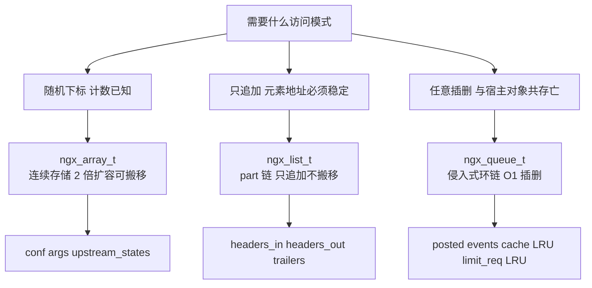

**图 11 解读**：选型的第一问永远是"**已有元素的地址能不能变**"。数组为了缓存局部性允许搬移；list 为了地址稳定牺牲连续性；队列干脆不拥有存储。第二问是"**谁拥有元素**"：array/list 拥有元素存储（元素是"槽位"），queue 不拥有（元素是宿主结构体内嵌的字段，链只是关系）。

### 7.2 与替代方案的对比

| 维度 | nginx 方案 | 替代方案 | 为什么不选替代 |
|------|-----------|----------|----------------|
| 字符串 | `ngx_str_t` 视图 + 显式 len | C `\0` 串 / C++ std::string | 网络报文二进制安全，`\0` 依赖会限制头部值内容并多一次扫描求长；std::string 携带分配器与拷贝语义，与"零拷贝视图 + 池生命周期"冲突 |
| 格式化 | 手写 `ngx_vslprintf`，自定义格式符 | libc `snprintf` | 需要 `%V`（len+data）与 `%M/%T/%i` 等平台相关类型的**精确**输出；libc 可变参数提升规则对 `size_t/time_t` 在不同平台的默认提升差异正是历史 bug 源 |
| 顺序容器 | 池上 array/list | glib GArray/GList、C++ vector | 引入新依赖；nginx 需要"销毁即整体回收、无逐元素析构"的池语义 |
| 排序 | `ngx_queue_sort` 归并 / `ngx_sort` 插入 | libc `qsort` | `qsort` 不保证稳定（C 标准未承诺），location 排序依赖稳定序 |
| 转义 | 静态位图 + 双遍 | 逐字符 `switch` | 位图 O(1) 判定且表即文档（源码注释逐位标注）；双遍让"精确尺寸再分配"成为可能 |
| 解析 | 手写 atoi 族 | `strtol` | 需要在"任意 n 字节非 `\0` 缓冲区"上解析并显式控溢出，`strtol` 依赖 `\0` 且错误通道（errno）在热路径嫌重 |

### 7.3 三条贯穿性的设计哲学

1. **生命周期跟着池走，代码里没有配对的 free**。`ngx_array_destroy` 的指针回退（`src/core/ngx_array.c:37-43`）已经是这套体系里"最努力"的回收；更常见的是干脆不回收。收益是：请求处理路径上没有任何 free 调用与碎片问题；代价是：峰值内存 ≈ 所有中间态分配的总和，所以才有 `request_pool_size` 这类调节旋钮（第 8 节）。
2. **地址稳定性被当作显式契约**。array 的"原地扩"优先、list 的"永不搬移"、queue 的"侵入式"，全是在用结构保证调用方缓存的指针不悬垂。反过来，array 一旦走换块扩容路径，契约立即失效——这是 array 与 list 的**本质分界线**。
3. **性能敏感处的手工降级路径**。`ngx_sprintf_num` 的 32 位快速路径（`src/core/ngx_string.c:502-523`）、`ngx_escape_uri` 的零分支位图、`ngx_strcasecmp` 避开 locale、`ngx_queue_middle` 的双指针无除法——每个都是"先量出来慢，再手工优化"的痕迹，而不是盲目微优化。

---

## 8. 配置项与调优映射

这些容器本身没有直接暴露指令，但**它们的运行参数**由若干指令间接控制：

| 指令 | 默认值 | 作用于哪段代码 | 调优建议 |
|------|--------|----------------|----------|
| `request_pool_size`（http/server 级） | 8k（文档值；代码默认 4096，`src/http/ngx_http_core_module.c:3487-3488`） | `ngx_http_alloc_request` 创建请求池（`src/http/ngx_http_request.c:573`）；`headers_in/headers_out` 的 list 元素区（各 20/4 个 `ngx_table_elt_t`，`598-612`、`1185-1191`）从中 bump 分配 | 池越小请求内存越省，但 headers 较多时 list 会多开 part（多两次池分配）；一般不调 |
| `keepalive_disable` / `keepalive_timeout` | — | `Keep-Alive: timeout=` 解析用 `ngx_atotm`（`src/http/ngx_http_request.c:2029`） | 客户端声明的 timeout 会被与服务端配置比较取小，容器无关但解析在此 |
| `proxy_cache_path ... inactive=` | 10m | cache 的 `ngx_queue_t` LRU：命中后 `ngx_queue_remove + insert_head` 提到队首（`src/http/ngx_http_file_cache.c:2314-2319`），过期清理从队尾扫（`1937-1939`） | inactive 决定"未命中多久后允许淘汰"，本质是控制这个 LRU 队列的换入换出节奏 |
| `limit_req_zone ... rate=` | — | limit_req 的 LRU 队列：命中 `ngx_queue_remove + insert_head`（`src/http/modules/ngx_http_limit_req_module.c:442-443`），溢出淘汰从队尾取（`658`、`686`） | 队列存储在共享内存，`zone` 大小约束节点总数上限 |
| `underscores_in_headers` / `ignore_invalid_headers` | off / on | 头部入 list 前的名字合法性检查（`src/http/ngx_http_request.c:1450-1465`），非法行直接 `continue` 不入 list | 放宽需权衡：进 list 的头部会参与哈希与转发 |
| `location` 指令 | — | 每条 location 经 `ngx_http_add_location` 入队列（`src/http/ngx_http.c:885`），配置收尾时 `ngx_queue_sort` 排序（`689`）后建树 | location 数量不影响请求期性能（排序在配置期），但组织结构决定了前缀树质量 |
| `ngx_conf_max_args`（内部常量） | 256（`NGX_CONF_MAX_ARGS`，校验于 `src/core/ngx_conf_file.c:435`） | `conf.args` 数组（初始 10 槽，`src/core/ngx_cycle.c:254`）push 上限 | 单条指令参数超限会报错，极长头部列表类配置需拆分 |

调优的共同心法：这些结构的成本都发生在**池分配次数**与**元素区大小**上。看到"每请求 N 次 palloc"的日志（`NGX_DEBUG_ALLOC` 级别）时，把注意力放在 list part 是否频繁续链、array 是否频繁换块扩容即可——绝大多数部署下默认值已按"20 个头部"这类典型值校准过。

---

## 9. 自测题

**Q1：`ngx_str_t` 的 `data[len]` 一定可读吗？**
答：**不一定**。`ngx_str_t` 只承诺 `len` 字节有效。不过 nginx 有个事实惯例：解析器在**恰好有写权限**时会把 `data[len]` 补成 `\0`（如请求头 key/value，`src/http/ngx_http_request.c:1477-1483`）。依赖这个惯例是危险的——来自池上拷贝的 `ngx_pstrdup` 结果就**没有** `\0`（`src/core/ngx_string.c:74-87`）。要 C 串必须显式补齐或用 `printf` 家族按 `%V` 输出。

**Q2：`ngx_snprintf(buf, sizeof(buf), ...)` 与 `snprintf` 的两个关键差异？**
答：① 不写结尾 `\0`——返回写指针，需 `p - buf` 得长度、自行补 `\0`；② 截断语义不同——写满即止，且 `%V` 类是整块 `ngx_min` 限幅（`src/core/ngx_string.c:585`），不会部分格式化半个数字（数字的截断发生在 `ngx_sprintf_num` 内部限长拷贝，`562-564`）。另外格式符不兼容：`%z`、`%V`、`%M` 都是 nginx 私有。

**Q3：`ngx_array_push` 在什么情况下不搬移数据？**
答：数组存储区恰好是池的**当前分配末端**（`elts + size*nalloc == p->d.last`）且末端还装得下一个元素时，只做 `p->d.last += a->size; a->nalloc++`（`src/core/ngx_array.c:62-71`）。否则 `ngx_palloc(p, 2*size)` 换块并 `memcpy`（`76-83`）。

**Q4：为什么 HTTP 头部用 `ngx_list_t` 而不是 `ngx_array_t`？**
答：头部解析后元素地址被大量缓存（`headers_in.host` 等快速指针 `src/http/ngx_http_request.h:186-235`、`next` 同名链）。数组换块扩容会搬移所有元素导致这些指针悬垂；list 按段追加、旧元素地址永不变（`src/core/ngx_list.c:42-56` 只在新 part 上分配）。而"删除"需求由 `hash = 0` 标记实现（`src/http/ngx_http_header_filter_module.c:430` 跳过输出），list 无需提供删除 API。

**Q5：如何遍历一个 `ngx_list_t`？可以直接 `for (i = 0; i < list->nelts; i++)` 吗？**
答：不行，list 没有**总体** `nelts`，计数分散在每个 part 上。必须按官方注释模式双层循环：外层按 `part = part->next` 跳链，`i` 在每个 part 重置为 0，直到 `part->next == NULL`（`src/core/ngx_list.h:55-77`）。

**Q6：`ngx_queue_sort` 是什么排序？为什么不用 `qsort` 风格的快排？**
答：自顶向下**归并排序**（`src/core/ngx_queue.c:54-74`：middle 切分 → split → 递归 → merge），且 `merge` 用 `cmp(q1,q2) <= 0` 保前队列优先实现**稳定**（`96`）。`qsort` 的稳定性不被 C 标准保证，而 location 排序（`src/http/ngx_http.c:689`）依赖稳定序；另外链表上的归并只需指针重接、O(1) split/add，比快排的分区搬移更自然。

**Q7：`ngx_queue_middle` 对偶数个节点返回哪个节点？为什么？**
答：返回**后半段的第一个节点**（`src/core/ngx_queue.c:16-19` 注释 + 实现 34-48）。快指针每轮 2 步、以"到达尾节点"为停机条件，天然产生这个偏置；而归并切分恰好需要 `split(queue, middle, &tail)` 把后半段（含 middle）整体切走，偏置使空半边不可能出现。

**Q8：`ngx_escape_uri(NULL, src, len, type)` 返回值是什么？为什么这么设计？**
答：返回**需要转义的字符个数**（`src/core/ngx_string.c:1642-1657`）。这样调用方先数一次、按 `原长 + 2*个数` 精确分配，再调一次（dst 非空）执行展开——双遍扫描，避免"按最坏 3 倍长度分配"的浪费或"二次计算"的耦合。惯用式如 `2 * ngx_escape_uri(NULL, ...)`（`src/http/modules/ngx_http_static_module.c:159`）。

**Q9：`ngx_decode_base64` 中 77 是什么？为什么解码是 O(n) 且自校验？**
答：77 是 256 项**反查表**中"非法字符"的哨兵值（`src/core/ngx_string.c:1253-1271`）。预扫描逐字符查表（非 77 即合法），同时定位 padding 起点（`1310-1318`），再按 4 进 3 出解码——一次遍历完成校验与解码，无需逐字符 switch。

**Q10：`ngx_atoi` 如何做到不触发有符号溢出 UB？它接受 `"  123"` 或 `"-5"` 吗？**
答：用 `cutoff = MAX/10`、`cutlim = MAX%10` 做**前瞻检查**：`value >= cutoff && (value > cutoff || 新数字 > cutlim)` 则返回 `NGX_ERROR`（`src/core/ngx_string.c:975-985`），乘 10 前就能判定溢出。不接受——没有空白跳过、没有符号处理，任何非数字字节立即 `NGX_ERROR`；符号与空白的处理属于更上层（如配置槽、头部解析）的职责。

**Q11（附加）：`ngx_array_destroy` 里两个 `if` 的顺序能换吗？**
答：不能。必须**先退元素区、再退数组头**：只有元素区先退回 `p->d.last`，数组头才可能"露出"成为新的池末端，第二个 `if` 才有机会命中（`src/core/ngx_array.c:37-43`）。此外只要中间有过其他池分配插队，两个条件都会失效，函数就什么都不做——这是设计内行为，不是 bug。

---

## 附：一页速查

| 你想做的事 | 用什么 | 出处 |
|-----------|--------|------|
| 字面量初始化 `ngx_str_t` | `ngx_str_set(&s, "text")`（加花括号！） | `src/core/ngx_string.h:42-43` |
| 给 str 延寿 | `ngx_pstrdup(pool, &s)` | `src/core/ngx_string.c:74-87` |
| 打印 `ngx_str_t` | `ngx_snprintf(buf, max, "%V", &s)` | `src/core/ngx_string.c:252-258` |
| 解析纯数字 | `ngx_atoi/ngx_atosz/ngx_atoof/ngx_atotm` | `src/core/ngx_string.c:966-1131` |
| URI 转义（先数后写） | `ngx_escape_uri(NULL,...)` + `ngx_escape_uri(dst,...)` | `src/core/ngx_string.c:1494-1673` |
| 动态收集元素（可下标） | `ngx_array_create + ngx_array_push` | `src/core/ngx_array.c:12-91` |
| 收集后地址不能变（如头部） | `ngx_list_create + ngx_list_push` | `src/core/ngx_list.c:12-63` |
| 宿主对象挂链/插删/排序 | `ngx_queue_insert_tail/remove/sort + ngx_queue_data` | `src/core/ngx_queue.h:43-107`、`src/core/ngx_queue.c:21-105` |
| 删除已入 list 的头部 | 置 `h->hash = 0` | `src/http/ngx_http_header_filter_module.c:430` |
