# 哈希表与树结构（hash/rbtree/radix）（基于 nginx-1.27.0 源码）

> **导读**：读完本文你将掌握——
>
> 1. `ngx_hash_t` 如何用"开放寻址式桶位 + 桶内连续元素段"的组合，在**构建后只读**的前提下做到零锁查找，以及 `ngx_hash_init` 里那段最不像"哈希表"代码的**桶数预估与逐桶字节预算算法**；
> 2. 通配符域名（`.example.com`、`*.example.com`、`www.example.*`）如何被 `ngx_hash_keys_arrays_t` 预编译成**三层嵌套哈希表**，查找时又如何靠 value 指针的低 2 位在精确值与子表之间切换；
> 3. `ngx_rbtree_t` 左旋/右旋、插入着色修复的全部三种 case 与删除修复的四种 case，以及 nginx 为什么把"插入策略"做成函数指针（timer 允许等 key、缓存节点用 md5 后 12 字节比较）；
> 4. `ngx_radix_tree_t` 如何按位分叉、按页预分配节点池，让 geo 模块的 CIDR 匹配变成一条"沿途记录value"的下行路径；
> 5. 在"虚拟主机名 / timer / geo / 缓存节点"四类场景中，nginx 分别选了 hash、rbtree、radix 中的哪一种，以及为什么。
>
> **前置阅读建议**：先了解 `ngx_pool_t` 内存池、`ngx_array_t` 动态数组、`ngx_str_t` 字符串（见本系列前几篇）；本文不要求红黑树基础，第 4、6 节会从旋转开始推演。
>
> **涉及源码清单**（均已用 glob 确认存在于本仓库）：
>
> - `src/core/ngx_hash.h`（125 行）、`src/core/ngx_hash.c`（1013 行）
> - `src/core/ngx_rbtree.h`（87 行）、`src/core/ngx_rbtree.c`（404 行）
> - `src/core/ngx_radix_tree.h`（55 行）、`src/core/ngx_radix_tree.c`（488 行）
> - 落点交叉引用：`src/event/ngx_event_timer.c`、`src/event/ngx_event_timer.h`、`src/http/ngx_http_file_cache.c`、`src/http/ngx_http_cache.h`、`src/http/modules/ngx_http_geo_module.c`、`src/http/ngx_http.c`、`src/http/ngx_http_core_module.h`、`src/http/ngx_http_request.c`、`src/http/ngx_http_variables.c`、`src/http/modules/ngx_http_referer_module.c`、`src/stream/ngx_stream_geo_module.c`

---

## 1. 本模块在 nginx 中的位置与职责

`ngx_hash`、`ngx_rbtree`、`ngx_radix_tree` 三个文件都住在 `src/core/`，是 nginx 的**通用容器层**：不认识 HTTP，也不认识事件，只提供"键到值"的三种映射原语。它们的共同特征是：

- **只依赖内存池**（`ngx_pool_t`），不依赖任何业务模块；
- **构建期写、运行期读**（hash 与 radix 的预分配思路尤其如此），天然适配 nginx 多 worker、每进程独立副本的 fork 模型；
- 通过**函数指针/宏参数化**，让上层模块按自己的键语义定制行为（rbtree 的 `insert`、hash 的 `ngx_hash_key_pt`）。

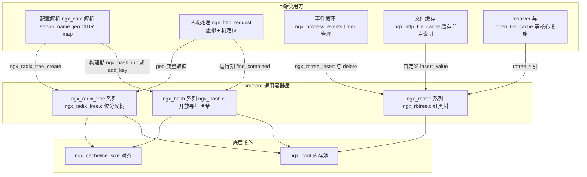

**图 1-1 解读**：容器层处在一个"哑层"的位置——hash 的构建由配置解析阶段驱动（`ngx_hash_init`），查找由请求处理驱动（`ngx_hash_find_combined`）；rbtree 的生命周期跨越运行期（timer 每次事件循环都在插删）；radix tree 几乎只服务于 geo 类模块的 CIDR。所有容器都从 `ngx_pool` 拿内存（唯一的例外是 `ngx_hash_init` 里的试探数组用 `ngx_alloc/ngx_free`，见第 6.6 节），并对齐到 `ngx_cacheline_size`——这不是学术洁癖，而是让每个桶的元素段落进尽量少的 cache line。

---

## 2. 核心数据结构精讲

### 2.1 ngx_hash_elt_t 与 ngx_hash_t：一维指针数组 + 连续元素段

`src/core/ngx_hash.h:16-26` 定义了两个核心结构：

| 结构 | 字段 | 类型 | 含义 |
|---|---|---|---|
| `ngx_hash_elt_t`（hash.h:16-20） | `value` | `void *` | 该 key 对应的值；`NULL` 兼任**桶尾哨兵** |
| | `len` | `u_short` | key 长度（≤ 65535，这也是桶大小上限的来源之一） |
| | `name[1]` | `u_char[1]` | 柔性数组，实际存 `len` 字节的小写 key |
| `ngx_hash_t`（hash.h:23-26） | `buckets` | `ngx_hash_elt_t **` | 桶指针数组，每项指向一个元素段首地址 |
| | `size` | `ngx_uint_t` | 桶数量，运行期固定不变 |

```c
/* src/core/ngx_hash.h:16-26 */
typedef struct {
    void             *value;
    u_short           len;
    u_char            name[1];
} ngx_hash_elt_t;


typedef struct {
    ngx_hash_elt_t  **buckets;
    ngx_uint_t        size;
} ngx_hash_t;
```

**字段关系与内存布局**：`buckets` 数组的每一项指向一块连续内存中的一个元素段；同一桶内的元素**背靠背紧凑排列**，段尾是一个 `value == NULL` 的假元素作为结束哨兵。整个元素区在构建时一次性分配、按 cacheline 对齐切分：

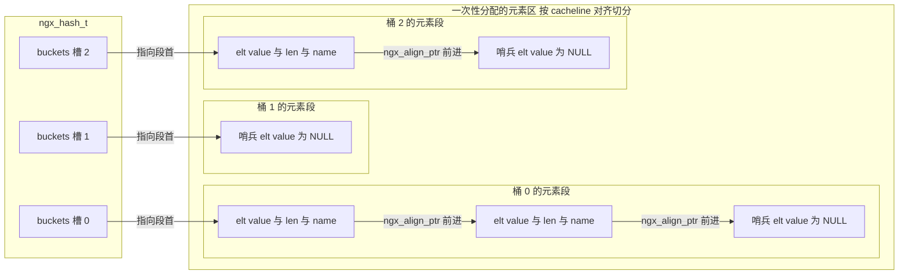

**图 2-1 解读**：注意三点。第一，**桶 1 可以为空**——空桶的槽位是 `NULL`（构建时跳过，见 hash.c:411-414），查找时第一拍就能返回。第二，"链"不是靠 `next` 指针串起来的，而是靠 `ngx_align_ptr(&elt->name[0] + elt->len, sizeof(void *))` 算出下一个元素的起始地址（hash.c:43-44），省掉了每个元素 8 字节的 next 指针，也让同一桶的元素在物理上连续。第三，元素区的总大小在构建期就精确算出（第 6.6 节），运行期**不可增删**——这是该结构一切取舍的前提。

### 2.2 ngx_hash_wildcard_t 与 ngx_hash_combined_t：嵌套表与"三表合一"

| 结构 | 字段 | 含义 |
|---|---|---|
| `ngx_hash_wildcard_t`（hash.h:29-32） | `hash` | 本层的 `ngx_hash_t` |
| | `value` | **本层通配符整体的默认值**：本层没查到具体 key 时向下兜底 |
| `ngx_hash_combined_t`（hash.h:45-49） | `hash` | 精确表 |
| | `wc_head` | 前缀通配表（`.example.com` / `*.example.com`）根 |
| | `wc_tail` | 后缀通配表（`www.example.*`）根 |

`ngx_hash_wildcard_t` 的巧妙之处在于**它和 `ngx_hash_t` 共用一次分配**：`ngx_hash_init` 在 `hinit->hash == NULL` 时会多分配一个 `sizeof(ngx_hash_wildcard_t)` 的头部（hash.c:384-393），桶指针数组紧跟在头部之后。于是"子表指针"和"子表本身"是同一次 `ngx_pcalloc` 的产物，释放时随池一起消亡。

```c
/* src/core/ngx_hash.h:29-32 */
typedef struct {
    ngx_hash_t        hash;
    void             *value;
} ngx_hash_wildcard_t;
```

`value` 指针的低 2 位被挪用作**类型标签**（语义见 hash.c:90-99 的注释，逐位分析见 6.2 节）：

| 低 2 位 | 含义 |
|---|---|
| `00` | value 是数据指针，对 `example.com` 与 `*.example.com` 都有效（前缀通配） |
| `01` | value 是数据指针，仅对 `*.example.com` 有效 |
| `10` | value 是子表指针（掩掉低位后即 `ngx_hash_wildcard_t *`），对两者都有效 |
| `11` | value 是子表指针，仅对 `*.example.com` 有效 |

### 2.3 ngx_hash_keys_arrays_t：通配符的"预编译车间"

`src/core/ngx_hash.h:75-89`：

| 字段 | 类型 | 含义 |
|---|---|---|
| `hsize` | `ngx_uint_t` | 预编译期冲突检测哈希的桶数（107 或 10007） |
| `pool` / `temp_pool` | `ngx_pool_t *` | 生存池 / 临时池 |
| `keys` | `ngx_array_t` | 精确 key 收集数组（元素是 `ngx_hash_key_t`） |
| `keys_hash` | `ngx_array_t *` | 长度为 `hsize` 的桶数组，每桶是已登记 key 的字符串列表，用于查重 |
| `dns_wc_head` / `dns_wc_head_hash` | 同上 | 前缀通配 key 的收集与查重 |
| `dns_wc_tail` / `dns_wc_tail_hash` | 同上 | 后缀通配 key 的收集与查重 |

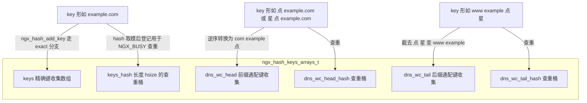

**图 2-2 解读**：这是典型的**两阶段构建**。第一阶段（配置解析期）`ngx_hash_add_key` 把每条 server_name 分类登记到三个数组，同时用 `*_hash` 桶数组做 O(1) 期望的重复检测（重复返回 `NGX_BUSY`）；第二阶段 `ngx_hash_init` / `ngx_hash_wildcard_init` 把数组一次性"压铸"成只读的最终表。查重桶数组用 `hsize=10007`（`NGX_HASH_LARGE_HSIZE`，hash.h:69，质数）或 107（SMALL，hash.c:689），几万条 server_name 的查重也不会退化。

### 2.4 ngx_hash_key_t 与 ngx_hash_init_t：构建期的输入与参数

| 结构 | 字段 | 含义 |
|---|---|---|
| `ngx_hash_key_t`（hash.h:35-39） | `key` / `key_hash` / `value` | 一个待入表键：预计算好的哈希值、键串、值 |
| `ngx_hash_key_pt`（hash.h:42） | 函数指针类型 | 哈希函数，默认 `ngx_hash_key_lc` |
| `ngx_hash_init_t`（hash.h:52-62） | `hash` | 输出槽：传 `NULL` 则自动分配（并多分配 wildcard 头）；传 `&addr->hash` 则原地填 |
| | `key` | 哈希函数 |
| | `max_size` / `bucket_size` | 桶数上限 / 单桶字节预算（对应指令 `*_hash_max_size`、`*_hash_bucket_size`） |
| | `name` | 出错日志里显示的表名，如 `"server_names_hash"` |
| | `pool` / `temp_pool` | 生存池 / 临时池 |

`NGX_HASH_SMALL` / `NGX_HASH_LARGE`（hash.h:65-66）是 `ngx_hash_keys_array_init` 的档位开关：SMALL 档 `asize=4, hsize=107`，LARGE 档 `asize=16384, hsize=10007`（hash.c:687-694；常量定义 hash.h:68-69）。

### 2.5 ngx_rbtree_node_t 与 ngx_rbtree_t：内嵌式红黑树

`src/core/ngx_rbtree.h:22-41`：

| 结构 | 字段 | 类型 | 含义 |
|---|---|---|---|
| `ngx_rbtree_node_t` | `key` | `ngx_rbtree_key_t`（即 `ngx_uint_t`） | 排序键 |
| | `left` / `right` / `parent` | 节点指针 | 三叉；孩子为 `sentinel` 表示空 |
| | `color` | `u_char` | 0 黑 1 红（宏 `ngx_rbt_red/black`，rbtree.h:64-65） |
| | `data` | `u_char` | 柔性数据区首字节，宿主结构把节点**内嵌**在自己头部 |
| `ngx_rbtree_t` | `root` / `sentinel` | 节点指针 | 根与哨兵；哨兵必须黑色（rbtree.h:71-73） |
| | `insert` | `ngx_rbtree_insert_pt` | **可插拔的插入策略**（rbtree.h:34-35） |

```c
/* src/core/ngx_rbtree.h:34-48 */
typedef void (*ngx_rbtree_insert_pt) (ngx_rbtree_node_t *root,
    ngx_rbtree_node_t *node, ngx_rbtree_node_t *sentinel);

struct ngx_rbtree_s {
    ngx_rbtree_node_t     *root;
    ngx_rbtree_node_t     *sentinel;
    ngx_rbtree_insert_pt   insert;
};

#define ngx_rbtree_init(tree, s, i)                                           \
    ngx_rbtree_sentinel_init(s);                                              \
    (tree)->root = s;                                                         \
    (tree)->sentinel = s;                                                     \
    (tree)->insert = i
```

`ngx_rbtree_data(node, type, link)`（rbtree.h:50-51）用 `offsetof` 从节点反推宿主结构地址——这是内核式侵入链表的经典手法，节点不带 `void *`，零额外间接层。

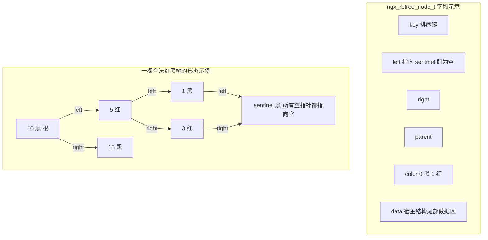

**图 2-3 解读**：这棵示例树（在 6.11 节的推演中会真实出现）体现两条不变量：从任一节点到其后代叶子的路径上黑色数目相同；红色节点的孩子必为黑色。哨兵统一替代 `NULL`，让删除修复、旋转代码无需逐处判空——代价是空子树的判断从 `== NULL` 变成 `== sentinel`。

### 2.6 ngx_radix_node_t 与 ngx_radix_tree_t：按位分叉的 trie

`src/core/ngx_radix_tree.h:16-34`：

| 结构 | 字段 | 含义 |
|---|---|---|
| `ngx_radix_node_t`（18-25） | `right` / `left` | 位为 1 走 right、位为 0 走 left |
| | `parent` | 删除塌缩时向上回溯用 |
| | `value` | `uintptr_t`；`NGX_RADIX_NO_VALUE`（= `(uintptr_t) -1`，头文件 16 行）表示"路过节点，无值" |
| `ngx_radix_tree_t`（28-34） | `root` | 根节点（代表空前缀） |
| | `pool` | 所属内存池 |
| | `free` | **已删除节点回收链**（借 `right` 字段串联） |
| | `start` / `size` | 当前页的切割游标与剩余字节数（页池） |

```c
/* src/core/ngx_radix_tree.h:18-34 */
struct ngx_radix_node_s {
    ngx_radix_node_t  *right;
    ngx_radix_node_t  *left;
    ngx_radix_node_t  *parent;
    uintptr_t          value;
};

typedef struct {
    ngx_radix_node_t  *root;
    ngx_pool_t        *pool;
    ngx_radix_node_t  *free;
    char              *start;
    size_t             size;
} ngx_radix_tree_t;
```

每个节点 32 字节（4 个机器字，`uintptr_t` 与指针同宽），正好是 `ngx_pagesize/sizeof(ngx_radix_node_t)` 在 amd64 上等于 128 的原因——这也是 6.18 节 preallocate 推导的输入。

---

## 3. 初始化/构建流程

### 3.1 ngx_hash_init：五阶段压铸

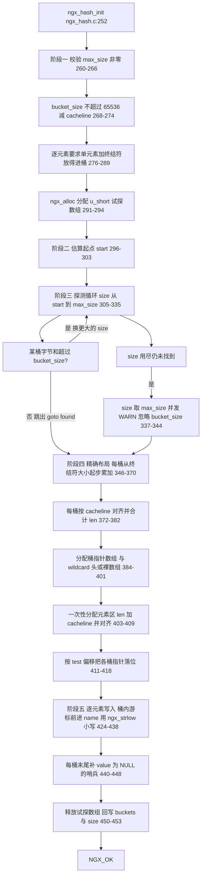

**图 3-1 解读**：第一阶段的三道校验决定了用户必须调 `*_hash_bucket_size`/`*_hash_max_size` 的场景；第二阶段的估算公式见 6.6 节逐行分析；第三阶段的探测本质是"**模拟装桶**"——不真正写内存，只在 `test[]` 里累加每桶字节数，一旦某个候选 size 能让所有桶都装下就锁定；第四、五阶段则把模拟结果变成真实内存布局。整个过程对 `names[]` 只读两遍（探测一遍、填充一遍），复杂度 O(候选数 × nelts)。

### 3.2 ngx_hash_add_key：三种 key 的分流

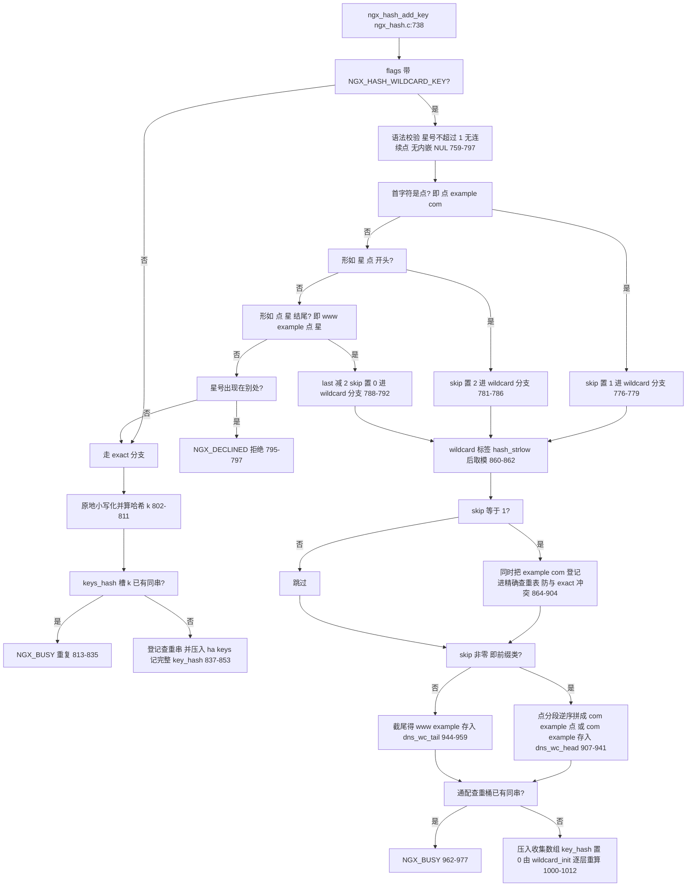

**图 3-2 解读**：这张图是 `ngx_hash_add_key` 的完整骨架，三个细节值得圈出来。其一，**`.example.com` 与精确名共表查重**（864-904）：`.example.com` 在语义上涵盖 `example.com`，所以它除了进 head 收集数组，还要把自己的主体 `example.com` 登记进 `keys_hash`，防止配置里再写一条精确 `example.com` 时检测不到冲突。其二，**两种通配的存储形态不同**：前缀类被逆序改写成 `com.example.`（带尾点），后缀类只截掉 `.*` 变 `www.example`——这个差异正是查找算法能"从右往左"/"从左往右"逐层降级的原因。其三，通配键的 `key_hash` 存 0（hash.c:1009），因为 `ngx_hash_wildcard_init` 会按层重新切分再哈希，预计算的整串哈希毫无用处。

### 3.3 ngx_hash_wildcard_init：按第一段标签递归分组

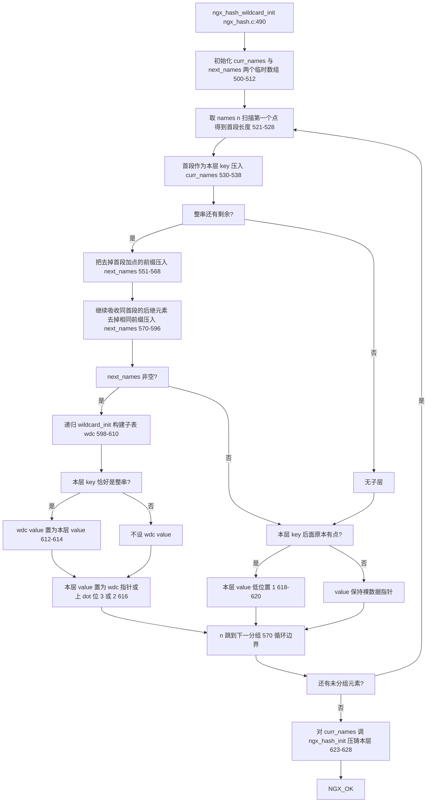

**图 3-3 解读**：递归的"层"与域名段一一对应：输入 `["com.example.", "com.test."]` 会先以 `com` 为首层键，把 `example.`、`test.` 递归下去。**前置条件**是 `names[]` 已按逆序域名排好序——调用方 `ngx_http.c` 在调用前用 `ngx_qsort` + `ngx_http_cmp_dns_wildcards` 排序（src/http/ngx_http.c:1617-1618 与 1635-1636），`ngx_hash_wildcard_init` 自己**不排序**，这是把通配键直接喂给 core 函数时最容易踩的坑。

### 3.4 ngx_radix_tree_create：预分配位层

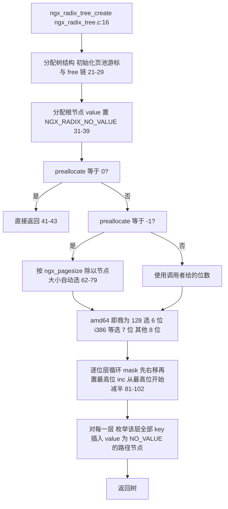

**图 3-4 解读**：预分配本质是"把二叉 trie 的前 `preallocate` 层全部铺出来"（每层多铺一倍节点：1, 2, 4, ... 共 2^n - 1 个）。`ngx_radix_tree.c:45-60` 的注释给出了理由：让最初的查找迭代命中的节点落在**连续页面**上，提高 TLB 命中；32 位平台铺 7 位正好吃满 4K 一页，64 位节点翻倍只够铺 6 位；铺超过一页没有意义，因为继续铺每页平均只摊到一个 bit 的节点，不如让随机插入自己分布。位数的选择以 `ngx_pagesize / sizeof(ngx_radix_node_t)` 为依据：amd64 节点 32 字节、页 4K，商 128 → 6 位；i386 节点 16 字节、商 256 → 7 位（radix.c:63-78）。

---

## 4. 核心查找与插入流程

### 4.1 ngx_hash_find：精确表查找

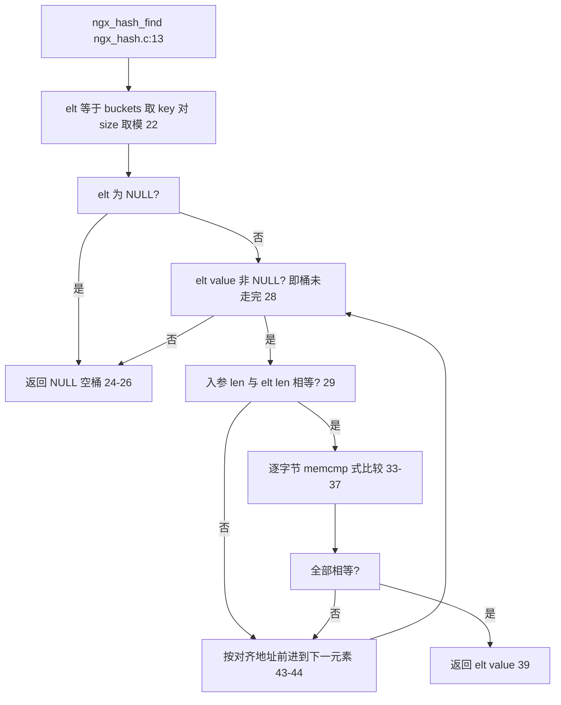

**图 4-1 解读**：查找是"先哈希定位桶，再桶内线性扫描"的两段式。桶内扫描的终止条件不是"到达某指针"，而是**撞到 value 为 NULL 的哨兵元素**；比较前先比长度，长度不等直接跳下一个——因为同一桶里的键哈希同余但长度可以任意。注意 `name` 必须已经是小写（存储时 `ngx_strlow` 小写化，hash.c:435；哈希计算用 `ngx_hash_key_lc/strlow`，hash.c:649-679），调用方传入原始大小写混合串会查不到——这是所有 `ngx_hash_find` 调用点的隐含契约。

### 4.2 ngx_hash_find_combined：三表合一的决策路径

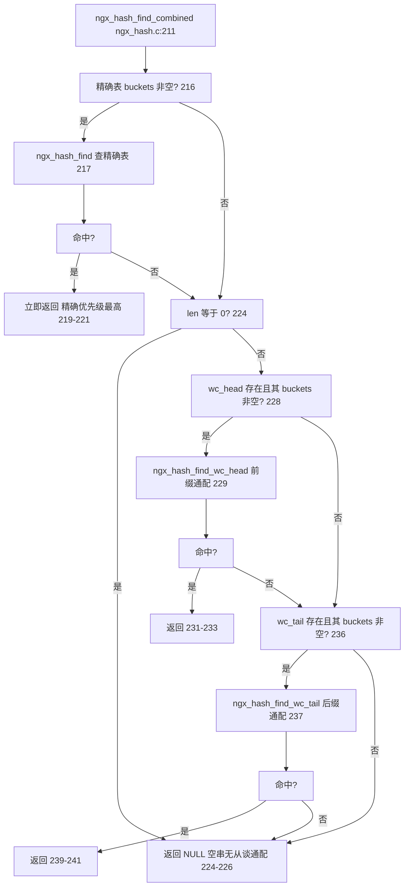

**图 4-2 解读**：优先级是**精确 > 前缀通配 > 后缀通配**，且三个表彼此独立——任何一个表未构建（buckets 为 NULL）都会被跳过。`len == 0` 的特判（224）防的是空串在通配查找里走 `while (n)` 循环时无谓的降级。虚拟主机匹配（`ngx_http_request.c:2330`）、map 变量（`ngx_http_variables.c:2492`）、referer 校验（`ngx_http_referer_module.c:193`）都走这条路径。

### 4.3 ngx_rbtree_insert：先普通二叉插入，再着色修复

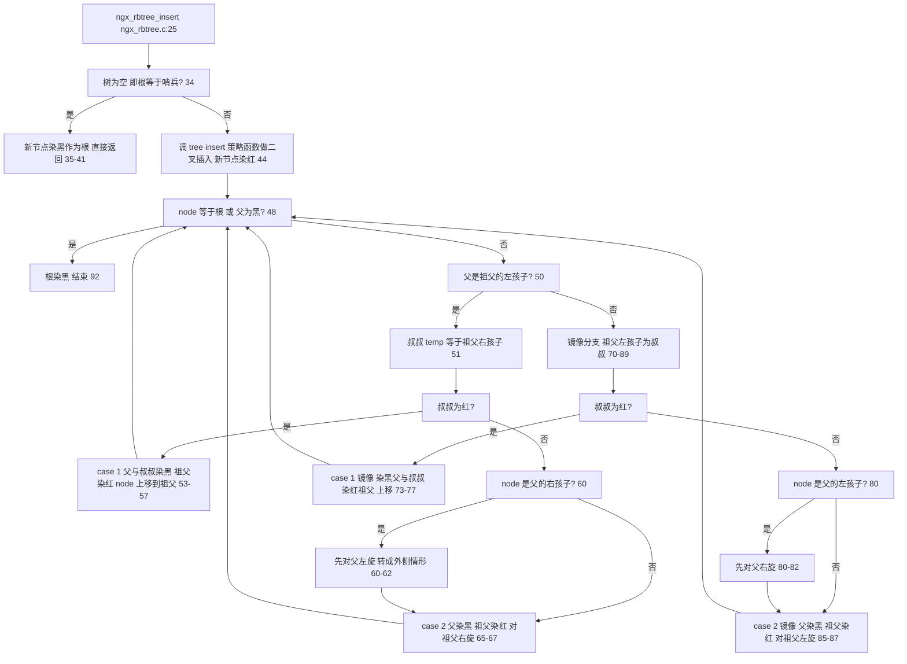

**图 4-3 解读**：进入循环的前提是"父为红"（48 行的第二个条件），而父为红蕴含**父不是根**（根恒为黑，见 92 行的收尾与第 6.11 节的不变量讨论），因此 50/71 行解引用祖父指针是安全的。case 1（红叔叔）只换色不旋转，把问题向上抛两层；case 2（黑叔叔）最多两次旋转子树内解决。循环每轮要么上移（case 1），要么旋转后父变黑使条件失效，因此修复至多 O(log n)。

### 4.4 ngx_radix32tree_find：沿途记录的最长前缀匹配

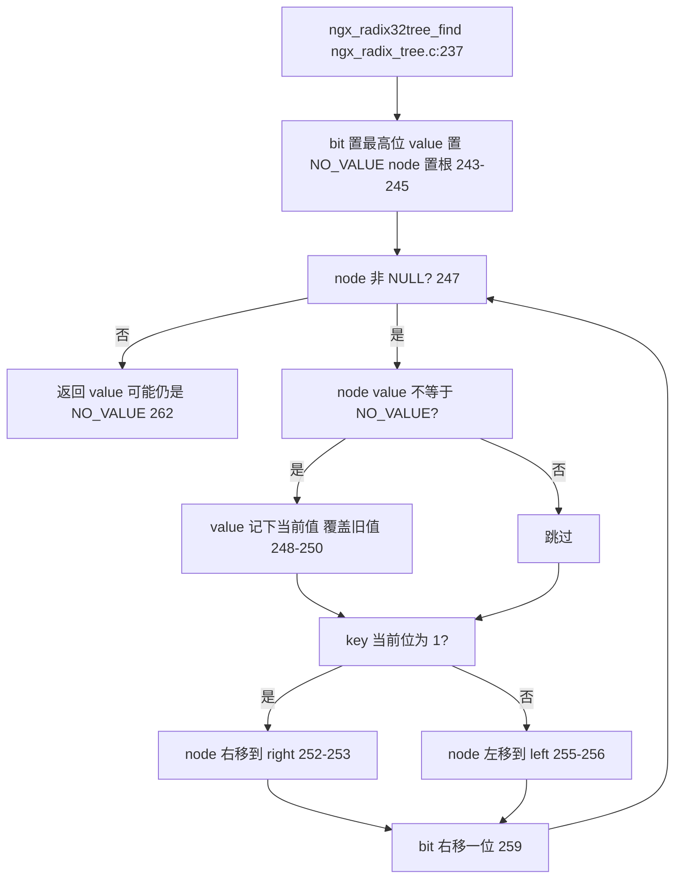

**图 4-4 解读**：radix 树没有"比较失败"的概念——它按 key 的二进制位从最高位往下走，能走多远走多远。**最长前缀匹配是免费的副产品**：每当路过的节点带有真实 value 就覆盖记录，循环自然结束时手中持有的就是"掩码最长的那条前缀"的值。对 geo 模块而言，`10.0.0.0/8` 与 `10.1.2.0/24` 同时存在时，查询 `10.1.2.3` 会先记下 /8 的值，再在 /24 节点覆盖之，返回 /24——这正是 CIDR 语义。

---

## 5. 关键时序图

### 5.1 虚拟主机名查找（请求 → server 配置）

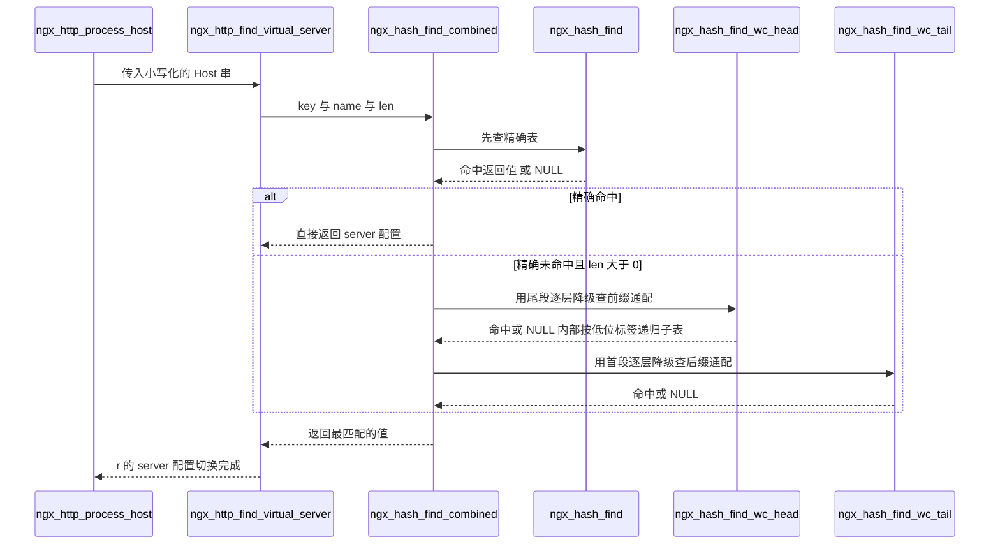

**图 5-1 解读**：每一跳的函数名都对应真实源码：入口在 `src/http/ngx_http_request.c:2330` 的 `ngx_hash_find_combined(&virtual_names->names, ...)`；`virtual_names` 是 `ngx_http_core_srv_conf_t` 内嵌的 `ngx_hash_combined_t`（三表字段定义于 `src/http/ngx_http_core_module.h:285-287`）。表的构建则在配置期由 `ngx_http.c:1600-1649` 完成：精确表用 `ngx_hash_key_lc` + `ngx_hash_init`，两张通配表各自排序后交给 `ngx_hash_wildcard_init`。

### 5.2 timer 树的最小超时与到期触发

```mermaid
sequenceDiagram
    participant LOOP as event loop
    participant FT as ngx_event_find_timer
    participant RT as ngx_event_timer_rbtree
    participant MN as ngx_rbtree_min
    participant EX as ngx_event_expire_timers
    participant HD as ev handler

    LOOP->>FT: 每轮阻塞前询问
    FT->>RT: 读 root 与 sentinel
    RT->>MN: 从根沿 left 下行
    MN-->>FT: 最左节点 即 key 最小
    FT-->>LOOP: 距最近超时的毫秒数 或无限
    LOOP->>LOOP: 以该值为 timeout 阻塞
    LOOP->>EX: 醒来后到期处理
    EX->>MN: 取当前最小节点
    EX->>RT: 未到期则返回 到期则 ngx_rbtree_delete 摘除
    EX->>HD: ev timedout 置 1 并回调
```

**图 5-2 解读**：这张图对应 `src/event/ngx_event_timer.c:32-96` 的两个函数。关键在"取最小"这一跳：`ngx_rbtree_min`（rbtree.h:76-84）只是沿 `left` 指针下行，复杂度 O(树高)；由于红黑树高度被夹在 O(log n)，工程上可视为常数级操作（百万节点约 20 次 dereference）。事件循环把 `ngx_event_find_timer()` 的返回值直接喂给 `epoll_wait` 的 timeout，**树的最小键就是整个进程的睡眠预算**——这是 timer 选 rbtree 而不是哈希表的根本原因：哈希表无法回答"最小 key 是多少"。

---

## 6. 源码逐段精读

本节是全文主体。每个函数按"签名 → 逐块逻辑 → 关键行 → 易错点"展开，所有行号均来自本仓库实际读取。

### 6.1 ngx_hash_find —— 桶内线性扫描（src/core/ngx_hash.c:12-49）

**签名**：`void *ngx_hash_find(ngx_hash_t *hash, ngx_uint_t key, u_char *name, size_t len)`（声明 hash.h:103）。参数 `key` 是调用方已算好的哈希值（未取模），`name/len` 是**小写化后的键串**。

**逐块逻辑**：

```c
/* src/core/ngx_hash.c:22-32 */
    elt = hash->buckets[key % hash->size];

    if (elt == NULL) {
        return NULL;
    }

    while (elt->value) {
        if (len != (size_t) elt->len) {
            goto next;
        }

        for (i = 0; i < len; i++) {
            if (name[i] != elt->name[i]) {
                goto next;
            }
        }
```

1. **定位**（22 行）：`key % hash->size` 选中桶。`size` 是构建期定死的桶数，运行期不变。
2. **空桶短路**（24-26 行）：空桶的槽位是 `NULL`（构建时 411-414 行跳过未分配的桶），一次解引用即可判定未命中。
3. **扫描**（28 行）：`while (elt->value)`——value 为 NULL 的元素是桶尾哨兵（hash.c:440-448 写入），循环靠它终止。这就是为什么用户**不能**把 `NULL` 作为合法 value 存进去：`ngx_hash_find` 会把它当哨兵提前截断。
4. **比较**（29-37 行）：先比 `len`，再逐字节比 `name`。没有调 `ngx_memcmp` 而是手写循环，配合 `goto next` 省去一次函数调用开销。

```c
/* src/core/ngx_hash.c:41-45 */
    next:

        elt = (ngx_hash_elt_t *) ngx_align_ptr(&elt->name[0] + elt->len,
                                               sizeof(void *));
        continue;
    }
```

5. **步进**（43-44 行）：下一元素紧跟在 `name[len]` 之后，并向上对齐到 `sizeof(void *)`——因为每个元素的 `value` 字段要求指针对齐。这与 `NGX_HASH_ELT_SIZE` 宏（6.5 节）的口径完全一致，两处必须同步修改。

**易错点**：传入未小写的 `name`（如含大写 Host 原文）永远查不中，因为存储侧在 hash.c:435 用 `ngx_strlow` 小写化；`key` 必须与存储侧用同一哈希函数算出（通常 `ngx_hash_key_lc`，hash.h:116）。

### 6.2 ngx_hash_find_wc_head —— 前缀通配的降级查找（src/core/ngx_hash.c:52-143）

**签名**：`void *ngx_hash_find_wc_head(ngx_hash_wildcard_t *hwc, u_char *name, size_t len)`（hash.h:104）。`name` 是完整待匹配域名（小写），`len` 是当前考虑的长度——**递归时会缩短**。

**逐块逻辑**：

```c
/* src/core/ngx_hash.c:62-76 */
    n = len;

    while (n) {
        if (name[n - 1] == '.') {
            break;
        }

        n--;
    }

    key = 0;

    for (i = n; i < len; i++) {
        key = ngx_hash(key, name[i]);
    }
```

1. **找最后一个点**（62-70 行）：从右往左扫，停在最右侧 `.` 上。注意 break 发生在**自减之前**，所以 `n` 是最后一个点**之后**的位置——`name[n..len-1]` 是最右的标签段，且**不含点**（例如 `www.example.com` 得到 `n=12`、尾段 `com`）。
2. **哈希尾段**（72-76 行）：只对尾段计算哈希。这是前缀通配的精髓：`*.example.com` 被逆序存成 `com.example.`，树的最上层键是 `com`，于是任何以 `.com` 结尾的名字都能在第一层撞桶。

```c
/* src/core/ngx_hash.c:90-99 */
        /*
         * the 2 low bits of value have the special meaning:
         *     00 - value is data pointer for both "example.com"
         *          and "*.example.com";
         *     01 - value is data pointer for "*.example.com" only;
         *     10 - value is pointer to wildcard hash allowing
         *          both "example.com" and "*.example.com";
         *     11 - value is pointer to wildcard hash allowing
         *          "*.example.com" only.
         */
```

3. **低位标签**（90-99 行注释；实现 101-137 行）：第一层查到的 `value` 有四种形态，由构建期 `ngx_hash_wildcard_init` 的 616/619 行打上（见 6.7 节）：
   - `value & 2` 置位 → 低位掩掉后是**子表指针**：若 `n == 0`（整个名字被消费完还停在子表上，即查的是裸 `example.com`）且 `value & 1` 置位则返回 NULL——`*.example.com` 不匹配 `example.com`；否则**递归** `ngx_hash_find_wc_head(hwc, name, n - 1)` 向更内层降级（101-125 行）。
   - 仅 `value & 1` 置位 → 数据指针但仅通配有效：`n == 0` 时返回 NULL，否则返回掩掉低位的数据（127-137 行）。
   - 两位都清零 → 数据指针，直接返回（139 行）。
4. **兜底**（142 行）：本层完全未命中时返回 `hwc->value`——即"以本层前缀结尾的更短通配模式"的值（例如同时配了 `*.com` 与 `*.example.com`，查询 `a.b.com` 降级失败时回落到 `*.com` 的值）。`wdc->value` 的赋值条件见 6.7 节对 612-614 行的分析。

**关键行**：递归降级在 118 行 `value = ngx_hash_find_wc_head(hwc, name, n - 1);`——每次把 `len` 缩到 `n-1`，等价于剥掉一层标签。`*.example.com` 能匹配 `a.b.example.com` 这类多层子域，正源于递归不限制降级次数。

**易错点**：该函数要求 `name` 以标签点分隔且小写；`n == 0`（name 无点）时第一层哈希为 0——一个合法但几乎必然未命中的值，若恰有恶意配置的 key 哈希到同桶且同串，行为需以实际数据验证，此处不展开（待验证场景：哈希值 0 的键碰撞）。

### 6.3 ngx_hash_find_wc_tail —— 后缀通配的降级查找（src/core/ngx_hash.c:146-207）

**签名**：`void *ngx_hash_find_wc_tail(ngx_hash_wildcard_t *hwc, u_char *name, size_t len)`（hash.h:105）。与 head 版对称，但从**左边**开始消费。

**逐块逻辑**：

```c
/* src/core/ngx_hash.c:156-168 */
    key = 0;

    for (i = 0; i < len; i++) {
        if (name[i] == '.') {
            break;
        }

        key = ngx_hash(key, name[i]);
    }

    if (i == len) {
        return NULL;
    }
```

1. **哈希首段**（156-164 行）：从左往右累加哈希，直到遇到 `.`。存的时候 `www.example.*` 截成 `www.example`（hash.c:944-958），所以查找方向与存储方向一致：先匹配 `www`。
2. **无点即失败**（166-168 行）：`www.example.*` 这类模式必须匹配**至少一个点**（星号要吃掉一段），裸串 `www` 直接返回 NULL。
3. **命中处理**（180-204 行）：`value & 2` 置位说明是子表指针——`i` 越过点后**递归** `ngx_hash_find_wc_tail(hwc, &name[i], len - i)`；两位全零是数据指针直接返回。与 head 不同，**tail 的 leaf 数据指针不需要 `& 1` 判定**：tail 模式不存在"裸名也匹配"的语义。
4. **兜底**（206 行）：`return hwc->value`，语义同 head——短的 `mail.*` 在构建时会把自己的值挂到 `mail` 层的 `wdc->value` 上（6.7 节），使 `mail.org` 在 `mail.com.*` 未命中时回落命中。

**易错点**：head 与 tail 的递归方向相反但都从"最外层表"进入；把 `wc_head` 与 `wc_tail` 配反（如把 `www.*` 塞进 head）会静默查不到——`ngx_hash_add_key` 的分流逻辑（hash.c:776-792）是唯一入口，手填数组绕过它会破坏一致性。

### 6.4 ngx_hash_find_combined —— 三表决策（src/core/ngx_hash.c:210-245）

**签名**：`void *ngx_hash_find_combined(ngx_hash_combined_t *hash, ngx_uint_t key, u_char *name, size_t len)`（hash.h:106-107）。

**逐块逻辑**（全文仅 36 行，逻辑即图 4-2）：

1. 216-222 行：精确表存在才查，命中即返回——**精确优先**。
2. 224-226 行：`len == 0` 直接 NULL，防止空串在通配函数里引发无意义递归。
3. 228-234 行 / 236-242 行：head、tail 依次尝试；每个表都检查 `wc_head != NULL && wc_head->hash.buckets` 双重条件——`ngx_hash_wildcard_init` 失败或未构建时 `buckets` 为 NULL。
4. 244 行：三表全空或全未命中返回 NULL。

**易错点**：combined 不做"先通配后精确"的回退，优先级固定。如果业务上希望"通配兜底、精确优先"，这正是现在的方式；反之（如希望更长的通配赢过短的精确）需要调用方自己编排。

### 6.5 NGX_HASH_ELT_SIZE —— 桶内存模型的度量衡（src/core/ngx_hash.c:248-249）

```c
/* src/core/ngx_hash.c:248-249 */
#define NGX_HASH_ELT_SIZE(name)                                               \
    (sizeof(void *) + ngx_align((name)->key.len + 2, sizeof(void *)))
```

**逐块逻辑**：一个元素占 `sizeof(void *)`（`value` 字段）+ `align(len + 2, 指针宽)`。`+2` 正是 `u_short len` 字段的大小；对齐保证**下一个元素**的 `value` 落在指针边界上——与 6.1 节步进公式 `ngx_align_ptr(&elt->name[0] + elt->len, sizeof(void *))` 互为镜像。举例（64 位机器）：键 `www.example.com`（15 字节）→ 8 + align(17, 8) = 8 + 24 = 32 字节。

**易错点**：这个宏把 `key.len` 算进预算，但**不包含**桶尾哨兵的 `sizeof(void *)`——哨兵在 `ngx_hash_init` 的 296 行（`bucket_size -= sizeof(void *)`）和 348-350 行（`test[i] = sizeof(void *)` 起步）单独预留。两处口径不一致是改桶模型时最常见的事故源。

### 6.6 ngx_hash_init —— 全文最精巧的内存预算算法（src/core/ngx_hash.c:251-486）

**签名**：`ngx_int_t ngx_hash_init(ngx_hash_init_t *hinit, ngx_hash_key_t *names, ngx_uint_t nelts)`（hash.h:109-110）。

**阶段一：参数校验（260-289 行）**

- 260-266 行：`max_size == 0` 直接 EMERG——桶数必须显式或隐式给出。
- 268-274 行：`bucket_size > 65536 - ngx_cacheline_size` 拒绝。原因：每桶字节数存在 `u_short test[]` 里，上限 65536；cacheline 余量留给对齐。
- 276-289 行：逐元素检查 `bucket_size >= NGX_HASH_ELT_SIZE + sizeof(void *)`——最长的那个键必须能独自住进一个桶（还要留哨兵位）。这对应配置指令 `server_names_hash_bucket_size` 的经典报错。

**阶段二：试探数组与起点估算（291-303 行）**

```c
/* src/core/ngx_hash.c:296-303 */
    bucket_size = hinit->bucket_size - sizeof(void *);

    start = nelts / (bucket_size / (2 * sizeof(void *)));
    start = start ? start : 1;

    if (hinit->max_size > 10000 && nelts && hinit->max_size / nelts < 100) {
        start = hinit->max_size - 1000;
    }
```

- 296 行：从预算里抠掉哨兵的一指针宽，之后所有"桶字节数"都不含哨兵。
- 298-299 行：起点估算——分母 `bucket_size / (2 * sizeof(void *))` 是"假设平均每元素占两个指针宽时，一桶能塞多少元素"；`nelts` 除以它得到**桶数下限的乐观估计**。这只是缩小探测区间的启发式，作者未注释经验依据（待验证：该系数的历史出处）。
- 301-303 行：若 `max_size` 远大于元素数（比如 `types_hash_max_size` 配了几万而实际类型只有几百），从 `max_size - 1000` 起步，把探测次数压到最多 1000 轮。

**阶段三：逐 size 模拟装桶（305-344 行）**

```c
/* src/core/ngx_hash.c:314-327 */
            key = names[n].key_hash % size;
            len = test[key] + NGX_HASH_ELT_SIZE(&names[n]);

            if (len > bucket_size) {
                goto next;
            }

            test[key] = (u_short) len;
        }

        goto found;
```

对每个候选 `size`：清零 `test[]`，把每个元素按 `key_hash % size` 归桶、累加字节数；**任一桶超预算就换下一个 size**（323-324 行 `goto next` 外层 continue）。全部装下则 `goto found`。整个阶段是纯算术模拟，不碰真实元素区。若所有 size 都失败，337-344 行发 WARN——"无法构建最优哈希，应增大 max_size 或 bucket_size；忽略 bucket_size"——然后以 `max_size` 硬建（此时桶可能超预算到 65535 字节，见阶段四的硬校验）。

**阶段四：精确布局与一次性分配（346-418 行）**

- 348-350 行：`test[i] = sizeof(void *)` 起步——每桶先预留**哨兵元素**的 `value` 字段。
- 352-370 行：重算每桶真实字节数；此时若单桶超 `65536 - cacheline` 则 EMERG 并 `ngx_free(test)` 返回（360-367 行）——这是 max_size 兜底路径上的保险丝。
- 372-382 行：每桶向上对齐到 cacheline，累加得到元素区总长 `len`。
- 384-393 行：**关键分叉**——`hinit->hash == NULL` 时分配 `sizeof(ngx_hash_wildcard_t) + size * sizeof(ngx_hash_elt_t *)`，桶数组紧随 wildcard 头之后；这是嵌套通配表"头与表一体"的实现。非 NULL（如 `hash.hash = &addr->hash`）则只分配裸桶数组。
- 403-409 行：元素区一次 `ngx_palloc(len + ngx_cacheline_size)` 后 `ngx_align_ptr` 到 cacheline——多分配一个 cacheline 是因为对齐可能向后跳。
- 411-418 行：`buckets[i] = elts; elts += test[i]`——按阶段四算好的每桶尺寸切分连续内存。

**阶段五：填元素与哨兵（420-453 行）**

```c
/* src/core/ngx_hash.c:424-438 */
    for (n = 0; n < nelts; n++) {
        if (names[n].key.data == NULL) {
            continue;
        }

        key = names[n].key_hash % size;
        elt = (ngx_hash_elt_t *) ((u_char *) buckets[key] + test[key]);

        elt->value = names[n].value;
        elt->len = (u_short) names[n].key.len;

        ngx_strlow(elt->name, names[n].key.data, names[n].key.len);

        test[key] = (u_short) (test[key] + NGX_HASH_ELT_SIZE(&names[n]));
    }
```

420-422 行把 `test[]` 清零复用为**桶内写游标**；每个元素写到 `buckets[key] + 游标` 处，写完游标前进一个元素——与探测阶段同序，因此**同桶内元素保持输入顺序**。435 行 `ngx_strlow` 在拷贝的同时小写化。最后：

```c
/* src/core/ngx_hash.c:440-448 */
    for (i = 0; i < size; i++) {
        if (buckets[i] == NULL) {
            continue;
        }

        elt = (ngx_hash_elt_t *) ((u_char *) buckets[i] + test[i]);

        elt->value = NULL;
    }
```

每个非空桶在其元素区末尾补一个 `value == NULL` 的假元素（440-448 行）——它只占 `sizeof(void *)` 一个字，正是阶段四起步预留的那份。450 行 `ngx_free(test)`（试探数组是 `ngx_alloc` 裸分配的，不归内存池管）；452-453 行回写 `buckets` 与 `size`。

**易错点**：① `names[n].key.data == NULL` 的元素被静默跳过（276、309、352、424 行四处都有过滤），上层以此表达"无效项"；② 表构建后不可变，想加一个 key 只能重建整表——这是运行期动态键（如连接级状态）绝不使用 `ngx_hash_t` 的原因。

### 6.7 ngx_hash_wildcard_init —— 递归压铸嵌套表（src/core/ngx_hash.c:489-631）

**签名**：`ngx_int_t ngx_hash_wildcard_init(ngx_hash_init_t *hinit, ngx_hash_key_t *names, ngx_uint_t nelts)`（hash.h:111-112）。输入是 `ngx_hash_add_key` 产出的逆序通配键（如 `com.example.`），**且已排序**。

**逐块逻辑**：

1. **首段切分**（521-538 行）：对当前组的首个 key 扫描第一个 `.`，`len` 为首段长度（含点与否由 `dot` 区分）；首段连同其 value 压入 `curr_names`。
2. **自身剩余与同组兄弟**（545-596 行）：`dot_len = len + 1`（545 行）。若有剩余部分（`names[n].key.len != len`，`len` 已在 548 行自增含点），把剩余压入 `next_names`（551-568 行）。随后 570-596 行的循环吸收**同首段**的后继元素：`ngx_strncmp` 前 `len` 字节相同（571 行）且——当本组键自身无点时——下一个字符必须是 `.`（575-580 行，防止 `com` 错误吞并 `comcast` 这类键！），同样去前缀入组。
3. **递归**（598-616 行）：

```c
/* src/core/ngx_hash.c:598-620 */
        if (next_names.nelts) {

            h = *hinit;
            h.hash = NULL;

            if (ngx_hash_wildcard_init(&h, (ngx_hash_key_t *) next_names.elts,
                                       next_names.nelts)
                != NGX_OK)
            {
                return NGX_ERROR;
            }

            wdc = (ngx_hash_wildcard_t *) h.hash;

            if (names[n].key.len == len) {
                wdc->value = names[n].value;
            }

            name->value = (void *) ((uintptr_t) wdc | (dot ? 3 : 2));

        } else if (dot) {
            name->value = (void *) ((uintptr_t) name->value | 1);
        }
```

   - `h.hash = NULL`（601 行）逼着内层 `ngx_hash_init` 走"多分配 wildcard 头"的分支（6.6 节阶段四），于是 610 行能直接把 `h.hash` 当 `ngx_hash_wildcard_t *` 用。
   - **`wdc->value` 的赋值条件**（612-614 行）：仅当本层键恰好消费完整串（`names[n].key.len == len`）时——对应"更短的兄弟模式"，如同时配置 `mail.*` 与 `mail.com.*`，`mail` 层的子表 value 挂上 `mail.*` 的值，供 6.3 节的 206 行兜底。
   - **低位打标**（616 行）：有子层时 `value = wdc | (dot ? 3 : 2)`——`dot` 说明本段后面还有点，即本层匹配的是"星号加多层"的形态，置位 bit0；619 行：无子层但有尾点（leaf 且通配）则置 bit0。head 查找据此区分 `example.com` 与 `*.example.com` 能否命中（6.2 节）。
4. **压铸本层**（623-628 行）：对 `curr_names` 调 `ngx_hash_init`——注意此时本层 value 可能是"真值 + 低位标签"或"子表指针 + 标签"，`ngx_hash_init` 一概按 `void *` 透传存储，不感知标签存在。这就是整个机制最漂亮的地方：**通配语义完全由低位约定承载，底层哈希零改动**。

**易错点**：输入必须已按逆序域名排序（调用方 `ngx_http.c:1617-1618`）；`ngx_hash_wildcard_init` 内部假定相邻同前缀元素连续，乱序会静默漏组。另外 575-580 行的"无点组边界"检查极易被忽视：它保证 `com` 与 `comcast` 不会因共享前三字节而被并组。

### 6.8 哈希函数族：ngx_hash 宏与三个包装（src/core/ngx_hash.h:114；src/core/ngx_hash.c:634-679）

**签名与定义**：

```c
/* src/core/ngx_hash.h:114 */
#define ngx_hash(key, c)   ((ngx_uint_t) key * 31 + c)
```

- `ngx_hash(key, c)`：逐字符 `hash = hash * 31 + c` 的经典多项式哈希。乘 31 可被编译器优化为移位减法，分布性足够。
- `ngx_hash_key`（634-646 行）：大小写敏感版，循环套宏。
- `ngx_hash_key_lc`（649-661 行）：每个字符先 `ngx_tolower` 再进哈希——**server_names_hash 的默认选择**（`ngx_http.c:1600` 显式指定 `hash.key = ngx_hash_key_lc`）。
- `ngx_hash_strlow`（664-679 行）：**边拷贝边小写边哈希**三合一，返回值是哈希、副产品是 `dst` 中的小写串——`ngx_hash_add_key` 在 860 行用它一次完成通配键的小写化与哈希。

**易错点**：`ngx_hash_key` 与 `ngx_hash_key_lc` 对同一字符串给出**不同**哈希值。构建时 `hinit->key` 用什么，查找时就必须用什么；混用（构建 lc、查找原串哈希）是肉眼难察的逻辑错。

### 6.9 ngx_hash_keys_array_init —— 预编译车间的开工（src/core/ngx_hash.c:682-734）

**签名**：`ngx_int_t ngx_hash_keys_array_init(ngx_hash_keys_arrays_t *ha, ngx_uint_t type)`（hash.h:120）。

**逐块逻辑**：687-694 行按档位定参——SMALL 档 `asize=4, hsize=107`（虚拟主机数少时省内存），LARGE 档 `asize=NGX_HASH_LARGE_ASIZE(16384), hsize=NGX_HASH_LARGE_HSIZE(10007)`。696-714 行初始化 `keys / dns_wc_head / dns_wc_tail` 三个收集数组（都挂 `temp_pool`，构建完随临时池销毁）；716-731 行 `ngx_pcalloc` 出**三张长度为 `hsize` 的 `ngx_array_t` 槽表**用于查重。

**易错点**：三个收集数组挂 `temp_pool`，最终表挂 `pool`——`ngx_hash_init(hinit, ...)` 时 `hinit->pool` 必须是生存池、`hinit->temp_pool` 是临时池，配反会导致最终表内存随临时池一起被释放。`ngx_http.c:1606-1621` 的写法（精确表 `temp_pool = NULL`，通配表 `temp_pool = &ha.temp_pool`）是标准姿势。

### 6.10 ngx_hash_add_key —— 三分支分类登记（src/core/ngx_hash.c:737-1013）

**签名**：`ngx_int_t ngx_hash_add_key(ngx_hash_keys_arrays_t *ha, ngx_str_t *key, void *value, ngx_uint_t flags)`（hash.h:121-122）。返回 `NGX_OK / NGX_BUSY(重复) / NGX_DECLINED(语法非法) / NGX_ERROR`。

**分支一：语法校验（750-798 行）**。`flags & NGX_HASH_WILDCARD_KEY` 时：759-765 行要求 `*` 至多一个；767-769 行拒绝 `..`；771-773 行拒绝内嵌 `\0`。随后定型：776-779 行首字符 `.` → `skip=1`（`.example.com` 型）；783-786 行 `*.` 开头 → `skip=2`；788-792 行末尾 `.*` → `last -= 2`（后缀型，`skip=0`）；795-797 行星号出现在其他位置 → `NGX_DECLINED`。

**分支二：精确键（802-853 行）**。805-807 行：除非 `NGX_HASH_READONLY_KEY`，**原地小写化**调用者的 key（改的是 `ngx_hash_keys_arrays_t` 持有的串，通常是配置拷贝）；811 行 `k %= ha->hsize` 后在 `keys_hash[k]` 里 O(期望1) 查重（813-835 行），重复返回 `NGX_BUSY`；837-842 行把 key 压入查重桶，844-851 行压入 `ha->keys` 并记 `key_hash = ngx_hash_key(key->data, last)`——**未取模的完整哈希**，因为最终取模由 `ngx_hash_init` 按 `size` 做。

**分支三：通配键（856-1012 行）**。860-862 行 `ngx_hash_strlow` 一次完成"剩余段小写化 + 哈希 + 取模"。`skip == 1` 时额外把主体 `example.com` 登记进 `keys_hash`（864-904 行），使 `.example.com` 与精确 `example.com` 互斥。随后是核心的**逆序改写**：

```c
/* src/core/ngx_hash.c:922-932 */
        for (i = last - 1; i; i--) {
            if (key->data[i] == '.') {
                ngx_memcpy(&p[n], &key->data[i + 1], len);
                n += len;
                p[n++] = '.';
                len = 0;
                continue;
            }

            len++;
        }
```

从尾部向头扫：每遇一个 `.` 就把刚积累的标签整段拷到输出并补一个 `.`。934-937 行处理残余（`skip=1` 时首标签从下标 1 开始拷，天然跳过前导点）——例如 `.example.com` 产出 `com.example\0`，`*.example.com` 产出 `com.example.\0`（尾点保留，注释见 909-912 行）。产出后 941-942 行进 `dns_wc_head`；后缀分支（944-958 行）则 `last++` 后 `ngx_cpystrn` 得 `www.example\0` 进 `dns_wc_tail`。962-984 行在通配查重桶里查重；1002-1010 行压入收集数组，`key_hash = 0`（1009 行，层级哈希由 wildcard_init 重算）。

**易错点**：① 788 行 `key->data[i - 2]` 依赖 759 行循环结束时 `i == key->len`，这种"循环变量复用"极脆弱，改动循环条件就会读到界外；② `.example.com` 型会**同时**占用精确查重表与 head 表，报 `NGX_BUSY` 时要分清是哪张表冲突（864-904 与 962-977 两处）。

### 6.11 ngx_rbtree_insert —— 插入与着色修复全流程（src/core/ngx_rbtree.c:24-93）

**签名**：`void ngx_rbtree_insert(ngx_rbtree_t *tree, ngx_rbtree_node_t *node)`（rbtree.h:54）。调用者**预填 `node->key`**，节点本体由策略函数挂链。

**逐块逻辑**：

1. **空树**（34-42 行）：根即哨兵时，新节点染黑当根，孩子指哨兵，直接返回。
2. **策略插入**（44 行）：`tree->insert(*root, node, sentinel)`——三叉定位由策略函数完成（见 6.12/6.13/6.25），新节点染红挂上。
3. **修复循环**（48-90 行）：

```c
/* src/core/ngx_rbtree.c:50-67 */
        if (node->parent == node->parent->parent->left) {
            temp = node->parent->parent->right;

            if (ngx_rbt_is_red(temp)) {
                ngx_rbt_black(node->parent);
                ngx_rbt_black(temp);
                ngx_rbt_red(node->parent->parent);
                node = node->parent->parent;

            } else {
                if (node == node->parent->right) {
                    node = node->parent;
                    ngx_rbtree_left_rotate(root, sentinel, node);
                }

                ngx_rbt_black(node->parent);
                ngx_rbt_red(node->parent->parent);
                ngx_rbtree_right_rotate(root, sentinel, node->parent->parent);
```

   **循环不变量**：仅当 `node != root 且父为红` 时进入（48 行）。父为红 ⇒ 父非根（根恒黑，92 行每次收尾强制）⇒ 祖父存在，50 行解引用安全。三种 case：
   - **case 1（叔叔红，53-57 行）**：父、叔染黑，祖父染红，`node` 上移两层继续循环——把"双红"问题往上抛。
   - **case 2/3（叔叔黑，59-67 行）**：若 node 是父的右孩子（"内侧"），先对父左旋转成"外侧"；随后父染黑、祖父染红、对祖父右旋，子树局部恢复合法，循环必然结束。
   - 70-89 行是左右镜像（父为右孩子、叔叔为左孩子），逻辑对称，内旋方向相反（80-82 行右旋，87 行左旋）。
4. **收尾**（92 行）：`ngx_rbt_black(*root)` 无条件把根染黑——它是 case 1 把红色一路抛到根时的兜底。

**逐步状态推演**（以依次插入 `1, 3, 2` 为例，哨兵记作 S）：

| 步骤 | 操作 | 树状态（B=黑 R=红） | 说明 |
|---|---|---|---|
| 1 | 插 1 | `1B` | 空树分支，根染黑（34-42 行） |
| 2 | 插 3 | `1B →(R) 3R` | 父黑，无需修复，3 挂 1 的 right（策略函数 104 行） |
| 3 | 插 2 | `1B →(R) 3R →(L) 2R` | 二叉插入：2 小于 1 走右，2 小于 3 走左 |
| 4 | 修复 | 父 3 红、3 是祖父右孩子（走镜像分支 70 行）；叔叔 = 1 的 left = S 黑 → case 2 镜像内旋：node==父左 → `node=3`、对 3 **右旋**（80-82 行），树变为 `1B → 2R → 3R` |
| 5 | 收尾 | 父 2 染黑、祖父 1 染红、对 1 **左旋**（85-87 行）→ `2B`，左 `1R`，右 `3R`；node=3 的父 2 已黑，循环退出；92 行根染黑 | 双旋（RL 型）完成，全树合法 |

**易错点**：策略函数只负责"挂到哪"，**必须**把新节点染红（`ngx_rbt_red(node)`）并初始化孩子指针——自定义 insert（6.25 节）漏掉这三行会直接破坏修复循环的前提。

### 6.12 ngx_rbtree_insert_value —— 缺省策略与重复键（src/core/ngx_rbtree.c:96-118）

**签名**：`void ngx_rbtree_insert_value(ngx_rbtree_node_t *temp, ngx_rbtree_node_t *node, ngx_rbtree_node_t *sentinel)`（rbtree.h:56-57）。

**逐块逻辑**：

```c
/* src/core/ngx_rbtree.c:104-118 */
        p = (node->key < temp->key) ? &temp->left : &temp->right;

        if (*p == sentinel) {
            break;
        }

        temp = *p;
    }

    *p = node;
    node->parent = temp;
    node->left = sentinel;
    node->right = sentinel;
    ngx_rbt_red(node);
```

循环用**二级指针** `p` 定位：严格小于走左，**大于等于走右**——相等的键一律向右堆积，即允许重复 key。挂链后三件事：父指针、双孩子指哨兵、染红。这红色是修复循环的启动条件。

**易错点**：`p` 是"父的孩子槽"的地址而非节点地址，`break` 后 `*p = node` 一步完成父侧接线——若把 `p` 误解为节点指针会写挂整棵树。

### 6.13 ngx_rbtree_insert_timer_value —— 回绕感知的比较（src/core/ngx_rbtree.c:121-153）

**签名**：`void ngx_rbtree_insert_timer_value(ngx_rbtree_node_t *temp, ngx_rbtree_node_t *node, ngx_rbtree_node_t *sentinel)`（rbtree.h:58-59）。

**关键行**：

```c
/* src/core/ngx_rbtree.c:129-139 */
        /*
         * Timer values
         * 1) are spread in small range, usually several minutes,
         * 2) and overflow each 49 days, if milliseconds are stored in 32 bits.
         * The comparison takes into account that overflow.
         */

        /*  node->key < temp->key */

        p = ((ngx_rbtree_key_int_t) (node->key - temp->key) < 0)
            ? &temp->left : &temp->right;
```

与 6.12 的唯一差别在比较：`node->key - temp->key` 以**有符号差**判断大小。两个时刻相距很近时，即使 `ngx_msec_t` 在 32 位平台上回绕（约 49.7 天），它们的差值仍是小的正/负数——差值比较天然免疫回绕。相等时走右，因此**timer 树允许重复 key**（同毫秒到期的事件共存），这与 `src/event/ngx_event_timer.c:16-20` 的注释"may contain the duplicate keys"互相印证。

**易错点**：该比较只在两 key 相距小于半个回绕周期时成立；timer 场景天然满足（邻近毫秒），拿去给"跨度极大"的键排序是错的。

### 6.14 ngx_rbtree_delete —— 后继顶替与删除修复（src/core/ngx_rbtree.c:156-315）

**签名**：`void ngx_rbtree_delete(ngx_rbtree_t *tree, ngx_rbtree_node_t *node)`（rbtree.h:55）。

**逐块逻辑**：

1. **选定顶替者**（167-178 行）：

```c
/* src/core/ngx_rbtree.c:167-178 */
    if (node->left == sentinel) {
        temp = node->right;
        subst = node;

    } else if (node->right == sentinel) {
        temp = node->left;
        subst = node;

    } else {
        subst = ngx_rbtree_min(node->right, sentinel);
        temp = subst->right;
    }
```

   至多一个孩子 → 顶替者就是被删节点自己（`subst = node`）；两个孩子 → 取**右子树最左节点**（后继）作 `subst`，其后右孩子作 `temp`。与教科书不同，nginx **不拷贝后继的 key**，而是把后继节点**整体搬到**被删节点的位置（结构顶替），这样宿主结构（外层 `ngx_event_t` 等）的指针无需更新。
2. **删根特例**（180-191 行）：`subst == root` 时根换成 temp 并染黑——树空或仅剩单链，直接返回（191 行）。
3. **顶替**（193-238 行）：193 行记下 `subst` 原色到 `red`。195-200 行把 subst 从原位摘出；202-238 行分两种：`subst == node`（单孩子）只需把 temp 接到 node 父下；否则把 subst 搬进 node 的位置——继承其孩子（215-216 行）、父（217 行）、**颜色**（218 行 `ngx_rbt_copy_color`），并修复 220-237 行的父侧与孩子侧回链。
4. **修复判断**（240-248 行）：先清空被删节点的指针（DEBUG 用，240-244 行）；若 subst 原为红，摘除不影响黑高，直接返回（246-248 行）。
5. **删除修复**（250-314 行）：`temp`（被顶上来的"缺口"）为黑且非根时循环，兄弟记作 `w`，左缺口的四 case：
   - **case 1（兄红，257-262 行）**：兄染黑、父染红、对父左旋，转出黑兄。
   - **case 2（兄黑、双侄黑，264-267 行）**：兄染红，缺口上移到父——黑亏一层向上传播。
   - **case 3（兄黑、近侄红，269-274 行）**：近侄染黑、兄染红、对兄右旋，转出远红侄。
   - **case 4（远侄红，276-280 行）**：兄继承父色、父与远侄染黑、对父左旋——一步补平黑亏，`temp = *root` 终止循环。
   283-311 行为右缺口镜像；314 行无条件把 `temp` 染黑兜底。

**易错点**：删除后**不要**复用 `node`——240-244 行已把它的指针清零、key 归零；宿主结构若要归还池必须用自己的析构路径，而不是指望这些清零动作。

### 6.15 左旋与右旋（src/core/ngx_rbtree.c:318-375）

**签名**：`static ngx_inline void ngx_rbtree_left_rotate(ngx_rbtree_node_t **root, ngx_rbtree_node_t *sentinel, ngx_rbtree_node_t *node)`（rbtree.c:18-21 前置声明）。

**逐块逻辑**（左旋）：

```c
/* src/core/ngx_rbtree.c:324-337 */
    temp = node->right;
    node->right = temp->left;

    if (temp->left != sentinel) {
        temp->left->parent = node;
    }

    temp->parent = node->parent;

    if (node == *root) {
        *root = temp;

    } else if (node == node->parent->left) {
        node->parent->left = temp;
```

五步标准旋：① 抬起右孩子 `temp`；② node 认领 temp 的左子树（并回链父指针）；③ temp 认领 node 的原父；④ 按 node 原位（根/左/右）把父侧指向 temp；⑤ 343-344 行 `temp->left = node; node->parent = temp` 完成父子反转。右旋（348-375 行）逐行镜像。两函数都 `static ngx_inline`——旋转在修复循环里高频出现，内联避免调用开销。

**易错点**：第 ④ 步的三分支缺一不可，尤其 `node == *root` 时要同步改 `tree->root`（通过二级指针 `root` 实现，所以旋转函数拿到的是 `&tree->root`）。

### 6.16 ngx_rbtree_next —— 中序后继（src/core/ngx_rbtree.c:378-404）

**签名**：`ngx_rbtree_node_t *ngx_rbtree_next(ngx_rbtree_t *tree, ngx_rbtree_node_t *node)`（rbtree.h:60-61）。

**逐块逻辑**：385-387 行——右子树非空则后继是右子树最左节点（`ngx_rbtree_min`）；否则 391-403 行向上爬，直到 node 是父的**左**孩子，该父即后继；爬到根返回 NULL。整树遍历开销摊还 O(1) 每步（每条边至多走两次）。timer 树用它做"还有没有不可取消的 timer"扫描（`ngx_event_timer.c:112-115`）。

### 6.17 ngx_rbtree_min —— 最左节点（src/core/ngx_rbtree.h:76-84）

```c
/* src/core/ngx_rbtree.h:76-84 */
static ngx_inline ngx_rbtree_node_t *
ngx_rbtree_min(ngx_rbtree_node_t *node, ngx_rbtree_node_t *sentinel)
{
    while (node->left != sentinel) {
        node = node->left;
    }

    return node;
}
```

**逐块逻辑**：沿 `left` 一路到底。它不是 O(1)——最坏 O(h)；但红黑树保证 h ≤ 2·log₂(n+1)，**百万节点也只有约 40 次指针跳转**，对事件循环每轮一次的调用频率而言工程上等价于常数。nginx 没有为"最小节点"维护缓存指针（如某些堆实现），换来的是实现零状态：删除最小节点就是普通 `ngx_rbtree_delete`，无需专门路径。这是"宁要简单正确，不要微优化"的典型取舍。

### 6.18 ngx_radix_tree_create —— 节点树与页池的诞生（src/core/ngx_radix_tree.c:15-105）

**签名**：`ngx_radix_tree_t *ngx_radix_tree_create(ngx_pool_t *pool, ngx_int_t preallocate)`（radix.h:37-38）。`preallocate`：0 不预分配；>0 预分配的位数；-1 自动选。

**逐块逻辑**：21-39 行分配树结构与根节点，根 `value = NGX_RADIX_NO_VALUE`（代表空前缀无值）。41-43 行 `preallocate == 0` 直接返回。62-79 行自动档：按 `ngx_pagesize / sizeof(ngx_radix_node_t)` 分派——128（amd64）→ 6 位，256（i386、sparc64）→ 7 位，其余 → 8 位（注释 45-60 行解释了"每页只装得下这么多节点层"的账）。预分配本体：

```c
/* src/core/ngx_radix_tree.c:86-99 */
        key = 0;
        mask >>= 1;
        mask |= 0x80000000;

        do {
            if (ngx_radix32tree_insert(tree, key, mask, NGX_RADIX_NO_VALUE)
                != NGX_OK)
            {
                return NULL;
            }

            key += inc;

        } while (key);

        inc >>= 1;
```

每轮外层循环加深一位：`mask` 最高位再置一个 1（掩码变长一位），内层 `do-while` 枚举该层全部 key（`key += inc`，`inc` 依次 0x80000000 → 0x40000000 → ...）。也就是说，**预分配复用了普通插入函数**：向树里插入一堆 `value = NO_VALUE` 的前缀路径，铺出完整的二叉 trie 前 n 层（2^n - 1 个节点）。`NGX_RADIX_NO_VALUE` 在此兼任"结构性节点"的空值标记。

**易错点**：预分配的节点 value 是 `NO_VALUE` 而非用户数据，`ngx_radix32tree_find` 沿途会"路过"它们但不记录（248 行有 `!= NO_VALUE` 判断），语义安全；但若用户 value 恰好是 `(uintptr_t) -1`（如把 `-1` 当错误码存储）会被误判为空——`NGX_RADIX_NO_VALUE` 定义（radix.h:16）就是为这个约定服务的。

### 6.19 ngx_radix32tree_insert —— 按位下行建链（src/core/ngx_radix_tree.c:108-170）

**签名**：`ngx_int_t ngx_radix32tree_insert(ngx_radix_tree_t *tree, uint32_t key, uint32_t mask, uintptr_t value)`（radix.h:40-41）。`key` 与 `mask` 都是**主机序**的 32 位值（geo 模块在插入前已 `ntohl`，见 ngx_http_geo_module.c:227 的对称读取）。

**逐块逻辑**：

```c
/* src/core/ngx_radix_tree.c:120-134 */
    while (bit & mask) {
        if (key & bit) {
            next = node->right;

        } else {
            next = node->left;
        }

        if (next == NULL) {
            break;
        }

        bit >>= 1;
        node = next;
    }
```

1. **走既有路径**（120-134 行）：从最高位开始，只要掩码还覆盖当前位就按 key 的该位选 left/right，直到撞上 `NULL` 孩子（该位以下还没人走过）或掩码耗尽。
2. **路径已存在**（136-143 行）：`next` 非 NULL 说明掩码长度内全程有路——落点 `node` 若已有值则 `NGX_BUSY`（同前缀重复），否则覆盖写入。这覆盖了"短前缀后插长前缀"之外的所有情况，例如先插 `10.0.0.0/8` 再插 `0.0.0.0/0`（mask=0 时循环体不执行，`node` 就是根）。
3. **补建缺失路径**（145-167 行）：从断点开始逐位 `ngx_radix_alloc` 新节点、按位挂 left/right、`value` 置 `NO_VALUE`，最后 167 行把终点 value 写为用户值。

**易错点**：`NGX_BUSY` 只在"终点已有值"时返回；若新前缀是既有前缀的**祖先**（如已有 `/24` 再插 `/8`），路径早已存在且中途节点值为 `NO_VALUE`，会**覆盖成功**——这正是 geo 模块允许先配宽网段再配窄网段的机制。

### 6.20 ngx_radix32tree_delete —— 塌缩与回收（src/core/ngx_radix_tree.c:173-233）

**签名**：`ngx_int_t ngx_radix32tree_delete(ngx_radix_tree_t *tree, uint32_t key, uint32_t mask)`（radix.h:42-43）。

**逐块逻辑**：179-195 行按掩码下行定位目标节点，走空返回 `NGX_ERROR`。197-204 行：**有孩子**则只清 value（若原本有值返回 OK，否则 ERROR）——路径还得留着给孩子们。无孩子则进入 206-230 行的**塌缩循环**：把自己从父侧摘下、挂进 `tree->free` 单链（214-215 行，借用 `right` 字段做 next），然后上移到父；只要父"没有其他孩子、无值、非根"就继续塌。整个过程不调 `ngx_pfree`（内存池本就不支持单块释放），节点通过 free 链**复用**。

**易错点**：free 链复用逻辑在 `ngx_radix_alloc`（468-472 行）：`p = tree->free; tree->free = tree->free->right`——出链后 `right` 字段立即被当真孩子指针用，所以入链时不必清字段，但出链使用前必须完整初始化（146-154 行正是如此）。

### 6.21 ngx_radix32tree_find —— 最长前缀匹配（src/core/ngx_radix_tree.c:236-263）

**签名**：`uintptr_t ngx_radix32tree_find(ngx_radix_tree_t *tree, uint32_t key)`（radix.h:44）。

**逐块逻辑**：见 4.4 节流程图。247-260 行的循环没有终点条件（走到底为止），每步先"路过记账"（248-250 行：非 `NO_VALUE` 就覆盖 `value`）再选边。三个出口语义：返回值 ≠ `NO_VALUE` → 匹配到某条前缀；== `NO_VALUE` → 无任何前缀命中。**逐块讲解**：这套"沿途覆盖"使得树中同时存在 `/8`、`/16`、`/24` 时，查询自动返回掩码最长者——CIDR 匹配被压缩成 10 行循环，没有任何比较、没有哈希、没有平衡操作。

**易错点**：调用方传入的 key 必须与插入时同样**主机序**（geo 在 ngx_http_geo_module.c:227 行 `ntohl(sin->sin_addr.s_addr)` 后才查）；字节序错乱会让整棵树"看似存在、永远查不中"。

### 6.22 ngx_radix128tree_* —— IPv6 版本（src/core/ngx_radix_tree.c:268-458）

**签名**：`ngx_radix128tree_insert/delete/find(tree, u_char *key, u_char *mask, ...)`（radix.h:46-52，`NGX_HAVE_INET6` 条件编译）。

**逐块逻辑**：与 32 位版同构，但位游标是二维的——`i` 是字节下标、`bit` 是字节内掩码（初值 `0x80`，277 行）。每右移一位到 `bit == 0` 就 `++i` 并复位 `bit = 0x80`（297-303 行），`i == 16` 时封顶。insert 的两段式（先走后建，282-345 行）、delete 的塌缩（362-418 行）、find 的沿途记账（437-455 行）逐行对应 32 位版逻辑，此处不重复展开。128 位树单次查找固定下行至多 128 层。

### 6.23 ngx_radix_alloc —— 页池与 free 链（src/core/ngx_radix_tree.c:463-488）

**签名**：`static ngx_radix_node_t *ngx_radix_alloc(ngx_radix_tree_t *tree)`。

**逐块逻辑**：

```c
/* src/core/ngx_radix_tree.c:468-485 */
    if (tree->free) {
        p = tree->free;
        tree->free = tree->free->right;
        return p;
    }

    if (tree->size < sizeof(ngx_radix_node_t)) {
        tree->start = ngx_pmemalign(tree->pool, ngx_pagesize, ngx_pagesize);
        if (tree->start == NULL) {
            return NULL;
        }

        tree->size = ngx_pagesize;
    }

    p = (ngx_radix_node_t *) tree->start;
    tree->start += sizeof(ngx_radix_node_t);
    tree->size -= sizeof(ngx_radix_node_t);

    return p;
```

两级供给：先吃 free 链（删除塌缩回收的节点）；再从**页池**切——页余量不足时 `ngx_pmemalign` 申请新的整页（页对齐、页大小），游标 `start` 向后切节点大小的块。为什么按页而不是随手 `ngx_palloc` 单节点？因为节点只有 32 字节，零散分配会把节点撒进不同 cache line/页面；按页连续切割让**相邻创建的节点物理相邻**，配合 6.18 节的位层预分配，前几层查找的指针跳转基本都落在同一两页里（TLB/cache 友好，radix.c:45-60 注释原话）。

**易错点**：页池只进不出——free 链只复用本树的节点，树销毁时整页随池回收，没有任何逐节点释放。

### 6.24 自定义 insert 实例一：timer 树允许等 key（src/event/ngx_event_timer.c:22-29；src/event/ngx_event_timer.h:50-87）

**挂接点**：`ngx_event_timer_init` 用宏初始化全局树：

```c
/* src/event/ngx_event_timer.c:22-29 */
ngx_int_t
ngx_event_timer_init(ngx_log_t *log)
{
    ngx_rbtree_init(&ngx_event_timer_rbtree, &ngx_event_timer_sentinel,
                    ngx_rbtree_insert_timer_value);

    return NGX_OK;
}
```

第三个参数把**策略**钉死为 6.13 节的回绕感知版本。树的声明在 13-14 行（哨兵是 `static` 全局节点），16-20 行注释明说"可能含重复 key，但没关系——我们只用它找最小值"。

**为什么必须允许重复**：`ngx_event_add_timer`（timer.h:50-87）把到期时刻 `key = ngx_current_msec + timer`（56 行）写进 `ev->timer` 内嵌节点后直接 `ngx_rbtree_insert`（84 行）。海量连接在同一毫秒到期是常态，若比较用 `<=` 之外的方式把等 key 拒之门外，事件会丢。`ngx_rbtree_insert_value` 家族"相等走右"的约定让重复键自然堆在同一右链上，`ngx_rbtree_min` 与 `ngx_rbtree_next` 依然正确。

**懒更新优化**（timer.h:58-76）：已设 timer 的事件再次改期时，若新旧到期时刻相差不到 `NGX_TIMER_LAZY_DELAY`（300 毫秒，timer.h:19）就**直接放弃本次改期**：

```c
/* src/event/ngx_event_timer.h:62-76 */
         * to minimize the rbtree operations for fast connections.
         */

        diff = (ngx_msec_int_t) (key - ev->timer.key);

        if (ngx_abs(diff) < NGX_TIMER_LAZY_DELAY) {
            ngx_log_debug3(NGX_LOG_DEBUG_EVENT, ev->log, 0,
                           "event timer: %d, old: %M, new: %M",
                            ngx_event_ident(ev->data), ev->timer.key, key);
            return;
        }

        ngx_del_timer(ev);
    }
```

注释点明动机：减少高频连接上的红黑树操作。这是"数据结构操作代价 × 调用频率"权衡的现场例子——300ms 的精度损失换来热连接零插删。

**消费端**：`ngx_event_find_timer`（timer.c:32-50）取 `ngx_rbtree_min` 与当前毫秒做差返回给事件循环；`ngx_event_expire_timers`（timer.c:53-96）循环取最小、未到期即返回（72-74 行）、到期则 `ngx_rbtree_delete`（82 行）后 `ngx_rbtree_data(node, ngx_event_t, timer)`（76 行）反解宿主并触发 handler。

### 6.25 自定义 insert 实例二：缓存节点的 md5 后 12 字节比较（src/http/ngx_http_file_cache.c:1073-1113）

**背景**：文件缓存的节点索引用 **16 字节 md5** 作键（`NGX_HTTP_CACHE_KEY_LEN = 16`，src/http/ngx_http_cache.h:26）。但 `ngx_rbtree_node_t.key` 只是一个 `ngx_uint_t`（8 字节）。nginx 的解法：**前 `sizeof(ngx_rbtree_key_t)` 字节放进 `node.key` 参与树序，剩余 12 字节放宿主结构自己持有**——`ngx_http_file_cache_node_t` 的布局（ngx_http_cache.h:39-44）：内嵌 `node`、`queue`，再一个 `u_char key[16 - sizeof(ngx_rbtree_key_t)]`。写入时拆分（ngx_http_file_cache.c:953-956 行：前 4/8 字节进 `node.key`，后 12 字节进 `fcn->key`），随后 958 行 `ngx_rbtree_insert(&cache->sh->rbtree, &fcn->node)`。

**自定义策略**（1073-1113 行，前向声明在 37-38 行）：

```c
/* src/http/ngx_http_file_cache.c:1090-1099 */
        } else { /* node->key == temp->key */

            cn = (ngx_http_file_cache_node_t *) node;
            cnt = (ngx_http_file_cache_node_t *) temp;

            p = (ngx_memcmp(cn->key, cnt->key,
                            NGX_HTTP_CACHE_KEY_LEN - sizeof(ngx_rbtree_key_t))
                 < 0)
                    ? &temp->left : &temp->right;
        }
```

三段式比较：`node->key < temp->key` 走左（1082-1084 行），`>` 走右（1086-1088 行），**相等时退化成对剩余 12 字节的 `ngx_memcmp`**（1090-1098 行）再决定左右。挂链部分（1101-1112 行）与缺省版完全一致（孩子指哨兵、染红）。于是整棵树的序等价于对 16 字节 md5 的字节序——前缀先比，前缀相等比后缀。

**配套查找**（`ngx_http_file_cache_lookup`，1028-1070 行）：同样三段式下行，1043-1051 行按 `node_key` 比较，命中等键后 1057-1064 行 `ngx_memcmp` 剩余 12 字节、相等返回节点，不等继续按比较结果下行走左或右——**这要求相等键的左右分布与插入策略严格一致**（相等且后缀更小走左，1057-1064 行的 `rc < 0 ? left : right` 与 1095-1098 行对称），否则插入与查找会错过彼此。这是自定义 insert 时最容易埋雷的地方：**比较谓词必须插入、查找两处逐字一致**。

**为什么不用哈希表**：缓存节点要在运行期增删（过期淘汰、引用归零摘除，2305 行还有重插路径），`ngx_hash_t` 构建后不可变，天然排除；rbtree 的 O(log n) 与有序性（后续按 expire 清理的队列挂 `queue` 字段配合）正合适。

### 6.26 小结：策略函数家族速览

| 策略函数 | 定义处 | 相等键行为 | 适用场景 |
|---|---|---|---|
| `ngx_rbtree_insert_value` | rbtree.c:96-118 | 相等走右（重复键堆右链） | 通用数值键 |
| `ngx_rbtree_insert_timer_value` | rbtree.c:121-153 | 差值比较、相等走右 | 时间回绕敏感 |
| `ngx_http_file_cache_rbtree_insert_value` | ngx_http_file_cache.c:1073-1113 | 等 key 再比 12 字节后缀 | 定长复合键 |
| `ngx_str_rbtree_insert_value`（geo 用） | ngx_rbtree.c 之外的字符串变体，`ngx_http_geo_module.c:459` 与 `ngx_stream_geo_module.c:429` 挂接 | 见其定义（本文未逐行展开，待验证细节可读源码） | 字符串键 |

---

## 7. 设计思想与权衡

**一、hash：为什么"构建后只读"。** `ngx_hash_t` 没有插入、删除、扩容——所有元素在 `ngx_hash_init` 一次性压入。收益有三层：桶数组与元素区两次分配搞定，无逐节点 malloc；桶内元素物理连续、无 next 指针，查找的热路径是"一次取模 + 顺序扫一小段连续内存"，对 CPU cache 极友好；只读意味着多 worker 各持副本（fork 继承）后无并发写问题，运行期零锁。代价是键集合变化必须整表重建——所以它只服务**配置期确定**的集合（server_name、变量名、mime types、map）。与"经典链表法哈希表"（如 `std::unordered_map`）对比：后者每桶一条链、节点散落堆中、支持增量 rehash，灵活性高但每次查找要多几次指针追逐，且nginx 构建期把"桶数/桶宽"暴露成指令（`server_names_hash_max_size/bucket_size`），把调优权交给运维而非运行时自适应——这与 nginx "配置即编译"的整体哲学一致。

**二、通配符：为什么嵌套哈希而不是一次哈希。** 把 `*.example.com` 直接作为整串键存一张表，查找时无法枚举"所有可能的星号展开"（子域层数不定）。nginx 的解法是**逆序改写 + 按段分层**：尾段（`com`）的哈希把所有 `*.com` 家族聚到同一桶，命中后用低位标签判断是否继续降级，递归至多域名段数层。查找复杂度从"不可行"变为 O(段数 × 桶内元素数)。而 `www.example.*`（后缀类）只需一层表 + 兜底 value，因为星号只吃最后一段。两种方向的查找函数（`find_wc_head`/`find_wc_tail`）加上低位标志位，用一个 `void *` 的 2 个 bit 表达了 4 种"精确/通配"组合——省掉每节点一个类型字段。

**三、rbtree：为什么可插拔 insert、为什么哨兵。** 一棵红黑树的"平衡修复"代码与"键比较"完全正交。nginx 把比较下沉为 `tree->insert` 函数指针（rbtree.h:34-35、44 行），同一套旋转/修复代码服务 timer（回绕差值）、缓存（md5 复合键）、geo 字符串值树、resolver 等十余种场景（见 8 节清单），而核心 `ngx_rbtree.c` 只有 404 行。哨兵节点统一了"空孩子"表示：旋转与删除修复里所有 `x == NULL` 的分支检查都变成 `x == sentinel` 的一元比较，且哨兵恒黑让"黑高"计算无需特判。代价是树对象必须随身带一个哨兵（`ngx_event_timer.c:14` 的 static 节点），以及判断空树要写 `root == sentinel` 而非 `root == NULL`。

**四、timer 为什么是 rbtree 不是堆。** 二叉堆取最小 O(1)，但**删除/更新任意元素**要么 O(n) 搜索、要么维护"节点到堆位"的句柄且 sift 期间句柄失效。nginx 的 timer 场景：每个事件可能在**任意时刻被取消**（连接关闭 `ngx_event_del_timer`，timer.h:31-47）或改期；rbtree 删除是 O(log n) 且节点地址稳定（内嵌于 `ngx_event_t`）。取最小的 O(log n) 对比堆的 O(1) 差距被 6.17 节的"树高有界"抹平。`NGX_TIMER_LAZY_DELAY` 的 300ms 懒更新进一步压低插删频率（6.24 节）。

**五、radix：为什么按位、为什么页池。** CIDR 是"掩码 + 位串"的原生结构：IPv4 前缀就是从最高位开始的若干位。按位分叉的 trie 让"插入/删除/最长前缀匹配"全部退化为"走位"，没有比较函数、没有平衡问题，复杂度恒等于 key 位数（32 或 128）。最长前缀匹配"沿途覆盖记录"免费获得（6.21 节）。页池 + 位层预分配则解决 trie 的经典痛点——节点小而多、指针跳转分散：预分配让前 6~8 层（覆盖 /6~前 8 位）的节点整整齐齐住在头一两页，深层节点按插入时序切页连续。代价是**位密度低**：单 IP 主机路由会拉出 32 层 32 字节的链（1KB 指针追逐）；但 geo 场景的前缀通常 ≥ /8，实际深度有限，nginx 源码注释（radix.c:45-60）对"多预分配一层值不值"算的正是这笔 TLB 账。与哈希表对比：hash 无法表达"前缀/掩码"语义，radix 无法 O(1)；与普通 trie（按字节/字符分叉）对比：按位分叉没有分支因子浪费、掩码天然对齐，代价是层数放大 8 倍。

---

## 8. 在 nginx 中的落点

### 8.1 三种结构选型对照表

| 维度 | ngx_hash_t | ngx_rbtree_t | ngx_radix_tree_t |
|---|---|---|---|
| 键形态 | 小写字符串 | `ngx_uint_t` 数值（或自定义比较下的复合键） | 定长位串 + 掩码（IPv4/IPv6 前缀） |
| 构建 | 配置期一次性压铸，之后只读 | 运行期随时插删 | 配置期插（geo），运行期只读 |
| 查找 | O(1) 期望（桶内线性段） | O(log n) 稳定 | O(key 位数)，恒定 |
| 最小值/有序遍历 | 无 | `ngx_rbtree_min` / `next` | 无（但天然支持前缀族） |
| 最长前缀匹配 | 不支持 | 需自建（如 cache 的等键退化比较只处理"相等"） | 原生支持（6.21 节） |
| 内存形态 | 两块：桶指针数组 + 连续元素区 | 每节点 32 字节 + 宿主结构，来自各自池 | 页池整页切分 + free 链复用 |
| 动态增删 | 不支持 | 核心能力 | 支持，支持塌缩回收 |
| 典型指令参数 | `*_hash_max_size` / `*_hash_bucket_size` | 无（节点即数据） | 无 |

一句话：**键是静态字符串 → hash；键是动态数值且要增删、要最值/有序 → rbtree；键是 IP 前缀位串 → radix。**

### 8.2 虚拟主机名查找：三层嵌套 hash

构建：`ngx_http.c:1600-1649`——`hash.key = ngx_hash_key_lc`、`max_size/bucket_size` 来自指令（1601-1602 行）、表名 `"server_names_hash"`（1603 行，出错日志可辨识）；精确表直接 `ngx_hash_init` 进 `addr->hash`（1606-1613 行）；两张通配表先 `ngx_qsort` 按 `ngx_http_cmp_dns_wildcards` 排序（1617-1618、1635-1636 行）再 `ngx_hash_wildcard_init`，结果挂 `addr->wc_head / wc_tail`（1630、1648 行）。容器字段即 `ngx_http_core_module.h:285-287` 的 `hash / wc_head / wc_tail`。查找：`ngx_http_request.c:2330` 一行 `ngx_hash_find_combined(&virtual_names->names, ...)`。**为什么用 hash**：精确匹配是绝对多数路径，O(1) 期望且无锁；通配需求由嵌套表 + 低位标签优雅兜住；`server_name` 集合配置期固定，哈希的"不可变"缺点不存在。regex 类 server_name 另走 `addr->nregex` 线性匹配（ngx_http.c:1653-1659），哈希不揽活。

### 8.3 timer：rbtree + 回绕策略函数

`ngx_event_timer.c:13-14` 声明全局 `ngx_event_timer_rbtree` 与 static 哨兵；22-29 行以 `ngx_rbtree_insert_timer_value` 初始化（6.24 节）。插入方 `ngx_event_add_timer`（timer.h:50-87，含 300ms 懒更新），删除方 `ngx_event_del_timer`（timer.h:31-47），消费方 `ngx_event_find_timer / ngx_event_expire_timers`（timer.c:32-96）。**为什么 rbtree**：见 7 节第四点——任意时刻取消/改期 + 取最小值，堆与哈希都不两全。

### 8.4 geo 模块：radix tree 承载 CIDR

构建：`ngx_http_geo_module.c:531/541/1060/1068` 以 `ngx_radix_tree_create(pool, -1)` 建 v4/v6 两棵树（stream 侧同构：`ngx_stream_geo_module.c:498/508/1010/1018`）；默认路由 `0/0` 直接插根（553 行）；每条 CIDR 的插入在 1203-1232 行：`NGX_BUSY` 时先 `find` 报旧值再 `delete` + 重 `insert` 实现"后者覆盖"：

```c
/* src/http/modules/ngx_http_geo_module.c:1219-1232 */
        ngx_conf_log_error(NGX_LOG_WARN, cf, 0,
              "duplicate network \"%V\", value: \"%v\", old value: \"%v\"",
              net, val, old);

        rc = ngx_radix32tree_delete(ctx->tree,
                                    cidr->u.in.addr, cidr->u.in.mask);

        if (rc == NGX_ERROR) {
            ngx_conf_log_error(NGX_LOG_EMERG, cf, 0, "invalid radix tree");
            return NGX_CONF_ERROR;
        }

        rc = ngx_radix32tree_insert(ctx->tree, cidr->u.in.addr,
                                    cidr->u.in.mask, (uintptr_t) val);
```

查找：变量取值时按客户端地址族分流（`ngx_http_geo_module.c:188-233`）——IPv4 直查 32 位树（230 行）；IPv6 先判断 v4-mapped，映射地址抽后 4 字节转回 v4 树（201-208 行），真 v6 查 128 位树（212 行）；unix 域套接字用 `INADDR_NONE` 当哨兵地址查默认路由（221 行）。**为什么 radix**：geo 的值由"网段"决定，掩码前缀是最长前缀匹配问题，radix 的按位下行 + 沿途覆盖（6.21 节）就是这个语义的零成本实现；换 hash 得为每个掩码长度建一张表且无法自动降级。

### 8.5 文件缓存节点：rbtree + md5 复合键

`ngx_http_file_cache.c:144` 初始化共享内存中的树；953-958 行拆 key 插入；1028-1113 行查找与自定义策略（6.25 节）。**为什么 rbtree**：缓存节点动态增删（新建、过期、purge），且 16 字节 md5 需要"树序 + 等键退化比较"的复合比较——正是可插拔 insert 的用武之地。

### 8.6 其他落点速览（均经 grep 确认）

- **hash**：变量名表 `ngx_hash_add_key(cmcf->variables_keys, ...)`（`src/http/ngx_http_variables.c:477`）；map 指令 `ngx_hash_find_combined(&map->hash, ...)`（同文件 2492 行）；referer 校验 `ngx_hash_find_combined(&rlcf->hash, ...)`（`src/http/modules/ngx_http_referer_module.c:193`，其 valid_referers 用 `NGX_HASH_WILDCARD_KEY` 登记，564 行）；SSI 命令表（`src/http/modules/ngx_http_ssi_filter_module.c:2832`）；stream 侧虚拟服务（`src/stream/ngx_stream.c:757`、`src/stream/ngx_stream_core_module.c:569`）与 map（`src/stream/ngx_stream_map_module.c:570`）——与 http 侧完全同构。
- **rbtree**：`limit_req/limit_conn` 的连接/请求状态（`src/http/modules/ngx_http_limit_req_module.c:743`、`ngx_http_limit_conn_module.c:481` 及 stream 版 463 行）；resolver 的名字/地址四棵树（`src/core/ngx_resolver.c:162-182`）；open_file_cache（`src/core/ngx_open_file_cache.c:67`）；UDP 连接表（`src/core/ngx_connection.c:76`）；`config_dump`（`src/core/ngx_cycle.c:144`）；OpenSSL session/stapling 缓存（`src/event/ngx_event_openssl.c:3932`、`ngx_event_openssl_stapling.c:2468`）；QUIC streams（`src/event/quic/ngx_event_quic.c:247`）。共同点清一色是"**运行期按数值键增删 + 偶尔取最值/有序遍历**"。
- **radix**：仅 geo 家族（http 与 stream，见 8.4）。全仓库检索 `ngx_radix_tree_create` 亦只有这些调用点——它是为 CIDR 而生、也为 CIDR 而用的专用结构。

---

## 9. 自测题

**Q1**：`ngx_hash_find` 里桶内扫描的终止条件是什么？为什么不能把 `NULL` 存成合法 value？

**答**：终止条件是遇到 `value == NULL` 的哨兵元素（ngx_hash.c:28 `while (elt->value)`；哨兵由 ngx_hash_init 在 440-448 行写入每个非空桶尾）。若用户 value 本身为 NULL，扫描会在真实数据处提前截断，该 key 及其后同桶元素全部"消失"，因此 value 必须非 NULL。

**Q2**：`ngx_hash_init` 为什么把每桶字节数记在 `u_short test[]` 里？相关的两条上限校验在哪？

**答**：桶字节数必须能塞进 `u_short`（上限 65535），`test` 数组是构建期逐桶累加字节的"模拟装桶"容器（ngx_hash.c:305-335）。两条校验：入参 `bucket_size <= 65536 - ngx_cacheline_size`（268-274 行）；兜底路径下单桶累加超 `65536 - ngx_cacheline_size` 时 EMERG（360-367 行）。

**Q3**：`ngx_hash_find_wc_head` 中，第一层查到 `value` 后，`(uintptr_t) value & 2` 与 `& 1` 分别代表什么？查询 `example.com` 能否命中 `*.example.com`？为什么？

**答**：bit1 置位表示 value 是子表指针（掩 ~3 后为 `ngx_hash_wildcard_t *`）；bit0 置位表示该值仅对带星号形态有效（语义注释 ngx_hash.c:90-99）。不能命中：`.example.com` 型 leaf 的低位是 `01`，find_wc_head 在 127-137 行对 bit0 判定时因 `n == 0` 返回 NULL；而 `.example.com` 型 leaf 是 `00`，能同时匹配两者（hash.c:616/619 行的打标差异）。

**Q4**：`ngx_hash_wildcard_init` 处理同首段分组时，575-580 行对"本组键无点"的特殊检查防的是什么？

**答**：防止前缀误吞——如组键 `com`（无点）不能把 `comcast` 当兄弟吸收，必须要求第 5 个字符是 `.`（ngx_hash.c:575-580）；带点组（`com.`）已有点作边界，无需此检查。

**Q5**：红黑树插入修复循环为什么可以安全解引用 `node->parent->parent`（ngx_rbtree.c:50）？

**答**：循环条件要求父为红（48 行），而根恒为黑（每次插入收尾 92 行强制染黑），父为红则父必非根、必有祖父，故解引用安全。

**Q6**：依次插入 1、3、2 后树长什么样？经历了哪些旋转？

**答**：终态 `2B(1R, 3R)`。过程：2 挂为 3 的左孩子触发修复；父 3 为祖父 1 的右孩子、叔叔为哨兵（黑）→ 镜像 case：node 是父的左孩子，先对 3 右旋（ngx_rbtree.c:80-82），再父染黑祖父染红并对 1 左旋（85-87 行）。

**Q7**：`ngx_rbtree_insert_timer_value` 与缺省策略的唯一的本质差别是什么？它解决了什么问题？

**答**：比较从 `node->key < temp->key` 换成 `(ngx_rbtree_key_int_t)(node->key - temp->key) < 0`（ngx_rbtree.c:104 与 138）。有符号差值比较让"接近的时刻"在毫秒计数器回绕（32 位约 49.7 天）后仍保持正确序，且相等键一律走右使同毫秒事件共存（ngx_event_timer.c:16-20 注释）。

**Q8**：`ngx_rbtree_delete` 处理"有两个孩子"的节点时，为什么把后继节点整体搬过去而不是拷贝它的 key？

**答**：节点是内嵌在宿主结构里的（如 `ngx_event_t.timer`、`ngx_http_file_cache_node_t.node`），外部以节点地址为句柄（`ngx_rbtree_data` 反解，rbtree.h:50-51）。拷 key 会让"地址对应的键"悄悄改变；结构顶替（ngx_rbtree.c:215-237）保证任何时刻"地址 → 键"稳定，颜色随迁（218 行）后修复逻辑只需处理 subst 原位留下的缺口。

**Q9**：`ngx_radix32tree_insert` 插入"10.1.2.0/24"后再插"10.0.0.0/8"会怎样？反过来呢？

**答**：先 /24 后 /8：/8 的掩码路径是 /24 路径的前缀，下行中途掩码耗尽且落点节点 value 为 `NO_VALUE`，覆盖成功（ngx_radix_tree.c:136-143）。先 /8 后 /24：前 8 位路径已存在，后 16 位需补建节点（145-167 行）；若 /24 终点已有值则返回 `NGX_BUSY`，geo 模块此时按 find+delete+insert 覆盖（ngx_http_geo_module.c:1216-1232）。

**Q10**：同样是"域名/字符串到配置"的映射，geo 模块为什么不用 `ngx_hash_t`，文件缓存为什么不用 `ngx_hash_t`？

**答**：geo 的键是"网段（key+mask）"，需要最长前缀匹配与按位塌缩删除——hash 表达不了掩码语义，radix 按位下行天然实现（6.21 节）。文件缓存的键集合在运行期随请求增删（新建/过期/purge），`ngx_hash_t` 构建后只读、不支持动态插删，必须用 rbtree（ngx_http_file_cache.c:144/958/2305）。

---

> **写作说明**：本文所有行号均来自对 nginx-1.27.0 源码的实际读取（`src/core/ngx_hash.{c,h}`、`src/core/ngx_rbtree.{c,h}`、`src/core/ngx_radix_tree.{c,h}` 及落点文件）；两处标注"待验证"的推断（start 估算系数的经验出处、`ngx_str_rbtree_insert_value` 的逐行细节）已明确标出，未做无依据断言。
