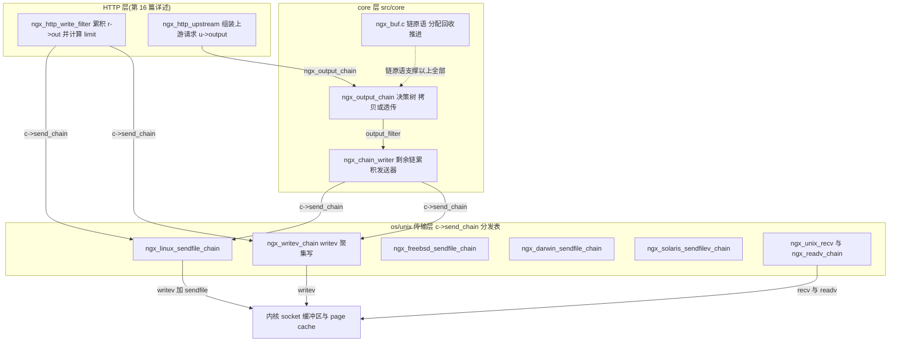
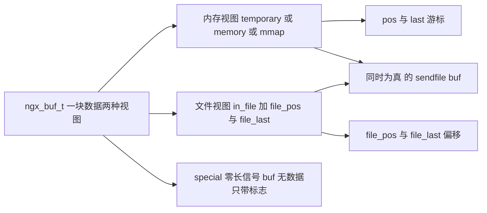
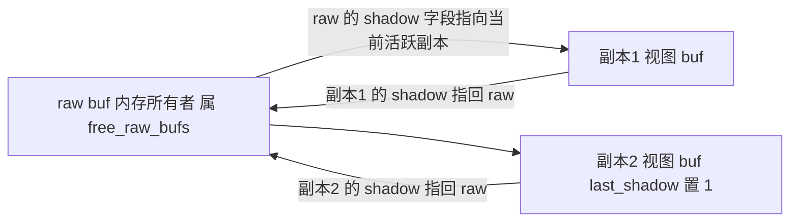
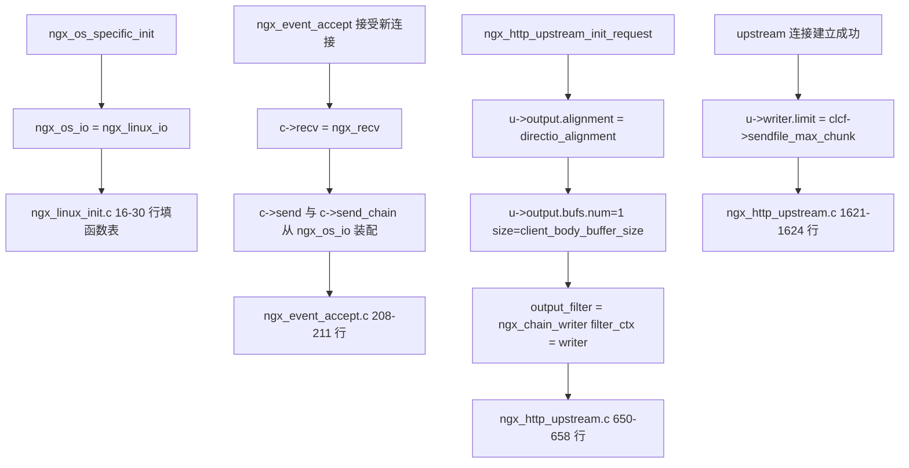
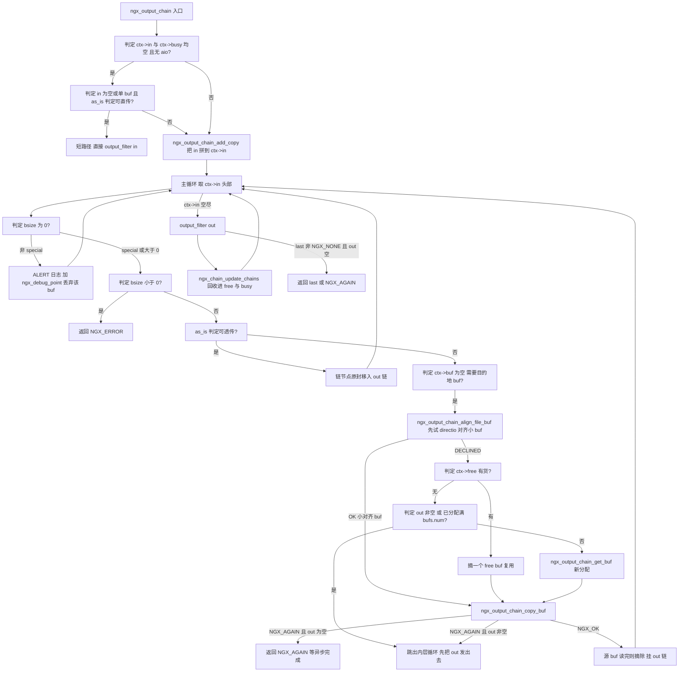
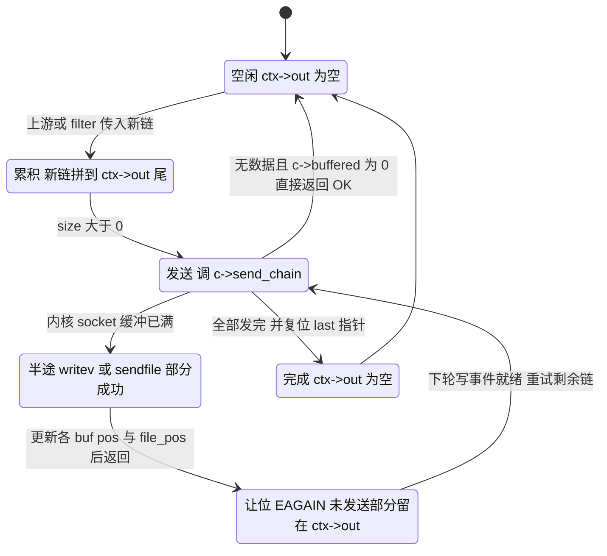
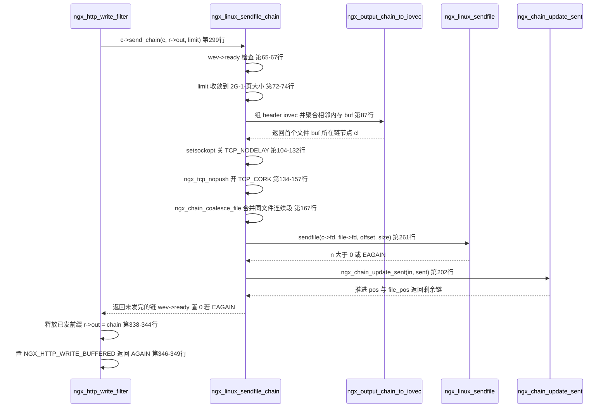
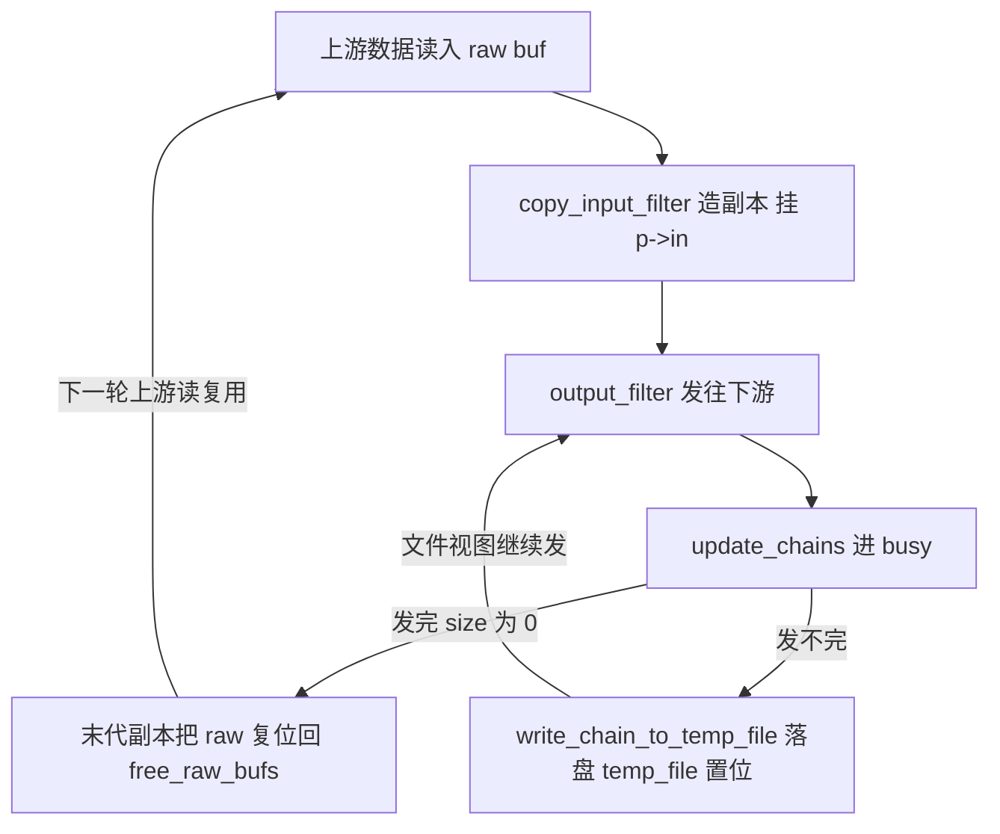

# 缓冲区体系与底层收发(buf/chain/output_chain/sendfile)(基于 nginx-1.27.0 源码)

> **导读**:读完本文你将掌握——
> 1. `ngx_buf_t` 每一个标志位的语义、`pos/last` 与 `file_pos/file_last` 的"二态"表示,以及 `ngx_buf_size` 等宏如何在这两种形态间无损切换;
> 2. `ngx_chain_t` 链如何被各层 filter 组装、拆解,`free/busy/tag` 三件套如何实现零 malloc 的缓冲区回收;
> 3. `ngx_output_chain` 的完整决策树:什么时候零拷贝透传、什么时候读文件进内存、directio 对齐为什么要单独分配;
> 4. `ngx_chain_writer` 如何用 `ctx->out` 累积 partial write 的剩余链,实现跨事件循环的续传;
> 5. `ngx_unix_recv`/`ngx_readv_chain` 的 kqueue/EPOLLRDHUP/FIONREAD 三层快速路径,以及"内核预读探测"的真实机制;
> 6. `ngx_writev_chain` 的 iovec 聚合规则与 limit 语义;
> 7. Linux sendfile 链的全部细节:TCP_CORK 的开关时序、EAGAIN 与"Linux 4.3+ 谎报"的对策、线程池卸载路径;
> 8. FreeBSD/Darwin/Solaris 三个 sendfile 变体的差异。
>
> **前置阅读建议**:先了解 nginx 事件框架(`ngx_event_t`、`wev->ready`、边缘触发)与内存池 `ngx_palloc` 的基本语义;HTTP filter 链的细节留到第 16 篇,本文只在衔接边界处引用。
>
> **涉及源码清单**(本文所有行号均出自作者逐文件通读的真实内容):
> - `src/core/ngx_buf.h`(全文 167 行)、`src/core/ngx_buf.c`(全文 314 行)
> - `src/core/ngx_output_chain.c`(全文 810 行)
> - `src/os/unix/ngx_recv.c`(203 行)、`src/os/unix/ngx_readv_chain.c`(252 行)
> - `src/os/unix/ngx_send.c`(73 行)、`src/os/unix/ngx_writev_chain.c`(216 行)
> - `src/os/unix/ngx_linux_sendfile_chain.c`(436 行)
> - 佐证阅读:`src/os/unix/ngx_freebsd_sendfile_chain.c`、`ngx_darwin_sendfile_chain.c`、`ngx_solaris_sendfilev_chain.c`、`ngx_socket.c`、`ngx_os.h`、`ngx_linux_init.c`、`src/core/ngx_connection.h`、`src/event/ngx_event_pipe.c`、`src/event/ngx_event_accept.c`、`src/http/ngx_http_upstream.c`、`src/http/ngx_http_write_filter_module.c`、`src/http/ngx_http_request.c`、`src/http/ngx_http_core_module.c`、`auto/os/freebsd`、`auto/unix`

---

## 1. 本模块在 nginx 中的位置与职责

这一组文件构成 nginx 的**传输层收发内核**:上面承接 HTTP filter 链(响应)与 upstream 请求发送,下面对接各操作系统的系统调用(`recv/readv`、`send/writev`、`sendfile`)。它要回答的根本问题是:**"一条 `ngx_chain_t` 链里既有内存 buf 又有文件 buf,如何用最少的拷贝、最少的系统调用把它送进 socket?"**

各文件的职责划分:

| 文件 | 职责 |
|---|---|
| `src/core/ngx_buf.h` / `ngx_buf.c` | 缓冲区与链的数据结构、分配/回收/进度推进的通用原语 |
| `src/core/ngx_output_chain.c` | 输出链的"中间适配层":决定拷贝还是透传,并提供通用发送器 `ngx_chain_writer` |
| `src/os/unix/ngx_recv.c` | 单缓冲读:`recv()` |
| `src/os/unix/ngx_readv_chain.c` | 聚集读:`readv()`,一次读进多段内存 |
| `src/os/unix/ngx_send.c` | 单缓冲写:`send()` |
| `src/os/unix/ngx_writev_chain.c` | 聚集写:`writev()`,含 iovec 聚合器 `ngx_output_chain_to_iovec` |
| `src/os/unix/ngx_linux_sendfile_chain.c` | Linux 零拷贝发送:header 用 `writev`、文件用 `sendfile` 混合 |

连接与这些函数的绑定发生在两处:进程初始化时 `ngx_os_specific_init` 把平台实现表赋给全局 `ngx_os_io`(Linux 版见 `src/os/unix/ngx_linux_init.c:16-30,49`);新连接被 accept 时,`ngx_event_accept.c:208-211` 把 `c->recv`/`c->send`/`c->recv_chain`/`c->send_chain` 四个函数指针指到 `ngx_os_io` 的对应成员。此后**所有协议层代码只通过 `c->recv`/`c->send_chain` 调用,永远不直接碰系统调用**——这就是 nginx 跨平台与 TLS 替换(SSL 握手完成后换成 `ngx_ssl_send` 系列)得以无缝工作的边界。



**图解**:响应路径(左上)中,`ngx_http_write_filter` 并不经过 `ngx_output_chain`,而是直接调 `c->send_chain`(见第 6.10 节);上游请求路径才走 `ngx_output_chain` + `ngx_chain_writer` 组合(`src/http/ngx_http_upstream.c:656-657`)。`ngx_buf.c` 的链原语(虚线)是所有层共用的"乐高积木"。

---

## 2. 核心数据结构精讲

### 2.1 ngx_buf_t:一个 buf,两种存在形态

`src/core/ngx_buf.h:20-56`:

```c
struct ngx_buf_s {
    u_char          *pos;
    u_char          *last;
    off_t            file_pos;
    off_t            file_last;

    u_char          *start;         /* start of buffer */
    u_char          *end;           /* end of buffer */
    ngx_buf_tag_t    tag;
    ngx_file_t      *file;
    ngx_buf_t       *shadow;
    ...
```

| 字段 | 类型 | 语义 |
|---|---|---|
| `pos` / `last` | `u_char *` | **内存态游标**:`[pos, last)` 是尚未发送/待处理的内存数据 |
| `file_pos` / `file_last` | `off_t` | **文件态游标**:`[file_pos, file_last)` 是文件中尚未发送的字节区间 |
| `start` / `end` | `u_char *` | 底层内存块的物理边界,回收复用时靠它们把 `pos/last` 拨回起点 |
| `tag` | `ngx_buf_tag_t`(即 `void *`) | **所有权指纹**:通常是所属模块的 `&ngx_xxx_module` 地址,回收时用于辨认"这个 buf 是不是我家的" |
| `file` | `ngx_file_t *` | 文件态时指向打开的文件对象(含 fd、日志、锁等) |
| `shadow` | `ngx_buf_t *` | 阴影链:同一块原始内存被多个"视图 buf"引用时的互指指针(见 2.4) |

标志位(`src/core/ngx_buf.h:33-53`,全部是 1 bit,整个标志区共 10 bit 塞进一个 `unsigned`):

| 标志 | 含义 | 谁设置/谁消费 |
|---|---|---|
| `temporary:1` | 内存内容**可修改**(nginx 自己分配的临时缓冲)。这是"内存态"三种取值之一 | 模块分配 buf 时置位;filter 据此判断能否原地改写 |
| `memory:1` | 内容在只读内存中,**不可修改**(如静态 mmap、常量串) | 与 `temporary` 互斥使用 |
| `mmap:1` | 内容来自 `mmap()`,不可修改 | sendfile 不可用时可走内存路径 |
| `recycled:1` | "我从 free 链刚回收来的,发完请尽快还我"——**回收催还标记** | 复用方置位;接收方(如 `ngx_event_pipe` 写下游循环)见它就尽快 flush |
| `in_file:1` | 数据(至少一部分)在文件里,`file_pos/file_last` 有效 | 与内存三态可**同时**为真(如 mmap+file 的 sendfile buf) |
| `flush:1` | 遇到此 buf 必须立即刷出,不许攒 | filter 链的"强制冲刷"信号 |
| `sync:1` | 空同步 buf:不携带数据,只用于**唤醒下游链**(典型:`ngx_http_output_filter` 传空链触发 write filter) | `ngx_buf_sync_only` 判定 |
| `last_buf:1` | **整个响应/整条流的最后一个 buf** | HTTP 层语义,`ngx_http_write_filter` 据此判定响应结束 |
| `last_in_chain:1` | 本条链的最后一个 buf(但不是响应的最后一个) | filter 用来感知链边界 |
| `last_shadow:1` | 阴影链的末代副本标记(配合 `shadow`,见 2.4) | `ngx_event_pipe` 回收时使用 |
| `temp_file:1` | 内容在**上游临时文件**中(`proxy_temp_path` 等),非原始文件 | 区分"可循环复用的临时文件 buf" |
| `num` | `/* STUB */ int num`,调试遗留字段(`ngx_buf.h:55`) | 无功能语义 |

**二态与三个关键宏**(`src/core/ngx_buf.h:125-138`)——这是全 nginx 缓冲体系的"类型系统":

```c
#define ngx_buf_in_memory(b)       ((b)->temporary || (b)->memory || (b)->mmap)
#define ngx_buf_in_memory_only(b)  (ngx_buf_in_memory(b) && !(b)->in_file)

#define ngx_buf_special(b)                                                   \
    (((b)->flush || (b)->last_buf || (b)->sync)                              \
     && !ngx_buf_in_memory(b) && !(b)->in_file)

#define ngx_buf_size(b)                                                      \
    (ngx_buf_in_memory(b) ? (off_t) ((b)->last - (b)->pos):                  \
                            ((b)->file_last - (b)->file_pos))
```

- `ngx_buf_size` 是**二态分派点**:只要 buf 有任何内存态(哪怕同时 `in_file`),长度就按内存区间算;纯文件 buf 才按文件区间算。所以 `temporary=1 且 in_file=1` 是合法组合——"这段内存和这段文件是同一份数据"(正是 sendfile buf 的形态,`ngx_output_chain_copy_buf` 在 `src/core/ngx_output_chain.c:635-643` 就是这么造出来的)。
- `ngx_buf_special` 定义了"**零长信号 buf**":不占数据、只带 `flush/last_buf/sync` 标志。`ngx_chain_update_sent`(`src/core/ngx_buf.c:278-280`)与 `ngx_output_chain_to_iovec`(`src/os/unix/ngx_writev_chain.c:123-125`)都会跳过它们,因为它们没有字节却必须留在链上传递语义。



**图解**:`ngx_buf_size` 先问"内存三态是否置位",是则用指针差,否则用文件偏移差;special buf 是两条视图都为空的退化形态,仅剩标志位本身。

### 2.2 ngx_chain_t 与链上原语

`src/core/ngx_buf.h:59-62`:`struct ngx_chain_s { ngx_buf_t *buf; ngx_chain_t *next; };`——一个两字段侵入式单链表节点。它本身也走池分配,但 nginx 为它做了一个专门的**免分配快速通道**:

```c
ngx_chain_t *
ngx_alloc_chain_link(ngx_pool_t *pool)
{
    ngx_chain_t  *cl;

    cl = pool->chain;

    if (cl) {
        pool->chain = cl->next;
        return cl;
    }
    ...
```
(`src/core/ngx_buf.c:47-65`;对应释放宏 `ngx_free_chain` 把节点头插回 `pool->chain`,见 `src/core/ngx_buf.h:148-150`)

即:**用过的链节点挂回 `pool->chain` 形成单链空闲栈,分配时 O(1) 弹出,只有空了才真正 `ngx_palloc`**。请求池销毁时一并释放,运行期几乎零分配开销。

### 2.3 ngx_output_chain_ctx_t 与 ngx_chain_writer_ctx_t

`ngx_output_chain_ctx_t`(`src/core/ngx_buf.h:78-110`)是输出适配层的**会话状态**,逐字段:

| 字段 | 语义 |
|---|---|
| `buf` | 当前正在填充的"目的地 buf"(拷贝目标),用完即置 NULL |
| `in` | 尚未处理的输入链(跨调用累积,partial write 时得以续传) |
| `free` / `busy` | 已归还待复用 buf 的空闲链 / 已交给下游但尚未发完的 busy 链 |
| `sendfile:1` | 本连接是否允许 sendfile(由 `c->sendfile` 等决定,HTTP 层写入) |
| `directio:1` / `unaligned:1` | 是否处于 directio 读路径 / 是否需要对齐开关 directio |
| `need_in_memory:1` | 下游还要求"必须有一份内存副本"(如 gzip 需要读数据) |
| `need_in_temp:1` | 下游要求内存副本必须落在**自己分配的**临时 buf(而非 mmap,因为 mmap 不可写) |
| `aio:1` | 有未完成的异步读 |
| `alignment` | directio 的对齐字节数(来自 `directio_alignment`,默认 512) |
| `bufs` | 复用 buf 的规格(num=1、size=client_body_buffer_size,见 6.2) |
| `allocated` | 当前已分配的目的地 buf 计数,上限即 `bufs.num` |
| `output_filter` / `filter_ctx` | 决策完成后交给谁(通常是 `ngx_chain_writer` 或上游协议 filter) |

`ngx_chain_writer_ctx_t`(`src/core/ngx_buf.h:113-119`)只有五个字段:`out`(未发完的累积链)、`last`(指向 out 尾节点 next 指针的二级指针,追加 O(1))、`connection`、`pool`、`limit`(单次 send_chain 的字节上限)。

### 2.4 shadow:同一块内存的多视图

shadow 机制服务于 upstream 缓冲(`ngx_event_pipe`):上游读进一块 raw buf 后,把它的**字段拷贝**给一个新 buf 挂进 `p->in` 发往下游,两个 buf 通过 `shadow` 互指:

- 原始 buf(`raw`):属于 `free_raw_bufs` 体系,是内存的所有者;
- 副本 buf(`b`):`b->shadow = buf; buf->shadow = b; b->last_shadow = 1;`(`src/event/ngx_event_pipe.c:990-995`),数据语义归副本,内存归还权归原始。

发送完成后,只有带 `last_shadow=1` 的**末代副本**负责把 `shadow`(raw)拨回 `pos=last=start` 并挂回 `free_raw_bufs`(`src/event/ngx_event_pipe.c:725-733,931-948`),中间副本直接作废(`ngx_event_pipe_remove_shadow_links`,同文件 1028-1056 行)。这样:多个副本可以同时处于"已拷贝、未发送"状态,而内存只有一份。



**图解**:实际代码中,raw 的 `shadow` 字段指向其**当前活跃的副本**,而每个副本的 `shadow` 指回 raw,形成互指;末代副本以 `last_shadow=1` 收口,回收动作(把 raw 复位入 free 链)只发生一次。

### 2.5 承载这些 buf 的连接层状态

`ngx_connection_t` 中与本主题直接相关的字段(`src/core/ngx_connection.h:124-203`):`recv/send/recv_chain/send_chain` 四个函数指针(131-134 行)、`sent` 计数(138 行)、`buffer`(首读缓冲,165 行)、`buffered:8` 位图(174 行,低 4 位 `NGX_LOWLEVEL_BUFFERED` 表示 SSL/h2 等低层缓冲,见 119-121 行)、`sendfile`(188 行)、`tcp_nodelay/tcp_nopush` 两个 2-bit 枚举(190-191 行,枚举定义在 105-116 行)、`need_last_buf/need_flush_buf`(193-194 行,h2/QUIC 需要)、`busy_count`(196-198 行,FreeBSD EBUSY 退避)与 `sendfile_task`(200-202 行,线程池任务)。

---

## 3. 初始化流程

缓冲体系没有独立的"启动"入口,它在三条线上分别就位:



**图解**:三条线分别是——(1) 平台函数表在 `ngx_os_specific_init` 装配(Linux:`src/os/unix/ngx_linux_init.c:16-30`,有 `NGX_HAVE_SENDFILE` 时 `send_chain` 用 `ngx_linux_sendfile_chain` 并带 `NGX_IO_SENDFILE` 标志,否则退回 `ngx_writev_chain`),49 行赋给全局;(2) accept 时四个函数指针落到连接上(`src/event/ngx_event_accept.c:208-211`);(3) 每个上游请求初始化 output ctx:`alignment` 取 `directio_alignment`、单 buf 规格取 `client_body_buffer_size`、发送器固定为 `ngx_chain_writer`(`src/http/ngx_http_upstream.c:650-658`),连接建立后再设 `writer.limit = sendfile_max_chunk`(同文件 1621-1624 行)。另外 1634-1658 行:若请求体已落临时文件,`r->request_body->buf` 会被**预置进 `u->output.free` 链**并把 `allocated` 置 1——一份内存两用,先当请求体缓冲再当上游发送缓冲。

---

## 4. 核心执行流程/状态机

### 4.1 ngx_output_chain 决策树

`ngx_output_chain(ctx, in)` 是输出侧的"分流枢纽",下图覆盖其全部分支(行号见第 6.2 节精读):



**图解**:三个关键汇合点——(1) `as_is` 为真时**零拷贝**,链节点直接搬家;(2) 需要拷贝时目的地 buf 的获取顺序是"directio 对齐专用 buf → free 复用 → 超限则先 flush → 否则新分配",`allocated == bufs.num` 这道闸保证 upstream 请求体最多同时占 `client_body_buffer_size` 一块内存;(3) `copy_buf` 返回 `NGX_AGAIN`(AIO/线程读挂起)时,若手里已有 out 就先发出去,否则把控制权还给事件循环。

### 4.2 partial write 的跨事件续传状态机

`ngx_chain_writer` 与各 send_chain 实现共同维护一个跨事件循环的状态机:



**图解**:状态迁移的**唯一持久化载体是 `ctx->out` 链**(write filter 语境下是 `r->out`):发送前把新数据**追加**到尾部,发送后把**已发送前缀**释放、剩余链整体替换回去;`wev->ready=0`(EAGAIN/半途)只是让事件循环别再调它。`c->buffered` 位图是"还有没有逻辑数据未发"的跨层汇总位。

---

## 5. 关键时序图

以 Linux 上最典型的一笔发送为例:**内存 header + 文件 body,一次 `send_chain` 调用**(函数均真实存在,行号见第 6 节):



**图解**:每一跳都发生在单次写事件的同步执行内;若 `sendfile` 报 `EAGAIN`,`ngx_linux_sendfile_chain` 立即带着剩余链返回,把控制权交还事件循环——**没有忙等、没有内部重试循环赖着不走**(与 partial 值"谎报"场景的重试不同,见 6.7)。TCP_CORK 在有 header 挡在文件前面时才开启,其关闭由上层(upstream 收尾或 keepalive 切换)负责,见 6.7 的时序说明。

---

## 6. 源码逐段精读

本节是全文主体。约定:函数签名后括注 `文件:起始行-结束行`;摘录每次不超过 15 行。

### 6.1 ngx_buf.c:链的生老病死

#### 6.1.1 ngx_create_temp_buf(ngx_buf.c:12-44)

```c
    b = ngx_calloc_buf(pool);
    ...
    b->start = ngx_palloc(pool, size);
    ...
    b->pos = b->start;
    b->last = b->start;
    b->end = b->last + size;
    b->temporary = 1;
```
(`src/core/ngx_buf.c:17-41`)

**逻辑**:`ngx_calloc_buf` 走 `ngx_pcalloc` 把整个 `ngx_buf_t` 清零——这同时把 `file_pos/file_last` 归零、`shadow/tag` 清空、**所有标志位清零**,所以注释(27-36 行)逐项声明哪些字段已被隐式置零。数据区与控制块都出自同一个 pool。最后置 `temporary=1`:这是 nginx 自家缓冲,内容可改。
**易错点**:`pos=last=start` 意味着新建 buf 的 size 是 0(待写入);`ngx_buf_size` 判断走内存分支得 0——下游 `ngx_output_chain` 的零长告警(`ngx_output_chain.c:103-126`)就是防这类 buf 被误挂进输出链。

#### 6.1.2 ngx_alloc_chain_link 与 ngx_free_chain(ngx_buf.c:47-65)

已在 2.2 节展示核心。**设计要点**:空闲链节点栈存在 `pool->chain` 上,先到先得;它解决的是"一请求内成千上万次建链/拆链"的分配抖动,而不是跨请求复用(池销毁即蒸发)。

#### 6.1.3 ngx_create_chain_of_bufs(ngx_buf.c:68-123)

一次分配 `bufs->num * bufs->size` 的**整块连续内存**(`p = ngx_palloc(...)` 76 行),然后切成 num 个 buf,每个 buf 的 `start/end` 指向自己的切片(102-108 行),链表用 `ngx_chain_t **ll` 二级指针尾插(81、116-117 行)。这是 `client_body_buffer_size`、`connection 池读缓冲`等"固定规格 buf 组"的出厂函数。**易错点**:它返回的 buf 全部 `temporary=1` 且 size 为 0,必须由调用方写满后再挂链。

#### 6.1.4 ngx_chain_add_copy(ngx_buf.c:126-153)

```c
    ll = chain;

    for (cl = *chain; cl; cl = cl->next) {
        ll = &cl->next;
    }

    while (in) {
        cl = ngx_alloc_chain_link(pool);
        ...
        cl->buf = in->buf;
```

**逻辑**:浅拷贝链——只复制**链节点**,不复制 buf;先把 `ll` 推到目标链尾,再把输入链逐节点接上去。与 `ngx_output_chain_add_copy`(`ngx_output_chain.c:309-375`,专给 output ctx 用、带 NGX_SENDFILE_LIMIT 拆分逻辑)相比,它是无副作用的通用版。

#### 6.1.5 ngx_chain_get_free_buf(ngx_buf.c:156-181)

free 链上有货就摘(161-166 行,`cl->next = NULL` 断尾);没货就同时分配链节点和**零初始化的 buf**(168-176 行)。它是 write filter、upstream 等"对称收发"模块构造新 buf 的标配。**易错点**:从 free 链摘来的 buf 其 `pos/last` 还停在旧位置,调用方必须自己复位或整体覆写语义(参见 `ngx_http_upstream.c:1655-1657` 对 `request_body->buf` 的复位)。

#### 6.1.6 ngx_chain_update_chains(ngx_buf.c:184-223)——free/busy 回收算法核心

```c
    if (*out) {
        if (*busy == NULL) {
            *busy = *out;
        } else {
            for (cl = *busy; cl->next; cl = cl->next) { /* void */ }
            cl->next = *out;
        }
        *out = NULL;
    }

    while (*busy) {
        cl = *busy;

        if (cl->buf->tag != tag) {
            *busy = cl->next;
            ngx_free_chain(p, cl);
            continue;
        }

        if (ngx_buf_size(cl->buf) != 0) {
            break;
        }
        ...
```
(`src/core/ngx_buf.c:190-216`)

**逻辑分四步**:
1. `out`(本次刚交给下游、返回后表示"剩余未发")整体**拼接到 busy 链尾**——busy 的含义是"已交给下游还没确认发完";
2. 从 busy 头部开始扫:**tag 不匹配的直接丢弃**(206-210 行)——别的模块的 buf 不归我回收,只把链节点还池;这正是 tag 作为"所有权指纹"的消费点;
3. `ngx_buf_size != 0` 说明这个 buf 还没发完(**partial write 停在它身上**),`break`——它及其后所有节点留在 busy 等下轮(212-214 行);
4. 发完的 buf:`pos/last` 拨回 `start`(216-217 行,文件 buf 同理由调用方处理),摘下头插进 free 链(219-221 行)。

**易错点**:第 3 步的 `break` 依赖 **busy 链的有序性**——必须先发完前面的才能回收后面的,所以 out 拼接时保持原序至关重要。若某模块乱序回收,会把未发完的 buf 困在 busy 里造成"内存泄漏假象"。

#### 6.1.7 ngx_chain_coalesce_file(ngx_buf.c:226-268)

为 sendfile 而生:把链上**同一 fd、文件偏移无缝相接**的连续文件 buf 合并成一次 sendfile 的区间(238-263 行的 do-while 条件:`total < limit && fd == cl->buf->file->fd && fprev == cl->buf->file_pos`)。被 limit 截断时按**页对齐向上取整**(244-249 行):

```c
            aligned = (cl->buf->file_pos + size + ngx_pagesize - 1)
                       & ~((off_t) ngx_pagesize - 1);

            if (aligned <= cl->buf->file_last) {
                size = aligned - cl->buf->file_pos;
            }
```

**为什么页对齐**:sendfile 内核按页搬运,对齐截断点可以让本次实际发送的字节数与记录的 `send` 一致,剩余部分留给下一轮(与 Solaris 变体 `ngx_solaris_sendfilev_chain.c:133-138` 的同款代码互为印证)。返回 `total` 并把 `*in` 推进到第一个**未被合并**的节点(265 行)。

#### 6.1.8 ngx_chain_update_sent(ngx_buf.c:271-314)

发送完成后唯一合法的"进度推进器":沿链扣减 `sent`,发完的 buf 内存态置 `pos=last`(291-293 行)、文件态置 `file_pos=file_last`(295-297 行);部分发送的 buf 双态各加 `sent`(302-308 行)后 `break`。special buf 直接跳过不计长(278-280 行)。返回值是**第一个尚未发完的链节点**——各 send_chain 的返回值、`ctx->out` 的替换值都来自它。

### 6.2 ngx_output_chain.c:输出决策树与通用发送器

#### 6.2.1 宏 NGX_SENDFILE_LIMIT 的两个身份

`ngx_output_chain.c:13-15` 中 `#define NGX_SENDFILE_LIMIT 4096` 被包在 `#if 0 ... #endif` 里,**默认不生效**,是作者留的调试开关(打开后所有文件偏移超过 4096 字节的 buf 强制走拷贝路径,用来测试小文件也能正确走非 sendfile 分支)。而 `src/os/unix/ngx_linux_config.h:74-79` 在**没有** `NGX_HAVE_SENDFILE64` 的旧平台上定义 `NGX_SENDFILE_LIMIT 0x80000000`(2G),因为 32 位偏移的 `sendfile()` 不能处理 2G 以上偏移。两者编译期只会存在一个。

#### 6.2.2 ngx_output_chain(ngx_output_chain.c:41-246)

**短路径**(48-72 行):`ctx->in`、`ctx->busy` 全空且无未完成 aio 时,若输入为空调 `output_filter(ctx->filter_ctx, NULL)` 直通(60-62 行,给 flush/last_buf 信号留通道);若单 buf 且 `ngx_output_chain_as_is` 放行,同样直通(64-71 行)。这条路径覆盖了"静态文件 + sendfile"最热的情形——**整个函数体只做一次 vtable 调用**。

**常规路径**:先 `ngx_output_chain_add_copy` 把输入拼进 `ctx->in`(76-80 行),然后进入 86-245 行的主循环(决策树见 4.1 节)。几个细节值得逐字读:

- 零长 buf 告警(103-126 行):日志里把 `temporary/recycled/in_file/pos/last/file_pos/file_last` 全打出来,`ngx_debug_point()` 在调试构建里直接断点,**然后丢弃该 buf 继续**——这是自我纠错,不是致命错;
- 负长 buf(128-146 行):直接 `NGX_ERROR`,因为它意味着指针错乱,继续走必崩;
- 拷贝后(208-213 行):只有 `ngx_buf_size(ctx->in->buf) == 0`(源读尽)才摘除源节点——**大文件源会多轮存活在 ctx->in 里**,每次被 copy_buf 咬掉一块;
- 尾部(227-244 行):`last` 变量记录 `output_filter` 的返回值;`out` 空且 `last != NGX_NONE` 时按 `ctx->in` 是否残留决定返回 `NGX_AGAIN` 还是 `last`——这是"没有数据可发但下游可能还要冲刷"的收口。

#### 6.2.3 ngx_output_chain_as_is(ngx_output_chain.c:249-306)

这是决策树的**判定函数**,返回 1 表示"这个 buf 原样透传即可":

```c
    if (ngx_buf_special(buf)) {
        return 1;
    }
    ...
    sendfile = ctx->sendfile;

#if (NGX_SENDFILE_LIMIT)
    if (buf->in_file && buf->file_pos >= NGX_SENDFILE_LIMIT) {
        sendfile = 0;
    }
#endif
```
(`src/core/ngx_output_chain.c:254-273`)

依次判定:
1. special buf(纯标志)直接放行(254-256 行);
2. `NGX_THREADS` 下给文件 buf 预挂 `thread_handler`(258-263 行),为后续线程读/线程 sendfile 做准备;
3. `NGX_SENDFILE_LIMIT` 生效时,文件偏移越限则关掉 sendfile(267-273 行);
4. **`#if !(NGX_HAVE_SENDFILE_NODISKIO)` 分支(275-286 行)**:平台不支持 `SF_NODISKIO` 类语义时,`file->directio` 的文件一律禁用 sendfile——Linux directio 下 sendfile 会因绕过页缓存而行为异常(EINVAL 或数据不一致);
5. `!sendfile` 且 buf **不在内存**(纯文件)→ 返回 0,必须拷贝(288-292 行);若 buf 同时在内存(如 mmap),**顺手清掉 `buf->in_file`(294 行)**——下游只需内存视图,清掉它避免 sendfile 路径误判;
6. `need_in_memory` 且不在内存 → 0(297-299 行,gzip 等要读数据);`need_in_temp` 且是 `memory/mmap`(不可写内存)→ 0(301-303 行,charset/sub 等要改写数据)。

#### 6.2.4 ngx_output_chain_add_copy(ngx_output_chain.c:309-375)

与 `ngx_chain_add_copy` 的唯一区别在 `NGX_SENDFILE_LIMIT` 分支(331-361 行):一个文件 buf 若**横跨**限值(`file_pos < LIMIT < file_last`),就地拆成两个 buf——前半(内存视图同步收缩,348-354 行)留在原 buf,后半(越过限值)用新 buf `b` 承接。**易错点**:`b` 是 `ngx_calloc_buf` 的新对象并 `ngx_memcpy` 整个结构体(346 行),`b->last = buf->pos`(350 行)依赖内存视图与文件偏移同歩推进;默认构建(`#if 0` 关闭、64 位 Linux 有 SENDFILE64)整段不编译。

#### 6.2.5 ngx_output_chain_align_file_buf(ngx_output_chain.c:378-425)

directio 专用。仅当 `in->file->directio` 才接管(386-388 行),否则 `NGX_DECLINED` 让位给常规路径。置 `ctx->directio = 1`(390 行)后计算**对齐缺口**:

```c
    size = (size_t) (in->file_pos - (in->file_pos & ~(ctx->alignment - 1)));

    if (size == 0) {
        if (bsize >= (off_t) ctx->bufs.size) {
            return NGX_DECLINED;
        }
        size = (size_t) bsize;
    } else {
        size = (size_t) ctx->alignment - size;
```
(`src/core/ngx_output_chain.c:392-408`)

即:file_pos 距上一个对齐边界的距离就是第一个小 buf 的大小;若恰好已对齐且数据量小于 `bufs.size`,干脆整个数据一个 buf。文件头注释(17-25 行)说明了为什么:`directio` 在 Linux 上要求参数按文件系统扇区对齐(XFS 可能 4096),否则 `EINVAL`;FreeBSD/Solaris/macOS 会静默回退普通读。

**关键设计**(415-418 行注释):这个临时 buf **故意不设 tag**——"we do not want to reuse the buf via ctx->free list"。对齐 buf 大小不一,复用没有意义,让它随请求池消亡。`NGX_HAVE_ALIGNED_DIRECTIO` 平台上置 `ctx->unaligned = 1`(420-422 行),驱动 copy_buf 阶段的开/关 directio 保护(见下)。

#### 6.2.6 ngx_output_chain_get_buf(ngx_output_chain.c:428-501)

常规目的地 buf 的分配器。大小策略(439-464 行):

- 源 buf 是 `last_in_chain` 且 `bsize < bufs.size`:**按实际大小**分配(`size = bsize`),`recycled = 0`——尾部小数据不占整块缓冲;
- 且(非 directio、单 buf 规格、`bsize < 1.25 * size`)时也按实际大小分——避免"最后一个 8.5K 的请求占两个 8K buf";
- 其余情况分配整块 `ctx->bufs.size`。

directio 时用 `ngx_pmemalign(pool, size, alignment)`(478 行)拿**扇区对齐内存**,普通路径 `ngx_palloc`(484 行)。收尾处 `b->tag = ctx->tag; b->recycled = recycled;`(494-495 行)与 `ctx->allocated++`(498 行)——前者保证 `ngx_chain_update_chains` 能把它认领回 free 链,后者是 4.1 节"分配上限"闸门的计数来源。

#### 6.2.7 ngx_output_chain_copy_buf(ngx_output_chain.c:504-655)

拷贝执行器,两条路径:

**内存→内存**(528-555 行):`ngx_memcpy` 后双向推进 `src->pos`/`dst->last`;若源同时 `in_file` 且 sendfile 可用,**副本 buf 被造成 sendfile 形态**:

```c
            if (sendfile) {
                dst->in_file = 1;
                dst->file = src->file;
                dst->file_pos = src->file_pos;
                dst->file_last = src->file_pos + size;
            } else {
                dst->in_file = 0;
            }
```
(`src/core/ngx_output_chain.c:535-543`)

**为什么拷贝了还要保留文件视图**:这里的拷贝通常是 gzip/charset 等 `need_in_memory` 场景的"边读边留底",下游发送仍应走 sendfile 零拷贝,内存副本只是旁路产物。源耗尽时把 `flush/last_buf/last_in_chain` 三个**链语义标志搬运到副本**(551-555 行)——标志跟着数据尾巴走,不能提前也不能滞后。

**文件→内存**(557-651 行):先处理 `unaligned`——读之前 `ngx_directio_off`(561-567 行),读完恢复 `ngx_directio_on`(604-618 行),并用 `ngx_set_errno(err)` 保护真实 errno(607、615 行)。读本身三级降级:AIO(`ngx_file_aio_read`,571-581 行,返回 `NGX_AGAIN` 时调 `ctx->aio_handler` 并向上返回)→ 线程(`ngx_thread_read`,583-596 行)→ 同步 `ngx_read_file`(597-600 行)。**读短即错**(626-631 行):`n != size` 记 ALERT 日志返回 `NGX_ERROR`——文件被截断是不可恢复状态。成功后同样按 `sendfile` 决定是否给副本挂文件视图(635-643 行)。

#### 6.2.8 ngx_chain_writer(ngx_output_chain.c:658-810)——partial write 续传的通用实现

```c
    for (size = 0; in; in = in->next) {
        ...
        size += ngx_buf_size(in->buf);
        ...
        cl = ngx_alloc_chain_link(ctx->pool);
        ...
        cl->buf = in->buf;
        cl->next = NULL;
        *ctx->last = cl;
        ctx->last = &cl->next;
    }
```
(`src/core/ngx_output_chain.c:669-726`)

**第一步(669-726 行)**:把新输入链**追加**到 `ctx->out` 尾部——注意用二级指针 `ctx->last` 尾插 O(1),且只追加不发送;沿途做零长/负长体检(671-709 行,与 write filter 同款告警)。

**第二步(731-774 行)**:遍历既有 `ctx->out` 统计总 size(含上次残留)。

**第三步(776-780 行)**:`size == 0 && !c->buffered` 直接返回 OK;否则 `chain = c->send_chain(c, ctx->out, ctx->limit)` 一把梭交给平台实现。`ctx->limit` 来自 `clcf->sendfile_max_chunk`(`src/http/ngx_http_upstream.c:1624`),默认 2MB(`ngx_http_core_module.c:3812-3813`)——**这是单次系统调用量的上限,不是总限速**。

**第四步(785-809 行)**:错误即返;若有剩余且写事件仍 ready,**把写事件挂进 `ngx_posted_next_events`**(789-791 行)——下一轮事件循环**优先**继续发,不等下一次 epoll 通知(边缘触发下内核不会再发就绪通知,必须自己续);释放已发送前缀的链节点(793-797 行),`ctx->out = chain` 只留剩余(799 行);out 清空则复位尾指针 `ctx->last = &ctx->out`(801-802 行);最终按 `c->buffered` 决定返回 OK 还是 AGAIN(801-809 行)。

**易错点**:free 的只是**链节点**(ngx_free_chain),buf 本身交还给各模块自己的 update_chains 流程;`ctx->out` 里的 buf 在发完前**必须保持有效**,这就是为什么 upstream 用 `u->output.free/busy` 而不是直接把 filter 链的 buf 转手。

### 6.3 ngx_recv.c:单缓冲读的三层快速路径

`ngx_unix_recv(ngx_connection_t *c, u_char *buf, size_t size)`(`src/os/unix/ngx_recv.c:13-203`)。

**第零层——事件框架预判**:
- kqueue(22-51 行):`rev->available == 0` 时,`pending_eof` 则置 `eof` 并返回 0/错误(30-43 行),否则返回 `NGX_AGAIN`(44-47 行)——kqueue 已提前告知"没了",根本不用进内核;
- EPOLLRDHUP(53-68 行):epoll+`EPOLLRDHUP` 且 `ngx_use_epoll_rdhup` 时同理(62-66 行)。

**第一层——recv 主循环**(70-194 行,do-while 结构):
- `n == 0`(76-94 行):对端关闭,`rev->ready=0; rev->eof=1`,kqueue 下顺手 `rev->available = 0`(87-90 行,注释解释 FreeBSD 上 recv 可能返回 0 而 kqueue 仍报有数据);
- `n > 0` 时的**内核预读探测**(121-153 行)是本文件的精华:

```c
#if (NGX_HAVE_FIONREAD)
            if (rev->available >= 0) {
                rev->available -= n;
                ...
            } else if ((size_t) n == size) {

                if (ngx_socket_nread(c->fd, &rev->available) == -1) {
                    n = ngx_connection_error(c, ngx_socket_errno,
                                             ngx_socket_nread_n " failed");
                    break;
                }
```

  `rev->available` 是"内核里还剩多少字节"的缓存:kqueue 事件自带该值;epoll 下初始为 -1(未知),此时若**一次读满**(n == size,说明可能还有货)就调 `ngx_socket_nread`(FIONREAD ioctl)问内核要精确余量,填进 `rev->available`,供 `ngx_handle_read_event` 判断边缘触发下是否需要重挂事件。读未满(n < size)则说明内核已清空,`rev->ready = 0`(173-177 行,`NGX_USE_GREEDY_EVENT` 平台例外);
- 错误分支(182-194 行):`EAGAIN/EINTR` 都把 `n` 置 `NGX_AGAIN`,但**只有 EINTR 继续循环重试**(`while (err == NGX_EINTR)` 194 行),EAGAIN 落到 196 行 `rev->ready = 0` 后返回。

**易错点**:`NGX_AGAIN` 时 `rev->ready` 已被清零,调用方**不得**立刻重试同一读——必须等事件;而 `n == 0`(eof)与 `NGX_AGAIN` 是不同返回值,混用会导致把对端关闭当成"没数据"死等。

#### 关于"首 buf 缩小策略"的源码事实澄清

坊间资料(含本仓库既有的《nginx-底层实现原理清单》第 349 行)称 `ngx_recv.c`/`ngx_readv_chain.c` 含"GCOS 优化:第一个 buf 小、后续大,防止慢客户端占大内存"。**经全文通读,nginx-1.27.0 的这两个文件中不存在任何缩小首缓冲的代码**(也 grep 不到 GCOS 字样,待验证其历史出处)。真实存在的内存保护是三个:其一,读入缓冲的**大小由调用方决定**,HTTP 层首次只给 1KB 的 `client_header_buffer_size`(`ngx_http_request.c:397-425` 先 `ngx_create_temp_buf` 后 `c->recv`,默认值 1024 见 `ngx_http_core_module.c:3491-3492`),不够再由 `large_client_header_buffers` 扩——"小首缓冲"是 **HTTP 层策略**,传输层只管往给定缓冲里读;其二,`ngx_readv_chain` 的 iovec 数量被 `NGX_IOVS_PREALLOCATE`(64 或 IOV_MAX,`ngx_os.h:57-61`)与显式 `limit` 双重封顶;其三,`rev->available`/FIONREAD 计量让"读多少"有据可依,避免盲读大缓冲。本文如实按源码描述。

### 6.4 ngx_readv_chain.c:聚集读

`ngx_readv_chain(ngx_connection_t *c, ngx_chain_t *chain, off_t limit)`(`src/os/unix/ngx_readv_chain.c:13-252`)。事件框架预判与 6.3 相同(25-72 行)。

**iovec 组装**(74-119 行)是本文件的独有内容:

```c
    while (chain) {
        n = chain->buf->end - chain->buf->last;

        if (limit) {
            if (size >= limit) {
                break;
            }
            if (size + n > limit) {
                n = (ssize_t) (limit - size);
            }
        }

        if (prev == chain->buf->last) {
            iov->iov_len += n;
        } else {
            if (vec.nelts == vec.nalloc) {
                break;
            }
            iov = ngx_array_push(&vec);
            ...
```

**规则**:读空间按 `end - last` 计;`limit`(上层传入,如 `r->request_length` 相关限幅)对总读量封顶并截短最后一个 iov(89-97 行);**内存相邻**(前一 buf 的 `end` 等于后一 buf 的 `last`,通过 `prev` 传递)的两段合并进同一个 iovec(99-101 行);iov 数量到 `NGX_IOVS_PREALLOCATE` 上限即停(103-105 行)——栈上数组,不动态扩容。

`readv` 本体与错误处理(124-252 行)结构与 ngx_recv 一致,差异仅在:读满判定用 `n == size`(size 是 iov 总容量,192 行)触发 FIONREAD 探测;`NGX_HAVE_KQUEUE` 分支同样维护 `rev->available`。

### 6.5 ngx_send.c:单缓冲写

`ngx_unix_send(ngx_connection_t *c, u_char *buf, size_t size)`(`src/os/unix/ngx_send.c:13-73`),极简但有两个语义要点:

- **partial write 不重试**(39-47 行):`n < size` 时置 `wev->ready = 0` 后**直接返回 n**——"发了多少就是多少",剩余部分由上层链状态机(如 `ngx_writev_chain` 的调用方)续传。这是 nginx "一次事件只推一把"哲学的单缓冲版;
- `send() == 0` 记 ALERT(51-55 行):TCP 上 send 返回 0 属异常,置 `wev->ready=0` 返回 0 静默处理;
- kqueue 预判 `wev->pending_eof`(22-31 行)直接报错,避免往半死连接上写。

### 6.6 ngx_writev_chain.c:聚集写

#### 6.6.1 ngx_writev_chain(ngx_writev_chain.c:13-104)

```c
    if (!wev->ready) {
        return in;
    }
    ...
    if (limit == 0 || limit > (off_t) (NGX_MAX_SIZE_T_VALUE - ngx_pagesize)) {
        limit = NGX_MAX_SIZE_T_VALUE - ngx_pagesize;
    }
```
(`src/os/unix/ngx_writev_chain.c:25-44`)

`!wev->ready` 时原样返回输入链(25-27 行)——**调用约定**:send_chain 永远不自己挂起,返回未发完的链即是"挂起"的表达。limit 归一化(42-44 行)防溢出。

主循环(51-103 行)每轮:① `ngx_output_chain_to_iovec` 组 iov(56 行);② **出现文件 buf 即告警退出**(62-79 行)——writev 不支持文件,`ngx_debug_point()` + `NGX_CHAIN_ERROR`,说明上游该走 sendfile 路径却没走;③ `ngx_writev` 发送(83 行);④ `ngx_chain_update_sent` 推进(93 行);⑤ `send - prev_send != sent` 说明**没发完**(部分发送或 AGAIN),`wev->ready = 0` 返回剩余(95-98 行);⑥ 发满本轮计划量或链尽则返回(100-102 行)。注意 ⑤ 与 ⑥ 的顺序:**只有"计划量 == 实发量"才值得再来一轮**,否则立刻让出,避免在内核缓冲满时空转。

#### 6.6.2 ngx_output_chain_to_iovec(ngx_writev_chain.c:107-178)

聚合器,同时被 Linux sendfile 链复用(`ngx_linux_sendfile_chain.c:87`)。规则与 readv 版对称:跳过 special(123-125 行);**碰到 `in_file` buf 立即截断**(127-129 行)——内存段与文件段的分界线,调用方据此知道"从这里开始该 sendfile 了";"bad buf"(无内存态又无文件态)记 ALERT 返回 `NGX_CHAIN_ERROR`(131-148 行);相邻内存合并(156-157 行,`prev == in->buf->pos`);`n == vec->nalloc` 截断(160-162 行);尾部返回**第一个未消费的链节点**(177 行)。`vec->count` 是 iov 个数、`vec->size` 是总字节(174-175 行)。

#### 6.6.3 ngx_writev(ngx_writev_chain.c:181-216)

薄封装:`EAGAIN → NGX_AGAIN`(198-201 行)、`EINTR → goto eintr 重试`(203-206 行)、其余置 `c->write->error = 1` 并报错(208-212 行)。** errno 语义与 send/read 完全对齐**,上层只认识这三个返回值。

### 6.7 ngx_linux_sendfile_chain.c:零拷贝发送主战场

#### 6.7.1 总体骨架(ngx_linux_sendfile_chain.c:49-228)

```c
#define NGX_SENDFILE_MAXSIZE  2147483647L
```
(`src/os/unix/ngx_linux_sendfile_chain.c:46`,文件头注释 29-44 行解释:2.6.16 之前 sendfile 计数参数超 2G-1 返回 EINVAL,之后内核静默截断到 2G-页大小,所以 nginx 自己先收敛)

limit 归一化到 `NGX_SENDFILE_MAXSIZE - ngx_pagesize`(72-74 行)。主循环每轮(82-227 行):

1. `ngx_output_chain_to_iovec` 组 header(87 行)——与 writev 共用聚合器,天然把内存 buf 聚到**第一个文件 buf 之前**为止;
2. **TCP_CORK 时序**(95-158 行):仅当"有内存 header 且紧随文件 buf"时介入:

```c
        if (c->tcp_nopush == NGX_TCP_NOPUSH_UNSET
            && header.count != 0
            && cl
            && cl->buf->in_file)
        {
            /* the TCP_CORK and TCP_NODELAY are mutually exclusive */

            if (c->tcp_nodelay == NGX_TCP_NODELAY_SET) {
                tcp_nodelay = 0;
                if (setsockopt(c->fd, IPPROTO_TCP, TCP_NODELAY, ...) == -1) {
                    ... /* EINTR 容忍后继续,其他错报错返回 */
                } else {
                    c->tcp_nodelay = NGX_TCP_NODELAY_UNSET;
                    ...
                }
            }

            if (c->tcp_nodelay == NGX_TCP_NODELAY_UNSET) {
                if (ngx_tcp_nopush(c->fd) == -1) { ... }
                else {
                    c->tcp_nopush = NGX_TCP_NOPUSH_SET;
                    ...
                }
            }
        }
```

  两步走:**先关 TCP_NODELAY**(104-132 行,二者互斥,Linux 上同时设置 NODELAY 与 CORK 会禁用 CORK 攒包),**再开 TCP_CORK**(`ngx_tcp_nopush` 即 `setsockopt(TCP_CORK, 1)`,`src/os/unix/ngx_socket.c:78-87`)。两处 setsockopt 对 `EINTR` 特殊容忍(119、144 行注释:被信号打断的概率极小,带着 NODELAY/不带 CORK 继续发比报错更好)。CORK 的**关闭不在此文件**:upstream 请求发送收尾时关(`ngx_http_upstream.c:2152-2162`;AGAIN 但写事件就绪也先关,2127-2137 行),HTTP 响应进入 keepalive 时关并恢复 NODELAY(`ngx_http_request.c:3279-3296`)。既有的清单文档说"EAGAIN 后关闭 CORK",与源码不符,以本节为准。
3. **文件分支 vs 内存分支**(162-198 行):`header.count == 0 && cl->buf->in_file && send < limit` 时走 sendfile:先 `ngx_chain_coalesce_file` 合并连续文件段(167 行),`file_size == 0` 直接断言失败(170-175 行,`#if 1` 保护块),再调 `ngx_linux_sendfile`(177 行);否则 `ngx_writev` 发 header(191 行)。
4. **进度与返回**(200-226 行):`c->sent += sent`,`ngx_chain_update_sent` 推进(200-202 行);`n == NGX_AGAIN` 时 `wev->ready = 0` 返回(204-207 行);**partial 值谎报的对策**(209-222 行)是最精妙的一段:

```c
        if ((size_t) (send - prev_send) != sent) {
            /*
             * sendfile() on Linux 4.3+ might be interrupted at any time,
             * and provides no indication if it was interrupted or not,
             * so we have to retry till an explicit EAGAIN
             * ...
             */
            send = prev_send + sent;
        }
```

  Linux 4.3+ 的 sendfile 被信号打断时**不返回 EINTR 而是返回部分计数**,nginx 无法区分"正常 partial"与"被打断的 partial",于是**不退出循环**,只把本轮计划量 `send` 修正为实际值继续发,直到出现明确的 `EAGAIN`(204 行)或发满 limit/链尽(224-226 行)。这与 6.6.1 writev 的"半途即让"形成对比——因为 writev 的 partial 语义可靠,而这里不可靠,只能以 EAGAIN 为唯一停止信号。
5. 线程任务投递返回 `NGX_DONE` 时**原样返回输入链**(183-186 行)——什么都没发,什么也不能推进,等完成事件。

#### 6.7.2 ngx_linux_sendfile(ngx_linux_sendfile_chain.c:231-301)

系统调用薄壳。偏移类型按 `NGX_HAVE_SENDFILE64` 选 `off_t` 或 `int32_t`(234-238 行,配合 6.2.1 的 NGX_SENDFILE_LIMIT);有 `thread_handler` 时整体转交线程版(242-248 行)。错误语义(263-281 行):`EAGAIN → NGX_AGAIN`、`EINTR → goto eintr`、其他置 `wev->error`。**截断检测**(284-295 行):

```c
    if (n == 0) {
        /*
         * if sendfile returns zero, then someone has truncated the file,
         * so the offset became beyond the end of the file
         */
        ngx_log_error(NGX_LOG_ALERT, c->log, 0,
                      "sendfile() reported that \"%s\" was truncated at %O",
                      file->file->name.data, file->file_pos);
        return NGX_ERROR;
    }
```

返回 0 意味着文件被并发截短,这是一类**必须显式失败**的状态。

#### 6.7.3 线程池卸载版(ngx_linux_sendfile_chain.c:304-434,`NGX_THREADS`)

`aio threads` 配置下,磁盘页面不在页缓存时 sendfile 会阻塞 worker——线程版把 sendfile 挪进线程池。`ngx_linux_sendfile_ctx_t`(306-313 行)记录 `file/socket/size/sent/err`。`ngx_linux_sendfile_thread`(316-394 行)是**双态函数**:

- 任务未完成(`!task->event.complete`):首次分配任务(327-339 行,任务缓存在 `c->sendfile_task` 复用),填 ctx,`file->file->thread_handler(task, file->file)` 投递(389 行),返回 **`NGX_DONE`**(393 行)——调用方(6.7.1 第 5 点)原样退出;
- 任务已完成(`event.complete`,344-381 行):读回 `ctx->err/ctx->sent`。`EAGAIN` 分支有个精微判断(347-359 行):若 `wev->complete`(等待期间写事件来过)则返回 **0** 而不是 `NGX_AGAIN`——0 会被当成"本轮发了 0 字节的 partial",触发 6.7.1 第 4 点的修正循环**继续重试**;`ctx->sent == 0` 同样判截断(367-378 行)。

线程侧执行体 `ngx_linux_sendfile_thread_handler`(397-434 行)在池线程里循环 sendfile 直到非 EINTR(431-433 行),结果写回 ctx——注意它**不碰任何连接状态**,所有判定留给 worker 侧。

### 6.8 shadow 与 file buf 复用机制(ngx_event_pipe.c 摘要)

shadow 的"配对"发生在 upstream 输入过滤器(默认 copy filter):

```c
    cl = ngx_chain_get_free_buf(p->pool, &p->free);
    ...
    b = cl->buf;

    ngx_memcpy(b, buf, sizeof(ngx_buf_t));
    b->shadow = buf;
    b->tag = p->tag;
    b->last_shadow = 1;
    b->recycled = 1;
    buf->shadow = b;
```
(`src/event/ngx_event_pipe.c:983-995`)

副本 buf 完整继承 raw 的字段快照(数据区间 `pos/last` 相同),互指 shadow,`last_shadow=1` 标记"我是这一块的最后一个副本",`recycled=1` 请求下游尽快归还。发送侧(`ngx_event_pipe_write_to_downstream`)每次 `output_filter` 后 `ngx_chain_update_chains`(700 行)回收;对 free 链里的末代副本执行**内存归还仪式**(707-733 行):`last_shadow` 置 0,把 `cl->buf->shadow`(raw)经 `ngx_event_pipe_add_free_buf` 复位(`pos=last=start` 见 944-945 行)挂回 `free_raw_bufs`,并 `ngx_event_pipe_remove_shadow_links` 清理整条阴影链(1028-1056 行:中间副本清 `temporary/recycled` 后彻底断链)。缓冲溢出时 `ngx_event_pipe_write_chain_to_temp_file` 把未发数据写进临时文件,产物 buf 置 `in_file=1、temp_file=1、file 指向 p->temp_file->file`(899-911 行)——`temp_file` 标志让 free 阶段能识别"这是可循环覆写的临时文件段",在 `cyclic_temp_file` 允许时把 `temp_file->offset` 回绕复用(709-718 行)。



**图解**:raw 内存永远只从 `free_raw_bufs` 出、回 `free_raw_bufs` 去;副本与临时文件 buf 是"视图层",随请求池消亡。这就是 proxy_buffering on 时"上游再快也不会把 worker 内存打爆"的完整答案。

### 6.9 三平台 sendfile 变体差异(精读摘要)

**FreeBSD**(`src/os/unix/ngx_freebsd_sendfile_chain.c:32-308`):一次 `sendfile()` 可带 `struct sf_hdtr` 的 header 与 trailer(160-163 行,零计数时指针必须置 NULL,155-158 行注释);文件头部注释(13-29 行)解释了为何用 `TCP_NOPUSH`:老内核 header+文件首段会拆包、千兆网下 sendfile 会吐半包。`NGX_HAVE_SENDFILE_NODISKIO`(auto/os/freebsd:50 定义)时传 `SF_NODISKIO` 标志:`EBUSY` 表示页不在缓存且不阻塞,nginx 计数 `c->busy_count`(254-275 行)——连续 busy 超过 2 次就去掉该标志退化为阻塞语义(178 行 `(c->busy_count <= 2) ? SF_NODISKIO : 0`),并把写事件 post 到 `ngx_posted_next_events` 延后再试;directio 文件加 `SF_NOCACHE`(180-182 行)避免污染缓存。"nbytes bug"(165-172 行)对老内核把 `header.size` 清零修正统计。`EAGAIN` 被当作"后续调用必然也 EAGAIN"的提示直接返回(281-292 行)。

**Darwin**(`ngx_darwin_sendfile_chain.c:30-206`):文件头注释(13-27 行)记录两个内核 bug——同时传 header 与 trailer 时**文件数据被整体忽略**;因此 trailer 只在 `header.count == 0` 时才构建(101-117 行,与 FreeBSD 的显著差异)。`sent` 是**出参**(135-136 行),由内核回填实际发送量(含 header),nginx 直接用它推进。TCP_NOPUSH 的 FreeBSD 式 workaround 在 Darwin 无效,索性不用。

**Solaris**(`ngx_solaris_sendfilev_chain.c:41-228`):接口是 `sendfilev(fd, vec[], sfvcnt, &xferred)`——**内存段与文件段统一进一个 vec**,内存段用 `SFV_FD_SELF` + 地址作偏移(97-123 行),文件段用真实 fd(125-161 行),同 fd 且偏移连续的段合并(141-142 行)。`c->sendfile` 为 0 时整体退回 `ngx_writev_chain`(63-65 行)。截断检测同样靠 `n == 0 && sent == 0`(186-205 行),且注释指出 Solaris 11 对超长 sfv_len 的 EINVAL 实际返回 0 的兼容性坑。

| 维度 | Linux | FreeBSD | Darwin | Solaris |
|---|---|---|---|---|
| 系统调用 | `sendfile(out, in, &off, count)` | `sendfile(fd, s, off, nbytes, &hdtr, &sent, flags)` | `sendfile(fd, s, offset, &sent, &hdtr, 0)` | `sendfilev(fd, vec[], n, &xferred)` |
| 内存段 | 单独 writev,一次只发一段 | hdtr.header + trailer | hdtr(但与 trailer 互斥) | 统一 vec,SFV_FD_SELF |
| 攒包 | TCP_CORK 手动开关 | TCP_NOPUSH | 不用 | 不用 |
| 非阻塞磁盘 | 线程池卸载(NGX_DONE) | SF_NODISKIO + EBUSY + busy_count | 无 | 无 |
| 单次上限 | 2G-1-页(自行收敛) | size_t-页 | 同左 | 同左 |
| 截断检测 | 返回 0 → ERROR | rc>=0 且 sent==0 → ERROR | rc==0 且 sent==0 → ERROR | n==0 且 sent==0 → ERROR |

### 6.10 与 HTTP write filter 的衔接边界

传输层(本文)与 HTTP 层(第 16 篇)的分界面是**两套调用点 + 一个状态位**:

1. **响应路径**:`ngx_http_write_filter`(body filter 链的末端,`src/http/ngx_http_write_filter_module.c:365-371` 注册)把本轮 `in` 浅拷贝拼到 `r->out`(67-144 行),以 `postpone_output`(默认 1460 字节,`ngx_http_core_module.c:3834-3835`)为攒包阈值(219-221 行),按 `limit_rate`/`sendfile_max_chunk` 算出 limit(258-292 行)后**直接调 `c->send_chain(c, r->out, limit)`**(299 行)——不经过 `ngx_output_chain`。剩余链管理(338-344 行)与 `ngx_chain_writer` 同构:`r->out = chain`,并置 `NGX_HTTP_WRITE_BUFFERED`(346-351 行);若 `chain && c->write->ready && !delayed` 则 post 到 `ngx_posted_next_events`(334-336 行)尽快续发。
2. **上游请求路径**:`ngx_http_upstream` 用 `ngx_output_chain(&u->output, out)`(`src/http/ngx_http_upstream.c:2215,2253`)做拷贝决策,`output_filter = ngx_chain_writer` 负责真正的 `c->send_chain`(656-657 行)。fastcgi/proxy/grpc 三个协议模块还会直接调 `ngx_chain_writer(&r->upstream->writer, out)` 绕过决策层发已造好的 buf(如 `src/http/modules/ngx_http_proxy_module.c:1792`)。
3. **状态位**:`c->buffered` 的低 4 位 `NGX_LOWLEVEL_BUFFERED`(SSL 0x01、HTTP/2 0x02,`ngx_connection.h:119-121`)表示**低层还有没吐完的字节**;`NGX_HTTP_WRITE_BUFFERED` 是 HTTP 层位。write filter 在 357-359 行用 `c->buffered & NGX_LOWLEVEL_BUFFERED` 决定是否要为低层续传再返回 AGAIN——这就是 TLS/h2 场景下 `send_chain` 被 `ngx_ssl_send_chain`/`ngx_http_v2_send_chain` 替换后,上层无需改动的关键。

---

## 7. 设计思想与权衡

**1. "标志位即协议"。** `ngx_buf_t` 的 10 个标志位是 filter 链各模块之间的私有协议:`flush/sync/last_buf/last_in_chain` 表达流边界,`recycled` 表达内存压力,`in_file/temp_file` 表达存储位置。相比为每种语义建一个包装结构(如 io_uring 的 SQE/CQE 分离),nginx 选择让**一个结构体贯穿全链**——代价是每个模块都必须谨慎维护别人的标志位(所以才有 `zero size buf in output` 这类运行时体检),收益是任何 buf 在任何两层之间传递都零转换、零拷贝。

**2. 二态 buf 是零拷贝的钥匙。** `pos/last` 与 `file_pos/file_last` 并存,使"内存副本 + 文件视图"可以共存于一个 buf(6.2.7 的 sendfile 形态)。替代方案是内存/文件两个 buf 挂链(增加节点、打乱 `ngx_chain_update_sent` 的原子推进),nginx 用一个字段组的冗余换来了"一次 update_sent 同时推进两个视图"的简单性。

**3. free/busy/tag 回收环是"无 GC 的内存管理"。** 与 slab/memcache 式集中回收不同,nginx 把回收责任**随数据流传递**:谁最后把 buf 发完(更新链扫到 size==0),谁把它放回 free。tag 校验(206 行)防止跨模块误回收。对比"引用计数"方案:refcount 需要原子操作与泄漏检测,tag+链扫描在单线程事件循环内是零同步成本的。

**4. 决策上移、执行下放。** `ngx_output_chain` 只做"拷不拷、谁分配"的决策;`send_chain` 各平台实现只做"怎么发"。`as_is` 短路径让纯内存/纯透传场景只有一次函数指针调用。反例是把 sendfile 判断塞进每个协议模块——老版本 memcached 模块确实手写过,后来统一进 output_chain 后所有上游协议免费获得 directio/AIO/线程读支持。

**5. 对内核不可靠语义的防御性编程。** Linux sendfile 的"打断不报错"(6.7.1 第 4 点)、FreeBSD 的 nbytes bug、Darwin 的 header+trailer 失效、Solaris 11 的 EINVAL 变 0——nginx 的策略高度一致:**以可观测结果(实际发送量、EAGAIN)为准,不信系统调用的承诺**。这也解释了为什么 writev_chain 敢"半途让出"而 sendfile_chain 必须"修完计划量再走"。

**6. 与 io_uring/SPDK 式方案的对比。** 现代方案倾向内核侧大缓冲环(一次提交、多轮收割),nginx 的 buf/chain 则是用户态**细粒度视图**:每次系统调用都从当前链现场聚合 iovec(6.6.2)。这牺牲了"提交复用"(iovec 数组每轮重建),换来对任意 filter 重写 buf 的完全自由——在 filter 链可编程的架构里,这是唯一自洽的选择。1.27.0 无 io_uring 支持(工作区既有清单第 303 行亦确认)。

---

## 8. 配置项与调优映射

| 指令 | 默认值(出处) | 作用在本文哪段代码 | 调优建议 |
|---|---|---|---|
| `sendfile` | `off`(`ngx_http_core_module.c:3811`) | `c->sendfile` → `ctx->sendfile` → `as_is` 288 行分支 | 静态/缓存大文件必开;TLS、directio 文件会自动回退 writev |
| `sendfile_max_chunk` | 2MB(3812-3813 行) | `ngx_chain_writer` 的 `ctx->limit`(upstream 1624 行)、write filter 的 limit 上限(284-288 行) | 大文件 + 慢客户端时可调小,避免单次 sendfile 长时间占用 worker;过小则系统调用次数上升 |
| `tcp_nopush` | `off`(3829 行) | Linux:6.7.1 的 TCP_CORK 开关时序;FreeBSD:TCP_NOPUSH(129-153 行) | sendfile 场景建议开:header+文件首段合包,MTU 利用率更高;上游收尾/keepalive 自动恢复 |
| `tcp_nodelay` | `on`(3830 行) | 6.7.1 中与 CORK 互斥的关闭逻辑(104-132 行) | keepalive 小响应场景保持 on;与 tcp_nopush on 组合时 nginx 自动协调 |
| `directio` | `off`(`NGX_OPEN_FILE_DIRECTIO_OFF`,3825-3826 行) | `as_is` 275-286 行禁 sendfile;`align_file_buf` 对齐分配 | 大文件(如视频)读多写少时对指定大小以上启用,绕过页缓存污染 |
| `directio_alignment` | 512(3827-3828 行) | `align_file_buf` 的 `ctx->alignment`(392 行)、`get_buf` 的 `ngx_pmemalign`(478 行) | XFS 等 4K 扇区文件系统需设 4096,否则 directio 读 EINVAL |
| `aio` | `off`(3817 行) | `copy_buf` 的 AIO 分支(571-581 行)、线程分支(583-596 行) | `aio threads` 让大文件读/sendfile 不阻塞 worker;需配合 `sendfile` 时注意线程版语义(6.7.3) |
| `aio_write` | `off`(3818 行) | 写路径(output_chain 不涉及,upstream body 写盘) | 与本文 sendfile 线程卸载互补 |
| `postpone_output` | 1460(3834-3835 行) | write filter 攒包阈值(219-221 行),决定是否调 `c->send_chain` | 默认即一个 MSS;流式小响应(如 SSE)可调小以降延迟 |
| `client_body_buffer_size` | 2×pagesize(3788-3790 行) | `u->output.bufs.size`(upstream 653 行)、`get_buf` 分配规格 | 即"上游请求体在内存中最多同时占多大";超过则临时文件,`get_buf` 的 1.25 倍优化(451-463 行)以它为基准 |
| `output_buffers` | 2 × 32KB(`ngx_http_copy_filter_module.c:383`) | 输入侧 copy filter(与本文 output_chain 对偶的读侧) | gzip/AIO 场景增大可减读盘次数 |
| `limit_rate` / `limit_rate_after` | 0(不限) | write filter 的 limit 计算(263-292 行) | 限速本质是把 limit 算小 + `delay` 定时器,单次 send_chain 量随之收缩 |
| `send_lowat` | 0(3833 行) | `ngx_handle_write_event` 的 SO_SNDLOWAT(不直接在本文文件) | 一般不动 |

**一个典型调优组合**:静态大文件场景 `sendfile on; tcp_nopush on; directio 8m; directio_alignment 4096; aio threads; sendfile_max_chunk 1m;`——sendfile 负责页缓存命中的部分,directio+AIO 接管未命中部分,CORK 保证满包,`max_chunk` 限制单次占用时间片。

---

## 9. 自测题

**1. `ngx_buf_size` 对 `temporary=1, in_file=1` 的 buf 返回什么?为什么这种组合合法?**
答:返回 `(last - pos)`,即内存视图长度,因为 `ngx_buf_in_memory` 为真(ngx_buf.h:136-138)。合法,这正是 sendfile 副本 buf 的形态:`copy_buf` 先拷了一份到内存(供 gzip 等读),又给副本挂上 `file_pos/file_last` 文件视图让下游继续零拷贝发送(ngx_output_chain.c:528-549)。

**2. `ngx_chain_update_chains` 为什么遇到 size 非 0 的 busy buf 要 `break` 而不是 `continue`?**
答:busy 链按发送顺序排列,链首 buf 未发完时其后 buf 必然也未发完(partial write 停在第一个未满的 buf 上);`continue` 会把后面实际未发完的 buf 也错误复位进 free,造成数据损坏(ngx_buf.c:212-214)。

**3. `ngx_output_chain_as_is` 在 `!sendfile` 时为什么会顺手执行 `buf->in_file = 0`?**
答:该分支只在 buf 同时处于内存态(mmap/memory)时到达(288-295 行);清掉文件标志后,下游按纯内存 buf 处理,避免 sendfile 与内存视图并存引起重复发送统计错误。

**4. 为什么 directio 文件的第一个目的地 buf 要用 `ngx_pmemalign` 且不设 tag?**
答:directio 读要求用户缓冲按扇区对齐(否则 Linux 返回 EINVAL),`ngx_pmemalign` 按 `ctx->alignment` 对齐(ngx_output_chain.c:478);不设 tag 是为了让 `ngx_chain_update_chains` 的 tag 校验把它排除在 free 复用之外——对齐 buf 大小不定,复用无意义(415-418 行注释)。

**5. `ngx_chain_writer` 发现 `chain && c->write->ready` 时为什么要把写事件 post 到 `ngx_posted_next_events`?**
答:内核缓冲刚被写入过、仍显示就绪,但本轮计划量(sendfile_max_chunk/limit)已用完;边缘触发模式下内核不会再发就绪通知,若不主动续 post,剩余链要等到**下一个无关事件**才会被发送,造成可感知的延迟(ngx_output_chain.c:789-791)。

**6. `ngx_unix_recv` 中 `rev->available` 何时为负、为何负值可以安全清零?**
答:kqueue/FIONREAD 报告的余量与 `recv` 实际读走字节数之间存在窗口——两次调用之间内核又收到了新字节,导致 `available -= n` 变负(ngx_recv.c:100-114,126-136 注释);负值说明真实余量至少为 0 且可能更多,清零并置 `ready=0` 对边缘触发也是安全的(下次事件会再报)。

**7. `ngx_writev_chain` 中 `send - prev_send != sent` 与 `send >= limit` 的先后顺序能交换吗?**
答:不能。先判 partial:没发完必须立刻 `wev->ready=0` 返回,否则下一轮 `to_iovec` 会把同一批 buf 重新聚进 iovec 造成重复发送(ngx_writev_chain.c:95-102);limit/链尽判断只在"本轮计划量全部兑现"时才有意义。

**8. Linux sendfile 链里,为什么 partial 发送后不返回而是修正 `send = prev_send + sent` 继续循环?**
答:Linux 4.3+ 的 sendfile 被信号打断时不返回 EINTR 而是返回部分计数,与正常 partial 无法区分(ngx_linux_sendfile_chain.c:209-222 注释);若按 partial 语义让出,在 ET 模式下可能失去续传机会,因此以**明确的 EAGAIN** 为唯一退出信号,循环直到发满 limit、链尽或 EAGAIN。

**9. 线程版 sendfile 完成后遇到 EAGAIN,什么情况下返回 0 而不是 NGX_AGAIN?各自的后果是什么?**
答:等待线程任务期间若 `wev->complete`(写事件来过)则返回 0(ngx_linux_sendfile_chain.c:347-359):0 被上层视为"本轮实发 0 字节的 partial",触发 `send = prev_send + sent` 修正后继续循环重试;返回 NGX_AGAIN 则直接 `wev->ready=0` 退出等待下次事件。前者利用了"写事件已就绪"的事实避免多等一轮。

**10. `NGX_SENDFILE_MORE` 在 nginx-1.27.0 中存在吗?Linux 链实际的"续传提示"机制是什么?**
答:不存在。grep 全部 src/ 无此宏(它只出现在本仓库一份清单文档的描述里,该描述与源码不符)。Linux 链没有 sendfile 级别的 MORE 标志,续传靠三件套:返回剩余链、`wev->ready` 状态位、写事件 posted 续发;带 NODISKIO 语义的"不阻塞探测"是 FreeBSD 的 `SF_NODISKIO/EBUSY`,Linux 对应能力由 `aio threads` 的线程卸载实现(6.7.3)。

**11. shadow buf 的内存为什么只在 `last_shadow=1` 的副本上归还?**
答:一个 raw buf 可能同时存在多个副本(如 gzip 前后各一份视图),只有末代副本被标记 `last_shadow`(ngx_event_pipe.c:993),发送链扫到它时才执行"把 raw 复位回 free_raw_bufs"的一次性动作(725-733 行);若每个副本都归还会导致 raw 被上游读覆盖而下游仍在发送——数据竞争。

**12. 响应路径为什么不用 `ngx_output_chain` 而上游路径用?**
答:响应侧的拷贝决策(如 gzip 需要内存副本)由专门的 `ngx_http_copy_filter_module` 在**输入侧/链构造期**完成,到达 write filter 时链已"ready to send",直接 `c->send_chain` 即可(ngx_http_write_filter_module.c:299);上游请求体则可能在发送期仍需内存↔文件形态转换(临时文件回读),`ngx_output_chain` 的运行期决策能力刚好匹配(ngx_http_upstream.c:2215)。

---

> **收束一句话**:nginx 传输层的全部复杂度,收敛为一个不变的契约——**"链进、剩余链出、`wev->ready` 与返回值说真话"**;`ngx_buf_t` 的标志位是各层之间的合同条款,`free/busy/tag` 是内存的回流泵,而 sendfile 的四个平台变体只是这同一契约在不同内核脾气下的四种方言。
