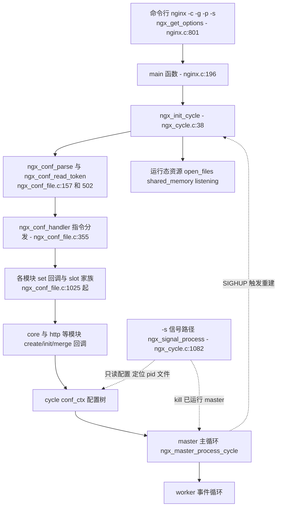
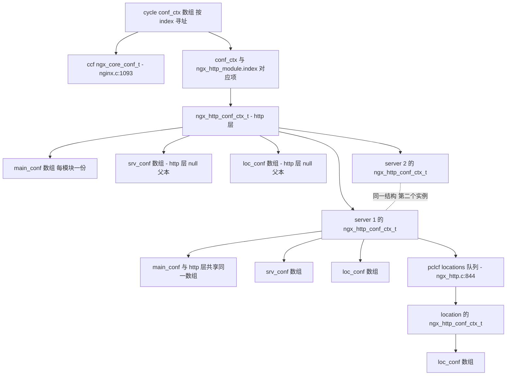
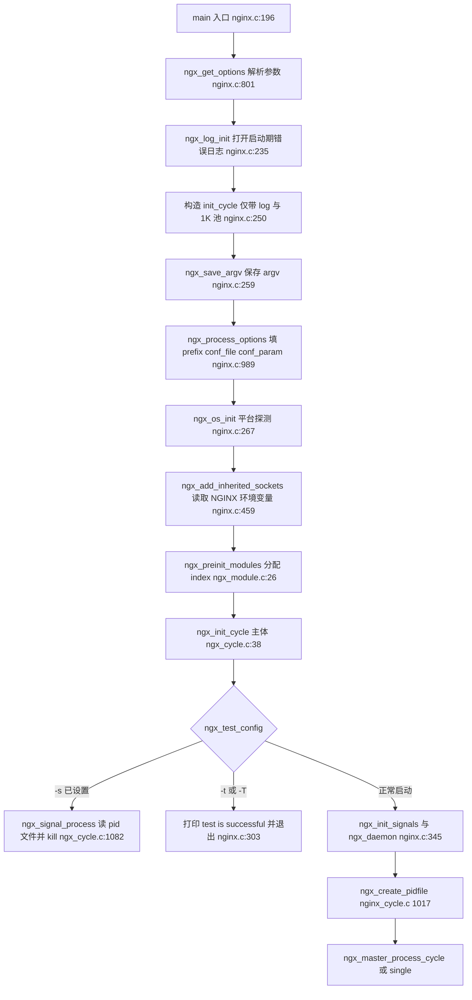
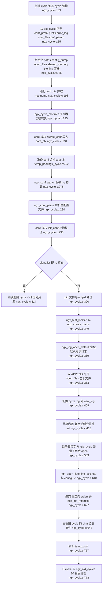
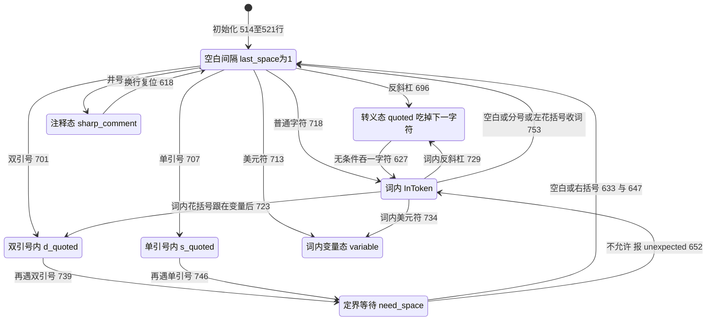
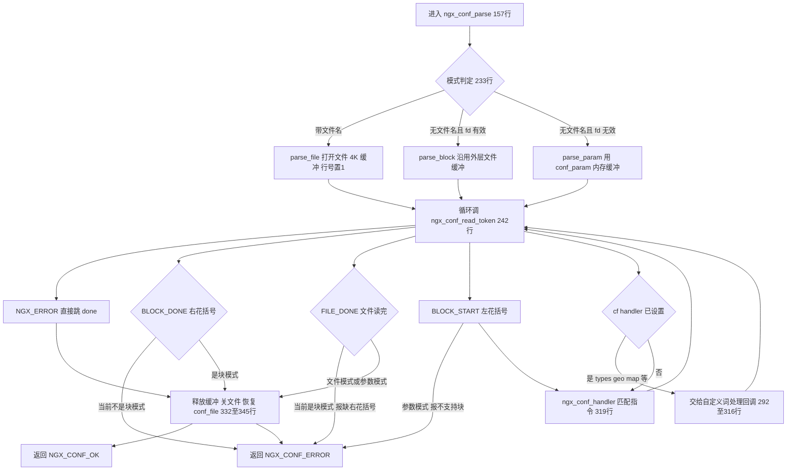
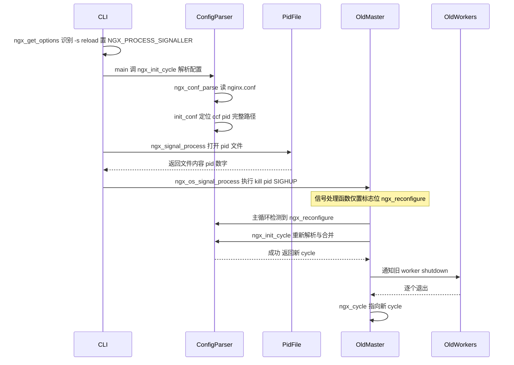
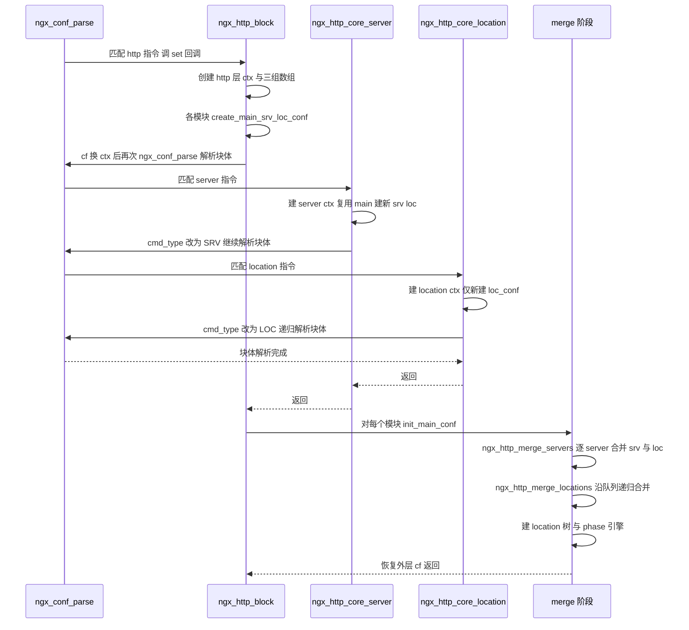
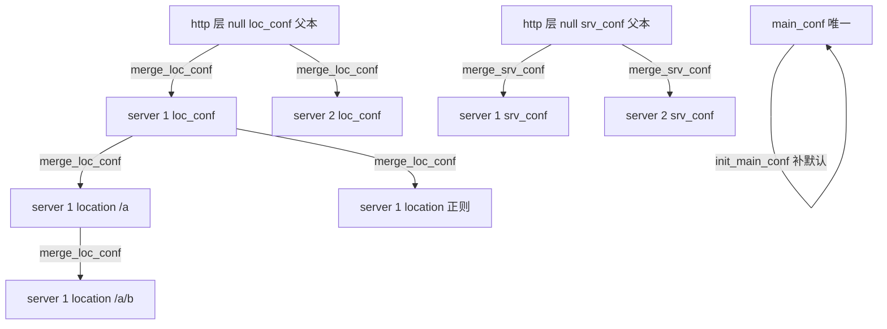

# 配置系统（解析/合并/cycle）（基于 nginx-1.27.0 源码）

> **导读**：读完本文你将掌握——
> 1. nginx 从 `main()` 开始如何把命令行参数、`nginx.conf`、`-g` 指令拼装成一棵 `conf_ctx` 配置树；
> 2. `ngx_conf_read_token` 这台手写分词状态机如何处理引号、转义、注释、块边界；
> 3. `ngx_command_t.type` 位掩码如何一次性校验"参数个数/出现位置/块/分号"四件事；
> 4. `set` 回调家族（str/num/size/off/flag/keyval/enum/bitmask…）如何用"哨兵值 + offsetof"把词法产物直接写进配置结构体；
> 5. http 三层 `conf` 数组（`main_conf/srv_conf/loc_conf`）如何创建、继承与逐层 merge；
> 6. `ngx_init_cycle` 的完整顺序、失败回滚保证，以及 `-t` 测试与 `reload` 在执行路径上的每一处差异；
> 7. `-s reload/stop/quit/reopen` 如何经由 pid 文件送达已运行实例。
>
> **前置阅读建议**：了解 `ngx_pool_t` 内存池与 `ngx_array_t/ngx_list_t` 的基本语义；知道 `ngx_module_t` 的存在即可（本文会在用到处给出 `index/ctx_index` 的精确含义）。建议先读《内存管理》与《模块系统》两篇（若系列中存在）。
>
> **涉及源码清单**（均已在写作前通读）：

| 文件 | 角色 | 是否确证存在 |
| --- | --- | --- |
| src/core/nginx.c | main、命令行参数、core 模块指令、信号入口 | 已确认 |
| src/core/ngx_conf_file.c | 词法/语法解析、指令分发、set 回调家族 | 已确认 |
| src/core/ngx_conf_file.h | `ngx_conf_t/ngx_command_t`、UNSET 哨兵与 merge 宏 | 已确认（glob） |
| src/core/ngx_cycle.c | `ngx_init_cycle`、pid 文件、信号进程、文件重开 | 已确认 |
| src/core/ngx_cycle.h | `ngx_cycle_t/ngx_core_conf_t` 定义 | 已确认（glob） |
| src/http/ngx_http.c | http 块指令、三级 conf 创建与 merge | 已确认 |
| src/http/ngx_http_config.h | `ngx_http_conf_ctx_t`、`ngx_http_module_t` 回调集 | 已确认（glob） |
| src/http/ngx_http_core_module.c | `server{}/location{}` 递归块实现 | 已确认（glob） |
| src/core/ngx_module.c / src/core/ngx_module.h | 模块预初始化、`index/ctx_index` 分配 | 已确认（glob） |
| src/os/unix/ngx_process.c | `signals[]` 表、`kill()` 投递 | 已确认（glob） |
| src/os/unix/ngx_process_cycle.c | master 侧 reload/upgrade 主循环 | 已确认（glob） |

---

## 1. 本模块在 nginx 中的位置与职责

配置系统是 nginx 的"装配车间"：在任何一个 worker 真正开始处理连接之前，master 进程必须先经过 `ngx_init_cycle()` 完成一整套配置解析与运行时资源准备。它向上接收命令行（`src/core/nginx.c:801-944` 的 `ngx_get_options`）与配置文件，向下驱动所有模块的 `create_conf/set/init_conf/merge_*` 回调，最终产出一份只读的、按模块索引寻址的 `ngx_cycle_t.conf_ctx` 树，供后续事件循环、HTTP 处理、upstream 等子系统查询。

它的职责边界非常清晰：

- **词法与语法**：把文本配置切成 token 流，处理引号、转义、注释、块边界（`ngx_conf_read_token`，src/core/ngx_conf_file.c:502-817）；
- **指令分发**：按"模块类型 + 位置类型 + 参数个数"匹配指令并调用 `set` 回调（`ngx_conf_handler`，src/core/ngx_conf_file.c:355-499）；
- **配置对象生命周期**：`create_conf → set 填充 → init_conf 补默认值 → merge 逐层下推`；
- **运行资源落地**：打开日志文件、分配共享内存、监听端口、调用 `ngx_init_modules`（src/core/ngx_cycle.c:38-940）；
- **进程间控制面**：pid 文件的创建/删除/读取，`-s` 信号转发（src/core/ngx_cycle.c:1017-1133）。



**图解**：实线是"首次启动"的数据流——命令行经 `main()` 汇入 `ngx_init_cycle()`，后者把文本配置一步步变成 `conf_ctx` 树并落地运行资源；虚线是"控制面"：`nginx -s reload` 这类短命进程只需要读配置拿到 pid 文件路径，然后对旧 master 发信号；旧 master 收到 `SIGHUP` 后重新走一遍 `ngx_init_cycle()`。这条虚线正是"配置解析与进程生命周期共用同一入口"的设计体现：**reload 就是重新执行一次完整的配置装配**。

---

## 2. 核心数据结构精讲

### 2.1 ngx_conf_t —— 解析器上下文（栈帧）

`ngx_conf_t` 是解析过程中的"游标 + 环境"，定义于 src/core/ngx_conf_file.h:116-132：

| 字段 | 类型 | 含义与要点 |
| --- | --- | --- |
| `name` | `char *` | 声明了但当前源码中未见读取点（grep 全 src 无 `cf->name` 使用），属遗留字段，勿依赖 |
| `args` | `ngx_array_t *` | 当前指令的 token 数组，元素为 `ngx_str_t`；`elts[0]` 是指令名，`elts[1..]` 是参数。`ngx_conf_read_token` 每次读 token 前将其 `nelts` 清零（src/core/ngx_conf_file.c:523） |
| `cycle` | `ngx_cycle_t *` | 反向指回所属 cycle，`set` 回调里可经 `cf->cycle` 访问 `conf_ctx`、`open_files` 等 |
| `pool` | `ngx_pool_t *` | **配置生存期**内存池（= cycle 的 pool），最终配置对象都分配在这里 |
| `temp_pool` | `ngx_pool_t *` | **解析期**临时池：如 location 的队列节点（src/http/ngx_http.c:851-860 用 `cf->temp_pool`），解析合并完成后整体销毁（src/core/ngx_cycle.c:767） |
| `conf_file` | `ngx_conf_file_t *` | 当前解析源：文件 fd/名/行号 + 4K 缓冲区 + dump 缓冲，见 2.4 |
| `log` | `ngx_log_t *` | 报错日志；`ngx_conf_log_error` 会自动附加"文件:行号"或"in command line"（src/core/ngx_conf_file.c:1013-1021） |
| `ctx` | `void *` | **当前上下文指针**：顶层时是 `cycle->conf_ctx`；进入 http{} 后是 `ngx_http_conf_ctx_t *`；进入 server{}、location{} 后又换成各自的 `ngx_http_conf_ctx_t *`。块指令回调靠保存/恢复它实现"上下文栈" |
| `module_type` | `ngx_uint_t` | 允许出现的模块类型，如 `NGX_CORE_MODULE` / `NGX_HTTP_MODULE`（src/core/ngx_cycle.c:271、src/http/ngx_http.c:237） |
| `cmd_type` | `ngx_uint_t` | 允许出现的位置类型，如 `NGX_MAIN_CONF` / `NGX_HTTP_MAIN_CONF` / `NGX_HTTP_SRV_CONF`（src/http/ngx_http_core_module.c:2979、3223） |
| `handler` / `handler_conf` | 回调 | 自定义"词处理器"：设置后 token 不再走指令匹配，直接交给回调。使用点：http `types{}`（src/http/ngx_http_core_module.c:3288-3290）、geo、map、charset、stream 的 geo/map/split_clients |

### 2.2 ngx_command_t —— 指令描述符

src/core/ngx_conf_file.h:77-84：

| 字段 | 含义 |
| --- | --- |
| `name` | 指令名（`ngx_str_t`），匹配用 `ngx_strcmp` 精确比较（src/core/ngx_conf_file.c:381） |
| `type` | 位掩码，一次编码四类约束：**参数个数**（`NGX_CONF_TAKE1..7`、`NGX_CONF_1MORE/2MORE/ANY/FLAG`）、**是否块**（`NGX_CONF_BLOCK`）、**出现位置**（`NGX_DIRECT_CONF`/`NGX_MAIN_CONF`/`NGX_HTTP_MAIN_CONF…LMT_CONF`）、**归属层**（`NGX_ANY_CONF` 等） |
| `set` | `char *(*)(ngx_conf_t *cf, ngx_command_t *cmd, void *conf)`；返回 `NGX_CONF_OK(NULL)` / `NGX_CONF_ERROR((void*)-1)` / 错误字符串（该字符串会被拼进 `"directive %s"` 报错，src/core/ngx_conf_file.c:473-474） |
| `conf` | 定位 conf 对象用的偏移：`0` 配合 `NGX_DIRECT_CONF`；`NGX_HTTP_MAIN_CONF_OFFSET` 等 `offsetof(ngx_http_conf_ctx_t, xxx)` 值（src/http/ngx_http_config.h:50-52） |
| `offset` | conf 结构体内目标字段的 `offsetof`，slot 家族靠 `p + cmd->offset` 定位 |
| `post` | 校验/枚举表指针：`ngx_conf_post_t`、`ngx_conf_enum_t[]`、`ngx_conf_bitmask_t[]` 等（src/core/ngx_conf_file.h:135-168） |

### 2.3 ngx_cycle_t 与 ngx_core_conf_t

`ngx_cycle_t`（src/core/ngx_cycle.h:39-86）是"一次配置生效周期"的总容器。与配置系统直接相关的字段：

| 字段 | 含义 |
| --- | --- |
| `conf_ctx` | `void ****`：顶层配置树，大小 `ngx_max_module`（src/core/ngx_cycle.c:198-202），`conf_ctx[module.index]` 寻址（src/core/ngx_conf_file.h:176 的 `ngx_get_conf`） |
| `pool` | 该 cycle 的总内存池，大小 `NGX_CYCLE_POOL_SIZE`（src/core/ngx_cycle.h:16-18），reload 成功后旧 cycle 连池一起延迟销毁 |
| `old_cycle` | 指向被替换的旧 cycle；`ngx_init_cycle` 大量依赖它做资源复用与差量回收 |
| `conf_file / conf_param / conf_prefix / prefix / error_log / lock_file / hostname` | 命令行与环境的快照：`-c`、`-g`、配置目录前缀、运行前缀、`-e`、锁文件、主机名（src/core/nginx.c:989-1090 填充） |
| `open_files` | `ngx_list_t`，全部需要长期打开的文件（各 error_log/access_log），元素 `ngx_open_file_t{fd,name,flush,data}`（src/core/ngx_conf_file.h:89-95） |
| `shared_memory` | `ngx_list_t`，`ngx_shm_zone_t` 列表，reload 时按"name+tag+size"匹配复用（src/core/ngx_cycle.c:441-480） |
| `listening` | `ngx_array_t`，`ngx_listening_t` 数组，监听套接字复用逻辑在 src/core/ngx_cycle.c:503-616 |
| `config_dump` + `config_dump_rbtree` | `-T` 转储用：每个被解析文件的原文缓冲（src/core/ngx_conf_file.c:101-154） |

`ngx_core_conf_t`（src/core/ngx_cycle.h:89-122）是 core 层模块的配置结构，由 `ngx_core_module_create_conf` 创建（src/core/nginx.c:1093-1135）。注意 `pid/oldpid` 两个 `ngx_str_t`：`oldpid` 在 `init_conf` 中被赋成 `pid + ".oldbin"`（src/core/nginx.c:1175-1183，`NGX_OLDPID_EXT` 定义在 src/core/nginx.h:23），是热升级双进程并存的基石。

### 2.4 ngx_conf_file_t / ngx_conf_dump_t

src/core/ngx_conf_file.h:98-109：

| 字段 | 含义 |
| --- | --- |
| `file` | `ngx_file_t`：fd、文件名、`info`（大小）、`offset`（已读偏移） |
| `buffer` | 4KB 缓冲（`NGX_CONF_BUFFER`，src/core/ngx_conf_file.c:11），`ngx_conf_parse` 用 `ngx_alloc` 单独分配（src/core/ngx_conf_file.c:200），退出时 `ngx_free`（同文件 333-335） |
| `dump` | `-T` 模式下同步把读入字节拷进 `config_dump` 缓冲（src/core/ngx_conf_file.c:608-610） |
| `line` | 当前行号：每遇 `LF` 自增（src/core/ngx_conf_file.c:615-616） |

### 2.5 ngx_http_conf_ctx_t —— 三层 conf 数组

src/http/ngx_http_config.h:17-21：

| 字段 | 含义 |
| --- | --- |
| `main_conf` | `void *[ngx_http_max_module]`，每个 http 模块一份，**http{} 全局唯一** |
| `srv_conf` | 每个 `server{}` 一份数组；http{} 层还有一份"null srv_conf"专用于 merge 的父本（src/http/ngx_http.c:160-169 的注释） |
| `loc_conf` | 每个 `location{}`（以及每个 server{}、http{}）各一份数组，逐层继承 |

`ngx_http_module_t`（src/http/ngx_http_config.h:24-36）定义了 8 个回调：`preconfiguration/postconfiguration/create_main_conf/init_main_conf/create_srv_conf/merge_srv_conf/create_loc_conf/merge_loc_conf`——这就是三级 conf 的"创建/校验/合并"协议。



**图解**：三层结构的关键是**继承方式不同**。server 的 ctx 里 `main_conf` 直接复制 http 层指针（src/http/ngx_http_core_module.c:2915-2916），location 的 ctx 里 `main_conf`、`srv_conf` 都复制父层指针（src/http/ngx_http_core_module.c:3057-3059），**只有 `loc_conf` 每层都新建数组**。因此 merge 只需要沿 `loc_conf` 链下推，`srv_conf` 在 server 一级与 http 层的 null 父本对齐，`main_conf` 天然全局唯一。`ngx_http_get_module_loc_conf(r, module)` 运行期用 `module.ctx_index` 在数组内寻址（src/http/ngx_http_config.h:55-58）。

### 2.6 NGX_CONF_UNSET 哨兵与 conf_merge 宏家族

src/core/ngx_conf_file.h:56-64 定义哨兵：

```c
#define NGX_CONF_UNSET       -1
#define NGX_CONF_UNSET_UINT  (ngx_uint_t) -1
#define NGX_CONF_UNSET_PTR   (void *) -1
#define NGX_CONF_UNSET_SIZE  (size_t) -1
#define NGX_CONF_UNSET_MSEC  (ngx_msec_t) -1
```

协议是三段式的：

1. **create_conf** 把整块内存 `ngx_pcalloc` 清零后，显式把"0 不是合法值"的字段设为哨兵（src/core/nginx.c:1114-1126：`daemon/master/timer_resolution/worker_processes/rlimit_*` 等）；
2. **set 回调**检查哨兵判断"是否已设置"从而报 `is duplicate`（如 src/core/ngx_conf_file.c:1036-1037、1178-1179）；
3. **init_conf / merge** 阶段用宏家族补默认值：

| 宏 | 判定条件 | 行号 |
| --- | --- | --- |
| `ngx_conf_init_value / init_ptr_value / init_uint_value / init_size_value / init_msec_value` | `== 对应 UNSET` 则赋 default | src/core/ngx_conf_file.h:180-203 |
| `ngx_conf_merge_value / merge_ptr / merge_uint / merge_msec / merge_sec / merge_size / merge_off` | 自身 UNSET 时取 `prev`，prev 也 UNSET 才取 default | src/core/ngx_conf_file.h:205-238 |
| `ngx_conf_merge_str_value` | 以 `conf.data == NULL` 为未设置标志；prev 有值借指针，否则取字面 default | src/core/ngx_conf_file.h:240-249 |
| `ngx_conf_merge_bufs_value` | 以 `conf.num == 0` 为未设置标志 | src/core/ngx_conf_file.h:251-260 |
| `ngx_conf_merge_bitmask_value` | 以 `0` 为未设置标志 | src/core/ngx_conf_file.h:262-265 |

**易错点**：`str` 族哨兵是 `data==NULL` 而非 `-1`；`bitmask/bufs` 族哨兵是 `0`。所以这三个宏的"未设置"判定与其余宏不同，写模块时选错宏会把合法的 0 值误当未设置。

---

## 3. 初始化流程

从进程启动到 master 主循环开始，配置系统的完整执行序列如下（节点内标注 函数名 与 文件:行号）：



进入 `ngx_init_cycle` 后的内部顺序（这一串顺序是源码写死的，回滚逻辑依赖它）：



**解读三个容易忽略的点**：

1. **两段式前缀**。`init_cycle` 阶段 `ngx_process_options` 先解析 `-p`：给定了就补尾斜杠作为 `conf_prefix` 与 `prefix`（src/core/nginx.c:995-1012）；没给且编译期无 `NGX_PREFIX` 时用 `getcwd` 兜底（src/core/nginx.c:1016-1035）。随后解析 `-c`：配置文件相对路径按 `prefix` 展开（src/core/nginx.c:1057），再**反向从配置文件路径里截取目录**作为 `conf_prefix`（src/core/nginx.c:1061-1070）。此后 `include` 与各类相对路径展开，到底用哪个前缀由 `ngx_conf_full_name(cycle, name, conf_prefix)` 的第三参决定（src/core/ngx_conf_file.c:886-894）：include 传 1 用 `conf_prefix`（src/core/ngx_conf_file.c:833），日志/pid 等传 0 用 `prefix`（src/core/ngx_conf_file.c:912）。
2. **配置默认值的三个来源**。编译期常量来自构建脚本（`conf/nginx.conf`、`logs/nginx.pid`、`logs/error.log`，见 auto/options:622-630 的 `${NGX_CONF_PATH:-...}` 默认）；create_conf 里的哨兵（src/core/nginx.c:1114-1126）；init_conf 里的 `ngx_conf_init_*` 补默认（src/core/nginx.c:1143-1149：`daemon=1`、`master=1`、`worker_processes=1`；pid 缺省 `NGX_PID_PATH`，1167-1169）。
3. **signaller 提前返回**。`-s` 进程在 core 模块 `init_conf` 结束后立即返回（src/core/ngx_cycle.c:314-316）——它**不需要**锁文件、路径、日志文件、共享内存和监听套接字，只需要 `ccf->pid` 的完整路径。这也解释了为什么 `nginx -s` 对配置文件语法错误同样敏感：解析在前，返回在后。

---

## 4. 核心执行流程/状态机

### 4.1 ngx_conf_read_token 的字符级状态机

`ngx_conf_read_token`（src/core/ngx_conf_file.c:502-817）没有用 flex，而是 7 个布尔状态变量的手写机。下面 stateDiagram 覆盖了全部分支：



**逐态讲解**：

- **空白间隔（last_space=1）**：这是 token 的起点。`#` 进入注释态（692-694）；`"`/`'` 分别置 `d_quoted/s_quoted` 并把 token 起点推后一格（701-705 起的 `start++`），保证引号不进入词内容；`\` 置 `quoted`（696-699），下个字符无条件消费（627-630），这就是"反斜杠转义任意字符"；`$` 置 `variable`（713-716）。
- **词内（InToken）**：空白、`;`、`{` 都终止当前词并把它压入 `cf->args`（753-758 与 760-803）。词内的 `\` 是转义（729-731）；`$` 置变量态，紧随其后的 `{` 被"吃掉"而不是当块边界（723-725），这正是 `"${pid}"` 之类引用不会把配置切成两半的原因。
- **引号内**：双/单引号只在起点有意义；引号内再次遇到同类引号即收词并进入 `need_space`（739-751）。
- **定界等待（need_space）**：收词后只允许空白、`;`、`{`、`)`（632-655），其他任何字符立即报 `"unexpected \"%c\""`。这个状态保证 `"a""b"` 这种粘连写法报错，而 `"a)"` 这类（如 map/geo 语法需要的括号）放行。
- **注释态**：`#` 之后一切字符忽略，直到 `LF` 复位（615-621），且注释不消耗行号以外任何语义。

### 4.2 ngx_conf_parse 主循环的五个返回值



**逐分支讲解**：

- `BLOCK_DONE`（读到 `}`）：只有 `parse_block` 模式合法——即本次 `ngx_conf_parse(cf, NULL)` 是某块指令的 `set` 回调里发起的"解析块体"。若文件模式遇到多余的 `}`，报 `unexpected "}"`（src/core/ngx_conf_file.c:261-264）。
- `FILE_DONE`：文件模式正常收尾；块模式收到它说明缺 `}`，报 `unexpected end of file, expecting "}"`（269-278）。
- `BLOCK_START` 在 `parse_param`（`-g`）模式：报 `block directives are not supported in -g option`（282-287）——**`-g` 只能放简单指令**。
- 自定义 handler 分支：`cf->handler` 设置后，块内每个"指令"都以 `rv = (*cf->handler)(cf, NULL, cf->handler_conf)` 处理（304），块起点 `{` 会被拒绝（299-302）。`types{}`、`geo{}`、`map{}`、`charset_map{}` 全靠这个钩子把"类型 扩展名列表"这类非标准语法交给模块自行解释。

### 4.3 -t 测试与 reload 的执行差异；失败回滚

| 维度 | `-t` / `-T` | reload（SIGHUP） |
| --- | --- | --- |
| 触发者 | 独立短命进程 | 已运行 master 收 `SIGHUP`（`signals[]` 表：`"reload"` → `NGX_RECONFIGURE_SIGNAL`，src/os/unix/ngx_process.c:40-43） |
| 日志级别 | `-t` 强制 `log_level = NGX_LOG_INFO`（src/core/nginx.c:1085-1087） | 保持运行级别 |
| `ngx_init_cycle` 内 | 解析到 `init_conf` 后走正常全流程，但 pid 文件仅以 `NGX_FILE_CREATE_OR_OPEN` 创建（验证路径可写、不写入内容，src/core/ngx_cycle.c:1035、1048-1054）；跳过 `ngx_configure_listening_sockets`（622-624）；不执行 `ngx_init_modules` 后续 worker 相关逻辑 | 完整执行；pid 文件改名仅在 `pid` 指令内容变化时发生（326-346） |
| 解析成功后 | 打印 `test is successful`（`-q` 静默）并 exit 0（src/core/nginx.c:303-327；`-T` 先转储 `config_dump`） | 启动新 worker（`NGX_PROCESS_JUST_RESPAWN`）再通知旧 worker 退出（src/os/unix/ngx_process_cycle.c:234-243） |
| 失败行为 | `ngx_init_cycle` 返回 NULL → 打印 `test failed` → exit 1（src/core/nginx.c:294-301） | master **保留旧 cycle 继续服务**：`cycle = ngx_init_cycle(cycle); if (cycle == NULL) { cycle = (ngx_cycle_t *) ngx_cycle; continue; }`（src/os/unix/ngx_process_cycle.c:225-229） |

**回滚保证**（`failed:` 标签，src/core/ngx_cycle.c:819-939）：新 cycle 装配到任何一步失败，都会——恢复旧环境变量指针（821-827）、关掉新 cycle 已打开的全部文件（831-854）、释放"新分配但旧 cycle 不存在"的共享内存（858-917）、`-t` 模式直接销毁两池返回（919-922）、否则关掉新 cycle 已打开的监听套接字（924-935）再销毁两池。由于**所有写动作都发生在新 cycle 的资源上，旧 cycle 直到 `ngx_init_modules` 提交点（635-638）之前完全未被触碰**，这就是配置失败"服务不中断"的结构性保证。唯一的全局副作用是 `environ` 被 `ngx_set_environment` 临时替换过，所以回滚第一件事就是还原它——连这种边角都考虑到了。

---

## 5. 关键时序图

### 5.1 `nginx -s reload` 全链路



**解读**：信号进程与被控进程唯一的耦合点是 pid 文件（名字来自同一份配置解析，`ccf->pid`，src/core/nginx.c:1167-1173）。master 收到信号后**不在信号处理函数里干活**，只置 `sig_atomic_t` 标志（src/os/unix/ngx_process_cycle.c:43），在主循环的安全点再执行 `ngx_init_cycle`（同文件 211-244）。若新配置失败，226-228 行直接回退旧 cycle 继续跑，这是 4.3 表格结论的时序体现。

### 5.2 http{} 的解析与三级 merge 时序



**解读**：注意每级递归都会"保存-改写-恢复"整个 `ngx_conf_t`（`pcf = *cf; ... *cf = pcf`，src/http/ngx_http.c:218-219 与 325、src/http/ngx_http_core_module.c:2977-2983、3221-3227）。因为 `ngx_conf_t` 是栈上值类型，压栈复制一个结构体就完成了上下文切换，无堆分配、无泄漏风险——这是 nginx 配置递归最优雅的一处实现。

---

## 6. 源码逐段精读

本章是全文主体。每节按"签名 → 逐块逻辑 → 关键行 → 易错点"展开。

### 6.1 ngx_get_options：命令行与 -s 的预检

**签名**：`static ngx_int_t ngx_get_options(int argc, char *const *argv)`（src/core/nginx.c:801）。

逻辑：外层 `for` 遍历 argv，内层 `while (*p)` 支持合并短选项（如 `-vq`）。每个选项要么吃掉本串剩余部分（`if (*p) { ngx_prefix = p; goto next; }`），要么吃掉下一个 argv（`argv[++i]`），否则报 `option "-p" requires directory name`（859）。

关键分支：

- `-t` / `-T`（835-842）：分别置全局 `ngx_test_config`、`ngx_dump_config`（定义在 src/core/ngx_cycle.c:28-30）。
- `-e`（862-878）：`-e stderr` 特判为空串（874-876），后续 `ngx_log_init` 据此不打开文件。
- `-g`（894-906）：存入 `ngx_conf_params`，最终进 `cycle->conf_param`（src/core/nginx.c:1080-1083）。
- **`-s`（908-930）**：先取值，再用 `ngx_strcmp` 与四个合法值精确匹配：

```c
if (ngx_strcmp(ngx_signal, "stop") == 0
    || ngx_strcmp(ngx_signal, "quit") == 0
    || ngx_strcmp(ngx_signal, "reopen") == 0
    || ngx_strcmp(ngx_signal, "reload") == 0)
{
    ngx_process = NGX_PROCESS_SIGNALLER;
    goto next;
}
```
（src/core/nginx.c:920-927）

`NGX_PROCESS_SIGNALLER` 数值为 2，大于 `NGX_PROCESS_MASTER` 的 1（src/os/unix/ngx_process_cycle.h:23-27）。这个大小关系被 `ngx_create_pidfile` 用来拒绝 signaller 写 pid 文件（src/core/ngx_cycle.c:1026-1028：`if (ngx_process > NGX_PROCESS_MASTER) return NGX_OK;`）。

**易错点**：`-s` 合法值列表与 `signals[]` 表的 `name` 字段一一对应（stop/quit/reopen/reload，src/os/unix/ngx_process.c:55-63、40-48），表里还有名字为空串的内部信号（如 `""` 对应 SIGUSR2 的换二进制），它们不能通过 `-s` 触发——这是刻意的：升级用 `kill -USR2` 而非 `-s`，因为升级需要 master 自己执行 `ngx_exec_new_binary`。

### 6.2 ngx_process_options：前缀、配置文件与 conf_param

**签名**：`static ngx_int_t ngx_process_options(ngx_cycle_t *cycle)`（src/core/nginx.c:989）。

分四块：

1. **prefix**（995-1047）：`-p` 给定则补 `/`（999-1007），`conf_prefix` 与 `prefix` 同值；否则编译期有 `NGX_PREFIX` 就用之（1037-1045），没有就 `getcwd`（1018-1035）。
2. **conf_file**（1049-1070）：默认 `NGX_CONF_PATH`（构建默认 `conf/nginx.conf`，auto/options:622）；`ngx_conf_full_name(cycle, &cycle->conf_file, 0)` 用 **prefix** 展开（1057）；然后从后向前找路径分隔符，把目录部分设为 `conf_prefix`（1061-1070）。此后 include 相对路径就以"配置文件所在目录"为基准。
3. **error_log / conf_param**（1072-1083）：`-e` 与 `-g` 的归档。
4. **test 模式**（1085-1087）：日志级别抬到 INFO，让 `-t` 输出解析期告警。

**易错点**：`conf_param` 此时只是字符串；真正解析发生在 `ngx_conf_param`（见 6.3），且顺序在主配置**之前**（src/core/ngx_cycle.c:278-288）——即 `-g` 指令先于 nginx.conf 执行，同名指令后到者会报 `is duplicate`，所以 `worker_processes 1;` 写进 `-g` 而 nginx.conf 里也写一份会启动失败。

### 6.3 ngx_conf_param：把 -g 伪装成一个"文件"

**签名**：`char *ngx_conf_param(ngx_conf_t *cf)`（src/core/ngx_conf_file.c:62）。

```c
b.start = param->data;
b.pos = param->data;
b.last = param->data + param->len;
b.end = b.last;
b.temporary = 1;
...
conf_file.file.fd = NGX_INVALID_FILE;
conf_file.line = 0;
cf->conf_file = &conf_file;
cf->conf_file->buffer = &b;
rv = ngx_conf_parse(cf, NULL);
```
（src/core/ngx_conf_file.c:80-93）

它把 `-g` 字符串包装成一个**内存缓冲假文件**：`file.fd = NGX_INVALID_FILE` 是模式判定的判据——`ngx_conf_parse` 里 `fd` 无效即 `parse_param` 模式（233-239）。`ngx_conf_read_token` 在缓冲耗尽且 `fd` 无效时报 `unexpected end of parameter, expecting ";"`（539-544）；报错时 `ngx_conf_log_error` 输出 `in command line` 而非文件行号（1013-1017）。

### 6.4 ngx_conf_parse：递归下降的骨架

**签名**：`char *ngx_conf_parse(ngx_conf_t *cf, ngx_str_t *filename)`（src/core/ngx_conf_file.c:157）。

三种模式（165-239）：

- `filename` 非空 → `parse_file`：`ngx_open_file` 只读打开（180），分配 4K 缓冲（200-208），`line = 1`（215），`-T` 时登记 dump（219-231）。
- `filename` 为空且 `cf->conf_file->file.fd != NGX_INVALID_FILE` → `parse_block`：**沿用外层文件与缓冲**，只把控制权交给块体解析。
- 否则 → `parse_param`（见 6.3）。

主循环（242-324）的返回值协议见 4.2 图。收尾（332-345）值得细读：

```c
if (filename) {
    if (cf->conf_file->buffer->start) {
        ngx_free(cf->conf_file->buffer->start);
    }
    if (ngx_close_file(fd) == NGX_FILE_ERROR) { ... }
    cf->conf_file = prev;
}
```
（src/core/ngx_conf_file.c:332-345）

`prev = cf->conf_file` 在打开文件前保存（189），退出时恢复——**文件栈就是这样用一个指针字段实现的**。失败路径 `failed:` 与成功路径 `done:` 汇合到同一段清理代码，保证 fd 与内存不泄漏。

**易错点**：`goto failed` 前若 `ngx_conf_add_dump` 失败（225-227），`buf.start` 可能尚未分配，332 行用 `if (cf->conf_file->buffer->start)` 判空防住。

### 6.5 ngx_conf_read_token：分词状态机逐段精读

**签名**：`static ngx_int_t ngx_conf_read_token(ngx_conf_t *cf)`（src/core/ngx_conf_file.c:502）。返回值五态：`NGX_ERROR / NGX_OK / NGX_CONF_BLOCK_START / NGX_CONF_BLOCK_DONE / NGX_CONF_FILE_DONE`。

**（1）状态初始化与清空 args（514-527）**：`found/need_space/last_space/sharp_comment/variable/quoted/s_quoted/d_quoted` 全部就位，`cf->args->nelts = 0` 复用数组内存而不重建。

**（2）缓冲管理（533-611）**：4K 环形式复用——`b->pos >= b->last` 时，若文件也读完则按"是否还有未收词"决定报错（537-552）或返回 `NGX_CONF_FILE_DONE`（552）；否则把未处理尾巴 `ngx_memmove` 到头部（579-581），再 `ngx_read_file` 补满（589-590）。参数超长（一个 token 跨满 4K 且引号未闭合）报 `too long parameter, probably missing terminating quote`（557-576）。

**（3）字符消费与全局态（613-630）**：`ch = *b->pos++`；`LF` 行号自增并复位注释态（615-621）；`sharp_comment` 期间一切跳过（623-625）；`quoted` 态无条件吞掉下一字符（627-630）。

**（4）need_space 态（632-656）**：如 4.1 所述。注意 647-649 对 `)` 的放行没有额外注释，其存在是为了让 `"a")` 型词法（geo/正则替代写法）不误报。

**（5）last_space 态（658-720）——token 起点**：

```c
case ';':
case '{':
    if (cf->args->nelts == 0) {
        ngx_conf_log_error(NGX_LOG_EMERG, cf, 0, "unexpected \"%c\"", ch);
        return NGX_ERROR;
    }
    if (ch == '{') {
        return NGX_CONF_BLOCK_START;
    }
    return NGX_OK;

case '}':
    if (cf->args->nelts != 0) { ... "unexpected \"}\"" ... }
    return NGX_CONF_BLOCK_DONE;
```
（src/core/ngx_conf_file.c:669-690）

这里定了三条硬规则：空参数出现 `;`/`{` 非法；有参数遇 `}` 非法；`}` 独占且立即结束块。`#`、`\`、`"`、`'`、`$` 五个特殊起点各置一态（692-716）。

**（6）词内态（722-815）——核心**：终止字符触发收词（760-803），拷贝时做**就地反转义**：

```c
if (*src == '\\') {
    switch (src[1]) {
    case '"':
    case '\'':
    case '\\':
        src++;
        break;
    case 't':
        *dst++ = '\t';
        src += 2;
        continue;
    case 'r':
        *dst++ = '\r';
        src += 2;
        continue;
    case 'n':
        *dst++ = '\n';
        src += 2;
        continue;
    }
}
*dst++ = *src++;
```
（src/core/ngx_conf_file.c:775-801）

支持的反义仅六种：`\" \' \\ \t \r \n`；其他如 `\x41` **不展开**，`\` 与下一字符原样保留。收词后若终止符是 `;` 返回 `NGX_OK`（805-807），是 `{` 返回 `NGX_CONF_BLOCK_START`（809-811），否则继续收下一个词。

**易错点**：变量态 `variable` 只影响两点——词内 `{` 不当块边界（723-725）、词起点遇到 `$` 不算普通字符（713-716）。它**不做变量替换**：`$pid` 会原样作为 token 交给指令回调，由 geo/map/split_clients 等模块自行解释。另外引号必须成对出现在 token 起点；`ab"cd"` 中引号只是普通字符。

### 6.6 ngx_conf_handler：匹配、校验与 conf 定位

**签名**：`static ngx_int_t ngx_conf_handler(ngx_conf_t *cf, ngx_int_t last)`（src/core/ngx_conf_file.c:355）。`last` 是 `ngx_conf_read_token` 的返回值（`NGX_OK` 或 `NGX_CONF_BLOCK_START`）。

**（1）线性扫描**（368-385）：双层循环遍历 `cf->cycle->modules[i]->commands`，先比长度再比内容（377-383），命中即 `found = 1`。**注意匹配不会提前结束**：即使名字命中，后续 type 校验不过会 `continue` 尝试下一个同名指令；扫描完全部模块后才根据 `found` 报 `directive is not allowed here`（480-485）或 `unknown directive`（487-490）。

**（2）四重 type 校验**：

```c
if (cf->cycle->modules[i]->type != NGX_CONF_MODULE
    && cf->cycle->modules[i]->type != cf->module_type)
{
    continue;
}
if (!(cmd->type & cf->cmd_type)) {
    continue;
}
if (!(cmd->type & NGX_CONF_BLOCK) && last != NGX_OK) { ... "not terminated by ;" ... }
if ((cmd->type & NGX_CONF_BLOCK) && last != NGX_CONF_BLOCK_START) { ... "has no opening {" ... }
```
（src/core/ngx_conf_file.c:387-411）

第一重过滤模块归属（`NGX_CONF_MODULE` 类型的 `include` 指令在任意上下文可用）；第二重过滤出现位置（`cmd->type` 与 `cf->cmd_type` 位与）；第三、四重校验分号/花括号与块声明一致性。

**（3）参数个数（415-443）**：`NGX_CONF_ANY` 直接过；`FLAG` 要求恰好 2 个 token（419-421）；`1MORE/2MORE` 要求下限（423-433）；否则查 `argument_number[cf->args->nelts - 1]` 位表（439-441，表定义于 50-59）且总数不得超 `NGX_CONF_MAX_ARGS`（=8，src/core/ngx_conf_file.h:31）。

**（4）conf 定位——理解三级寻址的钥匙**：

```c
conf = NULL;
if (cmd->type & NGX_DIRECT_CONF) {
    conf = ((void **) cf->ctx)[cf->cycle->modules[i]->index];
} else if (cmd->type & NGX_MAIN_CONF) {
    conf = &(((void **) cf->ctx)[cf->cycle->modules[i]->index]);
} else if (cf->ctx) {
    confp = *(void **) ((char *) cf->ctx + cmd->conf);
    if (confp) {
        conf = confp[cf->cycle->modules[i]->ctx_index];
    }
}
```
（src/core/ngx_conf_file.c:447-461）

三条路泾渭分明：

- `NGX_DIRECT_CONF`：顶层模块（core）的配置结构体**直接**存放在 `conf_ctx[index]`，如 `daemon on;` 拿到的 `conf` 就是 `ngx_core_conf_t *`；
- `NGX_MAIN_CONF`：**取数组槽位的地址**而非槽位值。因为 http{} 这类块指令的 `conf_ctx[http.index]` 初始为 NULL，`ngx_http_block` 需要向这个槽位**写入**自己创建的 `ngx_http_conf_ctx_t *`（src/http/ngx_http.c:133-144 的 `*(ngx_http_conf_ctx_t **) conf = ctx;`）；
- 其余（http 层普通指令）：`cf->ctx` 是 `ngx_http_conf_ctx_t *`，`cmd->conf` 是 `offsetof(ngx_http_conf_ctx_t, main_conf/srv_conf/loc_conf)`（src/http/ngx_http_config.h:50-52），先取数组指针再按 `ctx_index` 下标定位（456-460）。

**（5）调用与错误处理（463-476）**：`rv = cmd->set(...)`；`NGX_CONF_OK` → 返回；`NGX_CONF_ERROR` → 返回错误；**其余任何非空返回值被当作错误描述**拼进 `"\"%s\" directive %s"`——这就是 `return "is duplicate"` 能变成一行报错文本的原因。

### 6.7 ngx_conf_include：通配符展开

**签名**：`char *ngx_conf_include(ngx_conf_t *cf, ngx_command_t *cmd, void *conf)`（src/core/ngx_conf_file.c:820）。指令注册为 `NGX_ANY_CONF|NGX_CONF_TAKE1`（21-26），所以任何上下文（含 `types{}` 内部经 handler 转发，src/http/ngx_http_core_module.c:3311-3320）都能 include。

逻辑：

1. `ngx_conf_full_name(cf->cycle, &file, 1)`——**conf_prefix 展开**（833）；
2. `strpbrk((char *) file.data, "*?[") == NULL` 判定非通配符，直接 `ngx_conf_parse(cf, &file)` 递归（837-842）；
3. 通配符路径：`ngx_open_glob`（`gl.test = 1`，844-854）后循环 `ngx_read_glob` 逐个解析（858-878），任一文件失败即中断返回。

**易错点**：include 是**顺序解析**而非收集后统一解析，后 include 的文件可覆盖前者的语义（例如 `server{}` 数量）。另外 include 一个目录或空通配结果：glob 打开成功但 `ngx_read_glob` 无匹配 → `rv` 保持 `NGX_CONF_OK`，**不报错**；而 include 一个不存在的具体文件会 `open file failed` 直接 EMERG（182-187 路径）。

### 6.8 set 回调家族：slot 函数逐个过

这族函数都在 src/core/ngx_conf_file.c，统一模式是"`char *p = conf;` + `p + cmd->offset` 定位字段 + 哨兵查重 + 解析 + post 校验"。

**ngx_conf_set_flag_slot（1025-1062）**：`ngx_flag_t` 实为 `ngx_int_t`。`on/off` 大小写不敏感（`ngx_strcasecmp`，1042-1047）。查重哨兵 `NGX_CONF_UNSET`。

**ngx_conf_set_str_slot（1065-1089）**：查重条件是 `field->data` 非空（1075-1077），赋值 `*field = value[1]` 是**浅拷贝**——data 指向 read_token 分配的 `cf->pool` 内存，生存期与配置池一致。

**ngx_conf_set_str_array_slot（1092-1125）**：首次遇 `NGX_CONF_UNSET_PTR` 时 `ngx_array_create(cf->pool, 4, sizeof(ngx_str_t))` 预分配 4 个（1103-1108），随后每次指令出现都 `ngx_array_push` 追加——数组型指令（如 `include` 类的 `env` 之外的重复项）靠它支持多次出现。

**ngx_conf_set_keyval_slot（1128-1163）**：同上，元素为 `ngx_keyval_t{key,value}`，取 `value[1]/value[2]`。注意查重条件是 `*a == NGX_CONF_UNSET_PTR || *a == NULL`（1140）双判，兼容手工置 NULL 的模块。

**ngx_conf_set_num_slot（1166-1194）**：`ngx_atoi`，失败返回字符串 `"invalid number"`（1184-1185）。

**ngx_conf_set_size_slot（1197-1225）**：`ngx_parse_size` 支持 `k/m/g` 后缀（如 `64k`），返回 `(size_t) NGX_ERROR` 判错。

**ngx_conf_set_off_slot（1228-1256）**：`ngx_parse_offset`，支持 `k/m/g` 与 `c`（字节）。

**ngx_conf_set_msec_slot（1259-1287）与 sec_slot（1290-1318）**：同一 `ngx_parse_time` 的两种视角——`ngx_parse_time(&value[1], 0)` 返回毫秒（`1s`→1000），第二参 1 返回秒。`10ms` 用 msec 槽可表达，用 sec 槽会得到 `ngx_parse_time` 的错误值（毫秒数被解释为秒——精确行为属 `ngx_parse_time` 实现细节，此处不展开，待验证），建议模块作者只按字段类型选槽。

**ngx_conf_set_bufs_slot（1321-1348）**：解析 `num size` 两个参数到 `ngx_bufs_t`，查重哨兵是 `bufs->num`。

**ngx_conf_set_enum_slot（1351-1385）**：`cmd->post` 指向 `ngx_conf_bitmask_t` 风格的 `ngx_conf_enum_t[]` 表，循环 `ngx_strcasecmp` 比对，表尾以 `name.len == 0` 哨兵结束（1369）。典型用户：`debug_points stop|abort`（表在 src/core/nginx.c:35-39）。

**ngx_conf_set_bitmask_slot（1388-1431）**：遍历**所有**参数（`for i = 1; i < nelts`，1402），逐个在 bitmask 表中匹配并 `*np |= mask`；已置位的重复项仅 WARN 不报错（1411-1417）；未知值 EMERG。

**post 校验链**：几乎所有 slot 在尾部执行

```c
if (cmd->post) {
    post = cmd->post;
    return post->post_handler(cf, post, fp);
}
```
（以 flag 槽为例，src/core/ngx_conf_file.c:1056-1059）

两个现成 post：`ngx_conf_deprecated`（旧指令改名告警，1445-1456）与 `ngx_conf_check_num_bounds`（数值上下界，`high == -1` 表示只有下界，1459-1486）。

### 6.9 merge 宏家族的使用现场

以 core 模块为例走一遍三段协议。create（src/core/nginx.c:1114-1126）：

```c
ccf->daemon = NGX_CONF_UNSET;
ccf->master = NGX_CONF_UNSET;
ccf->timer_resolution = NGX_CONF_UNSET_MSEC;
ccf->shutdown_timeout = NGX_CONF_UNSET_MSEC;
ccf->worker_processes = NGX_CONF_UNSET;
...
```

init_conf 补默认（src/core/nginx.c:1143-1149）：

```c
ngx_conf_init_value(ccf->daemon, 1);
ngx_conf_init_value(ccf->master, 1);
ngx_conf_init_msec_value(ccf->timer_resolution, 0);
ngx_conf_init_msec_value(ccf->shutdown_timeout, 0);
ngx_conf_init_value(ccf->worker_processes, 1);
```

http 侧则是 merge 形态。例如 `ngx_http_merge_servers` 中 `module->merge_srv_conf(cf, saved.srv_conf[ctx_index], cscfp[s]->ctx->srv_conf[ctx_index])`（src/http/ngx_http.c:584-585）——prev 是 http 层 null 父本。一个真实的 merge 宏用例可参考 `ngx_http_merge_types`（src/http/ngx_http.c:2106-2168）：它没用宏而是手写，因为 MIME 类型表要连同 hash 一起判空并继承，且要处理 `*types == (void *) -1` 这个"清空全部"哨兵（src/http/ngx_http.c:2041-2043，来自 `types { *; }` 的特殊值，见 src/http/ngx_http.c:2068-2073）。

### 6.10 ngx_http_block：http{} 的总装车间

**签名**：`static char *ngx_http_block(ngx_conf_t *cf, ngx_command_t *cmd, void *conf)`（src/http/ngx_http.c:121）。指令声明 `NGX_MAIN_CONF|NGX_CONF_BLOCK|NGX_CONF_NOARGS`（85-95），因此 6.6 第（4）步里它拿到的 `conf` 是 `&conf_ctx[ngx_http_module.index]`。

**（1）查重与 ctx 创建（133-144）**：

```c
if (*(ngx_http_conf_ctx_t **) conf) {
    return "is duplicate";
}
ctx = ngx_pcalloc(cf->pool, sizeof(ngx_http_conf_ctx_t));
...
*(ngx_http_conf_ctx_t **) conf = ctx;
```

**两个 http{} 直接报 is duplicate**。

**（2）ctx_index 分配（149）**：`ngx_http_max_module = ngx_count_modules(cf->cycle, NGX_HTTP_MODULE)`。`ngx_count_modules`（src/core/ngx_module.c:82-153）给每个 HTTP 模块分配一个**在 HTTP 类型内**连续的小下标（100-124），并置 `cycle->modules_used = 1`（150）——此后 `load_module` 报 `is specified too late`（src/core/nginx.c:1592-1594），防止数组扩容破坏已分配的下标。函数还兼顾旧 cycle 的下标上界（133-146），保证 reload 时 `ctx_index` 不回缩。

**（3）三组数组与逐模块 create（154-216）**：http 层的 `main_conf/srv_conf/loc_conf` 三组数组各分配 `ngx_http_max_module` 个槽，然后对每个 HTTP 模块调用 `create_main_conf/create_srv_conf/create_loc_conf`。http 层的 srv/loc 是"null 父本"（160-180 的注释明确写了用途）。

**（4）保存现场并解析块体（218-243）**：

```c
pcf = *cf;
cf->ctx = ctx;
...
cf->module_type = NGX_HTTP_MODULE;
cf->cmd_type = NGX_HTTP_MAIN_CONF;
rv = ngx_conf_parse(cf, NULL);
```
（src/http/ngx_http.c:218-239）

preconfiguration 钩子在解析前执行（221-233，core 模块用它先注册内置变量，src/http/ngx_http_core_module.c:3366-3370）。

**（5）merge 与后处理（250-337）**：解析完毕后，对每个模块依次 `init_main_conf` → `ngx_http_merge_servers`；随后建 location 树（279-290）、初始化 phase 数组（293-295）、headers_in 哈希（297-299）、postconfiguration（302-314）、变量绑定校验 `ngx_http_variables_init_vars`（316-318）、phase 引擎编译 `ngx_http_init_phase_handlers`（328-330）、监听优化 `ngx_http_optimize_servers`（335-337）。`*cf = pcf` 恢复现场（325）；`failed:` 路径同样恢复（341-345）。

### 6.11 server{} 与 location{}：块指令的递归范本

**ngx_http_core_server**（src/http/ngx_http_core_module.c:2895-3036）：

1. 分配新 `ngx_http_conf_ctx_t`；`ctx->main_conf = http_ctx->main_conf` **共享数组指针**（2915-2916）；
2. 新建 `srv_conf/loc_conf` 数组并逐模块 create（2920-2956）；
3. `cscf = ctx->srv_conf[ngx_http_core_module.ctx_index]; cscf->ctx = ctx;`（2961-2962）——把 ctx 反向挂在 core 模块自己的 srv 配置上，之后 location 树、监听都要经由它回溯；
4. `ngx_array_push(&cmcf->servers)` 登记本 server（2965-2972）；
5. 换 ctx、`cmd_type = NGX_HTTP_SRV_CONF`、递归 `ngx_conf_parse(cf, NULL)`（2977-2981）；
6. 解析完若没有任何 `listen`，补默认监听：root 下 80 端口，否则 8000（2985-3033，端口决策在 2999-3002）。

**ngx_http_core_location**（src/http/ngx_http_core_module.c:3040-3230）：

1. 新 ctx：`main_conf/srv_conf` 复制父层（3057-3059），仅 `loc_conf` 新建（3061-3080）；
2. `clcf = ctx->loc_conf[core.ctx_index]; clcf->loc_conf = ctx->loc_conf;`（3082-3083）——location 的 core 配置持有整个 loc_conf 数组，这是请求处理阶段 `ngx_http_get_module_loc_conf` 能快速取数组的桥梁；
3. 修饰符解析（3087-3165）：三参数形式 `location = /a {}` 与两参数形式 `location =/a {}` 双语法都支持；`~`/`~*` 走 `ngx_http_core_regex_location` 编译正则（3233-3270）；`@` 开头标记 `named`（3161-3163）；
4. **嵌套合法性**（3169-3215）：`cf->cmd_type == NGX_HTTP_LOC_CONF` 即嵌套 location，四条规则——exact 内不许嵌、named 内不许嵌、named 只能挂 server 级、非正则子 location 前缀必须落在父前缀内（3201-3214）；
5. `ngx_http_add_location(cf, &pclcf->locations, clcf)` 入父级队列（3217-3219；函数本体在 src/http/ngx_http.c:844-892，注意节点与队列头都分配自 `cf->temp_pool`，851-860）；
6. `cmd_type = NGX_HTTP_LOC_CONF` 递归解析（3221-3227）。

**types{}：自定义 handler 的样板**（src/http/ngx_http_core_module.c:3273-3297）：

```c
save = *cf;
cf->handler = ngx_http_core_type;
cf->handler_conf = conf;
rv = ngx_conf_parse(cf, NULL);
*cf = save;
```

块内不再走 `ngx_conf_handler`，`ngx_conf_parse` 直接把每行交给 `ngx_http_core_type`（3300-3363），后者自己处理 `include`（3311-3320）与"扩展名 → Content-Type"映射。

### 6.12 逐层 merge：ngx_http_merge_servers / merge_locations

**ngx_http_merge_servers**（src/http/ngx_http.c:562-621）按模块粒度执行，每个 HTTP 模块被独立调用一次：

```c
cscfp = cmcf->servers.elts;
ctx = (ngx_http_conf_ctx_t *) cf->ctx;
saved = *ctx;
for (s = 0; s < cmcf->servers.nelts; s++) {
    ctx->srv_conf = cscfp[s]->ctx->srv_conf;
    if (module->merge_srv_conf) {
        rv = module->merge_srv_conf(cf, saved.srv_conf[ctx_index],
                                    cscfp[s]->ctx->srv_conf[ctx_index]);
        ...
    }
    if (module->merge_loc_conf) {
        ctx->loc_conf = cscfp[s]->ctx->loc_conf;
        rv = module->merge_loc_conf(cf, saved.loc_conf[ctx_index],
                                    cscfp[s]->ctx->loc_conf[ctx_index]);
        ...
        clcf = cscfp[s]->ctx->loc_conf[ngx_http_core_module.ctx_index];
        rv = ngx_http_merge_locations(cf, clcf->locations,
                                      cscfp[s]->ctx->loc_conf,
                                      module, ctx_index);
        ...
    }
}
failed:
    *ctx = saved;
```
（src/http/ngx_http.c:572-620）

三个精妙处：

1. **借 ctx 换"当前层"**：merge 回调内部若调用 `ngx_http_conf_get_module_main_conf(cf, module)` 之类宏（src/http/ngx_http_config.h:61-66），取的是 `cf->ctx`。把 `ctx->srv_conf/loc_conf` 临时换成当前 server 的数组，就让模块回调在"仿佛正在解析该 server"的环境里运行；
2. **父本固定**：`saved` 是进入循环前的 http 层数组快照，`prev` 参数永远来自它，不会串层；
3. **对称恢复**：`*ctx = saved` 无论成败都执行（616-620）。

**ngx_http_merge_locations**（src/http/ngx_http.c:624-666）是队列上的前序递归：每个 location 节点 `merge_loc_conf(cf, loc_conf[ctx_index], clcf->loc_conf[ctx_index])`——父参数是**上一层**的 loc_conf 数组（第 650 行），随后用 `clcf->locations` 与 `clcf->loc_conf` 深入下一层（656-660）。同样有 `saved = *ctx ... *ctx = saved` 恢复（639、663）。

merge 之后的 location 树构建（`ngx_http_init_locations` 排序并拆分 named/regex 队列，src/http/ngx_http.c:669-795；`ngx_http_init_static_location_trees` 递归建三叉树 798-841；重复 location 在 `ngx_http_join_exact_locations` 报 `duplicate location "..." in file:line`，999-1037，行号来自 `ngx_http_add_location` 里的 `lq->file_name/lq->line`，src/http/ngx_http.c:880-881）——这解释了 nginx 报重复 location 时为何能精确到行。



**图解**：merge 是"父到子的单次下推"，不是"子到父的上卷"——子层未设置的值继承父层（`ngx_conf_merge_*` 的 prev 分支），父层永远不受子层影响。这保证了同一个 server 内 `location /a/b { ... }` 不会改变 `location /a {}` 的行为。

### 6.13 ngx_init_cycle：完整顺序精读

**签名**：`ngx_cycle_t *ngx_init_cycle(ngx_cycle_t *old_cycle)`（src/core/ngx_cycle.c:38）。返回新 cycle 或 NULL。全程"只在池上分配、失败即整池销毁"。

**（1）容器初始化（69-228）**：新建 `NGX_CYCLE_POOL_SIZE` 池与 cycle；从 old_cycle 深拷贝 `conf_prefix/prefix/error_log/conf_file/conf_param` 五个字符串（85-122）——**reload 期间日志与错误输出在旧配置语境下进行**；初始化 `paths/config_dump(+rbtree)/open_files/shared_memory/listening` 容器，容量都按 old_cycle 现值预估（125-192）；分配 `conf_ctx = ngx_pcalloc(pool, ngx_max_module * sizeof(void *))`（198-202）；取小写 hostname（205-222）。

**（2）模块与 conf 前半（225-246）**：`ngx_cycle_modules` 把静态模块表复制进本 cycle（src/core/ngx_module.c:42-62）；随后**只对 NGX_CORE_MODULE 类型**执行 `create_conf` 并写入 `conf_ctx[index]`（231-246）。此刻 http 模块还没登场——它们要等 `ngx_http_block` 在解析期被触发。

**（3）解析（249-312）**：构造栈上 `ngx_conf_t`：`args` 数组、`temp_pool`、`ctx = cycle->conf_ctx`、`module_type = NGX_CORE_MODULE`、`cmd_type = NGX_MAIN_CONF`（252-272）；`ngx_conf_param`（278）→ `ngx_conf_parse(&cycle->conf_file)`（284）。任一失败：`environ = senv` 恢复环境变量后销毁两池返回 NULL（279-287，`senv` 在 249 行保存）。解析成功后 `-t` 打印 `syntax is ok`（290-293）。再对 core 模块执行 `init_conf`（295-312）。

**（4）signaller 出口（314-316）**：`if (ngx_process == NGX_PROCESS_SIGNALLER) return cycle;` —— 之后的一切（pid/锁/路径/日志/共享内存/监听）都被 `-s` 跳过。

**（5）pid 文件策略（318-346）**：`-t` 创建 pid 文件仅为验证路径（320-324）；非首轮 reload（`!ngx_is_init_cycle(old_cycle)`，判定宏在 src/core/ngx_cycle.h:125）时比较新旧 `ccf->pid`，**只有名字变了才新建并删除旧文件**（326-346）——pid 文件内容不变时根本不重写，避免无谓的 inode 变更。首轮启动的 pid 文件写在 daemon 之后由 main 调 `ngx_create_pidfile`（src/core/nginx.c:363-365），因为 daemon 化后 pid 才是最终值。

**（6）文件三连（349-410）**：`ngx_test_lockfile`（无原子锁平台上预创建锁文件，349-351）→ `ngx_create_paths`（354-356）→ `ngx_log_open_default`（359-361，若配置里没有 error_log 兜底）→ 遍历 `open_files` 以 `NGX_FILE_APPEND` 打开并设 `FD_CLOEXEC`（363-407）→ `cycle->log = &cycle->new_log` 切换日志对象（409-410）。**注意顺序：日志文件在共享内存与监听之前打开**，这样新日志对象可被后续阶段的报错使用。

**（7）共享内存（413-500）**：逐 zone 检查 size 非 0（429-434）；在 old_cycle 里按 **name 相同 + tag 相同 + size 相同 + 非 noreuse** 找复用对象，命中则继承 `shm.addr` 并调用 `zone->init(zone, old_data)`（441-480）——`old_data` 让 slab 状态跨 reload 存活（限速器、计数器因此不丢）；未命中则 `ngx_shm_alloc` → `ngx_init_zone_pool`（slab 初始化与互斥锁，951-1014）→ `init(zone, NULL)`（485-495）。

**（8）监听（503-624）**：先把旧监听全部清 `remain`，新监听逐个与旧监听做 `ngx_cmp_sockaddr` 匹配（527-529），命中则**继承 fd**（531-534）、`remain = 1`，backlog 变化则要求重新 `listen()`（536-538）；未命中的新监听 `open = 1`（586-598）。随后 `ngx_open_listening_sockets` 真正 bind/listen（618-620），非测试模式再 `ngx_configure_listening_sockets` 应用 SO_* 选项（622-624）。

**（9）提交与清理（627-816）**：重定向 stderr 到新日志（629-631）→ `ngx_init_modules`（635-638，**此后失败只能 exit(1)，因为模块可能已持有跨 cycle 状态**）→ 释放旧 cycle 多余 shm（645-702，复用条件与第 7 步对偶）→ 关闭旧 cycle 未 `remain` 的监听（707-737，UNIX 域套接字还要删文件）→ 关闭旧 cycle 多余打开文件（742-765）→ 销毁 temp_pool（767）。此后若在 master 或首轮，直接销毁旧池返回（769-775）；否则把旧 cycle 挂入 `ngx_old_cycles`，由 30 秒定时器 `ngx_clean_old_cycles`（1365-1419）在确认其连接全部关闭后销毁——**老 worker 可能还引用旧 cycle 的连接表，延迟销毁是必要的安全垫**。

**（10）failed 回滚（819-939）**：见 4.3。精读一个细节：回滚释放新 shm 时的复用判定（876-910）与提交阶段对称——**新分配但旧 cycle 也有同名同 tag 的 zone** 时跳过不释放，防止误释放了继承自旧 cycle 的内存（虽然这种情况通常不会出现，防御式编程）。

### 6.14 pid 文件与 -s 信号投递

**ngx_create_pidfile**（src/core/ngx_cycle.c:1017-1062）：worker 及 signaller 直接返回（1026-1028）；打开模式按 `-t` 区分——测试时 `NGX_FILE_CREATE_OR_OPEN`，运行时 `NGX_FILE_TRUNCATE`（1035）；只有非测试才写入 `%P%N`（pid + 换行，1049-1051）。

**ngx_signal_process**（src/core/ngx_cycle.c:1082-1133）：

```c
file.fd = ngx_open_file(file.name.data, NGX_FILE_RDONLY, NGX_FILE_OPEN, ...);
...
n = ngx_read_file(&file, buf, NGX_INT64_LEN + 2, 0);
...
while (n-- && (buf[n] == CR || buf[n] == LF)) { /* void */ }
pid = ngx_atoi(buf, ++n);
...
return ngx_os_signal_process(cycle, sig, pid);
```
（src/core/ngx_cycle.c:1100-1131）

尾部的 `while` 剥掉结尾的 CR/LF 再 `ngx_atoi`——兼容 Windows 风格换行的 pid 文件。真正的投递在 `ngx_os_signal_process`（src/os/unix/ngx_process.c:631-648）：查 `signals[]` 名字表（39-83）拿信号号，`kill(pid, sig->signo)`（638）。映射关系：`reload→SIGHUP`、`reopen→SIGUSR1`、`stop→SIGTERM`、`quit→SIGQUIT`。

**pid 文件名从哪来**：`-s` 进程解析的是**自己的 `-c/-p` 参数所指向的那份配置**。如果你用 `-c other.conf` 启动了实例，发信号时也必须带同样的 `-c`（以及一致的 `-p`），否则读到的 pid 文件不是同一个，`-s` 会失败或误伤。这是运维中最常见的坑。

**master 侧接收**：信号处理只置位（`sig_atomic_t ngx_reconfigure`，src/os/unix/ngx_process_cycle.c:43），主循环消费（211-244）：`ngx_init_cycle` 成功 → `ngx_start_worker_processes(..., NGX_PROCESS_JUST_RESPAWN)` → sleep 100ms → 向旧 worker 发 shutdown（234-243）。热升级路径 `ngx_exec_new_binary`（src/core/nginx.c:697-798）在执行新二进制前把 `pid` 改名 `oldpid`（769-779），失败则改名回滚（783-792）——pid 文件是升级协议的"交接棒"。

### 6.15 open_files 列表与 reopen 机制

指令回调通过 `ngx_conf_open_file`（src/core/ngx_conf_file.c:897-958）把"想打开的文件"登记进 `cycle->open_files`（按完整路径去重，930-937；`error_log` 未指定文件名时直接挂 `ngx_stderr`，949-952）。真正打开在 `ngx_init_cycle`（363-407），之后：

- `nginx -s reopen`（SIGUSR1）触发 master 与每个 worker 执行 `ngx_reopen_files`（src/core/ngx_cycle.c:1167-1288）：flush 回调（1193-1195）→ 以 APPEND 重新打开（1197-1198）→ 非 root 场景 chown/chmod 修复属主与权限（1211-1260）→ 设 CLOEXEC → 关旧 fd（1278-1284）；
- `ngx_conf_flush_files`（961-988）是 `ngx_conf_module` 的 exit_process 钩子（42 行注册），进程退出前统一 flush。

这套"登记-统一打开-统一 reopen"的设计让 access_log/error_log 的轮转只需一条命令，无需逐模块通知。

### 6.16 load_module：配置驱动的动态模块装载

`ngx_load_module`（src/core/nginx.c:1581-1660）：`ngx_dlopen` 打开 .so → `ngx_dlsym` 取出 `ngx_modules/ngx_module_names/ngx_module_order` 三个符号（1620-1636）→ 逐个 `ngx_add_module` 挂入 `cf->cycle->modules`。若 `modules_used` 已置位（即 `ngx_count_modules` 已跑过，只有 http{} 解析后才会），直接报 `"is specified too late"`（1592-1594）。因此 **`load_module` 必须写在任何 http{} 等块之前**——这是配置顺序敏感的少数几处之一。模块句柄挂进 pool cleanup（1604-1618），cycle 销毁时自动 `dlclose`。

### 6.17 ngx_core_module_init_conf：core 层默认值与"不可变项"

**签名**：`static char *ngx_core_module_init_conf(ngx_cycle_t *cycle, void *conf)`（src/core/nginx.c:1138）。

逐块：

1. **数值默认**（1143-1149）：`daemon=1`、`master=1`、`timer_resolution=0`、`shutdown_timeout=0`、`worker_processes=1`、`debug_points=0`——全部经 `ngx_conf_init_*` 宏，仅在哨兵未消除时赋值；
2. **亲和性告警**（1151-1164）：`worker_cpu_affinity` 掩码数与 `worker_processes` 不等仅 WARN（默认策略"多余 worker 复用最后一个掩码"，见 `ngx_get_cpu_affinity` 的兜底返回，src/core/nginx.c:1538-1542）；
3. **pid 派生**（1167-1183）：pid 缺省 `NGX_PID_PATH`（1167-1169）→ `ngx_conf_full_name(cycle, &ccf->pid, 0)` 按 prefix 展开（1171-1173）→ `oldpid = pid + ".oldbin"`（1175-1183，后缀常量在 src/core/nginx.h:23）；
4. **user 解析**（1188-1212）：仅在 `ccf->user == NGX_CONF_UNSET_UINT && geteuid() == 0` 时查 `getpwnam/getgrnam`——非 root 启动连 user 指令都不需要；
5. **lock_file 不变式**（1215-1259）：缺省 `NGX_LOCK_PATH`；然后与 `old_cycle->lock_file` 比对，**reload 不允许改 lock_file**，改了仅记 EMERG 但继续运行（1235-1237 的告警文本自带 `"ignored"`）。此处有个隐蔽的指针技巧：

```c
lock_file = cycle->old_cycle->lock_file;
if (lock_file.len) {
    lock_file.len--;
    ...
    cycle->lock_file.len = lock_file.len + 1;
    lock_file.len += sizeof(".accept");
    cycle->lock_file.data = ngx_pstrdup(cycle->pool, &lock_file);
```
（src/core/nginx.c:1226-1244）

`old_cycle->lock_file.len` 含结尾 `\0`（len-- 去掉），而它的底层缓冲当年是按 `lock_file.len + sizeof(".accept")` 分配的（src/core/nginx.c:1249-1253 的非首次分支），所以"借旧缓冲长度再追加 `.accept` 再 `ngx_pstrdup`"不会越界——**上一代 cycle 在分配时就为下一代预留了后缀空间**。`cycle->lock_file` 最终是 `.../nginx.lock.accept`，是 accept 互斥锁与（无原子锁平台）共享内存锁的文件名母体。

### 6.18 ngx_conf_add_dump：-T 原文捕获的去重逻辑

**签名**：`static ngx_int_t ngx_conf_add_dump(ngx_conf_t *cf, ngx_str_t *filename)`（src/core/ngx_conf_file.c:101）。

每打开一个配置文件，`ngx_conf_parse` 都会询问 dump（219-231）：以文件名 CRC32 为键在 `config_dump_rbtree` 查重（111-118），**命中则把 `cf->conf_file->dump` 置 NULL**——同一文件被 include 多次也只捕获一份原文；未命中则按 `ngx_file_size` 精确分配缓冲（130-135）、登记进 `cycle->config_dump` 数组并把指针交给 `conf_file->dump`（137-141）。此后 `ngx_conf_read_token` 每次补缓冲都把新读入的字节同步追加以便转储（608-610）。`-T` 时 `main` 把数组逐项输出为 `# configuration file 名:` + 原文（src/core/nginx.c:309-324）。红树节点本身分配自 `temp_pool`（143-151），随解析结束释放，只有缓冲本体留在 cycle 池。

### 6.19 ngx_shared_memory_add：tag 协议与 size 冲突检测

**签名**：`ngx_shm_zone_t *ngx_shared_memory_add(ngx_conf_t *cf, ngx_str_t *name, size_t size, void *tag)`（src/core/ngx_cycle.c:1291）。

各模块在解析期经它向 `cycle->shared_memory` 登记 zone，`tag` 惯例是**调用模块自己的 `&ngx_xxx_module`**。查找循环（1301-1343）的三种结果：

- 名字相同但 **tag 不同** → EMERG `the shared memory zone "..." is already declared for a different use`（1322-1328）——防止两个模块共用一个同名 zone 互相踩踏；
- 名字、tag 相同且一方 size 为 0（"先声明后定容"的用法）→ 采纳对方 size（1330-1332）；
- 双方 size 都非 0 且不等 → EMERG 冲突（1334-1340）。

新登记（1345-1361）把 `init/noreuse` 清零，`shm.addr = NULL`。`tag` 协议与 `ngx_init_cycle` 的复用判定严格对偶（name+tag+size+非 noreuse，src/core/ngx_cycle.c:441-480）——**解析期一致，运行期才能复用**；`noreuse = 1` 的 zone 每次 reload 强制重建。

### 6.20 ngx_http_add_listen：端口聚合与 default_server 查重

**签名**：`ngx_int_t ngx_http_add_listen(ngx_conf_t *cf, ngx_http_core_srv_conf_t *cscf, ngx_http_listen_opt_t *lsopt)`（src/http/ngx_http.c:1177）。

三级聚合结构：`cmcf->ports`（分配自 temp_pool，1189-1195）→ 每个 `port` 按三元组 **port 号 + socket 类型 + 地址族** 归并（1201-1208）→ `port->addrs`（同族地址）→ `addr->servers`（同 addr:port 上的多个 server）。关键校验都在合并路径 `ngx_http_add_addresses`（1231-1388）：

- `ngx_cmp_sockaddr(..., 0)` 宽松比较命中同一 addr:port（1257-1263，注释解释了内核可能填充 sockaddr 部分字段所以不能整结构比较，1248-1251）；
- 同一地址上第二条 `listen` 带 set 选项且已有 set → `duplicate listen options`（1292-1299）；
- 同一地址上第二个 `default_server` → `a duplicate default server`（1306-1317）；
- ssl/http2/quic/proxy_protocol 等协议位的并集计算与重定义告警（1319-1368）；
- `ngx_http_add_server` 里同一 cscf 重复 listen → `a duplicate listen`（1464-1473）。

这套聚合是 6.13 第（8）步"fd 复用"的数据前提：**配置期就把多个 server 压到同一个 `ngx_listening_t` 上**，运行期请求按 `server_name` 哈希分发（哈希构建在 `ngx_http_server_names`，src/http/ngx_http.c:1534-1687）。

### 6.21 phase 引擎编译：ngx_http_init_phase_handlers

**签名**：`static ngx_int_t ngx_http_init_phase_handlers(ngx_conf_t *cf, ngx_http_core_main_conf_t *cmcf)`（src/http/ngx_http.c:453）。

merge 完成后，把"各模块在 set 回调里注册进 `cmcf->phases[]` 的 handler 数组"编译成一条**线性跳转表** `phase_engine.handlers`：

1. `use_rewrite/use_access` 决定是否插入 POST_REWRITE/POST_ACCESS 跳板（466-467）；总槽数 `n = 1(find_config) + use_rewrite + use_access + 各 phase 的 handler 数`（469-475）；
2. `NGX_HTTP_FIND_CONFIG_PHASE` 槽记录 `find_config_index`（499-506）；`POST_REWRITE` 槽的 `ph->next = find_config_index`（516-524）——**rewrite 阶段改写 URI 后跳回 find_config 重新选 location** 的回路就在这里固化；
3. 每相 handler **逆序填入**（`for j = nelts - 1; j >= 0; j--`，550-555）——模块注册顺序与最终执行顺序相反，这正是"后写的 `rewrite` 指令先执行"现象的源头；
4. `server_rewrite_index/location_rewrite_index` 记录两个 rewrite 相的入口偏移（463-464、491-513），供内部重定向（`error_page`、`X-Accel-Redirect`）重置执行位置。

### 6.22 继承套接字与热升级：NGINX 环境变量协议

**下行（继承）**：`ngx_add_inherited_sockets`（src/core/nginx.c:459-516）读 `NGINX_VAR` 环境变量（466），把 `"4;5;6;"` 形态的 fd 串逐个转成 `ngx_listening_t`，`ls->fd = s; ls->inherited = 1`（502-503），并置 `ngx_inherited = 1`（513）后调 `ngx_set_inherited_sockets` 回填地址信息（515）。

**上行（交接）**：`ngx_exec_new_binary`（src/core/nginx.c:697-798）做反向打包——遍历 `cycle->listening`，跳过 `ls->ignore`（732-734），把每个 fd 拼进 `NGINX=fd;fd;...` 环境变量（728-738）；随后**先**把 `pid` 改名为 `oldpid`（769-779，失败即放弃升级），`ngx_execute` 启动新二进制，失败再把名字改回去（783-792）。新二进制的 master 检测到环境变量即走继承路径，与旧 master 共享端口；旧 master 随后收到 `SIGQUIT` 退出（master 主循环对 `ngx_change_binary` 的响应在 src/os/unix/ngx_process_cycle.c:262-266）。pid 文件的改名（`.oldbin`）就是这套协议的"提交点"：`upgrade` 期间两个 master 并存，运维凭 `pid`/`pid.oldbin` 两个文件区分新旧。

### 6.23 一条指令的完整旅程：`client_header_timeout 30s;`

把前文所有环节串起来，跟踪这条指令从文本到内存的全过程：

1. **声明**（src/http/ngx_http_core_module.c:234-239）：

```c
{ ngx_string("client_header_timeout"),
  NGX_HTTP_MAIN_CONF|NGX_HTTP_SRV_CONF|NGX_CONF_TAKE1,
  ngx_conf_set_msec_slot,
  NGX_HTTP_SRV_CONF_OFFSET,
  offsetof(ngx_http_core_srv_conf_t, client_header_timeout),
  NULL },
```

2. **create 阶段留哨兵**：`cscf->client_header_timeout = NGX_CONF_UNSET_MSEC`（src/http/ngx_http_core_module.c:3461），同时 create_conf 记录声明位置 `file_name/line`（3467-3468），供后续调试输出；
3. **分词**：6.5 的状态机产出两个 token；
4. **匹配**（src/core/ngx_conf_file.c:377-383）：名字命中；`cf->cmd_type` 在 server{} 内是 `NGX_HTTP_SRV_CONF`（src/http/ngx_http_core_module.c:2979），与指令 type 位与通过；1 个参数符合 `TAKE1`（439-441 位表）；
5. **conf 定位**（src/core/ngx_conf_file.c:455-460）：`cmd->conf = NGX_HTTP_SRV_CONF_OFFSET = offsetof(ngx_http_conf_ctx_t, srv_conf)`（src/http/ngx_http_config.h:51），`confp = *(void **)((char *) cf->ctx + cmd->conf)` 取到**当前 server 的 srv_conf 数组**，`conf = confp[ctx_index]` 取到本模块结构；
6. **set**：`ngx_conf_set_msec_slot` 查重（1270-1272）→ `ngx_parse_time(&value[1], 0)` 把 `30s` 变成 30000 毫秒写入 `p + offset`（1276）；
7. **merge**：`ngx_http_merge_servers` 逐 server 调 `ngx_http_core_merge_srv_conf`（src/http/ngx_http.c:583-589），其中 `ngx_conf_merge_msec_value(conf->client_header_timeout, prev->client_header_timeout, 60000)`（src/http/ngx_http_core_module.c:3489-3490）——**server 级没写就继承 http 级，http 级也没写就是默认 60 秒**。

七步走完，`http{}` 里的一行文本成为 `cscfp[s]->client_header_timeout` 上的一个整数，请求处理代码用 `ngx_http_get_module_srv_conf(r, ngx_http_core_module)` 零成本取出。这条路径也是**所有** slot 型指令的通用模板：差异只出现在第 1、6 两步。

### 6.24 ngx_init_zone_pool：共享内存段的 slab 引导

**签名**：`static ngx_int_t ngx_init_zone_pool(ngx_cycle_t *cycle, ngx_shm_zone_t *zn)`（src/core/ngx_cycle.c:951）。

共享内存段 `ngx_shm_alloc` 映射成功后由它引导（6.13 第（7）步的未命中分支）：

1. **复用判定**（959-985）：`zn->shm.exists` 为真说明段已在文件系统/命名空间里存活（reload 前后另一进程仍持有），此时把段首按 `ngx_slab_pool_t` 解释，检查 `sp == sp->addr`——slab 头部第一个字段是自指针，用来识别"这段内存确实已被 slab 引导过"。不等则 EMERG `shared zone "..." has no equal addresses`；Windows 平台因内存段不能保证映射到同一虚拟地址，先 `ngx_shm_remap` 到原地址再验（965-979）；
2. **首次引导**（987-1011）：`sp->end / sp->min_shift = 3 / sp->addr` 三个头部字段填好，然后 `ngx_shmtx_create` 建互斥锁——只有无原子操作的平台才落到文件锁（991-1005，锁文件名 = `cycle->lock_file` + zone 名，这正是 6.17 里 `.accept` 母体文件的第二用途），有原子操作时 `file = NULL` 用进程间信号量；最后 `ngx_slab_init(sp)`。

这里能看到配置系统与内存系统的接缝：**cycle 负责"拿到一段连续可共享的内存"，slab 负责在里面建分配器**，模块的 `zone->init` 回调（6.13 第（7）步）再在 slab 之上构建自己的数据结构（限速哈希、缓存元数据等）。

### 6.25 ngx_conf_open_file：日志文件的登记与去重

**签名**：`ngx_open_file_t *ngx_conf_open_file(ngx_cycle_t *cycle, ngx_str_t *name)`（src/core/ngx_conf_file.c:897）。

访问日志/错误日志指令的回调都经它登记而非直接打开：

- `name` 非空：`ngx_conf_full_name(cycle, &full, 0)` 按 **prefix**（非 conf_prefix）展开（912），然后线性遍历 `cycle->open_files` 链表分段，完整路径相同即返回已有表项（916-937）——**同一文件被多个 `access_log` 引用只打开一次**；
- `name` 为空：直接挂 `ngx_stderr`（949-952），对应 `error_log stderr;` 与默认错误日志兜底；
- 新表项 `fd = NGX_INVALID_FILE`、`flush = NULL`（944-955），真正的 `open` 推迟到 `ngx_init_cycle`（6.13 第（6）步）。

配套的 `ngx_conf_flush_files`（961-988）注册为 `ngx_conf_module` 的 exit_process 钩子（32-45 行的模块定义，42 行），worker 退出前对每个带 `flush` 的表项执行刷盘。`ngx_open_file_t` 的 `flush/data` 两个字段（src/core/ngx_conf_file.h:89-95）是日志模块扩展点：如 gzip 压缩日志靠 flush 回调输出压缩尾部。

---

## 7. 设计思想与权衡

**（1）递归下降 + 双缓冲，而非 yacc/lex。** 配置语法只有"指令 + 块"两层结构，`ngx_conf_read_token` 手写状态机（约 300 行）远比生成词法器可控，且天然支持"解析中修改 cf 上下文"的递归回调。代价是语法扩展能力弱（`types{}` 这类异形语法必须借助 `cf->handler` 旁路），收益是报错信息（文件:行号）与错误恢复路径完全可控。

**（2）值语义的上下文栈。** `pcf = *cf; ... *cf = pcf` 的保存/恢复模式让嵌套解析零堆开销（5.2 时序图的解读点）。对比方案是显式 context 栈，nginx 选择了结构体按值传递——简单、且 `ngx_conf_t` 只有十来个指针，复制成本可忽略。

**（3）双下标寻址（index vs ctx_index）。** `index` 是全模块空间的位置（conf_ctx 用），`ctx_index` 是同类型模块内的位置（http 三级数组用，src/core/ngx_module.c:100-124）。这把"顶层配置"与"每层配置"的寻址解耦：新增一个 HTTP 模块不影响 core 模块在 conf_ctx 的槽位。动态模块 `is specified too late` 的限制正是保护这套下标不变式。

**（4）哨兵值协议而非布尔标志表。** `NGX_CONF_UNSET` 家族让"默认值"与"用户显式赋值"可区分，merge 宏以三目决策统一表达"子 > 父 > 默认"。替代方案（如字段旁挂 `set` 位图）会增加内存与维护点；哨兵法的弱点是哨兵值必须与合法值域不相交（因此 `-1` 哨兵的 `ngx_int_t` 字段不能合法持有 -1，如 `worker_processes`）。

**（5）copy-on-fail 的新 cycle。** reload 不在原 cycle 上打补丁，而是构造全新 cycle，成功后原子切换、失败整体丢弃（4.3、6.13）。资源复用（监听 fd、共享内存）通过差量比对完成，而非增量更新。代价是 reload 瞬间内存翻倍（短暂），收益是回滚逻辑极度简单——"什么都不用回滚，别碰旧的就行"。

**（6）延迟销毁的旧 cycle。** `ngx_old_cycles` + 30 秒清理定时器（src/core/ngx_cycle.c:778-816、1365-1419）解决"旧 worker 可能仍引用旧 cycle"的竞态：等连接表里再无活跃 fd 才真正 `ngx_destroy_pool`。相比引用计数，实现更简单，且 30 秒上限使泄漏必然收敛。

**（7）配置即协议。** `-s` 不引入任何 IPC 通道，靠"读配置拿 pid 路径 + kill"完成控制面；模块生命周期回调（create/init/merge）全部由配置系统在解析期串行驱动。所有子系统（HTTP location 树、phase 引擎、监听表）都是"解析期构建、运行期只读"的快照——这是 nginx 高并发下零锁配置访问的根本原因。

---

## 8. 配置项与调优映射

**nginx.conf 指令 → 代码落点**（core 层）：

| 指令 | set 回调/落点 | 说明 |
| --- | --- | --- |
| `daemon` / `master_process` | src/core/nginx.c:44-56 | 直接 flag 槽写 `ngx_core_conf_t` |
| `worker_processes auto \| N` | src/core/nginx.c:1552-1578 | `auto` 解析为 `ngx_ncpu`（1566-1569） |
| `worker_cpu_affinity` | src/core/nginx.c:1400-1495 | 位串自右向左映射 CPU，`auto` 模式见 1425-1441 |
| `worker_rlimit_nofile / worker_rlimit_core` | src/core/nginx.c:114-126 | num/off 槽，setrlimit 在 fork worker 时应用 |
| `worker_shutdown_timeout` | src/core/nginx.c:128-133；src/core/ngx_cycle.c:1422-1437 | 定时到点强关所有连接（1440-1470），旧版优雅退出卡死的解药 |
| `pid` | src/core/nginx.c:65-70；src/core/nginx.c:1167-1183 | 默认 `NGX_PID_PATH`（logs/nginx.pid），oldpid 随之派生 |
| `load_module` | src/core/nginx.c:1581-1660 | 必须置于块指令之前（6.16） |
| `env` | src/core/nginx.c:142-147、1330-1357 | 仅收集进 `ccf->env`，fork worker 前生效 |
| `debug_points` | src/core/nginx.c:86-91；src/os/unix/ngx_process.c:611-628 | 枚举槽样例（stop→SIGSTOP，abort→abort） |

**http 层与结构强相关的指令**：

| 指令 | 落点 | 调优含义 |
| --- | --- | --- |
| `http{}/server{}/location{}` | src/http/ngx_http.c:85-95；src/http/ngx_http_core_module.c:213-218、276-281 | 递归块范本（6.11） |
| `listen` | src/http/ngx_http_core_module.c:283-288；src/http/ngx_http.c:1177-1228 | 同端口多 server 会合流进同一 `ngx_listening_t`（复用 fd） |
| `server_names_hash_max_size / bucket_size` | src/http/ngx_http.c:1600-1604 | server_name 哈希参数，name 冲突多时调大 |
| `types_hash_max_size / bucket_size` | src/http/ngx_http.c:2119-2162 | MIME 哈希参数，报 `could not build optimal types_hash` 时调 |
| `types{}` 块 | src/http/ngx_http_core_module.c:311-317、3273-3363 | handler 旁路语法的唯一 http 用例 |
| `include` | src/core/ngx_conf_file.c:19-29、820-883 | 通配符展开顺序即解析顺序 |

**命令行参数对照**（ngx_show_version_info 的用法文本，src/core/nginx.c:397-429）：

- `-t`：解析并退出，pid 文件仅验路径；`-T` 追加转储全部配置原文（`config_dump`，src/core/nginx.c:309-324）——排查"include 到底展开了什么"的首选；
- `-q`：抑制测试期非错误输出（与 `-t` 组合）；
- `-g`：先于主配置执行（6.2 易错点），不能含块；
- `-p` / `-c` / `-e`：前缀、配置文件、错误日志，三者共同决定 pid 文件解析结果（6.14 的坑）；
- `-s signal`：stop/quit/reopen/reload 四值（src/core/nginx.c:908-930）。

**调优建议**：配置解析本身是一次性成本，真正需要关注的是解析产物的运行期尺寸——`worker_connections` 决定 connections/events 数组（conf_ctx 之外），location 数量影响静态三叉树深度与 `ngx_http_init_static_location_trees` 递归栈（src/http/ngx_http.c:798-841）；极端的巨型配置（数万 location）应拆分 include 并注意 `-T` 转储体积（每个文件原文都会驻留 `cycle->pool`，src/core/ngx_conf_file.c:130-139）。

---

## 9. 自测题

**Q1：`-g 'worker_processes 2;'` 与 nginx.conf 里的 `worker_processes 4;` 同时存在会怎样？为什么？**
答：启动失败，报 `worker_processes directive is duplicate`。`ngx_conf_param` 在主配置之前解析（src/core/ngx_cycle.c:278-288），core 模块的 set 回调以 `NGX_CONF_UNSET` 哨兵查重（src/core/nginx.c:1560-1562），第二次设置即返回 "is duplicate"。

**Q2：`ngx_conf_handler` 拿到 `NGX_MAIN_CONF` 指令时为何取 `&conf_ctx[index]` 而不是 `conf_ctx[index]`？**
答：块指令（如 `http{}`）需要在 `conf_ctx` 槽位上**写入**自己创建的 ctx 指针（src/http/ngx_http.c:144），所以要传二级指针；`NGX_DIRECT_CONF` 指令的槽位在 `create_conf` 阶段已放好结构体指针，只需读取（src/core/ngx_conf_file.c:447-453）。

**Q3：`"a\qb"` 经过分词后得到的词是什么？**
答：`a\qb`。`read_token` 只展开 `\t \r \n \" \' \\` 六种（src/core/ngx_conf_file.c:775-801），其余 `\x` 序列原样保留两个字符。

**Q4：为什么 `location @foo {}` 不能嵌套在另一个 location 里？代码在哪个函数拦截？**
答：named location 只允许 server 级；`ngx_http_core_location` 在嵌套分支检查 `clcf->named` 并报 `named location ... can be on the server level only`（src/http/ngx_http_core_module.c:3193-3199）。

**Q5：reload 时旧的限速共享内存（如 limit_req zone）为什么不会丢？**
答：`ngx_init_cycle` 按 name+tag+size+非 noreuse 匹配旧 zone，命中则继承 `shm.addr` 并以 `init(zone, old_data)` 复用（src/core/ngx_cycle.c:441-480）；slab 中的计数状态随内存段存活。

**Q6：`-s reload` 可以在 nginx 未运行时执行吗？会发生什么？**
答：会失败。`ngx_signal_process` 打不开 pid 文件返回 1（src/core/ngx_cycle.c:1103-1107）；若 pid 文件残留但进程已死，`kill()` 报 ESRCH，`ngx_os_signal_process` 记 ALERT 返回 1（src/os/unix/ngx_process.c:638-647）。这也是运维要清理残留 pid 文件的原因。

**Q7：`ngx_conf_read_token` 遇到 `}` 时若 `cf->args->nelts != 0` 会怎样？举例说明这种配置长什么样。**
答：报 `unexpected "}"`（src/core/ngx_conf_file.c:683-690）。例如 `listen 80 }` ——参数未收完就遇到块结束符。

**Q8：merge 阶段 `ngx_http_merge_servers` 为什么要临时改写 `ctx->srv_conf/loc_conf` 再用 `saved` 恢复？**
答：让 merge 回调里的 `ngx_http_conf_get_module_*_conf(cf, ...)` 宏取到**当前正在合并的 server/location 层数组**（宏按 `cf->ctx` 寻址，src/http/ngx_http_config.h:61-66）；`saved` 保证循环回到下一项与最终退出时现场正确（src/http/ngx_http.c:574-620）。

**Q9：`-t` 通过但 reload 失败，线上服务会中断吗？master 做了什么？**
答：不会。master 的 reload 分支在 `ngx_init_cycle` 返回 NULL 时直接回退：`cycle = (ngx_cycle_t *) ngx_cycle; continue;`（src/os/unix/ngx_process_cycle.c:225-229），旧 worker 与监听全部原样保留；新 cycle 的临时资源已被 `failed:` 路径清理（src/core/ngx_cycle.c:819-939）。

**Q10：为什么 `load_module` 写在 `http{}` 之后会报错？**
答：`http{}` 触发 `ngx_count_modules` 时置 `cycle->modules_used = 1`（src/core/ngx_module.c:150），此后 `ngx_load_module` 直接返回 "is specified too late"（src/core/nginx.c:1592-1594）——再插入模块会打乱已分配的 ctx_index 与数组尺寸。

---

*本文所有行号引用均基于 nginx-1.27.0 源码实际读取核对；个别跨模块细节（如 `ngx_parse_time` 的内部换算）未展开，文中已标注"待验证"。*
