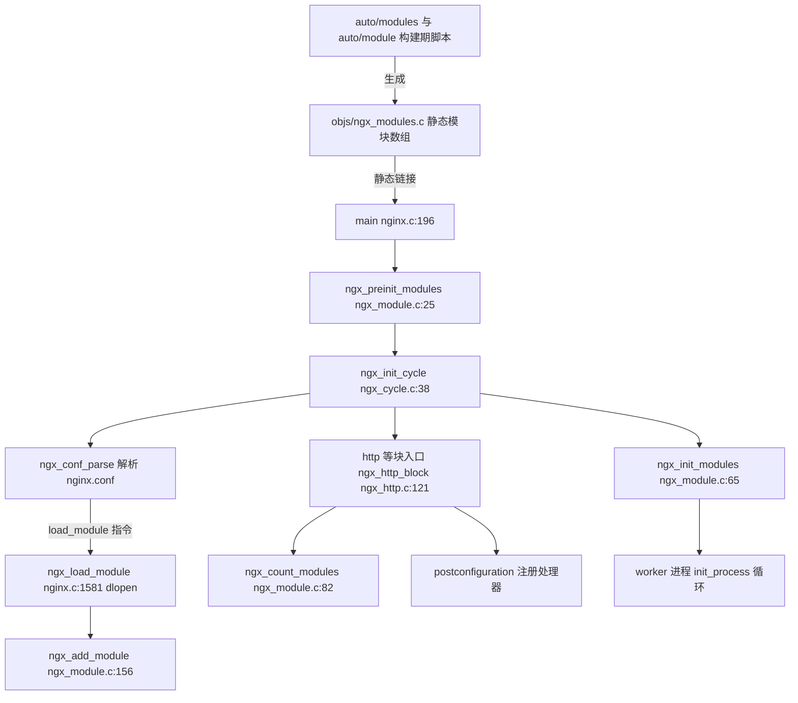
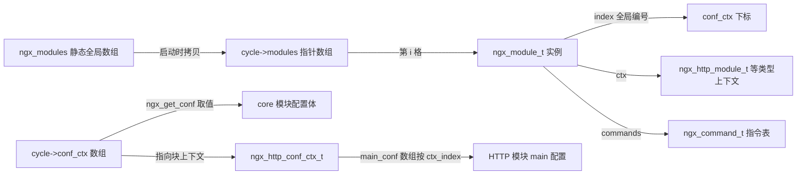
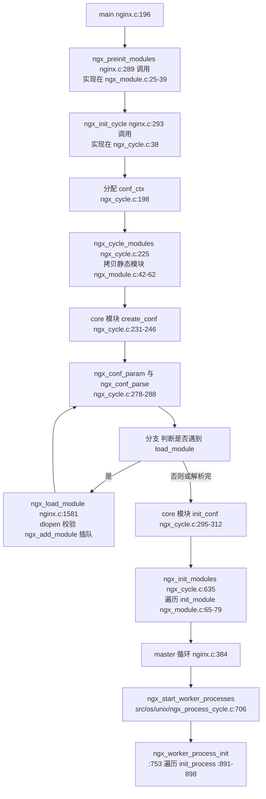
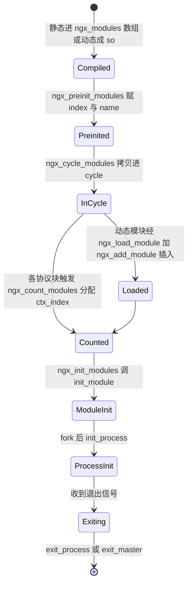
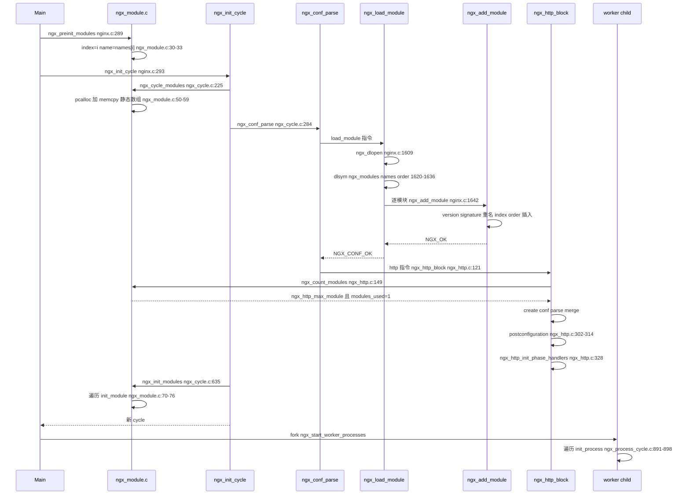
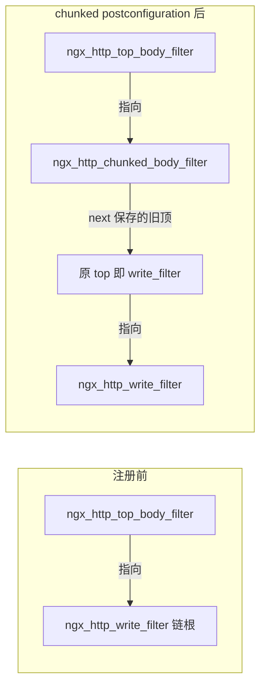
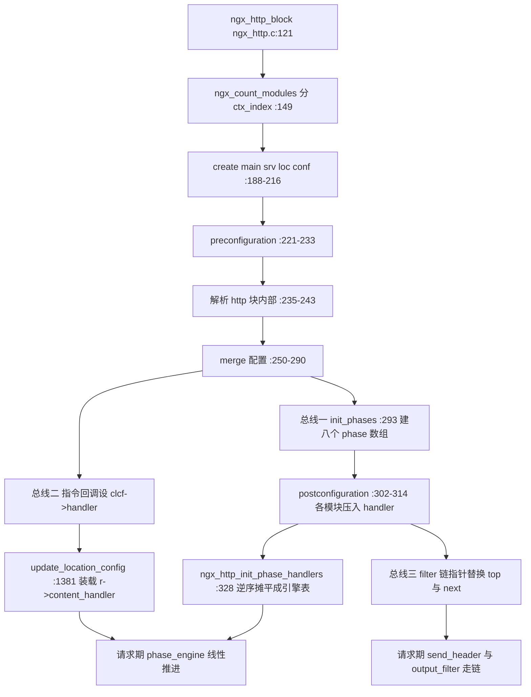

# 模块体系（ngx_module_t/静态注册/动态加载）（基于 nginx-1.27.0 源码）

> **导读**：读完本文你将掌握——nginx 用一个 `ngx_module_t` 结构体统一描述所有模块的完整约定；`index`/`ctx_index` 两套编号各自为谁服务、在哪个函数里、按什么算法分配；`init_module`/`init_process`/`exit_*` 七个生命周期回调分别在 master 还是 worker 进程、在启动还是 reload 时被调用（含 1.27.0 中已"死亡"的回调）；`auto/modules`+`auto/module` 如何把上百个模块编组排定顺序并生成 `objs/ngx_modules.c`；`load_module` 指令从 `dlopen` 到插队进模块数组的每一步校验；HTTP 模块三条总线（phase handlers/content handlers/filter 链）如何借助模块顺序构建；以及一个可以直接编译运行的最小 http handler 模块示例。
>
> **前置阅读建议**：内存池（`ngx_palloc`）、配置解析基础（`ngx_conf_parse`/`ngx_command_t`）、cycle 生命周期（`ngx_init_cycle`）。若已读过本系列《配置系统》一篇，第 6.4、6.6 节会更容易切入。
>
> **涉及源码清单**：`src/core/ngx_module.c`（360 行，全文精读）、`src/core/ngx_module.h`（288 行，全文精读）、`src/core/nginx.c`（重点 `main` 与 `ngx_load_module`/`ngx_unload_module`）、`src/core/ngx_cycle.c`（重点 `ngx_init_cycle` 中模块相关片段）、`auto/modules`（1530 行）、`auto/module`（178 行）、辅助佐证：`auto/make`、`auto/sources`、`src/http/ngx_http.c`、`src/http/ngx_http_config.h`、`src/http/ngx_http_core_module.c`、`src/http/modules/ngx_http_{static,chunked,empty_gif}_*.c`、`src/http/ngx_http_write_filter_module.c`、`src/os/unix/ngx_process_cycle.c`、`src/os/win32/ngx_process_cycle.c`、`src/os/{unix,win32}/ngx_dlopen.{c,h}`、`src/core/ngx_log.c`、`src/core/ngx_conf_file.{c,h}`、`src/core/ngx_thread_pool.c`、`src/core/nginx.h`。

---

## 1. 本模块在 nginx 中的位置与职责（附 mermaid 架构图：上下游与所在层）

nginx 是一个"框架内核 + 全模块化"的服务器：`src/core` 下的核心只提供进程模型、内存池、配置解析和事件循环骨架，所有协议功能（HTTP、mail、stream）、所有事件机制（epoll/kqueue）、所有过滤功能（gzip、chunked）都以模块为单位挂接进来。**模块体系就是这套挂接机制的"元层"**：它回答三个问题——

1. **模块是谁**：`ngx_module_t`（src/core/ngx_module.h:227-262）是所有模块的统一身份证，含名字、类型、上下文、命令表和 7 个生命周期回调；
2. **模块从哪来**：静态模块在编译期由 `auto/modules`+`auto/module` 排定顺序并生成 `objs/ngx_modules.c` 的 `ngx_modules[]` 全局数组（auto/modules:1491-1530），动态模块运行期由 `load_module` 指令经 `dlopen` 注入（src/core/nginx.c:1581-1660）；
3. **模块怎么被用**：`ngx_module.c` 提供的 5 个函数完成编号分配（`ngx_preinit_modules`/`ngx_count_modules`）、数组复制（`ngx_cycle_modules`）、插入（`ngx_add_module`）和回调驱动（`ngx_init_modules`），各协议框架（http/mail/stream/event）再按模块的 `ctx` 调用自己的三总线。



**图解**：这张图把模块体系放在"构建期→运行期"两个阶段里。构建期 `auto/modules` 决定"谁在数组里、第几位"；运行期 `main` 先做一次**不依赖任何配置**的预编号（`ngx_preinit_modules`），随后进入 `ngx_init_cycle`——复制模块数组、解析配置（期间可能插入动态模块）、给各协议模块编 `ctx_index`、调用 `init_module`，最后 fork 出的 worker 逐个调用 `init_process`。模块体系是所有箭头的"承载者"：没有 `cycle->modules[]`，配置解析找不到指令归属，HTTP 框架找不到模块上下文，事件框架选不出 epoll 模块。

### 1.1 几个特殊模块的地位

- **ngx_core_module**（src/core/nginx.c:167-180）：第一个 core 模块，持有 `daemon`/`worker_processes`/`load_module` 等主配置指令（src/core/nginx.c:42-157），其配置体 `ngx_core_conf_t` 通过 `ngx_get_conf(cycle->conf_ctx, ngx_core_module)` 获取（src/core/ngx_conf_file.h:176）。它本身也走标准 `ngx_module_t`，没有特权。
- **ngx_errlog_module**（src/core/ngx_log.c:54-67）：core 模块，只有 `error_log` 一条指令，`create_conf`/`init_conf` 均为 NULL（src/core/ngx_log.c:47-51）——因为日志在 cycle 建立前就要用，不能等配置体。
- **ngx_conf_module**（src/core/ngx_conf_file.c:32）：`CORE_MODULES` 三成员之一（auto/sources:6：`ngx_core_module ngx_errlog_module ngx_conf_module`），提供 `include` 指令，是配置解析器自己的"模块化外衣"。
- **ngx_os_module：1.27.0 中不存在**。全源码树搜索 `ngx_os_module` 无任何符号命中（grep 验证）；OS 层初始化由普通函数 `ngx_os_init()` 承担（src/core/nginx.c:267-269 调用），事件/IO 模型由 `NGX_EVENT_MODULE` 类型的模块（如 `ngx_epoll_module`）提供。该模块是远古版本（0.x 时代）的残留概念，本文据实说明，避免以讹传讹。
- **ngx_thread_pool_module**（src/core/ngx_thread_pool.c:83-96）：类型仍是 `NGX_CORE_MODULE`，但注册了 `init_process`（`ngx_thread_pool_init_worker`）和 `exit_process`——它是"core 模块使用进程级回调"的典型样本。它在模块数组中的位置被刻意安排在 events 之后（auto/modules:1397-1400 注释"thread pool module should be initialized after events"）。
- **ngx_http_module**（src/http/ngx_http.c:105-118）：名字容易误导——它是 **core 模块**，只为 `http{}` 这条块指令提供归属（`ngx_http_commands` → `ngx_http_block`，src/http/ngx_http.c:85-95），真正的 HTTP 协议框架在其 `ctx_index` 名下展开。

---

## 2. 核心数据结构精讲

### 2.1 ngx_module_t：模块的统一身份证

src/core/ngx_module.h:227-262 定义了 `struct ngx_module_s`，每个字段逐个列出：

| 字段 | 类型 | 谁来赋值 | 作用 |
|---|---|---|---|
| `ctx_index` | `ngx_uint_t` | `ngx_count_modules`（src/core/ngx_module.c:82-153）按类型分配 | **类型内编号**。同类型模块 0..n-1 连续编号，用于 `conf_ctx`/`main_conf[]`/`loc_conf[]` 等按类型组织的配置数组和 `cmcf->phases[].handlers` 的下标定位 |
| `index` | `ngx_uint_t` | 静态模块：`ngx_preinit_modules` 按数组序赋值（src/core/ngx_module.c:30-31）；动态模块：`ngx_add_module` 经 `ngx_module_index` 分配（src/core/ngx_module.c:197-205） | **全局编号**。所有模块统一编号，是 `cycle->conf_ctx[module.index]` 的下标（src/core/ngx_cycle.c:244） |
| `name` | `char *` | 静态模块指向 `ngx_module_names[i]`（src/core/ngx_module.c:32）；动态模块指向 .so 里的 `ngx_module_names`（src/core/nginx.c:1640） | 名字字符串，用于重名检查（src/core/ngx_module.c:184-191）与 order 定位（src/core/ngx_module.c:213-241） |
| `spare0`/`spare1` | `ngx_uint_t` | 恒为 0（`NGX_MODULE_V1`） | 保留位，历史上曾是 `version` 前的占位 |
| `version` | `ngx_uint_t` | `NGX_MODULE_V1` 展开为 `nginx_version`（src/core/ngx_module.h:220-222，src/core/nginx.h:12：`1027000`） | 动态加载时与宿主 `nginx_version` 严格比对（src/core/ngx_module.c:170-175） |
| `signature` | `const char *` | `NGX_MODULE_SIGNATURE` 宏展开的 34+3 位特征串（src/core/ngx_module.h:205-217） | 二进制兼容性指纹，加载时 `ngx_strcmp` 全串比对（src/core/ngx_module.c:177-182） |
| `ctx` | `void *` | 模块作者 | 指向按类型解释的上下文：core 模块指 `ngx_core_module_t`，HTTP 模块指 `ngx_http_module_t` 等 |
| `commands` | `ngx_command_t *` | 模块作者 | 该模块可识别的配置指令表，配置解析器据此分派（src/core/ngx_conf_file.c:447-459 决定 `conf` 实参） |
| `type` | `ngx_uint_t` | 模块作者 | 类型魔数：`NGX_CORE_MODULE 0x45524F43`（"CORE"，src/core/ngx_conf_file.h:70）、`NGX_CONF_MODULE 0x464E4F43`（src/core/ngx_conf_file.h:71）、`NGX_EVENT_MODULE 0x544E5645`（"EVNT"，src/event/ngx_event.h:425）、`NGX_HTTP_MODULE 0x50545448`（"HTTP"，src/http/ngx_http_config.h:39）、`NGX_MAIL_MODULE 0x4C49414D`（src/mail/ngx_mail.h:354）、`NGX_STREAM_MODULE 0x4d525453`（"STRM"，src/stream/ngx_stream.h:314）——都是四字符 ASCII 倒序 |
| `init_master` | 函数指针 | 模块作者 | **1.27.0 中无任何调用点**（全树 grep `->init_master` 零命中），纯预留 |
| `init_module` | 函数指针 | 模块作者 | 在 **master 进程**内、每次 `ngx_init_cycle` 成功末尾被调用（src/core/ngx_cycle.c:635-638 → src/core/ngx_module.c:65-79），即启动时一次、reload 时新 cycle 一次；fork 之前执行 |
| `init_process` | 函数指针 | 模块作者 | 在**每个 worker**（以及 cache manager/loader、单进程模式）fork 后调用（src/os/unix/ngx_process_cycle.c:891-898；单进程 src/os/unix/ngx_process_cycle.c:288-295；Windows src/os/win32/ngx_process_cycle.c:775-776） |
| `init_thread` | 函数指针 | 模块作者 | **1.27.0 中无任何调用点**（grep `->init_thread` 零命中），多线程支持早已移除 |
| `exit_thread` | 函数指针 | 模块作者 | 同上，无调用点 |
| `exit_process` | 函数指针 | 模块作者 | worker 退出时调用（src/os/unix/ngx_process_cycle.c:945-949；单进程 src/os/unix/ngx_process_cycle.c:304-308；Windows src/os/win32/ngx_process_cycle.c:832-833） |
| `exit_master` | 函数指针 | 模块作者 | master 退出时调用（src/os/unix/ngx_process_cycle.c:664-668；Windows src/os/win32/ngx_process_cycle.c:558-559） |
| `spare_hook0..7` | `uintptr_t` | 恒为 0（`NGX_MODULE_V1_PADDING`，src/core/ngx_module.h:224） | 8 个保留槽。历史意义：为将来新增回调预留**结构体尾部空间**，`NGX_MODULE_V1_PADDING` 显式补零保证 ABI |

`NGX_MODULE_V1`（src/core/ngx_module.h:220-224）是模块定义的"头部样板"：

```c
#define NGX_MODULE_V1                                                         \
    NGX_MODULE_UNSET_INDEX, NGX_MODULE_UNSET_INDEX,                           \
    NULL, 0, 0, nginx_version, NGX_MODULE_SIGNATURE

#define NGX_MODULE_V1_PADDING  0, 0, 0, 0, 0, 0, 0, 0
```

它把 `ctx_index`、`index` 初始化为 `(ngx_uint_t) -1`（`NGX_MODULE_UNSET_INDEX`，src/core/ngx_module.h:18），即"未编号"哨兵值——`ngx_count_modules` 正是用它判断"该编号还没人管"（src/core/ngx_module.c:100）。写模块时只需从 `ctx` 开始填写，头尾两个宏兜底，这是 nginx 保持模块 ABI 稳定的小技巧：**新字段只能插在尾部 padding 区**，否则老 .so 的字段错位会立刻被 signature 机制拦截。

### 2.2 signature：34 位编译特征指纹

`NGX_MODULE_SIGNATURE`（src/core/ngx_module.h:205-217）由 `NGX_MODULE_SIGNATURE_0` 到 `_34` 拼接：`_0` 是三项基本尺寸（指针大小、`sig_atomic_t` 大小、`time_t` 大小，src/core/ngx_module.h:21-24），`_1` 到 `_34` 是每个"1/0"形式的编译开关：kqueue、IOCP、file AIO、sendfile nodiskio、eventfd、epoll、inet6、deferred accept、TCP fastopen、unix domain、variadic macros、QUIC、openat、原子操作、POSIX 信号量、threads、PCRE、HTTP SSL、gzip、X-Forwarded-For、realip、headers、DAV、cache、upstream zone、`NGX_COMPAT`……例如 src/core/ngx_module.h:141-151：

```c
#if (NGX_PCRE)
#define NGX_MODULE_SIGNATURE_23  "1"
#else
#define NGX_MODULE_SIGNATURE_23  "0"
#endif

#if (NGX_HTTP_SSL || NGX_COMPAT)
#define NGX_MODULE_SIGNATURE_24  "1"
#else
#define NGX_MODULE_SIGNATURE_24  "0"
#endif
```

**为什么需要它**：动态模块与宿主共享 `ngx_module_t`、`ngx_cycle_t` 等结构体的内存布局。任何 `#if` 导致的结构体字段增减、指针宽度变化，都会让 .so 的访问错位。version 只防"版本号不同"，signature 防的是"同版本但 configure 选项不同"。`--with-compat` 的作用就是让这些受选项影响的特征位**恒为 1**（凡带 `|| NGX_COMPAT` 的项），把"编译开关空间"坍缩成单一兼容布局，官方包据此发布能配任意第三方 .so 的二进制。auto/modules:1479-1488 显示 `NGX_COMPAT=YES` 时会额外 `have` 一批 HTTP 特性宏，进一步拉齐特征位。

### 2.3 模块类型上下文

core 模块的上下文最简（src/core/ngx_module.h:265-269）：

```c
typedef struct {
    ngx_str_t             name;
    void               *(*create_conf)(ngx_cycle_t *cycle);
    char               *(*init_conf)(ngx_cycle_t *cycle, void *conf);
} ngx_core_module_t;
```

HTTP 模块的上下文是三总线之外还要加"配置四对钩子"的 `ngx_http_module_t`（src/http/ngx_http_config.h:24-36）：`preconfiguration`/`postconfiguration`（两条解析时机回调）、`create_main_conf`/`init_main_conf`、`create_srv_conf`/`merge_srv_conf`、`create_loc_conf`/`merge_loc_conf`。

### 2.4 ngx_cycle_t 中承载模块的骨架

src/core/ngx_cycle.h:39-86 中与模块直接相关的字段：

| 字段 | 含义 |
|---|---|
| `conf_ctx`（:40，`void ****`） | 四级配置上下文数组的根，按 **index**（全局编号）索引；core 模块的配置体直接放 `conf_ctx[index]`（src/core/ngx_cycle.c:244），块模块放指向 `ngx_http_conf_ctx_t` 的指针 |
| `modules`（:52，`ngx_module_t **`） | 本 cycle 生效的模块指针数组，容量 `ngx_max_module + 1`（src/core/ngx_module.c:50-51） |
| `modules_n`（:53） | 当前数组内模块个数 |
| `modules_used`（:54） | 位域标志。`ngx_count_modules` 置 1（src/core/ngx_module.c:150）后，`load_module` 一律拒绝（src/core/nginx.c:1592-1594） |

`conf_ctx` 与模块的对应关系由两个宏/规则粘合：`ngx_get_conf(conf_ctx, module)` = `conf_ctx[module.index]`（src/core/ngx_conf_file.h:176）；HTTP 侧则用 `ctx_index` 三级索引（src/http/ngx_http_config.h:55-72）。



**图解**：一个模块同时被四张"网"引用：静态数组（或 .so）提供实例本体；`cycle->modules[]` 提供本 cycle 生效集合；`conf_ctx` 按 `index` 挂 core 级配置；HTTP 等框架再按 `ctx_index` 挂自己的三级配置。**两套编号的价值正在于此**：`index` 让任意类型的模块都能在全局配置数组里有确定性位置；`ctx_index` 让同类型模块在"按类型紧凑排列"的框架内数组（如 `main_conf[]`、`phases[].handlers`）里不留空洞。

---

## 3. 初始化流程



**图解与调用时机表**：

| 回调 | 调用者（文件:行号） | 执行进程 | 执行时机 | 频度 |
|---|---|---|---|---|
| `init_master` | **无**（1.27.0 无调用点） | — | — | 从不 |
| `init_module` | `ngx_init_modules` ← `ngx_init_cycle`（src/core/ngx_cycle.c:635-638；src/core/ngx_module.c:70-76） | **master**（单进程模式即该进程） | 每次 cycle 建立成功末尾：启动时一次、reload 时新 cycle 一次、`-s reload` 前的解析也在 master | 每 cycle 一次 |
| `init_process` | `ngx_worker_process_init`（src/os/unix/ngx_process_cycle.c:891-898）、`ngx_single_process_cycle`（:288-295）、cache manager/loader（:1107 调 `ngx_worker_process_init`）；Windows 侧 src/os/win32/ngx_process_cycle.c:775-776 | **每个 worker 子进程**（fork 之后） | worker 启动、reload 后新 worker 启动 | 每进程一次 |
| `init_thread` / `exit_thread` | **无**（1.27.0 无调用点，仅声明于 src/core/ngx_module.h:248-249） | — | — | 从不 |
| `exit_process` | `ngx_worker_process_exit`（src/os/unix/ngx_process_cycle.c:945-949）、`ngx_single_process_cycle`（:304-308）；Windows :832-833 | **worker** | worker 收到退出信号、清完连接后 | 每进程一次 |
| `exit_master` | `ngx_master_process_exit`（src/os/unix/ngx_process_cycle.c:664-668）；Windows :558-559 | **master** | master 退出前 | 每进程一次 |

要点：**`init_module` 在 master 里跑、结果被 fork 继承**，所以它适合做"全局一次性"工作（如 `ngx_epoll_module` 无此类工作，而共享内存 zone 的创建在更早的 `ngx_init_cycle` 中段完成）；**`init_process` 在每个子进程里重跑**，适合初始化进程私有资源（如事件表、thread pool）。reload 时 master 先对新 cycle 跑一遍 `init_module`（`ngx_init_cycle`，src/os/unix/ngx_process_cycle.c:225 重新进入），再 fork 新 worker、向旧 worker 发 shutdown——旧 worker 退出时对新 cycle 的模块调 `exit_process` 吗？不会：旧 worker 持有的仍是旧 cycle 指针，其 `exit_process` 遍历的是旧 cycle->modules（同一批模块结构体，除动态模块外是同一批全局变量）。

---

## 4. 核心执行流程/状态机

把"一个模块"的一生画成状态机：



逐分支讲解：

- **Compiled → Preinited**：静态数组里 `NGX_MODULE_V1` 的两个 `-1` 编号在 `ngx_preinit_modules`（src/core/ngx_module.c:25-39）被就地改写为 `index=i`、`name=ngx_module_names[i]`。注意这是**直接改写全局模块结构体**，且只做一次（`main` 在第一次 `ngx_init_cycle` 前调用，src/core/nginx.c:289-291）。动态模块不走此路——它们的 `name` 在 `ngx_load_module` 里赋值（src/core/nginx.c:1640），`index` 在 `ngx_add_module` 里经 `ngx_module_index` 找空洞分配（src/core/ngx_module.c:197-205）。
- **InCycle → Loaded**（仅动态模块）：`ngx_load_module` 把 .so 导出的每个模块经 `ngx_add_module` 插入 `cycle->modules[]`，插入位置由 `ngx_module_order` 决定（详见 6.2.6）。
- **Counted 关卡**：`ngx_count_modules` 是"最后一班车"——它置 `cycle->modules_used = 1`（src/core/ngx_module.c:150）。此后任何 `load_module` 直接报 `is specified too late`（src/core/nginx.c:1592-1594）。这就是 `load_module` 必须写在 `http{}` 之前的根源。
- **ModuleInit**：`ngx_init_modules` 只遍历 `cycle->modules`，任何一个回调非 `NGX_OK` 即整体失败（src/core/ngx_module.c:70-76），`ngx_init_cycle` 里直接 `exit(1)`（src/core/ngx_cycle.c:635-638）——**这是 fatal 而非可恢复错误**，因为此刻 socket 已打开、老 cycle 可能已半销毁。
- **ProcessInit → Exiting**：worker 的 `exit_process` 逆序无关，按数组序执行（src/os/unix/ngx_process_cycle.c:945-949），nginx 不保证清理顺序的对称性——模块作者要自己保证 `init_process` 里注册的资源能被 `exit_process` 独立回收。
- **reload 分支**：master 收到 `SIGHUP` 后在老进程里再走一遍 `InCycle→…→ModuleInit`（src/os/unix/ngx_process_cycle.c:211-244 中 `ngx_init_cycle(cycle)`，:225），生成全新 `cycle->modules` 数组；动态模块被重新 dlopen，`version`/`signature`/重名检查**全部重来**。

---

## 5. 关键时序图

以"启动 + 配置里有一条 `load_module` + 一个 `http{}` 块"为例：



**图解**：注意三个时序约束的来源。(1) `ngx_preinit_modules` 必须在第一次 `ngx_init_cycle` 前——`conf_ctx` 的容量 `ngx_max_module`（含 128 个动态模块配额）就是它算出来的（src/core/ngx_module.c:36）。(2) `ngx_load_module` 只能出现在解析过程中、且在任何协议块之前——它依赖"cycle 数组尚未被 `modules_used` 封版"。(3) `init_module` 在配置解析完成、listening socket 打开之后（src/core/ngx_cycle.c:618-638 之间）才调用，因此 `init_module` 里可以安全地假定端口已 bind。

---

## 6. 源码逐段精读

### 6.1 ngx_module.h：编号、签名与生命周期契约

#### 6.1.1 NGX_MODULE_SIGNATURE_0——指纹的第一节是"物理量纲"

src/core/ngx_module.h:21-24：

```c
#define NGX_MODULE_SIGNATURE_0                                                \
    ngx_value(NGX_PTR_SIZE) ","                                               \
    ngx_value(NGX_SIG_ATOMIC_T_SIZE) ","                                      \
    ngx_value(NGX_TIME_T_SIZE) ","
```

指纹开头不是布尔开关，而是三个"量纲"：指针宽度（32/64 位）、信号原子类型宽度、`time_t` 宽度（32 位 time_t 的系统与 64 位 time_t 的系统 ABI 不同，如 32 位 Linux 开启 64 位 time_t 的发行版）。`ngx_value` 把宏数值转成字符串字面量。**易错点**：不要以为 signature 校验只看布尔特性——跨 32/64 位加载 .so 在这里就会被拦，报的错同样是 `is not binary compatible`。

#### 6.1.2 特征位 1..34——每一个 `#if` 都是一份 ABI 契约

src/core/ngx_module.h:26-203 逐位定义。挑几个有代表性的精读：

- `_3`（:38-42）：`NGX_HAVE_FILE_AIO || NGX_COMPAT`。file AIO 会让 `ngx_event_t` 之类的结构体增加 union 成员，所以这是一个**结构体布局开关**而非纯功能开关，必须进指纹。
- `_4`（:44-48）：`NGX_HAVE_SENDFILE_NODISKIO || NGX_COMPAT`，1.27.0 新增的异步 sendfile 特性位。
- `_18`（:111-115）：`NGX_QUIC || NGX_COMPAT`。
- `_22`（:135-139）：`NGX_THREADS || NGX_COMPAT`。
- `_24`（:147-151）：`NGX_HTTP_SSL || NGX_COMPAT`。
- `_34`（:199-203）：`NGX_COMPAT` 自身也占一位。

规律：**凡写了 `|| NGX_COMPAT` 的位，在 `--with-compat` 构建下恒为 "1"**。这正是官方二进制能加载任意 `--with-compat` 第三方模块的原因：双方指纹中所有"可能因选项而异"的位都被钉死为 1，剩下的指纹只由平台固有特性决定。也正因如此，`--with-compat` 构建的宿主无法加载非 compat 的老 .so（对方某些位是 "0"），反之亦然。

拼接宏（:205-217）把 35 段连成一个形如 `"8,8,8,0,0,1,...,1"` 的字符串。校验是**全串 strcmp**（src/core/ngx_module.c:177-182），不逐位解析——简单、一次比较、错误信息也只有一句。

#### 6.1.3 struct ngx_module_s 的内存布局

字段顺序（src/core/ngx_module.h:227-262）是有讲究的：`ctx_index, index, name, spare0, spare1, version, signature, ctx, commands, type` 十项在前（其中前 7 项由 `NGX_MODULE_V1` 填充），随后 7 个生命周期指针，尾部 8 个 `spare_hook`。**布局约定**：

1. 新增回调只能占用 `spare_hook0..7`（例如历史上的 `init_thread`/`exit_thread` 就曾占用过这里的槽位再被"转正"），已发布的字段位次永不改变；
2. `NGX_MODULE_V1_PADDING` 显式补零，保证老模块在新头文件下编译仍有确定值；
3. 对动态模块而言这份布局是跨二进制契约——这也是 signature 覆盖 `NGX_PTR_SIZE` 的原因。

#### 6.1.4 对外 API 与全局符号

src/core/ngx_module.h:272-285 声明了 5 个核心函数与 3 个全局符号：

```c
ngx_int_t ngx_preinit_modules(void);
ngx_int_t ngx_cycle_modules(ngx_cycle_t *cycle);
ngx_int_t ngx_init_modules(ngx_cycle_t *cycle);
ngx_int_t ngx_count_modules(ngx_cycle_t *cycle, ngx_uint_t type);

ngx_int_t ngx_add_module(ngx_conf_t *cf, ngx_str_t *file,
    ngx_module_t *module, char **order);

extern ngx_module_t  *ngx_modules[];
extern ngx_uint_t     ngx_max_module;
extern char          *ngx_module_names[];
```

`ngx_modules[]`/`ngx_module_names[]` 是**构建期生成**的弱契约：静态链接时它们来自 `objs/ngx_modules.c`；动态模块的 .so 内也必须有同名符号（`ngx_load_module` 靠 `dlsym` 找它们，src/core/nginx.c:1620-1634）。

### 6.2 ngx_module.c：五个函数，逐行拆解

#### 6.2.1 ngx_preinit_modules——一次性的静态编号

src/core/ngx_module.c:25-39：

```c
ngx_int_t
ngx_preinit_modules(void)
{
    ngx_uint_t  i;

    for (i = 0; ngx_modules[i]; i++) {
        ngx_modules[i]->index = i;
        ngx_modules[i]->name = ngx_module_names[i];
    }

    ngx_modules_n = i;
    ngx_max_module = ngx_modules_n + NGX_MAX_DYNAMIC_MODULES;

    return NGX_OK;
}
```

逐块：

1. 遍历静态数组直到 `NULL` 哨兵（数组由 auto/modules:1506-1515 生成，末尾固定 `NULL`）。
2. **直接写模块全局结构体**：`index` 从 `-1` 改为数组序，`name` 从 `NULL` 指向 `ngx_module_names[i]`。两个数组顺序严格对应（都是同一个 `$modules` 列表生成，auto/modules:1500-1524），因此平行下标即可对齐。
3. `ngx_modules_n` 记录静态模块数；`ngx_max_module = 静态数 + 128`（`NGX_MAX_DYNAMIC_MODULES`，src/core/ngx_module.c:13）——**这就是动态模块的容量配额**，超了会在 `ngx_add_module` 处报 `too many modules loaded`（src/core/ngx_module.c:164-168）。

**易错点**：这个函数会污染全局模块结构体（`index`/`name` 被永久改写），因此**只能调用一次**。nginx 把它安排在 `main` 中、第一次 `ngx_init_cycle` 之前（src/core/nginx.c:289-291），信号处理路径（`-s reload` 等）复用同一进程不再重复调用。另一个细节：`ngx_modules` 此时还是**全局数组**而非 cycle 私有——这就是后面 `ngx_cycle_modules` 存在的理由：cycle 需要一份**可增删的私有副本**。

#### 6.2.2 ngx_cycle_modules——从全局数组到 cycle 私有数组

src/core/ngx_module.c:42-62：

```c
    cycle->modules = ngx_pcalloc(cycle->pool, (ngx_max_module + 1)
                                              * sizeof(ngx_module_t *));
    ...
    ngx_memcpy(cycle->modules, ngx_modules,
               ngx_modules_n * sizeof(ngx_module_t *));

    cycle->modules_n = ngx_modules_n;
```

三点：

1. **容量预留**：一次按 `ngx_max_module + 1` 上限分配指针数组（约 200+ 个指针，实际开销不足 2KB），此后动态模块插入只做 `memmove` 不再扩容——这让"数组扩容导致指针失效"的整类问题不存在。
2. **浅拷贝**：只拷贝指针，不拷贝 `ngx_module_t` 本体。静态模块的本体是全局只读数据，全 cycle 共享；只有 `index`/`name` 这类"编号状态"在 preinit 时已写进本体。
3. 调用点在 `ngx_init_cycle` 很靠前的位置（src/core/ngx_cycle.c:225-228），早于 `conf_ctx` 下任何模块配置的创建——因为接下来 core 模块的 `create_conf`（src/core/ngx_cycle.c:231-246）就要按 `cycle->modules[i]->index` 往 `conf_ctx` 里放东西了。

#### 6.2.3 ngx_init_modules——init_module 的唯一驱动器

src/core/ngx_module.c:65-79：

```c
ngx_int_t
ngx_init_modules(ngx_cycle_t *cycle)
{
    ngx_uint_t  i;

    for (i = 0; cycle->modules[i]; i++) {
        if (cycle->modules[i]->init_module) {
            if (cycle->modules[i]->init_module(cycle) != NGX_OK) {
                return NGX_ERROR;
            }
        }
    }

    return NGX_OK;
}
```

朴素但有两个要点：其一，回调签名的实参是 `cycle`——**新 cycle**，模块此时拿不到 old_cycle 除非自己存了；其二，它被 `ngx_init_cycle` 在"commit the new cycle configuration"之后调用（src/core/ngx_cycle.c:627-638 的注释原话即 `commit the new cycle configuration`），任何一个 `init_module` 失败都会 `exit(1)`（:637）——**没有任何回滚**。模块作者要意识到：走到这里 socket 已打开（src/core/ngx_cycle.c:618 `ngx_open_listening_sockets`）、日志已切换（:409-410），失败即死亡。

#### 6.2.4 ngx_count_modules——类型内编号与"封版"

src/core/ngx_module.c:82-153，全文按逻辑块拆：

```c
    next = 0;
    max = 0;

    /* count appropriate modules, set up their indices */

    for (i = 0; cycle->modules[i]; i++) {
        module = cycle->modules[i];

        if (module->type != type) {
            continue;
        }

        if (module->ctx_index != NGX_MODULE_UNSET_INDEX) {

            /* if ctx_index was assigned, preserve it */

            if (module->ctx_index > max) {
                max = module->ctx_index;
            }

            if (module->ctx_index == next) {
                next++;
            }

            continue;
        }

        /* search for some free index */

        module->ctx_index = ngx_module_ctx_index(cycle, type, next);

        if (module->ctx_index > max) {
            max = module->ctx_index;
        }

        next = module->ctx_index + 1;
    }
```

（src/core/ngx_module.c:88-124）

- 外层按**数组序**（即 auto/modules 排定的全局顺序）扫所有模块，只处理 `type` 匹配者——所以 **ctx_index 的分配顺序 = 模块在数组中的物理顺序**，这是"HTTP 过滤模块顺序由 auto/modules 决定"的运行期落点。
- `ctx_index` 已非 UNSET（罕见：同一 cycle 对同一 type 调第二次）时只做"保号"：并入 `max`，并顺手推进 `next` 避免撞号。
- 否则调 `ngx_module_ctx_index`（src/core/ngx_module.c:318-360）在 `next` 起点找第一个"本类型内未被占用"的编号——它内部是两层 `goto again` 的暴力扫描：先扫当前 cycle（:328-339），有撞号就 `index++` 重扫；再扫 old_cycle（:343-357）。**为什么连老 cycle 也要扫**：reload 时老 cycle 的模块结构体还活着，其 `ctx_index` 已被各处（如共享内存 zone 的 tag 关联、upstream zone）引用；新 cycle 若分配出与老 cycle 相同语义不同值的编号，跨 cycle 的引用就会错位。
- old_cycle 抬高 `max`（src/core/ngx_module.c:133-146）：保证返回的"类型内模块总数"不小于上一 cycle，配置数组（如 `main_conf[]` 尺寸 `ngx_http_max_module`）不会因 reload 缩水。

```c
    if (cycle->old_cycle && cycle->old_cycle->modules) {
        ...
    }

    /* prevent loading of additional modules */

    cycle->modules_used = 1;

    return max + 1;
```

（src/core/ngx_module.c:133-152）

- `modules_used = 1` 是"封版"动作：此后 `ngx_load_module` 开头的检查（src/core/nginx.c:1592-1594）永远失败。**为什么不干脆拒绝所有后续加载而要一个标志位**：因为"模块数组可以继续加"与"编号已发出去"是两个概念；封版语义精确到"编号已分配"，报错文案 `is specified too late` 直指配置书写顺序问题。
- `return max + 1` 而非计数器：当有"保号"模块时（编号跳着占），`max+1` 才是数组必须的最小尺寸。返回值被 `ngx_http_max_module`（src/http/ngx_http.c:149）、`ngx_stream_max_module`（src/stream/ngx_stream.c:117）、`ngx_mail_max_module`（src/mail/ngx_mail.c:94）、`ngx_event_max_module`（src/event/ngx_event.c:1001）接住。

**举例走一遍**：设数组序中 HTTP 模块为 `[http_module(CORE), core_module(CORE), ..., static(HTTP), index(HTTP), autoindex(HTTP)]`。扫到 static：ctx_index=UNSET → `ngx_module_ctx_index(cycle, HTTP, 0)` 扫描发现没有同类型占用 0 → 返回 0，`next=1, max=0`。index：拿 1，`next=2, max=1`。autoindex：拿 2。old_cycle 里若曾有一个已删除的模块占过 5，`max` 被抬到 5，返回 6——新配置数组开 6 格，虽空 3 格但保证了跨 cycle 稳定。

#### 6.2.5 ngx_module_index / ngx_module_ctx_index——两个"找空洞"器

src/core/ngx_module.c:279-315 与 :318-360 是一对孪生函数，只差两点：前者按 `module->index` 全局找空洞（给动态模块分配全局编号，src/core/ngx_module.c:198），后者按 `module->ctx_index` 且**仅在同 type 内**找空洞。共同结构：

```c
again:

    /* find an unused index */

    for (i = 0; cycle->modules[i]; i++) {
        module = cycle->modules[i];

        if (module->index == index) {
            index++;
            goto again;
        }
    }

    /* check previous cycle */

    if (cycle->old_cycle && cycle->old_cycle->modules) {
        ...
    }
```

（src/core/ngx_module.c:287-312）

`goto again` 的含义：一旦当前候选号被占用，就 `index++` 并**从头再扫**——因为新号可能又撞上数组后段的占用者。最坏 O(n²)，但 n≤~250 且只在加载动态模块时运行，无所谓。**易错点**：这两个函数只被 `ngx_add_module` 使用（`ngx_module_ctx_index` 还被 `ngx_count_modules` 使用），所以"跳号"只会出现在动态模块场景；静态模块的 `index` 永远是紧凑的 0..n-1。

#### 6.2.6 ngx_add_module——动态模块入列的全过程

src/core/ngx_module.c:156-276，这是动态加载的核心，按执行顺序拆五段：

**第一段：三重资格检查（:164-191）**

```c
    if (cf->cycle->modules_n >= ngx_max_module) {
        ngx_conf_log_error(NGX_LOG_EMERG, cf, 0,
                           "too many modules loaded");
        return NGX_ERROR;
    }

    if (module->version != nginx_version) {
        ngx_conf_log_error(NGX_LOG_EMERG, cf, 0,
                           "module \"%V\" version %ui instead of %ui",
                           file, module->version, (ngx_uint_t) nginx_version);
        return NGX_ERROR;
    }

    if (ngx_strcmp(module->signature, NGX_MODULE_SIGNATURE) != 0) {
        ngx_conf_log_error(NGX_LOG_EMERG, cf, 0,
                           "module \"%V\" is not binary compatible",
                           file);
        return NGX_ERROR;
    }
```

顺序是：容量 → version → signature → 重名（:184-191）。注意 version 错误信息**同时打印模块自带版本和宿主版本**（`%ui instead of %ui`），这是排障时定位"拿错了哪个版本的 .so"的关键线索。signature 错误只有一句 `is not binary compatible`——具体哪一位不匹配不外泄，因为逐位 diff 会让错误处理复杂化（想排查要自己 `strings module.so | grep -A1 '8,8'` 之类比对）。

**第二段：全局编号（:197-205）**。`index == NGX_MODULE_UNSET_INDEX` 时调 `ngx_module_index`（6.2.5），再查一次上限——因为"找空洞"的返回值可能落在 `ngx_max_module` 之外（数组容量按 `ngx_max_module + 1` 分配，`conf_ctx` 按 `ngx_max_module` 分配，src/core/ngx_cycle.c:198，所以 index 越界必须拒绝）。

**第三段：按 order 计算插入位（:211-241）**

```c
    before = cf->cycle->modules_n;

    if (order) {
        for (i = 0; order[i]; i++) {
            if (ngx_strcmp(order[i], module->name) == 0) {
                i++;
                break;
            }
        }

        for ( /* void */ ; order[i]; i++) {
            for (m = 0; m < before; m++) {
                if (ngx_strcmp(cf->cycle->modules[m]->name, order[i]) == 0) {
                    ...
                    before = m;
                    break;
                }
            }
        }
    }
```

算法：在 `order`（.so 自带的 `ngx_module_order[]` 字符串数组）里找到**本模块自己**的名字，从下一个名字开始，逐个在已加载的 `cycle->modules` 里找；**谁先被找到且位置更靠前，`before` 就取谁的位置**（内层 `m < before` 保证只缩小）。语义即"插到 order 表中排在我后面的、且已经加载了的第一个模块之前"。举例：order = `["ngx_http_foo_module", "ngx_http_copy_filter_module"]`（动态 HTTP filter 的默认 order，auto/module:23-31 自动生成），此时 copy_filter 已在数组位置 30 → `before=30`，foo 将插到 30，原 30..end 整体后移一位。**如果 order 里排在我后面的模块都没加载**，`before` 保持 `modules_n`，模块追加到末尾——这就是动态模块顺序不是完全确定、而依赖加载时刻已加载集合的原因。

**第四段：物理插入（:243-252）**

```c
    /* put the module before modules[before] */

    if (before != cf->cycle->modules_n) {
        ngx_memmove(&cf->cycle->modules[before + 1],
                    &cf->cycle->modules[before],
                    (cf->cycle->modules_n - before) * sizeof(ngx_module_t *));
    }

    cf->cycle->modules[before] = module;
    cf->cycle->modules_n++;
```

朴素 `memmove` 插入。**易错点**：插入会移动指针数组元素，但**不重排已分配的 index/ctx_index**——编号跟模块本体走（存在 `ngx_module_t` 里），数组位置只影响"下一次遍历/编号的顺序"。这解释了为什么先加载的动态模块在 `ngx_count_modules` 时先拿到小编号。

**第五段：core 模块的即席初始化（:254-273）**

```c
    if (module->type == NGX_CORE_MODULE) {

        /*
         * we are smart enough to initialize core modules;
         * other modules are expected to be loaded before
         * initialization - e.g., http modules must be loaded
         * before http{} block
         */

        core_module = module->ctx;

        if (core_module->create_conf) {
            rv = core_module->create_conf(cf->cycle);
            ...
            cf->cycle->conf_ctx[module->index] = rv;
        }
    }
```

注释原文解释了不对称的合理性：**core 模块的配置体在 `ngx_init_cycle` 开头就已为静态模块统一创建过**（src/core/ngx_cycle.c:231-246），动态 core 模块错过了那班车，所以加载时补一次。而 http 等类型模块不做此处理——它们的配置体系要到对应块（`http{}`）解析时才建立，所以**只要保证 load 在块之前**即可，注释原话 `http modules must be loaded before http{} block`。

#### 6.2.7 小结：ngx_module.c 的五个函数与三种数组

| 函数 | 作用对象 | 关键产物 |
|---|---|---|
| `ngx_preinit_modules` | 全局 `ngx_modules[]` | 静态模块 index/name、`ngx_modules_n`、`ngx_max_module` |
| `ngx_cycle_modules` | `cycle->modules[]` | 可增删的 cycle 私有副本 |
| `ngx_count_modules` | 各协议模块的 `ctx_index` | `*_max_module`、`modules_used=1` 封版 |
| `ngx_add_module` | 动态模块 | 校验+编号+按 order 插队+core 补配置 |
| `ngx_init_modules` | 生命周期 | 驱动 `init_module` |

### 6.3 nginx.c：main 与 ngx_load_module

#### 6.3.1 main 的模块编排

src/core/nginx.c:196-388。与模块直接相关的只有三处，但位置决定一切：

- :289-291 `ngx_preinit_modules()`——所有编号的起点；
- :293 `ngx_init_cycle(&init_cycle)`——模块数组复制、配置解析（含动态加载）、`init_module` 全在这里；
- :337 `ccf = ngx_get_conf(cycle->conf_ctx, ngx_core_module)`——用 `ngx_core_module` 这个**模块符号本身**当 key 取配置，演示了 `index` 编号的标准用法。

#### 6.3.2 ngx_load_module——dlopen 三件套与逐模块注册

src/core/nginx.c:1581-1660。先看指令表项（:149-154）：

```c
    { ngx_string("load_module"),
      NGX_MAIN_CONF|NGX_DIRECT_CONF|NGX_CONF_TAKE1,
      ngx_load_module,
      0,
      0,
      NULL },
```

`NGX_MAIN_CONF`（0x01000000）+`NGX_DIRECT_CONF`（0x00010000，src/core/ngx_conf_file.h:49-51）意味着它只能出现在主配置层（`http{}` 内不可用），且 `conf` 实参直接是 core 模块配置体（src/core/ngx_conf_file.c:449-450）——`ngx_load_module` 声明形参 `conf` 却完全不用它，正是 `NGX_DIRECT_CONF` 的例行签名。

函数主体逐块：

**块 1：封版检查（:1592-1594）**

```c
    if (cf->cycle->modules_used) {
        return "is specified too late";
    }
```

`modules_used` 由 `ngx_count_modules` 置位（src/core/ngx_module.c:150），即**任何协议块一旦开始编号，就不再收新模块**。指令必须写在 `http{}`/`stream{}`/`mail{}` 之前。

**块 2：路径规范化（:1596-1602）**。`ngx_conf_full_name(cf->cycle, &file, 0)` 把相对路径按 **prefix**（非 conf prefix）解析为绝对路径——所以 `load_module modules/foo.so` 相对于 `-p` 指定的前缀目录。

**块 3：dlopen 与卸载托管（:1604-1618）**

```c
    cln = ngx_pool_cleanup_add(cf->cycle->pool, 0);
    ...
    handle = ngx_dlopen(file.data);
    if (handle == NULL) {
        ngx_conf_log_error(NGX_LOG_EMERG, cf, 0,
                           ngx_dlopen_n " \"%s\" failed (%s)",
                           file.data, ngx_dlerror());
        return NGX_CONF_ERROR;
    }

    cln->handler = ngx_unload_module;
    cln->data = handle;
```

`ngx_dlopen` 在 Unix 是 `dlopen(path, RTLD_NOW | RTLD_GLOBAL)`（src/os/unix/ngx_dlopen.h:16-23）——`RTLD_NOW` 立即解析所有符号（坏 .so 当场报错而不是运行期崩溃），`RTLD_GLOBAL` 让模块的符号进全局命名空间（HTTP 等框架后续要按名找模块的 `ngx_module_t` 引用？不——更实际的用途是第三方模块间依赖与 PLT 互访）。Windows 侧对应 `LoadLibrary`/`GetProcAddress`/`FreeLibrary`（src/os/win32/ngx_dlopen.h:16-26）。句柄挂到 **cycle pool 的 cleanup 链**上（:1604-1618），cycle 销毁时统一 `dlclose`（`ngx_unload_module`，src/core/nginx.c:1665-1674）——**模块没有显式卸载指令**，生命周期与 cycle 同寿。reload 时老 cycle 销毁才 dlclose 老 .so，新 cycle 重新 dlopen。

**块 4：三个符号（:1620-1636）**

```c
    modules = ngx_dlsym(handle, "ngx_modules");
    ...
    names = ngx_dlsym(handle, "ngx_module_names");
    ...
    order = ngx_dlsym(handle, "ngx_module_order");
```

前两个必须有（缺失即 `NGX_CONF_ERROR`），`order` 可选。这三个符号从哪来？**动态模块也有自己的 `*_modules.c`**：`make modules` 时 auto/make:503-564 为每个 `DYNAMIC_MODULES` 生成 `objs/<模块名>_modules.c`，内容与静态版同构外加 `ngx_module_order[]`（auto/make:553-562）：

```c
ngx_module_t *ngx_modules[] = {
    &ngx_http_foo_module,
    NULL
};

char *ngx_module_names[] = {
    "ngx_http_foo_module",
    NULL
};

char *ngx_module_order[] = {
    ...
    NULL
};
```

（生成逻辑见 auto/make:527-562，此处为按生成规则还原的样例；本源码树未执行 configure，objs/ 目录不存在，无法展示实际产物——已 glob 验证 objs/ngx_modules.c 不存在。）

**块 5：逐模块注册（:1638-1648）**

```c
    for (i = 0; modules[i]; i++) {
        module = modules[i];
        module->name = names[i];

        if (ngx_add_module(cf, &file, module, order) != NGX_OK) {
            return NGX_CONF_ERROR;
        }

        ngx_log_debug2(NGX_LOG_DEBUG_CORE, cf->log, 0, "module: %s i:%ui",
                       module->name, module->index);
    }
```

一个 .so 可导出多个模块（如官方 `ngx_http_geoip_module.so` 只含一个，但机制允许多个），逐个赋 `name` 并注册。`order` 数组是**整批共享**的：所有模块在同一条 order 表里互定先后。debug 日志打印最终 `index`，开 `debug_core` 可见。

**`--with-compat` 对本函数的影响**：它不改变 `ngx_load_module` 一行代码，而是改变**编译进宿主与 .so 的 `NGX_MODULE_SIGNATURE` 字符串**（6.1.2），使两边的 strcmp 有可能相等。没有 `--with-compat` 时，第三方模块几乎必然因某一位特征不同而报 `is not binary compatible`。

#### 6.3.3 ngx_unload_module——唯一的回收点

src/core/nginx.c:1663-1674：

```c
static void
ngx_unload_module(void *data)
{
    void  *handle = data;

    if (ngx_dlclose(handle) != 0) {
        ngx_log_error(NGX_LOG_ALERT, ngx_cycle->log, 0,
                      ngx_dlclose_n " failed (%s)", ngx_dlerror());
    }
}
```

只有 6 行，但注意它用的是 `ngx_cycle` 全局指针的 log——cleanup 执行时 cycle 可能已进入销毁尾声。失败仅 `ALERT` 不中断。**模块的 exit 回调不在这里**：动态模块的 `exit_process`/`exit_master` 与静态模块一样由进程退出路径调用（见第 3 节表格），dlclose 永远发生在所有回调之后。

#### 6.3.4 ngx_core_module 自身的定义——一个普通模块的标本

src/core/nginx.c:160-180：

```c
static ngx_core_module_t  ngx_core_module_ctx = {
    ngx_string("core"),
    ngx_core_module_create_conf,
    ngx_core_module_init_conf
};


ngx_module_t  ngx_core_module = {
    NGX_MODULE_V1,
    &ngx_core_module_ctx,                  /* module context */
    ngx_core_commands,                     /* module directives */
    NGX_CORE_MODULE,                       /* module type */
    NULL,                                  /* init master */
    NULL,                                  /* init module */
    ...
    NGX_MODULE_V1_PADDING
};
```

它 7 个回调全 NULL，却承担了主配置指令表（42-157）与 `ngx_core_conf_t` 的创建/校验（`ngx_core_module_create_conf`/`init_conf`）——**"core 模块 = 配置体 + 指令表"的极简形态**，可作为理解模块上下文的起点。

### 6.4 ngx_cycle.c：模块视角下的 ngx_init_cycle

#### 6.4.1 conf_ctx 与模块数组的初始化（:198-246）

```c
    cycle->conf_ctx = ngx_pcalloc(pool, ngx_max_module * sizeof(void *));
    ...
    if (ngx_cycle_modules(cycle) != NGX_OK) {
    ...
    for (i = 0; cycle->modules[i]; i++) {
        if (cycle->modules[i]->type != NGX_CORE_MODULE) {
            continue;
        }

        module = cycle->modules[i]->ctx;

        if (module->create_conf) {
            rv = module->create_conf(cycle);
            ...
            cycle->conf_ctx[cycle->modules[i]->index] = rv;
        }
    }
```

（src/core/ngx_cycle.c:198-246，摘录有省略）

`conf_ctx` 容量是 `ngx_max_module`（含动态配额），与 `ngx_add_module` 的 index 上界检查（src/core/ngx_module.c:200-204）呼应。`create_conf` 循环只挑 `NGX_CORE_MODULE`——这是 core 模块独有的"启动即建配置体"待遇；`ngx_http_module` 的 ctx 里 `create_conf` 为 NULL（src/http/ngx_http.c:98-102），所以 `conf_ctx[ngx_http_module.index]` 起初是 NULL，直到 `ngx_http_block` 自己写入 `ngx_http_conf_ctx_t`（src/http/ngx_http.c:133-144）。

#### 6.4.2 解析与 core init_conf（:252-312）

`ngx_conf_t` 的组装（:252-272）设置 `conf.module_type = NGX_CORE_MODULE`、`conf.cmd_type = NGX_MAIN_CONF`（:271-272），限定第一遍解析只认主层指令——`load_module` 的 `NGX_MAIN_CONF` 属性正为此。解析结束后（:295-312）对 core 模块逐个调 `init_conf` 做默认值回填与一致性检查。

#### 6.4.3 init_module 驱动点（:627-638）

```c
    /* commit the new cycle configuration */

    if (!ngx_use_stderr) {
        (void) ngx_log_redirect_stderr(cycle);
    }

    pool->log = cycle->log;

    if (ngx_init_modules(cycle) != NGX_OK) {
        /* fatal */
        exit(1);
    }
```

位置在 `ngx_open_listening_sockets`（:618）与 `ngx_configure_listening_sockets`（:623）之后——**init_module 时端口已 bind 且参数已设**，但尚未 fork。模块在此常做的事：初始化共享内存结构、启动仅 master 需要的资源、校验跨模块配置。

### 6.5 auto/modules 与 auto/module：构建期的模块编组

#### 6.5.1 auto/module：一个纯 shell 的"模块登记员"

auto/module 全文 178 行，逻辑是按 `ngx_module_link` 三分支写 shell 变量：

- **DYNAMIC 分支（:12-92）**：取 `ngx_module_name` 的**第一个名字**作为 .so 单元名（:14-19，一个 .so 一个单元），登记 `DYNAMIC_MODULES`、`eval ${ngx_module}_MODULES=\"$ngx_module_name\"`；若未显式给 `ngx_module_order` 且类型是 `HTTP_FILTER`/`HTTP_AUX_FILTER`，**默认 order 为"自己 排在 ngx_http_copy_filter_module 之前"**（:23-31）：

```sh
    if [ -z "$ngx_module_order" -a \
         \( "$ngx_module_type" = "HTTP_FILTER" \
         -o "$ngx_module_type" = "HTTP_AUX_FILTER" \) ]
    then
        eval ${ngx_module}_ORDER=\"$ngx_module_name \
                                   ngx_http_copy_filter_module\"
```

  源文件去重（:33-55，与先前 DYNAMIC 模块共享的源码归入 `SHRD`，避免同一 .c 编进多个 .so）；`ngx_module_libs` 中的 PCRE/OPENSSL/ZLIB 等特殊标记强制 `USE_xxx=YES`（:78-80）——动态模块依赖的库必须编进宿主。
- **YES 分支（:94-126）**：`eval ${ngx_module_type}_MODULES=\"\$${ngx_module_type}_MODULES $ngx_module_name\"`——**把名字追加到对应类型的前缀变量**（如 `HTTP_FILTER_MODULES`），源码进 `${ngx_var}_SRCS`。注意 `HTTP_*` 类型的 `ngx_var` 被归一为 `HTTP`（:6-9），所以 filter 和普通 HTTP 模块的源码都进 `HTTP_SRCS`，但**模块名单各自成列**——这就是"编组"的实现。
- **ADDON 分支（:128-178）**：`--add-module` 的第三方路径，名字同样进 `${ngx_module_type}_MODULES`（:130-131），源码去重后进 `NGX_ADDON_SRCS`。**静态第三方模块因此插在"该类型列表的末尾"**，顺序仍由 auto/modules 的调用次序决定（对 HTTP 而言，addon 的 `config` 在 auto/modules:1248-1275 被执行，即排在全部内置 HTTP 模块之后）。

#### 6.5.2 auto/modules 的编组与最终顺序

auto/modules 的产出是一条 `$modules` 列表（:1394-1476）：

```sh
modules="$CORE_MODULES $EVENT_MODULES"

# thread pool module should be initialized after events
if [ $USE_THREADS = YES ]; then
    modules="$modules $THREAD_POOL_MODULE"
fi

if [ $HTTP = YES ]; then
    modules="$modules $HTTP_MODULES $HTTP_FILTER_MODULES \
             $HTTP_AUX_FILTER_MODULES $HTTP_INIT_FILTER_MODULES"
```

（auto/modules:1394-1405）

**为什么这个顺序不可乱**：

1. **core 在最前**：`CORE_MODULES` 固定 `ngx_core_module ngx_errlog_module ngx_conf_module`（auto/sources:6），随后是 auto/modules:1308-1391 追加的 `ngx_openssl_module`/`ngx_quic_module`/`ngx_regex_module`。core 模块必须先于一切，因为 `ngx_init_cycle` 的 `create_conf` 循环（src/core/ngx_cycle.c:231-246）按数组序执行，且 `index` 编号 0,1,2... 由 `ngx_preinit_modules` 按数组序赋值——`ngx_core_module.index=0` 是 `ngx_get_conf` 等宏正常工作的前提。
2. **events 紧随其后**：事件模块（select/poll/epoll/kqueue…，:6-51 按探测结果拼 `EVENT_MODULES`）的 `ctx_index` 决定 `ngx_event_max_module` 下的事件配置数组布局（src/event/ngx_event.c:1001）；thread pool 刻意排在 events 之后（:1397-1400 注释），因为其 `init_process`（src/core/ngx_thread_pool.c:90）依赖事件基础设施已就绪——同一 worker 内 `init_process` 也按数组序执行（src/os/unix/ngx_process_cycle.c:891-898）。
3. **HTTP 四段**：`HTTP_MODULES`（框架四模块 ngx_http/core/log/upstream + 普通模块，:59-96、:422-953）、`HTTP_FILTER_MODULES`（:145-371）、`HTTP_AUX_FILTER_MODULES`（第三方 filter 经 addon 加入）、`HTTP_INIT_FILTER_MODULES`（copy/range_body/not_modified/slice，:374-419）。**filter 与普通模块分段**的原因见 6.6.4：filter 链靠"数组序 = 注册序 = 链深序"构建，把 filter 集中排布可读可调；`HTTP_INIT_FILTER` 段排最后，意味着 copy/not_modified/slice 这批 filter 注册时已是最后一批，最终位于链的**最外层（最先执行）**。
4. **MAIL/STREAM/MISC** 收尾（:1411-1476），二者 `ngx_module_order=` 显式置空（:966、:1047），因为它们没有 filter 链，无顺序纠结。

#### 6.5.3 "the filter order is important"——手工排定的顺序表

auto/modules:110-143 有一大段注释逐行列出 filter 期望顺序，:148-176 把同一份顺序表赋给 `ngx_module_order`。**这份表的真实作用面是动态模块**：静态 filter 的顺序由 `. auto/module` 的**调用次序**决定（:178-419 中 write→header→chunked→v2→v3→range_header→gzip→postpone→ssi→charset→xslt→image→sub→addition→gunzip→userid→headers→copy→range_body→not_modified→slice），`ngx_module_order` 变量只为 DYNAMIC 分支的 `*_ORDER` 生成（auto/module:23-31）提供"参照系"——动态 filter 模块按此表插到正确相对位置（如 6.2.6 第三段所示，默认锚点是 `ngx_http_copy_filter_module`）。

**为什么 filter 顺序必须手工排**：filter 链是"后注册者居顶"（6.6.4），等价于**数组序的逆序即执行序**。每对 filter 之间都有语义依赖：gzip 必须在 not_modified 之前注册（= 执行时 gzip 在 304 判定之后?）——精确定义：注册序 write 最先（最深层），not_modified/slice 最后（最外层）；执行时从最外层向最里层走，所以**not_modified 先于 gzip 看到 response**（先判 304 再决定是否压缩），copy_filter 靠外保证临时文件拷贝语义，chunked 贴近 header filter 处理 Transfer-Encoding。这些相对关系一旦调换，304/Range/gzip 的组合行为就出错——无法用通用算法推导，只能人工固化。

#### 6.5.4 objs/ngx_modules.c 的生成

auto/modules:1491-1530 直接 `cat` 生成三段：

1. 每个模块一行 `extern ngx_module_t  $mod;`（:1500-1503）；
2. `ngx_module_t *ngx_modules[] = { &xxx, ..., NULL };`（:1506-1517）；
3. `char *ngx_module_names[] = { "xxx", ..., NULL };`（:1519-1528）。

以静态方式构建时该文件进入主程序链接（auto/make:241-252 的编译规则）；`ngx_modules_n`、`ngx_max_module` 的运行期数值即由这个数组的长度推导（6.2.1）。**动态模块没有进这份文件**——它们的等价物是各自的 `objs/<模块名>_modules.c`（auto/make:512-564），含多出的 `ngx_module_order[]`。这就是"静态注册"与"动态注册"在构建产物上的分水岭：**静态 = 进一张全局表；动态 = 自带一张小表 + order 表，运行期合并**。

### 6.6 HTTP 三总线：模块顺序如何变成运行期结构

`ngx_http_block`（src/http/ngx_http.c:121-334）是 http 模块体系的总装车间，三条总线在这里汇成。

#### 6.6.1 总装流程总览

```c
    ngx_http_max_module = ngx_count_modules(cf->cycle, NGX_HTTP_MODULE);
```

（src/http/ngx_http.c:149）——ctx_index 编号在此完成（6.2.4）。随后分配 `main_conf/srv_conf/loc_conf` 三张按 `ctx_index` 索引的表（:154-180），遍历模块调 `create_main_conf/create_srv_conf/create_loc_conf`（:188-216）。接着：

```c
    for (m = 0; cf->cycle->modules[m]; m++) {
        if (cf->cycle->modules[m]->type != NGX_HTTP_MODULE) {
            continue;
        }

        module = cf->cycle->modules[m]->ctx;

        if (module->preconfiguration) {
            if (module->preconfiguration(cf) != NGX_OK) {
                return NGX_CONF_ERROR;
            }
        }
    }
```

（src/http/ngx_http.c:221-233）——**preconfiguration**：解析 `http{}` 内部之前的钩子（变量系统用它预注册内置变量）。然后 `ngx_conf_parse(cf, NULL)` 解析块内（:235-243），`init_main_conf` + `merge_srv/loc_conf`（:250-274），location 树构建（:277-290）。**postconfiguration** 在配置合并完成后：

```c
    for (m = 0; cf->cycle->modules[m]; m++) {
        ...
        if (module->postconfiguration) {
            if (module->postconfiguration(cf) != NGX_OK) {
                return NGX_CONF_ERROR;
            }
        }
    }

    if (ngx_http_variables_init_vars(cf) != NGX_OK) {
    ...
    if (ngx_http_init_phase_handlers(cf, cmcf) != NGX_OK) {
```

（src/http/ngx_http.c:302-330）——**postconfiguration 按 cycle->modules 数组序执行**，这就是"模块顺序决定三总线形态"的执行点。

#### 6.6.2 总线一：postconfiguration → phase handlers

`ngx_http_init_phases`（src/http/ngx_http.c:349-409）为 8 个 phase 各建一个 handler 数组（POST_READ:352、SERVER_REWRITE:359、REWRITE:366、PREACCESS:373、ACCESS:380、PRECONTENT:387、CONTENT:394、LOG:401）。`postconfiguration` 往对应 phase 的数组 `ngx_array_push` 自己的 handler，例如 static 模块（src/http/modules/ngx_http_static_module.c:281-297）：

```c
static ngx_int_t
ngx_http_static_init(ngx_conf_t *cf)
{
    ngx_http_handler_pt        *h;
    ngx_http_core_main_conf_t  *cmcf;

    cmcf = ngx_http_conf_get_module_main_conf(cf, ngx_http_core_module);

    h = ngx_array_push(&cmcf->phases[NGX_HTTP_CONTENT_PHASE].handlers);
    ...
    *h = ngx_http_static_handler;

    return NGX_OK;
}
```

所有模块注册完后，`ngx_http_init_phase_handlers`（src/http/ngx_http.c:453-554）把零散的 per-phase 数组**摊平成一张线性检查表** `phase_engine.handlers`：先数总数（:469-475），分配后按 phase 序填表，且**每个 phase 内部逆序拷贝**（:550-554：`for (j = cmcf->phases[i].handlers.nelts - 1; j >= 0; j--)`）。逆序的原因：`ngx_array_push` 使**后注册者位于数组尾部**；而 phase 检查希望"先注册者（数组序靠前的模块）先跑"，逆序拷贝即把数组头送到引擎表的头部。`FIND_CONFIG`/`POST_REWRITE`/`POST_ACCESS` 这几个"内部 phase"由 checker 专属处理并携带跳转目标 `ph->next`（:499-506、:516-524、:531-538），`server_rewrite_index`/`location_rewrite_index` 记录两个 rewrite phase 在引擎表中的位置供 `ngx_http_core_rewrite_phase` 的跳转使用（:491-514）。最终请求处理就是沿 `r->phase_handler` 在这张表上前进。

#### 6.6.3 总线二：content handlers

content 阶段是唯一"一个 location 只活一个 handler"的阶段，实现为两级：**location 级** `r->content_handler` 与 **phase 级** CONTENT handlers 数组。

- location 级：任何指令回调里执行 `clcf->handler = xxx`（empty_gif 的做法，src/http/modules/ngx_http_empty_gif_module.c:131-140），匹配 location 后由 `ngx_http_update_location_config` 装载：

```c
    if (clcf->handler) {
        r->content_handler = clcf->handler;
    }
```

（src/http/ngx_http_core_module.c:1381-1383）

- phase 级：CONTENT phase 的 checker 是 `ngx_http_core_content_phase`（src/http/ngx_http_core_module.c:1251-1301）：

```c
    if (r->content_handler) {
        r->write_event_handler = ngx_http_request_empty_handler;
        ngx_http_finalize_request(r, r->content_handler(r));
        return NGX_OK;
    }
    ...
    rc = ph->handler(r);

    if (rc != NGX_DECLINED) {
        ngx_http_finalize_request(r, rc);
        return NGX_OK;
    }

    /* rc == NGX_DECLINED */

    ph++;

    if (ph->checker) {
        r->phase_handler++;
        return NGX_AGAIN;
    }
```

（src/http/ngx_http_core_module.c:1259-1282）

优先级清晰：`r->content_handler` 一票定音（:1259-1263）；否则逐个试 CONTENT handlers，返回 `NGX_DECLINED` 则让位给下一个（:1268-1282）；全 declined 才落到 403（目录无 index，:1286-1294）或 404（:1297-1300）。所以 static/index/autoindex 等"候选型" handler 走 phase 数组，proxy/pro/fastcgi 等"独占型"（`proxy_pass` 等）走 `clcf->handler`。

#### 6.6.4 总线三：header/body filter 链——指针替换

过滤链不用数组而用**全局函数指针链**（src/http/ngx_http.h:193-195）：

```c
extern ngx_http_output_header_filter_pt  ngx_http_top_header_filter;
extern ngx_http_output_body_filter_pt    ngx_http_top_body_filter;
```

每个 filter 模块在自己的 `postconfiguration` 里做"保存旧顶、自己上位"：

```c
static ngx_int_t
ngx_http_chunked_filter_init(ngx_conf_t *cf)
{
    ngx_http_next_header_filter = ngx_http_top_header_filter;
    ngx_http_top_header_filter = ngx_http_chunked_header_filter;

    ngx_http_next_body_filter = ngx_http_top_body_filter;
    ngx_http_top_body_filter = ngx_http_chunked_body_filter;

    return NGX_OK;
}
```

（src/http/modules/ngx_http_chunked_filter_module.c:331-341）

链的根由两个基础模块占据：body 链根是 write filter（`ngx_http_top_body_filter = ngx_http_write_filter`，src/http/ngx_http_write_filter_module.c:366-369），header 链根是 header filter（`ngx_http_top_header_filter = ngx_http_header_filter`，src/http/ngx_http_header_filter_module.c:628-634，它不调 next、直接序列化输出）。由于 postconfiguration 按数组序执行（6.6.1），**先注册者沉底、后注册者居顶**，最终执行序 = `auto/modules` 中 filter 排列序的逆序。用 chunked 注册前后的指针变化作图：



**图解**：`ngx_http_next_body_filter` 是模块私有静态变量（src/http/modules/ngx_http_chunked_filter_module.c:55-56），保存注册时的旧顶；请求期 `chunked_body_filter` 处理完自己的分块逻辑后调 `ngx_http_next_body_filter(r, out)`（:219）把链交给下一环。这正是 6.5.3 中"filter 顺序必须手工排"的机理：链的每一环都假设上游语义（例如 gzip 假设自己在 not_modified 内侧、在 chunked 外侧），顺序错了语义就崩。模块顺序的另一面是——**filter 模块无法选择自己的位置**，只能靠 auto/modules 或 `ngx_module_order` 排定，这是 nginx filter 体系"简单但僵硬"的根源。

#### 6.6.5 三总线总图



**图解**：三条总线注册时机不同（filter 链在 postconfiguration、content handler 在指令解析期、phase 表在 postconfiguration 之后摊平），但原料都是"模块顺序 + 模块 ctx 回调"。读任何第三方 HTTP 模块时，先问它挂了哪条总线：实现 `postconfiguration` 的（phase/filter）、实现指令回调里设 `clcf->handler` 的（content）、还是兼而有之。

### 6.7 手写最小 http handler 模块完整示例

以一个输出固定文本的 `foo` 模块为例，走"config 脚本 → 源码 → configure → nginx.conf"全流程。API 用法全部对齐上文精读过的源码（`clcf->handler` 模式仿 src/http/modules/ngx_http_empty_gif_module.c:131-140，输出序列仿 src/http/modules/ngx_http_static_module.c:229-277）。

**目录布局**：

```
ngx_http_foo_module/
├── config
└── ngx_http_foo_module.c
```

**config**（被 auto/modules:1248-1275 或 :1278-1305 source 执行，随后 `. auto/module` 走 6.5.1 的分支）：

```sh
ngx_addon_name=ngx_http_foo_module
if test -n "$ngx_module_link"; then
    ngx_module_type=HTTP
    ngx_module_name=ngx_http_foo_module
    ngx_module_srcs="$ngx_addon_dir/ngx_http_foo_module.c"
    . auto/module
else
    HTTP_MODULES="$HTTP_MODULES ngx_http_foo_module"
    NGX_ADDON_SRCS="$NGX_ADDON_SRCS $ngx_addon_dir/ngx_http_foo_module.c"
fi
```

要点：`ngx_module_link` 由 auto/modules 在调用前设置（静态 addon 为 `ADDON`，:1263；动态为 `DYNAMIC`，:1293），非空即走新版协议；else 分支是老式纯静态写法，直接把名字追加进 `HTTP_MODULES`（等价于 auto/module YES 分支 :96-97 的效果）。本模块是普通 handler，**不需要** `ngx_module_order`（只有 filter 才要，6.5.3）。

**ngx_http_foo_module.c**：

```c
#include <ngx_config.h>
#include <ngx_core.h>
#include <ngx_http.h>

static ngx_int_t ngx_http_foo_handler(ngx_http_request_t *r);
static char *ngx_http_foo(ngx_conf_t *cf, ngx_command_t *cmd, void *conf);

static ngx_command_t  ngx_http_foo_commands[] = {

    { ngx_string("foo"),
      NGX_HTTP_LOC_CONF|NGX_CONF_NOARGS,
      ngx_http_foo,
      0,
      0,
      NULL },

      ngx_null_command
};

static ngx_http_module_t  ngx_http_foo_module_ctx = {
    NULL,                                  /* preconfiguration */
    NULL,                                  /* postconfiguration */
    NULL,                                  /* create main configuration */
    NULL,                                  /* init main configuration */
    NULL,                                  /* create server configuration */
    NULL,                                  /* merge server configuration */
    NULL,                                  /* create location configuration */
    NULL                                   /* merge location configuration */
};

ngx_module_t  ngx_http_foo_module = {
    NGX_MODULE_V1,
    &ngx_http_foo_module_ctx,              /* module context */
    ngx_http_foo_commands,                 /* module directives */
    NGX_HTTP_MODULE,                       /* module type */
    NULL,                                  /* init master */
    NULL,                                  /* init module */
    NULL,                                  /* init process */
    NULL,                                  /* init thread */
    NULL,                                  /* exit thread */
    NULL,                                  /* exit process */
    NULL,                                  /* exit master */
    NGX_MODULE_V1_PADDING
};

static char *
ngx_http_foo(ngx_conf_t *cf, ngx_command_t *cmd, void *conf)
{
    ngx_http_core_loc_conf_t  *clcf;

    clcf = ngx_http_conf_get_module_loc_conf(cf, ngx_http_core_module);
    clcf->handler = ngx_http_foo_handler;

    return NGX_CONF_OK;
}

static ngx_int_t
ngx_http_foo_handler(ngx_http_request_t *r)
{
    ngx_str_t    body = ngx_string("hello from ngx_http_foo_module\n");
    ngx_buf_t   *b;
    ngx_chain_t  out;

    if (!(r->method & (NGX_HTTP_GET|NGX_HTTP_HEAD))) {
        return NGX_HTTP_NOT_ALLOWED;
    }

    if (ngx_http_discard_request_body(r) != NGX_OK) {
        return NGX_HTTP_INTERNAL_SERVER_ERROR;
    }

    r->headers_out.status = NGX_HTTP_OK;
    r->headers_out.content_length_n = body.len;
    r->headers_out.content_type_len = sizeof("text/plain") - 1;
    ngx_str_set(&r->headers_out.content_type, "text/plain");
    r->headers_out.content_type_lowcase = NULL;

    b = ngx_calloc_buf(r->pool);
    if (b == NULL) {
        return NGX_HTTP_INTERNAL_SERVER_ERROR;
    }

    b->memory = 1;
    b->pos = body.data;
    b->last = body.data + body.len;
    b->last_buf = (r == r->main) ? 1 : 0;
    b->last_in_chain = 1;

    out.buf = b;
    out.next = NULL;

    if (ngx_http_send_header(r) == NGX_ERROR) {
        return NGX_ERROR;
    }

    return ngx_http_output_filter(r, &out);
}
```

逐点解释：

1. `NGX_MODULE_V1`/`NGX_MODULE_V1_PADDING`（6.1.3）兜底编号、版本、签名与保留槽——**不要手写** `ctx_index` 等字段，那两个 `-1` 是 `ngx_count_modules` 的判据（src/core/ngx_module.c:100）。
2. `foo` 指令回调把 handler 挂到 **content handler 总线**（`clcf->handler`，装载点 src/http/ngx_http_core_module.c:1381-1383），因此无需实现 `postconfiguration`。若想参与 phase 体系，改成实现 `postconfiguration` 并 `ngx_array_push(&cmcf->phases[NGX_HTTP_CONTENT_PHASE].handlers)`（仿 src/http/modules/ngx_http_static_module.c:281-297）。
3. `headers_out` 三件套（`content_type_len`/`content_type`/`content_type_lowcase`）是 header filter 认可 Content-Type 的标准写法（对照 src/http/modules/ngx_http_autoindex_module.c:271-281 的用法）。
4. `last_buf` 标记响应体终点（子请求时 `r == r->main` 不成立则不置位，仿 static 模块 :265），body filter 链靠它收尾。
5. 该模块导出的 `ngx_module_t` 名为 `ngx_http_foo_module`；动态构建时 auto/make 生成的 `<模块名>_modules.c` 引用的正是这个名字（6.3.2 块 4）。

**configure 与编译**：

```sh
# 静态编入
./configure --add-module=/path/to/ngx_http_foo_module
make

# 动态 .so（需 --with-compat 才能配官方二进制）
./configure --add-dynamic-module=/path/to/ngx_http_foo_module --with-compat
make modules
# 产物：objs/ngx_http_foo_module.so
```

动态路径下 auto/module DYNAMIC 分支（auto/module:12-92）会把 `ngx_http_foo_module` 登记进 `DYNAMIC_MODULES`，auto/make:503-564 生成其专属 `ngx_http_foo_module_modules.c`（含 `ngx_modules[]`、`ngx_module_names[]`；非 filter 无 `ngx_module_order[]` 内容项）。**注意**：动态模块不能与"同名模块已静态编入"共存——`ngx_add_module` 的重名检查（src/core/ngx_module.c:184-191）会报 `module "ngx_http_foo_module" is already loaded`。

**nginx.conf**（动态方式）：

```nginx
load_module modules/ngx_http_foo_module.so;   # 必须在 http{} 之前，6.3.2 块 1

events {
    worker_connections 1024;
}

http {
    server {
        listen 8080;

        location /foo {
            foo;      # 触发 ngx_http_foo 回调，挂 content handler
        }
    }
}
```

`nginx -t` 通过后 `curl http://127.0.0.1:8080/foo` 应返回 `hello from ngx_http_foo_module`。请求路径：content phase 的 checker 发现 `r->content_handler` 非空（src/http/ngx_http_core_module.c:1259-1263）→ `ngx_http_foo_handler` → `ngx_http_send_header` 走 header 链（6.6.4）→ `ngx_http_output_filter` 走 body 链 → write filter 落 socket。

---

## 7. 设计思想与权衡

1. **一张数组走天下 vs 注册表 API**。nginx 没有 `module_register()` 之类的运行期 API，静态模块靠**链接进一张编译期生成的数组**。对比 Linux 内核的 `initcall` 段、Apache 的 `module` 结构链表：nginx 的方案让"模块顺序"成为构建期一等公民（auto/modules 里手工排定即可预测），代价是加/减静态模块必须重新 configure+make。选择静态数组优先，与 nginx "编译期确定一切热路径"的总体哲学一致：phase 引擎表、配置数组尺寸、filter 链全部在启动期固化，请求期零查找开销。
2. **双编号的职责分离**。`index` 面向"全局配置数组"（conf_ctx），`ctx_index` 面向"类型内框架数组"（main_conf/loc_conf/phase handlers）。替代方案是只用一套全局编号——那会让 `main_conf[]` 的容量从"HTTP 模块数"膨胀为"全部模块数"，且 mail/stream/http 三个框架无法各自独立重编号。代价则是模块要同时背两个编号，初学者极易混淆（`ngx_http_get_module_loc_conf` 用 ctx_index，`ngx_get_conf` 用 index）。
3. **version + signature 双保险**。version 是粗粒度（一版一位），signature 是细粒度（34 个编译开关位）。相比 Windows PE/COFF 的导入库版本或 Linux 内核的 `vermagic`，nginx 的指纹是**显式字符串全等比较**，把"哪些 configure 选项影响 ABI"白纸黑字列在头文件里（src/core/ngx_module.h:21-217），第三方作者可自查。代价是：任何新增特征位都要全体模块重编译；`--with-compat` 则是为此开的"降维"阀门。
4. **filter 链：函数指针替换 vs 数组遍历**。指针替换（6.6.4）让请求期链路是纯间接调用，无需遍历数组、无需判断"该模块是否启用"；代价是顺序在启动期一次性焊死、动态 filter 依赖 order 表插队（6.2.6），且调试时链的形状不可见。OpenResty 生态的大量 filter 模块沿用了这套约定，证明其扩展性够用；但"想让第三方 filter 插到指定深度"确实只能改 order 表重编 .so。
5. **动态模块：配置期加载，而非运行期热插拔**。`load_module` 发生在解析 nginx.conf 时，封版（`modules_used`）后拒绝再加载。相比"随时 dlopen"的插件体系，这换来了：所有编号在启动期定型、reload 语义统一（新 cycle 重走全流程）、无需处理运行期并发插入。代价是"改模块必须 reload"——nginx 用 reload 秒级完成，且老 worker 平滑退出，实测可接受。
6. **生命周期回调的进程语义**。`init_module` 在 master、`init_process` 在 worker 的分工（第 3 节表）让"共享资源在 fork 前建、私有资源在 fork 后建"成为惯例（thread pool 模块即是范本，src/core/ngx_thread_pool.c:83-96）。`init_master`/`init_thread`/`exit_thread` 三具"空壳"保留在结构体里而不删除，是为了不破坏 `NGX_MODULE_V1` 之后的字段位次——**ABI 稳定性压过代码整洁**，这是理解 nginx 头文件演化的钥匙。

---

## 8. 配置项与调优映射

**直接控制模块体系的指令**：

- `load_module <path>`（src/core/nginx.c:149-154）：加载动态模块。规则：主层作用（`NGX_MAIN_CONF`）；必须在任何 `http{}`/`stream{}`/`mail{}` 块之前（否则 `is specified too late`，src/core/nginx.c:1592-1594）；相对路径按 `-p` prefix 解析（`ngx_conf_full_name`，src/core/nginx.c:1600）。一个 .so 一条指令；容量上限 `ngx_max_module`（静态数+128，src/core/ngx_module.c:36）。
- 其余主层指令（`daemon`/`master_process`/`worker_processes` 等，src/core/nginx.c:42-157）都经由 `ngx_core_module` 的模块机制解析进 `ngx_core_conf_t`——它们不"调优模块体系"本身，但 `master_process off` 会把执行流切到 `ngx_single_process_cycle`（src/core/nginx.c:380-381），此时 `init_process` 在主进程执行（src/os/unix/ngx_process_cycle.c:288-295）、退出走 `exit_process`+`ngx_master_process_exit`（:304-310）。

**configure 侧参数**（模块体系的另一半控制面）：

- `--add-module=DIR`：静态第三方（auto/modules:1248-1275，`ngx_module_link=ADDON`）。
- `--add-dynamic-module=DIR`：动态第三方（:1278-1305，`ngx_module_link=DYNAMIC`），配合 `make modules` 出 .so。
- `--with-compat`：拉齐 signature 特征位（6.1.2；auto/modules:1479-1488 同时 `have` 一批特性宏），官方二进制加载第三方 .so 的前提。
- `--with-threads`：把 `ngx_thread_pool_module` 追加进模块表且**必须排在 events 之后**（auto/modules:1394-1400）。
- `--without-http_*` 系列：直接裁剪 `HTTP_MODULES`/`HTTP_FILTER_MODULES` 内容，filter 链形态随 `--without-http_gzip` 等变化——这解释了"同一份 conf 在不同编译产物上行为不同"的排障场景。

**调优/排障建议**：

1. 模块数量本身不是性能项（编号在启动期、链在请求期只是指针跳转），**顺序才是语义项**：动态 filter 模块若行为怪异，先核对 `ngx_module_order` 锚点（auto/module:23-31 默认锚 `ngx_http_copy_filter_module`）。
2. `nginx -V` 输出里的 configure 参数决定 signature；第三方 .so 报 `is not binary compatible` 时，逐项比对 `nginx -V` 与 .so 构建参数，重点是 `--with-compat` 是否一致。
3. `error_log ... debug_core`（或 debug 级别）可见 `ngx_load_module` 的 `module: %s i:%ui` 日志（src/core/nginx.c:1646-1647），确认动态模块的最终 `index`。
4. `too many modules loaded` 两处来源（src/core/ngx_module.c:164-168 与 :200-204）：前者是总配额（静态+128），后者是 index 越界——一般只在极端数量动态模块时出现，解法是精简静态编译或拆分实例。

---

## 9. 自测题

**Q1：`ngx_modules[i]->index = i` 发生在哪个函数？为什么动态模块不能依赖它？**
答：`ngx_preinit_modules`（src/core/ngx_module.c:30-33），它只遍历编译期生成的静态全局数组。动态模块不在这张数组里，其 `index` 由 `ngx_add_module` 调 `ngx_module_index` 在"当前 cycle 已占用编号之外找空洞"分配（src/core/ngx_module.c:197-205、:279-315），因此可能跳号，且随加载次序变化。

**Q2：`ctx_index` 与 `index` 分别是谁的下标？各举一个使用点。**
答：`index` 是 `cycle->conf_ctx[]` 的全局下标（`ngx_get_conf(conf_ctx, module)` 即 `conf_ctx[module.index]`，src/core/ngx_conf_file.h:176；写入点 src/core/ngx_cycle.c:244）。`ctx_index` 是类型内框架数组的下标，如 HTTP 的 `main_conf[module.ctx_index]`（src/http/ngx_http_config.h:55-58）与 `phases[].handlers` 所属的 `cmcf` 定位（src/http/ngx_http.c:193-194）。

**Q3：`init_module` 在哪个进程、什么时机执行？`init_process` 呢？**
答：`init_module` 在 master 进程、`ngx_init_cycle` 成功末尾（listening socket 已打开后）由 `ngx_init_modules` 驱动（src/core/ngx_cycle.c:635-638；src/core/ngx_module.c:65-79），启动与每次 reload 各一次。`init_process` 在每个 fork 出的 worker（及 cache manager/loader、单进程模式）内执行（src/os/unix/ngx_process_cycle.c:891-898、:288-295、:1107）。

**Q4：1.27.0 中哪些生命周期回调从未被调用？**
答：`init_master`、`init_thread`、`exit_thread`。全源码树 grep `->init_master`、`->init_thread`、`->exit_thread` 均零命中；三者在 src/core/ngx_module.h:243-249 仅作声明，字段位次保留以维持 `NGX_MODULE_V1` 之后的 ABI。

**Q5：为什么 `load_module` 必须写在 `http{}` 之前？报错信息是什么？**
答：任何协议块入口会调用 `ngx_count_modules`，它给同类型模块分配 `ctx_index` 并置 `cycle->modules_used = 1` 封版（src/core/ngx_module.c:150、:117-123）；此后 `ngx_load_module` 开头检查 `cf->cycle->modules_used` 为真即返回字符串 `"is specified too late"`（src/core/nginx.c:1592-1594）。继续插入会打乱已分配的编号与已固化的数组尺寸。

**Q6：`ngx_add_module` 依次做哪些校验？各自报什么错？**
答：容量（`too many modules loaded`，:164-168）→ version（`module "xx" version %ui instead of %ui`，:170-175）→ signature（`module "xx" is not binary compatible`，:177-182）→ 重名（`module "xx" is already loaded`，:184-191）→ index 越界复查（`too many modules loaded`，:200-204）。之后才是按 order 计算插入位并 `memmove` 插入（:211-252），core 模块补 `create_conf`（:254-273）。

**Q7：静态 HTTP filter 的链顺序由什么决定？动态 filter 模块的默认 order 是什么？**
答：静态由 `. auto/module` 在 auto/modules 中的**调用次序**决定（auto/modules:178-419，最终汇入 `HTTP_FILTER_MODULES` 等，:1394-1405），运行期 postconfiguration 按 `cycle->modules` 数组序执行，后注册者居顶（src/http/modules/ngx_http_chunked_filter_module.c:331-341）。动态 filter 未显式给 order 时，auto/module 生成"自己 + ngx_http_copy_filter_module"作为默认 order（auto/module:23-31），即默认插到 copy_filter 之前。

**Q8：`ngx_http_init_phase_handlers` 为什么对每个 phase 的 handlers 逆序拷贝？**
答：postconfiguration 按 `ngx_array_push` 追加，先注册者在数组头部；而 phase 引擎按表序执行、期望"数组序靠前（先注册）的模块先跑"，故逆序填表（src/http/ngx_http.c:550-554）使数组头位于引擎表前部。FIND_CONFIG/POST_REWRITE/POST_ACCESS 三个内部 phase 不拷贝业务 handler，只放专属 checker 并写跳转 `next`（:499-524、:531-538）。

**Q9：一个动态 .so 必须导出哪些符号？各被谁消费？**
答：`ngx_modules[]`（模块指针数组）与 `ngx_module_names[]` 必须导出，`ngx_load_module` 用 `ngx_dlsym` 取用，缺失即 `NGX_CONF_ERROR`（src/core/nginx.c:1620-1634）；`ngx_module_order[]` 可选，传给 `ngx_add_module` 决定插入位置（src/core/nginx.c:1636-1642；src/core/ngx_module.c:213-241）。三者由 `make modules` 时生成的 `objs/<模块名>_modules.c` 提供（auto/make:512-564）。

**Q10：`--with-compat` 到底改变了什么？没有它为什么第三方模块报 `is not binary compatible`？**
答：它把所有带 `|| NGX_COMPAT` 的 signature 特征位恒置 "1"（如 `_3/_4/_18/_22/_24/_34`，src/core/ngx_module.h:38-48、:111-115、:135-139、:147-151、:199-203），并在 auto/modules:1479-1488 额外启用一批 HTTP 特性宏。没有它时，宿主与 .so 的 configure 开关只要有一处不同，34 位特征串就不全等，`ngx_add_module` 的 `ngx_strcmp(module->signature, NGX_MODULE_SIGNATURE)` 失败（src/core/ngx_module.c:177-182）。

**Q11（附加）：`ngx_os_module` 存在吗？OS 层初始化由谁完成？**
答：1.27.0 不存在 `ngx_os_module`（全树 grep 无符号命中）；OS 初始化是普通函数 `ngx_os_init()`，在 `main` 中于模块预编号之前调用（src/core/nginx.c:267-269），事件模型则由 `NGX_EVENT_MODULE` 类型模块承担。
