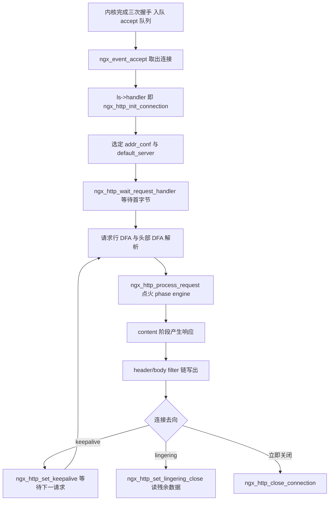
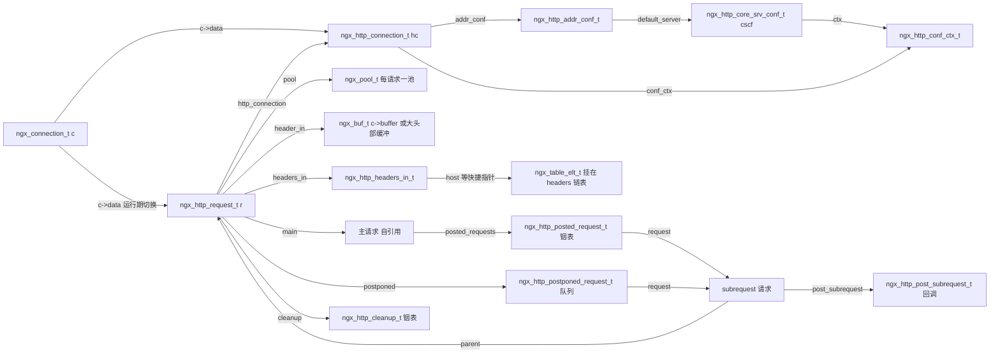
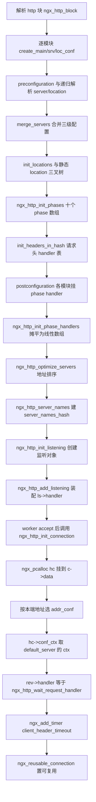
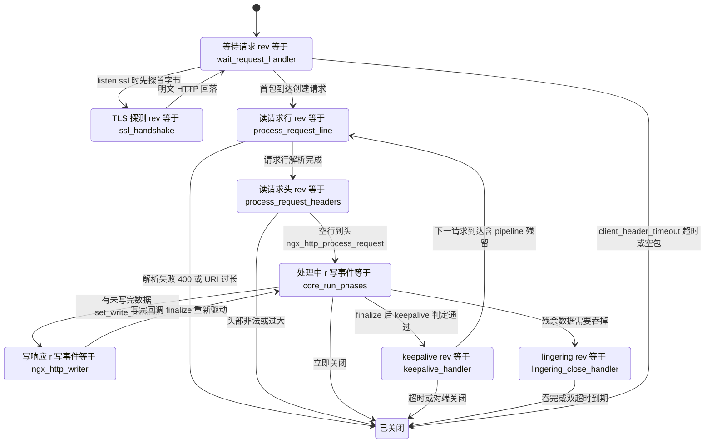
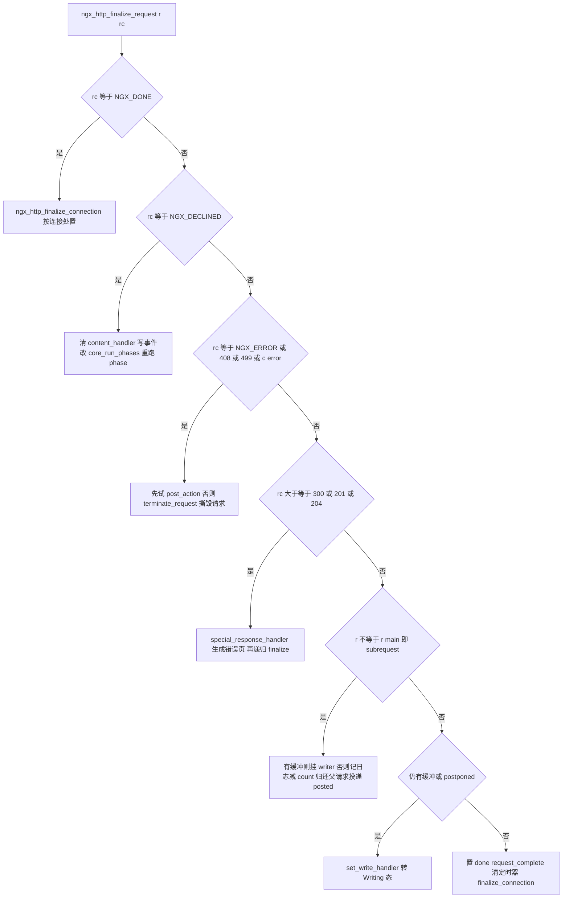
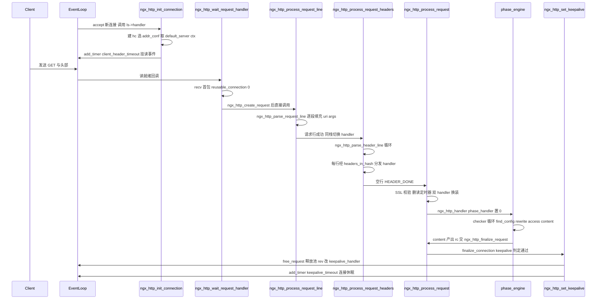
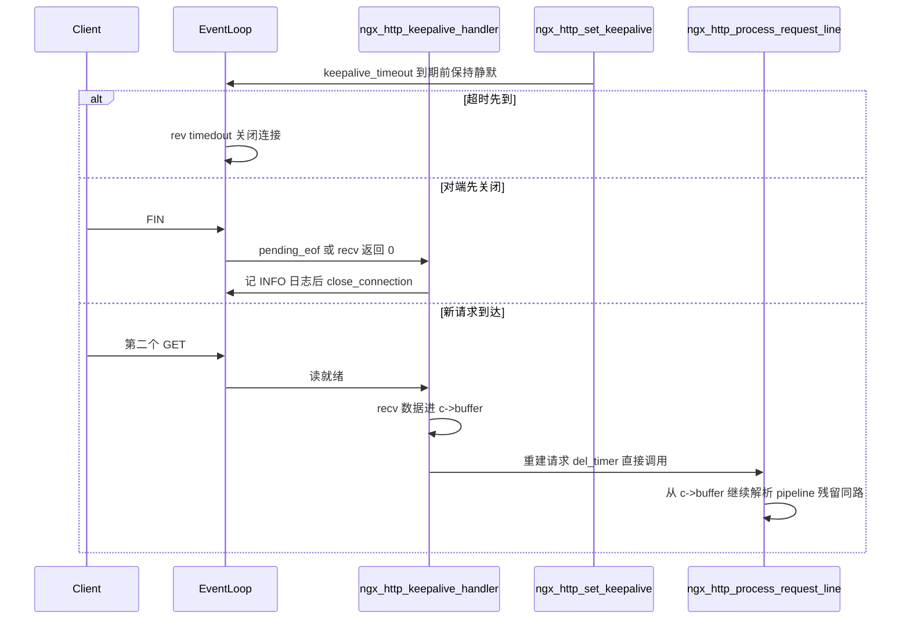

# HTTP 请求生命周期（状态机全流程）（基于 nginx-1.27.0 源码）

> **导读**：读完本文你将掌握——一条 TCP 连接从 `accept()` 进入 HTTP 模块后的完整生命轨迹：`ngx_http_init_connection` 如何选定 `addr_conf` 与 `default_server`；`ngx_http_wait_request_handler` 如何用最小的内存代价区分"空包关闭 / 半包等待 / 超时"；请求行与请求头两段 DFA 调度如何与解析器（第 13 篇）分工；`ngx_http_process_request` 如何完成 SSL 校验、虚拟主机切换并点火 phase engine；`ngx_http_finalize_request` 家族五类返回值的完整控制流；`main->count` 引用计数的每一次增减；keepalive 与 pipeline 预检、lingering close 为什么必须存在；以及 subrequest、internal redirect 与 posted_requests 队列如何在不递归的前提下驱动请求树。
>
> **前置阅读建议**：本系列第 2 篇《事件驱动框架与连接管理》（`ngx_event_accept` → `ls->handler` 的调用链）、第 4 篇《定时器管理》（`ngx_add_timer`/`ngx_del_timer` 的红黑树行为）、第 13 篇《请求行与头部解析 DFA》（`ngx_http_parse.c` 的状态机本体）。本文所有函数行号均出自 nginx-1.27.0 真实源码，均已逐行核实。
>
> **涉及源码清单**：
> - `src/http/ngx_http_request.c`（3953 行，生命周期主体，本文核心）
> - `src/http/ngx_http_request.h`（623 行，`ngx_http_request_t` 等全部核心结构）
> - `src/http/ngx_http.c`（2198 行，配置期搭建端口/地址/虚拟主机索引，运行期入口装配）
> - 关联：`src/http/ngx_http_core_module.c`（phase engine、subrequest、internal redirect）、`src/http/ngx_http_parse.c`（解析 DFA）、`src/http/ngx_http_special_response.c`（错误页）、`src/http/ngx_http_request_body.c`（请求体读取）

---

## 1. 本模块在 nginx 中的位置与职责

HTTP 请求生命周期由三层协作完成：

1. **配置期**（reload/master 启动）：`src/http/ngx_http.c` 的 `ngx_http_block`（`src/http/ngx_http.c:121-346`）把 `http{}` 块内所有 `server{}`/`listen`/`server_name` 归并成"端口 → 地址 → 虚拟主机"三级索引，并在 `ngx_http_add_listening`（`src/http/ngx_http.c:1809-1890`）中把每个监听套接字的 `ls->handler` 装配为 `ngx_http_init_connection`（`src/http/ngx_http.c:1823`）。这一行是 HTTP 模块与事件框架的唯一"接头"。
2. **连接期**：worker 事件循环里 `ngx_event_accept` accept 出新连接后调用 `ls->handler`，即 `ngx_http_init_connection`（`src/http/ngx_http_request.c:199-362`）。它分配连接级结构 `ngx_http_connection_t`、按本端地址选定 `addr_conf` 与 `default_server`、挂上第一个读事件 handler，然后进入事件驱动的"休眠等待"。
3. **请求期**：从 `ngx_http_wait_request_handler`（`src/http/ngx_http_request.c:365-524`）收到首字节开始，经请求行/头部解析、phase engine、输出过滤，到 `ngx_http_finalize_request` 收尾，最后按 `keepalive`/`lingering` 两种路径决定连接复用还是关闭。



**图 1 解读**：这张图是全文的"地图"。注意 K 节点到 F 节点的回边——keepalive 连接并不销毁重建，而是把 `rev->handler` 换回 `ngx_http_process_request_line` 后直接重入解析状态机（详见第 6.20/6.21 节）；而 `addr_conf` 的选定只做一次（连接级），`server`（虚拟主机）的切换可能随 Host 头反复发生（请求级）。事件框架对 HTTP 一无所知，它只认 `handler` 函数指针——这是 nginx "框架不认识协议" 的经典分层。

---

## 2. 核心数据结构精讲

### 2.1 连接级结构 `ngx_http_connection_t`

每个物理连接对应一个，挂在 `c->data` 上（`src/http/ngx_http_request.c:221`）。定义在 `src/http/ngx_http_request.h:316-334`：

| 字段 | 类型 | 含义 | 关键写入点 |
|---|---|---|---|
| `addr_conf` | `ngx_http_addr_conf_t *` | 本端 `IP:port` 对应的地址配置（含 `ssl`/`http2`/`quic`/`proxy_protocol` 位与 `virtual_names`） | `ngx_http_init_connection`，`src/http/ngx_http_request.c:256/274/286/292` |
| `conf_ctx` | `ngx_http_conf_ctx_t *` | 该地址 **default_server** 的配置上下文，请求未识别 Host 前的所有 `srv_conf/loc_conf` 都取自它 | `src/http/ngx_http_request.c:298` |
| `ssl_servername` | `ngx_str_t *` | TLS SNI 中携带、且已通过 `ngx_http_validate_host` 的服务器名 | `ngx_http_ssl_servername`，`src/http/ngx_http_request.c:935-940` |
| `ssl_servername_regex` | `ngx_http_regex_t *` | SNI 命中正则 server_name 时保存该正则，供请求建立后再补执行捕获 | `src/http/ngx_http_request.c:2363` |
| `busy` / `nbusy` | `ngx_chain_t *` / `ngx_int_t` | 本连接使用中的大头部缓冲链（`large_client_header_buffers`），跨请求复用 | `ngx_http_alloc_large_header_buffer`，`src/http/ngx_http_request.c:1682-1684` |
| `free` | `ngx_chain_t *` | 已用完、可复用的大头部缓冲链 | `ngx_http_set_keepalive`，`src/http/ngx_http_request.c:3148-3149` |
| `ssl` / `proxy_protocol` | `unsigned:1` | 该地址是否 TLS / 是否需读 PROXY protocol 头 | `src/http/ngx_http_request.c:329-339` |

`addr_conf` 的来源链：`c->listening->servers`（`ngx_http_port_t`）→ 按 `port->naddrs` 分支：多地址时先 `ngx_connection_local_sockaddr()`（内部 `getsockname()`，`src/http/ngx_http_request.c:235`）确定真实本端地址，再线性匹配 `addr[i].addr == sin->sin_addr.s_addr`（`src/http/ngx_http_request.c:268-274`）；通配 `*:port` 固定放在数组末尾兜底（注释 "the last address is \"*\""，`src/http/ngx_http_request.c:266-267`）。这一定序来自配置期的 `ngx_http_cmp_conf_addrs`——wildcard 必须排最后（`src/http/ngx_http.c:1698-1706`）。

### 2.2 请求级结构 `ngx_http_request_t`

定义在 `src/http/ngx_http_request.h:378-604`，约 100 个字段。按生命周期分组：

**（a）身份与配置上下文**

| 字段 | 行号 | 含义 |
|---|---|---|
| `signature` | 379 | 恒为 `"HTTP"`，模块防御性校验用 |
| `connection` | 381 | 所属物理连接 |
| `ctx` | 383 | 每模块请求上下文指针数组（`ngx_http_max_module` 项） |
| `main_conf` / `srv_conf` / `loc_conf` | 384-386 | 三级配置数组；`srv_conf/loc_conf` 会随虚拟主机/位置切换被整体替换 |
| `http_connection` | 453 | 回指 `ngx_http_connection_t` |
| `stream` / `v3_parse` | 454-455 | HTTP/2 流、HTTP/3 解析器（本文不展开） |

**（b）事件调度双 handler**

| 字段 | 行号 | 含义 |
|---|---|---|
| `read_event_handler` | 388 | 读事件到来时对"请求"的回调（区别于 `c->read->handler` 对"连接"的回调） |
| `write_event_handler` | 389 | 写事件回调；phase engine 运行期间它就是 `ngx_http_core_run_phases` |

两层 handler 是理解调度的关键：`c->read->handler` 只有一份（如 `ngx_http_request_handler`，`src/http/ngx_http_request.c:2405-2439`），它内部再按 `ev->write` 分发到 `r->read_event_handler` 或 `r->write_event_handler`——这样多个 subrequest 共享一个连接时，事件才能找到"当前活跃请求"。

**（c）树形关系与输出**

| 字段 | 行号 | 含义 |
|---|---|---|
| `main` | 425 | 指向主请求（自己时即自身）；引用计数、变量表、posted 队列都在它身上 |
| `parent` | 426 | subrequest 的父请求 |
| `postponed` | 427 | 本请求未消费的输出/子请求队列（`ngx_http_postponed_request_t` 链） |
| `post_subrequest` | 428 | subrequest 完成时的回调+数据（`src/http/ngx_http_request.h:351-354`） |
| `posted_requests` | 429 | **只挂在 main 上**的待执行请求队列（`src/http/ngx_http_request.h:366-371`） |
| `out` | 424 | 输出过滤链的挂起链表 |

**（d）解析结果**

| 字段 | 行号 | 含义 |
|---|---|---|
| `method` / `http_version` | 411-412 | 位掩码方法（`ngx_http_request.h:29-45`）与版本整数（HTTP/1.1 = 1001，`ngx_http_request.h:23-27`） |
| `request_line` / `method_name` / `http_protocol` | 414/420/421 | 原始请求行与方法片段（指向 `header_in` 内部或换算后的新缓冲） |
| `uri` / `args` / `exten` / `unparsed_uri` / `schema` | 415-418/422 | 规范化后的 URI、查询串、扩展名、原始 URI、协议 schema |
| `headers_in` / `headers_out` | 402-403 | 值类型（见 2.3） |
| `header_in` | 400 | 当前解析所用输入缓冲（可能是 `c->buffer` 或某个大头部缓冲） |

**（e）生命周期记账字段（本文重点）**

| 字段 | 行号 | 含义 |
|---|---|---|
| `pool` | 399 | 请求私有内存池（大小 `request_pool_size`，默认 4096，`src/http/ngx_http_core_module.c:3487-3488`）；置 NULL 是防双重关闭的哨兵（`src/http/ngx_http_request.c:3786-3789`） |
| `count:16` | 461 | 主请求引用计数：所有"异步操作在途"都 +1，完成或关闭时 -1，归零才真正销毁 |
| `subrequests:8` | 462 | 剩余可嵌套 subrequest 配额，初始 `NGX_HTTP_MAX_SUBREQUESTS + 1 = 51`（`ngx_http_request.h:13`，`ngx_http_request.c:651`） |
| `blocked:8` | 463 | 正在阻塞请求销毁的操作数（如 upstream cleanup 进行中） |
| `uri_changes:4` | 487 | 剩余 URI 变更配额，初始 `NGX_HTTP_MAX_URI_CHANGES + 1 = 11`（`ngx_http_request.h:12`，`ngx_http_request.c:650`）；internal redirect 每次递减，归零即报 rewrite/redirect cycle |
| `lingering_time` | 407 | lingering close 的截止绝对秒数（`ngx_time() + lingering_time/1000`） |
| `http_state:4` | 467 | 取值 `ngx_http_state_e`（`ngx_http_request.h:155-167`），仅供调试观测 |
| `start_sec` / `start_msec` | 408-409 | 请求起始时刻，`$request_time`/access log 用 |

**（f）请求态标志位（`src/http/ngx_http_request.h:470-603` 精选）**

| 位 | 行号 | 含义 |
|---|---|---|
| `complex_uri` / `quoted_uri` / `empty_path_in_uri` | 470-479 | 请求行 DFA 标记的 URI 特征，决定是否要走 `ngx_http_parse_complex_uri` 规范化 |
| `uri_changed` | 486 | rewrite 阶段改写了 URI，需要跳回 FIND_CONFIG 重来 |
| `valid_location` / `valid_unparsed_uri` | 484-485 | 内部跳转后 original location 校验与代理缓存键是否可继续使用 |
| `pipeline` | 533 | 本请求来自 pipeline 残留缓冲 |
| `keepalive` / `lingering_close` | 537-538 | 收尾决策的两个输入位 |
| `discard_body` / `reading_body` | 539-540 | 请求体被丢弃 / 无缓冲读取进行中 |
| `internal` | 541 | internal redirect / subrequest 置位，`ngx_http_handler` 据此决定 phase 起点与 keepalive 重算 |
| `header_sent` / `request_complete` / `done` / `logged` / `terminated` | 547-553 | 各收尾里程碑 |
| `buffered:4` | 555 | 四个 2 位槽：SSI/SUB/COPY/GZIP 等过滤器的缓冲状态（`ngx_http_request.h:147-152`） |

**（g）解析器暂存区（第 13 篇 DFA 的输出接口）**

`state`（当前 DFA 状态号，574）、`header_hash`（576）、`lowcase_index` 与 `lowcase_header[32]`（577-578，内联小写名字缓存，长度即 `NGX_HTTP_LC_HEADER_LEN = 32`，`ngx_http_request.h:16`）、`header_name_start/end`、`header_start/end`（580-583）是头部解析输出；`uri_start/uri_end/uri_ext/args_start/request_start/request_end/method_end/schema_start/schema_end/host_start/host_end`（590-600）是请求行解析输出。它们全部指向 `header_in` 缓冲内部；一旦缓冲被 `ngx_http_alloc_large_header_buffer` 换新，这批指针会被平移修正（`src/http/ngx_http_request.c:1707-1773`）。

### 2.3 头部集合 `ngx_http_headers_in_t` / `ngx_http_headers_out_t`

`headers_in`（`src/http/ngx_http_request.h:183-255`）由两部分组成：通用链表 `headers`（保存所有原始行，`ngx_table_elt_t`，预分配 20 个，`src/http/ngx_http_request.c:1185-1191`）和约 30 个**快捷指针**（`host`、`connection`、`content_length`…）。快捷指针由配置期建好的 `headers_in_hash` 分发填充：`ngx_http_init_headers_in_hash` 把静态表 `ngx_http_headers_in[]`（`src/http/ngx_http_request.c:77-196`）按小写名字建 hash（`src/http/ngx_http.c:412-450`），运行期 `ngx_hash_find` 命中后调用 `hh->handler(r, h, hh->offset)`（`src/http/ngx_http_request.c:1498-1503`），handler 用 `offset` 把指针写进 `headers_in` 对应槽位。同一名字出现多次时用 `h->next` 串成链（`ngx_http_process_header_line`，`src/http/ngx_http_request.c:1787-1792`）。

`headers_out`（`src/http/ngx_http_request.h:258-293`）同理，另含 `status`/`status_line`/`content_length_n` 等数值化字段，由 `ngx_http_clear_*`/`ngx_http_set_*` 宏族维护。

### 2.4 结构关系图



**图 2 解读**：注意三组"一跳"关系——`hc` 是连接与请求的桥梁，`hc->conf_ctx` 在 Host 未明时就是请求配置的来源；`main`/`parent`/`postponed`/`posted_requests` 四个字段把平铺的请求对象组织成一棵**同时受输出顺序（postponed）与执行顺序（posted）约束的树**；`pool` 只有一份且 subrequest 不新建池（`sr->pool = r->pool`，`src/http/ngx_http_core_module.c:2381`），所以 subrequest 绝不单独销毁池，只随 main 一起销毁。

---

## 3. 初始化流程

初始化分两个时点：**配置期**（`nginx -s reload` 解析阶段）与**连接期**（每次 accept）。

配置期主干（全部位于 `src/http/ngx_http.c`）：

1. `ngx_http_block`（121-346）统计 HTTP 模块数（149）、逐模块 `create_main/srv/loc_conf`（196-215）、执行 `preconfiguration`（221-233）、递归解析 `http{}`（237-243）、`init_main_conf` + `ngx_http_merge_servers`（253-274）、建 location 树（277-290）、`ngx_http_init_phases`（293）、`ngx_http_init_headers_in_hash`（297）、逐模块 `postconfiguration`（302-314）、`ngx_http_init_phase_handlers`（328）、`ngx_http_optimize_servers`（335）。
2. `ngx_http_init_phase_handlers`（453-559）把十个 phase 的 handler 数组**摊平**成一个 `ngx_http_phase_handler_t` 线性数组：每个条目带 `checker` + `handler` + `next`（下一 phase 首下标）；FIND_CONFIG 的下标被记进 `find_config_index`，POST_REWRITE 的 `next` 回指它（516-524），这正是 rewrite 循环的硬件基础。同 phase 内 handler 按**注册逆序**拷贝（550-555，后 `postconfiguration` 的模块先执行）。
3. `ngx_http_optimize_servers`（1487-1531）对每端口地址排序（wildcard 最后，1502）、为多 server 地址建 `server_names_hash`（`ngx_http_server_names`，1534-1687，通配头/尾 hash 分离 1615-1649）、最后 `ngx_http_init_listening`（1736-1806）创建 `ngx_listening_t` 并把地址数组连同 `virtual_names` 一起搬进 `ngx_http_port_t`（`ngx_http_add_addrs`，1893-1956，`default_server` 写入 1914，`virtual_names` 装配 1939-1952）。
4. `ngx_http_add_listening`（1809-1890）：`ls->handler = ngx_http_init_connection`（1823）、`ls->pool_size = cscf->connection_pool_size`（1826，默认 `64 * sizeof(void*)`，`src/http/ngx_http_core_module.c:3485-3486`）。



**图 3 解读**：上半段是纯配置期的"编译"过程，产物有三样——摊平的 phase 引擎数组、每地址的虚拟主机 hash、带 handler 的监听对象；下半段是每条新连接的运行期初始化。配置期一次性把所有查表操作预编译成 hash/数组，运行期每请求只做 O(1) 查找，这是 nginx 高并发低开销的配置侧根源。

---

## 4. 核心执行流程/状态机

以"连接"为对象的宏观状态迁移如下（handler 变迁全部真实对应 `rev->handler`/`r->*_event_handler` 的赋值语句）：



**逐分支讲解**（每条迁移的落点函数见第 6 节对应小节）：

- **Wait → SslProbe**：`listen ... ssl` 时 `ngx_http_init_connection` 直接把 `rev->handler` 换成 `ngx_http_ssl_handshake`（`src/http/ngx_http_request.c:328-334`），先 `recv(MSG_PEEK)` 偷看 1 字节判断是 TLS record（`0x16`）还是明文，明文则回退 Wait 分支（798-805）。
- **Wait → ReqLine**：首包非空即 `ngx_http_create_request` + handler 切换（`src/http/ngx_http_request.c:512-523`）。注意首字节到达前连接是 `reusable` 的，收到字节后立刻 `ngx_reusable_connection(c, 0)`（514）。
- **ReqLine → ReqHdr**：请求行解析成功后原地切换（1193-1196），同一事件循环内继续，不回事件环——请求行和头部经常同包到达。
- **ReqHdr → Processing**：空行（`NGX_HTTP_PARSE_HEADER_DONE`）触发 `ngx_http_process_request_header` 合法性检查 + `ngx_http_process_request`（1512-1531）；后者删读定时器、把 `c->read/write->handler` 统一为 `ngx_http_request_handler`，并调用 `ngx_http_handler(r)` 启动 phase engine（2052-2141）。
- **Processing ⇄ Writing**：phase 中返回 `NGX_AGAIN`（异步未决）则循环暂停、由事件环回调；有数据未写完时 `ngx_http_finalize_request` 走 `ngx_http_set_write_handler`（2643-2650）挂 `send_timeout` 定时器，写完由 `ngx_http_writer` 再 finalize（2858-2928）。
- **Processing → Keepalive**：`ngx_http_finalize_connection` 中 `count == 1` 且 `r->keepalive` 且 `keepalive_timeout > 0`（2752-2822 的 2801-2808 行）走 `ngx_http_set_keepalive`；若 `b->pos < b->last`（管线残留）则不进 keepalive 等待，直接造新请求回 ReqLine（3181-3208）——这就是"pipeline 预检"。
- **Processing → Lingering**：`lingering_close` 配置为 always，或为 on 且（请求标记了 lingering / 头部缓冲有残留 / 读就绪 / 管线中）四条件之一（2810-2819）。先 `shutdown(WRITE)` 发 FIN 但保留读端，边吞边等。
- **任何态 → Closed**：错误路径统一汇入 `ngx_http_close_request`（3665-3695，count 减到 0）→ `ngx_http_free_request`（3698-3790，跑 cleanup、写日志、毁池）→ `ngx_http_close_connection`（3811-3847，关 fd、毁连接池）。

`finalize` 家族的返回值语义与控制流走向，再以一张决策图固化（第 6.15 节逐行精读）：



**图 5 解读**：`NGX_DONE` 在 finalize 语境里表示"请求本身不结束，只是归还一次引用计数"（例如 upstream 读体完成时先用 `NGX_DONE` 把 `ngx_http_read_client_request_body` 加的那次计数还掉，`src/http/ngx_http_upstream.c:2887`）；`NGX_DECLINED` 表示"内容阶段没找到 handler，请重跑 phase 引擎"；`NGX_AGAIN` 从不出现在 finalize 的直接分支，它属于 phase checker 层。五类语义在第 7 节还有对照表。

---

## 5. 关键时序图

### 5.1 一次完整 GET 请求（非 TLS、无请求体）



**图 6 解读**：四个时序要点——请求行解析成功后**不回事件环**而直接同栈调用头部解析（`src/http/ngx_http_request.c:1193-1196`），省一次 epoll 往返；`ngx_http_process_request` 把连接层 handler 换成通用 `ngx_http_request_handler` 后，后续所有事件都经 `r->read/write_event_handler` 二次分发；phase engine 是同步 while 循环，只有 checker 返回 `NGX_OK`（= 异步挂起）才让出；`ngx_http_set_keepalive` 里 `ngx_http_free_request` 已把请求池销毁，连接则原地待命。

### 5.2 keepalive 超时与 pipeline 复用



**图 7 解读**：keepalive 连接的三种归宿全部收敛在 `ngx_http_keepalive_handler`（`src/http/ngx_http_request.c:3314-3442`）一个函数里。MSIE 常用 RST 关闭 keepalive 连接，因此 3374-3382 行特意把 `c->log_error` 降为 `NGX_ERROR_IGNORE_ECONNRESET` 再 recv，避免每条日志刷屏。pipeline 请求与普通新请求共用同一入口，区别只在 `r->pipeline = 1` 与缓冲里已有残留数据。

---

## 6. 源码逐段精读

本节是全文主体。每个函数按"签名 → 逐块逻辑 → 关键行 → 易错点"展开，行号均经核对。

### 6.1 `ngx_http_init_connection` —— 连接的 HTTP 出生证明

**签名**（`src/http/ngx_http_request.c:199-200`）：

```c
void
ngx_http_init_connection(ngx_connection_t *c)
```

**逐块逻辑**：

1. **分配连接级结构**（215-219）：`hc = ngx_pcalloc(c->pool, sizeof(ngx_http_connection_t))`，失败立即 `ngx_http_close_connection(c)`。注意 hc 用**连接池**而非请求池——它要活过多个请求。
2. **选 addr_conf**（223-295）：`port = c->listening->servers`；`port->naddrs > 1` 时（同一监听对象聚合了多个地址，因为通配与非通配共用一个 fd）必须 `ngx_connection_local_sockaddr()` 拿到真实本端地址（235），再在 IPv4/IPv6 两个分支里线性比对，通配地址兜底（注释 "the last address is \"*\""，266-267 / 248-249）；单地址直接取 `addr[0].conf`（279-295）。
3. **取 default_server**（297-298）：

```c
    /* the default server configuration for the address:port */
    hc->conf_ctx = hc->addr_conf->default_server->ctx;
```

此后、直到 Host 被识别为止，`ngx_http_get_module_srv_conf/loc_conf` 都从 `hc->conf_ctx` 取——这就是"未匹配 Host 的请求由 default_server 处理"的实现。`default_server` 的归属在配置期决定：`listen ... default_server` 写入 `addr[i].default_server = cscf`（`src/http/ngx_http.c:1316`，首地址默认即第一个 server，`src/http/ngx_http.c:1440`），重复声明报 "a duplicate default server"（`src/http/ngx_http.c:1308-1313`）。

4. **日志上下文**（300-315）：`ngx_http_log_ctx_t{connection, request, current_request}` 挂到 `c->log->data`，`c->log->handler = ngx_http_log_error`；`c->log->action = "waiting for request"`（313）——这条字符串会出现在所有错误日志的 "while ..." 后缀里。
5. **挂事件 handler**（317-319）：`rev->handler = ngx_http_wait_request_handler`、`c->write->handler = ngx_http_empty_handler`（写事件在等请求阶段无意义）。
6. **协议分流**（321-339）：QUIC 地址直接 `ngx_http_v3_init_stream` 后返回；`addr_conf->ssl` 则 `hc->ssl = 1` 且 `rev->handler = ngx_http_ssl_handshake`；`proxy_protocol` 只改 `log->action`，实际读取推迟到首包之后。
7. **deferred accept 快路径**（341-351）：`rev->ready` 说明内核已保证有数据（deferred accept / IOCP / dataready），此时若开启 accept_mutex 则把事件 post 到 `ngx_posted_events` 延后处理（避免锁竞争窗口），否则直接调用 handler。
8. **休眠**（353-361）：

```c
    cscf = ngx_http_get_module_srv_conf(hc->conf_ctx, ngx_http_core_module);
    ngx_add_timer(rev, cscf->client_header_timeout);
    ngx_reusable_connection(c, 1);
    if (ngx_handle_read_event(rev, 0) != NGX_OK) {
        ngx_http_close_connection(c);
        return;
    }
```

`client_header_timeout` 默认 60s（`src/http/ngx_http_core_module.c:3489-3490`）。`ngx_reusable_connection(c, 1)` 把连接标记为可复用并计入 `ngx_stat_reading` 之外的可复用计数，worker 退出或连接数超限时可优先踢掉这类空闲连接。

**易错点**：`hc->conf_ctx` 是"default_server 的 ctx"而不是"addr_conf 所属 server 的 ctx"——同一个 IP:port 上任何 server 都可能成为 default_server，取决于 `listen ... default_server` 写在谁身上；不写时是**该地址第一个被解析的 server**，这与"`server_name` 不匹配时选谁"是同一份配置。

### 6.2 `ngx_http_wait_request_handler` —— 空包、半包与超时的三岔口

**签名**（`src/http/ngx_http_request.c:365-366`）：`static void ngx_http_wait_request_handler(ngx_event_t *rev)`。

**逐块逻辑**：

1. **超时与关闭检查**（383-392）：`rev->timedout` → INFO 级 "client timed out" 后关连接；`c->close`（外部要求关闭，如 worker exiting）同样关连接。
2. **惰性分配首包缓冲**（397-421）：`size = cscf->client_header_buffer_size`（默认 1024，`src/http/ngx_http_core_module.c:3491-3492`）。`c->buffer` 为 NULL 则 `ngx_create_temp_buf`；若结构存在但 `b->start == NULL`（内存曾被 `ngx_pfree` 回收，见第 8 步），只需重新 `ngx_palloc` 一块内存填回 `pos/last/end`——**结构复用、内存惰性**。
3. **读一次**（423-466）：

```c
    size = b->end - b->last;
    n = c->recv(c, b->last, size);
    if (n == NGX_AGAIN) { ... }        /* 427 */
    if (n == NGX_ERROR) { close }      /* 454 */
    if (n == 0) { "client closed connection"; close }  /* 459 */
    b->last += n;                      /* 466 */
```

三岔口的语义：`n == 0` 是客户端干净关闭（对端 FIN），此时连一个字节都没读到，直接关连接，**不产生任何请求对象**；`NGX_AGAIN` 是半包；`NGX_ERROR` 是硬错误。

4. **半包等待**（427-452）：若 `rev->timer_set` 已在（6.1 第 8 步挂过）就不重复挂，否则补挂 `client_header_timeout` 并重标 reusable；`ngx_handle_read_event` 重新登记事件；随后做内存节流：

```c
        if (b->pos == b->last) {
            /*
             * We are trying to not hold c->buffer's memory for an
             * idle connection.
             */
            if (ngx_pfree(c->pool, b->start) == NGX_OK) {
                b->start = NULL;
            }
        }
```

（439-449 行）——一个只 connect 不发包的连接不占用 1KB 缓冲，只占一个事件与一个定时器。这就是第 2 步 `b->start == NULL` 分支存在的原因。

5. **PROXY protocol**（468-487）：`hc->proxy_protocol` 时先 `ngx_proxy_protocol_read` 剥头，剥完若恰好没有剩余字节，重置缓冲后 post 事件继续等真正的请求。
6. **HTTP/2 明文前导探测**（489-510）：未启用 TLS 但 `listen ... http2` 时，拿已收到的字节与 `"PRI * HTTP/2.0\r\n\r\nSM\r\n\r\n"` 前缀比对；完整命中进 `ngx_http_v2_init`，部分命中（前导被拆包）post 事件再等。
7. **正式建请求**（512-523）：

```c
    c->log->action = "reading client request line";
    ngx_reusable_connection(c, 0);
    c->data = ngx_http_create_request(c);
    ...
    rev->handler = ngx_http_process_request_line;
    ngx_http_process_request_line(rev);
```

`ngx_reusable_connection(c, 0)` 解除可复用标记（请求进行中的连接不可被抢占回收）；`c->data` 从 hc 被替换为 r——**从此连接的"当前活跃请求"就是这个指针**，直到 keepalive 阶段才换回 hc（`src/http/ngx_http_request.c:3171`）。

**易错点**：本 handler 里 `n == 0` 与 `n == NGX_ERROR` 的日志级别是 INFO 而非 ERROR，因为"连上不发请求就走"在互联网上是常态，按错误记会淹没日志。

### 6.3 `ngx_http_create_request` / `ngx_http_alloc_request` —— 请求对象的出厂设置

`ngx_http_create_request`（`src/http/ngx_http_request.c:527-556`）做四件事：调用 `ngx_http_alloc_request`；`c->requests++`（539，连接级请求计数，配合 `keepalive_requests` 判定）；按请求所在 server 的 `clcf->error_log` 换连接日志（543，`ngx_set_connection_log`）；更新 log ctx 的 `request/current_request`（546-547）。`NGX_STAT_STUB` 下维护 `ngx_stat_reading/requests` 原子计数（549-553）。

`ngx_http_alloc_request`（559-658）的关键初始化逐项：

| 行号 | 语句 | 意义 |
|---|---|---|
| 573 | `pool = ngx_create_pool(cscf->request_pool_size, c->log)` | 每请求独立池，默认 4096 字节 |
| 586-588 | `r->http_connection = hc; r->signature = NGX_HTTP_MODULE; r->connection = c` | 三向回链 |
| 590-592 | `r->main_conf/srv_conf/loc_conf = hc->conf_ctx->...` | 初始配置取 default_server；Host 识别后 `srv_conf/loc_conf` 会被 `ngx_http_set_virtual_server` 整体替换（`src/http/ngx_http_request.c:2308-2309`） |
| 594 | `r->read_event_handler = ngx_http_block_reading` | 请求级读 handler 先置"阻塞读"防误触 |
| 596 | `r->header_in = hc->busy ? hc->busy->buf : c->buffer` | pipeline 场景首请求解析用的正是上一请求搬入 hc->busy 的残留缓冲 |
| 598-612 | 初始化 `headers_out.headers`（20 项）与 `trailers`（4 项）两个 list | 值类型准备工作 |
| 614 | `r->ctx = ngx_pcalloc(...)` | 每模块上下文指针数组 |
| 622-627 | `r->variables = ngx_pcalloc(cmcf->variables.nelts * sizeof(...))` | 变量值槽位，一次分配全程复用 |
| 629-633 | SSL 且不支持 sendfile 时 `r->main_filter_need_in_memory = 1` | TLS 必须整段过内存过滤链 |
| 635-636 | `r->main = r; r->count = 1` | **引用计数的出厂值是 1** |
| 645-648 | `content_length_n` 等置 -1 | -1 是"未知"哨兵 |
| 650-651 | `uri_changes = 11; subrequests = 51` | rewrite 循环与 subrequest 深度的弹药基数 |
| 653 | `r->http_state = NGX_HTTP_READING_REQUEST_STATE` | 观测用 |

**易错点**：`r->pool` 与 `c->pool` 是两个池。大头部缓冲属于 `r->connection->pool`（`src/http/ngx_http_request.c:1661`），因此能跨请求复用；而 `r->uri.data` 等（1262）属于请求池，请求一结束即失效——模块代码若把请求池指针存进连接级数据，就是一个经典的 use-after-free。

### 6.4 TLS 探测与 SNI：`ngx_http_ssl_handshake` 三兄弟

`ngx_http_ssl_handshake`（663-810）核心是**偷看一个字节**：

```c
    size = hc->proxy_protocol ? sizeof(buf) : 1;
    n = recv(c->fd, (char *) buf, size, MSG_PEEK);
    ...
    if (n == 1) {
        if (buf[0] & 0x80 /* SSLv2 */ || buf[0] == 0x16 /* SSLv3/TLSv1 */) {
```

（694-755 行）`MSG_PEEK` 不消费数据，所以"明文 HTTP 打到 SSL 端口"的场景可以无损回落：798-805 行把 handler 换回 `ngx_http_wait_request_handler` 后直接调用，数据一个不少。命中 TLS 则 `ngx_ssl_create_connection`（770）→ `ngx_reusable_connection(c, 0)`（777）→ `ngx_ssl_handshake(c)`（779）；异步未完成时挂 `c->ssl->handler = ngx_http_ssl_handshake_handler` 并保留 `client_header_timeout` 定时器（781-791）。

`ngx_http_ssl_handshake_handler`（813-869）：握手成功置 `no_wait_shutdown = 1`（826，注释解释多数浏览器不发 close_notify）；ALPN 协商出 `h2` 则转 HTTP/2（828-850）；否则回到 `ngx_http_wait_request_handler`（852-859）。失败或超时关连接。

`ngx_http_ssl_servername`（874-1004，OpenSSL SNI 回调）在**握手中途**就切虚拟主机：`SSL_get_servername` → `ngx_http_validate_host`（914）→ `ngx_http_find_virtual_server`（924）→ `hc->conf_ctx = cscf->ctx`（942）→ `SSL_set_SSL_CTX` 换证书（953）。这样证书就能按域名选择；请求阶段的 `ngx_http_set_virtual_server` 看到 `hc->ssl_servername` 与 Host 一致就直接短路返回（2252-2267），SNI 与 Host 不一致且 `ssl_verify` 开启时报 421 MISDIRECTED_REQUEST（2283-2299）。

### 6.5 `ngx_http_process_request_line` —— 请求行调度循环

**签名**（`src/http/ngx_http_request.c:1082-1083`）：`static void ngx_http_process_request_line(ngx_event_t *rev)`。

**逐块逻辑**：

1. **超时**（1097-1102）：`c->timedout = 1`（给 access log 的 `$request_time` 相关判定与 `reset_timedout_connection` 用）后 `ngx_http_close_request(r, NGX_HTTP_REQUEST_TIME_OUT)`——注意这里走 408 而不是简单关连接。
2. **主循环**（1104-1239）：

```c
    rc = NGX_AGAIN;
    for ( ;; ) {
        if (rc == NGX_AGAIN) {
            n = ngx_http_read_request_header(r);
            if (n == NGX_AGAIN || n == NGX_ERROR) {
                break;
            }
        }
        rc = ngx_http_parse_request_line(r, r->header_in);
        ...
    }
    ngx_http_run_posted_requests(c);
```

调度协议是：**读函数保证有字节，解析器消费字节**。`ngx_http_parse_request_line`（DFA 本体，`src/http/ngx_http_parse.c:104` 起，第 13 篇专述）只负责推进 `r->state` 并回填 `r->request_start/method_end/uri_start/...` 指针，不读 socket、不做错误页——本文的调度函数与它的分工正在于此。`NGX_AGAIN` 表示请求行未完且缓冲已耗尽，循环顶部再读；解析器返回错误码（`NGX_HTTP_PARSE_INVALID_METHOD` 等，`ngx_http_request.h:56-62`）则走第 4 步。

3. **解析成功分支**（1118-1199）：先填 `request_line/method_name/request_length`（1122-1130）；`ngx_http_process_request_uri(r)` 处理 URI 规范化（1136）；请求行自带绝对地址（`GET http://host/path`）时用 `ngx_http_validate_host` + `ngx_http_set_virtual_server` 提前定 server（1145-1169）；HTTP/0.9（无版本号）没有头部，直接 `ngx_http_process_request(r)` 进 phase engine（1171-1182）；否则初始化 `headers_in.headers` 链表并**同栈切换**：

```c
            c->log->action = "reading client request headers";
            rev->handler = ngx_http_process_request_headers;
            ngx_http_process_request_headers(rev);
            break;
```

（1193-1196 行）

4. **解析错误**（1201-1216）：查静态表 `ngx_http_client_errors[]`（61-74）打 INFO 日志；`NGX_HTTP_PARSE_INVALID_VERSION` 回 505，其余 400。
5. **缓冲耗尽**（1220-1238）：`r->header_in->pos == r->header_in->end` 且 rc 仍为 AGAIN 时调 `ngx_http_alloc_large_header_buffer(r, 1)`；返回 `NGX_DECLINED` 说明请求行超过 `large_client_header_buffers.size`，回 414 REQUEST_URI_TOO_LARGE（1229-1237）。
6. **收尾**（1241）：`ngx_http_run_posted_requests(c)`——任何出口都可能压入了 posted 请求（例如本循环内某个模块的 finalize 链），统一在这里消费。

### 6.6 `ngx_http_process_request_uri` —— URI 规范化与安全修剪

签名与范围：`src/http/ngx_http_request.c:1245-1363`。要点：

- 长度计算：有 `args_start` 则 `uri.len = args_start - 1 - uri_start`（1251，减去 `?`），否则到 `uri_end`（1253）。
- 请求行 DFA 已标记 `complex_uri / quoted_uri / empty_path_in_uri` 时（1256），`ngx_pnalloc` 新内存（1262）并调 `ngx_http_parse_complex_uri`（1270，`src/http/ngx_http_parse.c:1245`）做 `..`、`//`（受 `merge_slashes` 控制）、`%XX` 解码与路径规范化；失败回 400。**简单 URI 不拷贝**，`r->uri.data = r->uri_start` 直接指向缓冲（1279-1281）——零拷贝原则再次出现。
- `unparsed_uri` 永远指向原始字节（1283-1284），代理转发、缓存键用它保证原样性。
- Win32 分支（1303-1351）拦截 `::$data` 等 NTFS Alternate Data Stream 注入并修剪尾部空格/点。

### 6.7 `ngx_http_alloc_large_header_buffer` —— 大头部的换舱术

签名：`static ngx_int_t ngx_http_alloc_large_header_buffer(ngx_http_request_t *r, ngx_uint_t request_line)`（`src/http/ngx_http_request.c:1613-1615`）。参数 `request_line` 区分"请求行装不下"与"某条头装不下"。

逐块：

1. **特例：整行只有 CRLF**（1626-1634）：请求行阶段且 `r->state == 0`（DFA 处于初始态，说明刚消费完一个完整单元）时，缓冲里其实只有 `\r\n`，直接重置 `pos/last` 复用，不换大缓冲。
2. **超限判定**（1636-1645）：未完成部分 `r->header_in->pos - old >= large_client_header_buffers.size` 时返回 `NGX_DECLINED`——调用方据此回 414（请求行）或 494（头部）。
3. **取缓冲**（1649-1680）：优先从 `hc->free` 链摘（复用），否则在 `large_client_header_buffers.num`（默认 4，`src/http/ngx_http_core_module.c:3493-3495`）限额内 `ngx_create_temp_buf(r->connection->pool, ...)` 新建并挂入 `hc->busy`（1682-1684）；两条路都断则 `NGX_DECLINED`。
4. **免拷贝快路**（1686-1696）：`r->state == 0` 意味着上一个单元已完整解析、无半截数据，直接把 `r->header_in` 指向新缓冲即可。
5. **半截搬迁**（1707-1773）：把 `old` 到 `pos` 的未完成字节 `ngx_memcpy` 进新缓冲（1709），然后**逐个平移所有解析指针**：

```c
    if (request_line) {
        r->request_start = new;
        if (r->request_end) {
            r->request_end = new + (r->request_end - old);
        }
        ...
```

（1714-1757 行；头部分支 1759-1773 平移 `header_name_start/end`、`header_start/end`）。这正是 2.2 (g) 节说"解析指针指向缓冲内部"的代价：每次换缓冲都要做一次全量指针重定位。

**易错点**：新缓冲来自 `r->connection->pool` 而非请求池，所以请求结束后它还能通过 `hc->busy/free` 服务下一个请求（第 6.20 节）；`r->header_in` 换新后，旧 `c->buffer` 里可能还躺着 pipeline 的后续请求，`ngx_http_set_keepalive` 会专门处理这种"缓冲分裂"（3125-3163）。

### 6.8 `ngx_http_process_request_headers` 与 `ngx_http_read_request_header`

**`ngx_http_read_request_header`**（1556-1610）：先返回缓冲存量（1567-1571）；`rev->ready` 才真正 `c->recv`（1573-1575），否则 `NGX_AGAIN`；AGAIN 时补挂 `client_header_timeout`（1580-1584，**这是头部阶段超时的实际挂接点**）；`n == 0` 记 "client prematurely closed connection" 并置 `c->error = 1` 后 `ngx_http_finalize_request(r, NGX_HTTP_BAD_REQUEST)`（1594-1605）——半截请求按 400 记账而不是默默丢弃。

**`ngx_http_process_request_headers`**（1366-1553）主循环与请求行同构，差异在四类返回值的处理：

1. **缓冲管理**（1401-1437）：`pos == end` 时调 `alloc_large_header_buffer(r, 0)`；`NGX_DECLINED` 分支里有个精细区分——`r->header_name_start == NULL` 说明连行首都没落进旧缓冲，报 "client sent too large request"（1415-1421）；否则能报出具体超长行（截断到 `NGX_MAX_ERROR_STR - 300`，1425-1431）。两条路都回 `NGX_HTTP_REQUEST_HEADER_TOO_LARGE`（494），且**前置 `r->lingering_close = 1`**（1413）：客户端还在往 socket 里灌数据，直接 close 会 RST，错误页可能发不出去（第 6.22 节）。
2. **单行成功**（1452-1509）：`ngx_list_push` 追加 `ngx_table_elt_t`，名字/值直接指向缓冲内零拷贝（1477-1483，末尾写 `\0` 是利用了 CRLF 位置）；`lowcase_key` 优先用 DFA 内联的 `lowcase_header`（1491-1496，名字 ≤32 字节时免 lowercase 拷贝）；`ngx_hash_find(cmcf->headers_in_hash, ...)` 命中后调 handler（1498-1503）——**Host/Connection/User-Agent 的特殊处理全部封装在这些 handler 里**（6.9 节），未注册的头部只进链表。
3. **头部结束**（1512-1532）：`NGX_HTTP_PARSE_HEADER_DONE` 后：`r->http_state = NGX_HTTP_PROCESS_REQUEST_STATE`（1521）→ `ngx_http_process_request_header(r)` 做跨字段合法性检查（1523，6.10 节）→ 成功则 `ngx_http_process_request(r)`（1529）。
4. **非法行**（1541-1549）：回 400；`ignore_invalid_headers` 开启时字符级非法行（如名字带空格）在 1456-1465 被静默跳过。

循环出口同样是 `ngx_http_run_posted_requests(c)`（1552）。

### 6.9 头部 handler 家族

- **`ngx_http_process_header_line`**（1781-1795）：通用 handler，把 `ngx_table_elt_t *` 写入 `headers_in` 中 `offset` 槽；同名重复时沿 `next` 链尾插：

```c
    ph = (ngx_table_elt_t **) ((char *) &r->headers_in + offset);
    while (*ph) { ph = &(*ph)->next; }
    *ph = h;
    h->next = NULL;
```

- **`ngx_http_process_unique_header_line`**（1798-1820）：`Content-Length`、`If-Modified-Since` 等只允许出现一次，重复直接 400 并返回 `NGX_ERROR`（1817-1819）。
- **`ngx_http_process_host`**（1823-1870）：重复 Host 400（1830-1838）；`ngx_http_validate_host` 校验（1845，非法回 400，1850）；若请求行已定过 server（`headers_in.server.len` 非零，1859-1861）就不再切；否则 `ngx_http_set_virtual_server`（1863-1867）。**虚拟主机的最终裁决点就在这里**。
- **`ngx_http_process_connection`**（1873-1889）：识别 `close` / `keep-alive` 子串写 `headers_in.connection_type`，供 `ngx_http_handler` 决定 `r->keepalive`（`src/http/ngx_http_core_module.c:826-839`）。
- **`ngx_http_process_user_agent`**（1892-1960）：趁头部字节还在 CPU cache 里识别 MSIE/MSIE6/Opera/Gecko/Chrome/Safari/Konqueror，结果供 `keepalive_disable`（`src/http/ngx_http_core_module.c:1352-1370`）等特性使用。

### 6.10 `ngx_http_process_request_header` —— 跨字段语义检查

范围 `src/http/ngx_http_request.c:1963-2049`。按序：

1. Host 仍为空（如 HTTP/1.0 无 Host）：用空串走 `ngx_http_set_virtual_server`，等于绑定 default_server（1966-1971）。
2. `http_version > 1.0` 且无 Host 头 → 400（1973-1978）。
3. `Content-Length` 必须是合法数字（1980-1991）。
4. `Transfer-Encoding`：HTTP/1.0 出现即 400（1993-2000）；只认 `chunked`，且与 `Content-Length` 同现按 RFC 7230 拒绝（2002-2015）；未知编码回 501（2017-2023）。
5. `Connection: keep-alive` 时解析 `Keep-Alive: timeout=...` 参数存 `keep_alive_n`（2026-2032）。
6. `CONNECT` / `TRACE` 方法直接 405（2034-2046）——核心 HTTP 模块不提供隧道与回环诊断。

### 6.11 `ngx_http_process_request` —— 请求的点火仪式

范围 `src/http/ngx_http_request.c:2052-2141`。四步：

1. **SSL 收尾检查**（2059-2123）：`hc->ssl` 但 `c->ssl == NULL` 是"明文打到 HTTPS 端口"，回 `NGX_HTTP_TO_HTTPS`（497，客户端会跳转 https，2067-2071）；`ssl_verify` 开启时逐项检查验证结果（2076-2091）、强制证书存在（2093-2108）、OCSP 状态（2110-2119），失败都先 `ngx_ssl_remove_cached_session` 再回 495/496。
2. **删读定时器**（2125-2127）：`client_header_timeout` 的使命结束。
3. **换装双 handler**（2136-2138）：

```c
    c->read->handler = ngx_http_request_handler;
    c->write->handler = ngx_http_request_handler;
    r->read_event_handler = ngx_http_block_reading;
```

从这一刻起连接层事件统一走 `ngx_http_request_handler`（2405-2439）：先处理 `c->close`（强杀：`r->main->count++` 防请求在 terminate 前被销毁，2419-2424）、清 `delayed+timedout` 组合（限速恢复，2426-2429），然后按 `ev->write` 分发到 `r->write_event_handler` / `r->read_event_handler`，出口 `ngx_http_run_posted_requests(c)`（2438）。

4. **点火**（2140）：`ngx_http_handler(r)`（`src/http/ngx_http_core_module.c:819-859`）——非 internal 请求：按 `connection_type` 定 `r->keepalive`（826-839）、按"有无请求体"预置 `r->lingering_close`（841-842，有 body 说明响应发完还得吞残余）、`r->phase_handler = 0`（843）；internal 请求（rewrite/subrequest）则从 `server_rewrite_index` 复跑（845-848）；最后 `r->write_event_handler = ngx_http_core_run_phases` 并**同步调用**（857-858）。

`ngx_http_core_run_phases`（862-881）就是一个 while 循环：`rc = ph[r->phase_handler].checker(r, &ph[r->phase_handler])`，checker 返回非 `NGX_OK` 就继续，`NGX_OK` 表示异步挂起、控制权交还事件环。checker 家族（`src/http/ngx_http_core_module.c:884-1301`）把 handler 的返回值翻译成引擎动作：generic 阶段 `NGX_OK→next`、`DECLINED→+1`、`AGAIN/DONE→挂起`、错误→finalize；content 阶段无 handler 兜底 403/404（1286-1300）。**这就是"phase engine 启动点"的完整链条：process_request → ngx_http_handler → core_run_phases。**

### 6.12 主机校验与虚拟主机定位三函数

- **`ngx_http_validate_host`**（2144-2233）：手写扫描器拒绝路径分隔符（2197-2199）、控制字符与空格（2201-2203）、连续点（2168-2171）、空主机（2217-2219）与结尾点（2213-2215）；含大写时按 `alloc` 参数决定是否分配小写副本（2221-2228）。返回 `NGX_DECLINED` / `NGX_ERROR` / `NGX_OK`。
- **`ngx_http_set_virtual_server`**（2236-2316）：先处理 SNI 已定名的一致性（2252-2268、2283-2300 的 421 逻辑）；再 `ngx_http_find_virtual_server`；命中则**整体替换**请求配置并换日志（2308-2315）：

```c
    r->srv_conf = cscf->ctx->srv_conf;
    r->loc_conf = cscf->ctx->loc_conf;
    clcf = ngx_http_get_module_loc_conf(r, ngx_http_core_module);
    ngx_set_connection_log(r->connection, clcf->error_log);
```

- **`ngx_http_find_virtual_server`**（2319-2402）：`ngx_hash_find_combined` 一次查精确名 + 前缀/后缀通配（2330-2332）；未命中再按序试正则（2341-2397）；全不中 `NGX_DECLINED`，调用方继续用 default_server（2304-2306 处 DECLINED 直接返回 OK——注意配置并不在这里切换，仍沿用 `hc->conf_ctx`）。

### 6.13 `ngx_http_finalize_request` —— 生命周期最复杂的交汇点

**签名**（`src/http/ngx_http_request.c:2498-2499`）：`void ngx_http_finalize_request(ngx_http_request_t *r, ngx_int_t rc)`。调用方是 phase handler、内容 handler、过滤链、事件回调……它必须把**任意**返回值翻译成安全的下一步。分支顺序即语义优先级：

1. **`rc == NGX_DONE`**（2511-2514）→ `ngx_http_finalize_connection`：含义是"这次调用只是归还一次引用，不决定请求命运"（读体完成、subrequest 挂起等场景）。详见 6.17。
2. **`rc == NGX_OK && r->filter_finalize`**（2516-2518）：过滤器内部把 `NGX_OK` 当错误处理（如 subrequest 输出已半途），置 `c->error = 1` 走销毁路径。
3. **`rc == NGX_DECLINED`**（2520-2525）：

```c
        r->content_handler = NULL;
        r->write_event_handler = ngx_http_core_run_phases;
        ngx_http_core_run_phases(r);
        return;
```

"没找到内容 handler，清空缓存的内容入口，重跑 phase 引擎"——`ngx_http_core_content_phase` 在 fallback 阶段被多个 content 模块 DECLINED 后靠它继续。

4. **错误家族**（2531-2542）：`NGX_ERROR`、408、499 或 `c->error` 先试 `ngx_http_post_action`（`error_page` 的孪生指令 `post_action`，3628-3662），未配置则 `ngx_http_terminate_request(r, rc)` 立即撕毁（6.16）。
5. **特殊响应**（2544-2569）：`rc >= 300`（或 201/204）时：444 `NGX_HTTP_CLOSE` 置 `c->timedout = 1` 后 terminate（2548-2552，timedout 位使 `reset_timedout_connection` 的 SO_LINGER RST 逻辑生效，`src/http/ngx_http_request.c:3752-3771`）；主请求先摘读写定时器（2554-2562）；然后 `ngx_http_finalize_request(r, ngx_http_special_response_handler(r, rc))` **递归**（2567）——错误页生成（`src/http/ngx_http_special_response.c:415-468`）可能触发 error_page 内部跳转，递归收敛后再走普通分支。
6. **subrequest 收尾**（2571-2641）：核心在 2584-2634：

```c
        pr = r->parent;
        if (r == c->data || r->background) {
            ...
            r->done = 1;
            if (r->background) {
                ngx_http_finalize_connection(r);
                return;
            }
            r->main->count--;
            if (pr->postponed && pr->postponed->request == r) {
                pr->postponed = pr->postponed->next;
            }
            c->data = pr;
        } else {
            ...
            r->write_event_handler = ngx_http_request_finalizer;
            if (r->waited) {
                r->done = 1;
            }
        }
        if (ngx_http_post_request(pr, NULL) != NGX_OK) {
            r->main->count++;
            ngx_http_terminate_request(r, 0);
            return;
        }
```

活跃 subrequest：记日志（`log_subrequest` 控制，2586-2595）、`done = 1`、**`main->count--`（2609）归还引用、`c->data` 回切父请求（2615）、把父请求投递进 posted 队列**（2630）。投递失败则把刚减掉的计数补回来再撕毁（2631-2633）——加回是为了让 terminate 的减法不落到负数。非活跃 subrequest 只换 finalizer handler，等它自然被调度。
7. **主请求仍有缓冲**（2643-2650）：`r->buffered || c->buffered || r->postponed` → `ngx_http_set_write_handler` 进 Writing 态，剩余数据写完由 `ngx_http_writer`（2858-2928）再次 finalize——**finalize 可以被多次进入，直到无缓冲才算数**。
8. **主请求终局**（2652-2681）：`r != c->data` 属于内部错序，ALERT 后仅返回（2652-2657）；正常则 `done = 1`、读 handler 置 `block_reading`、写 handler 置空（2659-2662）、非 post_action 时 `request_complete = 1`（2664-2666）、再试一次 post_action（2668-2670）、清定时器（2672-2679）、`ngx_http_finalize_connection`（2681）。

**五类返回值语义总表**：

| 返回值 | 谁返回 | finalize 后走向 | 典型场景 |
|---|---|---|---|
| `NGX_OK` | 内容 handler 正常完成 | 第 7 分支 → 连接收尾 | 静态文件发送完毕（内部 last buf 已排） |
| `NGX_DONE` | 异步组件 | 第 1 分支 → `finalize_connection` 只做计数归还 | upstream 读体完成（`ngx_http_upstream.c:2887`） |
| `NGX_DECLINED` | content 模块 | 第 3 分支 → 重跑 phase | proxy/static 等 4 个 content 模块轮询 |
| `NGX_AGAIN` | 异步未决 | 不进 finalize，checker 挂起引擎 | upstream 连接建立中 |
| `NGX_ERROR` / `4xx/5xx` | 任意层 | 第 4/5 分支 → terminate 或错误页 | 磁盘错、访问拒绝 |
| `>= 300`（含 201/204 特判） | 访问控制/内容 | 第 5 分支 → special_response_handler | access 阶段 deny |

### 6.14 posted 机制三函数：`ngx_http_post_request` / `ngx_http_run_posted_requests`

`ngx_http_post_request`（2475-2495）把节点**尾插**到 `r->main->posted_requests` 链（2490-2492）：`for (p = &r->main->posted_requests; *p; p = &(*p)->next)`。尾插保证 FIFO——subrequest 按发起顺序执行。

`ngx_http_run_posted_requests`（2442-2472）：

```c
    for ( ;; ) {
        if (c->destroyed) {
            return;
        }
        r = c->data;
        pr = r->main->posted_requests;
        if (pr == NULL) {
            return;
        }
        r->main->posted_requests = pr->next;
        r = pr->request;
        ...
        r->write_event_handler(r);
    }
```

三个细节：**队列在 main 上全局共享**，不是每请求一条；**每次循环重新取 `c->data`**，因为执行某个请求可能又创建/切换活跃请求；**`c->destroyed` 防御**——连接已死就立刻停，防止对已释放内存继续调度。调用点遍布所有顶层入口（`ngx_http_request.c:1241、1552、2438` 等），保证"任何一轮事件处理结束后，排队的请求都能跑完"。这个机制替代了递归：没有它，`finalize → post_action → internal_redirect → finalize` 会把 C 栈打穿。

### 6.15 `ngx_http_terminate_request` / `ngx_http_terminate_handler` —— 强制撕毁

`ngx_http_terminate_request`（2685-2737）：

1. `mr->terminated = 1`（2697）；`rc > 0` 且尚未发过响应头/字节时把 rc 记为最终 status（2699-2701，供 access log）。
2. **立即执行全部 cleanup**（2703-2712）并摘链——不等池销毁，因为临时文件删除等清理必须在关闭 fd 前发生。
3. 还有阻塞者（`mr->blocked`，如 upstream cleanup 进行中）：只置 `connection->error = 1`、写 handler 换 `ngx_http_request_finalizer`，等阻塞方自己退出（2718-2727）。
4. 写 handler 可用时：**清空 posted 队列**（`mr->posted_requests = NULL`，2730，防止残留 subrequest 被再执行）、写 handler 换 `ngx_http_terminate_handler` 并以 `e->terminal_posted_request`（栈外固定槽，`ngx_http_ephemeral(r)` 即 `&r->uri_start`，`ngx_http_request.h:612`）post 到队首——`ngx_http_post_request` 的第二参数允许复用预分配节点，因为此时请求池随时可能消失（2729-2733）。
5. 写 handler 为空（如刚从事件回调中直接调用）则直接 `ngx_http_close_request(mr, rc)`（2736）。

`ngx_http_terminate_handler`（2740-2749）只有两行：`r->count = 1; ngx_http_close_request(r, 0);`——**强制把计数归一**，无视一切在途引用，随后 `close_request` 减到 0 触发销毁。这是"尽力而为的优雅"之上最后一层"必须死"的保险。

### 6.16 `ngx_http_finalize_connection` —— 连接去向的总闸

范围 `src/http/ngx_http_request.c:2752-2822`。被两处调用：finalize 的 `NGX_DONE` 分支与主请求终局分支。逻辑：

1. HTTP/2 stream 或 HTTP/3 连接：直接 `ngx_http_close_request`（流语义与 TCP 不同，2757-2769）。
2. **`count != 1`**（2773-2787）：还有别的在途引用。若 `discard_body`（响应已完整、请求体被抛弃）：挂 `lingering_timeout` 定时器并初始化 `lingering_time` 截止线（2775-2783），让丢弃过程有界；然后 `ngx_http_close_request(r, 0)` 减一返回。
3. `count == 1`：取 `r = r->main`；读端已 EOF 直接关（2791-2794）；`reading_body`（无缓冲读体中断）强制 `keepalive = 0; lingering_close = 1`（2796-2799）。
4. **keepalive 判定**（2801-2808）：

```c
    if (!ngx_terminate
         && !ngx_exiting
         && r->keepalive
         && clcf->keepalive_timeout > 0)
    {
        ngx_http_set_keepalive(r);
        return;
    }
```

`r->keepalive` 的清零点在 `ngx_http_update_location_config`（`src/http/ngx_http_core_module.c:1340-1370`）：`keepalive_timeout == 0`、**`c->requests >= keepalive_requests`（默认 1000，1344-1345 与 3847-3848）**、连接存活超 `keepalive_time`（1347-1350，默认 1 小时）、MSIE6 POST / Safari 特性（keepalive_disable）。`r->keepalive` 的置位点在 `ngx_http_handler`（`src/http/ngx_http_core_module.c:826-839`）。

5. **lingering 判定**（2810-2819）：`lingering_close always` 恒走；`on` 时四个信号之一——请求标记（如头部过大/有请求体）、`header_in->pos < last`（缓冲有未解析残留）、读就绪、`c->pipeline`——走 `ngx_http_set_lingering_close`。
6. 兜底 `ngx_http_close_request(r, 0)`（2821）。

### 6.17 Writing 态：`ngx_http_set_write_handler` / `ngx_http_writer` / `ngx_http_request_finalizer`

`ngx_http_set_write_handler`（2825-2855）：`http_state` 切 WRITING；读 handler 按 `discard_body` 选 `ngx_http_discarded_request_body_handler`（`src/http/ngx_http_request_body.c:710`）或 `ngx_http_test_reading`（2959-3095，用 `MSG_PEEK`/kqueue/EPOLLRDHUP 探测对端关闭，命中即 499 CLIENT_CLOSED_REQUEST，3079-3094）；写 handler 换 `ngx_http_writer`；未 delayed 时挂 `send_timeout`（2845-2847，默认 60s，`src/http/ngx_http_core_module.c:3832`），`ngx_handle_write_event` 登记。

`ngx_http_writer`（2858-2928）：超时 → 408 finalize（2874-2881）；delayed（限速）或 aio → 重新挂 `send_timeout` 等（2883-2896）；否则 `ngx_http_output_filter(r, NULL)` 冲刷（2898）；`NGX_ERROR` → finalize 错误；仍 `buffered/postponed` → 再挂 send_timeout 继续（2909-2920）；写干净 → 写 handler 置空并 finalize（2925-2927）。

`ngx_http_request_finalizer`（2931-2938）：以 `rc = 0` 再 finalize，供"非活跃 subrequest 等到调度"与 terminate 的收尾路径复用。

### 6.18 `ngx_http_set_keepalive` —— 复用前的三件家务

范围 `src/http/ngx_http_request.c:3098-3311`。

1. **pipeline 预检第一半：缓冲完整性**（3119-3164）。`b = r->header_in`；`b->pos < b->last` 即残留了下一个请求的头几字节。若这个 `b` **不是** `c->buffer`（说明请求用过 `large_client_header_buffers`，pipeline 数据躺在某个大缓冲里），必须把大缓冲们归还 `hc->free`、并把载有残留的 `b` 单独挂成 `hc->busy`（`nbusy = 1`，3125-3163）。这样下个请求的 `r->header_in = hc->busy->buf`（`src/http/ngx_http_request.c:596`）才能接上。
2. **归还计数并释放请求**（3166-3171）：`r->keepalive = 0`（防 `finalize_connection` 重入，注释 "guard against recursive call"）；`ngx_http_free_request(r, 0)`——access log 在此写入，请求池在此销毁；`c->data = hc` 活跃指针换回连接级结构。
3. **真正的 pipeline 短路**（3181-3208）：缓冲仍有数据就不进 keepalive 休眠，直接 `ngx_http_create_request`、`r->pipeline = 1`、删旧定时器、`rev->handler = ngx_http_process_request_line` 后 **post 到 posted_events**（3205-3206）——用 posted 而非直接调用，是为了先退出当前 finalize 栈再开新请求，避免深递归。
4. **空闲内存瘦身**（3210-3260）：`ngx_pfree(c->pool, b->start)` 归还 `c->buffer` 内存，成功则 `b->pos = NULL` 作为"内存已释放"的暗号传给 `keepalive_handler`（3354-3371 会重新分配）；`hc->free/busy` 大缓冲全部 pfree 清空。注释原话："To keep a memory footprint as small as possible for an idle keepalive connection..."（3210-3215）。
5. **TCP 收尾**（3270-3296）：level 触发事件模型下把写事件摘除；`tcp_nopush` 已置则 `ngx_tcp_push` 清空并按 `ngx_tcp_nodelay_and_tcp_nopush` 决定是否顺带 `TCP_NODELAY`——短响应场景避免 Nagle 延迟。
6. **休眠**（3303-3310）：`c->idle = 1`、reusable、挂 `keepalive_timeout`（默认 75s，`src/http/ngx_http_core_module.c:3843-3844`）；若读已就绪直接 post，不等事件环。

### 6.19 `ngx_http_keepalive_handler` —— 复用连接的三种命运

范围 `src/http/ngx_http_request.c:3314-3442`。超时/强杀（3326-3329）；kqueue 下 `pending_eof` 直接感知关闭并记 INFO 日志（3331-3348）；`b->pos == NULL`（内存被 6.18 第 4 步回收）时重新分配（3351-3371）；**MSIE RST 免疫**（3374-3382）：

```c
    /*
     * MSIE closes a keepalive connection with RST flag
     * so we ignore ECONNRESET here.
     */
    c->log_error = NGX_ERROR_IGNORE_ECONNRESET;
    ngx_set_socket_errno(0);
    n = c->recv(c, b->last, size);
    c->log_error = NGX_ERROR_INFO;
```

`NGX_AGAIN` → 重新登记并再次尝试 pfree 缓冲（3384-3404）；`n == 0` → "client %V closed keepalive connection"；有数据 → `idle = 0`、reusable 清除、`ngx_http_create_request`、删 keepalive 定时器、handler 切 `ngx_http_process_request_line` 后**直接调用**（3426-3441）。

### 6.20 lingering close 全家：`ngx_http_set_lingering_close` / `ngx_http_lingering_close_handler`

`ngx_http_set_lingering_close`（3445-3513）：

1. 初始化截止线：`r->lingering_time = ngx_time() + clcf->lingering_time / 1000`（3456-3458，默认 30000ms → 30 秒，`src/http/ngx_http_core_module.c:3851-3852`）。
2. TLS 连接先 `ngx_ssl_shutdown`，异步未完时以自身为回调重入（3460-3478）。
3. 读 handler 换 `ngx_http_lingering_close_handler` 并登记；写 handler 置空。
4. **半关闭**（3498-3503）：

```c
    if (ngx_shutdown_socket(c->fd, NGX_WRITE_SHUTDOWN) == -1) {
```

只关写端：客户端立刻读到 EOF（确认收到全部响应），而服务端仍可读。然后 `c->close = 0`、reusable、挂 `lingering_timeout`（默认 5000ms，3508）；读就绪则立即调用。

`ngx_http_lingering_close_handler`（3516-3573）：

1. `rev->timedout || c->close` → 关闭（3532-3535）。
2. **绝对截止检查**（3537-3541）：`r->lingering_time - ngx_time() <= 0` 关闭——这是防"客户端每 4.9 秒发一个字节"攻击的总闸。
3. **排水循环**（3543-3557）：栈上 4KB 缓冲（`NGX_HTTP_LINGERING_BUFFER_SIZE`，`ngx_http_request.h:20`）反复 `c->recv` 直到 `NGX_AGAIN`（内核缓冲暂时排空）、错误或 EOF。数据被读走即丢弃。
4. 重新登记事件，定时器取 `min(剩余截止时间 * 1000, clcf->lingering_timeout)`（3564-3572）——`lingering_timeout`（5s）是单次休眠上限，`lingering_time`（30s）是总预算。

**为什么直接 close 会 RST 丢响应**：TCP 规定收到数据却缓冲区未读空的 socket 在 close 时向对端发 **RST**（内核 `tcp_close` 行为）。此时客户端 `send()` 请求体尚未读完，收到 RST 后**整个接收缓冲——包括 nginx 刚发出的响应——被内核丢弃**，用户态表现为 `Connection reset by peer`，响应报文永远到不了应用层。lingering close 用"shutdown(WR) + 边读边弃"让对端把剩余数据发完（我们只是丢弃），FIN 的到达顺序保证了响应被完整送达。这就是 6.8 节头部过大时先置 `r->lingering_close = 1` 的原因。

### 6.21 `ngx_http_post_action` / `ngx_http_close_request` / `ngx_http_free_request` / `ngx_http_close_connection`

- **`ngx_http_post_action`**（3628-3662）：`post_action` 指令配置了 URL 时，错误收尾可"最后再跑一个内部请求"：`main->count--`（3646，抵消当前调用方持有的引用）、`http_version = 9`（阻止再发响应头）、`header_only = 1`、`post_action = 1`，然后按 URI 首字符走 `ngx_http_internal_redirect` 或 `ngx_http_named_location`（3654-3659）。防循环：post_action 中 `uri_changes == 0` 时拒绝（3639-3641）。
- **`ngx_http_close_request`**（3665-3695）：始终作用于 `r = r->main`（3670）；`count == 0` 时 ALERT "http request count is zero"（3676-3678，双重关闭探针）；`count--` 后若 `count || blocked` 仍在，直接返回（3682-3684）；归零则 `ngx_http_free_request(r, rc); ngx_http_close_connection(c)`（3693-3694）。
- **`ngx_http_free_request`**（3698-3790）：`r->pool == NULL` 是"已关闭"哨兵（3712-3715）；跑 cleanup 链（3717-3726，清理临时文件等）；`rc > 0` 且没发过响应头时把 rc 定为 `headers_out.status`（3740-3742）；未记日志则跑 LOG_PHASE 全部 handler（3744-3748，`ngx_http_log_request` 3793-3808 遍历 `cmcf->phases[NGX_HTTP_LOG_PHASE]`）；`c->timedout && reset_timedout_connection` 时设 `SO_LINGER{l_onoff=1, l_linger=0}`（3752-3771）——**close 瞬间发 RST**，主动放弃 TIME_WAIT，用于超时连接的快速回收；最后置 `r->pool = NULL` 再 `ngx_destroy_pool`（3786-3789），顺序保证双重关闭时踩到哨兵而非随机内存。
- **`ngx_http_close_connection`**（3811-3847）：TLS 先 `ngx_ssl_shutdown`（异步时以自身为回调，3821-3827）；`ngx_close_connection(c)`（从事件表摘除、关 fd）后销毁连接池。

### 6.22 subrequest：`ngx_http_subrequest` 与 postponed 队列

定义在 `src/http/ngx_http_core_module.c:2314-2495`。关键步骤：

1. **配额检查**（2325-2345）：`r->subrequests == 0` 报 "subrequests cycle"；`r->main->count >= 65535 - 1000` 报 "request reference counter overflow"——`count:16` 是 16 位，留 1000 个安全余量（2331-2339）；`subrequest_in_memory` 不允许嵌套。
2. **构造 sr**（2347-2427）：不新建池（`sr->pool = r->pool`，2381）；`headers_in` **按值拷贝**（2383，共享指针不拷贝缓冲）；`request_body` 共享（2389）；`method` 固定 GET（2395）；`main = r->main; parent = r; post_subrequest = ps`（2419-2421）；读 handler 置空、写 handler 即 `ngx_http_handler`（2422-2423，**posted 队列调度时直接调它，等于子请求从头跑 phase**）；变量表共享（2425）。
3. **接入输出序**（2433-2454）：非 background 时，若 `c->data == r && r->postponed == NULL` 则活跃请求切换为 sr；`ngx_http_postponed_request_t{request: sr, out: NULL}` 尾插 `r->postponed`——父请求的输出过滤链靠这条队列实现"父输出 → 子请求全部输出 → 父继续"的顺序性。
4. **配额递减与计数**（2456-2469）：`sr->internal = 1`（所以它的 phase 从 server_rewrite 起跳）；`sr->uri_changes = 11`；`sr->subrequests = r->subrequests - 1`（**深度配额沿树递减**，根上有 50 的总预算，`ngx_http_request.h:13`）；`r->main->count++`（2469）。
5. **CLONE 变体**（2473-2492）：`NGX_HTTP_SUBREQUEST_CLONE`（SSI `include virtual` 并行片段用）继承父的 `loc_conf/content_handler/phase_handler`，省去重定位。
6. 出口 `ngx_http_post_request(sr, NULL)`（2494）：**子请求不立即执行**，等当前调用栈回到顶层 posted 消费点才开始——发起者与执行者解耦，杜绝栈递归。

subrequest 完成路径见 6.13 第 6 分支：`post_subrequest->handler` 先回调（2527-2529），随后 count--、父请求被 post 回队列唤醒。`ngx_http_finalize_request` 对 subrequest 的 `NGX_OK` 若还带 `buffered/postponed`，则同样挂 writer 等数据写完（2573-2580）。

### 6.23 internal redirect：`ngx_http_internal_redirect` / `ngx_http_named_location` / `uri_changes`

**`ngx_http_internal_redirect(r, uri, args)`**（`src/http/ngx_http_core_module.c:2498-2550`）：

```c
    r->uri_changes--;
    if (r->uri_changes == 0) {
        ...
        "rewrite or internal redirection cycle while internally redirecting to \"%V\""
        r->main->count++;
        ngx_http_finalize_request(r, NGX_HTTP_INTERNAL_SERVER_ERROR);
        return NGX_DONE;
    }
    r->uri = *uri; ...            /* 2516-2523 */
    ngx_memzero(r->ctx, ...);     /* 2531 清模块上下文 */
    r->loc_conf = cscf->ctx->loc_conf;  /* 2534 重置到 server 级，等 find_config 重选 */
    r->internal = 1;              /* 2542 */
    r->main->count++;             /* 2545 */
    ngx_http_handler(r);          /* 2547 重入引擎 */
    return NGX_DONE;              /* 2549 */
```

`uri_changes` 初始 11（6.3 节），即**单请求最多 10 次 URI 变更**（`NGX_HTTP_MAX_URI_CHANGES = 10`，`ngx_http_request.h:12`）；rewrite 模块每改一次 URI（置 `uri_changed`）会经 POST_REWRITE 跳回 FIND_CONFIG，同样消耗这个配额（`ngx_http_core_post_rewrite_phase` 检查 `uri_changed`，`src/http/ngx_http_core_module.c:1044` 起）。`count++`/`NGX_DONE` 的组合是标准"转交执行权"手法：计数代表一次新引用，调用方拿到 `NGX_DONE` 去归还自己的那份。

**`ngx_http_named_location(r, name)`**（2553-2626）：跳转目标形如 `@named` 或 `error_page 404 = /fallback` 命中命名 location 时用。`count++` 与 `uri_changes--` 在入口就做（2560-2561），遍历 `cscf->named_locations`（配置期由 `ngx_http_init_locations` 收集，`src/http/ngx_http.c:743-764`）精确匹配（2584-2597）；命中后直接设 `r->loc_conf = (*clcfp)->loc_conf`（2602）、`phase_handler = location_rewrite_index`（2611）——**命名 location 跳过 server_rewrite 与 find_config**，因为 location 已经显式给定。找不到报 500（2620-2625）。

### 6.24 `main->count` 引用计数增减点汇总表

`r->main->count`（主请求自身即 `r->count`）的所有增减点，全文核实如下：

| 位置 | 变化 | 场景与理由 |
|---|---|---|
| `src/http/ngx_http_request.c:636` | `= 1` | `ngx_http_alloc_request` 出厂引用：调用方（事件回调）当前正持有请求 |
| `src/http/ngx_http_request.c:2420` | `+1` | `ngx_http_request_handler` 见 `c->close`：即将 terminate，先防请求中途被释放 |
| `src/http/ngx_http_request.c:2609` | `-1` | 活跃 subrequest finalize：归还创建时（core:2469）的引用 |
| `src/http/ngx_http_request.c:2631` | `+1` | `ngx_http_post_request` 失败回滚 2609 的减法，保证 terminate 只减一次 |
| `src/http/ngx_http_request.c:3646` | `-1` | post_action 转交：抵消调用方引用后由 redirect 的 `+1` 接棒 |
| `src/http/ngx_http_request.c:3680` | `-1` | `ngx_http_close_request`：每次"决定放弃一个引用"的统一出口，减到 0 即销毁 |
| `src/http/ngx_http_core_module.c:2469` | `+1` | `ngx_http_subrequest`：新建一个在途子请求 |
| `src/http/ngx_http_core_module.c:2511` | `+1` | internal redirect 超限错误路径：先补计数再 finalize，使 500 的终止路径配平 |
| `src/http/ngx_http_core_module.c:2545` | `+1` | internal redirect 成功：新一次引擎执行的新引用 |
| `src/http/ngx_http_core_module.c:2560` | `+1` | named location：同上 |
| `src/http/ngx_http_request_body.c:43` | `+1` | `ngx_http_read_client_request_body`：读体异步操作在途 |
| `src/http/ngx_http_request_body.c:224` | `-1` | 读体出错（`rc >= SPECIAL_RESPONSE`）：归还 43 的引用 |
| `src/http/ngx_http_request_body.c:702` | `+1` | `ngx_http_discard_request_body`：丢弃读体也是异步操作 |
| `src/http/ngx_http_upstream.c:482` | `+1` | `ngx_http_upstream_create` 重建上游（X-Accel-Redirect 场景）：旧 upstream cleanup 在途 |
| `src/http/ngx_http_upstream.c:2887` | （经 `NGX_DONE`）`-1` | X-Accel 内部跳转前先归还读体引用，再由 redirect 的 `+1` 接棒（4511 行同型） |
| `src/http/modules/ngx_http_memcached_module.c:229` | `+1` | memcached 模块重新调度读体 |
| `src/http/modules/perl/ngx_http_perl_module.c:173`、`nginx.xs:1155` | `+1` | Perl 回调在途 |

**读表须知**：`count` 不是"存活请求数"，而是"对主请求的未归还引用数"。判 0 只发生在 `close_request`（3680-3684），因此**任何** `+1` 都必须有配对的"经由 close_request 或显式 `-1`"的归还；配对错位的后果是请求泄漏（fd 与内存永不释放）或提前释放（崩溃）。`terminate_handler` 里 `r->count = 1`（2746）是唯一一处"硬改写"——撕毁语义下不再讲道理。

### 6.25 各超时设置点汇总表

| 定时器 | 配置项（默认值） | 挂接函数与位置 | 删除点 |
|---|---|---|---|
| 等首字节/等半包 | `client_header_timeout`（60s，core:3489-3490） | `ngx_http_init_connection`，`ngx_http_request.c:355` | `ngx_http_process_request`，2125-2127 |
| 同上（AGAIN 补挂） | 同上 | `ngx_http_wait_request_handler`，430 | 同上 |
| TLS 握手等待 | 同上 | `ngx_http_ssl_handshake` EAGAIN 路径，709；握手 AGAIN 路径，786 | 同上 |
| 读头部期间 | 同上 | `ngx_http_read_request_header`，1583 | 同上 |
| 写响应期间 | `send_timeout`（60s，core:3832） | `ngx_http_set_write_handler`，2846；`ngx_http_writer` delayed 分支 2888、仍缓冲分支 2912 | 主请求终局 2676-2679；444/错误页路径 2554-2562 |
| keepalive 休眠 | `keepalive_timeout`（75s，core:3843-3844） | `ngx_http_set_keepalive`，3306 | 收到新请求 `ngx_http_keepalive_handler`，3438；pipeline 短路 3201-3203 |
| 丢弃请求体 | `lingering_timeout`（5s）+ `lingering_time`（30s）预算 | `ngx_http_finalize_connection` discard 分支，2777 | 丢弃完成或超时 |
| 读请求体 | `client_body_timeout`（60s，core 中 `ngx_conf_merge_msec_value`） | `ngx_http_do_read_client_request_body`，`ngx_http_request_body.c:346、438` | 体读完 452-454；无缓冲模式 333 |
| lingering 休眠 | `lingering_timeout`（5s，core:3853-3854） | `ngx_http_set_lingering_close`，3508；`ngx_http_lingering_close_handler`，3572（取 min） | 超时或吞完即关 |
| 丢弃读体 handler | 同 discard | `ngx_http_discarded_request_body_handler`，`ngx_http_request_body.c:776` | 丢弃完成 |

表中超时到期行为分两种：头部/keepalive 阶段直接 `ngx_http_close_connection`；请求处理阶段（请求行/头部/写响应/读体）先 `c->timedout = 1` 再走 408 或 `NGX_ERROR` finalize，从而享有 `reset_timedout_connection` 的 RST 快速回收（`ngx_http_free_request`，3752-3771）。

### 6.26 `ngx_http_special_response_handler` 的衔接

finalize 第 5 分支递归调用它（`src/http/ngx_http_special_response.c:415-468`）：记 `r->err_status`；按错误码表**摘除 keepalive**（400/413/414/497/495/496/500/501，428-440——这些错误下连接状态不可信）与 lingering（442-450）；随后查 `error_page` 指令表，命中则 `ngx_http_send_error_page` 走内部跳转（456-467），未命中才生成内建错误体。

---

## 7. 设计思想与权衡

**（1）两层 handler：连接亲和 + 请求多态。** 事件框架只认识 `ngx_connection_t` 上的 `read/write->handler`；HTTP 模块在其上再抽象 `r->read_event_handler/write_event_handler`，让"当前活跃请求"成为可切换状态（`c->data`）。对比把请求指针直接埋进事件的方案：subrequest 切换只需改一个指针（`src/http/ngx_http_request.c:2615`），连接级 handler 永远不用变。代价是每次事件多一跳间接调用——典型的时间换正确性。

**（2）引用计数代替"谁负责释放"。** 异步系统里"最后离开的人关灯"很难静态判定，nginx 用 `main->count` 显式记账。对比方案 A（请求与连接同生命周期，请求完即释放）：无法支持 upstream/subrequest/异步读体；方案 B（GC 或智能指针）：引入额外开销与不确定性。nginx 的选择是"加減都要显式配对 + terminate 时硬归一（2746）"，简单、O(1)、可审计——代价是每个异步模块作者都要懂 6.24 节的配对规则。

**（3）posted 队列代替递归。** 任何"接下来该轮到请求 X"的决定都不直接调用，而是 `ngx_http_post_request` 尾插 + 顶层循环消费（2442-2472）。等效于把调用树拍平成调度队列，C 栈深度恒定。对比直接递归（早期很多服务器如此）：subrequest 嵌套 50 层就是 50 层 C 栈 + 重入状态风险。

**（4）解析与调度分离。** `ngx_http_parse.c` 的 DFA（`ngx_http_parse_request_line`，`src/http/ngx_http_parse.c:104`；`ngx_http_parse_header_line`，816）是无 I/O、无错误页、可单测的纯状态机；`ngx_http_request.c` 的调度函数负责 socket、定时器、错误页。分工界线就是 `r->state` 与那批 `*_start/*_end` 指针。好处：解析器能被打断/续跑（半包）、能在换缓冲时被指针平移修复（6.7 节）、能被 HTTP/2、HTTP/3 复用部分逻辑。

**（5）内存分池与惰性回收。** 连接池（`connection_pool_size`）、请求池（`request_pool_size` 4096）、大头部缓冲（`connection->pool`，可跨请求）三池分立；空闲期 `ngx_pfree` 归还缓冲内存只留结构（439-449、3219-3231）。对比"每连接固定大缓冲"：10 万空闲 keepalive 连接会白白占 100MB；nginx 的做法把稳态内存压到每连接几十字节结构 + 事件节点。

**（6）lingering close：与内核 TCP 语义谈判。** 替代方案一是直接 close：未读数据触发 RST，响应丢失（见 6.20）；方案二是先把读缓冲排空再 close（`SO_RCVBUF` 级清空）：需要额外 syscall 且窗口期数据仍会进。nginx 折中：`shutdown(WR)` + 事件驱动排水 + 双超时兜底，把代价限制在 `lingering_timeout × 次数 ≤ lingering_time` 内。`reset_timedout_connection` 则走向另一极端（主动 RST），用于攻击/超时场景快速回收端口。

**（7）pipeline 预检而非独立状态。** nginx 没有为 pipelining 建独立状态机：残留数据被 `set_keepalive` 发现后直接短路成新请求（3181-3208）。对比"维护 pipeline 队列"的方案：多一份队列状态与一致性问题。nginx 的做法把 pipeline 退化为"keepalive 立即命中"，几乎零额外代码。

---

## 8. 配置项与调优映射

| 指令 | 默认值（出处） | 控制的代码 | 调优建议 |
|---|---|---|---|
| `client_header_timeout` | 60s（`src/http/ngx_http_core_module.c:3489-3490`） | 4 处 `ngx_add_timer`：355/430/709+786/1583 | 慢速客户端（移动网络）可上调；防 slowloris 应下调并配合 limit_req |
| `client_header_buffer_size` | 1024（3491-3492） | `ngx_http_wait_request_handler` 397 | 绝大多数请求一行装下；大 cookie 站点适度调大可减少大缓冲切换 |
| `large_client_header_buffers` | 4 8k（3493-3495） | `ngx_http_alloc_large_header_buffer` 1659-1680 | 超限即 494/414；值越大慢速攻击者占用越多 |
| `request_pool_size` | 4096（3487-3488） | `ngx_http_alloc_request` 573 | 高并发短请求场景不宜盲目调大 |
| `connection_pool_size` | 64×sizeof(void*)（3485-3486） | `ngx_http_add_listening` 1826 | 一般不动 |
| `send_timeout` | 60s（3832） | 2846/2888/2912 | 下载型站点上调；API 型默认即可 |
| `keepalive_timeout` | 75s（3843-3844） | 3306；判定在 `finalize_connection` 2801-2808 | 前端有 LB 时可缩短释放 fd；第二参数可下发 `Keep-Alive: timeout=` |
| `keepalive_requests` | 1000（3847-3848） | 判定在 `ngx_http_update_location_config` 1344-1345 | 高 QPS 单连接复用场景上调（如 10000）减少握手 |
| `keepalive_time` | 1h（3841-3842） | 1347-1350 | 长连接总寿命，防止连接老化（LVS/NAT 表项过期） |
| `keepalive_disable` | msie6 safari（3794-3795） | 1352-1370 | 现代环境可 `none` |
| `lingering_close` | on（3849-3850） | `finalize_connection` 2810-2819 | 上传/代理场景保持 on；纯静态小响应可 off |
| `lingering_time` | 30s（3851-3852） | 3456-3458、3537-3541 | 总预算，防排水无限拖 |
| `lingering_timeout` | 5s（3853-3854） | 3508、3572 | 单次排水静默上限 |
| `reset_timedout_connection` | off（3884-3885） | `ngx_http_free_request` 3752-3771 | 被攻击/超时海量时开 on 用 RST 省 TIME_WAIT |
| `error_page` / `post_action` | 无 | `ngx_http_special_response_handler` 456-467、`ngx_http_post_action` 3628-3662 | 错误兜底与异步计费 |
| `ignore_invalid_headers` | on | 1456-1465 | 宽容脏头部；严格后端可 off |

调优主线：**头部相关参数防 slowloris（时间×缓冲=占用）**；**keepalive 三参数（timeout/requests/time）共同决定连接复用率与 fd 压力**；**lingering 两参数决定收尾成本上限**。所有参数最终都收敛到 6.25 节的定时器行为上。

---

## 9. 自测题

**Q1：`ngx_http_init_connection` 中 `hc->conf_ctx` 为什么取 `addr_conf->default_server->ctx` 而不是某个 server 的 ctx？**

答：此时还没有任何 Host 信息，无法做虚拟主机匹配。HTTP 协议规定"未识别 Host 的请求由该 IP:port 的 default server 兜底"，所以请求初期所有 `ngx_http_get_module_srv_conf/loc_conf` 都从 default_server 的上下文取（`src/http/ngx_http_request.c:297-298`）。Host 到达后由 `ngx_http_set_virtual_server` 整体替换 `r->srv_conf/loc_conf`（2308-2309）。

**Q2：`ngx_http_wait_request_handler` 中 `n == 0` 与 `NGX_AGAIN` 各代表什么？为什么 AGAIN 分支要 `ngx_pfree` 缓冲？**

答：`n == 0` 是客户端已完成三次握手但在发数据前就关闭（干净 FIN），直接关连接、不创建请求对象（459-464）；`NGX_AGAIN` 表示本次未读到数据（半包/纯空闲），需继续等（427-452）。若缓冲完全为空（`pos == last`），就把内存还回池中只留 buf 结构（439-449），避免纯空闲连接白白占用 `client_header_buffer_size`；结构里的 `start == NULL` 状态在下次进入时被识别并重新分配（410-421）。

**Q3：请求行解析成功后为什么不回事件环而直接调用 `ngx_http_process_request_headers`？**

答：请求行和头部通常在同一 TCP 段内，数据已在 `r->header_in` 里；回事件环要多一次 epoll 等待与调度。同栈直调（1193-1196）在读不到更多数据时由 `ngx_http_read_request_header` 返回 `NGX_AGAIN` 自然挂起，二者行为等价但快路径零开销。

**Q4：`ngx_http_alloc_large_header_buffer` 返回 `NGX_DECLINED` 的三种原因分别导致什么响应？**

答：① 未完成部分超过 `large_client_header_buffers.size`（1640-1645）；② `large_client_header_buffers.num` 个缓冲已全部占用（1659-1680）。调用侧：请求行阶段 DECLINED → 414 REQUEST_URI_TOO_LARGE（1229-1237）；头部阶段 → 494 REQUEST_HEADER_TOO_LARGE，且先置 `r->lingering_close = 1`（1413）保证错误页能送达。

**Q5：`ngx_http_process_request` 做了哪三件"交接"动作？**

答：① SSL 终检（明文打 HTTPS 端口回 497、证书校验失败回 495/496，2067-2120）；② 删除 `client_header_timeout` 定时器（2125-2127）；③ 把 `c->read/write->handler` 统一为 `ngx_http_request_handler`、`r->read_event_handler` 置 `ngx_http_block_reading`（2136-2138），随后 `ngx_http_handler(r)` 点火 phase engine（2140）。

**Q6：finalize 收到 `NGX_DONE` 与 `NGX_DECLINED` 分别走什么路径？**

答：`NGX_DONE` → `ngx_http_finalize_connection`：若 `main->count != 1` 仅 `close_request` 减一归还引用、请求继续；`NGX_DECLINED` → 清 `content_handler`、把写 handler 设为 `ngx_http_core_run_phases` 并同步重跑引擎（2520-2525），用于内容模块轮询。前者"不决定命运只还计数"，后者"否定当前内容、寻找下一个"。

**Q7：为什么 subrequest finalize 时要 `r->main->count--` 并 `ngx_http_post_request(pr, NULL)` 投递父请求？**

答：subrequest 创建时 `count++`（`src/http/ngx_http_core_module.c:2469`）代表一个在途引用，完成时必须归还（2609），否则主请求永远无法归零销毁；父请求被切出活跃位后不能"就地继续执行"（当前还在 subrequest 的调用栈里），投递 posted 队列把控制权交还调度循环（2630），由 `ngx_http_run_posted_requests` 在安全栈深度上唤醒父请求。

**Q8：直接 `close()` 一个还有未读请求数据的连接，为什么会丢失已发出的响应？lingering close 如何解决？**

答：内核在 close 时若接收缓冲非空，会改发 RST 而非正常四次挥手；对端收到 RST 后丢弃整个接收缓冲，包括已到达但未被应用读取的响应数据，应用层表现为 connection reset。lingering close 先 `shutdown(WRITE)` 发 FIN（保留读端，3498-3503），再以事件驱动方式把对端后续数据读入 4KB 栈缓冲丢弃（3543-3557），总预算 `lingering_time`（30s）、单次静默上限 `lingering_timeout`（5s），保证响应被对端完整确认后连接才真正关闭。

**Q9：`uri_changes` 初始为 11，为什么上限是 10 次？它同时保护哪两条路径？**

答：`ngx_http_internal_redirect` 与 `ngx_http_named_location` 每次执行 `uri_changes--`（core:2504/2561），归零即报 "rewrite or internal redirection cycle" 并回 500（2506-2514）；rewrite 引擎的 URI 改写经 POST_REWRITE 跳回 FIND_CONFIG 也消耗同一配额。减 1 是因为初始值取 `MAX + 1` 作为"还剩 10 次"的哨兵编码（`ngx_http_request.c:650`、`ngx_http_request.h:12`）。它同时防住 rewrite 死循环与 error_page/post_action 重定向死循环。

**Q10：keepalive 连接上第二个请求如果已经完整躺在缓冲里，nginx 如何发现并处理？**

答：`ngx_http_set_keepalive` 检查 `r->header_in` 的 `pos < last`（3121）——即上一请求解析完头部后缓冲里还有字节。此时不挂 keepalive 休眠：归还旧请求资源后立即 `ngx_http_create_request`、置 `r->pipeline = 1`、handler 换回 `ngx_http_process_request_line` 并 post 到 posted_events（3181-3208）；若残留数据在某个 large buffer 里（`b != c->buffer`），还会先把大缓冲链整理回 `hc->busy/free` 保证下个请求取到正确的输入缓冲（3125-3163）。

---

## 附：全文行号出处速查

- 请求生命周期主体：`src/http/ngx_http_request.c`（1-3953 行）
- 结构与常量：`src/http/ngx_http_request.h`（1-623 行）
- 配置期索引与监听装配：`src/http/ngx_http.c`（1-2198 行）
- phase engine 与跳转：`src/http/ngx_http_core_module.c`（819-1301、2314-2626 行）
- 解析 DFA：`src/http/ngx_http_parse.c`（104、816、1245 行起）
- 错误页：`src/http/ngx_http_special_response.c`（415-468 行）
- 请求体与超时：`src/http/ngx_http_request_body.c`（31-228、294-461、680-790 行）
- upstream 计数配对例证：`src/http/ngx_http_upstream.c`（474-484、2860-2889 行）
