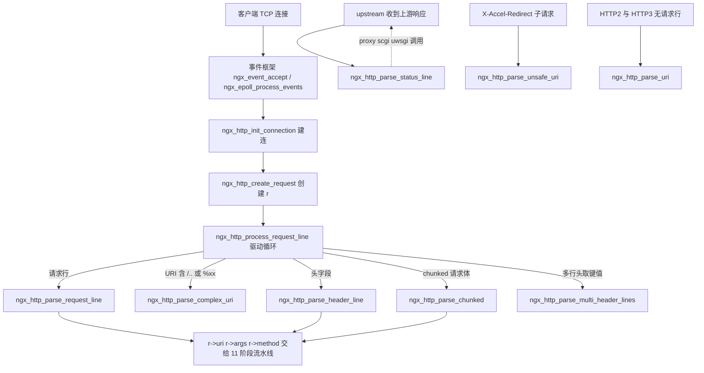
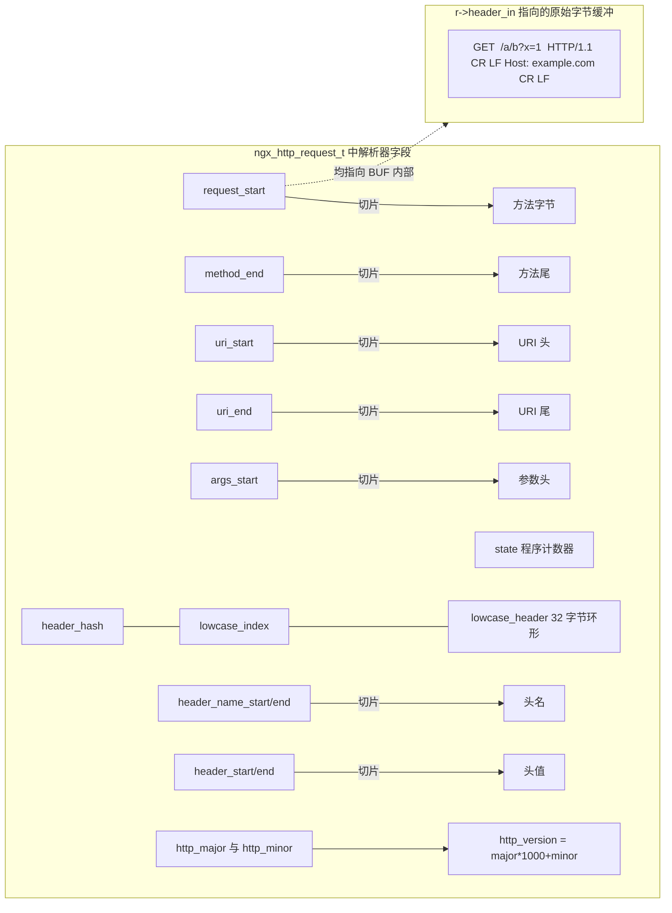
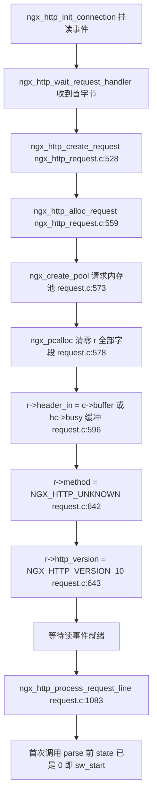
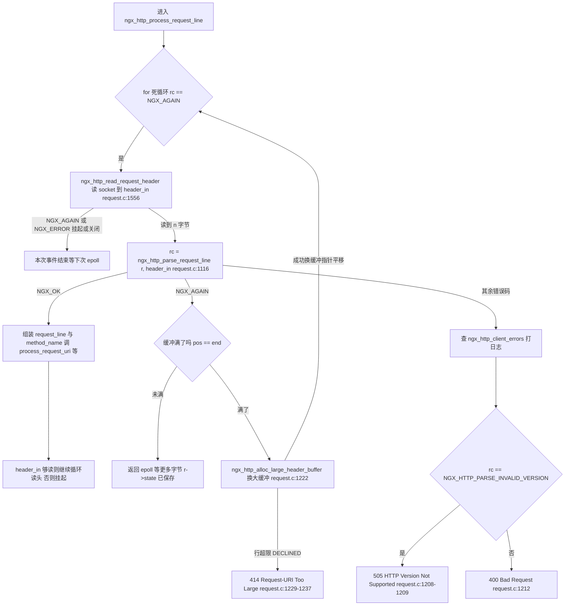
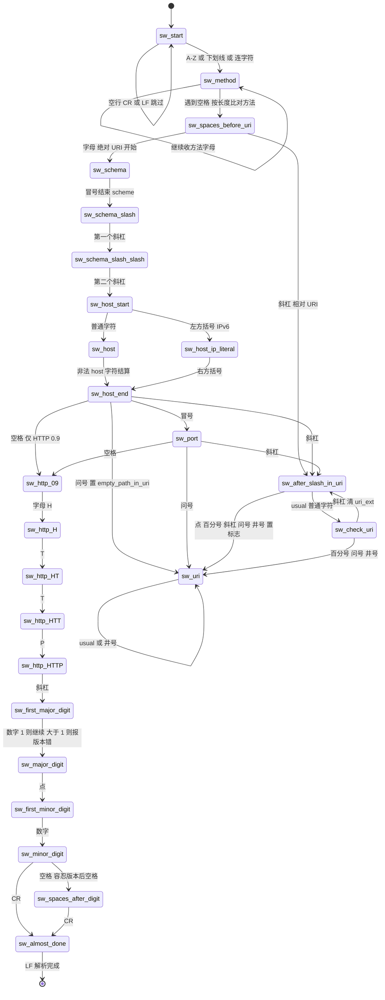
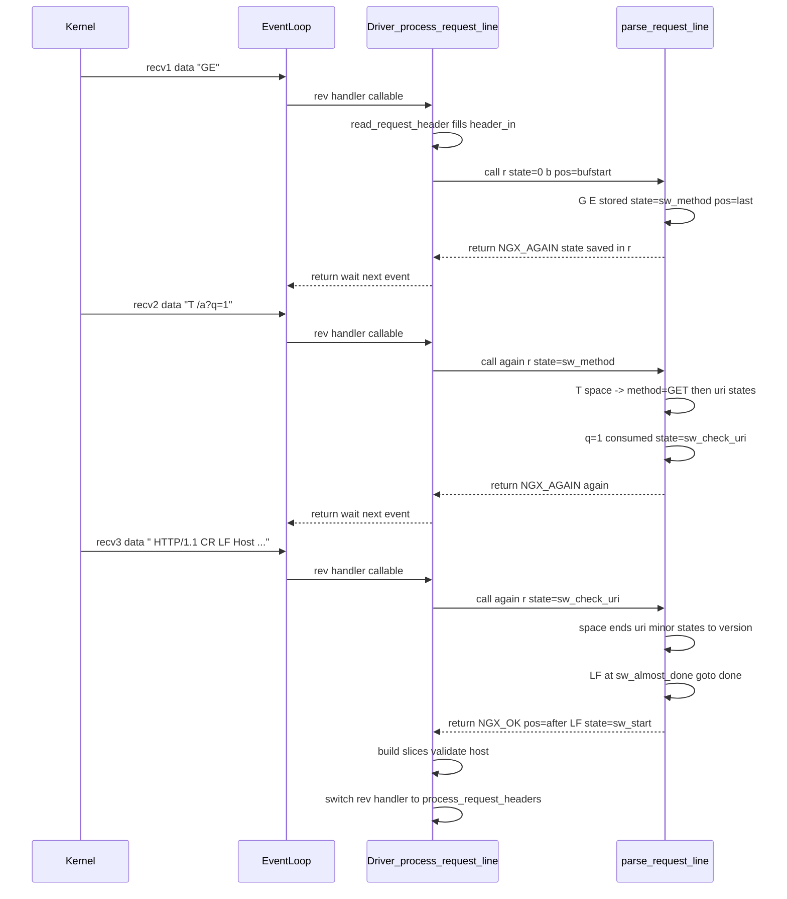
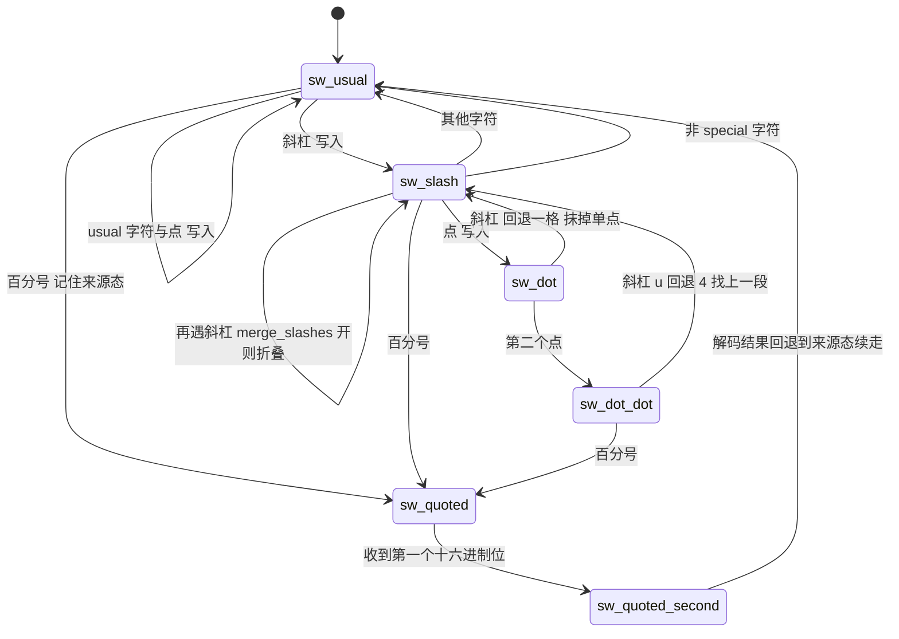
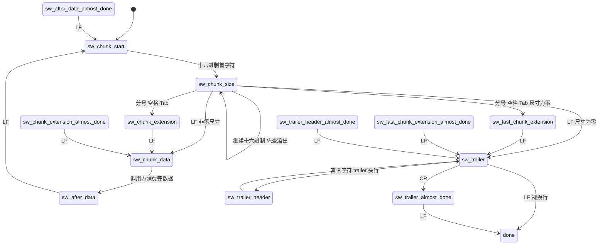

# HTTP 解析器（手写 DFA）（基于 nginx-1.27.0 源码）

> **导读**：读完本文你将掌握——
> 1. nginx 为什么把 HTTP 协议解析做成"手写 DFA"，而不是 flex/bison 或正则；
> 2. `ngx_http_parse_request_line` 的 24 个状态如何逐字节推进，状态如何存进 `r->state` 从而在 TCP 分包之间"续跑"；
> 3. `ngx_http_parse_header_line` 里"状态机 + hash 同步推进"的技巧，以及 `lowcase_header[32]` 环形截断的巧思；
> 4. `ngx_http_parse_complex_uri` 如何用 6 个状态在原地完成 `../` 归约、`//` 折叠与 `%xx` 解码，并在越界瞬间拒绝请求；
> 5. `ngx_http_parse_chunked` 的 13 个状态（含 trailer）如何服务"无限长"的 chunked 请求体；
> 6. 四种畸形请求（超长 URI、非法版本、坏 chunk、伪造 Host）在源码中的确切走向。
>
> **前置阅读建议**：先了解 `ngx_buf_t` 的 `pos/last/start/end` 四指针模型、`ngx_pool_t` 内存池、`ngx_connection_t` 事件驱动模型。若未读过，建议按 `src/core/ngx_buf.h`、`src/core/ngx_palloc.c`、`src/event/ngx_event_accept.c` 的顺序扫一遍。
>
> **涉及源码清单**（本目录先列出其中文件，再列关键文件）：
>
> | 文件 | 本文用途 |
> | --- | --- |
> | `src/http/ngx_http_parse.c`（2406 行） | 全部解析器实现，第 6 节逐段精读 |
> | `src/http/ngx_http_request.h`（623 行） | `ngx_http_request_t` 中解析器字段 |
> | `src/http/ngx_http.h` | `ngx_http_chunked_t`、`ngx_http_status_t` 定义与函数原型 |
> | `src/http/ngx_http_request.c` | 解析器的唯一"驱动方"：读缓冲、分发返回值、扩缓冲 |
> | `src/http/ngx_http_request_body.c` | chunked 请求体的消费循环 |
> | `src/http/modules/ngx_http_proxy_module.c` | upstream 状态行解析的调用方 |
> | `src/core/ngx_hash.h` | `ngx_hash()` 宏 |
> | `src/http/ngx_http_core_module.c` | 相关配置指令声明与默认值 |

---

## 1. 本模块在 nginx 中的位置与职责

`src/http/ngx_http_parse.c` 是 nginx HTTP 子系统最底层的"字节级协议解码器"。它不持有任何连接、定时器或套接字，只做一件事：**接收一个 `ngx_buf_t` 输入缓冲和一个"进度便签"，输出解析结果或"数据不够"**。它的全部对外接口在 `src/http/ngx_http.h:101-120` 声明，共 11 个函数：

- `ngx_http_parse_request_line`：解析请求行（method/URI/版本）；
- `ngx_http_parse_header_line`：逐行解析请求/响应头；
- `ngx_http_parse_uri` / `ngx_http_parse_complex_uri`：URI 预扫描与复杂 URI 归一化；
- `ngx_http_parse_status_line`：解析 upstream 响应状态行；
- `ngx_http_parse_unsafe_uri`：X-Accel-Redirect 的安全校验；
- `ngx_http_parse_multi_header_lines` / `ngx_http_parse_set_cookie_lines`：在多行头里找键值；
- `ngx_http_arg` / `ngx_http_split_args`：查询串取值与切分；
- `ngx_http_parse_chunked`：chunked 传输编码解码。



**图解**：解析器位于"事件框架"与"HTTP 业务流水线"之间，是一条纯函数式的窄腰。所有箭头都是单向调用：驱动方（`ngx_http_request.c` 一族）负责"喂字节、看返回值"，解析器只负责"吞字节、改状态、写指针"。正因如此，同一套解析器同时服务于服务端请求（request_line/header_line/chunked）、客户端响应（status_line）以及 HTTP/2、HTTP/3 网关路径（`v2/ngx_http_v2.c:3351` 与 `v3/ngx_http_v3_request.c:820` 直接复用 `ngx_http_parse_uri` 做 URI 特征扫描）。

---

## 2. 核心数据结构精讲

### 2.1 `ngx_http_request_t` 中解析器专用的字段（`src/http/ngx_http_request.h`）

解析器是"无锁无对象"的：它把全部进度塞进请求结构体 `ngx_http_request_s`（`ngx_http_request.h:378-604`）的几个字段里。逐字段列表：

| 字段 | 类型 | 声明位置 | 语义 |
| --- | --- | --- | --- |
| `state` | `ngx_uint_t` | `ngx_http_request.h:574` | **解析器的程序计数器**。当前解析函数的 `sw_*` 枚举值，跨包续跑的关键 |
| `header_hash` | `ngx_uint_t` | `ngx_http_request.h:576` | 头名字的 31 进制 hash，随字符同步推进 |
| `lowcase_index` | `ngx_uint_t` | `ngx_http_request.h:577` | `lowcase_header` 中已写字符数（模 32 环形回卷） |
| `lowcase_header[32]` | `u_char[]` | `ngx_http_request.h:578` | 头名前 32 字节的小写副本，长度 `NGX_HTTP_LC_HEADER_LEN`（`ngx_http_request.h:15-16`） |
| `header_name_start/end` | `u_char *` | `ngx_http_request.h:580-581` | 头名切片（指向 `header_in` 缓冲内部） |
| `header_start/end` | `u_char *` | `ngx_http_request.h:582-583` | 头值切片 |
| `uri_start/uri_end` | `u_char *` | `ngx_http_request.h:590-591` | 请求行中 URI 的起止 |
| `uri_ext` | `u_char *` | `ngx_http_request.h:592` | 扩展名起点（最后一个 `.` 后一位），遇 `/` 置 NULL |
| `args_start` | `u_char *` | `ngx_http_request.h:593` | `?` 后一位 |
| `request_start/request_end` | `u_char *` | `ngx_http_request.h:594-595` | 整条请求行起止 |
| `method_end` | `u_char *` | `ngx_http_request.h:596` | method 最后一个字符 |
| `schema_start/schema_end` | `u_char *` | `ngx_http_request.h:597-598` | 绝对 URI 的 scheme 切片 |
| `host_start/host_end` | `u_char *` | `ngx_http_request.h:599-600` | 请求行内嵌 host 切片 |
| `http_major/http_minor` | `unsigned:16` 位域 | `ngx_http_request.h:602-603` | 版本号，解析完合成 `http_version = major*1000+minor`（`ngx_http_parse.c:804`） |
| `method` | `ngx_uint_t` | `ngx_http_request.h:411` | method 位标志，`NGX_HTTP_GET` 等（`ngx_http_request.h:29-45`） |
| `http_version` | `ngx_uint_t` | `ngx_http_request.h:412` | 9/1000/1001/2000/3000（`ngx_http_request.h:23-27`） |
| `complex_uri` | `unsigned:1` | `ngx_http_request.h:470` | URI 含 `/.`、`//`（Win32 还含 `\`），需要 `complex_uri` 归一化 |
| `quoted_uri` | `unsigned:1` | `ngx_http_request.h:473` | URI 含 `%`，需要解码 |
| `plus_in_uri` | `unsigned:1` | `ngx_http_request.h:476` | URI 含 `+` |
| `empty_path_in_uri` | `unsigned:1` | `ngx_http_request.h:479` | 形如 `http://host?args`，路径为空需补 `/` |
| `invalid_header` | `unsigned:1` | `ngx_http_request.h:481` | 头名含非法字符，配合 `ignore_invalid_headers` 丢弃 |
| `header_in` | `ngx_buf_t *` | `ngx_http_request.h:400` | 所有切片指针指向的原始字节缓冲 |

注意 `state/header_hash/lowcase_index/lowcase_header` 与前面 11 个 `u_char *` 被注释明确分区（`ngx_http_request.h:585-588`）："a memory that can be reused after parsing a request line via ngx_http_ephemeral_t"——请求行解析结束后，从 `uri_start` 到结构体尾部的这段内存（别名 `ngx_http_ephemeral`，`ngx_http_request.h:607-612`）允许被上游/缓存等模块复用，因为请求行阶段的信息此时已转存为 `request_line/uri/args` 等 `ngx_str_t`。

### 2.2 字段关系与内存布局



**图解**：这是一张"零拷贝切片图"——`r` 里没有为 method/URI/头名/头值分配任何字符串内存，全部 `ngx_str_t` 都是 later 阶段由这些指针减法算出 `len`、直接指向 `header_in` 内部的视图（见 `ngx_http_request.c:1122-1130` 处 `request_line` 与 `method_name` 的组装）。唯一例外的拷贝是复杂 URI：归一化前才 `ngx_pnalloc` 一块新缓冲（`ngx_http_request.c:1262`）。`state` 是唯一的"跨包记忆"，其余切片指针在扩缓冲时会整体平移（见 6.11 节）。

### 2.3 `ngx_http_chunked_t` 与 `ngx_http_status_t`

| 结构 | 字段 | 类型 | 语义 | 声明 |
| --- | --- | --- | --- | --- |
| `ngx_http_chunked_t` | `state` | `ngx_uint_t` | chunked 状态机程序计数器 | `ngx_http.h:64-68` |
| | `size` | `off_t` | 当前 chunk 剩余待读字节数 | 同上 |
| | `length` | `off_t` | 预估"为推进到下一节点还需要多少字节" | 同上 |
| `ngx_http_status_t` | `http_version` | `ngx_uint_t` | 上游协议版本 | `ngx_http.h:71-77` |
| | `code` | `ngx_uint_t` | 3 位状态码累积值 | 同上 |
| | `count` | `ngx_uint_t` | 已收到的状态码位数 | 同上 |
| | `start` / `end` | `u_char *` | 状态码文本切片 | 同上 |

`ngx_http_chunked_t` 由请求体消费方按请求分配：`ngx_http_request_body.c:863-866` 在首次读 body 时 `ngx_pcalloc` 之并挂在 `r->request_body->chunked`（`ngx_http_request.h:306`）。`state` 归零（`pcalloc` 语义）即 `sw_chunk_start = 0`，与解析函数的枚举第一个成员对齐——这是所有 nginx 状态机共用的小约定：**枚举首项必须是"初始态"且值为 0，这样 `ngx_pcalloc` 的零初始化就是初始化**。

---

## 3. 初始化流程

解析器没有独立的 `init` 函数；它的"初始化"完全融入请求对象的创建与第一次读事件：



**图解**：三个关键点。其一，`ngx_http_alloc_request` 用 `ngx_pcalloc` 一次性清零整个 `r`（`ngx_http_request.c:578`），因此 `r->state == 0` 天然等于 `sw_start = 0`，`r->header_hash == 0`、`r->lowcase_index == 0`——解析器从不需要显式 reset。其二，`header_in` 的选择照顾了 pipelining：连接上还挂着上一次请求没用完的大头缓冲时直接复用（`ngx_http_request.c:596`）。其三，`method` 与 `http_version` 先给保守默认值（`ngx_http_request.c:642-643`），即使客户端一个字节都没发过来，关闭逻辑也能工作。

请求行解析完成后的衔接见 `ngx_http_process_request_line`（`ngx_http_request.c:1083-1242`）：`NGX_OK` 分支里组装 `request_line/method_name`、调用 `ngx_http_process_request_uri`、校验 host，最后把读事件处理函数切到 `ngx_http_process_request_headers`（`ngx_http_request.c:1195-1196`）。

---

## 4. 核心执行流程/状态机

### 4.1 驱动循环：解析器如何"续跑"

以请求行为例，驱动方与解析器的协作是一个经典的"拉取-推进"循环（`ngx_http_request.c:1106-1238`）：



**图解**：核心契约是——解析函数**每次返回前**要么把 `b->pos` 推进到本次消耗的末尾并保存 `r->state`（`NGX_AGAIN`，`ngx_http_parse.c:791-794`），要么已经消费完整行并复位 `r->state = sw_start`（`NGX_OK`，`ngx_http_parse.c:796-805`）。因此"续跑"不需要驱动方做任何配合：下一次带着同一个 `r`、同一个 `b` 再调一次即可，`for (p = b->pos; ...)` 从 `pos` 精确继续。

### 4.2 请求行状态机全景



**图解**：24 个状态（`ngx_http_parse.c:107-133`）按"method → 绝对/相对 URI 二选一 → host/port → 路径三态（`after_slash/check_uri/uri`）→ 版本"五大段推进。注意三个设计细节：`sw_host_start` 与 `sw_host_end` 之间存在故意的 `fall through`（`ngx_http_parse.c:357-374`）；`sw_after_slash_in_uri/sw_check_uri/sw_uri` 三个状态共享同一张 `usual[]` 位图做快速通道；HTTP/0.9（无版本字段）通过 URI 结束符直接从 `sw_http_09` 系列旁路。

### 4.3 返回值四态语义总表

以 `ngx_http_parse_request_line` 为准（头文件常量见 `ngx_http_request.h:54-63`）：

| 返回值 | 数值 | 触发点 | 驱动方动作 | 最终响应 |
| --- | --- | --- | --- | --- |
| `NGX_AGAIN` | -2 | 扫到 `b->last` 行未完整（`ngx_http_parse.c:791-794`） | 缓冲未满则回 epoll；满则换大缓冲 | 无（等待更多数据） |
| `NGX_OK` | 0 | `done:` 出口，行解析完成（`ngx_http_parse.c:796-811`） | 组装切片、校验 host、切到头解析 | 无（继续流程） |
| `NGX_HTTP_PARSE_INVALID_METHOD` | 10 | 方法含非法字符（`ngx_http_parse.c:150-152、276-278`） | `ngx_http_client_errors[rc - NGX_HTTP_CLIENT_ERROR]` 打日志（`ngx_http_request.c:1205-1206`） | 400 |
| `NGX_HTTP_PARSE_INVALID_REQUEST` | 11 | URI/分隔符/行尾不合法 | 同上 | 400 |
| `NGX_HTTP_PARSE_INVALID_VERSION` | 12 | 主版本大于 1（`ngx_http_parse.c:702-704、722-724`） | 同上但走专门分支（`ngx_http_request.c:1208-1209`） | **505** |
| `NGX_HTTP_PARSE_INVALID_09_METHOD` | 13 | HTTP/0.9 但方法不是 GET（`ngx_http_parse.c:807-809`） | 同上 | 400 |
| `NGX_HTTP_PARSE_HEADER_DONE` | 1 | 仅 `header_line`：整个头以 CRLF 结束（`ngx_http_parse.c:1084-1089`） | 调 `ngx_http_process_request_header` 后进入业务（`ngx_http_request.c:1512-1532`） | 无 |

这四态正是 nginx "错误即状态码" 风格的典型：**正常流只有 `AGAIN/OK` 两态，错误全部编码为大于 `NGX_HTTP_CLIENT_ERROR`（=10）的正数**，驱动方用同一行数组下标换算得到日志文案（`ngx_http_request.c:61-74`）。

---

## 5. 关键时序图

场景：请求行 `GET /a?q=1 HTTP/1.1\r\n` 被拆成 3 次 `recv` 到达，观察 `r->state` 如何跨越两次"数据断流"。



**图解**：三次调用之间没有任何"外部账本"——全部进度都在两处：`r->state`（程序计数器）与 `b->pos`（字节消费点）。第二次进入时 `for (p = b->pos; p < b->last; p++)`（`ngx_http_parse.c:137`）恰好从上次断点续推；这就是"跨包续跑"的全部实现。请求行完成后 `r->state` 复位为 `sw_start`（`ngx_http_parse.c:805`），同一连接上的 pipelined 下一个请求、以及后续头解析，都从 0 开始，互不污染。

需要强调：`NGX_AGAIN` 返回时 `b->pos = p` 指向**第一个未解析字节**，而 `header_in->last` 指向已收到数据的末尾——驱动方 `ngx_http_read_request_header` 用 `last - pos > 0` 判断"缓冲里还有存货"就不必再读 socket（`ngx_http_request.c:1567-1571`）。

---

## 6. 源码逐段精读（篇幅主体）

本章按函数逐一精读 `src/http/ngx_http_parse.c`（全文 2406 行），每节给出签名、逐块逻辑、关键行号与易错点。

### 6.1 预备知识：三件基础设施

**(1) `usual[]` 位图（`ngx_http_parse.c:13-33`）**

```c
static uint32_t  usual[] = {
    0x00000000, /* 0000 0000 ... 0000 */
    0x7fff37d6, /* ?>=< ;:98 7654 3210  /.-, +*)( '&%$ #"!  */
    ...
```

这是 256 个 ASCII 字符的"是否为 URI 常规字符"查找表，每个 `uint32_t` 覆盖 32 个字符，判定表达式是：

```c
usual[ch >> 5] & (1U << (ch & 0x1f))
```

（该表达式在 `ngx_http_parse.c:480、540、604` 等 9 处出现。）解码这张表：`0x00-0x1f` 全 0（控制字符不合法）；空格 `0x20` 为 0（它是行结束符）；`"`、`#`、`%`、`/`、`<`、`>`、`?` 为 0（它们各自有专门状态处理）；字母数字与 `-._~!$&'()*+,;=:@` 为 1；**`0x80-0xff` 全 1**（`ngx_http_parse.c:29-32`），因此 UTF-8 字节可以直接落在路径里而无需转义。Win32 分支下 `0x5c`（反斜杠）被排除出 usual（`ngx_http_parse.c:20-24`），交给专门的 `\\` 状态处理。

**(2) 一次比较多个字节的 `ngx_strNcmp` 宏（`ngx_http_parse.c:36-98`）**

小端且允许非对齐访问时，`ngx_str3_cmp(m,'G','E','T',' ')` 展开为 `*(uint32_t *) m == ('T'<<24|'E'<<16|'G'<<8|' ')`——**用一条 4 字节 load 完成三字符比较**；`ngx_str5cmp` 等更长的宏则用 4 字节整型比较再补 1-2 个字节比较。`ngx_str3Ocmp`（"0 字节省略"版，`ngx_http_parse.c:41-42、73-74`）利用已知首字母跳过 `m[0]` 的比较，用在 method 分支里。平台不支持时退化为逐字节链（`ngx_http_parse.c:70-97`）。

**(3) 状态外置与恢复（`ngx_http_parse.c:107-135、791-794`）**

```c
    state = r->state;          /* 135: 从请求对象恢复程序计数器 */
    for (p = b->pos; p < b->last; p++) { ... }
    b->pos = p;                /* 791: 记录消费点 */
    r->state = state;          /* 792: 保存程序计数器 */
    return NGX_AGAIN;          /* 794 */
```

`sw_*` 枚举是函数局部类型，但**值**保存在 `r->state` 里。注意一个隐蔽约定：`sw_start = 0` 必须是枚举第一项，因为 `r->state == 0` 被驱动方用作"当前没有解析到一半的行"的判据（`ngx_http_request.c:1626-1645`，大缓冲分配的快路径判断）。

### 6.2 `ngx_http_parse_request_line`：24 个状态逐个精讲

**签名**（`ngx_http_parse.c:103-104`）：

```c
ngx_int_t
ngx_http_parse_request_line(ngx_http_request_t *r, ngx_buf_t *b)
```

**`sw_start`（143-155）**：记录 `r->request_start = p`——请求行起点在此定格。裸 CR/LF 被静默跳过（146-148，容忍客户端发送前导空行），其余非大写字母/`_`/`-` 直接 `return NGX_HTTP_PARSE_INVALID_METHOD`（150-152）。

**`sw_method`（157-280）**：收到空格才结算方法。`r->method_end = p - 1`（159），随后按**长度**分发（162）：

- 长度 3：`GET`/`PUT`（164-175）；
- 长度 4：先看 `m[1] == 'O'` 分成 POST/COPY/MOVE/LOCK 与 HEAD 两组（177-208）；
- 长度 5-9：MKCOL/PATCH/TRACE、DELETE/UNLOCK、OPTIONS/CONNECT、PROPFIND、PROPPATCH；
- 未命中任何分支时 `r->method` 保持 `NGX_HTTP_UNKNOWN`，**不报错**——这是有意设计：nginx 不在解析层限制方法名，交由后续模块处理（未知方法会被 11 阶段判定）。

继续收到非空格时仍需校验字符合法性（276-278），所以 `GET+ /` 也会得到 400。

**`sw_spaces_before_uri`（283-304）**：跳过若干空格后，`/` 开头走相对路径（285-288），字母（`ch | 0x20` 小写化后落在 `a-z`）走绝对 URI 的 scheme（291-296），其余空格继续吞，其他任何字符报 11 号错。

**`sw_schema`（306-326）**：scheme 字符集是 `字母 0-9 + - .`（RFC 3986），遇 `:` 结算 `r->schema_end`（318-322）。

**`sw_schema_slash`/`sw_schema_slash_slash`（328-346）**：严格匹配 `//`，任何偏差报 11 号错。

**`sw_host_start`/`sw_host`/`sw_host_end`（348-404）**：

```c
        case sw_host_start:
            r->host_start = p;          /* 350 */
            if (ch == '[') {
                state = sw_host_ip_literal;   /* IPv6 字面量 */
                break;
            }
            state = sw_host;
            /* fall through */
        case sw_host:
            c = (u_char) (ch | 0x20);
            if (c >= 'a' && c <= 'z') break;
            if ((ch >= '0' && ch <= '9') || ch == '.' || ch == '-') break;
            /* fall through */
        case sw_host_end:
            r->host_end = p;            /* 376 */
            switch (ch) {
            case ':': state = sw_port; break;
            case '/': r->uri_start = p; state = sw_after_slash_in_uri; break;
            case '?': r->uri_start = p; r->args_start = p + 1;
                      r->empty_path_in_uri = 1; state = sw_uri; break;
            case ' ':
                r->uri_start = r->schema_end + 1;   /* 397 */
                r->uri_end = r->schema_end + 2;
                state = sw_http_09;
```

两个关键技巧：一是**双 fall through**——`sw_host` 收满合法字符后"坠落"进 `sw_host_end` 结算当前字符，省去重复代码；二是 `http://host` 后无路径（紧跟空格或 `?`）时，把 `uri_start/uri_end` 指向 scheme 后的两个字符即字符串 `"/"`（393-398、464-470），**借用原缓冲里的一个 `/` 保住指针有效性**，注释原文解释了原因：请求行将来若被拷进大缓冲，指针平移逻辑需要 `uri_start` 指向真实内存。同时置 `empty_path_in_uri = 1`（389、460），后续 `complex_uri` 解析会补写一个 `/`（`ngx_http_parse.c:1268-1270`）。

**`sw_host_ip_literal`（406-445）**：IPv6 字面量 `[...]` 内允许十六进制、冒号、以及 RFC 3986 的 unreserved 与 sub-delims 字符白名单，`]` 回到 `sw_host_end`。

**`sw_port`（447-475）**：只吞数字；`/`、`?`、空格三种终止符的处理与 `sw_host_end` 完全同构。**注意端口不在这里做数值化**——host 切片整体交给 `ngx_http_validate_host`（`ngx_http_request.c:1150`）处理，端口随后由它截断（`ngx_http_request.c:2175-2180`）。

**`sw_after_slash_in_uri`/`sw_check_uri`/`sw_uri`（477-631）**：路径三态。三者第一行都是 usual 位图快通道（480、540、604）——绝大多数路径字节在这里一次判断后直接前进。差异在"特殊字符"：

| 字符 | `after_slash_in_uri` | `check_uri` | `uri` |
| --- | --- | --- | --- |
| `.` | `complex_uri=1`，进 `sw_uri`（499-501） | `uri_ext = p+1`（556-558） | 忽略（usual 位图已吞） |
| `/` | `complex_uri=1`，进 `sw_uri`（507-510） | `uri_ext=NULL`，回 `after_slash`（545-555） | 吞掉 |
| `%` | `quoted_uri=1`，进 `sw_uri`（503-506） | `quoted_uri=1`，进 `sw_uri`（578-581） | 吞掉 |
| `?` | `args_start=p+1`，进 `sw_uri`（517-520） | 同左（582-585） | 吞掉 |
| `#` | `complex_uri=1`，进 `sw_uri`（521-524） | 同左（586-589） | `complex_uri=1`（622-624） |
| `+` | `plus_in_uri=1`，原地（525-527） | 同左（590-592） | 同左 |
| CR/LF | 置 `http_minor=9`，按 0.9 收尾（490-498） | 同左（563-571） | 同左（613-621） |
| `ch < 0x20` 或 `0x7f` | 400（528-531） | 400（593-596） | 400（625-629） |

`uri_ext` 的语义在 `check_uri` 里：`./foo` 之后每遇一个 `.` 就把扩展名起点改写为下一位，遇 `/` 清空——最终只保留**最后一个路径段**的扩展名。为什么 `/x./y` 要特判 `r->uri_ext == p`（546-552，Win32 only）：`x.` 后紧跟 `/` 时扩展名候选恰好停在分隔符上，需要转入复杂 URI 处理。这三个状态的产出是三个位标志（`complex_uri/quoted_uri/plus_in_uri`），它们决定 6.5 节的归一化是否必要。

**版本段（634-777）**：`sw_http_09` 允许"URI 后直接空格+CR/LF"（无版本，`http_minor=9`），也允许 `" HTTP/1.1"`——遇到 `H` 时顺手记录 `r->http_protocol.data = p`（645-648），供日志变量 `$request` 之外的 `http_protocol` 切片使用。之后是 4 个机械状态 `sw_http_H/HT/HTT/HTTP`（654-692）逐一比对字面量。

版本数字规则值得细读（695-763）：

- `sw_first_major_digit`：`ch < '1' || ch > '9'` 报 11 号错；**`ch > '1'` 报 12 号错**（696-704）——所以 `HTTP/2.0` 在第一个字符就被判"版本不支持"，而不是"请求非法"。
- `sw_major_digit`：允许继续累积数字，但 `r->http_major > 1` 即报 12 号错（720-724）——`HTTP/10` 被拒绝。
- `sw_first_minor_digit`：只收一个数字（729-736）。
- `sw_minor_digit`：**先检查 `r->http_minor > 99` 再累加**（758-762），因此次版本最多积累到 3 位（如 `HTTP/1.100` 合法且 `http_version=1100`），第 4 位才会触发 11 号错。这是"检查-累加"顺序导致的上界，而非刻意的三位数版本号设计，读源码时容易误解为笔误——它确实是宽松上界。
- 版本后允许出现空格（`sw_spaces_after_digit`，765-777），容忍 `HTTP/1.1 \r\n` 这类实现。

**`sw_almost_done` 与 `done:` 出口（780-811）**：

```c
        case sw_almost_done:
            r->request_end = p - 1;      /* 781: CR 前一位 */
            switch (ch) {
            case LF: goto done;
            default: return NGX_HTTP_PARSE_INVALID_REQUEST;
            }
    ...
done:
    b->pos = p + 1;                      /* 798: 越过 LF */
    if (r->request_end == NULL) r->request_end = p;   /* 800-801: 裸 LF 行 */
    r->http_version = r->http_major * 1000 + r->http_minor;  /* 804 */
    r->state = sw_start;                 /* 805: 复位 */
    if (r->http_version == 9 && r->method != NGX_HTTP_GET) {
        return NGX_HTTP_PARSE_INVALID_09_METHOD;      /* 807-809 */
    }
    return NGX_OK;
```

`NGX_HTTP_PARSE_INVALID_09_METHOD` 是唯一在"成功出口"上返回的错误码：HTTP/0.9 没有响应头概念，只能 GET，所以非 GET 的 0.9 请求在最后一刻被拒（对应日志 "client sent invalid method in HTTP/0.9 request"，`ngx_http_request.c:73`）。

**逐字节追踪示例**：以 `GET /a?q=1 HTTP/1.1\r\n` 为输入，走一遍完整推进（行号均为 `ngx_http_parse.c`）：

| 输入字节 | 进入时 state | 动作与副作用 | 离开时 state |
| --- | --- | --- | --- |
| `G` | sw_start | `request_start=p`（144） | sw_method |
| `E` `T` | sw_method | 无（276-278 校验通过） | sw_method |
| ` ` | sw_method | `method_end=p-1`；长度 3 命中 `ngx_str3_cmp(m,'G','E','T',' ')` → `method=NGX_HTTP_GET`（159-167） | sw_spaces_before_uri |
| ` ` | sw_spaces_before_uri | 忽略（299-300） | sw_spaces_before_uri |
| `/` | sw_spaces_before_uri | `uri_start=p`（286） | sw_after_slash_in_uri |
| `a` | sw_after_slash_in_uri | usual 位图命中（480-482） | sw_check_uri |
| `?` | sw_check_uri | `args_start=p+1`（582-585） | sw_uri |
| `q` `=` `1` | sw_uri | usual 吞掉（604-606） | sw_uri |
| ` ` | sw_uri | `uri_end=p`（609-611） | sw_http_09 |
| `H` | sw_http_09 | `http_protocol.data=p`（645-647） | sw_http_H |
| `T` `T` `P` | sw_http_H/HT/HTT | 逐字符比对（654-682） | sw_http_HTTP |
| `/` | sw_http_HTTP | （686-687） | sw_first_major_digit |
| `1` | sw_first_major_digit | `http_major=1`，`1 > 1` 不成立（700-704） | sw_major_digit |
| `.` | sw_major_digit | （711-713） | sw_first_minor_digit |
| `1` | sw_first_minor_digit | `http_minor=1`（734-735） | sw_minor_digit |
| `\r` | sw_minor_digit | （740-741） | sw_almost_done |
| `\n` | sw_almost_done | `goto done`：`request_end=p-1`、`b->pos=p+1`、`http_version=1001`、`state=sw_start`、返回 `NGX_OK`（781-811） | —— |

这张表揭示了两个"性价比"来源：`usual` 快通道把 17 个路径字节里的大多数压成一次位运算；真正的分支开销集中在 6 个特殊字节上。

**易错点小结**：`sw_start` 的 CR/LF 跳过意味着 `\r\nGET ...` 合法；`sw_minor_digit` 的 `>99` 是先判后加；method 未识别不是错误；`http_version==9` 时驱动方直接进业务流程跳过头解析（`ngx_http_request.c:1171-1182`）。

### 6.3 `ngx_http_parse_header_line`：状态与 hash 双轨推进

**签名**（`ngx_http_parse.c:815-817`）：

```c
ngx_int_t
ngx_http_parse_header_line(ngx_http_request_t *r, ngx_buf_t *b,
    ngx_uint_t allow_underscores)
```

**核心数据（834-846）**：函数内有一张 256 字节的静态表 `lowcase[]`——大写字母映射为小写，数字与 `-` 映射为自身，其余全 0。进入时三件"外置寄存器"一并恢复：`state = r->state; hash = r->header_hash; i = r->lowcase_index;`（844-846）。

**hash 推进技巧**：`sw_name` 里每收到一个合法字符：

```c
        case sw_name:
            c = lowcase[ch];
            if (c) {
                hash = ngx_hash(hash, c);              /* 912 */
                r->lowcase_header[i++] = c;            /* 913 */
                i &= (NGX_HTTP_LC_HEADER_LEN - 1);     /* 914: 环形回卷 */
                break;
            }
```

`ngx_hash(key,c)` 就是 `key * 31 + c`（`src/core/ngx_hash.h:114`）——与静态编译期头表（`ngx_http_headers_in[]` 建 hash 表）的 key 算法一致，于是**头名还没读完，它的 hash 已经算好**。驱动方拿到 `NGX_OK` 后直接 `h->hash = r->header_hash` 塞进 `ngx_table_elt_t`，再 `ngx_hash_find(&cmcf->headers_in_hash, h->hash, h->lowcase_key, h->key.len)` 一次命中处理器（`ngx_http_request.c:1475-1499`）——省掉一次 `ngx_hash_key` 全量计算。`i &= 31` 让 `lowcase_header[32]` 成为环形缓冲：**超过 32 字节的超长头名（如长 JWT 的自定义头）不会溢出，只是哈希与小写副本被截断**；此时 `h->key.len != r->lowcase_index`，驱动方走 `ngx_strlow` 全量小写化兜底（`ngx_http_request.c:1491-1496`）。`allow_underscores` 控制下划线头（`X_Forwarded_For` 这类）是否参与 hash：默认拒绝时仅置 `invalid_header`（878-891），头仍入列表但哈希为 0，无法命中任何已注册头。

**状态逐个讲**：

- `sw_start`（854-905）：CR → `sw_header_almost_done`（这是**头块结束符**），LF → 直接 `header_done`；普通字符进入 `sw_name` 并顺带做首字符 hash 初始化；`ch <= 0x20 || ch == 0x7f || ch == ':'` 报 `NGX_HTTP_PARSE_INVALID_HEADER`（893-896）——**注意这意味着"值折行（obs-fold）"不可能被支持：续行以空格开头，`sw_start` 遇空格立即判非法**。nginx 对 RFC 7230 obs-fold 的回答就是 400。
- `sw_name`（908-969）：遇 `:` 结算 `header_name_end`；CR/LF 是"无值的头"（如 `Foo:\r\n`），直接 `done`；另有一个彩蛋：`ch == '/'` 且已收 4 字符 `HTTP` 且当前在 upstream 语境时进入 `sw_ignore_line`（952-960），注释写明是"IIS may send the duplicate HTTP/1.1 ... lines"——IIS 偶尔把状态行重复发送为头，nginx 选择整行丢弃而非报错。
- `sw_space_before_value`/`sw_value`/`sw_space_after_value`（972-1032）：值内空格结束值并进入 `space_after_value`，但那里再遇非空格字符会**回到 `sw_value`**（1028-1030）——所以值内多段空格被原样保留（如 `User-Agent: foo  bar`），头值切片是"去首尾空格"语义。
- `sw_ignore_line`（1035-1043）：吞到 LF 回 `sw_start`。
- `sw_almost_done`（1046-1055）：行级 CR 后只允许 LF，**但也允许连续 CR**（1050-1051 `case CR: break`）——`Foo: v\r\r\n` 合法，这是对畸形 CRLF 的最小容忍。
- `sw_header_almost_done`（1058-1064）：整个头块的 CR LF 序列，`LF` 即 `header_done`。

**三个出口**（1068-1089）：

```c
    /* NGX_AGAIN 出口 */
    b->pos = p; r->state = state;
    r->header_hash = hash; r->lowcase_index = i;    /* 1068-1073 */
    return NGX_AGAIN;

done:                       /* 单行完成 */
    b->pos = p + 1; r->state = sw_start;
    r->header_hash = hash; r->lowcase_index = i;    /* 1075-1082 */
    return NGX_OK;

header_done:                /* 头块完成 */
    b->pos = p + 1; r->state = sw_start;            /* 1084-1089 */
    return NGX_HTTP_PARSE_HEADER_DONE;
```

细节：`done` 出口**保存** hash 供驱动方取用；`header_done` 出口不复位 hash（下一请求会从 `sw_start` 重新初始化，无碍）。`NGX_AGAIN` 时 hash 与 `lowcase_index` 必须一起保存，否则跨包续跑会算出不同的哈希——这正是"状态+hash 同时推进"的完整含义：**两者都是跨包状态，缺一不可**。

**逐字节追踪示例**：以 `Host: a.com\r\n` 为输入（行号均为 `ngx_http_parse.c`）：

| 输入字节 | 进入时 state | 动作与副作用 | 离开时 state |
| --- | --- | --- | --- |
| `H` | sw_start | `header_name_start=p`；`lowcase['H']='h'` → `hash=ngx_hash(0,'h')=104`、`lowcase_header[0]='h'`、`i=1`（855-875） | sw_name |
| `o` `s` `t` | sw_name | `hash=ngx_hash(hash,c)`、`lowcase_header[i++]`：'h'=104 → "ho"=104×31+111=3335 → "hos"=103500 → "host"=3208616；`i` 随写随 `&=31`（909-915） | sw_name |
| `:` | sw_name | `header_name_end=p`（931-934） | sw_space_before_value |
| ` ` | sw_space_before_value | 忽略（974-975） | sw_space_before_value |
| `a` `.` `c` `o` `m` | sw_space_before_value → sw_value | 首字符置 `header_start=p`（988-991），其余吞掉 | sw_value |
| `\r` | sw_value | `header_end=p`（1002-1004） | sw_almost_done |
| `\n` | sw_almost_done | `goto done`：`b->pos=p+1`、`state=sw_start`、回写 `header_hash=3208616`、返回 `NGX_OK`（1075-1082） | —— |

此时驱动方拿到 `hash=3208616` 后与静态注册表比对：`headers_in_hash` 里 `host` 键正是用同一 `ngx_hash` 递推算出的 key，于是 `ngx_hash_find` 一次命中 `ngx_http_process_host` 处理器（`ngx_http_request.c:1475-1499`），全程没有第二次全量哈希。

**非法头触发点一览**（均返回 `NGX_HTTP_PARSE_INVALID_HEADER`）：

| 场景 | 触发行 | 说明 |
| --- | --- | --- |
| 头首字符为控制字符/空格/`:` | 893-896 | `sw_start`，含 obs-fold 续行的空格 |
| 头名中途出现控制字符/空格 | 962-964 | `sw_name`，注意空格而不是 `:` 意味着畸形行 |
| 头值出现 NUL | 985-987、1009-1011、1025-1027 | 三处值态都拒绝内嵌 NUL |

**折行小结**：nginx 头解析器没有 obs-fold 状态；唯一的"折行"行为是 `sw_almost_done` 容忍多余 CR。上游响应解析（6.6 节）同样如此。

### 6.4 `ngx_http_parse_uri`：HTTP/2、HTTP/3 的 URI 预扫描

**签名**（`ngx_http_parse.c:1093-1094`）：`ngx_http_parse_uri(ngx_http_request_t *r)`——注意它**不收 `ngx_buf_t`**，直接扫 `r->uri_start..r->uri_end`（1106），因为 HTTP/2/3 路径上 URI 已由 HPACK/QPACK 解出。状态机是 `sw_after_slash_in_uri/sw_check_uri/sw_uri` 三态的简化重演（1097-1102），产出与请求行路径段完全相同的三个标志位与 `uri_ext/args_start`（1121-1236），差异只有两点：起始状态必须是 `/` 否则 `NGX_ERROR`（1112-1116）；非法字符判定是 `ch <= 0x20 || ch == 0x7f`（1160、1212、1231，含空格本身，因为没有空格终止符语义）。调用点：`src/http/v2/ngx_http_v2.c:3351` 与 `src/http/v3/ngx_http_v3_request.c:820`。

### 6.5 `ngx_http_parse_complex_uri`：路径归一化与防穿越

**签名**（`ngx_http_parse.c:1244-1245`）：

```c
ngx_int_t
ngx_http_parse_complex_uri(ngx_http_request_t *r, ngx_uint_t merge_slashes)
```

调用点在 `ngx_http_process_request_uri`：仅当 `complex_uri || quoted_uri || empty_path_in_uri` 时才调用，且**先分配新缓冲**（`ngx_http_request.c:1256-1270`）。双指针推进：`p` 从 `uri_start` 读原始字节，`u` 往 `r->uri.data` 写归一化结果（1263-1264）——**输出永远不长于输入**（`../` 归约、`//` 折叠、`%xx` 三字节变一字节都只缩短），所以无需边界检查写指针。循环条件 `while (p <= r->uri_end)` 配合 `ch = *p++`（1272-1274），注释解释了为何读到 `uri_end+1` 也安全：URI 后必有 LF。

**六个状态**：



**`sw_usual`（1287-1354）**：usual 字符直接 `*u++ = ch`。`%` 时记下 `quoted_state = state`（1333-1335）——**解码完成后回到哪个状态继续走**，这是处理 `%2F`（解码成 `/` 却不当分隔符，见下）的关键。`?` 直接 `goto args`（1336-1338），`#` 直接 `goto done`（1339-1340，fragment 在服务端一律丢弃），`.` 记 `uri_ext = u+1`（1341-1344，注意记的是**输出**指针）。

**`sw_slash`（1356-1398）**：又一个 `/` 时看 `merge_slashes` 参数（调用方传 `cscf->merge_slashes`，`ngx_http_request.c:1270`；默认 on，`ngx_http_core_module.c:3507`）——开启则**不写入**（折叠），关闭则原样保留（1370-1374）。

**`sw_dot`（1400-1442）**：`/a/./b` 的单点。遇 `/` 或（Win32）`\` 时 `u--` **把刚写的点抹掉**再回 `sw_slash`（1413-1416）——原地删除，没有任何 memcpy。

**`sw_dot_dot`（1444-1494）**：核心防穿越代码：

```c
            case '/':
            case '?':
            case '#':
                u -= 4;                       /* 1460: 撤销 "/..x" 的写入 */
                for ( ;; ) {
                    if (u < r->uri.data) {
                        return NGX_HTTP_PARSE_INVALID_REQUEST;  /* 1463 */
                    }
                    if (*u == '/') { u++; break; }              /* 1465-1467 */
                    u--;
                }
```

`u -= 4` 回退掉本轮已写的一个字符与上一步的 `..`（连同前面的 `/`），然后**向左扫描找上一个 `/`**：找到则把写指针落在它后面（该段被弹栈）；一路扫过开头（`u < r->uri.data`）说明没有可弹的上级段——`/a/../..` 这类请求在**解析瞬间**就被判非法，根本不会进文件系统。这就是"防路径穿越判定"的全部：它不依赖 `realpath`，也不依赖 OS 返回错误，而是把 URI 视作段栈在 DFA 里同步归约。

**`sw_quoted`/`sw_quoted_second`（1496-1552）**：十六进制解码。两个特殊分支决定解码结果的"身份"：

- 解码结果为 `%` 或 `#` 时：`state = sw_usual` 并**直接写入**（1520-1524）——`%25` 得到字面 `%`、`%23` 得到字面 `#`，它们**不再触发** `/`、`?`、`#` 的控制语义（防止 `%23` 被当作 fragment 二次截断）。
- 解码结果为 `?` 时：同样写为普通字符（1538-1543）——`/a%3Fb` 是文件名 `a?b` 而不是 `args=b`。
- 解码结果为 NUL：`NGX_HTTP_PARSE_INVALID_REQUEST`（1526-1527）。
- 其他解码结果：`state = quoted_state`（1530、1548）——**回到进入解码前的状态**。于是 `%2F` 解码成 `/` 后按 `quoted_state`（比如 `sw_usual`）被当普通字符写入，**不会**被当成路径分隔符；这正是 nginx 拒绝 `/foo%2F..%2Fbar` 穿越绕过的机制：`..` 的归约只认**原始斜杠**，`%2F` 永远是文件名的一部分。

**尾部与 args（1556-1616）**：循环以非 `sw_usual` 结束时补做归约——`sw_dot` 收尾 `u--`（1560-1561），`sw_dot_dot` 收尾执行与 1460-1470 相同的弹栈（1563-1578）；`sw_quoted/second` 收尾说明 `%` 或半截十六进制悬空，报错（1556-1558）。`done:` 处结算 `r->uri.len` 与扩展名（1580-1591）；`args:` 段扫描剩余字节寻找 `#` 以截断 args（1593-1605）。

**双指针逐字节追踪示例**：输入 `/a/./b/../c?x=1`（`merge_slashes=on`），观察 `p`（读）与 `u`（写）的推进，行号均为 `ngx_http_parse.c`：

| 输入字节 | 进入时 state | `u` 缓冲内容（写侧） | 动作 | 离开时 state |
| --- | --- | --- | --- | --- |
| `/` | sw_usual | `/` | `uri_ext=NULL`；`state=sw_slash`；`*u++='/'`（1328-1331） | sw_slash |
| `a` | sw_slash | `/a` | usual → `state=sw_usual`；写入（1358-1362） | sw_usual |
| `/` | sw_usual | `/a/` | 同第 1 步（1320-1331） | sw_slash |
| `.` | sw_slash | `/a/.` | `state=sw_dot`；写入（1375-1378） | sw_dot |
| `/` | sw_dot | `/a/` | `u--` 抹掉单点；`state=sw_slash`（1413-1416） | sw_slash |
| `b` | sw_slash | `/a/b` | usual → sw_usual；写入 | sw_usual |
| `/` | sw_usual | `/a/b/` | → sw_slash | sw_slash |
| `.` | sw_slash | `/a/b/.` | → sw_dot | sw_dot |
| `.` | sw_dot | `/a/b/..` | `state=sw_dot_dot`；写入（1417-1420） | sw_dot_dot |
| `/` | sw_dot_dot | `/a/` | `u-=4` 回到指向 `b`；向左扫到 `/` 后 `u++` 落在 `/a/` 尾（1460-1470）；`state=sw_slash` | sw_slash |
| `c` | sw_slash | `/a/c` | usual → 写入 | sw_usual |
| `?` | sw_usual | `/a/c` | `args_start=p`；`goto args`（1336-1338） | —— |

最终 `done:/args:` 段把 `r->uri.len` 定为 4（`/a/c`），args 段扫到末尾无 `#`，`args=x=1`（1593-1616）。整条链没有一次 `memcpy`——单点删除是 `u--`，段弹栈是写指针回退。

**易错点小结**：`merge_slashes=off` 时 `//` 原样保留但 `complex_uri` 流程照走；`r->uri_ext` 在 done 出口被置 NULL（1589）因为 `exten` 已固化；空路径（`http://host?x`）靠 `empty_path_in_uri` 先补一个 `/`（1268-1270）。

### 6.6 `ngx_http_parse_status_line`：upstream 响应行

**签名**（`ngx_http_parse.c:1620-1622`）：`ngx_http_parse_status_line(ngx_http_request_t *r, ngx_buf_t *b, ngx_http_status_t *status)`。与请求行版本同构的 `"HTTP/"` 逐字符状态（1650-1698），版本数字规则更宽松（major/minor 都允许两位累积，1701-1754），核心是状态码收集（1757-1773）：

```c
        case sw_status:
            if (ch == ' ') break;                 /* 容忍 200  与 200  */
            if (ch < '0' || ch > '9') return NGX_ERROR;
            status->code = status->code * 10 + (ch - '0');
            if (++status->count == 3) {
                state = sw_space_after_status;
                status->start = p - 2;            /* 状态码文本起点 */
            }
```

`sw_space_after_status` 里有一个兼容彩蛋：`.` 也被接受（1781，注释 "IIS may send 403.1, 403.2, etc"）——IIS 会发 `HTTP/1.1 403.1 Forbidden`，nginx 把 `403.1` 整体当作"状态码+文本"处理。`done:` 出口把 `status->http_version` 合成（1831）并复位 `r->state`（1832）。**错误返回是 `NGX_ERROR` 而非 `NGX_HTTP_PARSE_*`**，因为这是"我们自己是客户端"的语境。

调用方 `ngx_http_proxy_process_header` 之前的 `ngx_http_proxy_process_status_line`（`src/http/modules/ngx_http_proxy_module.c:1817-1852`）展示了容错策略：`NGX_ERROR` 时不立刻断链，而是**降级为 HTTP/0.9 语义**（`r->http_version = NGX_HTTP_VERSION_9`、`u->state->status = NGX_HTTP_OK`、置 `connection_close`），把后续字节当纯 body——这就是 nginx 反代一个"裸文本"后端也能工作的原因。`uwsgi/scgi` 模块同样调用此函数（`modules/ngx_http_scgi_module.c:1024`、`modules/ngx_http_uwsgi_module.c:1252`）。

### 6.7 `ngx_http_parse_chunked`：13 个状态与 trailer

**签名**（`ngx_http_parse.c:2141-2143`）：`ngx_http_parse_chunked(ngx_http_request_t *r, ngx_buf_t *b, ngx_http_chunked_t *ctx)`。进度三件套（`state/size/length`）全部外置于 ctx（见 2.3 节）。入口有一个"快速接续"：上次已处于数据态且 `size` 已减到 0 时直接跳 `sw_after_data`（2165-2167）。

**尺寸状态（2180-2251）**：`sw_chunk_start` 收第一个十六进制位（大写字母靠 `ch | 0x20` 归一，2187-2192）；`sw_chunk_size` 持续 `size = size*16 + digit`，**每次累加前先查溢出**（2198-2200，`NGX_MAX_OFF_T_VALUE / 16`），杜绝整型溢出攻击。`size == 0` 的分支是"最后一块"的分水岭（2214-2233）：CR/LF 进 trailer 流程，`;`/空格/Tab 进 `sw_last_chunk_extension`；非零 size 的对应分支则是普通 chunk（2235-2249）。

**扩展与数据（2253-2292）**：chunk extension（`5a; ext=val`）被整段跳过——extension 状态里除 CR/LF 外一律吞掉，nginx 不解析 extension 内容。`sw_chunk_data` 是唯一"向调用方交还控制权"的状态：`rc = NGX_OK; goto data;`（2270-2272），**由调用方消费 chunk 数据后**再次进入本函数继续走 `sw_after_data`。数据后的 CRLF 校验（2274-2292）保证 chunk 边界严格。

**trailer 状态组（2294-2344）**：`sw_trailer` 遇 CR/LF 之外的字符说明有 trailer 头行，进入 `sw_trailer_header` 吞行（2329-2337），行间用 `sw_trailer_header_almost_done` 校验 LF（2339-2344），最后 `sw_trailer` 的裸 LF 即 `goto done`（2316-2317）。trailer 头**并不进入 `headers_in`**——请求体模块只在 `expect_trailers` 场景另行收集（见 `ngx_http_request.h:536`），本函数只负责跳过它们。

**length 预估（2349-2394）**：`NGX_AGAIN` 返回前，按当前状态估算"推进到下一个可消费点还差多少字节"写进 `ctx->length`——例如 `sw_chunk_data` 态给 `size + 4`（"LF 0 LF LF"的尾巴，2372-2374）。调用方用它设置下次 want-read 的目标（`ngx_http_request_body.c:901-909`：`r->headers_in.content_length_n = ngx_max(rb->chunked->length, large_client_header_buffers.size)`），避免为半块数据反复进 epoll。函数尾部还有一道保险：`ctx->size > NGX_MAX_OFF_T_VALUE - 5` 时判非法（2354-2356）。

**状态图**：



（`done` 对应 `NGX_DONE` 出口，`ngx_http_parse.c:2396-2401`：`ctx->state = 0` 复位、`b->pos = pos + 1`；任何非法字节走 `invalid:` 返回 `NGX_ERROR`，2403-2405。）

**逐字节追踪示例**：body 为 `5\r\nhello\r\n0\r\n\r\n`（行号均为 `ngx_http_parse.c`）：

| 输入字节 | 进入时 state | 动作与副作用 | 离开时 state | 返回 |
| --- | --- | --- | --- | --- |
| `5` | sw_chunk_start | `ctx->size=5`（2181-2184） | sw_chunk_size | —— |
| `\r` | sw_chunk_size | size 非 0 → （2236-2237） | sw_chunk_extension_almost_done | —— |
| `\n` | sw_chunk_extension_almost_done | （2264-2266） | sw_chunk_data | —— |
| `h`（数据首字节） | sw_chunk_data | `rc=NGX_OK; goto data`（2270-2272） | sw_chunk_data | `NGX_OK` |
| （调用方消费 `hello` 5 字节，`size` 减到 0） | —— | `b->pos` 前移 5（`ngx_http_request_body.c:879-888`） | —— | —— |
| `\r` | sw_after_data（入口快速接续，2165-2167） | （2276-2277） | sw_after_data_almost_done | —— |
| `\n` | sw_after_data_almost_done | （2288-2290） | sw_chunk_start | —— |
| `0` | sw_chunk_start | `size=0` | sw_chunk_size | —— |
| `\r` | sw_chunk_size | `size==0` 分支 → 最后一块（2214-2219） | sw_last_chunk_extension_almost_done | —— |
| `\n` | sw_last_chunk_extension_almost_done | （2304-2307） | sw_trailer | —— |
| `\r` | sw_trailer | （2313-2314） | sw_trailer_almost_done | —— |
| `\n` | sw_trailer_almost_done | `goto done`：`ctx->state=0`、`b->pos=p+1`（2396-2401） | —— | `NGX_DONE` |

注意第二步：数据消费并不在本函数循环里发生——`sw_chunk_data` 态一进入就带 `NGX_OK` 跳出，把"切多少字节"的决定权交给调用方；本函数下次被调时靠入口的 `sw_chunk_data && size==0` 快速接续（2165-2167）直接落在 `sw_after_data`。这一设计让"解析"与"数据搬运"解耦，也是 `length` 预估机制（2358-2392）能独立成立的前提。

**调用方契约**（`ngx_http_request_body.c:871-918`）：`NGX_OK` → 按 `ctx->size` 从 `b->pos` 切走一块（875-890）；`NGX_DONE` → `content_length_n = 0`，body 读完（893-899）；`NGX_AGAIN` → 按 length 设水位后挂起（901-910）；`NGX_ERROR` → 日志 "client sent invalid chunked body" 并 `NGX_HTTP_BAD_REQUEST`（912-917）。

### 6.8 `ngx_http_parse_unsafe_uri`：X-Accel-Redirect 的安全闸

**签名**（`ngx_http_parse.c:1838-1840`）。它不是状态机而是**两遍扫描**：第一遍在原始 URI 上找 `?` 切 args（1873-1879）、拒绝空串/`?`开头/`..`开头/NUL（1850-1857、1881-1883）与 `/../` 段（1885-1894）；含 `%` 时（1897）用 `ngx_unescape_uri` 解码到新缓冲后**再扫一遍**（1926-1944）——`%2E%2E%2F` 这类编码穿越在解码后第二遍被拦截。命中 `NGX_HTTP_LOG_UNSAFE` 标志时打 "unsafe URI was detected"（1949-1956）。调用方是 `ngx_http_upstream.c` 的 X-Accel-Redirect 处理与 `ngx_http_core_module` 的内部跳转。

### 6.9 `ngx_http_parse_multi_header_lines` / `ngx_http_parse_set_cookie_lines`

**签名**（`ngx_http_parse.c:1960-1962、2030-2032`）。两者都遍历 `ngx_table_elt_t` 链表（`h = headers; h; h = h->next`，1967），在**头值内部**按 `;`/`,` 分段查找 `name`（大小写无关，`ngx_strncasecmp`，1981）。三个分支语义：

- `value == NULL`：只判存在性——匹配名后跳过空格，若到达末尾或遇 `,` 即命中（1989-1995）。
- `value != NULL`：要求 `name` 后必须紧跟 `=`（1997-2000），值取到 `;` 为止（2004-2011）。
- `skip:` 标签（2013-2022）：吞到下一个 `;` 或 `,`，跳过空格后重试下一段——同一头值里 `a=1; b=2; c=3` 能各自定位。

`ngx_http_parse_set_cookie_lines`（2030-2075）是 Set-Cookie 特化版：不做段内循环（Set-Cookie 无逗号分隔多值），只匹配**值开头**的 `name=`（2049-2060）。

**实例走读**：`Cookie: session=abc; theme=dark; lang=zh`，查询 `name="theme"`、`value` 非空（行号均为 `ngx_http_parse.c`）：

1. 外层取到该 `ngx_table_elt_t`，`name->len(5) > h->value.len` 不成立，进入内层 while（1972-1979）；
2. `ngx_strncasecmp("session=abc...", "theme", 5) != 0` → `goto skip`（1981-1983）：`skip:` 循环吞到 `;`（2013-2020），再吞空格（2022），`start` 落在 `theme=dark; ...`；
3. 第二轮 `ngx_strncasecmp` 命中 → `start += 5` 指向 `=dark; ...`，跳过空格（1985-1987）；
4. `value != NULL` 分支：`*start++` 必须是 `=`（1997-2000），命中后再跳空格，`last` 扫到 `;`（2004-2006）；
5. `value->len = 4`、`value->data` 指向 `dark`，返回该表项指针（2008-2011）——`value` 仍是 `h->value` 内部的零拷贝切片。

若查询 `value == NULL`（只判存在），第 4 步替换为：匹配名后只要 `start == end || *start == ','` 即命中返回（1989-1995），例如判 `Cache-Control` 里是否出现 `no-cache`。

调用点勾勒出它们的用途：`$cookie_xxx` 变量（`src/http/ngx_http_variables.c:1081`）、gzip 判定 Cache-Control 的 no-cache/no-store/private（`src/http/ngx_http_core_module.c:2126-2142`）、`$upstream_http_set_cookie` 变量（`src/http/ngx_http_upstream.c:5950`）、userid 模块取 uid cookie（`src/http/modules/ngx_http_userid_filter_module.c:341`）。

### 6.10 `ngx_http_arg` / `ngx_http_split_args`

`ngx_http_arg`（2078-2117）在 `r->args` 里定位 `name=` 并切出值：用 `ngx_strlcasestrn` 找名字，**但要求名字前是 `&` 或参数串开头、后紧跟 `=`**（2100），防止 `token=1` 匹配到 `subtoken=1`；值取到 `&` 或末尾。`ngx_http_split_args`（2120-2138）简单切 `?`。两者是给模块作者的高层工具，与 DFA 无关，但共用零拷贝切片风格。

### 6.11 调用方协作机制：大缓冲与指针重定位

解析器能"续跑"的前提是**切片指针与数据始终同生共死**。当一行跨包太长、缓冲耗尽时，`ngx_http_alloc_large_header_buffer`（`ngx_http_request.c:1613-1778`）负责搬家：

- `r->state == 0`（没有解析到一半的行）时只需换新缓冲，零拷贝（1626-1634、1686-1696）；
- 否则从 `request_start`（请求行）或 `header_name_start`（头行）起，把半行字节 `memcpy` 到新缓冲（1707-1709），再把**所有**已发出的切片指针逐一按差值平移（1714-1773）——请求行场景迁 10 个指针，头行场景迁 4 个；
- 缓冲池来自 `hc->free/hc->busy` 链，数量上限即 `large_client_header_buffers num`（1647-1680）。

超限的两种结局：请求行超限 → 414（`ngx_http_request.c:1229-1237`，日志 "client sent too long URI"）；头行超限 → 494 `NGX_HTTP_REQUEST_HEADER_TOO_LARGE`（1410-1436，置 `lingering_close` 以读完残余数据）。

### 6.12 `ngx_http_validate_host`：Host 字段的最后一道闸

解析器把请求行内嵌 host 切片后（`host_start/host_end`），驱动方调用 `ngx_http_validate_host`（`ngx_http_request.c:2145-2233`）做语义校验：连续两个点拒绝（2168-2171）、路径分隔符拒绝（2197-2199）、控制字符拒绝（2201-2203）、末尾单点剥掉（2213-2215）、空 host 拒绝（2217-2219），含大写时重新分配小写副本（2221-2228）。失败返回 `NGX_DECLINED` → 驱动方打日志 "client sent invalid host in request line" 并 400（`ngx_http_request.c:1152-1156`）；成功后经 `ngx_http_set_virtual_server` 选定 server 块（1164）。HTTP/1.1 请求缺 Host 头同样 400（`ngx_http_request.c:1973-1978`）。

---

## 7. 设计思想与权衡

**为什么手写 DFA 而不用 flex/bison/正则？** 五点论证：

1. **可中断性是硬需求**。HTTP 消息按 TCP 字节流到达，任意两个字节之间都可能断流。`flex/bison` 生成的解析器把状态藏在生成的 `yy_state` 变量里，虽也能续跑，但 nginx 需要的是"**单字节粒度**"的重入：`r->state` 一个 `ngx_uint_t` 存下全部进度，配合 `b->pos` 保存/恢复，代码直观、行为可预测。正则引擎（PCRE 或 RE2）则根本无法跨输入块暂停匹配。
2. **零拷贝是硬需求**。DFA 逐字节扫过原缓冲，靠"记住起点指针、终点自然产生"的方式切片（method/URI/头名/头值全是 `header_in` 内部指针视图）。传统 parser 工具按 token 产字符串，必然引入拷贝或二次定位。6.5 节的复杂 URI 更是"读写双指针原地归一化"，用编译器之外的方式很难表达。
3. **性能可控**。`switch` 状态机被主流编译器编译为跳转表（源码注释自证：`ngx_http_parse.c:101` "gcc, icc, msvc and others compile these switches as an jump table"）；每个字节 O(1) 推进，无回溯、无 NFA 指数爆炸风险。`usual[]` 位图把 90% 的普通字符压缩成一条 AND 指令。
4. **错误路径精确可控**。11 号与 12 号错的区分（400 vs 505）、0.9 非 GET 的特判、IIS 兼容特例（952-960、1781）——这些"带业务判断的错误"用生成器表达会非常别扭。安全上，nginx 的哲学是**任何未明确允许即拒绝**：控制字符、NUL、越界 `../` 全部在解析层击杀，不留给下游。
5. **无依赖**。nginx 自身依赖极少，HTTP 解析不引入 flex 运行时/bison 表能保持二进制精简，也便于交叉编译到嵌入式平台。

**代价与局限**：状态机代码可读性低于声明式文法（24+8+13 个状态需靠命名与注释维系）；新增协议特性需手改所有相关状态（例如 `empty_path_in_uri` 同时涉及 `sw_host_end` 与 `sw_port` 两处）；头名只保留前 32 字节的小写副本与 hash（`ngx_http_request.h:16`），超长头名靠驱动方兜底重算；obs-fold 折行直接不支持。这些都是**以开发效率换运行时确定性**的明确取舍。

**状态外置的附带收益**：pipelining 复用同一 `r->state` 槽位即可串联多个请求；`state == 0` 成为"行间空闲"哨兵，驱动方借此区分"需要搬家的半行"与"可以整块丢弃的行间空隙"（`ngx_http_request.c:1626-1634`）。

---

## 8. 配置项与调优映射

解析器行为本身不可配置（协议即协议），但驱动方的"弹药供给"由下列指令控制（声明于 `src/http/ngx_http_core_module.c`）：

| 指令 | 默认值 | 声明与默认值行号 | 作用于 |
| --- | --- | --- | --- |
| `client_header_buffer_size` | 1024 | 声明 `core:241-247`，默认 `core:3491-3492` | 首个 `header_in` 缓冲大小；大多数请求在此一次装下请求行+全部头 |
| `large_client_header_buffers` | `4 8k` | 声明 `core:248-254`，默认 `core:3493-3496` | 半行搬家（6.11 节）的目标缓冲：个数 × 大小；**单行长度上限由此决定** |
| `ignore_invalid_headers` | on | 声明 `core:255-261`，默认 `core:3504-3505` | `invalid_header` 头是否静默丢弃（`ngx_http_request.c:1456-1465`） |
| `underscores_in_headers` | off | 声明 `core:269-274`，默认 `core:3509-3510` | 传入 `ngx_http_parse_header_line` 的 `allow_underscores` 参数（`ngx_http_request.c:1449-1450`） |
| `merge_slashes` | on | 声明 `core:262-268`，默认 `core:3507` | 传入 `ngx_http_parse_complex_uri` 的第二参数（`ngx_http_request.c:1270`），控制 `//` 折叠 |
| `chunked_transfer_encoding` | on | 声明 `core:652-657`，默认 `core:3897-3898` | 响应方向是否可用 chunked；请求方向恒按 RFC 接受 chunked |
| `client_header_timeout` | 60s | 使用点 `ngx_http_request.c:1582-1583` | 半行悬停的死刑定时器（配合 `NGX_AGAIN` 挂起） |

调优要点：

- 突发 400/414 且日志出现 "client sent too long URI" → 调大 `large_client_header_buffers` 的 size；出现 "client sent too long header line" → 同上并关注 num。
- 反代长 Cookie/长 JWT 场景，`client_header_buffer_size` 从 1k 提到 4k-8k 可让绝大多数请求免于二次分配。
- `underscores_in_headers on` 会让下划线头参与 hash（`ngx_http_parse.c:878-886` 的 else 分支不再置 `invalid_header`）。
- `merge_slashes off` 后 `//a//b` 保持原样，正则 location 的匹配结果会变化——它改变的是 `r->uri`，不改变 `unparsed_uri`（`ngx_http_request.c:1283-1284`）。

---

## 9. 自测题

**Q1：`r->state` 为什么能支撑"跨包续跑"？驱动方需要在两次调用之间做些什么？**
答：`ngx_http_parse_request_line` 进入时 `state = r->state`（`ngx_http_parse.c:135`），退出 `NGX_AGAIN` 前把 `b->pos = p` 与 `r->state = state` 写回（791-794）。驱动方只需保证下次调用时 `b->pos`/`b->last` 反映最新缓冲（必要时先 `ngx_http_read_request_header` 再读入）即可，无需其他配合（`ngx_http_request.c:1106-1116`）。

**Q2：`GET /x HTTP/2.0` 与 `GET /x HTTP/1.100` 分别返回什么？为什么？**
答：前者在 `sw_first_major_digit` 因 `2 > 1` 返回 `NGX_HTTP_PARSE_INVALID_VERSION`（695-704），驱动方回 505；后者合法：minor 采用"先判 `>99` 再累加"（758-762），三位以内不触发，`http_version = 1100`。

**Q3：头名 hash 是在头名读完之前就算好的，靠什么保证跨包后 hash 不变？**
答：`hash` 与 `lowcase_index` 与 `state` 一样是外置状态，`NGX_AGAIN` 出口三者一起保存（`ngx_http_parse.c:1068-1073`），`done` 出口也回写（1079-1080）。`ngx_hash` 是 `key*31+c` 的增量计算（`ngx_hash.h:114`），顺序与分批无关。

**Q4：`lowcase_header[32]` 装不下 40 字节的头名会怎样？**
答：`i &= 31` 环形回卷（913-914），不越界、不报错；但 `h->key.len != r->lowcase_index`，驱动方改用 `ngx_strlow` 全量小写化（`ngx_http_request.c:1491-1496`），hash 则取截断版仍能命中（截断只影响 `ngx_hash_find` 的 key 前缀一致性——实际该头若注册名超 32 字节本就无法命中）。

**Q5：`/a/../../etc/passwd` 在 `ngx_http_parse_complex_uri` 里的结局？`/a/%2E%2E/b` 呢？**
答：前者在第二个 `../` 归约时向左扫不到 `/`，`u < r->uri.data` 成立，返回 `NGX_HTTP_PARSE_INVALID_REQUEST`（1460-1470），驱动方 400（`ngx_http_request.c:1270-1277`）。后者 `%2E` 解码为 `.` 后按 `quoted_state` 当普通字符写入（1520-1531），形成字面路径 `/a/../b`——**注意此时它作为普通文本进入 `r->uri`，不再被归约**，因为 `..` 归约只发生在解析期对原始字节的扫描中。

**Q6：为什么 `%2F` 解码后的 `/` 不会当作路径分隔符？**
答：解码完成时 `state = quoted_state`（1530、1548），即回到进入 `sw_quoted` 之前的状态；在那个状态里 `/` 只会被当作普通字符写进输出（若 `quoted_state` 是 `sw_usual`）。真正的分隔符语义只属于**原始未编码**的 `/`。

**Q7：chunked 解码的 `NGX_OK/NGX_DONE/NGX_AGAIN/NGX_ERROR` 各代表什么？调用方如何消费？**
答：`NGX_OK`=到达一个数据块边界，调用方按 `ctx->size` 切走数据（`ngx_http_request_body.c:875-890`）；`NGX_DONE`=最后一块与 trailer 全部完成（2396-2401）；`NGX_AGAIN`=数据不足，`ctx->length` 告知水位（2349-2394、901-909）；`NGX_ERROR`=字节流不合法，调用方回 400（912-917）。

**Q8：nginx 支持头值 obs-fold 折行吗？依据？**
答：不支持。折行续行以空格/Tab 开头，而 `sw_start` 对 `ch <= 0x20` 直接返回 `NGX_HTTP_PARSE_INVALID_HEADER`（893-896）。唯一容忍的"多余字符"是行尾连续 CR（1050-1051）。

**Q9：超长 URI 的完整走向？**
答：请求行解析返回 `NGX_AGAIN` 且 `pos == end` → `ngx_http_alloc_large_header_buffer(r, 1)`；半行超过 `large_client_header_buffers.size` 返回 `NGX_DECLINED` → 日志 "client sent too long URI" → 414（`ngx_http_request.c:1220-1238`，常量 414 见 `ngx_http_request.h:102`）。头行阶段对应 494（1410-1436）。

**Q10：伪造 Host（请求行内绝对 URI）如何被拦截？**
答：解析器只切出 `host_start/host_end`（`ngx_http_parse.c:348-404`），语义校验交给 `ngx_http_validate_host`：路径分隔符、控制字符、连续点、空 host 均返回 `NGX_DECLINED`（`ngx_http_request.c:2195-2219`），驱动方随即 400（1152-1156）；校验通过的 host 再参与虚拟主机选择（1164-1168）。HTTP/1.1 缺 Host 头同样 400（1973-1978）。

---

**结语**：`ngx_http_parse.c` 是"协议规范被编译成跳转表"的范本——状态即控制流，指针即输出，错误码即 API。理解它的最好方式是拿一个抓包文件对着 `state` 变量单步走一遍：你会发现 2406 行代码里没有一个"聪明的抽象"，却精确覆盖了 RFC 7230 的每一条合法路径与绝大多数攻击路径。
