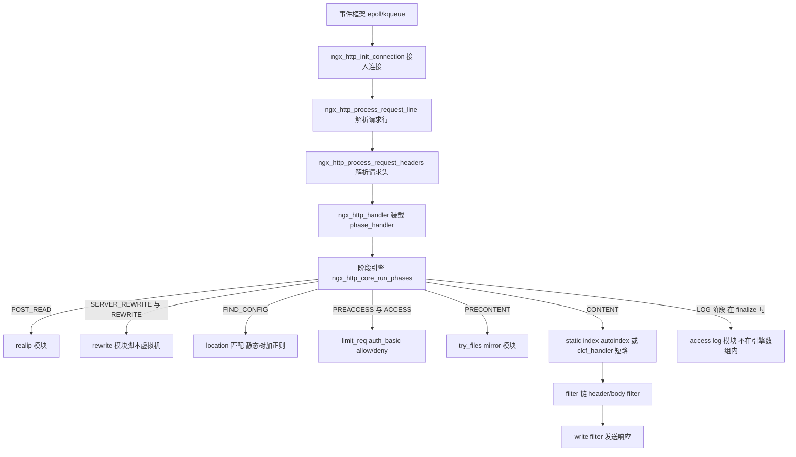
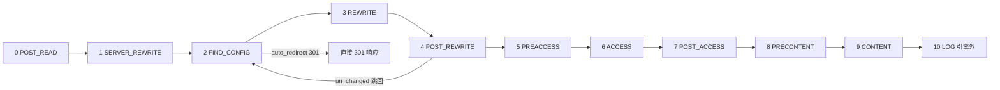
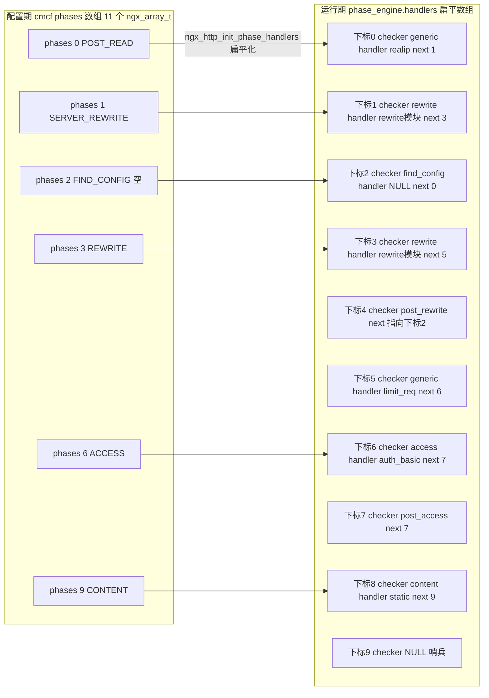
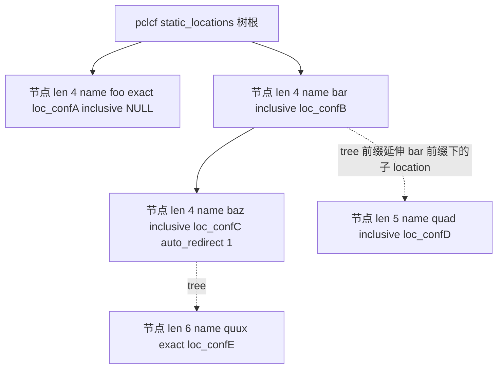
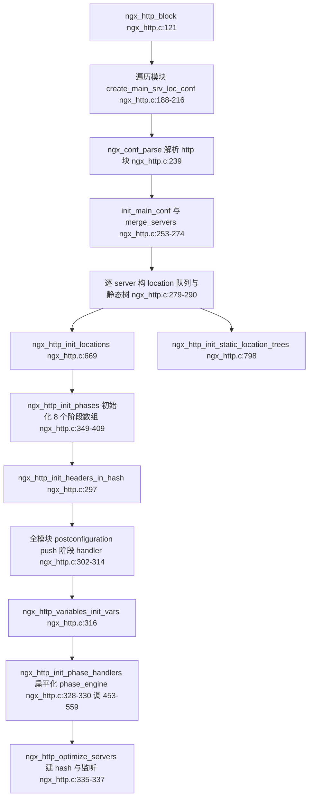
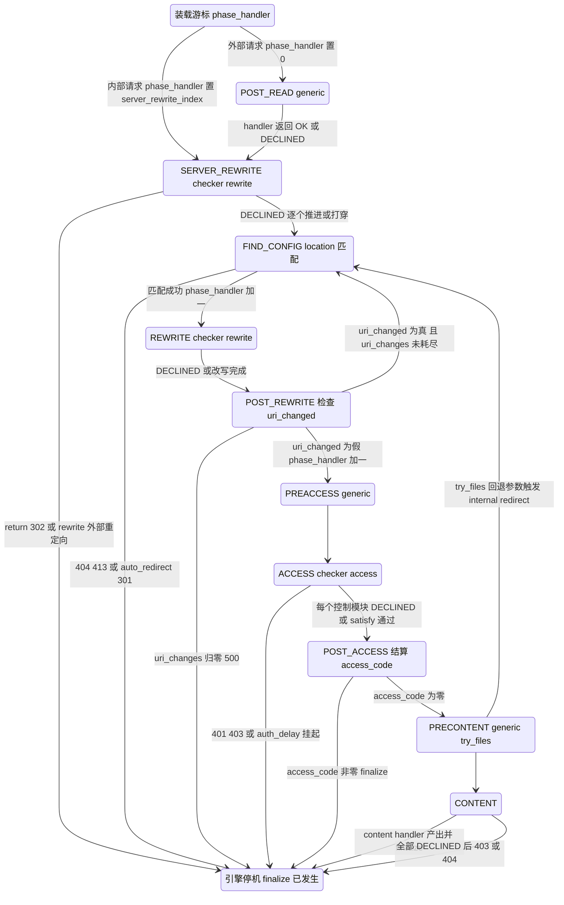
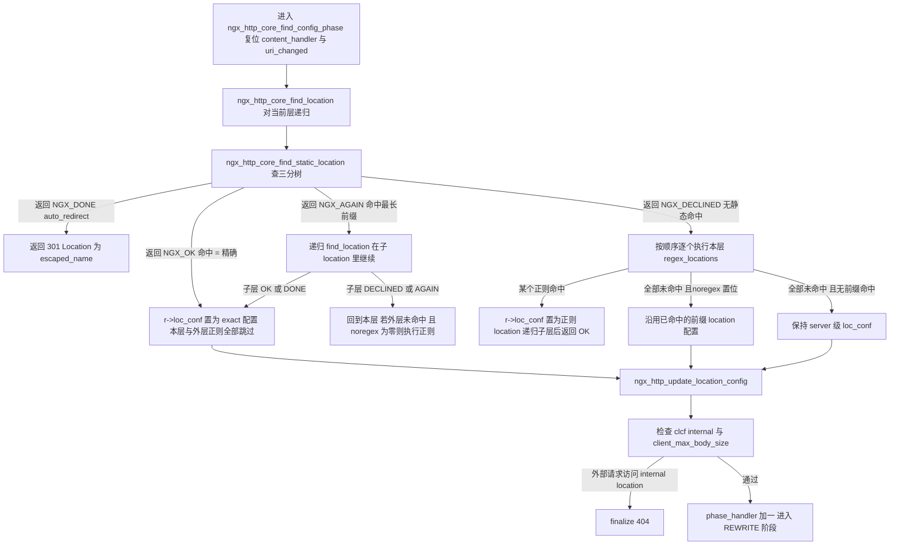
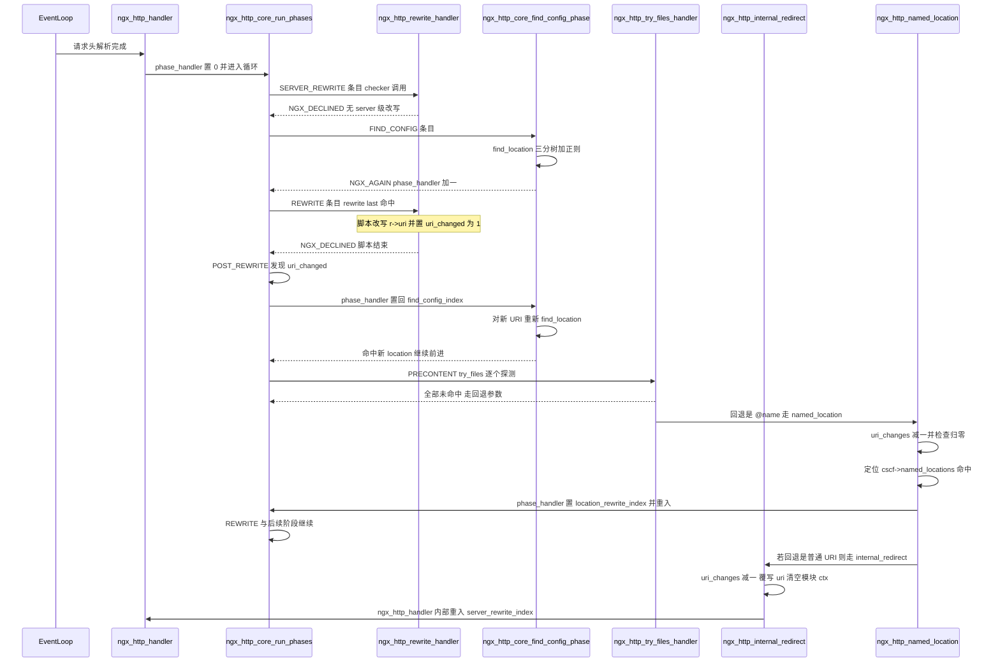

# 11 阶段引擎与 location 匹配（基于 nginx-1.27.0 源码）

> **导读**：读完本文你将掌握——
> 1. nginx HTTP 请求为什么被拆成 11 个 phase，每个 phase 的 checker/handler 二层模型如何工作；
> 2. `ngx_http_init_phase_handlers` 如何把分散在各模块的 handler 扁平化成一张可跳转的函数表（`phase_engine.handlers`），以及 `next` 字段的三种取值语义；
> 3. 三种 checker（generic/access/content）加三个特殊 checker（find_config/post_rewrite/post_access）的逐行推进逻辑差异；
> 4. FIND_CONFIG 阶段背后的静态 location 三分查找树（left/right/tree）状态机与精确/前缀/`^~`/正则的完整优先级回退流程；
> 5. `rewrite`/`return`/`set` 指令如何被编译成脚本虚拟机指令、`uri_changes=10` 如何防循环；
> 6. internal redirect 与 `try_files` 多次跳转的真实调用链；
> 7. CONTENT 阶段的 content handlers 数组与 `clcf->handler` 短路通道的区别。
>
> **前置阅读建议**：先了解 `ngx_http_request_t` 的生命周期与 `ngx_http_finalize_request` 的返回值语义（可参考同系列《HTTP 请求处理主流程》），熟悉 `ngx_array_t`/`ngx_queue_t` 两个基础容器。本文所有行号均来自 nginx-1.27.0 实际源码，均已逐一核对。
>
> **涉及源码清单**：
> - `src/http/ngx_http.c`（2198 行）：`http{}` 块解析收口、阶段数组初始化、phase engine 扁平化、location 队列与静态树构建；
> - `src/http/ngx_http_core_module.c`（5351 行）：全部 checker、`ngx_http_core_run_phases`、location 运行期匹配、internal redirect、named location；
> - `src/http/ngx_http_core_module.h`（592 行）：11 阶段枚举、`ngx_http_phase_handler_t`、`ngx_http_phase_engine_t`、location 树节点结构；
> - `src/http/modules/ngx_http_rewrite_module.c`（1020 行）：rewrite/return/set/if/break 指令与脚本虚拟机接入两个 rewrite 阶段；
> - `src/http/modules/ngx_http_try_files_module.c`（404 行）：`try_files` 在 PRECONTENT 阶段的多次内部跳转实现；
> - 佐证性文件：`src/http/ngx_http_request.h`、`src/http/modules/ngx_http_static_module.c`、`src/http/modules/ngx_http_index_module.c` 等。

---

## 1. 本模块在 nginx 中的位置与职责

### 1.1 架构定位

nginx 的 HTTP 处理可以概括为一条"事件驱动 → 请求解析 → **阶段引擎分发** → content handler 产出 → filter 链输出"的流水线。阶段引擎（phase engine）位于请求解析完成之后、内容产生之前，是整条流水线的调度中枢：它决定一个请求先被谁改写 URI、匹配到哪个 location、被哪些访问控制模块审查、最终由哪个模块生成响应。



**图 1-1 解读**：这张图自上而下是调用纵深，左右分支是阶段引擎在各阶段挂接的典型模块。注意两点：其一，LOG 阶段虽然在枚举里排最后（`ngx_http_core_module.h:127`），但它根本不在 `phase_engine.handlers` 数组里，而是在请求 finalize 时由 `ngx_http_log_request` 单独执行；其二，CONTENT 阶段有两条产出通道——`CONTENT` handlers 数组与 `r->content_handler` 短路指针，第 6 节会展开。

### 1.2 11 阶段总览

阶段枚举定义在 `src/http/ngx_http_core_module.h:109-128`，取值 0 到 10 共 11 个：

```c
typedef enum {
    NGX_HTTP_POST_READ_PHASE = 0,

    NGX_HTTP_SERVER_REWRITE_PHASE,

    NGX_HTTP_FIND_CONFIG_PHASE,
    NGX_HTTP_REWRITE_PHASE,
    NGX_HTTP_POST_REWRITE_PHASE,

    NGX_HTTP_PREACCESS_PHASE,

    NGX_HTTP_ACCESS_PHASE,
    NGX_HTTP_POST_ACCESS_PHASE,

    NGX_HTTP_PRECONTENT_PHASE,

    NGX_HTTP_CONTENT_PHASE,

    NGX_HTTP_LOG_PHASE
} ngx_http_phases;
```

下表是每个阶段的职责、checker 类型与典型模块归属（模块归属均以各模块 `postconfiguration` 中 `ngx_array_push(&cmcf->phases[...].handlers)` 的真实代码为准）：

| # | 阶段 | checker | 职责 | 典型模块（注册代码位置） |
|---|------|---------|------|--------------------------|
| 0 | POST_READ | generic | 请求头刚解析完，尽早读取原始信息 | realip（`ngx_http_realip_module.c:526`） |
| 1 | SERVER_REWRITE | rewrite | server 级 URI 改写/短路 | rewrite（`ngx_http_rewrite_module.c:279-284`） |
| 2 | FIND_CONFIG | find_config | **location 匹配，更新 r->loc_conf** | core 自身，无外部 handler |
| 3 | REWRITE | rewrite | location 级 URI 改写/短路 | rewrite（`ngx_http_rewrite_module.c:286-291`） |
| 4 | POST_REWRITE | post_rewrite | 检测 uri_changed，跳回 FIND_CONFIG | core 自身 |
| 5 | PREACCESS | generic | 预访问控制（限流类） | limit_conn（`:750`）、limit_req（`:1094`）、degradation（`:235`） |
| 6 | ACCESS | access | 访问控制决策 | access（`:455`）、auth_basic（`:389`）、auth_request（`:351`） |
| 7 | POST_ACCESS | post_access | 结算 satisfy 产生的 access_code | core 自身 |
| 8 | PRECONTENT | generic | 内容生成前的准备 | try_files（`ngx_http_try_files_module.c:396`）、mirror（`:256`） |
| 9 | CONTENT | content | 产出响应体 | static（`ngx_http_static_module.c:289`）、index（`ngx_http_index_module.c:450`）、autoindex、random_index、dav、gzip_static |
| 10 | LOG | 不进引擎 | 记录访问日志 | log 模块，finalize 时执行 |

**几个容易混淆的点**：

1. `rewrite` 模块向 SERVER_REWRITE 与 REWRITE 两个阶段注册的是**同一个 handler**（`ngx_http_rewrite_handler`），靠运行期的下标与 `r->loc_conf` 判断该执行哪份脚本（见 6.14 节）。
2. `proxy_pass`/`fastcgi_pass`/`memcached` 等上游模块**不进** CONTENT handlers 数组，而是直接设置 `clcf->handler`（如 `ngx_http_proxy_module.c:4132`），FIND_CONFIG 之后被 `ngx_http_update_location_config` 拷贝到 `r->content_handler`（`ngx_http_core_module.c:1381-1383`），在 CONTENT 阶段被短路执行。
3. FIND_CONFIG、POST_REWRITE、POST_ACCESS 三个阶段没有模块 handler，只有 core 提供的 checker，它们是引擎的"胶水阶段"。



**图 1-2 解读**：这是请求在扁平 handler 数组上的宏观流向。唯一的回边是 POST_REWRITE → FIND_CONFIG：location 级 `rewrite ... last` 改写了 URI 之后必须重新做 location 匹配。其余分支全部向前。`auto_redirect`（目录补斜杠 301）是 FIND_CONFIG 阶段唯一不经过后续阶段就结束请求的路径（`ngx_http_core_module.c:1000-1036`）。

---

## 2. 核心数据结构精讲

### 2.1 ngx_http_phase_handler_t：引擎的最小执行单元

定义在 `src/http/ngx_http_core_module.h:130-139`：

```c
typedef struct ngx_http_phase_handler_s  ngx_http_phase_handler_t;

typedef ngx_int_t (*ngx_http_phase_handler_pt)(ngx_http_request_t *r,
    ngx_http_phase_handler_t *ph);

struct ngx_http_phase_handler_s {
    ngx_http_phase_handler_pt  checker;
    ngx_http_handler_pt        handler;
    ngx_uint_t                 next;
};
```

| 字段 | 类型 | 含义 | 谁来设置 |
|------|------|------|----------|
| `checker` | `ngx_http_phase_handler_pt` | 阶段推进策略：调用 handler 并按返回值决定 `r->phase_handler` 怎么动，或直接 finalize 请求 | `ngx_http_init_phase_handlers` 按阶段指派（`ngx_http.c:489-546`） |
| `handler` | `ngx_http_handler_pt` | 具体业务函数，签名 `ngx_int_t (ngx_http_request_t *)`；FIND_CONFIG 项为 NULL（`ngx_http.c:502-504` 未赋值，pcalloc 清零） | 各模块 `postconfiguration` 压入阶段数组后，由扁平化倒序拷入（`ngx_http.c:550-555`） |
| `next` | `ngx_uint_t` | 本阶段"打穿"后要跳到的扁平数组下标；对 FIND_CONFIG/post_access 实际不被使用 | 扁平化时统一填 `n`（`ngx_http.c:553`），post_rewrite 特殊填 `find_config_index`（`:519`） |

**字段关系**：`checker` 是"外层策略"，`handler` 是"内层业务"。`next` 只表达"本阶段正常走完去哪"，不表达"出错去哪"——出错统一走 `ngx_http_finalize_request` 结束本轮引擎循环。

### 2.2 ngx_http_phase_engine_t 与配置期阶段数组

`src/http/ngx_http_core_module.h:142-151`：

```c
typedef struct {
    ngx_http_phase_handler_t  *handlers;
    ngx_uint_t                 server_rewrite_index;
    ngx_uint_t                 location_rewrite_index;
} ngx_http_phase_engine_t;

typedef struct {
    ngx_array_t                handlers;
} ngx_http_phase_t;
```

而 `ngx_http_core_main_conf_t` 把两者都挂上（`ngx_http_core_module.h:154-178`），关键字段：

| 字段 | 含义 |
|------|------|
| `phases[NGX_HTTP_LOG_PHASE + 1]`（`:177`） | 配置期数组，11 个 `ngx_http_phase_t`，每个是 `ngx_http_handler_pt` 的 `ngx_array_t`，模块按注册顺序 push |
| `phase_engine`（`:157`） | 运行期扁平表：`handlers` 指向一张连续的 `ngx_http_phase_handler_t` 数组 |
| `phase_engine.server_rewrite_index` | SERVER_REWRITE 阶段第一个 handler 在扁平表中的下标；`ngx_http_handler` 在 internal 重入时用它装载 `r->phase_handler`（`ngx_http_core_module.c:847`） |
| `phase_engine.location_rewrite_index` | REWRITE 阶段第一个 handler 的下标；named location 跳转用它（`ngx_http_core_module.c:2611`），rewrite 模块的空 location 跳过判断也用它（`ngx_http_rewrite_module.c:148-153`） |



**图 2-1 解读**：左侧是配置期的"按阶段分桶"，右侧是运行期的"一维扁平表"。注意三点：① FIND_CONFIG 桶永远只产出 1 个条目，且 `handler=NULL`、`next=0`；② POST_REWRITE 条目的 `next` 指回 FIND_CONFIG 条目下标（`ngx_http.c:519`），这是全表唯一的"向后跳"；③ 表尾有一个 `checker==NULL` 的哨兵条目，`ngx_http_core_run_phases` 靠它判停（分配时多要的 `sizeof(void *)` 正是为哨兵的 `checker` 字段准备的 8 字节，`ngx_http.c:477-481`）。

### 2.3 请求侧的引擎游标字段

`ngx_http_request_t` 中与引擎相关的位域（`src/http/ngx_http_request.h`）：

| 字段 | 位置 | 语义 |
|------|------|------|
| `phase_handler` | `:431` | 当前扁平表下标，是整个引擎唯一的"程序计数器" |
| `valid_location:1` | `:484` | URI 未被 rewrite 破坏过，供 alias 类逻辑使用 |
| `uri_changed:1` | `:486` | REWRITE 阶段是否改写过 URI，POST_REWRITE 据此决定跳回 |
| `uri_changes:4` | `:487` | 剩余可改写 URI 次数，4 位位域；初值 `NGX_HTTP_MAX_URI_CHANGES + 1`（`ngx_http_request.h:12` 定义为 10，`ngx_http_request.c:650` 赋值为 11） |
| `internal:1` | `:541` | 是否内部请求：internal redirect/subrequest 置 1，影响 `ngx_http_handler` 的重入下标与 `internal` 指令的拦截 |

### 2.4 location 匹配相关结构

**location 队列节点** `ngx_http_location_queue_t`（`ngx_http_core_module.h:455-463`）：

| 字段 | 含义 |
|------|------|
| `queue` | 挂到父 location 的 `locations` 队列 |
| `exact` / `inclusive` | 二元组：`=mod`、`@named`、正则、`if{}` 块走 `exact`；普通前缀 location 走 `inclusive`（判定逻辑在 `ngx_http.c:865-877`）。同名 `=` 与前缀对最终被合并到同一节点（`ngx_http.c:1026-1028`） |
| `name` | 指向 `clcf->name` 的快捷指针 |
| `file_name`/`line` | 配置文件位置，重名报错用 |
| `list` | 构树阶段暂存"以本节点名字为前缀"的子 location 集合（`ngx_http.c:1082-1083`） |

**location 树节点** `ngx_http_location_tree_node_s`（`ngx_http_core_module.h:466-477`）：

```c
struct ngx_http_location_tree_node_s {
    ngx_http_location_tree_node_t   *left;
    ngx_http_location_tree_node_t   *right;
    ngx_http_location_tree_node_t   *tree;

    ngx_http_core_loc_conf_t        *exact;
    ngx_http_core_loc_conf_t        *inclusive;

    u_short                          len;
    u_char                           auto_redirect;
    u_char                           name[1];
};
```

| 字段 | 含义 |
|------|------|
| `left`/`right` | 同前缀层内的字典序二叉（不是整棵树按高度平衡，而是每层取中点递归构造，`ngx_http.c:1113`） |
| `tree` | **三分查找树的关键第三叉**：前缀包含关系的向下延伸，匹配到一个 inclusive 节点后从 `tree` 继续在"剩余后缀"里找更长的前缀（`ngx_http_core_module.c:1512-1514`） |
| `exact`/`inclusive` | 同名合并后节点同时携带 `=` 与前缀两份配置 |
| `len` + `name[1]` | 节点保存的**名字片段**长度（相对 `prefix`，`ngx_http.c:1116`）；`name` 是柔性数组，分配时用 `offsetof(...,name)+len` 精确按需分配（`ngx_http.c:1118-1119`） |
| `auto_redirect` | 由 `proxy_pass`/`fastcgi_pass`/`memcached` 等指令在名字以 `/` 结尾的 location 上置 1（如 `ngx_http_proxy_module.c:4132-4135`），供 URI 比节点名短 1 字节时补斜杠 301 |

**父指针**挂在 `ngx_http_core_loc_conf_t`（`ngx_http_core_module.h:308-452`）：

| 字段 | 位置 | 含义 |
|------|------|------|
| `static_locations` | `:329` | 本层静态 location 三分树根 |
| `regex_locations` | `:331` | 本层正则 location 的 `NULL` 结尾指针数组，按配置顺序（`ngx_http.c:766-792`） |
| `handler` | `:340` | 上游类 content handler，经 `r->content_handler` 短路 |
| `locations` | `:447` | 配置期子 location 队列（构树后仅作记录） |
| `named_locations` | `:210`（在 `ngx_http_core_srv_conf_t` 上） | server 级 `@name` location 数组，供 `ngx_http_named_location` 线性查找（`ngx_http.c:743-764`） |



**图 2-2 解读**：`left/right` 是同层字典序兄弟（实线），`tree`（虚线）是"名字以当前节点片段为前缀"的下一层。节点名存的是相对父前缀的**片段**而非完整 URI，所以匹配时用 `uri += n; len -= n` 的游标推进（`ngx_http_core_module.c:1513-1514`），空间与比较开销都被压到最低。

---

## 3. 初始化流程

阶段引擎与 location 树都是在 `ngx_http_block`（`src/http/ngx_http.c:121-346`）解析完 `http{}` 块后一次性构建的，此后只读。全流程如下：



**图 3-1 解读**：两个关键次序约束——① `init_locations`/`init_static_location_trees` 必须在全部 `postconfiguration` 之前：因为 `if{}` 块创建的 noname location 也要进队列排序（`ngx_http_rewrite_module.c:586` 在指令解析期就调 `ngx_http_add_location`，但拆分 named/regex 数组必须等排序完成）；② `ngx_http_init_phase_handlers` 必须在所有 `postconfiguration` 之后：只有此时各阶段 `handlers.nelts` 才是最终值，扁平表的大小与 `use_rewrite`/`use_access` 才算得准。

### 3.1 配置期阶段数组的初始化：ngx_http_init_phases

`ngx_http.c:349-409` 对 8 个阶段（0、1、3、5、6、8、9、10）逐个 `ngx_array_init`，**跳过了 2、4、7 三个胶水阶段**（FIND_CONFIG/POST_REWRITE/POST_ACCESS 没有模块 handler，自然没有数组）。容量提示也各有侧重：CONTENT 阶段给 4（`ngx_http.c:394-395`，static/index/autoindex 等常规数量），ACCESS 给 2（`:380-381`），其余给 1——这只是 `ngx_array_t` 的预分配 nalloc 提示，不影响正确性。

### 3.2 扁平化：ngx_http_init_phase_handlers（即所谓 phase engine 初始化）

先澄清一个事实：nginx-1.27.0 中**不存在**名为 `ngx_http_init_phase_engines` 的函数，扁平化的实现是 `static ngx_int_t ngx_http_init_phase_handlers()`（`src/http/ngx_http.c:453-559`），产出的运行期结构叫 `ngx_http_phase_engine_t`。逐块精读：

**块 1：前置统计（`ngx_http.c:463-475`）**

```c
    cmcf->phase_engine.server_rewrite_index = (ngx_uint_t) -1;
    cmcf->phase_engine.location_rewrite_index = (ngx_uint_t) -1;
    find_config_index = 0;
    use_rewrite = cmcf->phases[NGX_HTTP_REWRITE_PHASE].handlers.nelts ? 1 : 0;
    use_access = cmcf->phases[NGX_HTTP_ACCESS_PHASE].handlers.nelts ? 1 : 0;

    n = 1                  /* find config phase */
        + use_rewrite      /* post rewrite phase */
        + use_access;      /* post access phase */

    for (i = 0; i < NGX_HTTP_LOG_PHASE; i++) {
        n += cmcf->phases[i].handlers.nelts;
    }
```

总条目数 `n` = 1 个 find_config + 条件性的 post_rewrite/post_access + 各阶段 handler 总数（**不含 LOG**，循环条件 `i < NGX_HTTP_LOG_PHASE`）。`use_rewrite`/`use_access` 决定胶水条目是否生成：如果没人注册 REWRITE 阶段 handler，POST_REWRITE 就没有存在意义；没人做访问控制，POST_ACCESS 同理。默认配置下 rewrite 模块必然注册（`ngx_http_rewrite_module.c:271-294`），所以 post_rewrite 实际总在。

**块 2：分配（`ngx_http.c:477-484`）**

```c
    ph = ngx_pcalloc(cf->pool,
                     n * sizeof(ngx_http_phase_handler_t) + sizeof(void *));
    if (ph == NULL) {
        return NGX_ERROR;
    }

    cmcf->phase_engine.handlers = ph;
    n = 0;
```

只多要 `sizeof(void *)` = 8 字节，而不是一整个 `sizeof(ngx_http_phase_handler_t)`。这是因为哨兵条目只要求 `checker` 字段（结构体第一个成员）可读且为 NULL，`pcalloc` 清零已保证——这是 nginx 典型的"按字段最小占用"分配手法。随后 `n = 0` 复位，进入填充循环，`n` 从"总数"语义切换为"运行游标"语义。

**块 3：逐阶段填充（`ngx_http.c:486-556`）**

- SERVER_REWRITE（`:491-497`）：首次到达时把当前 `n` 记入 `server_rewrite_index`，checker 取 `ngx_http_core_rewrite_phase`。
- FIND_CONFIG（`:499-506`）：`find_config_index = n` 记下标；填 1 个条目（checker=`ngx_http_core_find_config_phase`，handler 保持 NULL，next 保持 0）；`n++; ph++;` 后 `continue`，跳过通用填充块。
- REWRITE（`:508-514`）：记 `location_rewrite_index`，checker 同为 `ngx_http_core_rewrite_phase`——**两个 rewrite 阶段共用同一个 checker**。
- POST_REWRITE（`:516-524`）：仅当 `use_rewrite`；`ph->next = find_config_index` 写入回跳目标（`:519`），`n++; ph++;` 后 `continue`。
- ACCESS（`:526-529`）：`checker = access` 后**无条件 `n++`**——这个 +1 是在 ACCESS 处理时预支给紧随其后的 POST_ACCESS 条目的槽位（POST_ACCESS 分支不再 `n++`，见下）。
- POST_ACCESS（`:531-538`）：仅当 `use_access`；填 1 个条目，`ph->next = n`（此时 `n` 已指向它自己的下一个位置），`ph++;` 后 `continue`——注意它不 `n++`，因为槽位已被 ACCESS 的 `n++` 预支，这样 `n` 与 `ph` 重新同步。
- CONTENT（`:540-542`）：checker=`ngx_http_core_content_phase`。
- 其余阶段（POST_READ/PREACCESS/PRECONTENT）：走 default，checker=`ngx_http_core_generic_phase`（`:544-545`）。

**块 4：倒序拷入（`ngx_http.c:548-555`）**

```c
        n += cmcf->phases[i].handlers.nelts;

        for (j = cmcf->phases[i].handlers.nelts - 1; j >= 0; j--) {
            ph->checker = checker;
            ph->handler = h[j];
            ph->next = n;
            ph++;
        }
```

先 `n += nelts` 算出"本阶段走完后"的目标下标，再**倒序**把阶段数组拷入扁平表。倒序的结果是：配置期后注册的模块（模块顺序靠后）反而排在扁平表前面。这正是 nginx 文档描述的"same phase 内后声明的模块先执行"的由来——例如同在 ACCESS 阶段，`ngx_http_access_module`（allow/deny）先于 `auth_basic` 执行还是相反，取决于模块链接顺序而非配置顺序。同时 `next` 的取值规则在此定死：**指向下一个阶段的第一个条目**，于是 generic checker 收到 handler 返回 `NGX_OK` 时 `r->phase_handler = ph->next` 即"整阶段通过，进入下一阶段"；返回 `NGX_DECLINED` 时 `phase_handler++` 即"本阶段下一个 handler 继续"。

---

## 4. 核心执行流程/状态机

### 4.1 运行期主状态机



**图 4-1 解读**：整个引擎只有两个信息源驱动转移——handler 返回值（决定 `phase_handler` 是 `++`、`= next` 还是停机）与请求标志位（`uri_changed`/`uri_changes`/`access_code`）。两个回边：POST_REWRITE→FIND_CONFIG 与 PRECONTENT→FIND_CONFIG（后者经由 `ngx_http_internal_redirect` 整体重入引擎，而不是简单的下标回跳）。

### 4.2 三种 checker 的推进逻辑差异

三种通用 checker 的完整语义（行号：generic `ngx_http_core_module.c:884-918`，rewrite `:921-945`，access `:1087-1152`，content `:1251-1301`）：

| handler 返回值 | generic（0/5/8 阶段） | rewrite（1/3 阶段） | access（6 阶段） | content（9 阶段） |
|---|---|---|---|---|
| `NGX_OK` | `= ph->next`（打穿整阶段） | **finalize(r, NGX_OK)** | satisfy=all: `++` 继续下一个；satisfy=any: `= ph->next` 且清 access_code | **finalize(r, rc)** |
| `NGX_DECLINED` | `++`（下一个 handler） | `++` | `++` | `++`，若无下一条目则兜底 403/404 |
| `NGX_AGAIN`/`NGX_DONE` | 停机（异步挂起） | 仅 DONE 停机；AGAIN 走 finalize | 停机（异步挂起） | AGAIN 走 finalize |
| `NGX_ERROR`/HTTP 状态码 | `finalize(r, rc)` | `finalize(r, rc)` | satisfy=all: finalize；satisfy=any: 401/403 记入 access_code 后 `++` | `finalize(r, rc)` |

差异背后的设计意图：

1. **generic** 是"可以通过/可以放弃"的弱语义阶段：限流模块放行（OK）或不管（DECLINED）都继续走流程，所以 OK 才有"整阶段打穿"的待遇。
2. **rewrite** 阶段的 handler 是脚本虚拟机（见 6.14），它的"OK"意味着脚本主动要求结束请求（如 `return 302`），绝不能被解释为"通过"，因此一律 finalize；"DECLINED"才是"本 location 没有 rewrite 或脚本没命中"。`NGX_DONE`（`rewrite ... break` 后脚本置位）暂停引擎等待后续阶段由重入驱动。
3. **access** 阶段要实现 `satisfy all/any`（`ngx_http_core_module.c:1115-1142`）：all 模式下一个 OK 不代表通过（还有别的控制模块），只能 `++`；any 模式下一个 OK 即终审通过，`r->access_code = 0` 并清掉 `www_authenticate` 头后直接跳 `ph->next`。401/403 在 any 模式下**不当错误**，记入 `r->access_code` 后 `++` 继续尝试别的模块，最后由 POST_ACCESS 统一结算。
4. **content** 的 OK 即"响应已产出"（甚至响应头都已发出），只能 finalize；DECLINED 表示"我不处理这个 URI"，引擎落到数组末尾时还有目录 403 / no handler 404 两个兜底（`:1284-1300`）。

### 4.3 FIND_CONFIG 的 location 匹配决策



**图 4-2 解读**：优先级从高到低为 **`=` 精确 > 静态前缀（含嵌套下沉）> 正则（受 `^~` 抑制）> 前缀兜底**，`auto_redirect` 的 DONE 一旦从静态树带出来就会直接短路返回（`ngx_http_core_module.c:1425-1427`），连正则都不再尝试。两个细节值得强调：① 只有静态树返回 `NGX_AGAIN`（命中前缀）才会向子 location 递归（`:1412-1423`），纯 DECLINED 不递归——嵌套 location 物理上必须位于某个前缀之内；② 命中前缀后先保存该 location 的 `noregex` 再递归（`:1415-1417`），这就是 `^~` 能压制**本层**正则、却不妨碍子层继续匹配的原因。

---

## 5. 关键时序图

下面以一个典型请求穿越两种跳转：`rewrite ... last` 改写 URI → 重新匹配 → `try_files` 未命中 → 回退 URI 再次 internal redirect 进入 `@fallback`。



**图 5-1 解读**：每一跳的函数名都标在消息上。注意两条重入通道的差异——`ngx_http_named_location`（`ngx_http_core_module.c:2553-2626`）不做 location 匹配，直接拿 `cscf->named_locations` 线性比对名字，命中后把 `phase_handler` 指到 `location_rewrite_index`，**跳过 server 级 rewrite 与 FIND_CONFIG**；而 `ngx_http_internal_redirect`（`:2498-2550`）走完整的 `ngx_http_handler`，内部请求从 `server_rewrite_index` 重入，server 级 rewrite 会再跑一遍、FIND_CONFIG 也会重新匹配。两种通道都要消耗一次 `uri_changes`（`:2561` 与 `:2504`），归零即 500。

---

## 6. 源码逐段精读

本节是全文主体。每个函数按"签名 → 逐块逻辑 → 关键行 → 易错点"展开。

### 6.1 引擎入口：ngx_http_handler

**签名**：`void ngx_http_handler(ngx_http_request_t *r)`，`src/http/ngx_http_core_module.c:819-859`。

```c
    if (!r->internal) {
        switch (r->headers_in.connection_type) {
        case 0:
            r->keepalive = (r->http_version > NGX_HTTP_VERSION_10);
            break;

        case NGX_HTTP_CONNECTION_CLOSE:
            r->keepalive = 0;
            break;

        case NGX_HTTP_CONNECTION_KEEP_ALIVE:
            r->keepalive = 1;
            break;
        }

        r->lingering_close = (r->headers_in.content_length_n > 0
                              || r->headers_in.chunked);
        r->phase_handler = 0;

    } else {
        cmcf = ngx_http_get_module_main_conf(r, ngx_http_core_module);
        r->phase_handler = cmcf->phase_engine.server_rewrite_index;
    }
```

（摘录 `ngx_http_core_module.c:826-848`）

**逐块逻辑**：

1. `:826-843` 外部请求（`r->internal == 0`）：按 `Connection` 头决定 keepalive；`r->lingering_close` 依据有无请求体（有 body 才可能需要 lingering close 读完再关）；**`r->phase_handler = 0`**——从 POST_READ 开始。
2. `:845-848` 内部请求：`phase_handler = server_rewrite_index`。internal redirect 与 subrequest（`ngx_http_subrequest` 中 `sr->internal = 1`，`:2456`）都从这里重入。跳过 POST_READ 是刻意的：realip 这类"读原始连接信息"的工作对内部跳转毫无意义，且重复执行有副作用。
3. `:850-858` 统一复位 `r->valid_location = 1`（URI 尚未被改写）、清 gzip 缓存位；把 `r->write_event_handler` 设为 `ngx_http_core_run_phases`——这是引擎可被事件循环"续跑"的关键：一旦任何阶段异步挂起（返回 NGX_AGAIN/DONE），后续事件到来时写事件回调直接恢复引擎循环。最后**同步调用** `ngx_http_core_run_phases(r)`。

**易错点**：`r->valid_location` 是在这里复位的，而不是在 FIND_CONFIG。一个 `rewrite` 改写 URI 后，`valid_location` 被 rewrite 脚本代码清零（脚本代码 `ngx_http_script_regex_end_code` 负责），`ngx_http_map_uri_to_path` 据此拒绝在改写后的 URI 上使用 `alias`（`:1887-1892` 报 `"alias" cannot be used in location ... where URI was rewritten`）。

### 6.2 引擎主循环：ngx_http_core_run_phases

**签名**：`void ngx_http_core_run_phases(ngx_http_request_t *r)`，`src/http/ngx_http_core_module.c:862-881`。

```c
    cmcf = ngx_http_get_module_main_conf(r, ngx_http_core_module);

    ph = cmcf->phase_engine.handlers;

    while (ph[r->phase_handler].checker) {

        rc = ph[r->phase_handler].checker(r, &ph[r->phase_handler]);

        if (rc == NGX_OK) {
            return;
        }
    }
```

（摘录 `ngx_http_core_module.c:869-881`）

**逐块逻辑**：全函数只有 10 行有效代码。`while` 条件读当前条目的 `checker`：非 NULL 就调用；checker 返回 `NGX_OK` 意味着"请求已被 finalize 或异步挂起"，主循环直接 return（请求的控制权已移交 finalize 链或事件循环）；返回其他值（约定为 `NGX_AGAIN`）表示游标已在 checker 内被推进，继续循环。checker 为 NULL（哨兵条目）则循环自然结束。

**易错点**：这个循环里**没有**对 `r->phase_handler` 的越界保护——安全性完全依赖两件事：哨兵条目的 `checker` 恒为 NULL，以及每个 checker 保证推进单调。也正因为如此，`ngx_http_core_post_rewrite_phase` 里 `r->phase_handler = ph->next` 必须指向 FIND_CONFIG 的下标，若指向其他位置就可能死循环（URI 归零保护在 6.6 节）。

**嵌套运行**：`ngx_http_internal_redirect` → `ngx_http_handler` → `ngx_http_core_run_phases` 会发生引擎的**同步嵌套运行**。外层循环在挂起点（generic checker 看到 `NGX_DONE` 返回 `NGX_OK`，`:909-911`）退出，请求实际由内层循环接管。try_files 的回退跳转正是利用了这一点（见 6.15）。

### 6.3 generic checker：ngx_http_core_generic_phase

**签名**：`ngx_int_t ngx_http_core_generic_phase(ngx_http_request_t *r, ngx_http_phase_handler_t *ph)`，`ngx_http_core_module.c:884-918`。

```c
    rc = ph->handler(r);

    if (rc == NGX_OK) {
        r->phase_handler = ph->next;
        return NGX_AGAIN;
    }

    if (rc == NGX_DECLINED) {
        r->phase_handler++;
        return NGX_AGAIN;
    }

    if (rc == NGX_AGAIN || rc == NGX_DONE) {
        return NGX_OK;
    }

    /* rc == NGX_ERROR || rc == NGX_HTTP_...  */

    ngx_http_finalize_request(r, rc);

    return NGX_OK;
```

（摘录 `ngx_http_core_module.c:897-917`）

**逐块逻辑**：四种返回值四种走法，全部在 4.2 节表格里。实现上它自己返回 `NGX_AGAIN` 让主循环继续、返回 `NGX_OK` 让主循环停机——注意区分"checker 的返回值"（给 run_phases 看）与"handler 的返回值"（给 checker 看）是两套语义，初读极易混淆。

**易错点**：`NGX_AGAIN`/`NGX_DONE` 分支 checker 直接返回 `NGX_OK`，此时**请求既没有 finalize 也没有推进**，handler 必须自己安排好后续驱动（比如 `ngx_http_internal_redirect` 已在内部重入了引擎；limit_req 挂起后靠定时器/读事件回调 `ngx_http_core_run_phases` 恢复）。如果 handler 返回 AGAIN 却什么都没安排，请求就悬挂了。

### 6.4 rewrite checker：ngx_http_core_rewrite_phase

**签名**：`ngx_int_t ngx_http_core_rewrite_phase(ngx_http_request_t *r, ngx_http_phase_handler_t *ph)`，`ngx_http_core_module.c:921-945`。

与 generic 相比删掉了 `NGX_OK` 打穿分支，把 OK 与 `NGX_AGAIN`、错误、HTTP 状态码全部交给 `ngx_http_finalize_request`（`:940-944`），只保留 DECLINED 推进（`:931-934`）与 DONE 停机（`:936-938`）。

**为什么 OK 不能打穿**：rewrite 模块脚本虚拟机的状态初值就是 `e->status = NGX_DECLINED`（`ngx_http_rewrite_module.c:176`），只有脚本里出现 `return`/`rewrite ... redirect`/`rewrite ... permanent` 才会把 status 改成 HTTP 状态码。所以"OK"对 rewrite handler 是异常语义（外部重定向模块如 geo/Map 不在此阶段，正常情况不会返回 OK），宁可 finalize 也不能当"通过"处理，否则会静默跳过 FIND_CONFIG。

**易错点**：`NGX_DONE` 在 rewrite checker 里是停机而非 finalize——`rewrite ... break` 生效时脚本只改写不跳转，请求要在**同一轮引擎**里继续走到 CONTENT（break_cycle 置位后脚本代码自己不做 uri_changed 处理，见 6.14）。停机返回 `NGX_OK` 后主循环退出，但此时没有 finalize，谁来续跑？答案是 `break` 指令编译出的 `ngx_http_script_break_code` 会把 `r->phase_handler` 直接推进到 content 阶段条目并调用 `ngx_http_core_run_phases`（脚本实现位于 `src/http/ngx_http_script.c`，本文不展开逐行，行为以该文件为准）。

### 6.5 FIND_CONFIG：ngx_http_core_find_config_phase

**签名**：`ngx_int_t ngx_http_core_find_config_phase(ngx_http_request_t *r, ngx_http_phase_handler_t *ph)`，`ngx_http_core_module.c:948-1040`。

**块 1：复位与匹配（`:957-965`）**

```c
    r->content_handler = NULL;
    r->uri_changed = 0;

    rc = ngx_http_core_find_location(r);

    if (rc == NGX_ERROR) {
        ngx_http_finalize_request(r, NGX_HTTP_INTERNAL_SERVER_ERROR);
        return NGX_OK;
    }
```

每轮重新匹配前清掉 `content_handler`（上一轮 location 可能设过上游 handler）与 `uri_changed`（为下一轮 POST_REWRITE 做干净初始化）。匹配失败直接 500。

**块 2：internal 指令拦截（`:967-972`）**

```c
    clcf = ngx_http_get_module_loc_conf(r, ngx_http_core_module);

    if (!r->internal && clcf->internal) {
        ngx_http_finalize_request(r, NGX_HTTP_NOT_FOUND);
        return NGX_OK;
    }
```

`internal` 指令（`ngx_http_core_module.c:5069-5081` 置 `clcf->internal = 1`）的拦截点在这里：外部请求（`r->internal == 0`）匹配到 internal location 一律 404。子请求与 internal redirect 会置 `r->internal = 1`（`ngx_http_core_module.c:2456`、`:2542`）从而放行。

**块 3：应用配置（`:974-998`）**：`ngx_http_update_location_config(r)` 把新 location 的 clcf 摊平到请求上（详见 6.9 末尾），随后立刻做 `client_max_body_size` 检查（`:985-998`）——这就是为什么 413 错误在 location 匹配之后才报，且报错的是**新 location**的配额。

**块 4：auto_redirect 301（`:1000-1036`）**：`rc == NGX_DONE` 时组装 `Location: escaped_name?args`（`escaped_name` 在配置期由 `ngx_http_escape_location_name` 生成，`ngx_http.c:895-923`）并 finalize 301。目录补斜杠响应在这里产生。

**块 5：前进（`:1038-1039`）**：`r->phase_handler++; return NGX_AGAIN;`——find_config checker 从不使用 `ph->next`（该条目的 next 恒为 0），只用线性递增。它是全引擎唯一"无 handler、纯策略"的条目。

### 6.6 POST_REWRITE：ngx_http_core_post_rewrite_phase

**签名**：`ngx_int_t ngx_http_core_post_rewrite_phase(ngx_http_request_t *r, ngx_http_phase_handler_t *ph)`，`ngx_http_core_module.c:1043-1084`。

```c
    if (!r->uri_changed) {
        r->phase_handler++;
        return NGX_AGAIN;
    }

    ngx_log_debug1(NGX_LOG_DEBUG_HTTP, r->connection->log, 0,
                   "uri changes: %d", r->uri_changes);

    r->uri_changes--;

    if (r->uri_changes == 0) {
        ngx_log_error(NGX_LOG_ERR, r->connection->log, 0,
                      "rewrite or internal redirection cycle "
                      "while processing \"%V\"", &r->uri);

        ngx_http_finalize_request(r, NGX_HTTP_INTERNAL_SERVER_ERROR);
        return NGX_OK;
    }

    r->phase_handler = ph->next;

    cscf = ngx_http_get_module_srv_conf(r, ngx_http_core_module);
    r->loc_conf = cscf->ctx->loc_conf;

    return NGX_AGAIN;
```

（摘录 `ngx_http_core_module.c:1052-1083`）

**逐块逻辑**：`uri_changed` 为假（本轮 REWRITE 没动 URI）就线性前进进 PREACCESS；为真则：

1. `:1067` 消耗一次改写额度。`uri_changes` 是 4 位位域（`ngx_http_request.h:487`），初值 11（`NGX_HTTP_MAX_URI_CHANGES + 1`，`ngx_http_request.h:12` 与 `ngx_http_request.c:650`）。初值取 11 是因为判断发生在**消耗后**：第 10 次改写仍被允许执行并重新匹配，第 11 次才会归零报错——用户视角就是"最多 10 次"。
2. `:1069-1076` 归零即 500，日志串 `rewrite or internal redirection cycle`。
3. `:1078` `r->phase_handler = ph->next`——回跳扁平化时写入的 `find_config_index`（`ngx_http.c:519`）。
4. `:1080-1081` **必须**把 `r->loc_conf` 重置回 server 级：URI 变了，旧 location 的配置全部作废。这个重置同时决定了 rewrite 模块在 SERVER_REWRITE 阶段的行为（见 6.14 的跳过条件分析）。

**易错点**：`:1060-1065` 有一段针对 gcc 3.3 的注释：`r->uri_changes--` 写成 `if (r->uri_changes-- == 0)` 会生成错误代码——位域自减比较的老 bug，读代码时别以为是死代码。另外 `uri_changes` 是 `ngx_int_t` 位域，溢出理论上回绕，但每次 internal redirect/named location 也消耗额度（`:2504`、`:2561`），正常配置到不了。

### 6.7 ACCESS：ngx_http_core_access_phase

**签名**：`ngx_int_t ngx_http_core_access_phase(ngx_http_request_t *r, ngx_http_phase_handler_t *ph)`，`ngx_http_core_module.c:1087-1152`。

**块 1：子请求短路（`:1094-1097`）**

```c
    if (r != r->main) {
        r->phase_handler = ph->next;
        return NGX_AGAIN;
    }
```

子请求整体跳过 ACCESS 阶段（直接 `= ph->next` 打穿）：访问控制只对原始请求做一次，子请求继承主请求的授权结果。

**块 2：satisfy 双模式（`:1104-1142`）**

- `NGX_DECLINED` → `phase_handler++`（`:1104-1107`）。
- `NGX_AGAIN`/`NGX_DONE` → 停机挂起（`:1109-1111`，如 auth_request 等待上游）。
- `satisfy all`（默认，`ngx_http_core_module.c:3798-3799` merge 默认值）：`NGX_OK` 只能 `++` 继续问下一个模块（`:1115-1121`）；错误/HTTP 码直接 finalize（`:1144-1151`）。
- `satisfy any`：`NGX_OK` 时 `r->access_code = 0`、把 `www_authenticate` 链上所有头的 hash 清零（`:1123-1132`）——阻止 401 响应体生成 WWW-Authenticate 头——然后 `= ph->next` 直接跳过剩余模块与 POST_ACCESS；`NGX_HTTP_FORBIDDEN`/`NGX_HTTP_UNAUTHORIZED` 记入 `r->access_code`（UNAUTHORIZED 优先保留，`:1134-1141`）后 `++` 继续尝试。

**块 3：401 的 auth_delay（`:1146-1148`）**：统一走 `ngx_http_core_auth_delay`（`:1187-1225`）：若配置了 `auth_delay`，用 `ngx_add_timer` 延迟响应并返回 NGX_OK（引擎停机，延迟到期后 `ngx_http_core_auth_delay_handler` finalize 401），以恒定时间响应挫败密码爆破时序探测。

**易错点**：satisfy any 模式下成功的 `= ph->next` 跳过了 POST_ACCESS 条目——这是安全的，因为 access_code 已清零，POST_ACCESS 本来也只会空转。反过来 all 模式最后一个模块 OK 后 `++` 恰好落在 POST_ACCESS 条目上（扁平化时 ACCESS 的 `n++` 预支了它的槽位，`ngx_http.c:528`），`access_code` 自然为 0。

### 6.8 POST_ACCESS：ngx_http_core_post_access_phase

**签名**：`ngx_int_t ngx_http_core_post_access_phase(ngx_http_request_t *r, ngx_http_phase_handler_t *ph)`，`ngx_http_core_module.c:1155-1184`。

```c
    access_code = r->access_code;

    if (access_code) {
        r->access_code = 0;

        if (access_code == NGX_HTTP_FORBIDDEN) {
            ngx_log_error(NGX_LOG_ERR, r->connection->log, 0,
                          "access forbidden by rule");
        }

        if (access_code == NGX_HTTP_UNAUTHORIZED) {
            return ngx_http_core_auth_delay(r);
        }

        ngx_http_finalize_request(r, access_code);
        return NGX_OK;
    }

    r->phase_handler++;
    return NGX_AGAIN;
```

（摘录 `ngx_http_core_module.c:1164-1183`）

**逐块逻辑**：satisfy any 模式的"记账结算点"。ACCESS 阶段把失败的 401/403 暂存在 `r->access_code` 里继续尝试后续模块，这里一次性清算：401 走 auth_delay，403 打日志，其余状态码原样 finalize。注意先取值再清零，防止 finalize 链上重入。无欠账则线性前进。

**易错点**：`ph->next` 在此条目上没被使用（其值是扁平化时顺手写入的 `n`），推进只靠 `++`。别把 401/403 之外的 access_code 当作"下一个模块返回的错误"——它一定是 satisfy any 下某个已失败模块留下的。

### 6.9 CONTENT：ngx_http_core_content_phase 与 update_location_config

**签名**：`ngx_int_t ngx_http_core_content_phase(ngx_http_request_t *r, ngx_http_phase_handler_t *ph)`，`ngx_http_core_module.c:1251-1301`。

**块 1：content_handler 短路（`:1259-1263`）**

```c
    if (r->content_handler) {
        r->write_event_handler = ngx_http_request_empty_handler;
        ngx_http_finalize_request(r, r->content_handler(r));
        return NGX_OK;
    }
```

只要 `r->content_handler` 非空就完全无视扁平表上的 CONTENT handler 数组。该指针在 `ngx_http_update_location_config`（`:1381-1383`）中由 `clcf->handler` 赋值，而 `clcf->handler` 的设置方是：proxy/fastcgi/uwsgi/scgi/grpc/memcached（如 `ngx_http_proxy_module.c:4132`，且名字以 `/` 结尾时顺带 `auto_redirect = 1`，`:4135`）、flv（`:258`）、mp4（`:3912`）、empty_gif（`:137`）、stub_status（`:223`）、perl（`:1011`）。短路前把 `write_event_handler` 换成空函数，防止 content 执行过程中写事件误触引擎重入。

**块 2：数组执行与兜底（`:1265-1300`）**

```c
    rc = ph->handler(r);

    if (rc != NGX_DECLINED) {
        ngx_http_finalize_request(r, rc);
        return NGX_OK;
    }

    /* rc == NGX_DECLINED */

    ph++;

    if (ph->checker) {
        r->phase_handler++;
        return NGX_AGAIN;
    }

    /* no content handler was found */

    if (r->uri.data[r->uri.len - 1] == '/') {

        if (ngx_http_map_uri_to_path(r, &path, &root, 0) != NULL) {
            ngx_log_error(NGX_LOG_ERR, r->connection->log, 0,
                          "directory index of \"%s\" is forbidden", path.data);
        }

        ngx_http_finalize_request(r, NGX_HTTP_FORBIDDEN);
        return NGX_OK;
    }

    ngx_log_error(NGX_LOG_ERR, r->connection->log, 0, "no handler found");

    ngx_http_finalize_request(r, NGX_HTTP_NOT_FOUND);
```

（摘录 `ngx_http_core_module.c:1268-1300`）

DECLINED 时先 `ph++` 探测下一个条目：还有 CONTENT 条目就 `phase_handler++` 继续；已是哨兵（`ph->checker == NULL`）则兜底——URI 以 `/` 结尾报 `directory index of ... is forbidden` 并 403（有 autoindex 模块时轮不到这里），否则 `no handler found` 404。这就是"静态模块是 CONTENT 阶段默认归宿"的准确含义：static handler DECLINED 之后若没人接盘，最终由这段代码收场。

**ngx_http_update_location_config（`:1304-1384`）**：FIND_CONFIG 每轮调用（`:979`），internal redirect 也调用（`:2536`）。要点：`limit_except` 命中当前方法时切换到 `limit_except_loc_conf`（`:1311-1314`）；主请求才切换连接日志（`:1316-1318`）；sendfile/tcp_nopush/请求体落盘策略同步到连接与请求（`:1320-1338`）；keepalive 综合裁决——`keepalive_timeout == 0`、`keepalive_requests` 用尽、`keepalive_time` 超时、MSIE6/Safari 的 POST 特例（`:1340-1374`）；最后是 `content_handler = clcf->handler`（`:1381-1383`）。

**易错点**：content checker 返回 `NGX_OK` 的两种情形语义完全不同——短路分支是"handler 已 finalize"，数组分支的 finalize 也已发生；这两种 OK 都让 run_phases 停机。若 content handler 返回 `NGX_AGAIN`（异步产出），走的是 `:1270-1273` 的 finalize 分支而非挂起分支，finalize 对 AGAIN 的处理（挂起写事件）保证了异步续传。

### 6.10 location 匹配总控：ngx_http_core_find_location

**签名**：`static ngx_int_t ngx_http_core_find_location(ngx_http_request_t *r)`，`ngx_http_core_module.c:1395-1462`。函数头注释（`:1387-1393`）明确了五态返回：`NGX_OK` 精确或正则、`NGX_DONE` auto redirect、`NGX_AGAIN` 前缀、`NGX_ERROR` 正则错误、`NGX_DECLINED` 无命中。

```c
    pclcf = ngx_http_get_module_loc_conf(r, ngx_http_core_module);

    rc = ngx_http_core_find_static_location(r, pclcf->static_locations);

    if (rc == NGX_AGAIN) {

        clcf = ngx_http_get_module_loc_conf(r, ngx_http_core_module);

        noregex = clcf->noregex;

        /* look up nested locations */

        rc = ngx_http_core_find_location(r);
    }

    if (rc == NGX_OK || rc == NGX_DONE) {
        return rc;
    }
```

（摘录 `ngx_http_core_module.c:1408-1427`）

**逐块逻辑**：

1. `:1408-1410` 当前层根：`pclcf->static_locations`。第一层调用时 `r->loc_conf` 是 server 级，递归时（见第 3 步）是刚命中的前缀 location——递归天然沿 location 嵌套链下降。
2. `:1412-1423` 静态树返回 `NGX_AGAIN`（最长前缀命中）：先把该前缀 location 的 `noregex` 存进局部变量（**存的是当前层前缀的标志**），再递归进子 location。递归返回的 OK/DONE 直接上抛。
3. `:1425-1427` OK（精确/正则命中）与 DONE（auto redirect）短路返回——正则不会再被本层尝试。
4. `:1433-1458`（`#if (NGX_PCRE)`）：`noregex == 0` 且本层有正则时，按配置顺序逐个 `ngx_http_regex_exec` 对 `r->uri` 匹配（`:1440`）。命中即 `r->loc_conf = (*clcfp)->loc_conf`（`:1443`），再向子层递归（正则 location 也能有嵌套），`NGX_ERROR` 之外一律返回 OK（`:1449`）。`n == NGX_DECLINED` 继续下一个（`:1452-1454`），其他（编译期已保证不会出错，运行期出错返回 ERROR）上抛。
5. `:1461` 返回 rc（NGX_DECLINED 或嵌套后的 AGAIN）。

**易错点**：① `noregex` 是 `^~` 前缀命中时从**前缀 location** 上读的（`clcf->noregex` 在 `ngx_http_core_location` 解析 `^~` 时置位，`ngx_http_core_module.c:3098-3101`）；精确命中（OK）根本走不到正则分支，所以 `= location` 天然压制正则。② 递归只在 AGAIN 时发生：`location ~ \.php$ { location /x/ {} }` 里嵌套前缀永远不可达，这正是 nginx 文档"嵌套 location 只能出现在前缀 location 内"的运行期体现（配置期还有 `ngx_http_core_location:3169-3215` 的静态校验）。③ 正则命中后再递归子层，所以"正则 location 内的嵌套 location"也支持。

### 6.11 静态三分查找树状态机：ngx_http_core_find_static_location

**签名**：`static ngx_int_t ngx_http_core_find_static_location(ngx_http_request_t *r, ngx_http_location_tree_node_t *node)`，`ngx_http_core_module.c:1472-1549`。函数头注释（`:1465-1470`）：`NGX_OK` 精确、`NGX_DONE` auto redirect、`NGX_AGAIN` 前缀、`NGX_DECLINED` 无命中。

```c
    len = r->uri.len;
    uri = r->uri.data;

    rv = NGX_DECLINED;

    for ( ;; ) {

        if (node == NULL) {
            return rv;
        }

        n = (len <= (size_t) node->len) ? len : node->len;

        rc = ngx_filename_cmp(uri, node->name, n);

        if (rc != 0) {
            node = (rc < 0) ? node->left : node->right;

            continue;
        }

        if (len > (size_t) node->len) {

            if (node->inclusive) {

                r->loc_conf = node->inclusive->loc_conf;
                rv = NGX_AGAIN;

                node = node->tree;
                uri += n;
                len -= n;

                continue;
            }

            /* exact only */

            node = node->right;

            continue;
        }

        if (len == (size_t) node->len) {

            if (node->exact) {
                r->loc_conf = node->exact->loc_conf;
                return NGX_OK;

            } else {
                r->loc_conf = node->inclusive->loc_conf;
                return NGX_AGAIN;
            }
        }

        /* len < node->len */

        if (len + 1 == (size_t) node->len && node->auto_redirect) {

            r->loc_conf = (node->exact) ? node->exact->loc_conf:
                                          node->inclusive->loc_conf;
            rv = NGX_DONE;
        }

        node = node->left;
    }
```

（完整摘录主体，`ngx_http_core_module.c:1480-1548`，去掉两处 debug 日志）

**状态机逐分支精讲**（`rv` 是"迄今最优结果"寄存器）：

- **分支 A（`:1499-1503`）首字节分歧**：`ngx_filename_cmp` 比较前 `n` 字节（`n = min(len, node->len)`，`:1495`），非 0 即字典序分歧，URI 小走 `left`、大走 `right`。注意树是按"每层取队列中点"构造的（`ngx_http.c:1113`），中点作为本层比较锚点，左子树全部小于锚点、右子树全部大于。
- **分支 B（`:1505-1517`）URI 比节点名长**：URI 一定包含节点名前缀。若节点有 `inclusive`（前缀 location）则**先记账再下沉**：`r->loc_conf` 指向其配置、`rv = NGX_AGAIN`，然后从 `node->tree` 进入"前缀包含"子树，游标 `uri += n; len -= n` 只比较剩余后缀。若节点只有 `exact`（`=location` 不可能是 URI 的真前缀），去 `right` 继续——因为更长的候选只会在字典序更大的方向。
- **分支 C（`:1526-1536`）URI 与节点名等长**：节点名被完整消耗。有 `exact` 立即返回 `NGX_OK`（最高优先级，函数唯一的中途 return）；否则记 `inclusive` 返回 `NGX_AGAIN`。由于构树时 `ngx_http_join_exact_locations` 已把同名 `=` 与前缀合并到同一节点（`ngx_http.c:1026-1028`），这里二者必居其一。
- **分支 D（`:1538-1547`）URI 比节点名短**：URI 是节点名的严格前缀（前面 cmp 已通过）。若长度恰好差 1 且节点 `auto_redirect`（proxy/fastcgi 类指令在尾斜杠 location 上设置），记账 `rv = NGX_DONE`、loc_conf 取 exact 优先；随后**无论如何走 `node->left`**——URI 更短必然字典序更小，继续在左子树找是否存在更短的真实命中。若左子树找到等长 exact（返回 OK）或更长前缀（分支 B 把 rv 覆盖为 AGAIN），DONE 被自然淘汰；一路到底才把 DONE 带出去。

**为什么这样设计**：`left/right/tree` 三叉把"字典序兄弟"与"前缀包含"两类关系分离，单次匹配的代价是 O(URI 长度 + 树深) 次字节比较，不需要任何哈希与回溯；`rv` 寄存器让"最长前缀"与"auto redirect"的优先级竞争在同一循环内解决，无需优先级队列。

**易错点**：① 节点 `name` 存的是相对父前缀的片段（`ngx_http.c:1116` `len = lq->name->len - prefix`），所以分支 B 的游标推进后，子树节点的名字都是"后缀片段"；② `ngx_filename_cmp` 在 Windows 上大小写不敏感并统一 `/`（`ngx_string.c` 实现），同一份配置跨平台行为一致；③ `rv = NGX_DONE` 后仍继续循环，所以静态树内精确/更长前缀优先于 301——但一旦带出静态树，`find_location:1425-1427` 直接返回 DONE，**本层正则不再被尝试**，这是 `location /dir/ { proxy_pass ...; }` 对裸路径 `/dir` 产生 301 的完整路径。

### 6.12 location 树的构建四部曲

全部位于 `src/http/ngx_http.c`，在 `ngx_http_block` 内逐 server 调用（`:279-290`）。

**第一步：ngx_http_init_locations（`:669-795`）**——排序与分类拆分。

1. `:689` `ngx_queue_sort(locations, ngx_http_cmp_locations)`。比较函数（`:926-996`）的次序约定：`noname`（`if{}`/`limit_except`）压到队尾且互不排序（`:939-952`）；`named`（`@foo`）其次、按 `ngx_strcmp` 排（`:954-966`）；正则再次、**保持配置顺序不排序**（`:968-985`，两处 `return 0`）；普通字符串按 `ngx_filename_cmp`，等长同名时 exact 排在 inclusive 前（`:987-995`）。
2. `:698-737` 顺序扫描：正则 location 从 `regex` 处开始连续；`named` 同理；碰到 `noname` 直接 `break`（`:734-736`）——排序已保证它在尾部，后面的都是同类。
3. `:743-764` named 段切割成 `cscf->named_locations` 指针数组（NULL 结尾），随后从队列中 split 掉。
4. `:766-792` 正则段同样拆成 `pclcf->regex_locations`。此后队列里只剩静态 location，交给第二步。

**第二步：ngx_http_init_static_location_trees（`:798-841`）**——先递归处理子 location，然后 `:829` `ngx_http_join_exact_locations` 检查同名冲突：同类型（两个 `=` 或两个前缀）直接 `"duplicate location"` 报错退出（`:1018-1024`），`=` 与前缀同名则合并到同一队列节点（`:1026-1028` `lq->inclusive = lx->inclusive`）。

**第三步：ngx_http_create_locations_list（`:1040-1096`）**——把"以某前缀 location 名字为前缀"的所有后续队列元素切下来挂到它的 `lq->list` 上。`:1062-1073` 用前缀比较找到第一个不再以 `lq->name` 为前缀的元素 `x`，`:1082-1083` split+add 完成挂接，然后对 `lq->list` 与剩余主队列分别递归。这是为第四步准备"tree 叉"的素材。

**第四步：ngx_http_create_locations_tree（`:1104-1174`）**——递归构树。

```c
    q = ngx_queue_middle(locations);

    lq = (ngx_http_location_queue_t *) q;
    len = lq->name->len - prefix;

    node = ngx_palloc(cf->pool,
                      offsetof(ngx_http_location_tree_node_t, name) + len);
```

（摘录 `ngx_http.c:1113-1122`）

`:1113` 取中点作节点；`:1116` 节点名长度 = 完整名减去已匹配前缀；`:1118-1122` 用 `offsetof` + len 精确分配（`name[1]` 柔性数组技巧）；`:1130-1131` `auto_redirect` 取 exact/inclusive 两者按位或；`:1146` 左子树、`:1157` 右子树各自递归（构造时 `ngx_queue_split` 已把主队列切成三段）；`:1162-1173` `inclusive:` 标签处理 `lq->list`——非空则递归生成 `node->tree` 子树，前缀参数累加 `prefix + len`。`:1099-1102` 的注释说明了节点分配顺序（node、左、右、inclusive 子树）是为让左叶子节点在内存中连续、提升 cache 命中。

**易错点**：① `ngx_http_add_location`（`:844-892`）在**指令解析期**就把每个 location（含 `if{}` 生成的 noname）插入父队列（`ngx_http_core_location:3217` 与 `ngx_http_rewrite_if:586` 调用），`exact`/`inclusive` 归类规则在 `:865-877`：`exact_match || regex || named || noname` 走 exact 槽，否则 inclusive 槽——所以正则 location 在队列里也占 `exact` 槽，构树时被 `init_locations` 先拆走，不会进树；② 队列与 lq 节点分配自 `cf->temp_pool`（`:851`、`:860`），构树结束后随临时池一起销毁，常驻内存的只有最终的 `ngx_http_location_tree_node_t` 数组。

### 6.13 内部跳转双通道：internal_redirect 与 named_location

**ngx_http_internal_redirect（`ngx_http_core_module.c:2498-2550`）**

```c
    r->uri_changes--;

    if (r->uri_changes == 0) {
        ngx_log_error(NGX_LOG_ERR, r->connection->log, 0,
                      "rewrite or internal redirection cycle "
                      "while internally redirecting to \"%V\"", uri);

        r->main->count++;
        ngx_http_finalize_request(r, NGX_HTTP_INTERNAL_SERVER_ERROR);
        return NGX_DONE;
    }

    r->uri = *uri;

    if (args) {
        r->args = *args;

    } else {
        ngx_str_null(&r->args);
    }
```

（摘录 `ngx_http_core_module.c:2504-2523`）

**逐块逻辑**：① `:2504-2514` 先扣 `uri_changes` 额度，归零 500（注意这里多做了 `r->main->count++`：因为调用方随后会 finalize 一次，先补计数防止过早析构）。② `:2516-2523` 覆写 `r->uri`/`r->args`——**原地改写请求**，不是创建新请求。③ `:2528` 重算 `r->exten`（新 URI 的扩展名，影响 MIME 判断）。④ `:2530-2531` `ngx_memzero(r->ctx, ...)` 清空全部模块 ctx——每个 location 重新初始化模块上下文，这是 internal redirect 语义上"重新处理"的核心。⑤ `:2533-2536` loc_conf 重置回 server 级并立即 update_location_config（让 error_log、keepalive 等先回到 server 基线）。⑥ `:2538-2540` 清 `r->cache`（proxy cache 不能跨 URI 复用）。⑦ `:2542-2545` `r->internal = 1`（`internal` 指令放行 + `ngx_http_handler` 走 server_rewrite 重入通道）、`valid_unparsed_uri = 0`（日志/上游不再用原始 URI）、`add_uri_to_alias = 0`、`r->main->count++`（引用计数，防止原请求资源被提前释放）。⑧ `:2547` `ngx_http_handler(r)` 同步重入引擎，`:2549` 返回 `NGX_DONE` 给调用方。

**ngx_http_named_location（`:2553-2626`）**：先扣额度并检查空 URI（`:2560-2578`）；`cscf->named_locations` 线性 `ngx_strncmp` 比名（`:2584-2593`）；命中后 `r->internal = 1`、`content_handler = NULL`、`uri_changed = 0`、`loc_conf = 命中配置`（`:2599-2602`），清模块 ctx（`:2605`）、update_location_config（`:2607`），然后 **`r->phase_handler = cmcf->phase_engine.location_rewrite_index`**（`:2611`）并 `ngx_http_core_run_phases`（`:2613-2614`）。找不到同名 location 直接 500（`:2620-2625`）。

**两条通道的关键差异**：

| 维度 | internal_redirect | named_location |
|------|-------------------|----------------|
| 重入下标 | `server_rewrite_index`（经 ngx_http_handler） | `location_rewrite_index` |
| server 级 rewrite 重跑 | 是 | 否 |
| FIND_CONFIG 重新匹配 | 是 | 否（@name 直接定位） |
| URI 被替换 | 是（传参 uri/args） | 否（沿用当前 r->uri） |
| 典型调用方 | rewrite `... last`、try_files 回退、error_page、X-Accel-Redirect | try_files `@name`、error_page `@name` |

### 6.14 REWRITE 双阶段：rewrite 模块的注册、跳过判断与脚本虚拟机

**注册（`ngx_http_rewrite_module.c:271-294`）**：`ngx_http_rewrite_init` 把 `ngx_http_rewrite_handler` 同时压入 SERVER_REWRITE（`:279-284`）与 REWRITE（`:286-291`）两个阶段数组。由于 rewrite 模块的 `postconfiguration` 在模块链表中的位置，它通常是这两个阶段唯一的注册者，因此 `server_rewrite_index`/`location_rewrite_index` 恰好指向它的条目。

**运行期分流（`:136-184`）**：

```c
    cmcf = ngx_http_get_module_main_conf(r, ngx_http_core_module);
    cscf = ngx_http_get_module_srv_conf(r, ngx_http_core_module);
    index = cmcf->phase_engine.location_rewrite_index;

    if (r->phase_handler == index && r->loc_conf == cscf->ctx->loc_conf) {
        /* skipping location rewrite phase for server null location */
        return NGX_DECLINED;
    }
```

（摘录 `ngx_http_rewrite_module.c:146-153`）

条件逐项拆解：`r->phase_handler == index` 为真说明当前跑的是 REWRITE 阶段那份拷贝；`r->loc_conf == cscf->ctx->loc_conf` 说明 URI 没匹配进任何 location{}（server "null location"）。二者同时成立时跳过——因为 server 级 rewrite 指令编译进 server 级 rlcf->codes，刚刚在 SERVER_REWRITE 阶段已经执行过一次，再执行就是重复。反向验证：FIND_CONFIG 命中了某个 location 后 `r->loc_conf` 换成了 location 级指针，条件失效，REWRITE 阶段正常执行 location 级脚本。

**脚本虚拟机执行（`:155-183`）**：取当前 loc_conf 的 `rlcf->codes`（`ngx_array_t`，元素是变长脚本指令），`rlcf->codes == NULL` 直接 DECLINED（`:157-159`）。每次执行在请求池上分配引擎与栈：`e->sp` 大小 `stack_size * sizeof(ngx_http_variable_value_t)`（`:166-170`，stack_size merge 默认 10，`:250`），`e->ip` 指向指令流、`e->status` 初值 `NGX_DECLINED`（`:176`）。主循环 `:178-181`：

```c
    while (*(uintptr_t *) e->ip) {
        code = *(ngx_http_script_code_pt *) e->ip;
        code(e);
    }
```

每个指令的第一个 `uintptr_t` 要么是函数指针（继续执行），要么是 NULL（指令流终止）。返回 `e->status`——这就是 rewrite checker 里 OK/DECLINED/HTTP 码/DONE 的来源。

**指令编译要点**：

- `rewrite`（`:297-438`）：`:334` 编译匹配正则，`:339` 头指令 `ngx_http_script_regex_start_code`，`:343-350` 处理"替换串结尾 `?` 丢弃原 args，否则 `add_args = 1`"，`:354-361` 替换串以 `http://`/`https://`/`$scheme` 开头时置 `status = 302`、`redirect = 1`、`last = 1`（外部重定向不再回 POST_REWRITE），`:363-386` 解析四个 flag（`last`/`break`/`redirect`/`permanent`），`:412-423` 尾指令 `ngx_http_script_regex_end_code` 负责真正改写 `r->uri` 并置 `r->uri_changed = 1`（外部重定向分支除外），`:425-432` flag 带 `last`/`break` 时在指令流中插入 NULL 提前终止本条 rewrite 的后续代码。
- `return`（`:441-510`）：`:465` 尝试把参数解析为状态码，`:467-482` URL 形式（`http(s)://`/`$scheme` 开头）按 302 重定向编译，`:485-489` 状态码上限 999。
- `break`（`:513-528`）：只插入一条 `ngx_http_script_break_code`。
- `set`（`:896-962`）：`:918-919` 以 `NGX_HTTP_VAR_CHANGEABLE|NGX_HTTP_VAR_WEAK` 登记变量，`:929-932` 无 get_handler 时挂 `ngx_http_rewrite_var`（`:187-218`，对未初始化变量按 `uninitialized_variable_warn` 决定是否告警），`:938-961` 按有无 `set_handler` 编译两种赋值指令。
- `if`（`:531-644`）：`:579-588` 创建一个 `noname` 的 location 挂进父队列（这就是排序时被压到队尾的 noname 的来源），`:594-599` 插入 `ngx_http_script_if_code`，`:606-607` **if 块内的指令编译进父块同一个 codes 数组**（`nlcf->codes = lcf->codes`），`:636-637` `if_code->next` 记录条件为假时的跳转偏移——整个 if/else 就是脚本指令流内的相对跳转，没有真正的控制流嵌套。

**易错点**：① `rewrite ... break` 与 `break` 指令都不会触发 POST_REWRITE 回跳，但都会让后续 location 匹配结果建立在**已改写的 URI** 上（因为 FIND_CONFIG 已经跑过了）——`alias` 与改写后 URI 的组合因此受限（6.1 节）；② `rewrite ... last` 在 server 级出现时等价于行为未定义级别的陷阱吗？不是——server 级 rewrite 只在 SERVER_REWRITE 阶段跑一次，`last` 让它跳回 FIND_CONFIG，这正是官方文档允许的用法；③ `return 302 URL` 实际编译为 status 302 的 redirect 代码，**不会**消耗 uri_changes（uri_changed 不置位，POST_REWRITE 走的是 uri_changed 为假的线性前进路径——不，准确说：redirect 分支直接 finalize 请求，引擎在 rewrite checker 的 finalize 分支就停机了，根本到不了 POST_REWRITE）。

### 6.15 try_files 的多次跳转：ngx_http_try_files_handler

**签名**：`static ngx_int_t ngx_http_try_files_handler(ngx_http_request_t *r)`，`src/http/modules/ngx_http_try_files_module.c:78-287`。PRECONTENT 阶段注册（`:388-404`，push 于 `:396`）。

**块 1：参数展开与路径映射（`:114-184`）**：对 `try_files` 的每个参数循环。`tf->lengths` 非空说明参数含变量，跑一遍长度脚本（`:116-128`，`len` 初值 1 预留 `\0`）；`:134-154` 按 `alias` 情况计算 `reserve` 并调 `ngx_http_map_uri_to_path` 得到 `root`（文件系统前缀长度）；`:156-184` 把参数值写入 `name`（`path.data + root`），带变量时跑值脚本，`alias` 命中前缀时 `ngx_memmove` 掐掉前缀（`:178-183`）。

**块 2：末参数回退跳转（`:194-214`）**——多次跳转的核心：

```c
        if (tf->lengths == NULL && tf->name.len == 0) {

            if (tf->code) {
                return tf->code;
            }

            path.len -= root;
            path.data += root;

            if (path.data[0] == '@') {
                (void) ngx_http_named_location(r, &path);

            } else {
                ngx_http_split_args(r, &path, &args);

                (void) ngx_http_internal_redirect(r, &path, &args);
            }

            ngx_http_finalize_request(r, NGX_DONE);
            return NGX_DONE;
        }
```

（摘录 `ngx_http_try_files_module.c:194-214`）

循环里 `tf++` 后（`:188`）若下一项是无变量空名，说明当前项就是 `try_files` 的**最后一个参数**（配置解析时末参数单独处理，`:290-365`：`:350-362` 识别 `=code` 形式存进 `tf[i].code`）。三种回退：`=code` 直接把状态码作为 handler 返回值（content checker finalize）；`@name` 走 named_location；普通 URI（可带 `?args`）走 internal_redirect。随后 `ngx_http_finalize_request(r, NGX_DONE)` 并返回 `NGX_DONE`——internal redirect 内部已经同步重入了整个引擎（`ngx_http_internal_redirect:2547`），外层引擎在 generic checker 的 DONE 分支（`ngx_http_core_module.c:909-911`）停机，控制权已完全移交内层。

**块 3：文件探测（`:216-250`）**：`of.test_only = 1`（`:222`）——只查存在性不打开句柄，走 `ngx_open_cached_file`（open_file_cache 加速）；错误仅接受 `ENOENT/ENOTDIR/ENAMETOOLONG` 静默重试（`:237-245`），其他错误打 CRIT 日志后也 `continue`；`:248-250` `of.is_dir != test_dir`（参数尾斜杠决定是否要求目录）不匹配也重试。

**块 4：命中改写（`:252-283`）**：命中后把 `path` 去掉 `root` 得到纯 URI 部分，按 alias 三种情况改写 `r->uri`（`:255-276`），重算 `r->exten`（`:278`），返回 `NGX_DECLINED`。**注意：这里没有 internal redirect**——generic checker 对 DECLINED 只做 `phase_handler++`，请求带着改写后的 URI 与**同一个 location 配置**继续走 PRECONTENT 剩余 handler 与 CONTENT 阶段。

**易错点**：① try_files 命中文件只改 `r->uri` 不重新匹配 location，所以 `location /images/ { try_files $uri /fallback; }` 的 `/fallback` 才需要 internal redirect（不同 location）；② 每次 `@name`/URI 回退都消耗一次 `uri_changes`（`:2561`/`:2504`），理论上 10 次上限同样约束 try_files 链；③ `r->uri_changes` 在子请求上被重置为满额（`ngx_http_subrequest:2462`），主子请求互不挤兑。

### 6.16 CONTENT 阶段的注册方与"默认静态模块"

CONTENT 阶段 handlers 数组的注册者（`ngx_array_push(&cmcf->phases[NGX_HTTP_CONTENT_PHASE].handlers)`）共 6 个模块：static（`ngx_http_static_module.c:289-294`）、index（`ngx_http_index_module.c:450-455`）、autoindex（`ngx_http_autoindex_module.c:1064`）、random_index（`:309`）、dav（`:1165`）、gzip_static（`:327`）。典型执行顺序（模块链接序）是 index 在 static 之前：index handler 对目录 URI 逐个探测 index 文件，命中则 internal redirect 到 `/dir/index.html`（又一次 `uri_changes` 消耗）；未命中 DECLINED 落到 static，static 打开文件成功即发送、`ENOENT` 等 DECLINED，最终无 handler 时由 content checker 兜底 403/404（6.9 节）。

而 proxy/fastcgi/uwsgi/scgi/grpc/memcached 等在**配置期**就占了 `clcf->handler`（如 `ngx_http_proxy_module.c:4132-4135`），FIND_CONFIG 之后经 `r->content_handler` 短路，与数组通道互斥（短路优先，`ngx_http_core_module.c:1259-1263`）。这条双通道设计的动机：数组通道面向"多个模块协商，DECLINED 依次让位"的文件类处理；指针通道面向"一个 location 独占一个上游 handler"的确定性分发，省去数组遍历与协商。

---

## 7. 设计思想与权衡

**1. 扁平数组 + checker 双层模型 vs 每阶段独立链表遍历。** 把所有阶段压进一张连续数组（`ngx_http_init_phase_handlers`），换来三个收益：缓存友好（一次遍历零指针追踪断裂，`checker/handler/next` 三指针连续存放）；阶段间跳转退化为整数赋值（`phase_handler = ph->next`）；跨阶段重入只需一个下标（`server_rewrite_index`/`location_rewrite_index`）。代价是初始化逻辑复杂（`use_rewrite`/`use_access` 条件槽位、ACCESS 的 `n++` 预支），并且 handler 数组定死于配置期，运行期无法插拔——nginx 的选择是把"灵活性"留在配置期、把"确定性"留给运行期，这与它"配置驱动、运行零锁"的整体哲学一致。

**2. checker/handler 分层 vs 直接调用 handler。** 若每个模块自带推进逻辑，"阶段推进策略"会散落在几十个模块里且容易写错（比如 access 阶段的 satisfy 双模式、rewrite 阶段"OK 即 finalize"）。checker 把策略收敛到 core 的 6 个函数里，模块只需提供语义最简单的"我要通过/不管/拒绝/挂起"。代价是一次间接调用——在每请求十几次的量级上完全可忽略。

**3. FIND_CONFIG 作为"阶段"而不是模块。** location 匹配是唯一"改变请求上下文（loc_conf）"的阶段，必须保证在 SERVER_REWRITE 后、REWRITE 前准确执行一次（每次 URI 变更后再来一次）。做成 checker 型胶水阶段（无 handler），既避免了"哪个模块负责匹配"的次序纠纷，也让 POST_REWRITE 的回跳目标（find_config_index）成为扁平表上可计算的常量。

**4. 静态三分树 vs 哈希 vs 纯线性正则。** 哈希无法表达前缀语义；线性扫描在 location 多时退化为 O(n×L)。三分树的 left/right 承担字典序、tree 承担前缀包含，配合"节点存后缀片段 + 游标推进"，一次匹配的比较次数与树深同阶。代价是构树复杂（排序、join、list、tree 四步，6.12 节）与"最长前缀"语义要靠 `rv` 寄存器小心维护。正则不进树是必然：PCRE 匹配无法建立字典序，只能保持配置顺序线性执行——这也解释了官方文档"正则按书写顺序、先命中先赢"的规则在代码里的落点（`ngx_http_core_module.c:1435-1457`）。

**5. uri_changes 计数器 vs 调用深度栈。** 防循环最朴素的做法是重定向链栈或每 URI 记录访问集合。nginx 选了一个 4 位计数器（`uri_changes:4`），初始 11、每次改写/跳转扣 1、归零 500。它无法区分"循环"与"深度为 10 的合法链"，但实现成本近乎零、且 URI 空间不可枚举（rewrite 目标可以是任意变量组合），链式计数是唯一可行的通用方案。同类机制还有子请求的 `subrequests` 计数（`ngx_http_request.h:12` 旁的 `NGX_HTTP_MAX_SUBREQUESTS`，`ngx_http_subrequest:2325-2329` 检查）与引用计数上限（`:2334-2339`）。

**6. 双通道 content 分发 vs 单一数组。** 见 6.16 节末尾。这里补充一个权衡视角：`clcf->handler` 短路意味着 proxy 类 location 永远不参与 CONTENT 数组协商，反过来 static/index 也永远"看不见"上游 location——两个世界通过配置合法性（一个 location 只能有一个 content 来源）在配置期就完成了仲裁，运行期零成本。

**7. 与替代方案对比。** Apache httpd 的 request processing 是固定 hook 序列 + 每目录 `.htaccess` 重入，目录级配置在每请求 walk 时解析，代价高但灵活；OpenResty 选择在 nginx 阶段模型上叠加 Lua 的 `rewrite_by_lua*` 等挂点，本质仍是把脚本注册进 REWRITE/PREACCESS 等阶段数组——本文的扁平表正是这些挂点的物理载体。nginx 的阶段模型牺牲了运行期动态性，换来了 O(1) 的调度与可预测的语义边界。

---

## 8. 配置项与调优映射

| 配置指令 | 作用代码点 | 行为说明与调优建议 |
|----------|-----------|--------------------|
| `location [=|~|~*|^~|@] uri` | `ngx_http_core_location`（`ngx_http_core_module.c:3087-3164`） | 修饰符决定 `exact_match`/`noregex`/`regex`/`named` 位，进而在 `ngx_http_add_location`（`ngx_http.c:865-877`）与树构建中分流。热路径 location 尽量用 `=` 或 `^~` 减少正则执行 |
| `rewrite regex replacement [flag]` | `ngx_http_rewrite`（`ngx_http_rewrite_module.c:297-438`） | `last` 触发 POST_REWRITE 回跳并消耗 uri_changes；`break` 只改写不回跳；替换串结尾 `?` 丢弃原 args |
| `return code [text]` / `return URL` | `ngx_http_rewrite_return`（`:441-510`） | 编译成脚本 return/redirect 代码，执行即 finalize，代价最低的短路方式 |
| `set $var value` | `ngx_http_rewrite_set`（`:896-962`） | 变量登记为 CHANGEABLE|WEAK；未初始化读取告警由 `uninitialized_variable_warn`（`:248-249`）控制 |
| `rewrite_log on` | `ngx_http_rewrite_merge_loc_conf`（`:247`） | 打开脚本引擎的 rewrite 日志（error log 的 notice 级），调试 location 匹配首选 |
| `try_files file... uri` / `try_files file... =code` | `ngx_http_try_files`（`ngx_http_try_files_module.c:290-365`）与 handler（`:78-287`） | 探测走 open_file_cache（`of.test_only`，`:222`）；回退 URI 每次消耗 uri_changes；`=code` 直接短路 |
| `internal` | `ngx_http_core_internal`（`ngx_http_core_module.c:5069-5081`），拦截于 `:969-972` | 保护内部 location；配合 `error_page xxx @name` / `X-Accel-Redirect` 使用 |
| `satisfy all\|any` | 默认值 merge 于 `:3798-3799`，运行于 access checker `:1115-1142` | any 模式下多个控制模块按注册顺序尝试，401/403 记入 access_code 由 POST_ACCESS 结算 |
| `auth_delay time` | `ngx_http_core_auth_delay`（`:1187-1225`） | 401 前延迟响应，恒定时间防爆破；设 0 直接返回 |
| `client_max_body_size` | FIND_CONFIG 内检查 `:985-998` | 在 location 匹配后检查，因此不同 location 可配不同配额 |
| `error_page code =code uri/@name` | `ngx_http_core_error_page`（`:4830-4946`） | URI/`@name` 回退复用 internal_redirect/named_location 通道，同样受 uri_changes 约束 |
| `merge_slashes` | 请求行解析阶段生效（server 级 `ngx_http_core_merge_srv_conf:3507`） | 影响进入 FIND_CONFIG 的 URI 形态，进而影响静态树命中 |
| `server_names_hash_max_size/bucket_size` | `ngx_http_core_init_main_conf`（`:3414-3419`） | 与本文无直接关系，但与 FIND_CONFIG 前的 server 选择共用 hash 基建 |
| `keepalive_time/requests/timeout` | `ngx_http_update_location_config`（`:1340-1374`） | 每个 location 可独立裁决 keepalive，长连接调优的实际生效点在 FIND_CONFIG 之后 |

**调优要点小结**：① 用 `^~` 或 `=` 消灭热路径上的正则回溯；② `rewrite ... break` 比 `last` 少一轮 FIND_CONFIG；③ try_files 回退优先 `@name`（跳过 server rewrite 与匹配，比 URI 回退少一个阶段），但注意它不重新匹配 location；④ 打开 `rewrite_log` 与 `error_log notice` 可直接看到 `test location`/`using configuration` 日志（`ngx_http_core_module.c:974-977`、`:1491-1493`），是排查匹配问题的第一手段。

---

## 9. 自测题

**Q1：扁平表中 POST_REWRITE 条目的 `next` 指向哪里？由谁在什么时机写入？**

答案：指向 FIND_CONFIG 条目的下标 `find_config_index`。在 `ngx_http_init_phase_handlers` 填充 POST_REWRITE 槽位时写入（`ngx_http.c:519`）。运行期由 `ngx_http_core_post_rewrite_phase` 在 `r->uri_changed` 为真时通过 `r->phase_handler = ph->next` 使用（`ngx_http_core_module.c:1078`）。

**Q2：为什么 ACCESS 阶段在扁平化时有一个无条件的 `n++`（`ngx_http.c:528`）？**

答案：为紧随其后的 POST_ACCESS 条目预支槽位。POST_ACCESS 分支只 `ph++` 不 `n++`（`ngx_http.c:531-538`），ACCESS 的 `n++` 恰好补齐，使 `n` 与实际填充位置 `ph` 在 ACCESS 之后保持同步，后续阶段的 `next` 才不会错位。

**Q3：`rewrite ... last` 与 `rewrite ... break` 在阶段引擎层面的本质区别是什么？**

答案：`last` 置 `uri_changed`，POST_REWRITE 发现后扣减 `uri_changes` 并把 `phase_handler` 拉回 `find_config_index` 重新匹配（`ngx_http_core_module.c:1052-1083`）；`break` 只改写 URI，不置回跳标记，请求留在同一轮引擎里以当前 location 配置继续走向 CONTENT。`break` 因此受 alias 限制（`valid_location` 已失效）。

**Q4：静态树返回 `NGX_DONE`（auto_redirect）后，本层正则还会执行吗？为什么？**

答案：不会。`ngx_http_core_find_location` 对 `NGX_OK` 与 `NGX_DONE` 统一短路返回（`ngx_http_core_module.c:1425-1427`），根本到不了正则循环（`:1433`）。但注意静态树内部 DONE 可能被后续命中覆盖：等长 exact 返回 OK、更长前缀把 `rv` 改写为 AGAIN（`:1510`）。

**Q5：`^~` 抑制正则的机制在代码里如何体现？它能抑制子 location 内的正则吗？**

答案：静态树命中前缀后，先把该前缀 location 的 `clcf->noregex` 存入局部变量（`:1415-1417`），再在本层正则循环前判断（`:1433`）。子 location 的正则匹配发生在**递归调用**内部，用的是子层自己的 `noregex`，所以 `^~` 只压制"本层"正则，不压制子层的。

**Q6：`ngx_http_rewrite_handler` 在什么条件下直接返回 `NGX_DECLINED` 而不执行脚本？**

答案：两个条件：其一，当前下标等于 `location_rewrite_index` 且 `r->loc_conf` 等于 server 级 loc_conf（URI 未匹配进任何 location，server 级脚本已在 SERVER_REWRITE 阶段执行过，跳过防止重复，`ngx_http_rewrite_module.c:148-153`）；其二，当前 loc_conf 的 `rlcf->codes == NULL`（该位置没有任何 rewrite/set/if/return 指令，`:157-159`）。

**Q7：internal redirect 与 named location 在重入下标上的差异带来哪些可观察行为差异？**

答案：internal_redirect 经 `ngx_http_handler` 从 `server_rewrite_index` 重入（`ngx_http_core_module.c:847`、`:2547`）：server 级 rewrite 重跑、FIND_CONFIG 重新匹配；named_location 直接把 `phase_handler` 置为 `location_rewrite_index`（`:2611`）：跳过 server rewrite 与 FIND_CONFIG，URI 保持不变、配置直接取自 `cscf->named_locations` 数组。因此 `@name` 回退更快，但其中的 `internal` 保护同样生效（`r->internal = 1`，`:2599`）。

**Q8：`uri_changes` 的初值是多少？为什么第 10 次 rewrite 仍能成功、第 11 次才报 500？**

答案：初值 11（`NGX_HTTP_MAX_URI_CHANGES + 1`，`ngx_http_request.h:12`，赋值于 `ngx_http_request.c:650`）。判断在扣减之后进行（`ngx_http_core_module.c:1067-1076`）：第 10 次扣减后剩余 1，非零放行；第 11 次扣减后为 0，报 `rewrite or internal redirection cycle` 500。用户视角即"最多允许 10 次 URI 变更"。

**Q9：try_files 命中某个文件时为什么不触发重新 location 匹配？其 URI 是如何被替换的？**

答案：命中分支只改写 `r->uri`（去掉 `root` 前缀，alias 分场景拼接，`ngx_http_try_files_module.c:252-276`）并返回 `NGX_DECLINED`；generic checker 对 DECLINED 只做 `phase_handler++`，请求以**原 location 配置**继续。只有最后一个参数（`@name` 或 URI）才走 named_location/internal_redirect 触发真正的重匹配。

**Q10：CONTENT 阶段 `r->content_handler` 与扁平表 CONTENT handler 数组同时存在时谁生效？分别由哪些模块使用？**

答案：`r->content_handler` 优先（`ngx_http_core_module.c:1259-1263`）。指针通道来自 `clcf->handler`，由 proxy/fastcgi/uwsgi/scgi/grpc/memcached/flv/mp4/empty_gif/stub_status/perl 在配置期设置（如 `ngx_http_proxy_module.c:4132`）；数组通道由 static/index/autoindex/random_index/dav/gzip_static 在 postconfiguration 注册（如 `ngx_http_static_module.c:289-294`）。数组全部 DECLINED 后由 content checker 兜底：目录 URI 403、其余 404（`:1284-1300`）。
