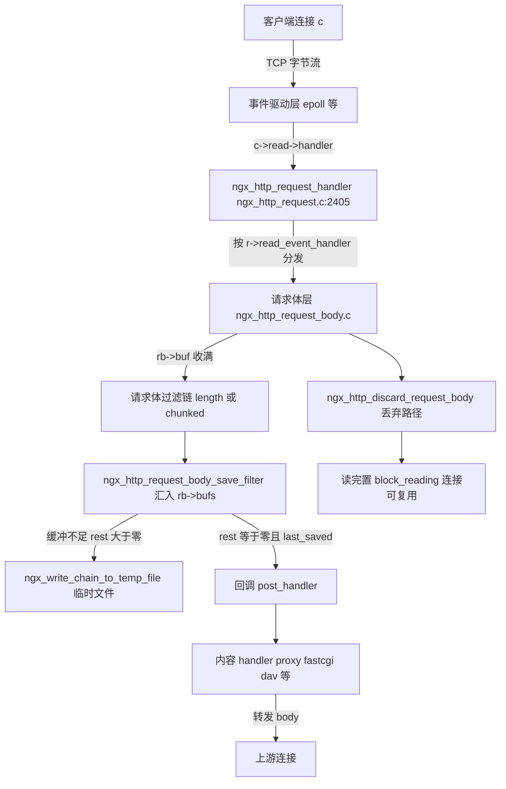
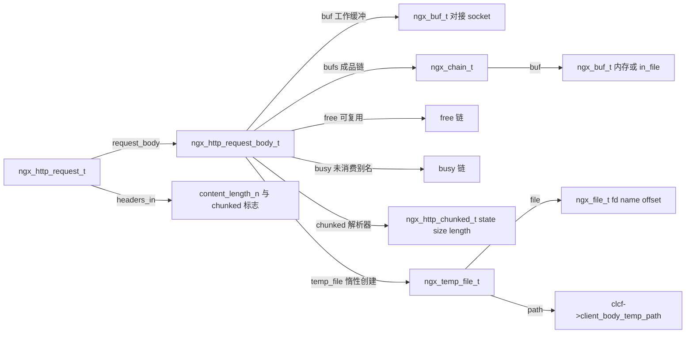
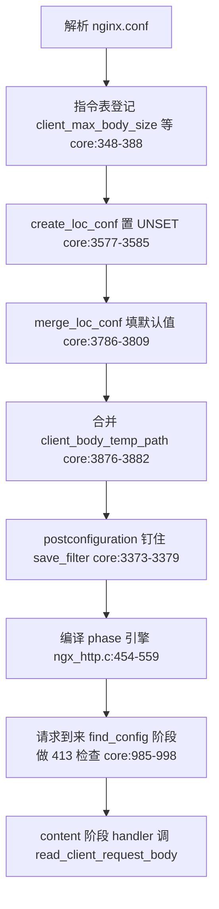
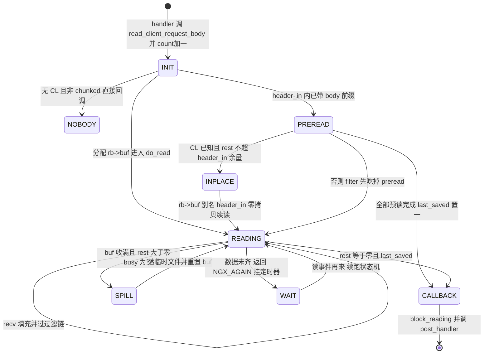
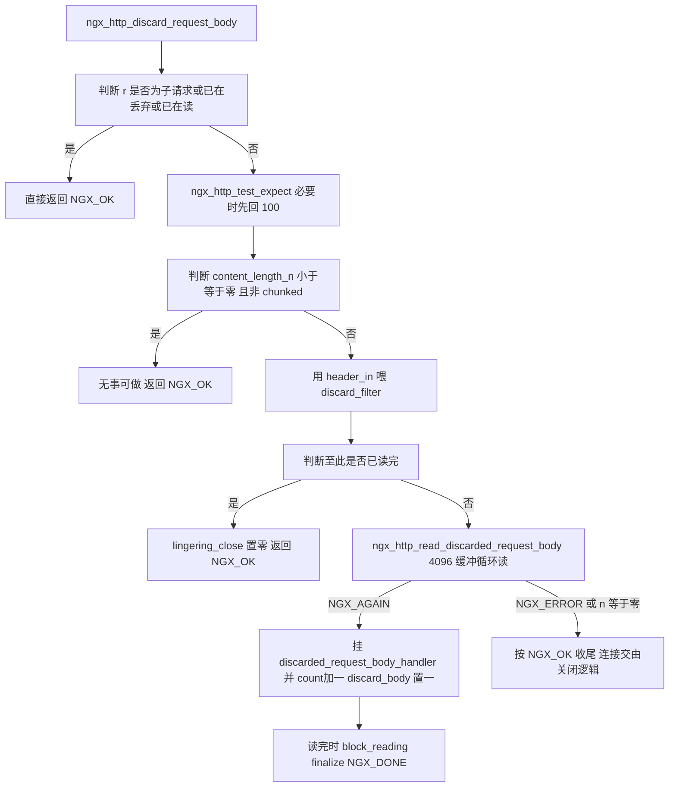
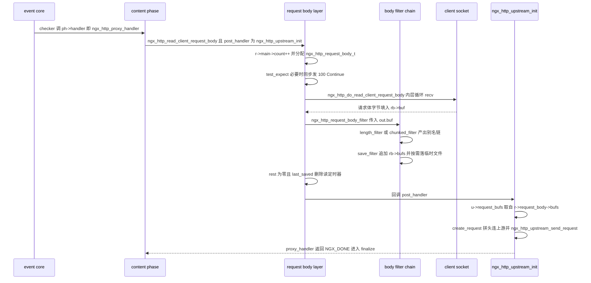

# 请求体处理（读取/临时文件/丢弃）（基于 nginx-1.27.0 源码）

> **导读**：读完本文你将掌握 —— nginx 是如何把一条 TCP 连接上飘忽而至的请求体，一步步变成 handler 手里那个 `r->request_body->bufs`（内存）或 `r->request_body->temp_file`（临时文件）的；`client_body_buffer_size`、`client_max_body_size`、`client_body_temp_path`、`client_body_in_file_only` 这些指令分别落在哪几行代码上；`ngx_http_read_client_request_body` 的引用计数回调模型为什么长成那样；chunked 帧状态机 `ngx_http_parse_chunked` 怎么跨包续跑；以及"丢弃请求体"与"lingering close"这对搭档如何分工，保证 keepalive 连接上永远不残留脏数据。
>
> **前置阅读建议**：先了解 `ngx_buf_t`（`start/pos/last/end` 四指针）与 `ngx_chain_t` 链表；了解 nginx 事件框架中 `r->read_event_handler` 的分发机制（见本系列《02-事件驱动框架与连接管理》《09-缓冲区与输出链底层》）；对 HTTP/1.1 的 `Content-Length` 与 `Transfer-Encoding: chunked` 两种 body 定界方式有基本概念。
>
> **涉及源码清单**（均已逐行通读相关部分）：
> - `src/http/ngx_http_request_body.c`（全文 1385 行，本主题主战场）
> - `src/http/ngx_http_parse.c`（`ngx_http_parse_chunked`：2141-2406 行）
> - `src/http/ngx_http_core_module.c`（指令表、location 配置更新、413 检查等）
> - `src/http/ngx_http_request.c` / `src/http/ngx_http_request.h`（引用计数、finalize、lingering）
> - `src/http/ngx_http_core_module.h` / `src/http/ngx_http.h`（结构与声明）
> - `src/core/ngx_file.c` / `src/core/ngx_file.h`（临时文件原语）
> - `src/http/ngx_http_upstream.c`、`src/http/modules/ngx_http_proxy_module.c`、`src/http/modules/ngx_http_fastcgi_module.c`（body 向上游的传递）
> - `src/http/ngx_http_variables.c`（`$request_body`、`$request_body_file`）
> - `src/http/ngx_http_special_response.c`（错误响应前的丢弃）

---

## 1. 本模块在 nginx 中的位置与职责

nginx 的 HTTP 处理流水线可以粗分为五层：事件层 → 请求头解析层 → **请求体层** → 内容 handler 层 → 过滤/输出层。请求体层（核心文件 `src/http/ngx_http_request_body.c`）夹在中间，向上对接两拨完全不同的调用方：

1. **内容 handler**（proxy、fastcgi、dav、perl、mirror 等）调用 `ngx_http_read_client_request_body(r, post_handler)`，把"读 body"这件事委托给请求体层，并在读完后通过 `post_handler` 回调继续自己的逻辑；
2. **框架本身**（413 检查、错误页、`ngx_http_send_response`）调用 `ngx_http_discard_request_body(r)`，不解析 body 内容，只负责把字节从 socket 里读走丢掉，为下一个 keepalive 请求清场。

它的职责边界非常清晰：**只管收，不管用**。body 收进 `rb->bufs`/临时文件后如何转发给上游、如何被 `$request_body` 消费，都是调用方的事；请求体层只提供"读完了通知你"和"读丢了也不脏"两个保证。



图解：客户端字节先落到事件层，`ngx_http_request_handler`（`src/http/ngx_http_request.c:2405-2439`）把读事件转成 `r->read_event_handler(r)` 调用；请求体读取期间这个槽位指向 `ngx_http_read_client_request_body_handler`。数据不直接进 handler，而是先经过"请求体过滤链"（length/chunked 两个 filter + save filter 兜底），再决定去内存链 `rb->bufs` 还是临时文件。丢弃路径则完全绕开过滤链的产出物，只消费不保存。注意图中两条出边——"回调 post_handler"与"落临时文件"并不互斥：大 body 常常是边读边攒、最后回调时数据已全部在文件里。

## 2. 核心数据结构精讲

### 2.1 `ngx_http_request_body_t` —— 一次请求体读取的全部状态

定义在 `src/http/ngx_http_request.h:298-311`：

```c
typedef struct {
    ngx_temp_file_t                  *temp_file;
    ngx_chain_t                      *bufs;
    ngx_buf_t                        *buf;
    off_t                             rest;
    off_t                             received;
    ngx_chain_t                      *free;
    ngx_chain_t                      *busy;
    ngx_http_chunked_t               *chunked;
    ngx_http_client_body_handler_pt   post_handler;
    unsigned                          filter_need_buffering:1;
    unsigned                          last_sent:1;
    unsigned                          last_saved:1;
} ngx_http_request_body_t;
```

| 字段 | 类型 | 含义与读法 |
|---|---|---|
| `temp_file` | `ngx_temp_file_t *` | body 溢出磁盘时的临时文件句柄，惰性创建（首次写盘时才分配，见 `src/http/ngx_http_request_body.c:561-582`） |
| `bufs` | `ngx_chain_t *` | **成品 body 链**：handler 拿到的就是它；元素 buf 指向内存或 `in_file` |
| `buf` | `ngx_buf_t *` | 当前正在接收的"工作缓冲"（`ngx_create_temp_buf` 分配，`request_body.c:195`），读 socket 直达这里 |
| `rest` | `off_t` | 语义随模式变化：初值 -1（未初始化）；Content-Length 模式下= 还未接受的字节数；chunked 模式下="下次还想看到多少字节"（`request_body.c:1243` 注释） |
| `received` | `off_t` | 已接收字节数，主要供 HTTP/2 路径使用（本文件 1.27.0 中 HTTP/1.x 路径不维护它） |
| `free` / `busy` | `ngx_chain_t *` | 过滤链的缓冲回收站：`free` 可复用，`busy` 是"已交给 save filter 但尚未消费完"的别名缓冲（`ngx_chain_update_chains` 维护） |
| `chunked` | `ngx_http_chunked_t *` | chunked 帧解析器上下文，惰性分配（`request_body.c:1108`、`863`） |
| `post_handler` | 回调指针 | body 就绪后要调用的 handler，即 `ngx_http_read_client_request_body` 的第二参 |
| `filter_need_buffering` | 1 bit | 第三方 body filter 请求暂存时置位，`do_read` 据此返回 `NGX_AGAIN`（`request_body.c:343-353`） |
| `last_sent` | 1 bit | HTTP/2 路径使用的结束标记 |
| `last_saved` | 1 bit | save filter 收到 `last_buf` 时置位（`request_body.c:1318`），是"body 真正完结"的唯一凭证 |

`post_handler` 的类型 `ngx_http_client_body_handler_pt` 就是 `void (*)(ngx_http_request_t *)`（`ngx_http_request.h:296`）。

### 2.2 `ngx_http_chunked_t` —— 跨包续跑的帧状态机上下文

定义在 `src/http/ngx_http.h:64-68`，只有三个字段：

| 字段 | 含义 |
|---|---|
| `state` | 当前所处状态（`ngx_http_parse_chunked` 内部 enum 的编号，`ngx_http_parse.c:2147-2161`），跨调用保存在 ctx 里实现"断点续解析" |
| `size` | 当前 chunk 声明的数据长度，以及解析过程中剩余的数据长度 |
| `length` | "至少还要多少字节才能推进"的估计值，供 `rb->rest`/`content_length_n` 取 max 用（`ngx_http_parse.c:2358-2392`） |

### 2.3 `ngx_temp_file_t` —— 临时文件抽象

定义在 `src/core/ngx_file.h:71-84`，请求体场景下的关键字段：

| 字段 | 在 body 场景中的取值（`request_body.c:569-580`） |
|---|---|
| `file.fd` | 初始 `NGX_INVALID_FILE`，首次写盘时惰性 open |
| `file.log` / `path` | 连接日志 / `clcf->client_body_temp_path` |
| `warn` | `"a client request body is buffered to a temporary file"`（573 行），落盘时按 `log_level` 打日志 |
| `log_level` | `r->request_body_file_log_level`（`client_body_in_file_only` 非默认时为 NOTICE，否则 WARN，见 `ngx_http_core_module.c:1332-1335`） |
| `persistent` / `clean` | 来自 `r->request_body_in_persistent_file` / `request_body_in_clean_file`（575-576 行） |
| `access` | `request_body_file_group_access` 置位时为 0660（578-580 行） |
| `offset` | 已写入字节数，最终变成 `in_file` buf 的 `file_last`（`request_body.c:1365-1378`） |

### 2.4 散落在 `ngx_http_request_t` 上的相关位域

`src/http/ngx_http_request.h:489-495` 定义了配置向请求的投影：`request_body_in_single_buf`、`request_body_in_file_only`、`request_body_in_persistent_file`、`request_body_in_clean_file`、`request_body_file_group_access`、`request_body_file_log_level:3`、`request_body_no_buffering`。同文件 533-549 行还有运行态位：`pipeline`、`chunked`、`keepalive`、`lingering_close`、`discard_body`、`reading_body`、`expect_tested`。而 `headers_in.content_length_n`（241 行）与 `headers_in.chunked`（245 行）是请求体层一切决策的输入。



图解：这张图反映了"**一个工作缓冲 + 一条成品链 + 一份磁盘备份**"的三层布局。`buf` 是流水线上的料斗，socket 直接往里灌；过滤链从料斗里舀出数据，生成别名 buf 挂进 `bufs`；当料斗被舀空又灌满、而上游成品还没地方去时，`bufs` 整体倒进临时文件，料斗 `pos/last` 归零复用。`free/busy` 两链由 `ngx_chain_update_chains` 自动维护，保证别名缓冲在落盘前不会被复用覆盖——这就是 `do_read` 中 `rb->busy != NULL` 检查（`request_body.c:330`）存在的原因。

### 2.5 buf 的三种最终形态（内存/文件/混合）

- **纯内存**：`rb->bufs` 中每个 buf 的 `temporary=1`，`pos/last` 指向 `rb->buf`（或 `header_in`）内的地址；
- **纯文件**：body 全部落盘后，save filter 会**丢弃原链**，构造一个全新的 `in_file=1` buf（`request_body.c:1365-1381`）：`b->file_last = rb->temp_file->file.offset`，`b->file = &rb->temp_file->file`；
- **混合**：仅出现在"部分落盘 + 最后一段留在内存"的场景——落盘段为 `in_file` buf，尾部数据仍以内存 buf 存在于 `rb->bufs`（save filter 只在 `rest==0` 且 `last_saved` 时统一替换，替换前内存与文件段共存于 `bufs`）。

## 3. 初始化流程

请求体层几乎没有独立的"init 函数"，它的初始化分散在三个时期：

1. **配置解析期**：指令表登记（`ngx_http_core_module.c:348-388`），`create_loc_conf` 全部置 `NGX_CONF_UNSET`（3577-3585 行），`merge_loc_conf` 填默认值：`client_max_body_size` 默认 1MB（3786-3787 行）、`client_body_buffer_size` 默认两页即 `2 * ngx_pagesize`（3788-3790 行）、`client_body_timeout` 默认 60000ms（3791-3792 行）、`client_body_in_file_only` 默认 `off`（3805-3807 行）、`client_body_in_single_buffer` 默认 0（3808-3809 行）；`client_body_temp_path` 通过 `ngx_conf_merge_path_value` 继承编译期常量 `NGX_HTTP_CLIENT_TEMP_PATH`（`ngx_http_core_module.c:148-150` 与 3876-3882 行）。
2. **模块加载期**：`ngx_http_core_postconfiguration` 把请求体过滤链的"最末端"钉死为 save filter：`ngx_http_top_request_body_filter = ngx_http_request_body_save_filter;`（`ngx_http_core_module.c:3373-3379`）。第三方模块可在此之上再包一层（`ngx_http_request_body_filter_pt` 类型定义在 `ngx_http_core_module.h:526-527`）。
3. **运行期准备**：`ngx_http_init_phase_handlers` 把各 phase 编译成线性 checker 数组（`src/http/ngx_http.c:454-559`），其中 `NGX_HTTP_FIND_CONFIG_PHASE` 固定占用一个槽位（499-506 行）——正是稍后 413 检查的发生地；`NGX_HTTP_CONTENT_PHASE` 的 checker 是 `ngx_http_core_content_phase`（540-542 行）——handler 链的入口。



图解：注意这条链上没有任何一次 malloc 发生在"请求体"名下——所有 per-request 结构（`rb`、工作缓冲、临时文件）都要等到 handler 真正调用 `ngx_http_read_client_request_body` 才创建（`request_body.c:56`、`195`）。配置期的产出只有两类：一份 `ngx_http_core_loc_conf_t` 数字快照，和一个指向 `client_body_temp_path` 的 `ngx_path_t`（其 `level[]` 决定临时文件的三级哈希目录深度，`ngx_create_temp_file` 在 `src/core/ngx_file.c:196` 调 `ngx_create_hashed_filename` 生成路径）。

## 4. 核心执行流程/状态机

### 4.1 前置判定：到底有没有 body

在进入请求体层之前，`ngx_http_process_request_header`（`src/http/ngx_http_request.c:1980-2024`）已经完成裁定：`Content-Length` 头存在则 `ngx_atoof` 换算成 `content_length_n`，非法直接 400（1985-1990 行）；HTTP/1.0 带 `Transfer-Encoding` 直接 400（1994-2000 行）；`chunked` 与 `Content-Length` 同时出现按 RFC 优先 TE，直接 400（2006-2013 行）；否则置 `headers_in.chunked = 1`（2015 行）。请求体层因此只需要面对两个变量：`content_length_n` 与 `chunked` 标志。

### 4.2 读取路径状态机



图解：初态 `INIT` 的三岔口对应 `ngx_http_read_client_request_body` 的 82-86 行（无 body）、102-147 行（预读）与 173-204 行（常规分配缓冲）。`INPLACE` 是一个容易被忽略的优化：当 CL 已知且剩余量能塞进 `header_in` 的剩余空间时，`rb->buf` 直接以 `header_in` 内存为底（128-140 行），连一块新缓冲都不分配。`SPILL` 不是独立状态而是 `do_read` 循环内的一个动作，这里单列是为了对齐"何时切临时文件"这条主线。`WAIT`→`READING` 的回边由事件层驱动：`do_read` 返回 `NGX_AGAIN` 前挂上 `client_body_timeout` 定时器（437-438 行），超时后 `read_client_request_body_handler` 以 408 收场（280-284 行）。

### 4.3 丢弃路径状态机



图解：丢弃路径有两个设计细节值得圈点。其一，**chunked 的丢弃也要解析帧**（`discard_request_body_filter` 的 852-918 行），因为不知道"多少字节算完"；解析器 `NGX_AGAIN` 时把 `content_length_n` 临时抬到 `max(chunked->length, large_client_header_buffers.size)`（901-910 行），既保证循环有推进动力，又保证每次至少按一个大头部缓冲的量去读。其二，**读错误被当成"读完了"处理**（`read_discarded_request_body` 811-814 行：`NGX_ERROR` 时置 `c->error = 1` 并返回 `NGX_OK`）——socket 都坏了，自然不存在残留数据污染下一个请求的问题。

### 4.4 与响应写入的交错

`do_read` 的外层循环（`request_body.c:431-445`）每轮都会检查 `!c->read->ready`，数据没到就 `ngx_add_timer(c->read, clcf->client_body_timeout)` 并返回 `NGX_AGAIN`——此时请求并未"挂起"在某个专门队列里，而是把 `r->read_event_handler` 继续指向 `ngx_http_read_client_request_body_handler`，等下一个读事件重新进入同一个状态机。`r->main->count` 在入口加一（43 行）就是为了让事件循环知道"这个请求还有未完的生意"，不会被 finalize 掉。

## 5. 关键时序图

下面以 `proxy_pass` 为例，画出 handler 链上完整的一跳——这也是所有调用 `ngx_http_read_client_request_body` 的模块（fastcgi：`ngx_http_fastcgi_module.c:751`；scgi：549 行；uwsgi：730 行；grpc：`ngx_http_grpc_module.c:601`；dav：`ngx_http_dav_module.c:176`；mirror：`ngx_http_mirror_module.c:120`；perl：`nginx.xs:424`）共用的模板。



图解：三个关键节点值得放大。第一，`count++`（`request_body.c:43`）与 `post_handler` 回调是**配对**的：请求因此多了一份"存活抵押"，即便 handler 同步返回，finalize 链也要等 body 读取这桩生意了结（错误路径的显式 `r->main->count--` 在 223-225 行，正常路径则由 close/finalize 侧减一，见 `ngx_http_close_request` 的 `r->count--`，`src/http/ngx_http_request.c:3680`）。第二，`test_expect` 的 100 Continue 是**同步内联发送**（972-974 行直接 `c->send`），不走输出过滤链——因为此刻响应头还没生成。第三，`post_handler` 可能在两种栈深度被调：body 一次读齐时是同步深栈（`do_read` 456-459 行）；数据未到时则退化为事件回调（`ngx_http_request_handler` → `read_event_handler` → `do_read` → 458 行），两种情况最终汇合在同一行代码上。

## 6. 源码逐段精读

本节是全文主体，按执行顺序逐函数解剖 `ngx_http_request_body.c`（及其依赖），每个函数给出签名、逐块逻辑、关键行区间与易错点。

### 6.1 `ngx_http_read_client_request_body` —— 入口与引用计数模型

签名（`ngx_http_request_body.c:31-33`）：

```c
ngx_int_t
ngx_http_read_client_request_body(ngx_http_request_t *r,
    ngx_http_client_body_handler_pt post_handler)
```

**块 1：计数与重入保护（43-49 行）**

```c
    r->main->count++;

    if (r != r->main || r->request_body || r->discard_body) {
        r->request_body_no_buffering = 0;
        post_handler(r);
        return NGX_OK;
    }
```

四个条件覆盖三类重入：子请求（`r != r->main`，body 永远属于主请求，子请求直接回调拿共享数据）、已经读过（`r->request_body` 非空，第二次调用只是"通知 body 已就绪"）、正在丢弃（`r->discard_body`）。注意此时 `count` 已经加一——即重复调用也会抬高计数，配合调用方随后的 `NGX_DONE` finalize，计数天然平衡。

**块 2：期望与结构体初始化（51-80 行）**。先 `ngx_http_test_expect`（详见 6.9）处理 `Expect: 100-continue`；随后 `ngx_pcalloc` 出 `rb`，62-75 行的注释逐字段列出了零初始化结果，这是阅读时的"字段语义速查表"。`rb->rest = -1`（77 行）是重要的哨兵值：过滤链首次被调用时靠它识别"还没初始化"（`length_filter` 的 1014 行判断）。

**块 3：无 body 快速通道（82-86 行）**。`content_length_n < 0`（无 CL 头）且非 chunked 时，不建缓冲、不设事件 handler，直接 `post_handler(r)`。注意 `content_length_n == 0`（显式 `Content-Length: 0`）**不**走这里，而是走下面的过滤链——`length_filter` 会为它造一个只含 `last_buf` 的空链（1020-1035 行），保证 handler 拿到的 `rb->bufs` 形态一致。

**块 4：HTTP/2 与 HTTP/3 分流（88-100 行）**。`r->stream` 非空走 `ngx_http_v2_read_request_body`，`http_version == NGX_HTTP_VERSION_30` 走 `ngx_http_v3_read_request_body`。这两个函数位于 `src/http/v2/ngx_http_v2.c` 与 `src/http/v3/ngx_http_v3_request.c`，本文未精读，仅指出它们最终也会调用 `ngx_http_top_request_body_filter`（分别见 `ngx_http_v2.c:4153`、`ngx_http_v3_request.c:1721`），复用同一套 save filter。

**块 5：预读处理（102-157 行）**。请求头和 body 前缀共享一个 `header_in` 缓冲，`preread = r->header_in->last - r->header_in->pos`（102 行）就是"头部之后多读进来的字节数"。若有预读：

```c
        out.buf = r->header_in;
        out.next = NULL;

        rc = ngx_http_request_body_filter(r, &out);
```

（111-114 行）——**预读直接作为第一块输入喂给过滤链**，链内的 length/chunked filter 会各自更新 `rb->rest` 与 `content_length_n`；120 行 `r->request_length += preread - (r->header_in->last - r->header_in->pos)` 巧妙地只把"真被 body 消费掉的部分"计入请求长度（被回退的部分属于下一个流水线请求）。

紧接着 122-147 行是零拷贝快车道：CL 模式、`rest > 0` 且 `rest <= header_in->end - header_in->last` 时，直接构造一个**别名 `header_in` 内存**的工作缓冲：

```c
            b->temporary = 1;
            b->start = r->header_in->pos;
            b->pos = r->header_in->pos;
            b->last = r->header_in->last;
            b->end = r->header_in->end;

            rb->buf = b;
```

（134-140 行）此后 `do_read` 在这块共享内存上续读，全程零额外拷贝。若无预读则走 152 行 `ngx_http_request_body_filter(r, NULL)`，仅仅为了初始化 `rb->rest`。159-164 行处理"预读即全部"：`rest == 0 && rb->last_saved` 时直接同步回调 handler 收工。

**块 6：工作缓冲尺寸决策（173-193 行）**——本函数最精巧的一段：

```c
    size = clcf->client_body_buffer_size;
    size += size >> 2;
```

先取配置值再加 25% 余量（`size >> 2`）。若非 chunked 且 `rb->rest` 小于这个放大量，就按 `rest` 精确分配（180-181 行）——body 多大缓冲就多大，不浪费；`request_body_in_single_buf` 置位时还要 `size += preread`（183-185 行），把预读也算进去，保证整个 body 与预读连成**同一块内存**（这正是 `client_body_in_single_buffer` 指令的真正用途：让 `$request_body` 变量拿到的数据连续可读）。`size == 0` 时强置为 1（187-189 行），因为 `ngx_create_temp_buf` 对 0 长度的行为不可靠。chunked 模式长度未知，永远用配置原值（191-193 行）。178 行留有 `/* TODO: honor r->request_body_in_single_buf */`，指 chunked 路径尚未支持单缓冲，属未完成特性。

**块 7：收尾（195-227 行）**。分配缓冲、装上 `read_event_handler = ngx_http_read_client_request_body_handler` 与空写 handler（201-202 行），进入 `do_read`。`done:` 标签后的代码处理无缓冲模式（206-221 行）：`request_body_no_buffering` 时若一次没读完要置 `r->reading_body = 1` 并把读事件 handler 改为 `ngx_http_block_reading`，控制权交给调用方（upstream 流式转发场景）。223-225 行是唯一的错误计数修正点：`rc >= NGX_HTTP_SPECIAL_RESPONSE` 时 `r->main->count--`，把块 1 加上的抵押当场退还，随后由调用方 finalize 走正常关闭。

> **易错点**：(1) `post_handler` 在"重入"与"无 body"两条路径上是**同步调用**的，handler 必须能承受在 `read_client_request_body` 返回前就被执行的时序；(2) `rc` 既可能是 `NGX_OK`（body 就绪）也可能是 `NGX_AGAIN`（异步中）或错误码，调用方（如 proxy handler 的 1025-1029 行）必须把 `NGX_OK/NGX_AGAIN` 统一映射为 `NGX_DONE`，否则会被 content phase checker 二次 finalize。

### 6.2 事件回调入口：`ngx_http_read_client_request_body_handler` 与无缓冲续读

`ngx_http_read_client_request_body_handler`（275-291 行）短小但地位关键：

```c
    if (r->connection->read->timedout) {
        r->connection->timedout = 1;
        ngx_http_finalize_request(r, NGX_HTTP_REQUEST_TIME_OUT);
        return;
    }

    rc = ngx_http_do_read_client_request_body(r);

    if (rc >= NGX_HTTP_SPECIAL_RESPONSE) {
        ngx_http_finalize_request(r, rc);
    }
```

它只做三件事：超时→408；错误码→finalize；`NGX_OK/NGX_AGAIN`→**什么都不做**（`NGX_AGAIN` 时定时器与事件已在 `do_read` 内部挂好）。这里没有 `r->main->count--`，因为错误经 `ngx_http_finalize_request` 的错误分支（`ngx_http_request.c:2531-2541`）最终由 close 链减计数，与块 1 的 `count++` 配对。

`ngx_http_read_unbuffered_request_body`（231-272 行）是上游流式转发（`proxy_request_buffering off`）时由 `ngx_http_upstream_send_request_body` 反向调用的续读接口：HTTP/2、HTTP/3 各有分支（236-258 行），HTTP/1.x 下先检查 `read->timedout`（260-263 行，定时器归上游写超时管），再进 `do_read`，成功后清 `r->reading_body`。

### 6.3 `ngx_http_do_read_client_request_body` —— 双层循环主引擎

签名（294-295 行），核心是 314-446 行的**双层 for**：外层管"刷出与等待"，内层管"接收与喂链"。

**内层循环逐块（315-418 行）**：

- **退出条件一**：`rb->rest == 0`（316-318 行）——CL 模式余量归零或 chunked 已见终结帧；
- **缓冲满处理（320-364 行）**：`rb->buf->last == rb->buf->end` 时先 `ngx_http_request_body_filter(r, NULL)` 强刷一次（324 行），然后按 `rb->busy` 状态分三岔：

```c
                if (rb->busy != NULL) {
                    if (r->request_body_no_buffering) {
                        if (c->read->timer_set) {
                            ngx_del_timer(c->read);
                        }
                        if (ngx_handle_read_event(c->read, 0) != NGX_OK) {
                            return NGX_HTTP_INTERNAL_SERVER_ERROR;
                        }
                        return NGX_AGAIN;
```

（330-341 行）无缓冲模式把定时器都撤掉、以 `NGX_AGAIN` 交还上游；`filter_need_buffering` 分支（343-353 行）则相反，要挂上 `client_body_timeout` 等第三方 body filter 腾地方；两者都不满足却仍 busy，说明缓冲管理出了 bug，打 ALERT 并返回 500（355-358 行）。busy 为空则重置缓冲：`rb->buf->pos = rb->buf->last = rb->buf->start`（362-363 行）——此时旧数据要么已写盘要么已进 `bufs` 别名，覆盖是安全的。
- **读取量计算（366-371 行）**：

```c
            size = rb->buf->end - rb->buf->last;
            rest = rb->rest - (rb->buf->last - rb->buf->pos);

            if ((off_t) size > rest) {
                size = (size_t) rest;
            }
```

`size` 是缓冲空洞，`rest` 修正量是"`rb->rest` 减去缓冲中尚未被 filter 接受的字节"。CL 模式下 filter 每次都全量接受，修正量为零；chunked 模式下帧边界可能截在缓冲中间（filter 返回 `NGX_AGAIN` 时 `pos` 落后于 `last`），这行减法保证不会把"下一个 chunk 的帧头"提前读爆缓冲。
- **recv 与错误分支（377-394 行）**：`n == 0` 意味着对端半关闭，打 `"client prematurely closed connection"`（INFO 级，387-389 行）后与 `NGX_ERROR` 一样置 `c->error = 1` 返回 400——**读到一半的连接不可复用**，因为连接上还有身份不明的残留字节。
- **喂链（399-409 行）**：`out.buf = rb->buf` 打包进过滤链（401-405 行），`rb->rest == 0` 或缓冲未满即破内层（411-417 行）——后者是为了让出控制权去刷盘/等数据，避免单次事件里做无用功。

**外层循环（420-446 行）**：`flush == 1` 时（首轮或刚重置过缓冲）再调一次 `filter(r, NULL)`（423-429 行），让 save filter 有机会把 `bufs` 落盘；431-433 行是全局出口：`rest == 0 && last_saved`。435-445 行处理"数据未到"：挂 `client_body_timeout` 定时器、`ngx_handle_read_event` 注册读兴趣、返回 `NGX_AGAIN`。

**收尾（448-461 行）**：`ngx_http_copy_pipelined_header` 抢救流水线头部（见 6.4）；删读定时器（452-454 行）；非无缓冲模式下置 `read_event_handler = ngx_http_block_reading` 并**同步调用 `rb->post_handler(r)`**（456-459 行）——body 到手，把请求交还给 handler 链。

> **易错点**：(1) `flush` 初值为 1（309 行），保证"预读即全部"这类没有经过内层 recv 的路径也会触发一次 save filter 刷盘；(2) `do_read` 返回 `NGX_OK` 不代表回调了 handler——无缓冲模式下它只负责读，回调权在 `read_client_request_body` 的 `done:` 块。

### 6.4 `ngx_http_copy_pipelined_header` —— 流水线头部的抢救与安置

签名（465-466 行）。body 读取期间客户端可能已经把**下一个请求**的头一起发来了，它们此刻躺在 `rb->buf` 里（`pos` 之后的未接受区）。此函数把它们搬回 `r->header_in`：

```c
    b = r->header_in;
    n = buf->last - buf->pos;

    if (buf == b || n == 0) {
        return NGX_OK;
    }
```

（474-479 行）两个守卫：`buf == b` 覆盖零拷贝快车道（此时 `rb->buf` 与 `header_in` 同底，实际不会有残留，见 6.1 块 5 的分析——`size` 受 `rest` 钳制，recv 不会越过 body 末尾）；`n == 0` 是常态。若残留量超过 `header_in` 剩余空间，490-536 行先换大缓冲：优先从 `hc->free`（大头部缓冲空闲链）取，否则按 `cscf->large_client_header_buffers.size` 新建，链入 `hc->busy` 并 `hc->nbusy++`（525-527 行），替换 `r->header_in`（529 行）；若换完还装不下则 ALERT `"too large pipelined header after reading body"` 返回错误（531-535 行）。最后 538-541 行执行搬运并修正统计：

```c
    ngx_memcpy(b->last, buf->pos, n);

    b->last += n;
    r->request_length -= n;
```

`request_length -= n` 与 6.1 块 5 的 `+= preread` 呼应：这些字节先被当 body 计了长，现在物归原主记回头部。

### 6.5 请求体过滤链：dispatch 与 length filter

`ngx_http_request_body_filter`（988-997 行）是三行分发器：`headers_in.chunked` 走 `ngx_http_request_body_chunked_filter`，否则走 `ngx_http_request_body_length_filter`。这条链的拓扑是 **length/chunked filter → `ngx_http_top_request_body_filter`（默认为 save filter）**，与输出过滤链同构（`ngx_http_core_module.h:526-527` 定义了专用函数指针类型）。

`ngx_http_request_body_length_filter`（1000-1084 行）逐块：

- **初始化（1014-1036 行）**：`rb->rest == -1` 时从 `content_length_n` 装载余量；`rest == 0`（即 `Content-Length: 0`）时立刻产出一个只含 `last_buf` 的空 buf（1029-1034 行 `ngx_memzero` 后 `b->last_buf = 1`）——空 body 也必须走完"回调 post_handler"的全流程。
- **逐输入块接受（1038-1076 行）**。对每个输入 `cl`（通常是 `rb->buf` 或预读的 `header_in`）：

```c
        b->temporary = 1;
        b->tag = (ngx_buf_tag_t) &ngx_http_read_client_request_body;
        b->start = cl->buf->pos;
        b->pos = cl->buf->pos;
        b->last = cl->buf->last;
        b->end = cl->buf->end;
        b->flush = r->request_body_no_buffering;
```

（1053-1059 行）构造的是**零拷贝别名 buf**：不搬数据，只圈定输入缓冲的一个窗口。tag 打上本函数地址，供 `ngx_chain_update_chains` 区分"哪些链是我家的可以回收"。接受逻辑（1061-1072 行）分两支：输入小于余量则全吃（`cl->buf->pos = cl->buf->last`，`rb->rest -= size`）；否则吃到余量截断（`cl->buf->pos += rb->rest`，`b->last = cl->buf->pos`，`b->last_buf = 1`）——注意截断时输入 buf 的 `pos` 停在 body 末尾，**后面剩下的就是流水线数据**，这正是 6.4 能抢救到它们的前提。
- **下行与回收（1078-1081 行）**：先调 `ngx_http_top_request_body_filter(r, out)` 让 save filter 收货（顺带在缓冲满时落盘），再 `ngx_chain_update_chains(r->pool, &rb->free, &rb->busy, &out, tag)` 回收链节点：pos 追上 last 的进 `free`，否则进 `busy`。

### 6.6 chunked filter：帧解析 + 限长 + 小 chunk 合并

`ngx_http_request_body_chunked_filter`（1087-1268 行）是三条过滤链里最复杂的：

- **初始化（1103-1117 行）**：`rb->rest == -1` 时分配 `rb->chunked`，**把 `content_length_n` 归零**（1115 行——chunked 请求没有可信总长，这个变量改用作"已收字节数计数器"），`rb->rest` 置为一个大头部缓冲尺寸（1116 行），表示"先给我这么多字节再谈"。
- **限长检查（1140-1155 行）**：每解析出一个 chunk 声明就累计检查：

```c
                if (clcf->client_max_body_size
                    && clcf->client_max_body_size
                       - r->headers_in.content_length_n < rb->chunked->size)
                {
                    ...
                    r->lingering_close = 1;

                    return NGX_HTTP_REQUEST_ENTITY_TOO_LARGE;
                }
```

CL 模式的同类检查发生在更早的 find_config 阶段（见 6.12），chunked 因为总长未知只能边收边查。返回 413 前特意置 `r->lingering_close = 1`，让连接在错误响应后进入 lingering 关闭而非直接 RST——客户端还欠我们一整块 body 不读掉，硬关会把它打懵。
- **小 chunk 合并（1157-1178 行）**：一个非常务实的优化——若上一轮已有输出 buf `b`、当前 chunk 数据不超过 128 字节且输入缓冲里数据足够，就把这几十个字节 `memcpy`/`memmove` 进 `b`（1163-1175 行，数据小于 8 字节走逐字节拷贝分支），省掉一次链节点分配。这是典型的"小块合并抗碎片"手法。
- **常规接受（1180-1213 行）**：与 length filter 同构的别名 buf 产出，但接受量以 `rb->chunked->size`（当前 chunk 剩余）为准，同时累加 `r->headers_in.content_length_n`（1204、1209 行）。
- **终结与饥饿（1218-1251 行）**：`ngx_http_parse_chunked` 返回 `NGX_DONE`（终结帧解析完）时 `rb->rest = 0` 并产出 `last_buf`（1222-1233 行）；返回 `NGX_AGAIN` 时 `rb->rest = ngx_max(rb->chunked->length, large_client_header_buffers.size)`（1247-1248 行）——`chunked->length` 是解析器自估的"至少还要多少字节"，钳一个下限防止恶意半帧把缓冲饿死。非法帧返回 400 `"client sent invalid chunked body"`（1253-1258 行）。

### 6.7 save filter 与临时文件切换

`ngx_http_request_body_save_filter`（1271-1385 行）是链的终点，也是"内存 → 文件"决策者：

- **追加（1280-1330 行）**：把 `in` 链逐节点挂到 `rb->bufs` 尾部（`tl->buf = cl->buf`，同样是别名不拷贝）；见到 `last_buf` 时置 `rb->last_saved = 1`（1309-1318 行），重复出现直接 ALERT 500（1311-1316 行）——"body 结束"必须恰好发生一次。
- **无缓冲直通（1334-1336 行）**：`request_body_no_buffering` 时只入链不落盘，数据由 upstream 边读边发（见 6.13）。
- **中途落盘（1338-1347 行）**：

```c
    if (rb->rest > 0) {

        if (rb->bufs && rb->buf && rb->buf->last == rb->buf->end
            && ngx_http_write_request_body(r) != NGX_OK)
        {
            return NGX_HTTP_INTERNAL_SERVER_ERROR;
        }

        return NGX_OK;
    }
```

触发条件缺一不可：还有余量（body 没完）、成品链非空、**工作缓冲已满**。第三个条件是关键——缓冲没满就继续用它攒，攒满才整批倒进文件，把写盘次数压到 `body大小 / 缓冲大小` 量级。
- **终局落盘与形态替换（1349-1382 行）**：`rest == 0` 且 `last_saved` 后，若启用过临时文件或 `request_body_in_file_only`：先检查成品链"没有已带 `in_file` 的 buf"（1355-1359 行，重复落盘是致命错误），执行 `ngx_http_write_request_body`，然后**整链替换**（1365-1381 行）：

```c
            b->in_file = 1;
            b->file_last = rb->temp_file->file.offset;
            b->file = &rb->temp_file->file;

            rb->bufs = cl;
```

替换仅在 `temp_file->file.offset != 0`（真写过字节）时进行——`client_body_in_file_only` 加空 body 时 6.7 的 `write_request_body` 会创建空文件但 offset 为 0，此时保持 `bufs == NULL`，handler 自己去判断空 body。

`ngx_http_write_request_body`（547-626 行）负责真正的磁盘动作。561-596 行惰性初始化 `ngx_temp_file_t`（配置映射见表 2.3），其中 584-595 行处理"`in_file_only` 但 body 为空"的边角：也要把文件创建出来（保证 `$request_body_file` 变量有值可取）。602-623 行写链：

```c
    n = ngx_write_chain_to_temp_file(rb->temp_file, rb->bufs);
    ...
    rb->temp_file->offset += n;
    /* mark all buffers as written */

    for (cl = rb->bufs; cl; /* void */) {
        cl->buf->pos = cl->buf->last;
        ln = cl;
        cl = cl->next;
        ngx_free_chain(r->pool, ln);
    }

    rb->bufs = NULL;
```

写完即把所有别名 buf 的 `pos` 推到 `last`（它们随后的 `ngx_chain_update_chains` 会回流 `free`），并清空 `bufs`。底层 `ngx_write_chain_to_temp_file`（`src/core/ngx_file.c:108-137`）在 `fd` 无效时先 `ngx_create_temp_file`（141-229 行）：文件名由 `path->name` 加 `ngx_next_temp_number` 生成的 10 位序号构成（185、193 行），冲突则换号重试（221-224 行）；打开成功即注册 pool cleanup（207-216 行），cleanup handler 按 `clean` 标志选 `ngx_pool_delete_file` 或 `ngx_pool_cleanup_file`（209 行）——**临时文件的生命周期绑定在请求内存池上，无论请求走哪条退出路径都会被清理**，这是"clean 模式丢文件也不漏文件"的兜底。

### 6.8 丢弃家族：四个函数的接力

`ngx_http_discard_request_body`（629-706 行）入口逻辑已在 4.3 的流程图中展开，这里补三个行级细节：661-663 行先删读定时器（丢弃期间由自己的节奏管理超时）；683-688 行**同步读完**时置 `r->lingering_close = 0`——body 已净，关闭时无需 lingering；694-705 行异步路径挂 `ngx_http_discarded_request_body_handler` 并 `r->count++`、`r->discard_body = 1`，同样是用计数抵押换异步资格。

`ngx_http_discarded_request_body_handler`（709-778 行）是异步期间的读回调，超时即 `c->error = 1` 并 finalize `NGX_ERROR`（721-726 行）；728-740 行维护 `lingering_time` 死线（当丢弃与 lingering 混合时复用同一计时器，超线置 `discard_body = 0` 强行收场）；742-750 行读完时做三连清理（`discard_body = 0`、`lingering_close = 0`、`lingering_time = 0`）再 finalize `NGX_DONE`；766-777 行把下次超时压到 `lingering_timeout` 与剩余时间的较小者。

`ngx_http_read_discarded_request_body`（781-841 行）是栈上 4096 字节缓冲（`NGX_HTTP_DISCARD_BUFFER_SIZE`，`ngx_http_request.h:19`）的丢弃循环：798-800 行以 `content_length_n == 0` 为终止条件；806-807 行每轮最多读 `min(余量, 4096)`；三个错误分支各有态度——`NGX_ERROR` 置 `c->error = 1` 返回 `NGX_OK`（811-814 行，连接废了即视为干净），`n == 0`（对端关了）直接 `NGX_OK`（820-822 行）；读完仍要走一遍 `ngx_http_copy_pipelined_header`（834 行）——丢弃场景下流水线请求同样可能已经挤在 body 尾部。

`ngx_http_discard_request_body_filter`（844-934 行）与读取路径的 filter 相比是个"只消费不产出"的简化版：chunked 分支惰性建 `rb` 与 `rb->chunked`（852-869 行）——注意丢弃路径可能根本没人调过 `read_client_request_body`，`r->request_body` 在此之前是 NULL；每轮 `ngx_http_parse_chunked` 返回 `NGX_OK` 就按 `chunked->size` 推进 `b->pos`（879-888 行），返回 `NGX_DONE` 置 `content_length_n = 0`（893-899 行），返回 `NGX_AGAIN` 时把 `content_length_n` 抬到 `max(chunked->length, large_client_header_buffers.size)` 当作循环的"燃料"（901-910 行）。非 chunked 分支（920-931 行）就是纯粹的指针推进。

### 6.9 `ngx_http_test_expect` —— 100-continue 的最小实现

签名（937-939 行）。守卫条件（943-955 行）：只处理一次（`r->expect_tested`）、只认 `Expect` 头、只对 HTTP/1.1、HTTP/2 与 HTTP/3（`r->stream` / `r->connection->quic`）不适用——后两者没有"先发 100 再发响应"的语义空间。值比较（961-967 行）严格要求恰好是 `100-continue`（大小写不敏感），带任何扩展（如 `100-continue, foo`）都不触发。命中后同步直发：

```c
    n = r->connection->send(r->connection,
                            (u_char *) "HTTP/1.1 100 Continue" CRLF CRLF,
                            sizeof("HTTP/1.1 100 Continue" CRLF CRLF) - 1);

    if (n == sizeof("HTTP/1.1 100 Continue" CRLF CRLF) - 1) {
        return NGX_OK;
    }

    /* we assume that such small packet should be send successfully */

    r->connection->error = 1;
```

（972-984 行）21 字节的临时响应不走输出链、不留日志、不重试——写不完就判连接已死。丢弃路径同样会调它（653 行），保证客户端不会卡在"等 100"上白白超时；而 413 快速拒绝时反而**置 `r->expect_tested = 1` 主动抑制 100**（`ngx_http_core_module.c:994`），让客户端尽早停手。

### 6.10 `ngx_http_parse_chunked` —— 十三态帧状态机

签名（2141-2143 行），状态枚举 2147-2161 行共 13 态：`sw_chunk_start`、`sw_chunk_size`、`sw_chunk_extension`（含 almost_done）、`sw_chunk_data`、`sw_after_data`（含 almost_done）、`sw_last_chunk_extension`（含 almost_done）、`sw_trailer`（含 almost_done）、`sw_trailer_header`（含 almost_done）。函数开头（2163-2167 行）恢复跨调用状态，并处理一个特殊转移：上次停在 `sw_chunk_data` 且 `size == 0` 说明数据已被吸干，直接跳 `sw_after_data` 去找 CRLF。

主体是逐字节 switch（2171-2347 行）：

- `sw_chunk_start`（2180-2195 行）：首位十六进制数字，`ch | 0x20` 的小写化技巧一次覆盖大小写字母；
- `sw_chunk_size`（2197-2251 行）：先做溢出防护 `ctx->size > NGX_MAX_OFF_T_VALUE / 16`（2198-2200 行）；**`size == 0` 时语义切换**（2214-2233 行）——此时遇到 CR/LF/`;` 走的是"最后一个 chunk"的分支（`sw_last_chunk_extension` / `sw_trailer`），同一字符在非零 size 下则走普通 chunk 的分支（2235-2249 行）。一个状态机用 `size` 是否为零复用两套转移表，是本函数最值得学习的地方；
- `sw_chunk_data`（2270-2272 行）：`rc = NGX_OK; goto data;`——数据区交还给调用者按 `size` 消费，解析器自己不吞数据字节；
- 尾部状态（2294-2344 行）：trailer 区支持任意多行 `header: value`（`sw_trailer_header` ↔ `sw_trailer` 循环），空行即终结。

`data:` 标签后（2349-2394 行）保存状态与 `b->pos`，并**预计算 `ctx->length`**——"从这个位置走到 body 结束至少还需多少字节"，例如 `sw_chunk_data` 态是 `ctx->size + 4`（`LF "0" LF LF`，2372-2374 行）。这个估计值就是 6.6/6.8 中 `ngx_max(chunked->length, ...)` 的来源，让上层在没有总长的情况下也能给 socket 读一个有意义的量。三个出口：`return rc`（2394 行，`NGX_OK` 或 `NGX_AGAIN`）、`done:`（2396-2401 行，`ctx->state = 0` 复位并 `b->pos = pos + 1` 跳过终结 LF，返回 `NGX_DONE`）、`invalid:`（2403-2405 行，`NGX_ERROR`）。

> **易错点**：(1) `NGX_DONE` 时 `b->pos` 已越过终结 CRLF，但 trailer 里若有非空行，其字节**被解析器读掉却无处安放**——nginx 的请求体路径不向 handler 暴露 trailer 内容（`ngx_http_request.h` 中 `trailers` 字段只存在于 `headers_out`，见 260 行），如需 trailer 须自行包一层 body filter（`r->expect_trailers` 位域预留于 `ngx_http_request.h:536`）；(2) 状态机对 `\n` 单独结尾的帧同样接受（如 2220-2221 行），宽容度高于 RFC 的严格要求。

### 6.11 配置落点：`ngx_http_update_location_config` 与 413 检查

location 定型时 `ngx_http_update_location_config`（`ngx_http_core_module.c:1304-1384`）把指令值投影到请求位域：

```c
    if (clcf->client_body_in_file_only) {
        r->request_body_in_file_only = 1;
        r->request_body_in_persistent_file = 1;
        r->request_body_in_clean_file =
            clcf->client_body_in_file_only == NGX_HTTP_REQUEST_BODY_FILE_CLEAN;
        r->request_body_file_log_level = NGX_LOG_NOTICE;

    } else {
        r->request_body_file_log_level = NGX_LOG_WARN;
    }

    r->request_body_in_single_buf = clcf->client_body_in_single_buffer;
```

（1327-1338 行）注意两个隐含语义：`in_file_only` 一旦开启，**持久化是无条件的**（临时文件不随请求删除，供 dav PUT 等场景改名收编）；只有 `clean` 值才打开"请求结束即删"。枚举定义在 19-21 行（`off/on/clean`）与 101-106 行（`ngx_conf_enum_t` 表）。紧接着 1340-1374 行顺带处理 keepalive 决策，与 body 无直接关系但共用同一次 location 切换。

CL 模式的总长检查发生在更早的 `ngx_http_core_find_config_phase`（948-1040 行）：

```c
    if (r->headers_in.content_length_n != -1
        && !r->discard_body
        && clcf->client_max_body_size
        && clcf->client_max_body_size < r->headers_in.content_length_n)
    {
        ngx_log_error(NGX_LOG_ERR, r->connection->log, 0,
                      "client intended to send too large body: %O bytes",
                      r->headers_in.content_length_n);

        r->expect_tested = 1;
        (void) ngx_http_discard_request_body(r);
        ngx_http_finalize_request(r, NGX_HTTP_REQUEST_ENTITY_TOO_LARGE);
        return NGX_OK;
    }
```

（985-998 行）三件事一次做完：抑制 100-continue、尝试把已到的 body 字节丢掉（减小 RST 概率）、返回 413。`!r->discard_body` 守卫防止丢弃过程中递归触发。chunked 的同类检查在 6.6 已述——**同一指令两个检查点，模式不同位置不同**。

### 6.12 未读 body 就 finalize 的清理路径

handler 没碰 body 就返回错误（例如 static 模块对 POST 请求直接出 405）时，走的是另一条看不见的清理线，分四层：

1. **预防层**：`ngx_http_handler` 一开始就预埋伏笔——`r->lingering_close = (r->headers_in.content_length_n > 0 || r->headers_in.chunked);`（`ngx_http_core_module.c:841-842`）。**只要请求声明了 body，这个位就是 1**，与 handler 是否读过无关。
2. **错误页层**：`ngx_http_special_response_handler` 生成错误页前主动丢 body：`r->expect_tested = 1; if (ngx_http_discard_request_body(r) != NGX_OK) { r->keepalive = 0; }`（`ngx_http_special_response.c:471-475`）——能异步丢就丢，丢不动就放弃 keepalive。
3. **finalize 层**：`ngx_http_finalize_connection`（`ngx_http_request.c:2752-2822`）在 `count != 1` 时若 `r->discard_body` 还挂着，补上 `discarded_request_body_handler` 与 `lingering_timeout` 定时器（2775-2783 行）；`r->reading_body`（无缓冲模式读到一半被上游错误打断）则强制 `keepalive = 0` 且 `lingering_close = 1`（2796-2799 行）。
4. **lingering 层**：关闭前若 `lingering_close` 配置允许且（请求标记了 lingering 或连接上还有未读数据），进入 `ngx_http_set_lingering_close`（2810-2819 行条件判断；3446-3513 行实现）：半关写侧（`ngx_shutdown_socket`，3498 行）、读 handler 换成 `ngx_http_lingering_close_handler`（3481 行）、挂 `lingering_timeout`（3508 行）。该 handler（3516-3573 行）在 `lingering_time` 总死线内循环 `recv` 4096 缓冲并**直接扔掉**（3543-3557 行），直到客户端发完或死线到。

`discard` 与 `lingering` 的分工由此清晰：**discard 是请求级的"精准读完"**——它知道 `content_length_n` 或 chunked 边界，读完即停、连接立即可复用（`read_event_handler = ngx_http_block_reading`，838 行）；**lingering 是连接级的"无差别吸干"**——不知道边界、只按时间死线读扔，用在"读不完也不知何时是头"的错误场景。前者是主动选择，后者是被动兜底。

### 6.13 与 proxy/fastcgi 的 body 传递

**缓冲模式**（默认）：proxy handler 调 `ngx_http_read_client_request_body(r, ngx_http_upstream_init)`（`ngx_http_proxy_module.c:1023`），body 读完才连上游。`ngx_http_upstream_init` 把成品链交接给 upstream：`if (r->request_body) { u->request_bufs = r->request_body->bufs; }`（`ngx_http_upstream.c:630-632`）；`ngx_http_proxy_create_request` 再把 body 链接到头部链之后——1573-1595 行逐节点 `ngx_memcpy(b, body->buf, sizeof(ngx_buf_t))` 复制 buf 描述符（不复制数据）串到 `u->request_bufs`。发送由 `ngx_http_upstream_send_request_body`（2192-2308 行）完成：缓冲模式下一个 `ngx_output_chain(&u->output, out)`（2215 行）搞定，`in_file` buf 自然走 sendfile/writev 路径——**body 在文件里时，从磁盘到上游连用户态拷贝都省了**。fastcgi 模块的对应入口在 `ngx_http_fastcgi_module.c:745-757`，FastCGI 协议以 `STDIN` record 流式封装 body。

**流式模式**（`proxy_request_buffering off`）：proxy handler 先置 `r->request_body_no_buffering = 1`（`ngx_http_proxy_module.c:1015-1021`，条件含 `pass_request_body` 与 chunked/HTTP11 兼容判断）再调 read；`do_read` 变成"读一块发一块"的泵——`ngx_http_upstream_send_request_body` 的 2250-2298 行循环里，`r->reading_body` 置位时调 `ngx_http_read_unbuffered_request_body`（2280 行）拉新数据，拉到 `r->request_body->bufs` 就发、发完清空（2286-2287 行），直到 `reading_body` 清零。chunked 客户端请求会被 proxy 重编成自己的 chunked（`ngx_http_proxy_body_output_filter`，1634 行起）或带 CL 的普通流。另外 upstream 侧还有一处精打细算：body 落过盘的主请求可把 `r->request_body->buf` **二次利用**为 upstream 输出缓冲（1634-1658 行，注释明言"the r->request_body->buf can be reused for one request only"——子请求不得复用）。

**变量视图**：`$request_body`（`ngx_http_variables.c:2111-2169`）只在"全部在内存且无临时文件"时可用（2120-2127 行 `temp_file` 非空即 `not_found`）；多链时现场 `ngx_pnalloc` 拼接（2142-2161 行）。`$request_body_file`（2172-2189 行）返回 `temp_file->file.name`，无临时文件即 not_found。fastcgi 模块在 1.27.0 中**没有**内建 `REQUEST_BODY_FILE` 参数（全模块 grep 无此字符串，已验证），需要时用 `fastcgi_param REQUEST_BODY_FILE $request_body_file;` 手工下发。另注意 dav 模块是"文件化 body"的头号受益者：PUT handler 以 body 临时文件为素材改名落位（调用点 `ngx_http_dav_module.c:176`）。

## 7. 设计思想与权衡

**其一，异步回调而非同步读取。** 最早的 HTTP 服务器常在 handler 里同步把 body 读齐，代码好写但一个慢客户端就能钉死一个 worker。nginx 的答案是 `count++` + `post_handler`：把"body 没到"变成一个可等待的事件态，handler 链以回调续命。代价是所有调用方必须理解"我可能在 `read_client_request_body` 返回之前就被回调"（6.1 易错点），并在 `NGX_DONE` 返回值上与 phase 框架达成默契。替代方案是协程/状态机外提（如其他服务器的 async/await 重构），nginx 选择让**每个 handler 只多写一个回调函数**来换取零语法糖的 C 兼容。

**其二，过滤链而非硬编码。** body 的"定界"（CL/chunked）、"存储"（save filter）、"消费"（第三方 body filter）被拆成可插拔链段，`ngx_http_top_request_body_filter` 是天然扩展点。代价是缓冲所有权复杂化——`free/busy` 双链与 tag 机制全为它服务（6.5）。

**其三，零拷贝别名贯穿始终。** 从 `header_in` 预读（134-140 行）到 filter 产出的窗口 buf（1054-1058 行）再到 proxy 的 buf 描述符复制（1584 行），数据本体自 socket 读取后至多被搬一次（落盘写、发上游写），内存中的"移动"全部是 `pos/last` 调整。25% 的缓冲余量（175-176 行）与"缓冲满才落盘"（1340 行）都是为减少搬运/写盘次数服务的同一哲学。

**其四，discard 与 lingering 的双保险。** 只用 discard 的问题：错误场景下客户端可能发的是无限流或超长 body，"精准读完"变成自缚；只用 lingering 的问题：正常请求也要多耗一个 `lingering_timeout` 才能复用连接。nginx 把两者正交组合——能算出边界就 discard（快路径），算不出或被打断就 lingering（慢路径），并以 `r->lingering_close` 位域在两路径间传递意图（686 行清零、1152 行置一、841 行预置）。

**其五，`rest` 的一语双关。** CL 模式它是"还剩多少 body"，chunked 模式它是"还想看多少帧"。复用一个 `off_t` 省掉了模式分支的重复代码，但代价是阅读者必须随时确认当前语义——本文 2.1 的表格就是把这道阅读税一次性交清。

## 8. 配置项与调优映射

| 指令 | 代码落点 | 默认值（merge 处） | 作用于 |
|---|---|---|---|
| `client_max_body_size` | 检查：`core:985-998`（CL）、`request_body.c:1142-1155`（chunked） | 1MB（`core:3786-3787`） | 413 阈值；设 0 关闭检查 |
| `client_body_buffer_size` | 缓冲分配 `request_body.c:173-193`；upstream 输出缓冲 `upstream.c:653` | `2 * ngx_pagesize`（8K/16K，`core:3788-3790`） | 超过即落盘的临界值 |
| `client_body_timeout` | 两次挂定时器：`request_body.c:346、438` | 60000ms（`core:3791-3792`） | 两次读事件间的最大间隔 |
| `client_body_temp_path` | `tf->path`（`request_body.c:571`）；默认常量 `core:148-150、3876-3882` | 编译期 `NGX_HTTP_CLIENT_TEMP_PATH` | 临时文件根目录及哈希层级 |
| `client_body_in_file_only` | 投影 `core:1327-1336`；落盘决策 `request_body.c:1353` | off（`core:3805-3807`） | off/on/clean 三档（`core:19-21、101-106`） |
| `client_body_in_single_buffer` | `request_body.c:183-185`（CL 路径） | off（`core:3808-3809`） | 强制 body 与预读同缓冲，救 `$request_body` |
| `proxy_request_buffering` / `fastcgi_request_buffering` | `proxy:1015-1021`、`fastcgi:745-749` 置 `request_body_no_buffering` | on | 流式转发开关 |
| `lingering_close` / `lingering_time` / `lingering_timeout` | `core:2810-2819、3849-3854`；实现 `request.c:3446-3573` | on / 30s / 5s | 错误关闭时的吸干策略 |

关于"multiple_buffers"的说明：nginx-1.27.0 全源码 grep 无 `multiple_buffers` 标识符（已验证，0 匹配）。与"多缓冲"相关的真实机制有两处：一是 chunked filter 的小 chunk 合并（`request_body.c:1157-1178`）通过 `free` 链复用减少缓冲数量；二是 `ngx_chain_get_free_buf`/`ngx_chain_update_chains` 维护的 free/busy 缓冲池。请求体本身**恒为单工作缓冲**（`rb->buf` 一个），不存在"多缓冲模式"指令。

调优要点：上传场景把 `client_body_buffer_size` 提到略大于典型 body（避免几乎每个请求都付一次临时文件开销）；反代大文件上传可关 `proxy_request_buffering` 让数据直通上游、同时把磁盘压力转嫁出去；`$request_body` 相关的 WAF/日志需求记得开 `client_body_in_single_buffer` 并确保 buffer 装得下，否则变量静默变空（6.13）；错误率高的公网服务适当调低 `lingering_time`，减小恶意慢发占坑窗口。

## 9. 自测题

**Q1：`ngx_http_read_client_request_body` 为什么第一行就 `r->main->count++`，而错误路径又要显式 `r->main->count--`？**
答：`count` 是请求的存活抵押，`count++` 防止 body 异步读取期间请求被 finalize 关闭。正常路径的减一发生在 close/finalize 链（`ngx_http_close_request` 的 `r->count--`，`request.c:3680`），但 `read_client_request_body` 自身检测到错误（如 500）时请求可能不走 post_handler，必须在 223-225 行当场退还抵押，否则计数永远无法归零、连接泄漏。

**Q2：为什么 `Content-Length: 0` 不走 82-86 行的快速通道，而要绕一圈过滤链？**
答：82 行条件是 `content_length_n < 0`（无 CL 头），显式 0 会进 `length_filter`，由 1020-1035 行产出仅含 `last_buf` 的空链。这样无论 body 大小，handler 看到的 `rb->bufs` 形态与 `last_saved` 时序完全一致，调用方无需特判空 body。

**Q3：`do_read` 中 `rest = rb->rest - (rb->buf->last - rb->buf->pos)` 这行修正为谁而设？**
答：为 chunked。帧边界可能截断在缓冲中间，`ngx_http_parse_chunked` 返回 `NGX_AGAIN` 时 `pos` 落后于 `last`，这个减法把"已读入但尚未被 filter 接受的帧字节"从待读量中扣除，避免把半截帧头之后的字节提前读爆缓冲（`request_body.c:366-371`）。

**Q4：`client_body_in_file_only on` 与 `clean` 的区别落到哪两个请求位域上？**
答：`on/clean` 都置 `request_body_in_file_only = 1` 且**无条件** `request_body_in_persistent_file = 1`（临时文件不随请求删除，`core:1328-1329`）；仅 `clean` 额外置 `request_body_in_clean_file = 1`（1330-1331 行），最终决定 pool cleanup 用 `ngx_pool_delete_file` 还是 `ngx_pool_cleanup_file`（`ngx_file.c:209`）。

**Q5：save filter 为什么必须等 `rb->buf->last == rb->buf->end` 才落盘？**
答：写盘以"整批链"为单位（`ngx_write_chain_to_temp_file`），缓冲没满就落盘会让每个请求多出一次小 IO；等缓冲满（或 body 结束）才把 `bufs` 整体写入，写盘次数正比于 `body大小/缓冲大小`。代价是落盘前内存占用最多为缓冲尺寸，这正是可调指令 `client_body_buffer_size` 的意义。

**Q6：chunked 请求被 413 拒绝时，代码为什么先置 `r->lingering_close = 1`？**
答：`request_body.c:1152`。CL 请求在 find_config 阶段就已知超长、可以在响应前尝试丢弃；chunked 总长未知，发现超长时客户端大概率还在源源不断发数据。置位后 finalize 链会走 lingering close（`request.c:2810-2819`）把余量吸干，避免直接 RST 导致客户端读不到 413 响应。

**Q7：`ngx_http_discard_request_body` 成功同步读完时为什么置 `r->lingering_close = 0`？**
答：`request_body.c:685-687`。该位是 `ngx_http_handler` 在 841-842 行预置的"请求带 body"标记；丢弃路径精准读完后连接上已无残留，finalize_connection 的 lingering 条件不再需要触发，连接可以直接 keepalive 复用，省掉 `lingering_timeout` 的等待。

**Q8：`ngx_http_parse_chunked` 的 `ctx->length` 是干什么用的？**
答：解析器每轮退出时预计算的"距 body 结束至少还需多少字节"（`parse.c:2358-2392`）。上层 filter 在 `NGX_AGAIN` 时取 `max(chunked->length, large_client_header_buffers.size)` 作为下次读取目标（`request_body.c:1247-1248`），使无总长的 chunked 读取也能有确定性的推进量，同时防半帧饿死。

**Q9：`$request_body` 什么时候取不到值？如何预防？**
答：`r->request_body` 为空、`bufs` 为空、或 `temp_file` 非空时 `not_found`（`variables.c:2120-2127`）——即 body 落了盘。预防：开 `client_body_in_single_buffer` 并把 `client_body_buffer_size` 调到能装下 body，使 save filter 走纯内存路径（`request_body.c:1353` 的条件不成立即不建临时文件）。

**Q10：`Expect: 100-continue` 请求返回 413 时，nginx 为何反而抑制 100 Continue？**
答：`core:994` 置 `r->expect_tested = 1`。100 Continue 的意义是"同意客户端开始发 body"；既然已判定 413，再发 100 等于鼓励客户端白传一坨数据。抑制后客户端的 wait-continue 计时器到期自行收手，双方都省流量。

---

**总结**：请求体处理是 nginx "把异步写到底"哲学的样板间——入口一次 `count++`，出口一次回调，中间用状态机（`do_read` 双层循环、`parse_chunked` 十三态）与过滤链（length/chunked/save）把"读取、定界、暂存、落盘、丢弃、转发"六件事解耦成可以独立演进的小机制。理解了 `rb->rest` 的双重语义、`bufs` 的别名本质与 `discard/lingering` 的正交分工，再看 fastcgi、upload、dav 等模块对 body 的花式用法，都只是在这套骨架上换贴面而已。
