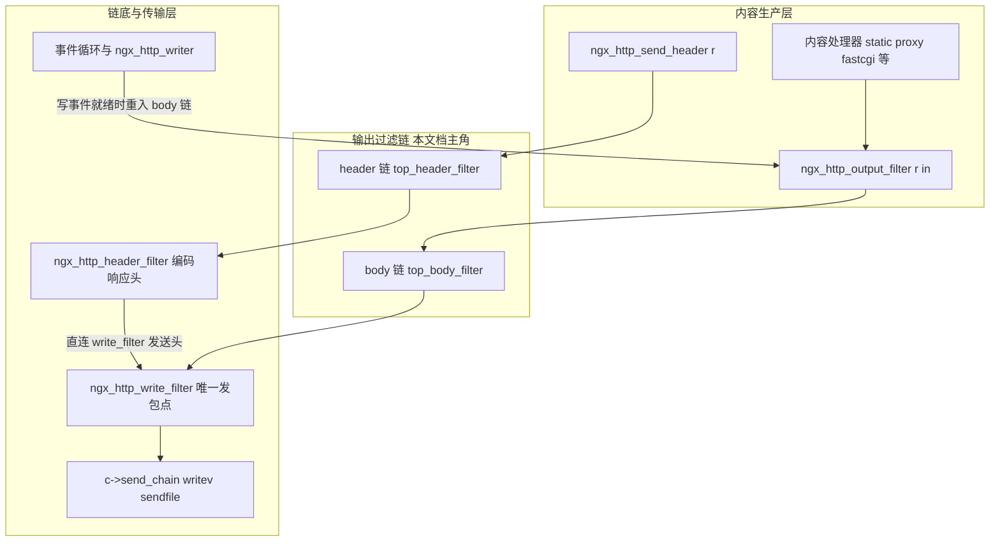
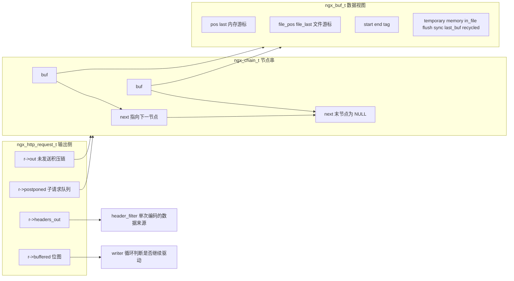
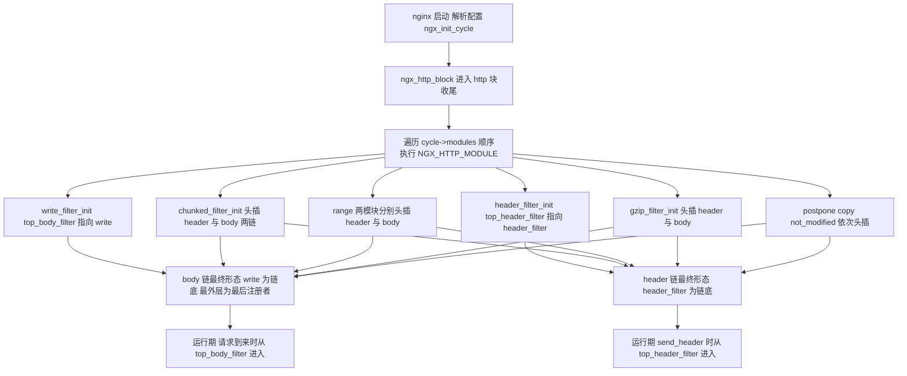
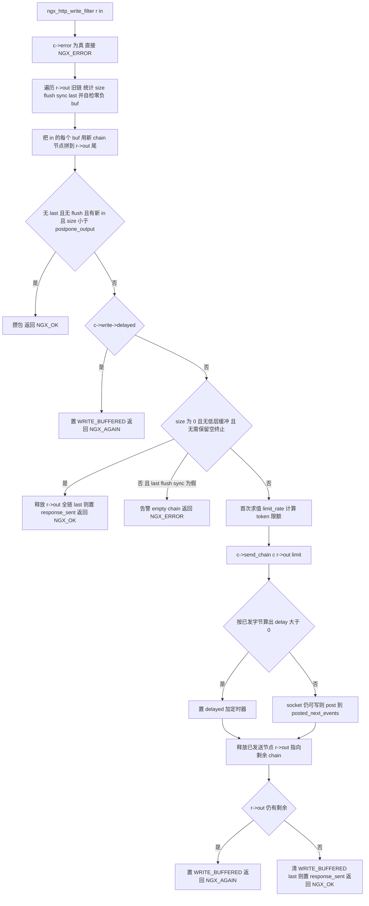
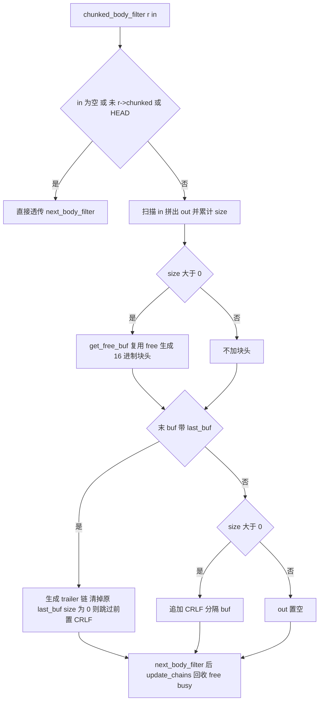
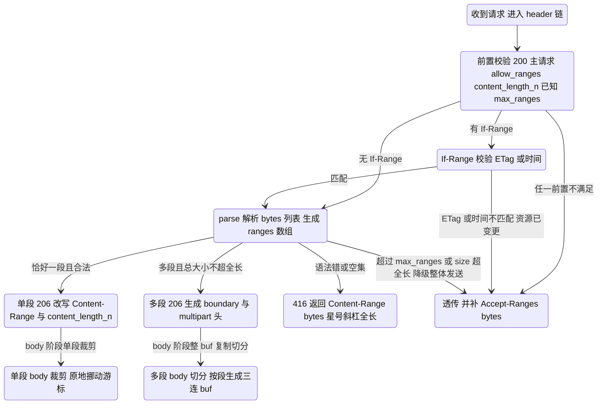
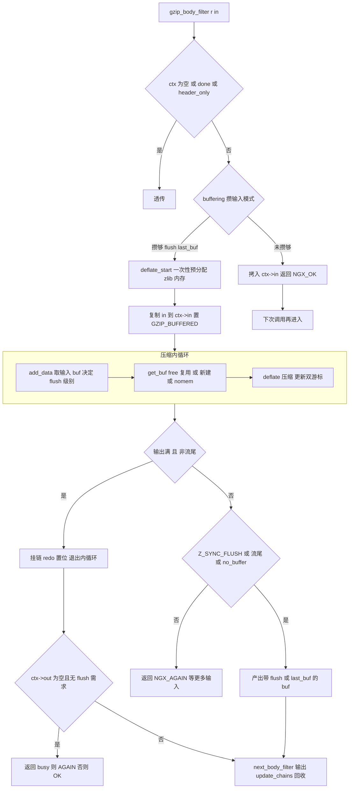
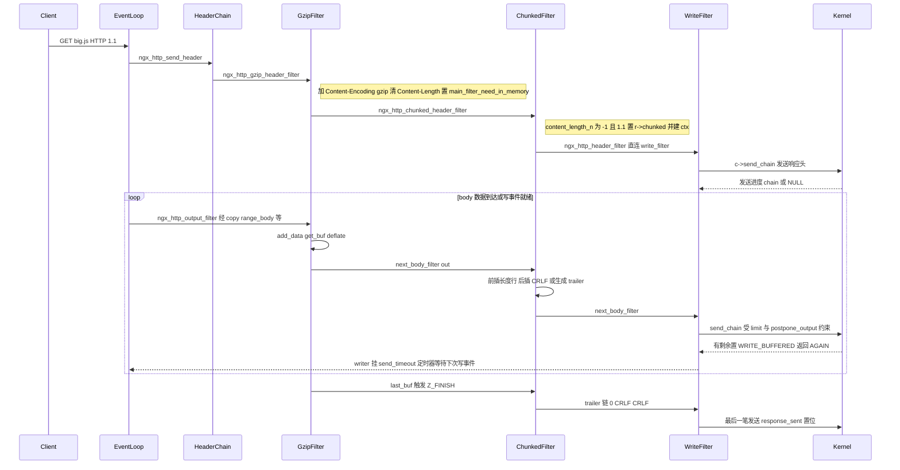

# HTTP 输出过滤链（header/body filter 全解）（基于 nginx-1.27.0 源码）

> **导读**：读完本文你将掌握——nginx 两条输出过滤链（header 链与 body 链）如何在编译期与运行期被"织"出来；一条响应（状态行、通用头、body 数据）如何被十几个过滤器依次改造；write filter 的 busy/free buf 复用与 `postpone_output` 攒包、`limit_rate` 限速算法；header filter 的 Content-Length 与 chunked 决策树；not_modified/chunked/range/gzip/postpone/copy 六大过滤器的完整源码走读；以及 special_response 如何把一个错误码变成一页 HTML 并借内部跳转复用 error_page。所有结论均落到具体源码行号。
>
> **前置阅读建议**：先了解 `ngx_buf_t`/`ngx_chain_t` 双游标缓冲模型（src/core/ngx_buf.h:20-62）、nginx 模块 `ctx`/`postconfiguration` 机制、事件驱动的 `ngx_http_writer` 写循环（src/http/ngx_http_request.c:2858-2928）。不需要预读 HTTP/2 或上游模块。
>
> **涉及源码清单**（全部在本仓库内，行号以本文实际读取为准）：
>
> | 文件 | 角色 |
> | --- | --- |
> | src/http/ngx_http_write_filter_module.c | body 链链底：真正发包 |
> | src/http/ngx_http_header_filter_module.c | header 链链底：编码状态行与响应头 |
> | src/http/ngx_http_postpone_filter_module.c | 子请求输出排序 |
> | src/http/ngx_http_copy_filter_module.c | 文件 buf 拷入内存（AIO/线程池联动） |
> | src/http/modules/ngx_http_chunked_filter_module.c | chunked 编码与 trailer |
> | src/http/modules/ngx_http_range_filter_module.c | 单段/多段 Range |
> | src/http/modules/ngx_http_not_modified_filter_module.c | 条件请求 304/412 |
> | src/http/modules/ngx_http_gzip_filter_module.c | gzip 压缩 |
> | src/http/ngx_http_special_response.c | 错误页生成与内部跳转 |
> | auto/modules、src/http/ngx_http.c | 链的编译期与运行期构建 |
> | src/core/ngx_buf.h、src/core/ngx_buf.c、src/core/ngx_output_chain.c | buf 模型与 output_chain |

---

## 1. 本模块在 nginx 中的位置与职责

nginx 处理一个 HTTP 请求的输出时，并不存在一个"响应生成器直接写 socket"的过程。内容处理器（static、proxy、fastcgi 等）只负责往 `ngx_http_output_filter(r, chain)` 里灌数据；数据的"最后一公里"——限速、压缩、分块、条件请求、错误页——全部由一条**函数指针链**完成。这条链由两个全局指针定义（src/http/ngx_http_core_module.h:523-525）：

```c
typedef ngx_int_t (*ngx_http_output_header_filter_pt)(ngx_http_request_t *r);
typedef ngx_int_t (*ngx_http_output_body_filter_pt)
    (ngx_http_request_t *r, ngx_chain_t *chain);
```

以及两个全局变量（src/http/ngx_http.h:193-195）：`ngx_http_top_header_filter` 与 `ngx_http_top_body_filter`。每个过滤模块在配置解析阶段的 `postconfiguration` 回调里做一次**头插法**注册：

```c
// src/http/ngx_http_copy_filter_module.c:389-396
static ngx_int_t
ngx_http_copy_filter_init(ngx_conf_t *cf)
{
    ngx_http_next_body_filter = ngx_http_top_body_filter;
    ngx_http_top_body_filter = ngx_http_copy_filter;

    return NGX_OK;
}
```

于是"数组里越靠后的模块，越晚注册、越靠近链头、越早被调用"。两个入口函数是所有过滤器的总闸（src/http/ngx_http_core_module.c:1853-1872）：

```c
ngx_int_t
ngx_http_output_filter(ngx_http_request_t *r, ngx_chain_t *in)
{
    ...
    rc = ngx_http_top_body_filter(r, in);

    if (rc == NGX_ERROR) {
        /* NGX_ERROR may be returned by any filter */
        c->error = 1;
    }

    return rc;
}
```

### 1.1 编译期顺序：auto/modules 的"过滤器名册"

过滤器在 src/http 里的**排序责任**落在 auto/modules。文件里有一段著名注释（auto/modules:122-143）："the filter order is important"，随后列出 write_filter → header_filter → chunked → v2/v3 → range_header → gzip → postpone → ssi/charset/xslt/image/sub/addition/gunzip/userid/headers → copy → range_body → not_modified → slice 的顺序（auto/modules:148-176 的 `ngx_module_order` 决定模块索引）。运行期注册循环则按模块索引顺序执行 `postconfiguration`（src/http/ngx_http.c:302-314）：

```c
for (m = 0; cf->cycle->modules[m]; m++) {
    if (cf->cycle->modules[m]->type != NGX_HTTP_MODULE) {
        continue;
    }

    module = cf->cycle->modules[m]->ctx;

    if (module->postconfiguration) {
        if (module->postconfiguration(cf) != NGX_OK) {
            return NGX_CONF_ERROR;
        }
    }
}
```

因为每个 init 都是"先记住旧链头、再把自己插到链头"，最终：**body 链从外到内是 slice(若启用) → range_body → copy → …内容类过滤器… → postpone → gzip → chunked → write；header 链从外到内是 slice(待验证，slice 模块未在本文精读) → not_modified → range_header → gzip → v2/v3 → chunked → header_filter**。write filter 只注册 body 链（src/http/ngx_http_write_filter_module.c:365-371），header_filter 只注册 header 链（src/http/ngx_http_header_filter_module.c:628-634），其余模块大多两条链都注册（如 chunked，src/http/modules/ngx_http_chunked_filter_module.c:331-341）。

### 1.2 架构位置图



图解：header 链与 body 链在 `ngx_http_write_filter` 处**汇合**——header_filter 编码完整个响应头后不调用 `next_header_filter`，而是直接调 `ngx_http_write_filter(r, &out)`（src/http/ngx_http_header_filter_module.c:621-624），把头 buf 交给唯一的发包点。body 链上任何过滤器返回的 `NGX_ERROR` 都会被 `ngx_http_output_filter` 捕获并置 `c->error = 1`（src/http/ngx_http_core_module.c:1866-1869），后续 write filter 一进来就因 `c->error` 短路（src/http/ngx_http_write_filter_module.c:59-61）。

### 1.3 一条响应穿越全部过滤器的旅程


图解：上半程是 header 链——所有"改变响应形态"的决策（304、206、gzip、chunked）必须在响应头编码**之前**完成，因此它们排成一条链先跑；下半程是 body 链——每块数据到达时被逐层加工，最后由 write filter 决定"现在发多少、发多快"。注意 copy_filter 在 body 链中位置靠外（先于 gzip/postpone 被调用），这正是它能提前把文件内容准备好、满足下游"要内存不要文件"诉求的原因（见 6.8 节）。

---

## 2. 核心数据结构精讲

### 2.1 ngx_buf_t：一切数据的载体

过滤器之间流动的不是裸内存，而是带双游标的 buf。字段全景（src/core/ngx_buf.h:20-56）：

| 字段 | 类型/位域 | 含义 |
| --- | --- | --- |
| `pos` / `last` | `u_char *` | 内存区间游标：`last - pos` 是待发送字节数，发送后 `pos` 前移 |
| `file_pos` / `file_last` | `off_t` | 文件区间游标，仅 `in_file` 时有意义 |
| `start` / `end` | `u_char *` | 底层缓冲区首尾，游标在 `[start, end]` 内滑动 |
| `tag` | `ngx_buf_tag_t` | 所属模块指针，free/busy 回收的身份凭证 |
| `file` | `ngx_file_t *` | `in_file` 时指向文件对象 |
| `shadow` | `ngx_buf_t *` | 指向本 buf 的"影子"（如 sendfile 用的原始文件 buf） |
| `temporary` | 1 bit | 内存内容**可修改**（如 gzip 输出缓冲） |
| `memory` | 1 bit | 只读内存（如静态错误页字符串） |
| `mmap` | 1 bit | mmap 内容，只读 |
| `recycled` | 1 bit | buf 来自 free 链复用，迫使 write filter 视作 flush 点 |
| `in_file` | 1 bit | 数据在文件中 |
| `flush` | 1 bit | 冲刷点：攒包逻辑必须立刻放行 |
| `sync` | 1 bit | 纯信号 buf，无数据（占位同步用） |
| `last_buf` | 1 bit | 整个响应的最后一块（main 请求才可置） |
| `last_in_chain` | 1 bit | 本次 chain 的最后一块 |
| `last_shadow` / `temp_file` | 1 bit | 上游临时文件相关 |

四个宏决定所有过滤器的分支行为（src/core/ngx_buf.h:125-138）：`ngx_buf_in_memory`（temporary||memory||mmap）、`ngx_buf_special`（flush/last_buf/sync 且无数据）、`ngx_buf_sync_only`、`ngx_buf_size`（内存取 `last-pos`，文件取 `file_last-file_pos`）。

### 2.2 ngx_chain_t 与请求上的关键输出字段

链表节点只有两个字段（src/core/ngx_buf.h:59-62）。请求结构上的输出相关字段（src/http/ngx_http_request.h:424-429、533-570）：

| 字段 | 含义 | 谁读写 |
| --- | --- | --- |
| `r->out` | write filter 的**未发送积压链**，是整个 body 链唯一持久化的输出队列 | write filter 独占 |
| `r->postponed` | 子请求输出队列 | postpone filter 独占 |
| `r->buffered` | 4 bit 位图，"是否还有数据没写完" | 各过滤器置位/清位 |
| `r->header_sent` / `r->response_sent` | 头/响应已发出标志 | header/write filter |
| `r->main_filter_need_in_memory` / `r->filter_need_in_memory` | 声明"下游要内存数据" | gzip 置位，copy 消费 |
| `r->allow_ranges` / `single_range` / `subrequest_ranges` | Range 许可位 | 内容处理器设置 |

buffered 位图定义（src/http/ngx_http_request.h:147-152）：`NGX_HTTP_LOWLEVEL_BUFFERED 0xf0`、`NGX_HTTP_WRITE_BUFFERED 0x10`、`NGX_HTTP_GZIP_BUFFERED 0x20`、`NGX_HTTP_COPY_BUFFERED 0x04`、`NGX_HTTP_SSI_BUFFERED 0x01`、`NGX_HTTP_SUB_BUFFERED 0x02`。注意 0xf0 与 0x10/0x20 有意交叠：write filter 用 `c->buffered & NGX_LOWLEVEL_BUFFERED`（取高 4 位，即 SSL/HTTP2 等传输层缓冲）判断"除了 HTTP 层还有没有人欠着数据"（src/http/ngx_http_write_filter_module.c:228-231、357-359）。

### 2.3 ngx_http_headers_out_t：header 链的全部输入

定义于 src/http/ngx_http_request.h:258-293。关键字段：

| 字段 | 说明 |
| --- | --- |
| `headers` / `trailers` | 通用头/trailer 的 `ngx_list_t`，元素是 `ngx_table_elt_t` |
| `status` / `status_line` | 数字状态码；`status_line` 非空则优先使用（可自定义短语） |
| `server`/`date`/`content_length`/`content_encoding`/`location`/`last_modified`/`content_range`/`accept_ranges`/`etag`/`cache_control` | 常用头的**快捷指针**，指向 `headers` 列表中的元素；`hash=0` 表示"已删除" |
| `content_type` / `content_type_len` / `charset` | Content-Type 由三个字段拼装（charset 只有在 `content_type_len == content_type.len` 时才追加，即上游没有自带参数时） |
| `content_length_n` | `off_t` 数值型长度；`-1` 表示未知（chunked 的前提） |
| `content_offset` | 响应实际起始文件偏移（Range 语义用） |
| `last_modified_time` | `time_t`；`-1` 表示无 Last-Modified |

`content_length`（表元素）与 `content_length_n`（数值）的**双轨制**是理解 header 链的钥匙：过滤器改数值，header filter 负责把数值编码成头；而要"删头"时则把表元素 `hash` 置 0（header filter 遍历时跳过 hash==0，src/http/ngx_http_header_filter_module.c:430-432）。

### 2.4 各过滤器私有上下文

- **ngx_http_postponed_request_t**（src/http/ngx_http_request.h:359-363）：`request`（该节点属于哪个子请求，NULL 表示这是"父请求自己的数据"节点）、`out`（攒下的 chain）、`next`。
- **ngx_http_chunked_filter_ctx_t**（src/http/modules/ngx_http_chunked_filter_module.c:13-16）：仅 `free`/`busy` 两条回收链。
- **ngx_http_range_filter_ctx_t / ngx_http_range_t**（src/http/modules/ngx_http_range_filter_module.c:48-59）：`offset` 记录 body 已流过多少字节、`boundary_header`（multipart 边界头模板）、`ranges` 数组（每项 `start/end/content_range` 字符串）。
- **ngx_http_gzip_ctx_t**（src/http/modules/ngx_http_gzip_filter_module.c:33-67）：`in`（待压缩输入链）、`free/busy/out/last_out`（输出管理）、`preallocated/free_mem/allocated`（给 zlib 的一次性大块内存）、`zstream`、位标志 `flush/redo/done/nomem/buffering/zlib_ng/state_allocated`、统计 `zin/zout`。
- **ngx_output_chain_ctx_t**（src/core/ngx_buf.h:78-110）：copy filter 借用的通用引擎，`need_in_memory/need_in_temp` 决定拷贝策略，`output_filter/filter_ctx` 指回下游过滤器。

### 2.5 数据结构关系图



图解：`r->out` 与 `r->postponed` 都是 `ngx_chain_t` 链，链上每个节点包一个 `ngx_buf_t`；buf 用双游标描述"数据在哪、发到哪"，用标志位描述"我是什么性质"。header 链不产生 chain 队列——它只消费 `headers_out`，一次性编码后立即交给 write filter；body 链则全程围绕 chain 的拼装、裁剪、回收展开。

---

## 3. 初始化流程

### 3.1 流程图



### 3.2 注册代码逐个确认

各过滤器 init 的一致写法（两行头插）已在 1 节展示 copy filter 的版本；其余为：

- write filter：只挂 body 链，`ngx_http_top_body_filter = ngx_http_write_filter;`（src/http/ngx_http_write_filter_module.c:365-371）。它没有 `next` 静态变量——它就是链的**终点**，无需转发。
- header filter：`ngx_http_top_header_filter = ngx_http_header_filter;`（src/http/ngx_http_header_filter_module.c:628-634）。
- chunked：四行，header/body 各头插一次（src/http/modules/ngx_http_chunked_filter_module.c:331-341）。
- range：**一个源文件、两个模块**。`ngx_http_range_header_filter_module` 注册 header 链（src/http/modules/ngx_http_range_filter_module.c:967-974），`ngx_http_range_body_filter_module` 注册 body 链（src/http/modules/ngx_http_range_filter_module.c:977-984）。拆成两个模块的原因：header 决策（选单段/多段）要把 ctx 挂到 body 模块名下——`ngx_http_set_ctx(r, ctx, ngx_http_range_body_filter_module)`（src/http/modules/ngx_http_range_filter_module.c:232），body 阶段再按模块取回（src/http/modules/ngx_http_range_filter_module.c:648）。
- not_modified：只挂 header 链（src/http/modules/ngx_http_not_modified_filter_module.c:259-266）。
- gzip/postpone/copy：均 header+body 或 body，见 6 节各处 init。

**易错点**：模块在 auto/modules 中的顺序若被第三方动态模块打乱（如把 gzip 挪到 chunked 之后），header 链语义会被破坏——gzip 依赖"chunked 先看 content_length_n"吗？恰恰相反：gzip 先于 chunked 被调用，gzip 清空 `content_length_n` 后 chunked 才能依据"未知长度"打开 `r->chunked`。所以 auto/modules:122 的注释"the filter order is important"绝非装饰。

---

## 4. 核心执行流程/状态机

### 4.1 两条链的驱动入口与写循环

驱动 force 有三股：

1. 内容处理器显式调用：`ngx_http_send_header(r)`（src/http/ngx_http_core_module.c:1831-1850，内部只是把 `err_status` 折算进 `status` 后调 `ngx_http_top_header_filter(r)`）与 `ngx_http_output_filter(r, chain)`（src/http/ngx_http_core_module.c:1853-1872）。
2. 事件写循环：socket 可写或定时器到期时 `ngx_http_writer(r)` 被调用，它以 `in = NULL` 重入 body 链（src/http/ngx_http_request.c:2858-2928，第 2898 行 `rc = ngx_http_output_filter(r, NULL);`），把各过滤器积压的半成品继续往下推。
3. posted requests：子请求完成时被 `ngx_http_post_request` 挂入 `main->posted_requests`（src/http/ngx_http_request.c:2475-2495），由 `ngx_http_run_posted_requests` 在安全点逐个 `write_event_handler(r)`（src/http/ngx_http_request.c:2442-2472）。

`ngx_http_writer` 的退出条件（src/http/ngx_http_request.c:2909-2920）非常有信息量：`r->buffered || r->postponed || (r == r->main && c->buffered)` 任一非零，就重新挂 `send_timeout` 定时器等下一次写事件——**"r->buffered 是 HTTP 层欠账，c->buffered 是传输层欠账"** 的双账本设计。

### 4.2 write filter 状态机



图解：这条状态机的骨架是"**审计旧账 → 记新账 → 决定发不发 → 发 → 回收**"。两个最容易误读的分支：其一，攒包判定（src/http/ngx_http_write_filter_module.c:219-221）要求 `in` 非空——`ngx_http_writer` 以 `in=NULL` 重入时绕过攒包，保证积压总能被发送；其二，"size 为 0"分支只在链上只剩信号 buf 时触达，若此时连 `last/flush/sync` 都没有，说明上游状态机出了 bug，直接 `ngx_debug_point()` 告警（src/http/ngx_http_write_filter_module.c:250-255）。

### 4.3 header filter 的 Content-Length/chunked 决策树

决策分散在两处、但严格有序：

1. gzip header filter：命中压缩条件就 `ngx_http_clear_content_length(r)`（src/http/modules/ngx_http_gzip_filter_module.c:291），把 `content_length_n` 归位 -1。
2. chunked header filter：`content_length_n == -1 || r->expect_trailers` 时，若 `http_version >= 1.1` 且 `chunked_transfer_encoding` 开启 → 置 `r->chunked = 1`；否则（含 HTTP/1.0 客户端）→ `r->keepalive = 0`（src/http/modules/ngx_http_chunked_filter_module.c:74-98）。
3. header filter 编码期：`r->chunked` 为真 → 输出 `Transfer-Encoding: chunked`（src/http/ngx_http_header_filter_module.c:378-380、553-556）；`content_length == NULL && content_length_n >= 0` → 输出 `Content-Length: %O`（src/http/ngx_http_header_filter_module.c:504-509）。

HTTP/1.0 兼容体现在三点：状态行恒写 `HTTP/1.1 `字面量（src/http/ngx_http_header_filter_module.c:444，`sizeof("HTTP/1.x ")` 恰好等长）；1.0 + 未知长度宁可降级为 `Connection: close`（chunked filter 95-97 行）；`Connection` 头三分支 upgrade/keep-alive/close（src/http/ngx_http_header_filter_module.c:382-402），其中 keep-alive 分支可附 `Keep-Alive: timeout=N`（396-398）。

### 4.4 not_modified 判定流程

顺序即语义（src/http/modules/ngx_http_not_modified_filter_module.c:54-109）：仅对**主请求 + 200 响应 + 未被 `disable_not_modified` 禁用**生效；先查前置条件 `If-Unmodified-Since`/`If-Match`，失败则经 `ngx_http_filter_finalize_request` 转 412（64-76）；再查 `If-Modified-Since`/`If-None-Match`：任一"未修改"证据成立就把响应**就地改造**为 304——清 status_line、清 content_type、`ngx_http_clear_content_length`、清 Accept-Ranges、连 `Content-Encoding` 表元素也摘掉（94-103），然后照常传递给下游编码。304 改造后的实际发送由 header filter 的 `r->header_only → b->last_buf = 1` 收尾（src/http/ngx_http_header_filter_module.c:617-619）。

### 4.5 chunked body filter 与 trailer



图解：每个数据 buf 前插 `%xO\r\n` 长度行、后插 `\r\n`；`last_buf` 被摘除并替换为 trailer 链（无 trailer 时就是 `\r\n0\r\n\r\n`，有 trailer 时是 `\r\n0\r\n头列表\r\n`）。`r->expect_trailers`（由 `add_trailer` 指令相关逻辑置位，本文未精读该路径，机制待验证）会让 chunked 在有已知 Content-Length 时也改走 chunked，以便携带 trailer（src/http/modules/ngx_http_chunked_filter_module.c:74-84）。

### 4.6 range filter 状态机



图解：单段（`ctx->ranges.nelts == 1`）走 `ngx_http_range_singlepart_body`——它**原地挪动游标**裁剪：区间外的部分 `pos = last` 或 `file_pos = file_last` 并置 `sync` 信号（src/http/modules/ngx_http_range_filter_module.c:760-773），区间首尾各砍一刀（775-794）。多段走 `ngx_http_range_multipart_body`——它要求**整个 body 在一个 buf 里**（src/http/modules/ngx_http_range_filter_module.c:658-670 的注释与守卫），然后按每个 range 生成"边界头 buf + Content-Range buf + 数据 buf"三连，最后补 `--boundary--` 终止 buf（837-964）。

### 4.7 gzip filter 状态机



图解：gzip 的复杂度全在"**三个环形队列（in/free/busy）+ 一个 redo 位**"的协作上。`nomem` 时不是报错，而是先 `next_body_filter(r, NULL)` 把下游欠账冲下去、`update_chains` 回收 out buf，再继续压缩（src/http/modules/ngx_http_gzip_filter_module.c:360-377）——这是整条链"反压"协同的典范。

### 4.8 postpone filter：子请求顺序控制

规则用一句话概括：**同一连接上，`c->data` 指向"当前拥有发言权"的请求**。非焦点请求的输出全部 `ngx_http_postpone_filter_add` 攒进自己的 `r->postponed`（src/http/ngx_http_postpone_filter_module.c:69-86）；焦点请求若自己没有欠账，数据直接放行到 `next_body_filter(r->main, in)`（88-95）；一旦自己有欠账（说明轮到某个子请求说话），连自己的新数据也要入队，然后从队首开始：遇 `pr->request` 节点就把 `c->data` 切到该子请求并 `ngx_http_post_request` 唤醒它（103-117），遇 `pr->out` 节点就把攒好的数据放行（119-131）。子请求全部结束后父请求通过同样的循环收回话语权。

### 4.9 copy filter 与 ngx_output_chain：文件 buf 拷入内存的时机

copy filter 本体只是"配置装配 + 委托"：首次调用时按请求上的声明位装配 `ngx_output_chain_ctx_t`——`need_in_memory = r->main_filter_need_in_memory || r->filter_need_in_memory`，`need_in_temp = r->filter_need_temporary`（src/http/ngx_http_copy_filter_module.c:110-112），AIO/线程池 handler 按 `aio` 指令挂载（124-134），随后整个逻辑交给通用引擎 `ngx_output_chain`（src/core/ngx_output_chain.c:42-246）。引擎对每个 buf 先问 `ngx_output_chain_as_is`（src/core/ngx_output_chain.c:249-306）：special 直接放行；directio 打开时关 sendfile（282-284）；`need_in_memory` 且 buf 不在内存 → 必须拷（297-299）。拷贝动作在 `ngx_output_chain_copy_buf` 中进行，AIO/线程池提交后返回 `NGX_AGAIN`，完成事件回调 `r->write_event_handler(r)` 重新驱动链条（src/http/ngx_http_copy_filter_module.c:181-223、301-356）。**拷入内存的时机 = 下游有人声明 need_in_memory 的那一刻之后、数据流过 copy filter 的那一次调用**；典型触发者是 gzip 的 `r->main_filter_need_in_memory = 1`（src/http/modules/ngx_http_gzip_filter_module.c:289）。

---

## 5. 关键时序图



图解：请抓住三个要点——(1) header 链一次跑完且在**任何 body 字节**之前发出（chunked 的 `r->chunked` 必须在 header 编码前定案）；(2) body 链会被事件循环以 `in=NULL` 反复重入，gzip/chunked/write 都要为"半途"状态负责（各自的 `*_BUFFERED` 位与 free/busy 队列）；(3) `last_buf` 是贯穿全链的"流尾信号"，gzip 用它切 `Z_FINISH`，chunked 用它替换为终止块，write filter 用它置 `r->response_sent` 并决定日志与连接复用（src/http/ngx_http_write_filter_module.c:353-355）。

---

## 6. 源码逐段精读

本节是全文主体。阅读约定：每小节先给函数签名与职责，再按代码块顺序讲解，关键行标注 `文件:起始行-结束行`，最后列易错点。

#### 6.0 精读路线图

| 小节 | 文件 | 核心函数 | 关键行 |
| --- | --- | --- | --- |
| 6.1 | src/http/ngx_http_write_filter_module.c | `ngx_http_write_filter` | 47-362 |
| 6.2 | src/http/ngx_http_header_filter_module.c | `ngx_http_header_filter` | 156-625 |
| 6.3 | src/http/modules/ngx_http_not_modified_filter_module.c | not_modified_header_filter 与三个判定函数 | 54-256 |
| 6.4 | src/http/modules/ngx_http_chunked_filter_module.c | chunked_header_filter / body_filter / create_trailers | 59-328 |
| 6.5 | src/http/modules/ngx_http_range_filter_module.c | range_header_filter / parse / singlepart / multipart 四组 | 146-964 |
| 6.6 | src/http/modules/ngx_http_gzip_filter_module.c | gzip_header_filter / body_filter 及压缩三函数 | 220-999 |
| 6.7 | src/http/ngx_http_postpone_filter_module.c | postpone_filter / add / in_memory | 54-249 |
| 6.8 | src/http/ngx_http_copy_filter_module.c | copy_filter 与 AIO/threads handler；引擎在 src/core/ngx_output_chain.c | 82-358、42-306 |
| 6.9 | src/http/ngx_http_special_response.c | special_response_handler / filter_finalize / send_error_page / send_special_response | 415-857 |

阅读顺序建议：先 6.1（终点语义），再 6.2（头的形态），然后按数据流 6.3 → 6.5 → 6.6 → 6.4 → 6.7 → 6.8，最后 6.9（错误路径是 header/body 两链的会合点）。每小节末尾的"易错点"是扩展自定义过滤器时的踩坑清单。

### 6.1 write filter：src/http/ngx_http_write_filter_module.c

#### 6.1.1 模块骨架

模块无指令、无任何 conf 钩子，ctx 只注册 `postconfiguration`（src/http/ngx_http_write_filter_module.c:16-28），`ngx_http_write_filter` 是导出函数（src/http/ngx_http_core_module.h:531 有原型），因为 header filter 要绕过 body 链直呼它。

#### 6.1.2 ngx_http_write_filter（src/http/ngx_http_write_filter_module.c:47-362）

签名 `ngx_int_t ngx_http_write_filter(ngx_http_request_t *r, ngx_chain_t *in)`。局部变量四件套（50-55 行）：`size`（新旧链总字节数）、`last/flush/sync`（三个信号聚合位）、`ll`（尾插双指针）。

**第一段：审计旧链**（63-132）。`ll = &r->out`（67 行）后遍历旧积压链，`ll = &cl->next`（72 行）不断推进尾指针——这是 nginx 标准的"找到链尾插入点"写法。审计中做两次安全自检：零尺寸非 special buf（83-99）与负尺寸 buf（101-117）都视为致命错误，打 ALERT 并 `ngx_debug_point()`。随后聚合信号：`flush || recycled` 置 `flush`（121-123，注意 **recycled 被当作 flush 等价物**——复用 buf 意味着原持有者不能再等），`sync` 置 `sync`（125-127），`last_buf` 置 `last`（129-131）。

**第二段：拼接新链**（134-206）。对 `in` 的每个节点 `ngx_alloc_chain_link` 分配新链节点、`cl->buf = ln->buf` **只借 buf 不拷数据**（137-144），尾插后同样做零/负尺寸自检与信号聚合（155-203），最后 `*ll = NULL` 封口（206 行）。至此 `r->out` 是"旧账+新账"的完整待发队列。

**第三段：攒包判定**（208-221）：

```c
// src/http/ngx_http_write_filter_module.c:219-221
    if (!last && !flush && in && size < (off_t) clcf->postpone_output) {
        return NGX_OK;
    }
```

四个条件缺一不可：没到流尾、没有冲刷点、**本次确实有新数据**（`in` 非空，防止 writer 空转重入被攒）、总量小于 `postpone_output`。`postpone_output` 默认 1460 字节（src/http/ngx_http_core_module.c:3834-3835），恰好一个 MSS——把小包攒进一个以太网帧。

**第四段：delayed 短路**（223-226）。若写事件被限速定时器压住，置 `NGX_HTTP_WRITE_BUFFERED` 返回 `NGX_AGAIN`，数据安全地躺在 `r->out`。

**第五段：空链收尾**（228-256）。`size == 0` 且传输层无低层缓冲（`c->buffered & NGX_LOWLEVEL_BUFFERED`，0xf0 高四位），且不满足 HTTP/2 需要空终止 buf 的两个特例（`last && c->need_last_buf`、`flush && c->need_flush_buf`，这两个标志由 HTTP/2 建流时设置，src/http/v2/ngx_http_v2_filter_module.c:625-626）时：若有信号在身（last/flush/sync）就整链释放、`r->out = NULL`、清 WRITE_BUFFERED，`last` 则置 `r->response_sent = 1`（234-247）；否则是协议层 bug，`"the http output chain is empty"` 告警（250-253）。

**第六段：限速预算**（258-292）。`limit_rate` 是复杂值，首次需要时才求值并缓存到 `r->limit_rate`（258-261，配合 `r->limit_rate_set` 位，src/http/ngx_http_request.h:526）。核心公式：

```c
// src/http/ngx_http_write_filter_module.c:271-272
        limit = (off_t) r->limit_rate * (ngx_time() - r->start_sec + 1)
                - (c->sent - r->limit_rate_after);
```

这是一个**按秒补给的令牌桶**：每过 1 秒发放 `limit_rate` 字节额度，减去已发送量（`limit_rate_after` 之前的字节不计费）。额度 ≤ 0 时置 `c->write->delayed = 1`，定时器时长 `-limit*1000/limit_rate + 1` 毫秒（274-281）——欠多少字节睡多少毫秒。额度充足时再被 `sendfile_max_chunk` 封顶（284-288，默认 2MB，src/http/ngx_http_core_module.c:3812-3813）；未开限速时 `limit` 就是 `sendfile_max_chunk`（290-292）。

**第七段：真正发送**（294-307）。`chain = c->send_chain(c, r->out, limit)`（299 行）——多路复用协议（HTTP/2）会替换该函数指针；返回 `NGX_CHAIN_ERROR` 则 `c->error = 1`。

**第八段：发送后限速**（309-332）。这一笔实际发出 `nsent - sent` 字节，折算耗时 `(nsent - sent)*1000/limit_rate` 毫秒，大于 0 就再挂定时器（326-331）——保证即使一次 send_chain 通关，也不会把下一秒的额度提前用掉。`limit_rate_after` 的处理（313-324）把起征点前的字节从两侧同时扣掉，避免负数。

**第九段：再调度与回收**（334-344）。socket 仍可写且未被延迟时 `ngx_post_event(c->write, &ngx_posted_next_events)`（334-336）——立刻再排一次写事件，追求单次调用清空积压；随后释放 `chain` 之前的已发送节点（338-342，`ngx_free_chain` 还回请求池的 chain 缓存），`r->out = chain`（344 行）。

**第十段：返回值**（346-361）。有剩余 → 置位并 `NGX_AGAIN`；无剩余 → 清位，`last` 置 `response_sent`，若传输层仍欠账且本请求无 postponed 队列则仍返回 `NGX_AGAIN`（357-359，防止 writer 过早 finalize），否则 `NGX_OK`。

**易错点**：(1) write filter 从不复制 buf 数据，只复制链节点，因此上游过滤器在数据进入 `r->out` 之后**不得再改写 buf 内容**（除非走 recycled 语义）；(2) `recycled` 等价 flush 是为了 free 链复用安全，新写的过滤器若误置 recycled 会导致意外提前冲刷；(3) 攒包判定里的 `in` 条件是 1.11.x 之后修正的关键防死等细节（旧版依赖 writer 重入绕过）。

#### 6.1.3 init（365-371）

仅一行赋值，见 3.2 节。因为 write filter 不持有 `next` 静态指针，它是 body 链上唯一"只进不出"的过滤器——所有上游过滤器的 `ngx_http_next_body_filter` 最终都收敛到这个函数。

#### 6.1.4 返回值语义与上游配合

| 返回值 | 触发条件 | 上游如何消化 |
| --- | --- | --- |
| `NGX_OK` | 链已清空（或仅剩信号 buf 被安全释放，234-247） | 内容处理器可 finalize；writer 检查 `r->buffered || r->postponed || c->buffered` 决定是否还需挂定时器 |
| `NGX_AGAIN` | `r->out` 有剩余（346-348）、写事件 delayed（223-226）、或传输层仍欠账（357-359） | writer 挂 `send_timeout` 定时器等写事件；write filter 侧可能已 `ngx_post_event` 加速重试 |
| `NGX_ERROR` | `c->error`（59-61）、buf 自检失败（83-117、155-189）、`send_chain` 失败（304-307）、空链告警（250-255） | `ngx_http_output_filter` 置 `c->error = 1`（src/http/ngx_http_core_module.c:1866-1869），后续过滤器短路 |

`NGX_AGAIN` 不等于"出错重试"，而是"HTTP 层记账未清"——这正是 `NGX_HTTP_WRITE_BUFFERED` 位存在的意义；writer 的欠账判断在 src/http/ngx_http_request.c:2909-2920。

#### 6.1.5 send_chain 契约与再调度

`chain = c->send_chain(c, r->out, limit)`（src/http/ngx_http_write_filter_module.c:299）的契约：返回**未发送完的链**（可能是 `r->out` 的中段指针——已发送部分被内核消化、游标前移）或 `NGX_CHAIN_ERROR`。334-336 的再调度细节：socket 仍可写且未被限速延迟时，把写事件挂入 `ngx_posted_next_events` 队列，让事件循环在 posted 阶段立即再跑一轮 write filter——比等待下一次 epoll 就绪更激进，能把一个"突发可写窗口"内的数据全部压出去（该队列的消费点位于事件循环主框架，未列入本文精读清单）。

#### 6.1.6 限速算例

设 `limit_rate 100k`、`limit_rate_after 1m`、响应 2m，请求开始至今已过 3 秒、`c->sent` 累计 1.2m：

- 额度 = `102400 * (3 + 1) - (1228800 - 1048576)` = 409600 − 180224 = 229376 字节可用（271-272 行公式）；
- `sendfile_max_chunk 2m` 不构成瓶颈，本次最多发 229376 字节；
- 发送后按 `delay = (nsent - sent) * 1000 / limit_rate` 决定是否再挂定时器（309-332）——保证连续两次 `send_chain` 之间至少间隔"上一笔字节数对应的传输时间"，即令牌不会在单次调用内被提前透支。`limit_rate_after` 的扣除在 313-324 完成，两侧同时扣、下限 0，防止响应刚开始时出现负数额度导致的巨大延迟。

#### 6.1.7 观测点

调试日志是理解这台状态机最快的途径：旧链审计 `write old buf t:%d f:%d ...`（74-81）、新链 `write new buf ...`（146-153）、状态汇总 `http write filter: l:%ui f:%ui s:%O`（208-209，即 last/flush/size 三元组）、限额 `http write filter limit %O`（296-297）、返回链 `http write filter %p`（301-302）。error.log 里 `"zero size buf in writer"` / `"negative size buf in writer"`（83-117、155-189）属于**上游过滤器违约**，排查对象是发送方而非 write filter 本身。

#### 6.1.8 r->out 演化实例

设一次调用 `in` 携带两个 800 字节内存 buf，旧 `r->out` 为空，`postpone_output` 默认 1460：

1. 旧链审计：空链，71-132 的循环体不执行；
2. 拼接：两个新链节点挂上 `r->out`，size=1600（134-206）；
3. 攒包判定：`size(1600) >= 1460` 不满足 → 不攒，直接发送（219-221）；
4. `send_chain` 送出 1000 字节返回剩余链（299）；释放已发送链节点，`r->out` 指向剩余部分，首 buf 的 `pos` 已被 send_chain 前移（338-344）；
5. 返回 `NGX_AGAIN` 并置 `NGX_HTTP_WRITE_BUFFERED`（346-348）；下一个写事件以 `in=NULL` 重入，绕过攒包送完余下 600 字节，返回 `NGX_OK` 并清位（351-361）。

若第 2 步 size 只有 800（< 1460）且无 flush：第 3 步直接 `return NGX_OK`，800 字节躺在 `r->out` 里等下一笔数据或 writer 重入——**"返回 OK 但数据未发送"** 是调用方最容易误解的语义点，原因正是攒包判定以 `in` 非空为前提。

### 6.2 header filter：src/http/ngx_http_header_filter_module.c

#### 6.2.1 静态表

状态行短语表按 2xx/3xx/4xx/5xx 分段存放，`ngx_null_string` 占位未实现码；`NGX_HTTP_LAST_2XX/3XX/4XX/5XX` 与三个 `OFF` 偏移宏把任意状态码折算成数组下标（src/http/ngx_http_header_filter_module.c:54-132）。`ngx_http_headers_out[]`（135-153）是 `Server/Date/Content-Length/...` 的名字-偏移表，供日志模块反查，与编码无关。

#### 6.2.2 ngx_http_header_filter（src/http/ngx_http_header_filter_module.c:156-625）

**入口守卫**（172-188）：`header_sent` 已置 → 直接 `NGX_OK`（幂等）；`r != r->main` → 子请求不发头；`http_version < 1.0` → 不发头；HEAD 请求置 `r->header_only`。**Last-Modified 收窄**（190-198）：只有 200/206/304 允许携带，其余状态清掉 `last_modified_time` 与表元素。

**状态行解析**（204-282）：优先 `headers_out.status_line`（210-215）；否则按段折算下标。两个特例：204 会顺手清空 Content-Type/Last-Modified/Content-Length 并置 `header_only`（226-233）；304 置 `header_only`（244-246）。查表得到空短语（如 203）或状态码越界（如 599）时回退为 `%03ui ` 数字短语（272-281）。

**长度预算**（284-436）：编码前精确累加每个将输出的字节数——Server 头按 `server_tokens` 三态选字符串（286-296）、Date 固定 29 字节 GMT 格式（298-300）、Content-Type + 可选 charset（302-311）、Content-Length（313-317）、Last-Modified（319-323）、Location 绝对化（327-376）、Transfer-Encoding（378-380）、Connection 三分支（382-402）、Vary（404-413）、最后遍历 `headers_out.headers` 列表跳过 `hash == 0`（415-436）。**这个"先算总长再一次性分配"的模式**保证整个响应头落在一个连续 buf 里。

**Location 绝对化**值得单独读（327-376）：仅当值以 `/` 开头且 `absolute_redirect` 开启时；主机名依次取 `server_name_in_redirect` 配置 → 请求 `Host` 头 → 本机地址（341-348）；端口默认 80/443 时省略（356-367）。编码阶段（521-551）会把拼好的绝对 URL **回写**进 `headers_out.location->value`（546-548），注释说明是"for possible logging"。

**一次性编码**（438-613）：`ngx_create_temp_buf(r->pool, len)` 分配精确大小的临时 buf（438-441），然后按预算顺序逐段 `ngx_cpymem/ngx_copy/ngx_sprintf`。三处回写注意点：charset 追加后同步改 `content_type` 供日志（495-498）；`Date` 直接用缓存的 `ngx_cached_http_time`（472-478）；通用头列表原样 `key: value CRLF` 拷贝（583-607）。结尾再补一对 CRLF（613 行），`r->header_size` 记录头的字节数供 `%H` 日志变量（615 行）。

**收尾**（615-624）：`header_only` 时给 buf 打 `last_buf`；组装单节点 chain；**直接调用 `ngx_http_write_filter(r, &out)`**（624 行）——这就是 1.2 节架构图中 header 链直连 body 链底的那条边。

**易错点**：(1) 想自定义状态短语必须设置 `status_line`，且非空才生效（277-281 会把空短语回退为数字）；(2) 从过滤器里"删除"响应头必须同时把表元素 `hash` 置 0 并将快捷指针置 NULL（参考 not_modified 100-103 对 Content-Encoding 的处理），只做其一会被编码或日志漏抓；(3) `b->last_buf` 只在 `header_only` 时置位，普通响应的 last_buf 由 body 链负责。

#### 6.2.3 状态码下标折算算例

按 src/http/ngx_http_header_filter_module.c:66-131 的宏定义：`NGX_HTTP_OFF_3XX = 207-200 = 7`、`NGX_HTTP_OFF_4XX = 309-301+7 = 15`、`NGX_HTTP_OFF_5XX = 430-400+15 = 45`。折算实例：

| 状态码 | 分支 | 下标算式 | 短语 |
| --- | --- | --- | --- |
| 200 | 2xx | 200-200=0 | 200 OK |
| 204 | 2xx 特例 | 204-200=4 | 204 No Content（同时清 Content-Type/Last-Modified/Content-Length 并置 header_only，226-233） |
| 302 | 3xx | 302-301+7=8 | 302 Moved Temporarily |
| 304 | 3xx 特例 | 304-301+7=10 | 304 Not Modified（同时置 header_only，244-246） |
| 416 | 4xx | 416-400+15=31 | 416 Requested Range Not Satisfiable |
| 500 | 5xx | 500-500+45=45 | 500 Internal Server Error |
| 599 | 越界 | 无 | `%03ui` 数字短语（272-275） |
| 203 | 查表为空 | 3 | 回退数字短语（277-281） |

#### 6.2.4 头输出顺序总览

编码段（444-613）的固定顺序：状态行 → Server → Date → Content-Type → Content-Length → Last-Modified → Location（绝对化） → Transfer-Encoding → Connection → Vary → 通用头列表 → 空行。这个顺序在"预算段"（284-436）与"编码段"（444-613）**两处并行维护**：新增一个响应头必须成对修改两段。预算偏小的后果是越界写（`ngx_create_temp_buf` 的缓冲被写穿），偏大的后果只是尾部少量浪费（输出长度由 `b->last` 决定，多分配的空间不会出现在 wire 上）。

#### 6.2.5 charset 追加的双条件

`; charset=...` 只在 `content_type_len == content_type.len && charset.len` 时追加（306-310、487-499）：前者意味着 Content-Type 没有自带参数（用 `default_type` 设置时两者相等），后者要求配置了 charset。追加完成后 `r->headers_out.content_type` 被回写为包含 charset 的完整串（495-498 的注释写明 for possible logging）——日志变量 `$content_type` 因此带 charset。Location 绝对化同样有回写（546-548），`$location` 日志值是拼好的绝对 URL。

#### 6.2.6 Location 绝对化算例与通用头遍历

请求 `Host: api.example.com:8443`、TLS 连接、`absolute_redirect on`、`port_in_redirect on`，内容处理器把相对 URI `/v2/` 写入 `headers_out.location`：

1. 预算（src/http/ngx_http_header_filter_module.c:327-376）：host 优先取请求 `Host` 头（338-339）；SSL 连接且 port==443 → 端口省略（359-363）；`len += sizeof("Location: https://") - 1 + host.len + uri.len + 2`（352-354）；
2. 编码（521-551）：`http` + `s`（`c->ssl` 时，528-532）+ `://` + host + uri，回写 `headers_out.location->value`（546-548），key 固定为 `Location`（548 行）。

通用头遍历（415-436 预算、583-607 编码）走 `ngx_list_part` 多段链：每段内按下标扫描，`hash == 0` 的元素跳过（430-432）——"删除头"的本质是打残 hash 而非物理移除，列表内存保持稳定。这解释了 headers/add_trailer 等模块"先 push 再按需置 hash"的头操作模式为何廉价：删除是 O(1)，遍历只多付一次比较。

### 6.3 not_modified filter：src/http/modules/ngx_http_not_modified_filter_module.c

#### 6.3.1 ngx_http_not_modified_header_filter（54-109）

守卫（57-62）：非 200、子请求、`r->disable_not_modified`（上游模块在缓存再验证等场景置位，src/http/ngx_http_request.h:564）都直接放行。前置条件两连查（64-76）：`If-Unmodified-Since` 不满足或 `If-Match` 不匹配 → `ngx_http_filter_finalize_request(r, NULL, NGX_HTTP_PRECONDITION_FAILED)` 返回 412——注意传 `m = NULL` 意味着**清空全部模块 ctx**（见 6.9.2）。再验证（78-106）：`If-Modified-Since` 判定"已修改"→ 常规发送；`If-None-Match` 判定"不匹配"→ 常规发送；两者都指向"未修改"→ 304 改造（94-103）。

#### 6.3.2 三个判定函数

`ngx_http_test_if_unmodified`（112-132）：服务器无 Last-Modified → 直接判失败（保守）；`iums >= last_modified_time` 通过。`ngx_http_test_if_modified`（135-168）：无 LM 或 `if_modified_since off` → 视为已修改；`ims == lm` → 未修改；`if_modified_since exact` 或 `ims < lm` → 已修改（157-167）——默认 `param` 语义允许客户端时间略旧于服务器也算未修改。

`ngx_http_test_if_match`（171-256）是最长的一个：`*` 通配直接通过（180-182）；服务器无 ETag → 不匹配（184-186）；weak 模式（即 If-None-Match 调用，`weak = 1`）把双方 `W/` 前缀剥掉（193-200、207-213）；然后在逗号分隔的列表里逐项 `ngx_strncmp` 前缀匹配，命中后跳过空白并要求下一字符是逗号或串尾（215-238），防止 `"etag1"` 误匹配 `"etag10"`。

**易错点**：`If-Modified-Since` 与 `If-None-Match` 同时存在时，**任一**判"未修改"即 304、两者都判"已修改/不匹配"才继续（80-90 的两个 early return 结构）——这是 RFC 7232 §6 的"AND of validators"语义。

#### 6.3.3 条件组合真值表（设 Last-Modified=1000，ETag="v1"）

| 客户端条件 | 判定 | 结果 | 依据 |
| --- | --- | --- | --- |
| `If-Modified-Since: 900` | 已修改 | 200 完整发送 | src/http/modules/ngx_http_not_modified_filter_module.c:161-165 |
| `If-Modified-Since: 1000` | 未修改 | 进入 304 改造（若无 INM 反证） | 157-159 |
| `If-None-Match: "v1"` | 匹配 | 304 改造 | 86-90、236-237 |
| `If-None-Match: "v2"` | 不匹配 | 200 完整发送 | 86-90 |
| `If-None-Match: *` | 恒匹配 | 304 改造 | 180-182 |
| `If-Unmodified-Since: 900` | 失败 | 412，经 `ngx_http_filter_finalize_request` | 64-69、127-129 |
| `If-Match: "v2"` | 失败 | 412 | 71-76 |
| `If-Modified-Since: 1000` 且 `If-None-Match: "v2"` | 一改一不改 | 200 完整发送 | 80-90 的 early return 顺序 |

304 改造后的响应头形态：无 Content-Length（97）、无 Accept-Ranges（98）、无 Content-Type（96）、无 Content-Encoding（100-103）；保留 ETag 与 Last-Modified——后者因 304 在 190-198 的白名单内而幸存。ETag 保留是协商缓存的关键：客户端下一轮 `If-None-Match` 仍可命中。

### 6.4 chunked filter：src/http/modules/ngx_http_chunked_filter_module.c

#### 6.4.1 header 侧（59-101）

五类豁免（65-72）：304/204、状态 < 200、子请求、HEAD——都无 body 不必 chunked。决策（74-98）见 4.3 节。建 ctx 后挂到请求（88-93）。`expect_trailers` 时先 `ngx_http_clear_content_length`（82-84）再置 `r->chunked`。

#### 6.4.2 ngx_http_chunked_body_filter（104-225）

签名 `static ngx_int_t ngx_http_chunked_body_filter(ngx_http_request_t *r, ngx_chain_t *in)`。扫描输入（126-152）：累计 `size`，同时把**有实质内容或信号**的 buf 原序拼入 `out`（132-145 的条件 `flush || sync || ngx_buf_in_memory || in_file`——纯 sync-only 空信号不进 out，避免产生零长 chunk）。

块头生成（154-183）：`size > 0` 时从 `ctx->free` 取（或新建）16 字节 buf，第一次分配 `sizeof("0000000000000000" CRLF) - 1` 即 17+2 字节（163-173，注释明说按 64 位十六进制上限预分配），`b->last = ngx_sprintf(chunk, "%xO" CRLF, size)`（179 行）写十六进制长度，`tl->next = out; out = tl`（181-182）**头插**到数据前。

终止块与分隔符（185-217）：`cl->buf->last_buf`（注意是**输入链最后一个节点**的 buf）→ 调 `ngx_http_chunked_create_trailers` 生成 trailer 链并 `cl->buf->last_buf = 0` 摘除原信号（185-192）；`size == 0` 时 `tl->buf->pos += 2`（195-197）跳过 trailer 串首的两个 CRLF——因为前面没有数据块需要终结。否则 `size > 0` 追加一个指向静态 `"CRLF"` 的只读 buf（199-213，`b->memory = 1; b->pos = (u_char *) CRLF`——零拷贝引用字符串常量）。

收尾（219-222）：`next_body_filter(r, out)` 后 `ngx_chain_update_chains(r->pool, &ctx->free, &ctx->busy, &out, tag)` 归还节点。

#### 6.4.3 ngx_http_chunked_create_trailers（228-328）

先遍历 `r->headers_out.trailers` 统计长度（241-262）；无 trailer 时直接引用静态串 `CRLF "0" CRLF CRLF`（276-280）；有 trailer 时 `ngx_palloc` 后拼 `CRLF 0 CRLF` + 每个头 + 最终 `CRLF`（282-325）。该 buf 恒带 `last_buf = 1`（274 行）——它继承了被摘除的数据终结权。

**易错点**：(1) `r->chunked` 只在主请求置位，子请求即便未知长度也不 chunked，它们被 postpone 攒进主请求流；(2) trailer 头在 **body 开始发送之后**才可能被填充（例如上游响应流式写入），所以 trailer 长度必须在 `last_buf` 到达那一刻才统计；(3) 块头 buf 复用依赖 tag 正确性——若别的过滤器误用 chunked 的 tag 归还 buf，`ngx_chain_update_chains`（src/core/ngx_buf.c:184-223）会把异主 buf 直接 free 掉（206-210），同主才重置游标入 free 链（212-222）。

#### 6.4.4 一次编码的 wire 实例

设 `r->chunked = 1`，body 先后到达两个节点：`"hello"`（5 字节内存 buf）与一个 `last_buf` 信号 buf，trailer 列表为空：

1. 首次调用：扫描得 `size=5`，`out = [数据buf]`；块头分支（154-183）生成 `"5\r\n"` 头插到数据前；`cl->buf->last_buf` 为 0 → CRLF 分支（199-213）追加静态 `"\r\n"`；输出序列 `5\r\nhello\r\n`。
2. 末次调用（信号 buf 到达）：`size=0`，无块头；`last_buf` 命中（185-197）→ `create_trailers` 返回引用静态串 `CRLF "0" CRLF CRLF` 的 buf，`pos += 2` 跳过前导 CRLF → 输出 `0\r\n\r\n`，终结权移交 trailer buf（274 行）。

若配置了 trailer（`headers_out.trailers` 含 `X-Checksum: abc`），第 2 步输出变为 `0\r\nX-Checksum: abc\r\n\r\n`（282-325 的拼装路径，先 `ngx_palloc` 再逐头拷贝）。块头与 CRLF buf 全部经 `ngx_chain_get_free_buf` 从 `ctx->free` 复用（155、200、264 行），每轮输出后由 `ngx_chain_update_chains`（221-222）把 tag 匹配、游标归零的 buf 归还 free 链——第一次调用 `ngx_palloc` 17 字节块头缓冲（166-173），之后整个连接生命周期不再为该请求分配块头内存。

### 6.5 range filter：src/http/modules/ngx_http_range_filter_module.c

#### 6.5.1 ngx_http_range_header_filter（146-266）

守卫（155-162）：`http_version < 1.0`、非 200、（非主请求且未开 `subrequest_ranges`）、`content_length_n == -1`（未知长度无法定位）、`!allow_ranges`——任一命中直接透传。`max_ranges == 0` 同样透传（166-168）。`Range` 头必须以 `bytes=` 开头且总长 ≥ 7（170-177）。`If-Range`（179-216）：值以 `"` 结尾按 ETag 精确比对（183-201），否则按 HTTP 时间与 `last_modified_time` 精确比对（203-215）——**不一致就整体 200 发送**（goto next_filter 补 `Accept-Ranges: bytes`）。

解析成功后（229-251）：ctx 挂到 **body 模块**名下；状态改 206、`status_line.len = 0`（让 header filter 查短语表）；单段走 `ngx_http_range_singlepart_header`，多段走 `ngx_http_range_multipart_header`。`ranges = r->single_range ? 1 : clcf->max_ranges`（227 行）——`single_range` 位（proxy 场景为避免多次打开文件置位）强制只接受一段。

#### 6.5.2 ngx_http_range_parse（269-409）

子请求复用主请求已解析的 ranges（280-287，SSI include 场景）。解析循环（302-398）逐段处理 `start-end`：溢出防护用 `cutoff/cutlim`（299-300、315-317）——手工实现的"超出 off_t 上限即 416"；`-N` 后缀语法（335-361）转成 `start = len - N, end = len - 1`；开区间 `N-` 在遇到 `,`/`\0` 时 `end = content_length`（330-333）。每段入库前检查：`start < end` 才有效（372 行）；累计 `size` 防溢出（381-383）；**段数超限即 `NGX_DECLINED`**（387-389）——注意这是"降级整体发送"而非报错；`start == 0` 的空段也 DECLINED（391-393）。循环结束后：零段 → `NGX_HTTP_RANGE_NOT_SATISFIABLE`（400-402）；`size > content_length` → DECLINED（404-406）——多段总和超过全长时不如整发。

#### 6.5.3 两个头改写函数

单段（412-465）：新建 `Content-Range: bytes S-E/T` 表元素（423-454）；**改写 `content_length_n = end - start`**（456 行）与 `content_offset = start`（457 行，供日志 `%O` 与 upstream 对位）；旧 `Content-Length` 表元素 hash 置 0（459-462）。多段（468-595）：`ngx_next_temp_number(0)` 生成 boundary（494 行），拼 `boundary_header` 模板（含 Content-Type，489-531），把响应 `content_type` 改写为 `multipart/byteranges; boundary=N`（533-552），为每段生成 `content_range` 字符串（561-580），最终 `content_length_n = 所有边界+数据+终止边界总长`（558、578-582）——**多段响应的精确总长在头阶段就算好**，因此 multipart 不需要 chunked 兜底。

#### 6.5.4 body 阶段三函数

分发（639-671）：`in == NULL` 或无 ctx → 透传；单段 → `singlepart_body`；多段要求单 buf（662-664）且通过 `test_overlapped`（674-711：buf 未覆盖全部 range 即告警 `"range in overlapped buffers"` 返回错误——多段切分算法只支持"整体连续"输入）。

`ngx_http_range_singlepart_body`（714-834）以 `ctx->offset` 为"已流过字节数"游标，对每个 buf 计算逻辑区间 `[start, last)`（732-738），四种关系：special buf 且 range 已收完 → 丢弃；**区间左割**（`range->start > start`）：`file_pos`/`pos` 前移差值（775-784）；**区间右割**（`range->end <= last`）：`file_last`/`last` 回退，并置 `last_buf = (r == r->main)` 与 `last_in_chain`（786-810）；完全在区间外 → 整体跳过，文件 buf 也把 `file_pos` 推到 `file_last` 以释放 sendfile 资源，`buf->sync = 1`（760-773）。函数末尾手工释放临时链节点（827-831）。

`ngx_http_range_multipart_body`（837-964）：对每段生成三个新 buf——边界头（memory，指向 `ctx->boundary_header`）、`content_range`（temporary，指向预生成字符串）、数据（`ngx_calloc_buf` 后按 `in_file`/内存分别设置 `file_pos/file_last` 或 `pos/last`，898-917，**零拷贝偏移引用原 buf**）；最后补 `--boundary--` 终止 buf 并置 `last_buf`（932-961）。

**易错点**：(1) 单段裁剪是**原地修改**调用方 buf 的游标，若同一 buf 被 shadow/复用机制共享会产生二次裁剪——nginx 通过"range 位于 copy 之前、write 之前且无并发读者"的链序保证安全；(2) `end` 在存储时是**开区间**（`end++`，363-368），而 `Content-Range` 输出时用 `end - 1` 折算闭区间（452-453、572-576），混用即错 1 字节；(3) 416 路径（598-636）返回 `NGX_HTTP_RANGE_NOT_SATISFIABLE` 正数 rc，最终由 finalize → special_response 生成错误页，此时 `Content-Range: bytes */T` 已在头列表中（620-631）。

#### 6.5.5 解析算例（content_length_n = 1000）

| Range 头 | 解析结果 | 出口 |
| --- | --- | --- |
| `bytes=0-99` | [0,100) 一段 | 206 单段 |
| `bytes=-100` | start=900, end=999（后缀换算 358-361） | 206 单段 |
| `bytes=900-` | end 补为 1000（开区间语法 330-333） | 206 单段 |
| `bytes=0-49,300-399` | 两段，size=150 不超全长 | 206 多段 |
| `bytes=0-0` | start=0, end=1，1 字节 | 206 单段 |
| `bytes=1000-` | start=1000, end=1000，零段 | 416（400-402） |
| `bytes=2000-2100` | end 收敛到 1000 后 start 不小于 end，零段 | 416 |
| `bytes=0-99,200-299,400-499`（max_ranges=2） | 第三段时 `ranges-- == 0` | DECLINED → 200 + Accept-Ranges（387-389、253-265） |
| `bytes=abc` | 首字符非数字 | 416（310-311） |

#### 6.5.6 单段裁剪算例

资源 1000 字节、`bytes=100-299`、body 以单个 1000 字节内存 buf 到达（`ctx->offset` 初始 0）：

1. `start=0, last=1000`（732-738）；`range->start(100) > start(0)` → `buf->pos += 100`（775-784）；
2. `range->end(300) <= last(1000)` → `buf->last -= 700`（786-794），随后 `last_buf = (r == r->main)`、`last_in_chain = 1`（796-797）；
3. 输出 buf 视图 [100,300)，恰 200 字节，与头阶段改写的 `content_length_n = 200`（456 行）一致。

若 body 分两个 buf（0-499、500-999）：第二个 buf 的逻辑区间 [500,1000) 与 [100,300) 不相交 → 整体跳过：文件 buf 把 `file_pos` 推到 `file_last` 释放 sendfile 资源、内存 buf `pos = last`、并置 `buf->sync = 1`（760-773）——`sync` 信号让 write filter 的 flush 聚合不至于因跳过数据而丢掉冲刷语义。

#### 6.5.7 multipart body 的内存视图

资源 1000 字节单文件 buf（`file_pos=0, file_last=1000`），`bytes=0-49,300-399`，boundary=N。头阶段已生成 `boundary_header` 模板（CRLF --N CRLF Content-Type... CRLF Content-Range: bytes ，489-531）与两段 `content_range` 串（`0-49/1000 CRLF CRLF`、`300-399/1000 CRLF CRLF`，561-580）。body 阶段的输出链（837-964）：

| 输出顺序 | buf | 内容与游标 | 标志 |
| --- | --- | --- | --- |
| 1 | 边界头 | pos=boundary_header.data，last=+len | memory（865-867） |
| 2 | 第一段描述 | content_range[0] 串 | temporary（884-886） |
| 3 | 第一段数据 | file_pos=0，file_last=50（909-912） | 继承原 buf 的 in_file/temporary/memory/mmap/file（903-907） |
| 4 | 边界头 | 同 1 | memory |
| 5 | 第二段描述 | content_range[1] 串 | temporary |
| 6 | 第二段数据 | file_pos=300，file_last=400 | 同上 |
| 7 | 终止边界 | CRLF --N-- CRLF（942-951） | temporary，last_buf=1（940） |

三个关键点：数据 buf 是对原文件 buf 的**偏移引用**，不复制数据；`content_length_n` 在头阶段已被改写为上表 7 个 buf 的总长（558、578-582），因此多段响应长度已知、不需要 chunked 兜底；终止边界 buf 是整条链唯一带 `last_buf` 的节点。

#### 6.5.8 content_offset 与裁剪游标的初值

单段响应的 `content_offset` 在头阶段被写为 `range->start`（457 行），body 阶段它成为裁剪游标的初值：`ctx->offset = r->headers_out.content_offset`（src/http/modules/ngx_http_range_filter_module.c:225），随后每个 buf 的逻辑区间从该值起算（732-735 的 `start = ctx->offset; last = ctx->offset + ngx_buf_size(buf)`）。代码可验证的推论：若 body 首个 buf 已从 `content_offset` 处开始流入，`range->start > start` 的左割自然不触发，只做右割——响应体起点与区间坐标系因此对齐；而 multipart 路径对非零初值直接拒绝：`test_overlapped` 开头 `if (ctx->offset) goto overlapped`（683-685）。该初值主要服务于"响应体不是资源开头"的场景（如 slice 模块取回中段后按全资源坐标做 Range，具体交互本文未精读，机制待验证）。

### 6.6 gzip filter：src/http/modules/ngx_http_gzip_filter_module.c

#### 6.6.1 header 侧 ngx_http_gzip_header_filter（220-296）

启用条件（229-241）：`gzip on`、状态 ∈ {200, 403, 404}、无既有 `Content-Encoding`、已知长度 ≥ `gzip_min_length`（默认 20，src/http/modules/ngx_http_gzip_filter_module.c:1111）、Content-Type 命中 `gzip_types`（`ngx_http_test_content_type`，src/http/ngx_http_core_module.c:1553）、非 HEAD。`r->gzip_vary = 1`（243 行）——Vary 头由 header filter 统一编码（src/http/ngx_http_header_filter_module.c:404-413），且要同时看 core 的 `gzip_vary` 指令（src/http/ngx_http_core_module.c:740-745）。`r->gzip_tested/gzip_ok` 缓存判定结果（257-264），判定本体 `ngx_http_gzip_ok` 在 core 模块（src/http/ngx_http_core_module.c:2024，综合 Accept-Encoding/版本/gzip_proxied，细节不在本文精读清单）。

随后建 ctx（266-271）、`ctx->buffering = (conf->postpone_gzipping != 0)`（274 行）、`ngx_http_gzip_filter_memory` 预估 zlib 内存（276 行）、加 `Content-Encoding: gzip` 头（278-287）、**置 `r->main_filter_need_in_memory = 1`**（289 行，触发 copy filter 拷文件入内存）、清 Content-Length/Accept-Ranges、`ngx_http_weak_etag(r)` 弱化 ETag（291-293）。

#### 6.6.2 body 侧 ngx_http_gzip_body_filter（299-465）

三态守卫（309-311）：无 ctx（未启用）、`ctx->done`（已收尾）、header_only → 透传。`buffering` 阶段（316-344）：`postpone_gzipping` 默认 0（1105-1106），此阶段不启用；启用时 `ngx_http_gzip_filter_buffer` 返回 `NGX_OK`（还没攒够）就结束本次调用——**zlib 的 200-400K 内存与首轮压缩推迟到攒够数据才发生**（319-325 的注释算了一笔缓存热度账）。

主体流程：`preallocated == NULL` → `deflate_start`（346-350）；新输入 `ngx_chain_add_copy` 进 `ctx->in` 并置 `NGX_HTTP_GZIP_BUFFERED`（352-358）；`nomem` 态先冲刷下游并回收（360-377）；进入双层循环（379-448）——内层 `add_data → get_buf → deflate` 直到"无输入"或"无输出空间"，外层把 `ctx->out` 交给下游、`update_chains` 回收、循环直到 `done` 或无事可做。返回值（424-428）：`ctx->out == NULL && !flush` 时，`ctx->busy` 非空说明下游还欠着 → `NGX_AGAIN`，否则 `NGX_OK`。失败路径（452-464）：`deflateEnd` + `ngx_pfree(preallocated)`，置 `done`，返回 `NGX_ERROR`。

#### 6.6.3 内存与缓冲管理三函数

`ngx_http_gzip_filter_memory`（468-533）：已知响应长度时**缩小窗口**——`while (content_length_n < (1 << (wbits-1)) - 262) { wbits--; memlevel--; }`（483-486，262 字节是 zlib 窗口尾部保留）；预分配总量 `8192 + 16 + (1 << (wbits + 2)) + (1 << (memlevel + 9))`（512-513），注释给出 deflate_state 在 32/64 位下的实测 5816/5920 字节。zlib-ng 变体（515-532）额外加 128K hash 与对齐开销，且 level 1 时强制 wbits ≥ 13。

`ngx_http_gzip_filter_buffer`（536-601）：攒输入期间每个 buf **拷贝**进私有临时 buf 并挂 `ctx->in`（574-591），遇到 `flush/last_buf` 或超过 `postpone_gzipping` 则结束攒包（570-572），返回 `NGX_DONE` 让调用方继续。

`ngx_http_gzip_filter_get_buf`（702-742）：输出 buf 三级来源——`zstream.avail_out` 还有余量直接复用（708-710）；`ctx->free` 链取还回的 buf（714-720）；已分配数 `ctx->bufs < conf->bufs.num` 才新建（722-731，`recycled = 1`）；否则 `nomem = 1` 返回 `NGX_DECLINED`（733-736）。`bufs` 默认 `(128*1024)/ngx_pagesize` 个、每片 `ngx_pagesize`（1102-1103）。

#### 6.6.4 压缩主循环三函数

`ngx_http_gzip_filter_add_data`（640-699）：`avail_in || flush != Z_NO_FLUSH || redo` 未消化完就不换输入（645-647）；`copy_buf` 延迟释放到 `copied` 链（656-666，注释解释避免 CPU cache 抖动）；换入的 buf 设置 `next_in/avail_in`（679-680）；**flush 级别决策**（687-696）：`last_buf → Z_FINISH`、`buf->flush → Z_SYNC_FLUSH`、空 buf → `NGX_AGAIN` 换下一个。

`ngx_http_gzip_filter_deflate`（745-869）：调 `deflate()`（759 行）后同步游标——`in_buf->pos = zstream.next_in`（777-783）、`out_buf->last = zstream.next_out`（785 行）。四个出口：输出满且非流尾 → 挂链 `redo = 1` 返回 `NGX_AGAIN`（787-804）；`Z_SYNC_FLUSH` → 产出 `b->flush = 1` 信号 buf（空数据时新建专用 buf，819-824）并清 GZIP_BUFFERED（808-839）；`Z_STREAM_END` → `deflate_end`（842-849）；`gzip_no_buffer` 且输入耗尽 → 立即挂链输出（851-866）。

`ngx_http_gzip_filter_deflate_end`（872-919）：记录 `zin/zout`（供 `$gzip_ratio` 变量，1018-1059）、`deflateEnd`、`ngx_pfree(preallocated)` **不等响应发完就归还 zlib 内存**（891 行，注释 497-501 点明动机）、给最后一个 out buf 置 `last_buf`（空数据时把 temporary 降级避免零长 temporary buf，900-902）、`done = 1`、清 GZIP_BUFFERED（914-916）。

#### 6.6.5 自定义分配器（922-981）

`ngx_http_gzip_filter_alloc` 是**bump 分配器**：第一次 `items==1 && alloc<8192 && 非512对齐` 的请求被识别为 `deflate_state`，圆整到 8192（932-943）；之后从 `free_mem` 线性切割（945-955）。预算耗尽时：若早已怀疑 zlib-ng 则告警并退回 `ngx_palloc`（957-967）；否则置全局 `ngx_http_gzip_assume_zlib_ng = 1`（963 行）——**进程级自学习**，后续请求按 zlib-ng 口径预分配。`free` 是空函数（972-981），内存随请求池整体释放。

**易错点**：(1) `Z_SYNC_FLUSH` 信号 buf 即使压缩输出为空也要发——它承载"客户端可以立刻解码头"的语义，空 buf 用 `ngx_calloc_buf` 新建避免把正在使用的 out_buf 改成 flush（819-824）；(2) `deflateInit2` 的 `wbits + 16`（624-625）是把 raw deflate 包装成 gzip 容器格式，`gzip_window` 指令换算在 1138-1159；(3) `ctx->bufs` 计数与 `conf->bufs.num` 上限配合 `nomem` 反压，调大 `gzip_buffers` 未必更快——输出 buf 过大反而推迟 flush（见 8 节）。

#### 6.6.6 z_stream 生命周期与 flush 级别

| 阶段 | 函数与行号 | 动作 |
| --- | --- | --- |
| 初始化 | `ngx_http_gzip_filter_deflate_start`（604-637） | 一次性预分配 → `zalloc/zfree/opaque` 绑定自定义分配器（620-622） → `deflateInit2(level, Z_DEFLATED, wbits+16, memlevel, Z_DEFAULT_STRATEGY)`（624-625） |
| 喂输入 | `ngx_http_gzip_filter_add_data`（640-699） | 设 `next_in/avail_in`（679-680），按输入 buf 性质决定 flush 级别 |
| 压缩 | `ngx_http_gzip_filter_deflate`（745-869） | 循环调用 `deflate()`（759），同步双游标（777-785），处理 redo 与 nomem |
| 收尾 | `ngx_http_gzip_filter_deflate_end`（872-919） | 记录 zin/zout（880-881） → `deflateEnd`（883） → `ngx_pfree` 预分配（891） → out_buf 置 last_buf |
| 异常收尾 | body_filter 的 failed 标签（452-464） | 同样 `deflateEnd` + `ngx_pfree`（457-459），保证 zlib 内部状态不悬挂到请求池销毁 |

flush 三态（触发在 687-696，复位在 810）：`Z_FINISH` 由 `last_buf` 触发，一次性走完压缩流并触发 `Z_STREAM_END` 出口；`Z_SYNC_FLUSH` 由 `buf->flush` 触发，产出客户端可立即解码的数据边界；`Z_NO_FLUSH` 为常态，让 zlib 自主攒窗口。

#### 6.6.7 预分配序列与 $gzip_ratio

默认 `wbits=15`、`memlevel=8`（1108-1110）时 `allocated = 8192 + 16 + (1<<17) + (1<<17) = 270352` 字节（511-513）。分配器（922-969）的运行序列：zlib 首次请求 `deflate_state`（amd64 约 5920 字节、单次请求、非 512 对齐）→ 识别为状态体、圆整 8192、置 `state_allocated`（932-943）；随后窗口、hash 等大块请求从 `free_mem` 线性切割（945-955）。预算意外耗尽（zlib 版本差异）时退化为 `ngx_palloc` 并置进程级 `ngx_http_gzip_assume_zlib_ng = 1`（963 行）——下一个请求改按 zlib-ng 口径预分配，**自适应修正只需一次失败**。

`$gzip_ratio`（1018-1059）在 `deflate_end` 记录 `zin/zout`（880-881）之后才可取值：整数部分 `zin/zout`，两位小数 `(zin*100/zout)%100`，第三位小数 ≥5 时进位（1041-1054）；压缩未发生时变量 `not_found`（1027-1029）。

#### 6.6.8 一次小响应的完整调用序列

以 `gzip on`、500 字节 HTML、客户端 Accept-Encoding 含 gzip 为例：

| 轮次 | 入口 | 关键动作 | 结果 |
| --- | --- | --- | --- |
| 0 | gzip_header_filter（220-296） | 建 ctx、加 Content-Encoding、清 Content-Length、`main_filter_need_in_memory=1` | 交给 header 链下游 |
| 1 | gzip_body_filter，in=全文 buf（300-465） | buffering 关闭；`deflate_start` 预分配并 `deflateInit2`（346-350）；copy 进 ctx->in（352-358） | 进入压缩循环 |
| 1a | add_data / get_buf / deflate | Z_NO_FLUSH；zlib 窗口未满，`avail_out` 尚有余量 | 内循环 NGX_AGAIN 退出（868） |
| 1b | 外层 | `ctx->out == NULL && !flush` → 直接返回（424-428） | busy 为空 → NGX_OK |
| 2 | body 末 buf 到达 | add_data 置 Z_FINISH（687-688）；deflate 返回 Z_STREAM_END → deflate_end：last_buf 上身、预分配释放、done=1（872-919） | out 交给下游 |
| 3 | next_body_filter（ctx->out） | chunked/write 正常发送；update_chains 回收输出 buf（438-440） | NGX_OK |

整个过程 zlib 内存只分配一次、释放一次；小响应通常在一轮调用内完成压缩与转发。若第 1a 步 `avail_out` 先耗尽（压缩比差的小数据可能发生），787-804 会挂链、置 `redo`，下一轮 get_buf 续上——"redo"位保证从同一个 zstream 状态继续，不丢不重。

### 6.7 postpone filter：src/http/ngx_http_postpone_filter_module.c

#### 6.7.1 ngx_http_postpone_filter（54-138）

三个分支：

1. `r->subrequest_in_memory`（65-67）→ 走 `in_memory` 特殊路径（见 6.7.3）。
2. `r != c->data`（69-86）：本请求没有发言权——有输入就 `ngx_http_postpone_filter_add` 攒进自己的 `r->postponed`（71-77），`in == NULL`（writer 重入）直接 `NGX_OK`（79-85，带 `#if 0` 的 SSI NULL 告警备注）。
3. `r == c->data`（88-137）：自己有发言权。`r->postponed == NULL` 且有新数据或连接有欠账 → 直接 `ngx_http_next_body_filter(r->main, in)`（88-95）；否则先把 `in` 入队（97-101），然后 do-while 清欠账队列：`pr->request` 非空 → 把 `c->data` 切给该子请求并 `ngx_http_post_request(pr->request, NULL)` 唤醒（103-117）；`pr->out` 非空 → `ngx_http_next_body_filter(r->main, pr->out)` 放行（119-131）；`pr->request == NULL && pr->out == NULL` 是异常，ALERT（119-121）。

**关键细节**：放行时传的是 `r->main`（91、128 行）——下游 gzip/chunked/write 的 ctx 都挂在主请求上，postpone 是"子请求视角 → 主请求视角"的转换器。

#### 6.7.2 ngx_http_postpone_filter_add（141-177）

优化：若队尾节点已是 `request == NULL` 的数据节点，复用它继续 `ngx_chain_add_copy`（146-153），避免相邻两次父请求输出产生两个节点；否则 `ngx_palloc` 新节点（159-168）。拷贝是**链节点级**拷贝（170-172），buf 引用不变。

#### 6.7.3 ngx_http_postpone_filter_in_memory（180-249）

供 `subrequest_in_memory` 场景（SSI/`ngx_http_subrequest` 的内存子请求）：首次调用按 `content_length_n` 或 `subrequest_output_buffer_size` 分配一个临时 buf，**预置 `b->last_buf = 1`**（193-223），之后所有输入直接 `ngx_cpymem` 进去并清空源游标（225-246）。超限即 `"too big subrequest response"` 错误（199-203、235-239）。

**易错点**：(1) 焦点切换依赖 `c->data` 与 `posted_requests` 的配合——postpone 只入队与唤醒，真正的执行由 `ngx_http_run_posted_requests` 驱动（src/http/ngx_http_request.c:2442-2472），理解时勿把两处逻辑混为一谈；(2) 分支 2 中 `in == NULL` 返回 OK 而非透传，防止子请求的 writer 重入把数据乱序推给下游。

#### 6.7.4 场景走查：父请求夹带一个子请求

设父请求 P 依次输出段 A、B，中间发起子请求 S（如 SSI include）：

| 步骤 | 事件 | `c->data` | P 的 `r->postponed` | 下游输出 |
| --- | --- | --- | --- | --- |
| 1 | P 输出段 A（尚未有子请求） | P | 空 | A 直通：88-95 条件 `r->postponed == NULL && in` 成立，`next(r->main, in)` |
| 2 | P 发起 S（焦点切到 S，S 的 request 节点进入 P 队列），随后 P 输出段 B | S | [S节点][B] | 无：P 已不是焦点（分支 2，69-77），B 入队 |
| 3 | S 输出其 body | S | [S节点][B] | S 直通：S 是焦点且自身队列空（88-95） |
| 4 | S finalize，焦点与话语权归还 P（finalize 路径，本文未精读该恢复点） | P | [S节点][B] | P 被唤醒后进入分支 3 的 do-while：队首是 S 节点 → `c->data = S`、`ngx_http_post_request`（103-117）；若 S 已收尾则继续处理数据节点 |
| 5 | do-while 处理数据节点 | P | [B] | `next(r->main, B)` 放行（119-131），队列清空 |

要点：分支 3 的 do-while 一次**只**处理到第一个 `pr->request` 节点就返回（116 行 `return ngx_http_post_request(...)`）——剩余欠账留给被唤醒者恢复执行时继续清；`pr->request` 节点由子请求创建路径（`ngx_http_subrequest`，src/http/ngx_http_core_module.c，本文未精读其插入点）而非 postpone 的 add 函数生成，add 创建的节点 `request` 恒为 NULL（166 行）。这个"数据节点与请求节点混排"的队列正是输出顺序与子请求执行顺序保持一致的钥匙。

#### 6.7.5 in_memory 路径的缓冲视图

`subrequest_in_memory` 子请求（如被 SSI 引用的 URI 声明为内存子请求）的输出不进 postpone 队列而直接进内存（65-67 分流到 `ngx_http_postpone_filter_in_memory`）：

| 阶段 | 行为 | 行号 |
| --- | --- | --- |
| 首次调用 | 已知长度按 `content_length_n` 分配临时 buf，否则按 `subrequest_output_buffer_size`；buf **预置 `last_buf = 1`** 挂上 `r->out`（214 行） | 193-223 |
| 已知超长 | 直接 `"too big subrequest response"` 报错 | 199-203 |
| 数据到达 | `ngx_cpymem` 进 buf，并把源 buf 的 `pos` 推到 `last`（244-245） | 225-246 |
| 动态超长 | 超过 buf 剩余空间即报错 | 235-239 |

`r->out` 上这个带 `last_buf` 的 buf 最终由子请求框架消费（消费点位于 subrequest 的 post_subrequest 语义，本文未精读）；postpone 在此只做"收集器"，甚至没有创建任何 postpone 队列节点——一条过滤链内两条输出路径（进队排序 / 进内存）的分野清晰可见。

### 6.8 copy filter：src/http/ngx_http_copy_filter_module.c

#### 6.8.1 ngx_http_copy_filter（82-158）

首次调用装配 ctx（96-139）：`sendfile = c->sendfile`（109 行）；`need_in_memory` 汇集两级声明位（110-111）；`need_in_temp`（112 行，要求 memory/mmap 内容也重拷进 temporary，供需要改写内容的过滤器）；`alignment = clcf->directio_alignment`（114 行，directio 读的对齐要求）；`output_filter` 指向 **body 链下游**（120-121），`filter_ctx = r`（122 行）；AIO 与线程池 handler 按编译开关与 `aio` 指令挂载（124-134）。有实质输入时置 `r->request_output = 1`（136-138，供日志与响应统计）。每次调用同步 `ctx->aio = r->aio`（141-143）后委托 `ngx_output_chain(ctx, in)`（145 行），并按引擎是否仍有积压维护 `NGX_HTTP_COPY_BUFFERED` 位（147-152）。

#### 6.8.2 AIO 路径（161-225）

`ngx_http_copy_aio_handler`（163-178）：提交读后 `file->aio->data = r`、挂 60 秒超时定时器（173 行）、`r->main->blocked++` 与 `r->aio = 1`——请求被"挂起"但连接不关。完成回调 `ngx_http_copy_aio_event_handler`（181-223）：清 aio 标志，请求已终止则直接触发连接写 handler（211-218），否则 `r->write_event_handler(r)` + `ngx_http_run_posted_requests(c)`（220-222）。

#### 6.8.3 线程池路径（228-358）

`ngx_http_copy_thread_handler`（230-298）：容忍并发 sendfile 任务（242-261，HTTP/2 下写事件可能重复触发）；线程池优先取 `thread_pool` 指令值，否则按 `thread_pool` 复杂值解析名字再 `ngx_thread_pool_get`（263-280）；`ngx_thread_task_post` 提交、60 秒定时器、`blocked++`（282-292）。完成回调（301-356）与 AIO 版本同构，多一段 HTTP/2 的 write 事件手工置就绪（329-341）。

#### 6.8.4 引擎 ngx_output_chain（src/core/ngx_output_chain.c:42-246）

快速通道（48-72）：无积压且输入是单 buf 且 `ngx_output_chain_as_is` 判定"原样可用"→ 直接 `ctx->output_filter(ctx->filter_ctx, in)` 一步到位——**绝大多数纯内存/可 sendfile 响应零拷贝直达**。慢速通道：`ngx_output_chain_add_copy` 挂输入（76-80），主循环里对每个 buf 再问一次 `as_is`（148 行）——special 直接搬链（148-160）；需要拷贝时先取 buf（free 链 172-180 → 已满则 break 等下游 182-184 → `ngx_output_chain_get_buf` 新建 186 行），`ngx_output_chain_copy_buf` 执行读（192 行，AIO/线程提交后返回 `NGX_AGAIN`），拷完的 buf 挂 `out`（206-224），外层把 `out` 交给 `ctx->output_filter`（236 行）后 `update_chains` 回收（242-243）。

`ngx_output_chain_as_is`（249-306）是"拷不拷"的唯一裁判：special → 1；directio 文件且无 SF_NOCACHE → 关 sendfile（275-286）；`!sendfile` 且不在内存 → 必须拷（288-295）；`need_in_memory` 且不在内存 → 必须拷（297-299）；`need_in_temp` 且是 memory/mmap → 必须拷（301-303）。

**易错点**：(1) copy filter 的 ctx 挂在**进入它的那个请求**上，而 postpone 放行时传 `r->main`，因此文件拷贝的 free 链始终随主请求存活，子请求不会重复装配；(2) `directio` 打开后首读会经历 `ngx_directio_off/on` 的切换（src/core/ngx_output_chain.c:562-564、609-611），小文件场景反而更慢；(3) `output_buffers` 默认 `2 32k`（src/http/ngx_http_copy_filter_module.c:383）——同时最多 64KB 在拷贝管道里，大文件高延迟存储场景应调大。

#### 6.8.5 as_is 判定表（src/core/ngx_output_chain.c:249-306）

| 输入 buf 形态 | sendfile 可用 | need_in_memory | need_in_temp | 结论 |
| --- | --- | --- | --- | --- |
| flush/sync/last_buf 信号 buf | 任意 | 任意 | 任意 | 原样直通（254-256） |
| 内存 temporary buf | 可 | 否 | 否 | 直通 |
| 文件 buf | 可 | 否 | 否 | 直通（sendfile 零拷贝） |
| 文件 buf | 否（如 directio 且无 SF_NOCACHE，282-284） | 否 | 否 | 拷入内存（288-295，顺带清 `in_file`） |
| 文件 buf | 可 | 是（gzip 已声明） | 否 | 拷入内存（297-299） |
| memory/mmap 只读 buf | 任意 | 否 | 是 | 重拷进 temporary（301-303） |

#### 6.8.6 AIO 与 threads 两路对比

| 维度 | Linux AIO（NGX_HAVE_FILE_AIO） | aio threads（NGX_THREADS） |
| --- | --- | --- |
| 挂载点 | `ctx->aio_handler`（src/http/ngx_http_copy_filter_module.c:124-128） | `ctx->thread_handler`（130-134） |
| 提交 | 文件 AIO 读（`ngx_file_aio`，copy_buf 内部） | `ngx_thread_task_post` 到 `thread_pool`（285） |
| 挂起标志 | `r->aio=1`、`r->main->blocked++`（175-176） | 同左（291-292） |
| 超时保护 | 60 秒定时器（173） | 60 秒定时器（289） |
| 完成回调 | `ngx_http_copy_aio_event_handler`（181-223） | `ngx_http_copy_thread_event_handler`（301-356） |
| 特殊处理 | 请求终止时直呼 `c->write->handler`（211-218） | 容忍并发 sendfile 任务（242-261）；HTTP/2 下手工置写事件就绪（329-341） |

两路共同收尾：`r->write_event_handler(r)` + `ngx_http_run_posted_requests(c)`——把"读盘完成"翻译成"body 链重入"，响应在磁盘 IO 期间从未占用事件循环。

#### 6.8.7 走查：gzip 开启的静态文件请求

`gzip on` + 10MB 静态文件 + 客户端 Accept-Encoding 含 gzip：

1. gzip_header_filter 声明 `r->main_filter_need_in_memory = 1`（src/http/modules/ngx_http_gzip_filter_module.c:289）；
2. static handler 产出文件 buf（in_file）进入 body 链：range_body（无 Range 透传）→ copy_filter 首次调用；
3. ctx 装配：`need_in_memory = 1`（src/http/ngx_http_copy_filter_module.c:110-111）；`ngx_output_chain_as_is` 因 need_in_memory 且 buf 不在内存返回 0（src/core/ngx_output_chain.c:297-299）——文件 buf 必须拷；
4. `ngx_output_chain_get_buf` 按 `output_buffers 2 32k` 取 32K temporary buf，`ngx_output_chain_copy_buf` 同步读填满（src/core/ngx_output_chain.c:192-204），挂 out 后经 `ctx->output_filter`（236 行）交给 body 链下游直至 gzip；
5. gzip 消费 32K、产出压缩数据；write filter 攒包/发送；事件循环以 `in=NULL` 重入，copy filter 因 `ctx->in` 仍有剩余继续拷下一块（src/core/ngx_output_chain.c:94-225），并维护 `NGX_HTTP_COPY_BUFFERED`（src/http/ngx_http_copy_filter_module.c:147-152）；
6. 10MB 文件以"32K 拷贝 → 压缩 → 发送"的流水线流过，任意时刻内存中至多 64K 原始数据加压缩输出——单遍流式在文件路径上的具体形态。

若 `aio threads`：第 4 步的读改为任务提交后 `NGX_AGAIN`（192-204 与 src/http/ngx_http_copy_filter_module.c:141-143），writer 暂停，读盘完成回调重新驱动第 4 步，其余不变。

### 6.9 special_response：src/http/ngx_http_special_response.c

#### 6.9.1 ngx_http_special_response_handler（415-524）

调用点：`ngx_http_finalize_request` 中 `rc >= NGX_HTTP_SPECIAL_RESPONSE` 时（src/http/ngx_http_request.c:2544-2567），以及 `ngx_http_filter_finalize_request`（551 行）。

流程：记 `r->err_status = error`（426 行）；按错误类别关 keepalive（428-440，400/413/414/494-497/500/501 等连请求语义都不可信的错误）与 lingering（442-450）；清 `content_type`（452 行）。**error_page 查找**（454-469）：仅当 `!r->error_page`（非递归）或 `recursive_error_pages` 开启且 `uri_changes` 未耗尽时；命中即 `ngx_http_send_error_page`。否则 `ngx_http_discard_request_body`（471-475，失败关 keepalive）；MSIE 的 301/302 用 refresh 页面替代（477-483）；错误码折算成页面数组下标（485-521，`NGX_HTTP_NGINX_CODES` = 494，src/http/ngx_http_request.h:114；494-497 折算时把对外状态改写成 400，510-516）；未知码给零 body（518-521）。最后 `ngx_http_send_special_response(r, clcf, err)`（523 行）。

#### 6.9.2 ngx_http_filter_finalize_request（527-564）

过滤器内部发生致命错误（如 not_modified 的 412、gzip 压缩失败）时的统一出口：`ngx_http_clean_header` 清空响应头状态（567-584——`ngx_memzero` 从 `status` 字段清到结构体尾，再手工复位 headers/trailers 列表与两个时间戳，**刻意保留 `header_sent` 之前的所有请求态**）；除 `m` 指定模块外清空全部模块 ctx（536-547，防止过期 ctx 影响重跑）；置 `r->filter_finalize = 1`（549 行，后续 finalize 时 `NGX_OK` 也会被视作 `c->error`，src/http/ngx_http_request.c:2516-2518）；重跑 `special_response_handler` 生成错误响应。返回值把 `NGX_OK/NGX_DONE` 归一为 `NGX_ERROR`（555-563）。

#### 6.9.3 ngx_http_send_error_page（587-669）

`error_page 404 = /x.html` 的 `=` 语义即 `overwrite`：`overwrite >= 0` 时改写 `r->err_status`（601-603）。URI 三分支：`/` 开头 → 拆参数后 **`ngx_http_internal_redirect`**（609-624，同时把方法改成 GET，618-621）——内部跳转让请求重新走一遍 phases，从而复用全部内容处理器；`@` 开头 → `ngx_http_named_location`（626-628）；其余视为外部重定向：补 `Location` 头（636-658），非 3xx overwrite 一律按 302 发送（642-649），MSIE 用 refresh 页（662-664），最终仍走 `send_special_response` 的 3xx 页（666-668）。

#### 6.9.4 ngx_http_send_special_response（672-784）

tail 按 `server_tokens` 三态选择（683-694）；`content_length_n = 页面 + tail`（MSIE/Chrome 的 4xx/5xx 追加 6 段注释 padding 干扰"友好错误页"探测，698-708）；`content_type = text/html`（710-712）；清 Accept-Ranges/Last-Modified/ETag（723-725）；`ngx_http_send_header`（727 行）——**此刻才真正进入 header 链**，因此 not_modified 等过滤器在 412/304 改造后再次跑链是安全的（`header_sent` 仍为 0）。空页面（如 201/204/304）直接 `ngx_http_send_special(r, NGX_HTTP_LAST)` 发一个纯 last_buf 信号（733-735；`ngx_http_send_special` 见 src/http/ngx_http_request.c:3595-3625）。否则组 `out[3]` 静态链：页面 buf + tail buf（+ padding buf）（737-775），主请求时 tail buf 置 `last_buf`（777-781），`ngx_http_output_filter(r, &out[0])` 送入 body 链（783 行）。

#### 6.9.5 ngx_http_send_refresh（787-857）

MSIE 专用：把 Location 值按 `NGX_ESCAPE_REFRESH` 转义后嵌入 `<meta http-equiv=Refresh>` 页面（800-848），`err_status` 改写为 200（806 行）。

**易错点**：(1) `error_page` 处理器内部跳转后 `r->error_page = 1`（456-459）默认防递归，`recursive_error_pages on` 才允许链式跳转且受 `uri_changes:4` 位限制（src/http/ngx_http_request.h:487）；(2) `clean_header` 不清 `r->headers_out.headers` 之外的**请求侧**状态，也不重置 `header_sent`，所以它只能用于"头尚未发出"的改造；(3) 错误页 body 的 buf 全是静态串（`memory = 1`），零拷贝、随代码段存活。

#### 6.9.6 错误码 → 页面下标映射算例

special_response 侧的偏移宏（src/http/ngx_http_special_response.c:344-345、357-358、391-392）：`NGX_HTTP_OFF_3XX = 202-201 = 1`、`NGX_HTTP_OFF_4XX = 309-301+1 = 9`、`NGX_HTTP_OFF_5XX = 430-400+9 = 39`。

| 错误码 | 算式 | 页面 |
| --- | --- | --- |
| 301 | 301-301+1=1 | `ngx_http_error_301_page`（60-65） |
| 304 | null 占位（351 行） | 无页面 → 纯 last_buf 信号（733-735） |
| 404 | 404-400+9=13 | `ngx_http_error_404_page`（132-137） |
| 494 | 494-494+39=39 | 494 页（394 行，正文文案仍是 400，244-251） |
| 503 | 503-500+39=42 | `ngx_http_error_503_page`（308-313） |
| 205 | 不在任何区间 | err=0，零 body（518-521） |

#### 6.9.7 一次 416 的全旅程

对 1000 字节资源发送 `Range: bytes=1000-`：

1. range parse 零段 → 返回 `NGX_HTTP_RANGE_NOT_SATISFIABLE`（src/http/modules/ngx_http_range_filter_module.c:400-402）；
2. `ngx_http_range_not_satisfiable` 置状态 416、挂 `Content-Range: bytes */1000`、清 Content-Length，返回 416（598-636）——**header 链在此中断**，`header_sent` 仍为 0；
3. rc=416 一路上传到内容处理器 → `ngx_http_finalize_request(r, 416)` 命中 `rc >= NGX_HTTP_SPECIAL_RESPONSE` 分支（src/http/ngx_http_request.c:2544-2567）；
4. `ngx_http_special_response_handler`：无 error_page 配置 → `ngx_http_send_special_response` 组 text/html + 416 页 chain（src/http/ngx_http_special_response.c:672-784）；
5. `ngx_http_send_header` 二次进入 header 链：not_modified（状态非 200 豁免）、range（状态非 200 豁免）、gzip（状态不在 200/403/404 豁免）、chunked（`status < NGX_HTTP_OK` 为假但 416 非豁免码——其内容长度已知且非 -1，不置 `r->chunked`），header filter 编码 416 + Content-Range + text/html；
6. body 链发送静态页 buf，主请求的 tail buf 带 `last_buf`（777-781）。

第 5 步解释了为什么 not_modified 的 412 可以安全走 `ngx_http_filter_finalize_request`：两者的共同前提都是"原链中断时响应头尚未发出"，于是二次过链不会触发 `header_sent` 幂等短路（src/http/ngx_http_header_filter_module.c:172-174）。

#### 6.9.8 out[3] 静态链与 msie_padding

`ngx_http_send_special_response` 的 body 用栈上数组 `ngx_chain_t out[3]` 组链（src/http/ngx_http_special_response.c:681）：

| 槽位 | 内容 | 条件 |
| --- | --- | --- |
| out[0] | 错误页正文（`ngx_http_error_pages[err]`，memory buf，737-747） | 页面非空 |
| out[1] | tail（`<hr><center>nginx</center>` 等，683-694 选串、749-760 装配） | 恒有 |
| out[2] | msie_padding 注释块（762-775） | `msie_padding on` 且 MSIE/Chrome 且 err 为 4xx/5xx（700-708） |

栈数组安全的原因：`ngx_http_output_filter` 是同步调用，write filter 在拼接阶段（src/http/ngx_http_write_filter_module.c:136-144）为每个节点分配**新的链节点**、只借走 buf 指针，`out` 数组随函数返回失效也无妨——"链节点快拷、buf 长引用"契约的又一实例。`last_buf` 置于最后一个实体 buf（777-781）；HEAD 请求（`r->header_only`）在 send_header 后即返回（729-731），整个 body 段被跳过。

#### 6.9.9 错误页与 gzip 的交互

gzip header filter 的状态白名单是 200/403/404（src/http/modules/ngx_http_gzip_filter_module.c:229-241），因此 403/404 错误页**可以**被压缩，而 502/503 等 5xx 错误页不进 gzip；能否命中还要求 `text/html` 落在 `gzip_types` 的默认集合里。`error_page 404 /404.html` 这类内部跳转后，请求以 200 重新过 header 链，按 200 语义参与 gzip——错误响应是否被压缩，取决于"最终状态码 + 类型"而非"它来自错误页"这一出身。至于 304/412 等 header_only 响应，body 链即使被 writer 重入也只搬运头 buf（617-619 打上的 last_buf），gzip body filter 因 `r->header_only` 直接透传（src/http/modules/ngx_http_gzip_filter_module.c:309-311）。

---

## 7. 设计思想与权衡

1. **函数指针链 vs 注册表/回调数组**：nginx 选择"全局链头 + 每模块两行 init"的侵入式注册。代价是顺序耦合在 auto/modules 中手工维护（auto/modules:122-143）；收益是零查找开销、每请求 O(链长) 直呼、动态模块也能按编译期同样的头插语义插链。对比方案是 phase 引擎那样的 handler 数组（`ngx_http_phase_handler_t`，请求阶段用），它适合"按序遍历可中断"的访问控制，而过滤器需要"每层都要看到全部数据"，直呼链更贴切。
2. **单遍流式 vs 多遍批处理**：body 链要求每个过滤器"来多少处理多少、能留则留"（返回 `NGX_AGAIN` 语义），write filter 是唯一的" reservoir"。gzip 的 `nomem → next(NULL)` 反压（6.6.2）、chunked 的 free/busy 复用（6.4.2）、write 的攒包（6.1.2 第三段）都建立在"上游不缓存、下游可反压"的契约上。替代方案（先全量缓冲再处理）在 nginx 的定位（大文件、流式上游）下不可行，gzip 的 `postpone_gzipping` 是唯一例外且默认关闭。
3. **buf 所有权三色规则**：temporary（可写、谁产生谁负责）、memory/mmap（只读、可被多方引用）、recycled（复用即冲刷）。`ngx_chain_update_chains` 用 `tag` 判产权（src/core/ngx_buf.c:203-222），跨模块误还 buf 会被静默 free——这是扩展过滤器时最常见的事故源。
4. **postpone 用 `c->data` 而非锁**：单线程事件模型下"话语权"就是一个指针。相比为每个子请求维护独立输出缓冲再排序的方案，nginx 把"排序"变成"调度"：数据不入队就不可能乱序（postpone 分支 2 直接吞掉 NULL 重入，6.7.1）。
5. **copy filter 的适配器定位**：把"文件→内存"这个跨界动作收敛到一个模块，用两个声明位（`main_filter_need_in_memory`/`filter_need_in_memory`）做**反向控制流**——下游声明、上游执行。这避免了每个内容过滤器各自实现 sendfile 探测与 AIO 状态机，代价是理解链序时必须记住这个"隐式协议"。
6. **header filter 的"先预算后编码"**：长度精确预算 + 单次分配（6.2.2），换来响应头永远单 buf——对 write filter 与 TLS 记录层都更友好。代价是增删任何一段都要同步改两处（预算段与编码段），1.27.0 源码中两者仍靠人工对齐。
7. **特殊路径直连**：header filter 绕过 body 链直呼 write filter（6.2.2 收尾），破坏了链的对称性，但保证了"头永远先于一切 body 字节"这一 HTTP 语义不被任何 body 过滤器（如 postpone 的入队逻辑）意外延迟。

---

## 8. 配置项与调优映射

| 指令 | 默认值 | 作用代码 | 调优建议 |
| --- | --- | --- | --- |
| `postpone_output` | 1460 | src/http/ngx_http_core_module.c:475-480、3834-3835；判定在 src/http/ngx_http_write_filter_module.c:219-221 | 保持 MSS 值即可；小响应低延迟场景（如 API 网关）可设 0 禁用攒包 |
| `limit_rate` / `limit_rate_after` | 关闭 | 指令 src/http/ngx_http_core_module.c:482-488；公式 src/http/ngx_http_write_filter_module.c:263-292、309-332 | 按秒补给的令牌桶；`limit_rate_after` 适合"前 N MB 全速、之后限速"的大文件分发 |
| `sendfile_max_chunk` | 2m | src/http/ngx_http_core_module.c:398-403、3812-3813；封顶 src/http/ngx_http_write_filter_module.c:284-292 | 降低单次 sendfile 对事件循环的阻塞；机械盘可降到 1m 级 |
| `output_buffers` | `2 32k` | src/http/ngx_http_copy_filter_module.c:35-45、383 | copy filter 拷贝管道容量；gzip 场景配合大响应可调 `4 64k` |
| `gzip` / `gzip_comp_level` / `gzip_types` / `gzip_min_length` | off / 1 / text-html / 20 | src/http/modules/ngx_http_gzip_filter_module.c:111-178、1099-1111 | `comp_level` 1→6 压缩率收益递减而 CPU 线性增长；HTML 流式场景 `gzip_no_buffer` 与 `postpone_gzipping` 一般保持默认 |
| `gzip_buffers` | `128k 页大小对齐` | src/http/modules/ngx_http_gzip_filter_module.c:1102-1103 | 输出 buf 数量与 `nomem` 反压频率相关，过小增加系统调用，过大推迟 flush |
| `gzip_vary` | off | src/http/ngx_http_core_module.c:740-745；编码 src/http/ngx_http_header_filter_module.c:404-413 | 有前端缓存的 CDN 场景必须开启 |
| `chunked_transfer_encoding` | on | src/http/modules/ngx_http_chunked_filter_module.c:79-81 | 极老的 1.0 网关才需要关闭 |
| `max_ranges` | 0（不限段数但功能关？见下） | src/http/modules/ngx_http_range_filter_module.c:166-168、227、387-389 | `max_ranges` 来自 core loc conf（默认值本文未核对，待验证）；设 0 完全禁用 Range，防 DoS 可限制段数 |
| `if_modified_since` | exact | src/http/modules/ngx_http_not_modified_filter_module.c:147-167 | 客户端时钟漂移大的集群用 `before` |
| `aio` / `directio` / `thread_pool` / `thread_pool_max_queues`（相关） | off | src/http/ngx_http_copy_filter_module.c:124-134、230-298；directio 关 sendfile 见 src/core/ngx_output_chain.c:282-284 | `aio threads` + `directio 512` 适合大文件混合读写盘 |
| `send_timeout` | 60s | src/http/ngx_http_request.c:2846、2911-2913 | writer 每轮欠账都会重挂；长肥管道适当调大 |
| `server_tokens` | on | src/http/ngx_http_header_filter_module.c:286-296；错误页 tail src/http/ngx_http_special_response.c:683-694 | 安全合规关闭版本泄露 |
| `recursive_error_pages` | off | src/http/ngx_http_special_response.c:456-460 | 链式 error_page 才开启，注意 `uri_changes` 上限 4 次（src/http/ngx_http_request.h:487） |
| `keepalive_header` | 0 | src/http/ngx_http_header_filter_module.c:396-398、566-569 | 输出 `Keep-Alive: timeout=N` 帮助前端代理对齐 |

---

## 9. 自测题

**Q1：为什么 `ngx_http_write_filter` 的攒包条件里必须有 `in` 非空？**
答：事件循环重入（`ngx_http_writer` → `ngx_http_output_filter(r, NULL)`）时 `in == NULL`，此时唯一目的是把 `r->out` 积压发出去；若没有 `in` 条件，重入也会被 `size < postpone_output` 拦截，欠账永远无法清偿。见 src/http/ngx_http_write_filter_module.c:219-221 与 src/http/ngx_http_request.c:2898。

**Q2：header 链为什么不把头 buf 也交给 `next_header_filter`，而是直呼 write filter？**
答：`ngx_http_header_filter` 就是 header 链链底，其下没有 header 过滤器；直连 write filter 保证响应头立即进入发送队列，且不受 body 链（如 postpone 的子请求入队）影响。见 src/http/ngx_http_header_filter_module.c:621-624。

**Q3：一个 HTTP/1.0 客户端请求未知长度的响应，nginx 如何终止响应？**
答：chunked header filter 里 `content_length_n == -1` 且 `http_version < 1.1`（或 `chunked_transfer_encoding off`）时置 `r->keepalive = 0`，header filter 随即输出 `Connection: close`，靠连接关闭界定响应结束。见 src/http/modules/ngx_http_chunked_filter_module.c:95-97 与 src/http/ngx_http_header_filter_module.c:400-402。

**Q4：`recycled` 位为什么在 write filter 里被当作 flush 点？**
答：recycled buf 来自 free 链复用，其内容随时可能被重新填充，必须立刻送进 `send_chain` 消耗掉（发送推进游标），否则复用会破坏数据一致性。见 src/http/ngx_http_write_filter_module.c:121-123。

**Q5：`If-None-Match: W/"abc"` 与服务器 ETag `"abc"` 匹配吗？`If-Match` 呢？**
答：都匹配。`test_if_match` 以 `weak=1`（INM）调用时剥掉两侧 `W/` 前缀做强比较；而 `If-Match` 以 `weak=0` 调用、语义上只认强 ETag——本题服务器是强 ETag、列表剥前缀后一致故也匹配。核心实现见 src/http/modules/ngx_http_not_modified_filter_module.c:171-256。

**Q6：chunked filter 在 `size == 0` 且 `last_buf` 时为什么要 `tl->buf->pos += 2`？**
答：trailer 串以 `CRLF "0" CRLF CRLF` 模板生成，首部 CRLF 用于终结前一个数据块；没有数据块（size==0）时这 2 字节是多余的，直接移动 `pos` 跳过，输出从 `"0\r\n\r\n"` 开始。见 src/http/modules/ngx_http_chunked_filter_module.c:195-197、276-280。

**Q7：多段 Range 为什么要求整个 body 在单个 buf？两个降级出口是什么？**
答：`multipart_body` 对每个 range 只做"同一 buf 上的偏移引用"切分，无法表达跨 buf 的区间；`test_overlapped` 检查 buf 未完整覆盖所有 range 即报 `"range in overlapped buffers"` 错误（src/http/modules/ngx_http_range_filter_module.c:658-670、674-711）。解析期的降级出口是 `NGX_DECLINED`——段数超 `max_ranges`（387-389）或总大小超全长（404-406）时整体 200 发送并补 `Accept-Ranges`。

**Q8：gzip 的预分配是 200-400K，为什么 `postpone_gzipping` 默认 0？攒包阶段拷贝会不会更亏？**
答：默认 0 表示不做攒包直接压缩，避免小响应多一次拷贝与额外延迟；只有显式配置（如 `postpone_gzipping 32k`）后才进入攒包模式，其收益是"小响应一次性分配+压缩+输出，全部命中热缓存"（src/http/modules/ngx_http_gzip_filter_module.c:319-325 的注释与 536-601 实现），是典型的可配置权衡而非普适优化。

**Q9：postpone filter 放行数据时为什么传 `r->main` 而不是当前请求？**
答：gzip/chunked/write 等下游过滤器的 ctx、`r->out`、`c->buffered` 账目都挂在主请求上；子请求的输出必须以主请求身份进入下游，才能正确累计 Content-Length/块框架与积压状态。见 src/http/ngx_http_postpone_filter_module.c:91、128。

**Q10：`error_page 404 /404.html` 的内部跳转与 `ngx_http_filter_finalize_request` 有何不同？**
答：前者走 `ngx_http_send_error_page` → `ngx_http_internal_redirect`，请求**重新执行 phases**，可复用任意内容处理器生成 body（src/http/ngx_http_special_response.c:609-624）；后者是过滤器内部的应急通道：清响应头、清模块 ctx、置 `filter_finalize`，然后直接用静态错误页组 chain 输出（src/http/ngx_http_special_response.c:527-564、672-784），不会重新跑内容阶段。

---

> **行号说明**：本文所有 `文件:行号` 均出自 nginx-1.27.0 源码树中实际读取的内容；凡未能核实之处均已标注"待验证"。带 `#if` 的编译开关（AIO/线程池/HTTP2/DEGRADATION）在未启用对应特性时相关分支不参与编译。
