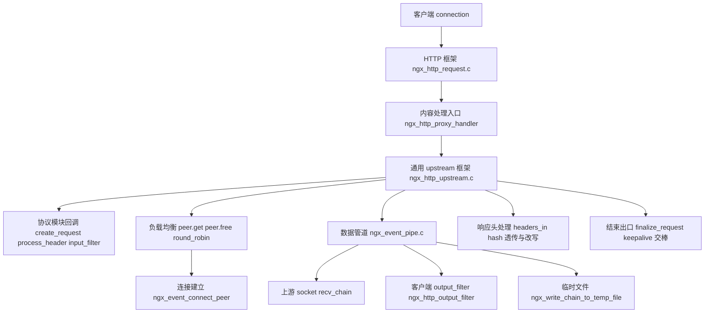
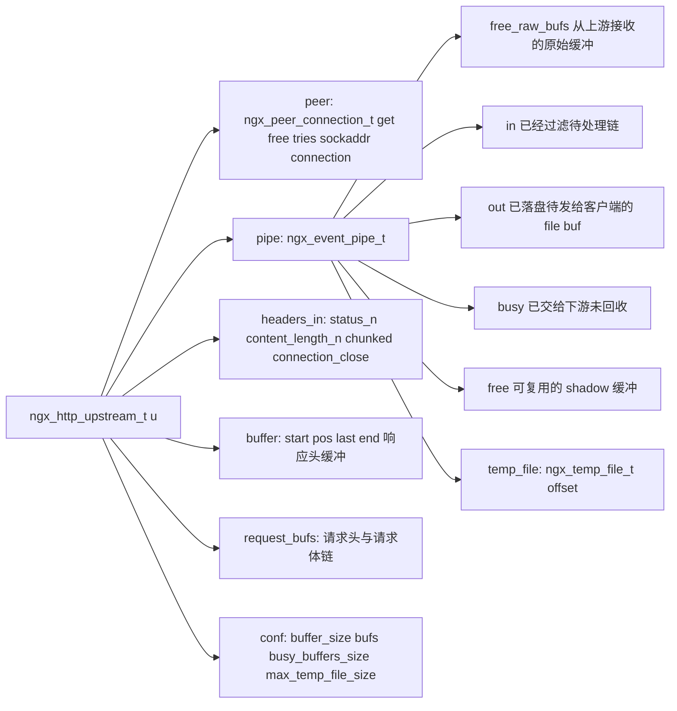
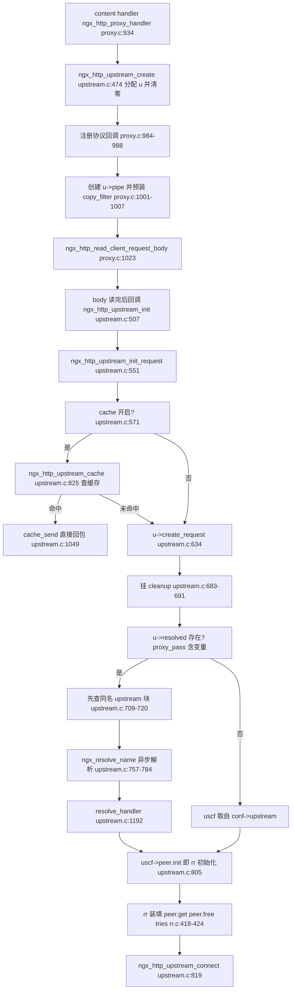
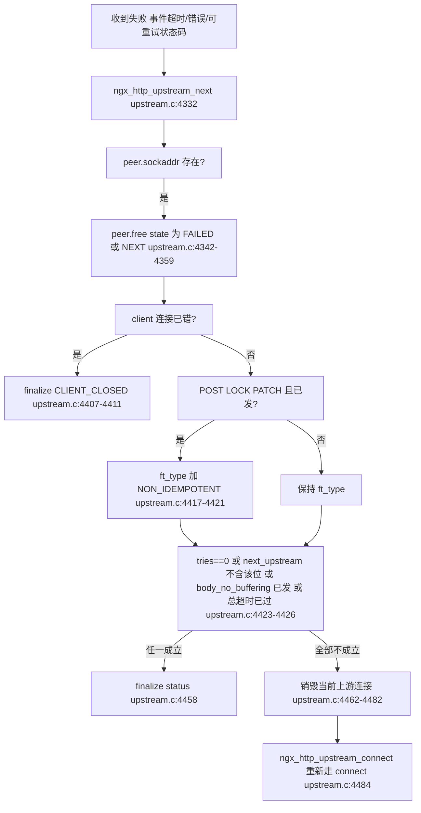
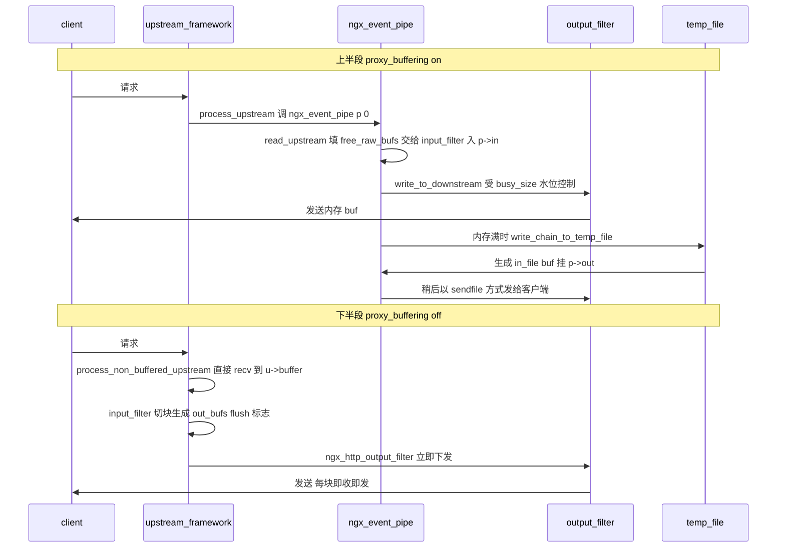
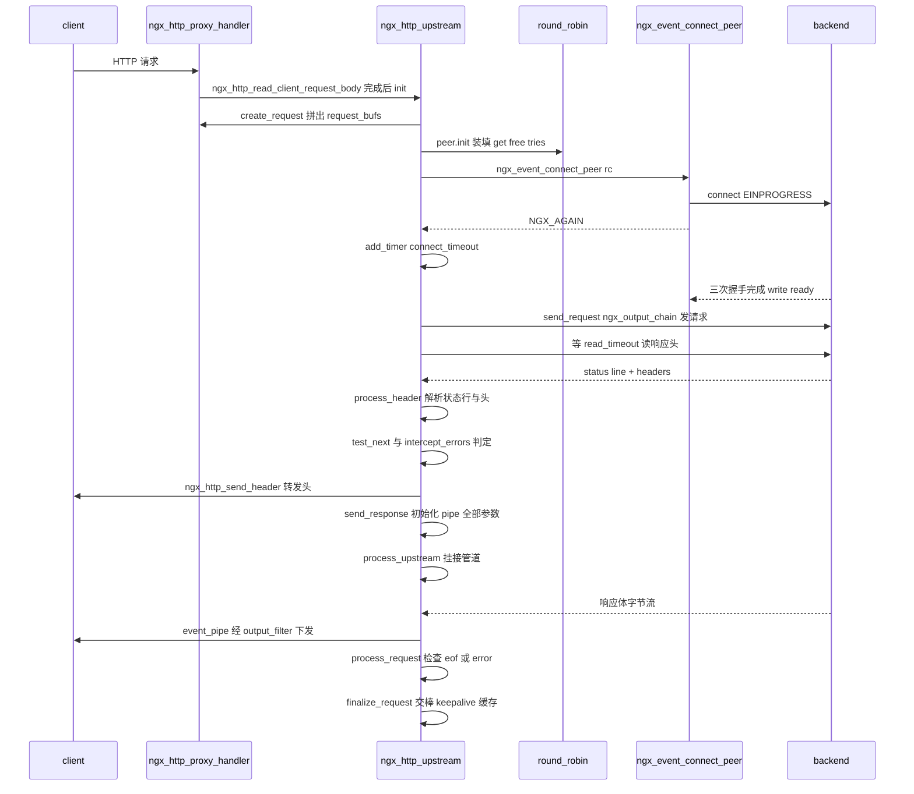
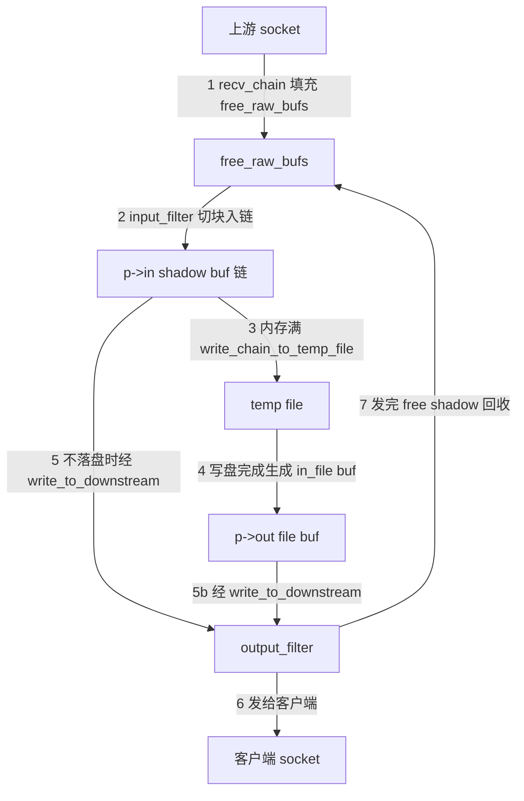

# upstream 上游机制(状态机/缓冲/管道)(基于 nginx-1.27.0 源码)

> **导读**:读完本文你将掌握——
> 1. `ngx_http_upstream_t` 的完整字段布局,以及协议模块(proxy/fastcgi/uwsgi 等)通过 `create_request`、`process_header`、`input_filter`、`finalize_request` 等回调点与通用 upstream 框架的协作方式;
> 2. 一条请求从 `init` → `connect` → `send_request` → `wait header` → `process_header` → `body pipe` → `finalize` 的完整状态机,每一步落在哪个函数、哪个文件哪一行;
> 3. `ngx_event_pipe` 的"双写模型"——同一份数据如何同时被送往客户端与临时文件,六条数据通路如何由 `free_raw_bufs`/`in`/`out`/`busy`/`free` 五条链协作;
> 4. `proxy_buffering on` 与 `off` 两条数据通路在内存水位(`busy_size`)、临时文件(`max_temp_file_size`)上的真实差异;
> 5. `next_upstream` 重试的全部可重试条件(幂等判定、`request_body_no_buffering`、`next_upstream_timeout`、`max_fails` 联动)与已发送请求体的处理;
> 6. 响应头透传:默认隐藏头、`proxy_redirect`、`proxy_cookie_domain/path/flags` 的脚本化改写实现;
> 7. 请求结束的各条出口:正常结束、错误、`error_page` 拦截、X-Accel-Redirect,以及连接如何交棒给 upstream keepalive 缓存。
>
> **前置阅读建议**:先熟悉 `ngx_buf_t` 的 `pos/last/start/end` 与 `shadow/last_shadow/recycled` 位(见本系列内存管理篇)、事件驱动的 `ngx_event_t` 与定时器模型、HTTP 请求主体结构 `ngx_http_request_t`。
>
> **涉及源码清单**:
> - src/http/ngx_http_upstream.h(442 行,结构体与错误掩码)
> - src/http/ngx_http_upstream.c(6831 行,状态机主体)
> - src/event/ngx_event_pipe.h(107 行,管道结构)
> - src/event/ngx_event_pipe.c(1146 行,管道实现)
> - src/http/modules/ngx_http_proxy_module.c(5113 行,HTTP 协议模块样板)
> - src/event/ngx_event_connect.c(435 行,连接建立,辅助引用)
> - src/http/ngx_http_upstream_round_robin.c(853 行,负载均衡,辅助引用)
> - src/http/modules/ngx_http_upstream_keepalive_module.c(576 行,连接复用,辅助引用)

---

## 1. 本模块在 nginx 中的位置与职责

upstream 不是单个模块,而是一套"通用反代框架 + 一组协议模块"的组合。通用框架(src/http/ngx_http_upstream.c)只负责与"一个对端 TCP 连接"打交道:建立连接、发送请求字节、读回响应头、把响应体从上游搬给客户端。具体"发什么请求头、如何解析响应头、如何切分响应体"则由协议模块通过函数指针注入。`ngx_http_proxy_module` 是其中最典型、也是理解这套框架的最佳参照。



图解:协议模块(proxy)只出现在"入口"和"协议回调"两处;中间所有的连接管理、事件状态机、缓冲与落盘全部由 upstream 框架与 ngx_event_pipe 完成。负载均衡(如 round_robin)通过 `ngx_http_upstream_peer_t`(src/http/ngx_http_upstream.h:87-91)中的 `init_upstream`/`init` 两个钩子在配置期与请求期各注入一次,而真正的 `connect()` 由事件层通用函数 `ngx_event_connect_peer` 完成。

---

## 2. 核心数据结构精讲

### 2.1 ngx_http_upstream_t —— 每请求的上游状态机

定义于 src/http/ngx_http_upstream.h:321-402。它是贯穿整个请求生命周期的"总控制器"。

| 字段 | 类型 | 含义与关键行为 |
|---|---|---|
| `read_event_handler` | 函数指针 | 上游可读事件的当前处理者,随状态机多次改写(如 `ngx_http_upstream_process_header`、`ngx_http_upstream_process_upstream`) |
| `write_event_handler` | 函数指针 | 上游可写事件处理者(如 `ngx_http_upstream_send_request_handler`) |
| `peer` | ngx_peer_connection_t | 负载均衡上下文:含 `get`/`free`/`tries`/`sockaddr`/`connection`,连接建立与释放都经它 |
| `pipe` | ngx_event_pipe_t * | 响应体缓冲管道,buffering 开启时才真正工作 |
| `request_bufs` | ngx_chain_t * | 待发往上游的请求链(请求头 buf + 请求体 buf),重试时会被 reinit 复位 |
| `output` / `writer` | ngx_output_chain_ctx_t / ngx_chain_writer_ctx_t | 请求体发送的输出链上下文;`output.output_filter` 默认为 `ngx_chain_writer`(src/http/ngx_http_upstream.c:655-658) |
| `conf` / `upstream` | conf 指针 / srv_conf 指针 | 运行期参数与所选 `upstream{}` 块 |
| `headers_in` | ngx_http_upstream_headers_in_t | 解析后的上游响应头(hash 索引 + 常用头快速指针 + `status_n`/`content_length_n`) |
| `resolved` | ngx_http_upstream_resolved_t * | `proxy_pass http://$var` 时由域名解析填充 |
| `from_client` | ngx_buf_t | upgrade 双向透传时"客户端→上游"方向的工作缓冲 |
| `buffer` | ngx_buf_t | 响应头缓冲区,同时也是 buffering off 时的响应体单缓冲;大小为 `conf->buffer_size`(src/http/ngx_http_upstream.c:2394-2405) |
| `length` | off_t | 剩余应读响应体字节数;-1 表示未知(连接关闭式) |
| `out_bufs`/`busy_bufs`/`free_bufs` | 三条链 | buffering off 通路的输出/占用/空闲缓冲 |
| `input_filter_init`/`input_filter`/`input_filter_ctx` | 函数指针组 | 响应体过滤器(协议模块注入);buffering off 时指向 `ngx_http_upstream_non_buffered_filter`(src/http/ngx_http_upstream.c:3082-3086) |
| `create_key`/`create_request`/`reinit_request`/`process_header`/`abort_request`/`finalize_request` | 协议回调组 | 见 2.4 节 |
| `rewrite_redirect`/`rewrite_cookie` | 函数指针 | 头改写钩子,由 proxy 模块按配置注册(src/http/modules/ngx_http_proxy_module.c:991-997) |
| `state` | ngx_http_upstream_state_t * | 计量:connect_time/header_time/response_time/bytes_received 等(src/http/ngx_http_upstream.h:59-70) |
| 位标志 | — | `buffering`、`keepalive`、`upgrade`、`request_sent`、`request_body_sent`、`header_sent`、`error` 等(src/http/ngx_http_upstream.h:385-401) |



图解:`u->buffer` 是"头与单缓冲通路"的工作区;`u->pipe` 则持有一整套独立链表。两条通路共享的只有 `conf` 参数与 `headers_in`。注意 `pipe->input_filter` 与 `u->input_filter` 是两套并存的过滤器:前者服务 buffering on(ngx_event_pipe 管道),后者服务 buffering off(直接输出过滤)。

### 2.2 ngx_event_pipe_t —— 管道本体

定义于 src/event/ngx_event_pipe.h:25-99。

| 字段 | 含义 |
|---|---|
| `upstream` / `downstream` | 两个连接:上游 socket 与客户端 socket |
| `free_raw_bufs` | 从上游读到的"原始"缓冲(可继续被 `recv_chain` 填充) |
| `in` / `last_in` | 经 `input_filter` 处理后、尚未处理完的链 |
| `writing` | 线程池异步写临时文件时暂存的链 |
| `out` / `free` / `busy` | 待发给下游的链(含 file buf)/ 可复用缓冲/ 已交下游未回收 |
| `input_filter` / `input_ctx` | 上游输入过滤(默认 `ngx_event_pipe_copy_input_filter`,proxy 用 `ngx_http_proxy_copy_filter`/`ngx_http_proxy_chunked_filter`) |
| `output_filter` / `output_ctx` | 下游输出过滤(upstream 框架注入 `ngx_http_upstream_output_filter`,src/http/ngx_http_upstream.c:3230-3231) |
| 状态位 | `read`、`cacheable`、`single_buf`、`free_bufs`、`upstream_done`、`upstream_error`、`upstream_eof`、`upstream_blocked`、`downstream_done`、`downstream_error`、`cyclic_temp_file`、`aio`(src/event/ngx_event_pipe.h:57-68) |
| `allocated` / `bufs` | 当前已分配内存缓冲数 / 目标 `num`×`size`(来自 `proxy_buffers`) |
| `busy_size` | busy 水位阈值,来自 `proxy_busy_buffers_size`(src/http/ngx_http_upstream.c:3234) |
| `read_length` / `length` | 累计读长 / 剩余应读长度(chunked 时表示最小还需字节) |
| `max_temp_file_size` / `temp_file_write_size` | 临时文件容量上限 / 单次写盘批量,来自 proxy 指令(src/http/ngx_http_upstream.c:3271-3272) |
| `preread_bufs` / `preread_size` / `buf_to_file` | 头解析后残留在 `u->buffer` 中的"预读体数据"包装 |
| `temp_file` | ngx_temp_file_t,含 `offset`(已写字节数) |
| `limit_rate` / `start_sec` | 上游读取限速(来自 `proxy_limit_rate`,src/http/ngx_http_upstream.c:3239-3240) |

### 2.3 ngx_http_upstream_headers_in_t 与头处理表

`headers_in`(src/http/ngx_http_upstream.h:260-298)把常用响应头做成 `ngx_table_elt_t *` 快速指针(如 `content_length`、`transfer_encoding`、`set_cookie`),另有 `status_n`、`status_line`、`content_length_n`、三个位标志 `connection_close`/`chunked`/`no_cache`/`expired`。

注册表 `ngx_http_upstream_headers_in[]`(src/http/ngx_http_upstream.c:193-323)每项五元组:头名、**process 函数**(解析期调用,做校验/副作用)、headers_in 内偏移、**copy 函数**(透传期调用)、copy 参数、`redirect` 标记。框架在 `ngx_http_upstream_init_main_conf` 中把该表建成 hash(src/http/ngx_http_upstream.c:6807-6828),解析每行头时以小写 key 查表分发。

### 2.4 协议模块回调点

proxy 模块在 `ngx_http_proxy_handler` 中一次性注册(src/http/modules/ngx_http_proxy_module.c:984-988):

| 回调 | proxy 的实现 | 框架调用点 |
|---|---|---|
| `create_request` | `ngx_http_proxy_create_request` 拼请求头/体链 | `ngx_http_upstream_init_request`,src/http/ngx_http_upstream.c:634 |
| `reinit_request` | `ngx_http_proxy_reinit_request` 复位 status/chunked 解析状态 | 重试重连前,src/http/ngx_http_upstream.c:1998 |
| `process_header` | `ngx_http_proxy_process_status_line` → `ngx_http_proxy_process_header` | 每收到数据循环调用,src/http/ngx_http_upstream.c:2474 |
| `abort_request` | `ngx_http_proxy_abort_request`(空实现) | 放弃上游时 |
| `finalize_request` | `ngx_http_proxy_finalize_request`(空实现) | 统一出口 src/http/ngx_http_upstream.c:4537 |
| `create_key` | `ngx_http_proxy_create_key` | 仅 cache 场景 |
| `input_filter_init`/`input_filter` | `ngx_http_proxy_input_filter_init` + 四个 filter | 请求体起始时 |

`process_header` 返回值约定:`NGX_AGAIN` 表示头不完整继续收;`NGX_OK` 表示头解析完成;`NGX_HTTP_UPSTREAM_INVALID_HEADER`(值 40,src/http/ngx_http_upstream.h:45)表示协议错误;`NGX_ERROR` 致命。

---

## 3. 初始化流程



图解:初始化分两条线——静态 upstream 块(`proxy_pass http://backend`)直接拿到 `ngx_http_upstream_srv_conf_t`;动态地址(`proxy_pass http://$host`)则填 `u->resolved`,先尝试匹配同名 upstream 块(src/http/ngx_http_upstream.c:709-720),否则走异步 resolver(src/http/ngx_http_upstream.c:757-784)。两种线最终都汇入 `uscf->peer.init`(rr 的 `ngx_http_upstream_init_round_robin_peer`),由它把 `peer.get/free/tries` 装进 `u->peer`(src/http/ngx_http_upstream_round_robin.c:418-424),然后调用 `ngx_http_upstream_connect`。

---

## 4. 核心执行流程/状态机

### 4.1 总状态机

```mermaid
stateDiagram-v2
    state init as "init_request 建请求链与cleanup"
    state resolve as "resolve 可选 异步DNS"
    state connect as "connect ngx_event_connect_peer"
    state ssl as "ssl_handshake 可选"
    state send_request as "send_request 发头与体"
    state wait_header as "wait_header 上游可读"
    state process_header as "process_header status_line headers"
    state check_status as "check_status test_next intercept"
    state body_pipe as "body_pipe buffering on ngx_event_pipe"
    state body_direct as "body_direct buffering off 单缓冲"
    state upgraded as "upgraded 双向透传 101"
    state finalize as "finalize_request 统一出口"
    init --> resolve
    resolve --> connect
    init --> connect
    connect --> ssl
    ssl --> send_request
    connect --> send_request
    send_request --> wait_header
    wait_header --> process_header
    process_header --> check_status
    check_status --> body_pipe
    check_status --> body_direct
    check_status --> upgraded
    check_status --> finalize
    body_pipe --> finalize
    body_direct --> finalize
    upgraded --> finalize
```

图解:状态迁移全部由"改写 handler 指针 + 等下一个事件"驱动,没有显式的枚举状态变量。`u->read_event_handler`/`u->write_event_handler` 与 `r->write_event_handler` 的当前取值就是状态本身。例如 connect 阶段 `u->write_event_handler = ngx_http_upstream_send_request_handler`(src/http/ngx_http_upstream.c:1590),进入响应体阶段后 upstream 读侧换成 `ngx_http_upstream_process_upstream`(src/http/ngx_http_upstream.c:3349)。

### 4.2 next_upstream 重试决策(逐分支)



图解:重试的唯一入口是 `ngx_http_upstream_next`。`peer.free` 时以 `NGX_PEER_FAILED` 记失败(403/404 等状态码重试用 `NGX_PEER_NEXT`,不算宕机,src/http/ngx_http_upstream.c:4348-4355)。rr 侧 `fails++` 并扣 `effective_weight`(src/http/ngx_http_upstream_round_robin.c:629-651),连续失败达到 `max_fails` 后在 `fail_timeout` 秒内不再被选中(src/http/ngx_http_upstream_round_robin.c:554-559),这就是 max_fails 联动。幂等判定在两个地方出现:`test_next` 里对"收到可重试状态码但请求已发出"的场景(src/http/ngx_http_upstream.c:2544-2551)与 `next` 里对事件类失败的场景(src/http/ngx_http_upstream.c:4417-4421)。

### 4.3 buffering on/off 两条通路对比时序



图解:on 模式下读与写完全解耦——上游可以全速读满内存再落盘,客户端慢慢取;off 模式没有 `pipe`,只有一个 `u->buffer`,上游 recv 与下游 output_filter 在同一个 `for(;;)` 循环里交替(src/http/ngx_http_upstream.c:3706-3777),内存占用最小但客户端慢会拖住上游 socket。off 时框架还会强制清零 `r->limit_rate`(src/http/ngx_http_upstream.c:3092-3093),避免双层限速叠加。

---

## 5. 关键时序图:buffering on 的完整一跳



图解:每一跳的函数名都标注在 participant 之间的消息上。特别留意 `connect` 的 `NGX_AGAIN` 分支:非阻塞 connect 未立即完成时,框架在 `c->write` 上挂 `connect_timeout` 定时器后直接返回事件循环(src/http/ngx_http_upstream.c:1664-1667),可写事件到达后才继续 `send_request`。头阶段挂在 `c->read` 上的是 `read_timeout`(src/http/ngx_http_upstream.c:2181)。

---

## 6. 源码逐段精读

本节是全文主体,按执行顺序逐函数剖析。每小节先给出签名与位置,再逐块讲解,最后列出易错点。

### 6.1 ngx_http_upstream_create —— 对象与卫生状态

```c
ngx_int_t
ngx_http_upstream_create(ngx_http_request_t *r)
{
    ngx_http_upstream_t  *u;

    u = r->upstream;

    if (u && u->cleanup) {
        r->main->count++;
        ngx_http_upstream_cleanup(r);
    }

    u = ngx_pcalloc(r->pool, sizeof(ngx_http_upstream_t));
    if (u == NULL) {
        return NGX_ERROR;
    }
    ...
    u->headers_in.content_length_n = -1;
    u->headers_in.last_modified_time = -1;

    return NGX_OK;
}
```

(src/http/ngx_http_upstream.c:474-504)

要点:
- 这是唯一的分配点,`ngx_pcalloc` 把全部字段清零。`content_length_n`/`last_modified_time` 复位为 -1(第 500-501 行),这是"未知长度"的哨兵值,后续所有长度判定都依赖它。
- 第 481-484 行处理"同一请求复用 upstream"的场景(例如 X-Accel-Redirect 触发内部跳转后再次进入):若有未清理的旧 upstream,先 `r->main->count++` 抵消 cleanup 银行里的计数,再调用 `ngx_http_upstream_cleanup`,防止在子请求 finalize 时发生双重释放。这是阅读时最容易被忽略的防御逻辑。

### 6.2 ngx_http_upstream_init_request —— 框架入口

签名:`static void ngx_http_upstream_init_request(ngx_http_request_t *r)`(src/http/ngx_http_upstream.c:551-820)。

逐块:
1. **缓存旁路**(第 569-610 行):`u->conf->cache` 打开时先走 `ngx_http_upstream_cache`。命中则 `ngx_http_upstream_cache_send`(第 589 行)——它复用 `u->process_header` 解析缓存文件里的响应头(src/http/ngx_http_upstream.c:1086-1094),这也是协议模块回调第一次被调用的位置之一。缓存文件头损坏时置 `u->cache_status = MISS` 并把 `u->buffer.start = NULL`,让后续 `process_header` 重新分配缓冲(第 595-601 行)。
2. **客户端断连监控**(第 614-628 行):默认(store 关、非 post_action、未 ignore_client_abort)把 `r->read_event_handler` 换成 `ngx_http_upstream_rd_check_broken_connection`。其核心在 `ngx_http_upstream_check_broken_connection`(src/http/ngx_http_upstream.c:1320-1524):kqueue/EPOLLRDHUP 平台直接看 `pending_eof`,其他平台用 `recv(fd, buf, 1, MSG_PEEK)` 探测(第 1468 行)。若客户端已断且 `!u->cacheable`,立刻 `finalize CLIENT_CLOSED_REQUEST` 放弃请求——注意 **cacheable(或 store)请求会继续把上游响应拉完**,这正是 `proxy_ignore_client_abort` 生效的底层通道。
3. **建请求链**(第 630-637 行):`u->request_bufs = r->request_body->bufs` 后调 `u->create_request(r)`。proxy 的实现会在这个链前面插一个"请求头 buf"(详见 6.6)。
4. **输出上下文**(第 650-660 行):`u->output.bufs.num = 1`、`size = client_body_buffer_size`,`output_filter` 为 `ngx_chain_writer`。请求体发送的零拷贝/拷贝决策都由 `ngx_output_chain` 完成。
5. **计量与 cleanup**(第 662-691 行):`r->upstream_states` 数组按 try 追加 state;cleanup handler 挂到请求清理链,`u->cleanup = &cln->handler` 存的是"指向 handler 槽位的指针",finalize 时通过 `*u->cleanup = NULL` 让重复 finalize 幂等(见 6.14)。
6. **地址解析与 rr 装填**(第 693-817 行):如第 3 节流程图。`u->conf->next_upstream_tries` 会收紧 `u->peer.tries`(第 813-817 行),这是 `proxy_next_upstream_tries` 的落点。

易错点:第 577 行 `r->write_event_handler = ngx_http_upstream_init_request` —— cache lock NGX_BUSY 场景下请求会挂起等待锁释放,锁释放后的"重新进入"正是通过写事件重入本函数完成的。

### 6.3 ngx_event_connect_peer —— 连接建立与 rr 衔接

```c
ngx_int_t
ngx_event_connect_peer(ngx_peer_connection_t *pc)
{
    ...
    rc = pc->get(pc, pc->data);
    if (rc != NGX_OK) {
        return rc;
    }

    type = (pc->type ? pc->type : SOCK_STREAM);

    s = ngx_socket(pc->sockaddr->sa_family, type, 0);
    ...
    c = ngx_get_connection(s, pc->log);
    ...
    rc = connect(s, pc->sockaddr, pc->socklen);

    if (rc == -1) {
        err = ngx_socket_errno;

        if (err != NGX_EINPROGRESS ...) {
            ...
            ngx_close_connection(c);
            pc->connection = NULL;

            return NGX_DECLINED;
        }
    }

    if (ngx_add_conn) {
        if (rc == -1) {
            /* NGX_EINPROGRESS */
            return NGX_AGAIN;
        }
        wev->ready = 1;
        return NGX_OK;
    }
    ...
}
```

(src/event/ngx_event_connect.c:20-331,摘录为 34-41、53、209-264 行区间)

逐块:
- 第 34 行 `pc->get(pc, pc->data)` 是与负载均衡模块的唯一耦合点:rr 实现里它遍历 peers、跳过 `down`/超过 `max_fails`/超过 `max_conns` 的节点(src/http/ngx_http_upstream_round_robin.c:554-563),做平滑加权轮询(src/http/ngx_http_upstream_round_robin.c:565-589),主组选不出再递归尝试 backup 组(src/http/ngx_http_upstream_round_robin.c:487-511);全部不可用返回 `NGX_BUSY`——这就是日志 "no live upstreams" 的来源。
- 第 41-93 行创建 socket 并设 SO_RCVBUF、SO_KEEPALIVE、非阻塞、可选 `proxy_bind` 的 bind。
- 第 209 行非阻塞 `connect`。除 `EINPROGRESS` 外的错误按类别选日志级别,并返回 `NGX_DECLINED`(第 248 行)——调用方 `ngx_http_upstream_connect` 对该值执行 `ngx_http_upstream_next(r, u, NGX_HTTP_UPSTREAM_FT_ERROR)`(src/http/ngx_http_upstream.c:1574-1577),换下一台;`NGX_BUSY` 则换 `FT_NOLIVE`(src/http/ngx_http_upstream.c:1568-1572)。
- 事件模型分支:`ngx_add_conn`(epoll/kqueue 的边缘注册)在 `NGX_AGAIN` 时什么都不挂,等待写事件;select/poll 分支则手动 `ngx_add_event` 读写(第 304-317 行)。

connect 超时的实现是纯定时器:`NGX_AGAIN` 返回后,`ngx_http_upstream_connect` 执行 `ngx_add_timer(c->write, u->conf->connect_timeout)`(src/http/ngx_http_upstream.c:1664-1667);超时触发写事件,`ngx_http_upstream_send_request_handler` 见 `c->write->timedout` 走 `FT_TIMEOUT`(src/http/ngx_http_upstream.c:2322-2325)。握手是否真正成功则在 `send_request` 前用 `ngx_http_upstream_test_connect`(`getsockopt(SO_ERROR)`,src/http/ngx_http_upstream.c:2762-2810)复查。

### 6.4 ngx_http_upstream_connect —— 状态机自举

(src/http/ngx_http_upstream.c:1527-1679)

逐块:
1. 第 1534 行设置 log action;第 1540-1553 行 push 新的 `u->state` 并把 `response_time/connect_time/header_time` 初始化为 -1。**每个 try 一个 state**,`$upstream_addr` 变量的逗号分隔格式正来自这个数组(src/http/ngx_http_upstream.c:5660-5687)。
2. 第 1555 行调 `ngx_event_connect_peer`,随后按 `NGX_ERROR/BUSY/DECLINED` 分派 finalize 或 next(第 1560-1577 行)。
3. 第 1587-1591 行装填事件 handler:`c->read/write->handler` 统一为 `ngx_http_upstream_handler`(事件到来后按 `ev->write` 分派给 `u->read_event_handler`/`u->write_event_handler`,src/http/ngx_http_upstream.c:1295-1300),而 `u->read_event_handler = ngx_http_upstream_process_header`、`u->write_event_handler = ngx_http_upstream_send_request_handler`。
4. 第 1621-1624 行初始化 `u->writer`(`connection` 指向上游连接、`limit = sendfile_max_chunk`)。
5. 第 1626-1632 行:**重试路径**上 `u->request_sent` 已置位,此时调用 `ngx_http_upstream_reinit`。
6. 第 1634-1658 行:主请求的请求体若已落临时文件,其 buf 只能复用一次,子请求需自备——这里为 `u->output.free` 预挂该 buf。
7. 第 1660-1662 行复位三个标志;`NGX_AGAIN` 挂 connect_timeout 后返回;ssl 场景转入 `ngx_http_upstream_ssl_init_connection`(第 1669-1676 行);否则立即 `ngx_http_upstream_send_request(r, u, 1)`(第 1678 行)。

`ngx_http_upstream_reinit`(src/http/ngx_http_upstream.c:1992-2075)做三件事:调 `u->reinit_request` 复位协议解析状态;把 `u->request_bufs` 每个链节 `pos = start`、文件 buf 的 `file_pos` 归零(第 2026-2037 行)——**请求体已发送的字节会被重发**,因为框架并不知道对端处理到哪;清空 `u->output.in/busy` 与 `u->buffer`(第 2056-2072 行)。这也是"已发送数据的处理"问题的答案:框架完全不做断点续传,直接从头重发,因此非幂等方法默认禁止重试。

### 6.5 ngx_http_upstream_send_request / send_request_body

```c
static void
ngx_http_upstream_send_request(ngx_http_request_t *r, ngx_http_upstream_t *u,
    ngx_uint_t do_write)
{
    ...
    if (!u->request_sent && ngx_http_upstream_test_connect(c) != NGX_OK) {
        ngx_http_upstream_next(r, u, NGX_HTTP_UPSTREAM_FT_ERROR);
        return;
    }

    c->log->action = "sending request to upstream";

    rc = ngx_http_upstream_send_request_body(r, u, do_write);

    if (rc == NGX_ERROR) {
        ngx_http_upstream_next(r, u, NGX_HTTP_UPSTREAM_FT_ERROR);
        return;
    }
    ...
    if (rc == NGX_AGAIN) {
        if (!c->write->ready || u->request_body_blocked) {
            ngx_add_timer(c->write, u->conf->send_timeout);
        }
        ...
        return;
    }

    /* rc == NGX_OK */
    ...
    if (!u->request_body_sent) {
        u->request_body_sent = 1;
        ...
        ngx_add_timer(c->read, u->conf->read_timeout);

        if (c->read->ready) {
            ngx_http_upstream_process_header(r, u);
            return;
        }
    }
}
```

(src/http/ngx_http_upstream_send_request:2078-2188,摘录 2094-2187)

逐块:
- `connect_time` 计量在第 2090-2092 行补齐。
- **NGX_AGAIN 分支**(第 2113-2144 行):发送未完成时挂 `send_timeout`,并调用 `ngx_handle_write_event` 重新注册写事件;若 `c->write->ready`(发送缓冲区又空了)则 `ngx_tcp_push` 顶开 Nagle。`u->request_body_blocked` 标记"本次写被内核缓冲区挡住",由 `send_request_body` 维护(第 2217-2222 行)。
- **NGX_OK 分支**(第 2146-2187 行):请求全部发完,写侧 handler 降级为 `ngx_http_upstream_dummy_handler`(第 2164-2166 行,除非 `preserve_output`);**读侧挂 read_timeout**(第 2181 行),若上游数据已先到(`c->read->ready`)则同步推进 `process_header`——这就是"先读后写"的优化,避免多等一轮事件循环。
- `ngx_http_upstream_send_request_body`(src/http/ngx_http_upstream.c:2191-2308)有两个世界:
  - 默认 `request_buffering on`:一次 `ngx_output_chain(&u->output, u->request_bufs)` 把整条链写完或写满返回(第 2203-2225 行);
  - `proxy_request_buffering off`(`r->request_body_no_buffering`):进入"边收边发"循环(第 2250-2298 行)——`ngx_http_read_unbuffered_request_body` 读客户端、`ngx_output_chain` 写上游交替,期间客户端读事件 handler 换成 `ngx_http_upstream_read_request_handler`(第 2244 行),它超时会以 `NGX_HTTP_REQUEST_TIME_OUT` 结束整个请求(src/http/ngx_http_upstream.c:2360-2364)。这条路径也是 `next_upstream` 禁止重试的来源之一(见 6.11)。

### 6.6 ngx_http_proxy_create_request —— 请求的"数据长什么样"

(src/http/modules/ngx_http_proxy_module.c:1235-1605)

产出的字节流形如:

```
GET /foo?a=1 HTTP/1.0\r\n
Host: backend\r\n
Connection: close\r\n
Content-Length: 5\r\n
X-Custom: v\r\n
\r\n
hello
```

逐块:
1. **方法与 URI 长度预计算**(第 1265-1311 行):method 取自 `u->method`(HEAD 转 GET 缓存场景)、`proxy_method` 或原方法;URI 有三个来源——`proxy_pass` 带变量时运行期求值(`ctx->vars.uri`)、`valid_unparsed_uri`(原样转发)、否则"location 前缀替换 + 转义 + 拼参"(第 1300-1311 行,`ngx_escape_uri` 按 `NGX_ESCAPE_URI` 计算膨胀字节数)。
2. **默认头与脚本引擎**(第 822-832、1348-1503 行):默认头集在配置期被编译成 nginx script 字节码(`headers->lengths`/`values`),运行期用两个脚本引擎先算长度再落盘;`val_len == 0` 的头(如空 `TE`/`Keep-Alive`)整体跳过——这是"覆盖/删除请求头"的机制。
3. **透传原请求头**(第 1370-1395、1506-1541 行):`pass_request_headers` 打开时遍历 `r->headers_in.headers`,命中 `headers->hash` 的跳过(被默认头或 `proxy_set_header` 覆盖),其余原样复制。
4. **请求体挂链**(第 1564-1602 行):三种方式——`request_body_no_buffering` 时只挂头 buf,体后续通过 `output` 链动态喂;普通透传时把 `r->request_body->bufs` 深拷贝一组 buf 结构(共享数据页)接到头 buf 后;`proxy_set_body` 时 script 已把体编进头 buf。最后 `b->flush = 1` 保证头立即冲刷。

易错点:`ctx->internal_body_length`(第 1326-1346 行)是发给上游的 `Content-Length`,与客户端的未必相等(如 proxy_set_body);chunked 且仍在读体时它为 -1 且 `internal_chunked = 1`,此时 `ngx_http_proxy_body_output_filter`(src/http/modules/ngx_http_proxy_module.c:1634-1798)负责给发送的字节流动态套 chunked 帧(第 1716-1745 行生成十六进制长度行,第 1747-1788 行生成结尾 `0\r\n\r\n`)。

### 6.7 ngx_http_upstream_process_header —— 收响应头

```c
    for ( ;; ) {

        n = c->recv(c, u->buffer.last, u->buffer.end - u->buffer.last);

        if (n == NGX_AGAIN) {
            if (ngx_handle_read_event(c->read, 0) != NGX_OK) {
                ngx_http_upstream_finalize_request(r, u, ...);
                return;
            }
            return;
        }

        if (n == NGX_ERROR || n == 0) {
            ngx_http_upstream_next(r, u, NGX_HTTP_UPSTREAM_FT_ERROR);
            return;
        }

        u->state->bytes_received += n;
        u->buffer.last += n;

        rc = u->process_header(r);

        if (rc == NGX_AGAIN) {
            if (u->buffer.last == u->buffer.end) {
                ngx_log_error(NGX_LOG_ERR, c->log, 0,
                              "upstream sent too big header");
                ngx_http_upstream_next(r, u,
                                       NGX_HTTP_UPSTREAM_FT_INVALID_HEADER);
                return;
            }
            continue;
        }

        break;
    }
```

(src/http/ngx_http_upstream.c:2436-2491)

逐块:
- 缓冲只在第一次分配,大小 `u->conf->buffer_size`(第 2394-2405 行)。cache 场景 `pos` 会跳过缓存头占用的 `header_start`(第 2429-2433 行)。
- 循环语义:recv 满一段就调一次 `u->process_header`,返回 AGAIN 且缓冲还有空位则继续收;**缓冲写满仍未解析出头**即 "upstream sent too big header",按 `FT_INVALID_HEADER` 重试或 502。头大小上限因此就是 `proxy_buffer_size`(cache 时预留 256 字节,src/http/ngx_http_upstream.c:862-871)。
- 头解析成功后(第 2504-2523 行):记 `header_time`;若 `status_n >= 500` 区间(≥NGX_HTTP_SPECIAL_RESPONSE)先过 `ngx_http_upstream_test_next`(可重试状态码)与 `ngx_http_upstream_intercept_errors`(error_page 拦截);再 `process_headers` 透传,最后 `send_response` 进入体阶段。

`ngx_http_upstream_test_next`(src/http/ngx_http_upstream.c:2527-2663)逐项对照 `ngx_http_upstream_next_errors[]`(500/502/503/504/403/404/429,src/http/ngx_http_upstream.c:440-449)。可重试的完整条件(第 2553-2557 行)是:`u->peer.tries > 1` **且** `(u->conf->next_upstream & mask) == mask`(注意是"全部位都开",因为非幂等方法会额外要求 NON_IDEMPOTENT 位) **且** 非"已发请求 + request_body_no_buffering" **且** 未超过 `next_upstream_timeout`。cache 过期场景还有 cache_use_stale 兜底(第 2564-2589 行)。

`ngx_http_upstream_intercept_errors`(src/http/ngx_http_upstream.c:2666-2759):`proxy_intercept_errors on` 且 `error_pages` 中存在该状态码时,以该状态码 finalize 请求,让 HTTP 框架的 error_page 机制接管;`intercept_404` 单独控制 404。401 场景会把上游的 `WWW-Authenticate` 链搬进 `r->headers_out`(第 2698-2721 行),否则浏览器弹不出认证框。

### 6.8 proxy 的 process_status_line / process_header / input_filter_init

`ngx_http_proxy_process_status_line`(src/http/modules/ngx_http_proxy_module.c:1801-1877):
- `ngx_http_parse_status_line` 解析 `HTTP/1.1 200 OK`;AGAIN 继续收。
- 解析失败时的兼容路径:若 cache 存在则按 HTTP/0.9 处理(第 1825-1831 行);否则记 `u->headers_in.connection_close = 1` 并按 200 继续(第 1843-1847 行)——**HTTP/0.9 兼容意味着非法状态行不会触发 502**,这是一个历史行为,值得注意。
- 复制 `status_line`(第 1856-1864 行);`http_version < 1.1` 直接置 `connection_close`(第 1870-1872 行),HTTP/1.0 上游默认短连接。
- 把 `u->process_header` 切换为 `ngx_http_proxy_process_header` 并立刻续调(第 1874-1876 行)——一个回调函数指针本身就完成了状态迁移。

`ngx_http_proxy_process_header`(src/http/modules/ngx_http_proxy_module.c:1880-2039):
- 每行头 `ngx_list_push` 进 `u->headers_in.headers`,key/value/lowcase_key 三段共享一次分配(第 1910-1918 行)。
- 查 `umcf->headers_in_hash` 命中协议无关处理表(第 1932-1941 行)。**Content-Length 判定**:`ngx_http_upstream_process_content_length`(src/http/ngx_http_upstream.c:4720-4757)拒绝重复 CL、拒绝 CL 与 TE 共存,`ngx_atoof` 失败即 INVALID_HEADER。**Transfer-Encoding 判定**:`ngx_http_upstream_process_transfer_encoding`(src/http/ngx_http_upstream.c:5192-5233)仅接受字面值 `chunked`,其他 TE 值一律 INVALID_HEADER,并置 `u->headers_in.chunked = 1`。**Content-Encoding** 不做任何处理,登记为透传(src/http/ngx_http_upstream.c:317-320)——nginx 代理不解压 gzip,原样转发。
- `HEADER_DONE` 收尾(第 1950-2024 行):补空 `Server`/`Date` 头(供上游变量取值);chunked 时清 `content_length_n`;**keepalive 判定**——204/304/HEAD/CL=0 且对端未发 close 时 `u->keepalive = 1`(第 2006-2013 行),这个位决定了请求结束时连接是回收入 keepalive 缓存还是关闭;101 Switching Protocols 置 `u->upgrade = 1`(第 2015-2021 行)。

`ngx_http_proxy_input_filter_init`(src/http/modules/ngx_http_proxy_module.c:2042-2098)是"响应体长度语义"的唯一裁决点,按 RFC 2616 §4.4 分四路:
- 204/304/HEAD:`pipe->length = 0`,`u->length = 0`,无体;
- chunked:pipe 过滤器切到 `ngx_http_proxy_chunked_filter`,`pipe->length = 3`(最小可见字节,解析器状态的通俗表达);直接通路切到 `ngx_http_proxy_non_buffered_chunked_filter`,`u->length = 1`;
- `content_length_n == 0`:同无体,且允许 keepalive;
- 其余:`pipe->length = u->length = content_length_n`,未知(CL 与 TE 都没有)时为 -1,即"读到对端关连接为止"。

### 6.9 ngx_http_upstream_send_response —— 通路分派与 pipe 装配

(src/http/ngx_http_upstream.c:3013-3353)

逐块:
1. 第 3022-3029 行 `ngx_http_send_header` 把转发头交给客户端;`u->header_sent = 1` 之后再出错就不能再换上游了(错误只能体中断)。
2. `u->upgrade` 直接转 `ngx_http_upstream_upgrade`(第 3031-3043 行),进入 `ngx_http_upstream_process_upgraded`(src/http/ngx_http_upstream.c:3442-3632)的双向泵:`from_upstream` 决定 `src/dst` 与工作 buf(`u->buffer` 或 `u->from_client`),单缓冲循环读写,直到两侧都 EOF(第 3562-3570 行)。这就是 WebSocket 转发的全部实现——没有 pipe、没有缓存。
3. **buffering off 分支**(第 3072-3132 行):装默认过滤器 `ngx_http_upstream_non_buffered_filter`(它只做一件事:把 `u->buffer` 中刚收到的 `bytes` 切成 `out_bufs` 尾巴并扣减 `u->length`,src/http/ngx_http_upstream.c:3825-3883);切换两个 handler(第 3088-3090 行);`r->limit_rate = 0`;若头解析时已残留体字节(`u->buffer.last > pos`),立即走一轮 `process_non_buffered_downstream` 推给客户端(第 3105-3118 行),否则冲刷一次并等上游事件(第 3119-3128 行)。
4. **buffering on 分支**(第 3228-3352 行)装配 pipe 的每个参数,前文 2.2 已列。这里挑四个关键点:
   - `p->preread_bufs` 包住 `u->buffer` 本身(第 3281-3291 行)——头解析残留的体字节作为第一批"预读"进入管道,`preread_size = u->buffer.last - u->buffer.pos`;
   - cacheable 时 `buf_to_file` 记录头缓冲区起点,使 `u->buffer` 里的预读体也能写进缓存文件(第 3293-3305 行);
   - `cyclic_temp_file`(复用固定文件环形写)强制关闭 sendfile(第 3321-3334 行),因为新数据写盘会污染内核正在 sendfile 的页缓存;
   - 最后把两个 handler 换成 `ngx_http_upstream_process_upstream`(上游读)与 `ngx_http_upstream_process_downstream`(客户端写),并立刻驱动一次管道(第 3349-3352 行)。

`ngx_http_upstream_output_filter`(src/http/ngx_http_upstream.c:4018-4033)只是包了一层 `ngx_http_output_filter` 并同步 `p->aio = r->aio`,让 pipe 感知下游异步(线程池 sendfile/aio_write)在途。

### 6.10 ngx_event_pipe —— 管道主循环与双写模型

```c
ngx_int_t
ngx_event_pipe(ngx_event_pipe_t *p, ngx_int_t do_write)
{
    ...
    for ( ;; ) {
        if (do_write) {
            p->log->action = "sending to client";

            rc = ngx_event_pipe_write_to_downstream(p);

            if (rc == NGX_ABORT) {
                return NGX_ABORT;
            }

            if (rc == NGX_BUSY) {
                return NGX_OK;
            }
        }

        p->read = 0;
        p->upstream_blocked = 0;

        p->log->action = "reading upstream";

        if (ngx_event_pipe_read_upstream(p) == NGX_ABORT) {
            return NGX_ABORT;
        }

        if (!p->read && !p->upstream_blocked) {
            break;
        }

        do_write = 1;
    }
    ...
}
```

(src/event/ngx_event_pipe.c:22-100,主循环摘录 29-58)

这是本篇的灵魂:一个"读-写交替"的内层泵。每轮先写下游(若上轮读到了数据 `do_write=1`),再读上游;只有"这一轮既没读到新数据、上游也不被下游阻塞"时才退出循环,随后做两连接的 `handle_*_event` 与定时器整理(第 60-97 行)。`p->read` 表示本轮真实读到了字节;`p->upstream_blocked` 表示"内存满但下游就绪"——读循环主动放弃读、先把数据写下去再回来,避免无限堆积。



图解(六方向交互):1️⃣ 上游 socket → free_raw_bufs(recv_chain);2️⃣ free_raw_bufs → p->in(input_filter,proxy 场景是 copy_filter 或 chunked_filter);3️⃣ p->in → temp file(内存水位超限);4️⃣ temp file → p->out(生成 in_file buf);5️⃣ p->in / p->out → output_filter → 客户端;6️⃣ 客户端发送完成 → free shadow → free_raw_bufs(缓冲闭环)。所有六步都发生在 `ngx_event_pipe_read_upstream` 与 `ngx_event_pipe_write_to_downstream` 两个函数里,由 4.3 节的两个事件 handler 驱动。

**读侧细节**(src/event/ngx_event_pipe.c:103-502):
- 第 149-151 行:无预读且上游不 ready 即退出。
- 缓冲来源优先级(第 224-309 行):先吃 `free_raw_bufs` 空闲缓冲;不足且 `allocated < p->bufs.num` 时新分配(内存缓冲总数受 `proxy_buffers` 约束);再不足且下游就绪 → 置 `upstream_blocked` 回去写;再不足 → `cacheable || temp_file->offset < max_temp_file_size` 时写临时文件腾内存(第 272-281 行);否则彻底放弃("no pipe bufs to read in")。**这一串 if 就是 busy 水位与 proxy_max_temp_file_size 的真实交汇点**。
- 限速(第 205-222 行):`limit = limit_rate × 秒数 - read_length`,超了就给读事件加 delay 定时器。
- 读到数据后逐 buf 喂 `input_filter`(第 349-373 行);`n == 0` 即上游 EOF(第 337-340 行)。
- 收尾:还有 free_raw_bufs 且 `p->length != -1` 时,若首 buf 字节数已覆盖剩余长度则强制过滤(第 448-463 行);`p->length == 0` 置 `upstream_done`(第 465-468 行)——**Content-Length 读满即主动结束,不等 FIN**,这是 keepalive 复用的前提;EOF/error 后把残余喂给过滤器并可选归还内存(第 470-487 行);cacheable 且仍有 in/buf_to_file 时补写盘(第 489-499 行)。

**写侧细节**(src/event/ngx_event_pipe.c:505-738):
- 上游已结束(第 539-594 行):`recycled = 0` 后把 `p->out`、`p->in` 全量推给 output_filter,置 `downstream_done = 1`——收尾阶段不受水位限制,一次冲完。
- 正常路径(第 605-679 行):先统计 **busy 中 recycled 缓冲的容量 bsize**(只有 `recycled` 位才算数,因为只有它们还被上游侧引用);`bsize >= p->busy_size` 直接 `flush = 1`——这就是 `proxy_busy_buffers_size` 水位。否则从 `p->out` 优先、`p->in` 次之(**注意第 645 行:`!p->cacheable && !p->writing && p->in` 才允许从 in 取**,cacheable 的数据必须先落盘再发,保证缓存文件完整)组装 out 链。
- 第 698-700 行:`p->output_filter(p->output_ctx, out)` 后 `ngx_chain_update_chains` 把发完的 buf 归入 `p->busy`(尚未确认写完)与 `p->free`(已写完)。
- 第 707-734 行:遍历 `p->free`,file buf 特殊处理(cyclic 模式下全部发送完可把 temp offset 归零复用);`last_shadow` buf 归还其 shadow 到 `free_raw_bufs`——**shadow buf 的双指针结构**(copy_filter 中 `b->shadow = buf; buf->shadow = b`,src/http/modules/ngx_http_proxy_module.c:2138-2143)在这里兑现价值:内存页只有一份,p->in 里的影子 buf 和 free_raw_bufs 里的原始 buf 指向同一页,下游发完才能回收上游侧。
- 第 692-695 行:AIO workaround,空 out 但要求 flush 时连续 flush 超 10 次返回 NGX_BUSY 防死循环。

**写盘**(src/event/ngx_event_pipe.c:741-952):
- 非 cacheable 时按 `temp_file_write_size` 与 `max_temp_file_size` 截链(第 794-831 行);一个 buf 都装不下返回 NGX_BUSY(第 820-822 行)。
- `ngx_write_chain_to_temp_file` 写盘;线程池模式返回 NGX_AGAIN 时把链暂存 `p->writing`,完成事件回来后从第 757-766 行续写。
- 写完后生成 file buf 挂 `p->out`(第 872-912 行):`file_pos = temp_file->offset`(写前)、`file_last = temp_file->offset + n`(写后),`in_file = 1; temp_file = 1`。若 `p->out` 尾 buf 的 `file_last` 恰好等于本次写前 offset,直接扩展该 buf(第 875-884 行),减少链节点。
- 第 914-949 行:释放已落盘的内存——`last_shadow` 的影子 buf 复位 `pos/last` 后挂回 `free_raw_bufs`。

**默认输入过滤器** `ngx_event_pipe_copy_input_filter`(src/event/ngx_event_pipe.c:957-1025):为每个数据 buf 生成影子副本挂 `p->in`,维护 `p->length`(Content-Length 剩余;超出即警告并截断,第 1010-1020 行)。proxy 模块自带同构的 `ngx_http_proxy_copy_filter`(src/http/modules/ngx_http_proxy_module.c:2101-2178),区别仅在于读满时联动 `r->upstream->keepalive`(第 2172-2175 行)。

**chunked 过滤器** `ngx_http_proxy_chunked_filter`(src/http/modules/ngx_http_proxy_module.c:2181-2330):反复调 `ngx_http_parse_chunked`,每个完整 chunk 生成一个 buf 入 `p->in`,多个 buf 用 shadow 链串起来(第 2245-2246 行 `*prev = b; prev = &b->shadow`);`NGX_DONE` 表示终止 chunk,置 `p->length = 0` 并按对端是否发 close 决定 keepalive(第 2276-2289 行)。**同一个内存页可以被拆成多个逻辑 buf**,这正是 shadow 链的设计动机。

### 6.11 ngx_http_upstream_next —— 重试总闸

(src/http/ngx_http_upstream.c:4332-4485)

```c
    if (u->peer.tries == 0
        || ((u->conf->next_upstream & ft_type) != ft_type)
        || (u->request_sent && r->request_body_no_buffering)
        || (timeout && ngx_current_msec - u->peer.start_time >= timeout))
    {
        ...
        ngx_http_upstream_finalize_request(r, u, status);
        return;
    }
```

(src/http/ngx_http_upstream.c:4423-4431)

四个否决条件:
1. `tries == 0`:没有剩余尝试(rr 每次 get 后 `tries--`,src/http/ngx_http_upstream_round_robin.c:667-669);
2. `(u->conf->next_upstream & ft_type) != ft_type`:配置位未全开。`ft_type` 可能叠加了 `NON_IDEMPOTENT`(第 4417-4421 行)——**POST/LOCK/PATCH 且请求已发出时,只有 `proxy_next_upstream ... non_idempotent` 显式开启才允许重试**;`off` 位置位后 `next_upstream` 被整个清成只剩 off(src/http/modules/ngx_http_proxy_module.c:3623-3626),任何失败都直接结束;
3. 已发请求且请求体未缓冲(`request_body_no_buffering`):边收边发模式下无法重放,无条件禁止;
4. 总预算:`ngx_current_msec - u->peer.start_time >= next_upstream_timeout`,start_time 在每次 connect 前刷新(src/http/ngx_http_upstream.c:1549),是"整轮重试"的墙钟上限而非单次。

通过否决后:SSL 快速关断(第 4468-4474 行)、销毁连接池并 `ngx_close_connection`(第 4476-4481 行)、调 `ngx_http_upstream_connect` 重来(第 4484 行)。状态计量上,每个 try 的 state 已在 connect 时独立 push,`$upstream_status` 里会看到 `502, 200` 这样的序列。

### 6.12 头透传与脚本化改写

`ngx_http_upstream_process_headers`(src/http/ngx_http_upstream.c:2813-2965):
- `X-Accel-Redirect` 分支(第 2829-2889 行):finalize 当前 upstream 后,遍历响应头把所有 `redirect` 标记的头(如 Location/Set-Cookie)用各自 copy_handler 搬到 `r->headers_out`,然后按 `@named` 或普通 URI 触发内部跳转(第 2865-2888 行)。`proxy_ignore_headers X-Accel-Redirect` 可关闭(位掩码 `NGX_HTTP_UPSTREAM_IGN_XA_REDIRECT`)。
- 普通透传(第 2891-2934 行):每个头先查 `u->conf->hide_headers_hash`(默认隐藏 Date/Server/X-Pad/X-Accel-*,src/http/modules/ngx_http_proxy_module.c:835-845;`proxy_pass_header` 可放行,`proxy_hide_header` 可追加,两者的并交集在 `ngx_http_upstream_hide_headers_hash` 中合成,src/http/ngx_http_upstream.c:6629-6749),再查协议无关 copy 函数,未命中走通用 `copy_header_line`。
- 状态与长度落位(第 2944-2947 行):`r->headers_out.status/status_line/content_length_n` 全部来自 headers_in。

三个改写钩子由 copy 函数在透传期触发:
- **Location**:`ngx_http_upstream_rewrite_location`(src/http/ngx_http_upstream.c:5435-5477)先调 `u->rewrite_redirect`。proxy 的实现 `ngx_http_proxy_rewrite_redirect`(src/http/modules/ngx_http_proxy_module.c:2666-2695)遍历 `plcf->redirects`,每条规则由 `ngx_http_proxy_rewrite_complex_handler`/`regex_handler`/`domain_handler` 之一执行(第 3149-3226 行),命中后 `ngx_http_proxy_rewrite`(src/http/modules/ngx_http_proxy_module.c:3229-3268)做**前缀原位替换或重新分配**(`replacement->len > len` 时需 pnalloc 新串)。`proxy_redirect default` 在 merge 阶段自动生成"proxy_pass 的 url → location"一条规则(src/http/modules/ngx_http_proxy_module.c:3782-3822)。
- **Refresh**:同样走 rewrite_redirect,但先在值里定位 `url=` 前缀(src/http/ngx_http_upstream.c:5496-5505)。
- **Set-Cookie**:`ngx_http_upstream_rewrite_set_cookie`(src/http/ngx_http_upstream.c:5527-5560)调 `u->rewrite_cookie`。proxy 的 `ngx_http_proxy_rewrite_cookie`(src/http/modules/ngx_http_proxy_module.c:2698-2831)先用 `ngx_http_proxy_parse_cookie`(第 2834-2896 行)把 `k=v; k=v; ...` 拆成 attrs 数组,再对 `domain`/`path` 属性套规则,`proxy_cookie_flags` 则由 `ngx_http_proxy_rewrite_cookie_flags`+`ngx_http_proxy_edit_cookie_flags`(第 2921-3146 行)增删 Secure/HttpOnly/SameSite;最后把 attrs 重新序列化回 `h->value`(第 2782-2828 行)。

### 6.13 buffering off 通路精读

`ngx_http_upstream_process_non_buffered_request`(src/http/ngx_http_upstream.c:3685-3815):

```c
    for ( ;; ) {

        if (do_write) {

            if (u->out_bufs || u->busy_bufs || downstream->buffered) {
                rc = ngx_http_output_filter(r, u->out_bufs);
                ...
                ngx_chain_update_chains(r->pool, &u->free_bufs, &u->busy_bufs,
                                        &u->out_bufs, u->output.tag);
            }

            if (u->busy_bufs == NULL) {
                if (u->length == 0 || (upstream->read->eof && u->length == -1)) {
                    ngx_http_upstream_finalize_request(r, u, 0);
                    return;
                }
                ...
                b->pos = b->start;
                b->last = b->start;
            }
        }

        size = b->end - b->last;

        if (size && upstream->read->ready) {
            n = upstream->recv(upstream, b->last, size);
            ...
            if (u->input_filter(u->input_filter_ctx, n) == NGX_ERROR) {
                ngx_http_upstream_finalize_request(r, u, NGX_ERROR);
                return;
            }
            do_write = 1;
            continue;
        }

        break;
    }
```

(src/http/ngx_http_upstream.c:3706-3777)

读法:**"下游追上来了才继续读"**。每轮先把 out_bufs 推给输出过滤;只有 `u->busy_bufs == NULL`(上一块已被下游完全接收)才复用 `u->buffer`,否则不覆盖数据。长度判定同时覆盖"读满 CL"与"未知长度 + 对端 FIN"。这个单缓冲乒乓就是 buffering off 的全部内存模型——无论响应多大,内存占用恒为 `proxy_buffer_size` 加下游发送缓冲。

### 6.14 结束路径:finalize 与 keepalive 交棒

`ngx_http_upstream_finalize_request`(src/http/ngx_http_upstream.c:4500-4667)是唯一出口,签名 `static void (ngx_http_request_t *r, ngx_http_upstream_t *u, ngx_int_t rc)`。顺序:
1. 幂等护栏:`u->cleanup == NULL` 说明已 finalize 过,直接 `ngx_http_finalize_request(r, NGX_DONE)`(第 4509-4516 行)。
2. 取消未完成的 resolver(第 4518-4521 行)。
3. 补齐计量:`response_time`;若 pipe 存在,`bytes_received += pipe->read_length - preread_size`、`response_length = pipe->read_length`(第 4523-4535 行)——管道模式下逐 buf 计数分散在各 filter,这里统一汇总。
4. `u->finalize_request(r, rc)`(协议模块钩子,proxy 为空实现)。
5. **`u->peer.free(&u->peer, u->peer.data, 0)`**(第 4539-4542 行,state=0 表示成功)。若装了 keepalive 模块,这个 free 是 `ngx_http_upstream_free_keepalive_peer`(src/http/modules/ngx_http_upstream_keepalive_module.c:304-409):它检查 `state & NGX_PEER_FAILED`、连接无错误超时、`c->requests` 未超限、**`u->keepalive` 位为 1**、请求体已发完(第 323-348 行)后,把连接挂进 LRU 队列、改挂 dummy/close handler、加 timeout 定时器(第 361-405 行),并把 `pc->connection = NULL`——随后的 `ngx_close_connection` 因此变成空操作,**连接就这样逃过了销毁,进入复用池**。任何条件不满足则回落到原始 rr free。这就是"连接复用出口"的完整机制:生产者是我们 6.8 节的 keepalive 判定位,消费者是 keepalive 模块的 free 包装。
6. 第 4544-4573 行:未被缓存的连接在此销毁(SSL close_notify 只发不等)。
7. store 场景删除未用完的临时文件(第 4587-4597 行);cache 场景 `ngx_http_file_cache_free`(第 4599-4620 行)。
8. `r->read_event_handler = ngx_http_block_reading`(第 4622 行)——上游侧从此不再读。
9. 第 4624-4636 行:`NGX_DECLINED`(X-Accel-Redirect)直接返回,框架不再碰请求;头未发或客户端已走则把 rc 交给 `ngx_http_finalize_request`(error_page 在这一层触发)。
10. 第 4652-4666 行:rc==0 正常完成时处理 trailers(`proxy_pass_trailers`)并发 `NGX_HTTP_LAST`;错误已发头则 `NGX_HTTP_FLUSH` 冲掉残余。

与 error_page 的交互链条:上游错误 → `next`/`process_header` 判定 → `intercept_errors`(6.7)以错误状态码 finalize → `ngx_http_finalize_request` 查 `clcf->error_pages` → 内部跳转 error_page location。若 `proxy_intercept_errors off`(默认),上游的 4xx/5xx 原样透传,不经过 error_page。

### 6.15 ngx_http_upstream_process_request —— 管道收尾判定

(src/http/ngx_http_upstream.c:4134-4240)

两个事件 handler(process_upstream/process_downstream)驱动完 pipe 后都汇到这里:
- 线程写未完成则再驱动一轮 pipe(第 4145-4160 行);
- store:EOF/完成且状态 200 且长度吻合时 `ngx_http_upstream_store`(rename 临时文件,src/http/ngx_http_upstream.c:4166-4180 与 4243-4321);
- cache:`upstream_done` → `ngx_http_file_cache_update`;`upstream_eof` 且长度吻合才更新,否则 `file_cache_free` 丢弃(第 4184-4207 行)——**长度不齐的响应不允许进缓存**;
- 通用结束(第 4211-4229 行):`upstream_done` 或 `upstream_eof && length == -1`(未知长度靠 FIN 判完)→ finalize 0;EOF 但有 CL → "upstream prematurely closed connection" → 502;`upstream_error` → 502;
- `downstream_error` 且不可缓存 → 立即放弃(第 4232-4239 行);cacheable 则把剩余数据继续拉完(结合 6.2 的 ignore_client_abort 语义)。

---

## 7. 设计思想与权衡

1. **框架与协议分层**。upstream 框架只理解"字节流进出连接",把格式知识全部下放给协议模块回调。代价是回调表庞大(2.4 节六个钩子),收益是 fastcgi/uwsgi/scgi/memcache 与 proxy 共享同一套连接、重试、缓冲、缓存机制。对比方案是把 proxy 做成独立内容 handler(如 Apache 的 mod_proxy 按协议各写全套),nginx 的选择让"加一种后端协议"只需实现六个函数。
2. **双通路而不是单通路加参数**。buffering on/off 是两套 handler + 两套过滤器的完整实现,而非一个开关散布在共享代码里。代码量更大,但每条通路的最坏内存行为都可静态论证:on 是 `proxy_buffers` + `busy_buffers_size` + `proxy_max_temp_file_size`;off 恒为 `proxy_buffer_size`。可预期的资源上界正是高并发服务器最需要的性质。
3. **shadow buf 换零拷贝**。copy_filter 不拷贝数据,用影子 buf 让"上游原始视图"与"下游切片视图"共享内存页,回收时机由 `last_shadow` 单点决定(6.10 节方向 6)。代价是回收逻辑复杂(`ngx_event_pipe_remove_shadow_links`,src/event/ngx_event_pipe.c:1028-1056),chunked 场景甚至一个原始 buf 对应一串影子 buf。替代方案是双份拷贝,内存翻倍;或引用计数,锁开销更大。
4. **重试策略保守**。默认 `next_upstream error timeout`,非幂等方法被 `NON_IDEMPOTENT` 位硬性挡住,`request_body_no_buffering` 一票否决。这是"proxy 必须不能悄悄重复执行副作用"的取舍——对比 HAProxy 默认允许 POST 重试(有 `retry-on` 白名单机制),nginx 把风险决策显式交给配置者。
5. **定长缓冲 + 显式水位,避免动态增长**。从 `u->buffer` 到 `proxy_buffers` 再到 `busy_size`/`temp_file_write_size`,全部是配置期固定的尺寸,运行期只有"分配、复用、落盘、回收"四种动作。没有 malloc 风暴,也没有 OOM 时的不可控行为;代价是头过大只能 502,大响应必须落盘。
6. **keepalive 复用靠状态位协商,而非连接池强制**。`u->keepalive` 由响应语义(6.8)产生,由 keepalive 模块在 `peer.free` 包装层消费(6.14),两层解耦:没有 keepalive 配置时框架照常关连接,有了配置也只是"能复用才复用"。

---

## 8. 配置项与调优映射

| 指令 | 默认值 | 代码落点 | 调优提示 |
|---|---|---|---|
| `proxy_buffering` | on | merge 3481-3482;分派 3072/3228 | 流式接口(SSE/长轮询)建议 off,或让后端发 `X-Accel-Buffering: no`(处理 5110-5145,需 `change_buffering` 默认开) |
| `proxy_buffer_size` | 1 页 | 3514-3516;分配 2394-2405 | 头很大(大 cookie)时调大;也是 buffering off 的唯一缓冲 |
| `proxy_buffers` | 8×1页 | 3521-3528;pipe bufs 3233 | num 至少 2;总量决定不落盘可缓存的响应体上限 |
| `proxy_busy_buffers_size` | 2×max(buffer_size, bufs.size) | 3541-3565;水位 625-628 | 客户端快而上游慢时可调大,减少写盘;上限为 buffers 总量减一个 buf |
| `proxy_max_temp_file_size` | 1024m | 3588-3609;读侧 272-273、写侧 802-808 | 设 0 禁止落盘(超内存即截断传输);"大于"才有效,等于 buffer_size 也合法 |
| `proxy_temp_file_write_size` | 2×size | 3568-3586;写盘批量 794-816 | 加大可降低写盘次数,但单次写盘期间上游读停顿 |
| `proxy_read_timeout` | 60s | 3505-3506;头阶段 2181、管道 3336 | 两次成功读之间的间隔;流式接口按心跳周期调 |
| `proxy_connect_timeout` | 60s | 3499-3500;挂定时器 1665 | 通常调到 5-10s 快速失败,把时间留给重试 |
| `proxy_next_upstream` | error timeout | 3617-3626;判定 4423-4426 | 加 `http_502/503/504` 扩状态重试;POST 场景显式 `non_idempotent`;`off` 全禁 |
| `proxy_next_upstream_tries` | 0(不限) | 截断 813-817 | 限次防止雪崩放大 |
| `proxy_next_upstream_timeout` | 0(不限) | 预算 4426 | 整轮重试的墙钟上限 |
| `proxy_intercept_errors` / `proxy_intercept_404` | off / - | 2666-2759 | 开启后 error_page 才能接管上游错误页 |
| `proxy_limit_rate` | 0 | 3239;限速 205-222 | 限的是 nginx 从上游读取的速率 |
| `proxy_ignore_client_abort` | off | 3487-3488;判定 1350/1508 | on 时客户端断连仍拉完(cacheable 场景本就如此) |
| `proxy_hide_header` / `proxy_pass_header` | 默认隐藏 8 头 | 835-845;hash 合成 6629-6749 | 只影响透传,不影响 headers_in 内部判定 |
| `proxy_redirect` | default | 4235-4376;执行 2666-2695 | Location 改写;off 完全禁用 |
| `proxy_cookie_domain/path/flags` | off | 4379-4680;执行 2698-3146 | 支持正则与变量;flags 可增删 Secure/HttpOnly/SameSite |
| `proxy_http_version` | 1.0 | 3831-3832;拼版本行 1447-1454 | keepalive 必须切 1.1 并配 `proxy_set_header Connection "";` |
| `keepalive`(upstream 块) | 0 | keepalive 模块 174-185 | 配合上两行;`u->keepalive` 位(6.8)决定连接是否可回收 |
| `proxy_cache_*` | - | cache 流程 825-1003 | 缓存命中直接走 process_header 复用路径(6.2) |
| `proxy_request_buffering` | on | 3484-3485;边收边发 2250-2298 | off 后大上传省磁盘,但重试被禁(6.11 条件 3) |

---

## 9. 自测题

**Q1:`u->buffer` 的大小由哪个指令决定?头过大时框架如何表现?**
答:`proxy_buffer_size`(分配于 src/http/ngx_http_upstream.c:2394-2405)。头解析返回 NGX_AGAIN 且缓冲写满时报 "upstream sent too big header",按 `NGX_HTTP_UPSTREAM_FT_INVALID_HEADER` 走 next_upstream(src/http/ngx_http_upstream.c:2478-2485),无剩余尝试则 502。

**Q2:为什么 POST 默认不会因 502 触发 next_upstream?哪个开关可以放开?**
答:请求已发送(`u->request_sent`)且方法为 POST/LOCK/PATCH 时,ft_type 被叠加 `NGX_HTTP_UPSTREAM_FT_NON_IDEMPOTENT`(src/http/ngx_http_upstream.c:4417-4421),而默认 `next_upstream` 不含该位,`(next_upstream & ft_type) != ft_type` 判定失败。在 `proxy_next_upstream` 中显式写 `non_idempotent` 可放开。

**Q3:`request_body_no_buffering` 场景下为什么无条件禁止重试?**
答:边收边发模式下请求体是流式的,框架没有保留已发送字节的副本(src/http/ngx_http_upstream.c:2250-2298),无法重放,因此 next 里第 4425 行一票否决。

**Q4:buffering on 时,内存缓冲耗尽且客户端暂不可写,数据去哪?**
答:进入 `ngx_event_pipe_read_upstream` 的写盘分支:仅当 `p->cacheable || p->temp_file->offset < p->max_temp_file_size` 时调 `ngx_event_pipe_write_chain_to_temp_file` 把 `p->in` 落盘腾内存(src/event/ngx_event_pipe.c:272-301);写盘后生成 in_file buf 挂 `p->out`,客户端恢复后以文件 buf 形式发出。`max_temp_file_size` 耗尽则读循环退出,等待下游。

**Q5:busy 水位统计的是哪些缓冲?为什么只统计 recycled 位?**
答:`ngx_event_pipe_write_to_downstream` 中只累计 `p->busy` 里 `buf->recycled` 的容量(src/event/ngx_event_pipe.c:605-618)。recycled 表示该缓冲仍被上游侧引用、发送后才能归还;非 recycled 的 busy buf 只是等待确认,不构成对读侧的阻塞压力。

**Q6:cacheable 管道为什么不允许直接从 `p->in` 发给客户端?**
答:`ngx_event_pipe_write_to_downstream` 第 645 行限定 `!p->cacheable && !p->writing && p->in` 才取 in。缓存响应必须先完整落盘再透传,保证缓存文件与发给客户端的字节一致;若先发后落盘,发送失败会污染缓存一致性。

**Q7:上游响应带 `Content-Length` 时,为什么读完立即结束而等不到 FIN?**
答:`input_filter_init` 把 `pipe->length` 设为 CL(src/http/modules/ngx_http_proxy_module.c:2093);copy_filter 逐 buf 扣减,读满后 `p->length == 0`,`ngx_event_pipe_read_upstream` 尾部置 `p->upstream_done = 1`(src/event/ngx_event_pipe.c:465-468),随后 `ngx_http_upstream_process_request` finalize(4211-4219 行)。这使连接无需关闭即可复用。

**Q8:keepalive 连接被回收入缓存必须同时满足哪些条件?**
答:`ngx_http_upstream_free_keepalive_peer` 检查:无 NGX_PEER_FAILED、连接无 eof/error/timedout、`c->requests` 未超限、未超 time 限制、`u->keepalive` 为 1、`u->request_body_sent` 为 1、非退出中、读事件注册成功(src/http/modules/ngx_http_upstream_keepalive_module.c:323-356)。其中 `u->keepalive` 由响应语义产生:204/304/HEAD/CL=0 且无 Connection: close(src/http/modules/ngx_http_proxy_module.c:2006-2013),或 copy_filter 读满 CL(src/http/modules/ngx_http_proxy_module.c:2172-2175)。

**Q9:`proxy_set_header Host $host` 与默认 `Host $proxy_host` 的覆盖机制在代码上如何实现?**
答:配置期 `ngx_http_proxy_init_headers` 把 `proxy_set_header` 的条目与默认头表合并,并构建 `headers->hash`(src/http/modules/ngx_http_proxy_module.c:3987-4022、4101-4109)。运行期 `create_request` 遍历原请求头时对 hash 命中者跳过(第 1386-1390 行),因此默认/自定义值生效;value 编译为空串的头相当于"删除"该头(第 1362-1364 行 val_len==0 跳过)。

**Q10:客户端在响应中途断开,cacheable 请求为什么不放弃?**
答:`ngx_http_upstream_check_broken_connection` 对 `!u->cacheable` 的请求立即 finalize CLIENT_CLOSED(src/http/ngx_http_upstream.c:1350-1353、1445-1452);cacheable 请求必须拉完才能生成完整缓存条目,故仅在管道结束后由 `process_request` 处理,`downstream_error` 分支也只对不可缓存请求提前退出(第 4232-4239 行)。

---

> 全文行号均出自本仓库实际读取内容:src/http/ngx_http_upstream.h、src/http/ngx_http_upstream.c、src/event/ngx_event_pipe.h、src/event/ngx_event_pipe.c、src/http/modules/ngx_http_proxy_module.c、src/event/ngx_event_connect.c、src/http/ngx_http_upstream_round_robin.c、src/http/modules/ngx_http_upstream_keepalive_module.c。
