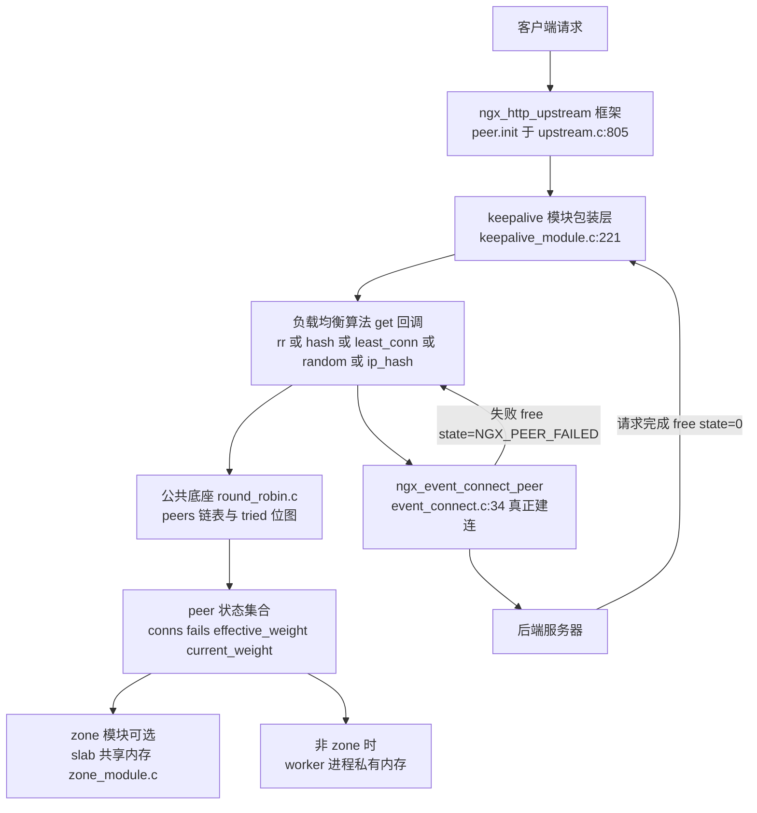
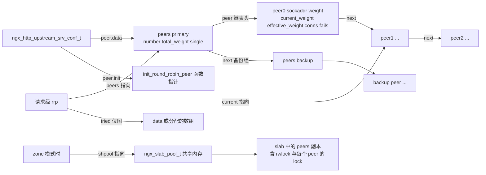
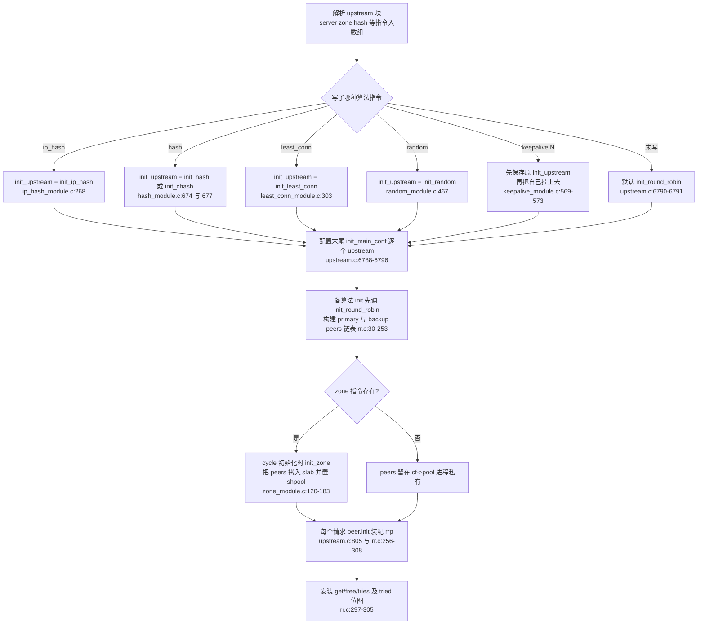
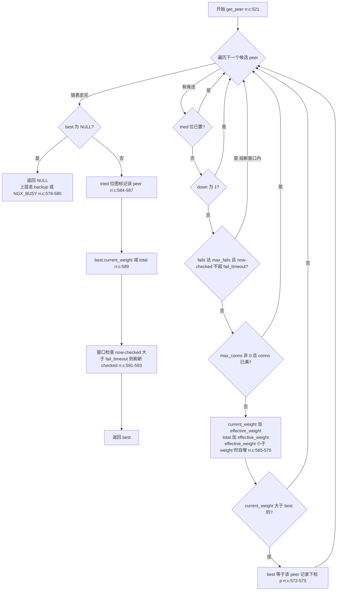
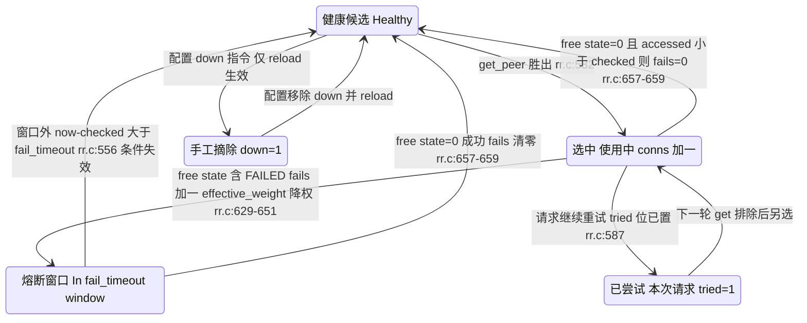
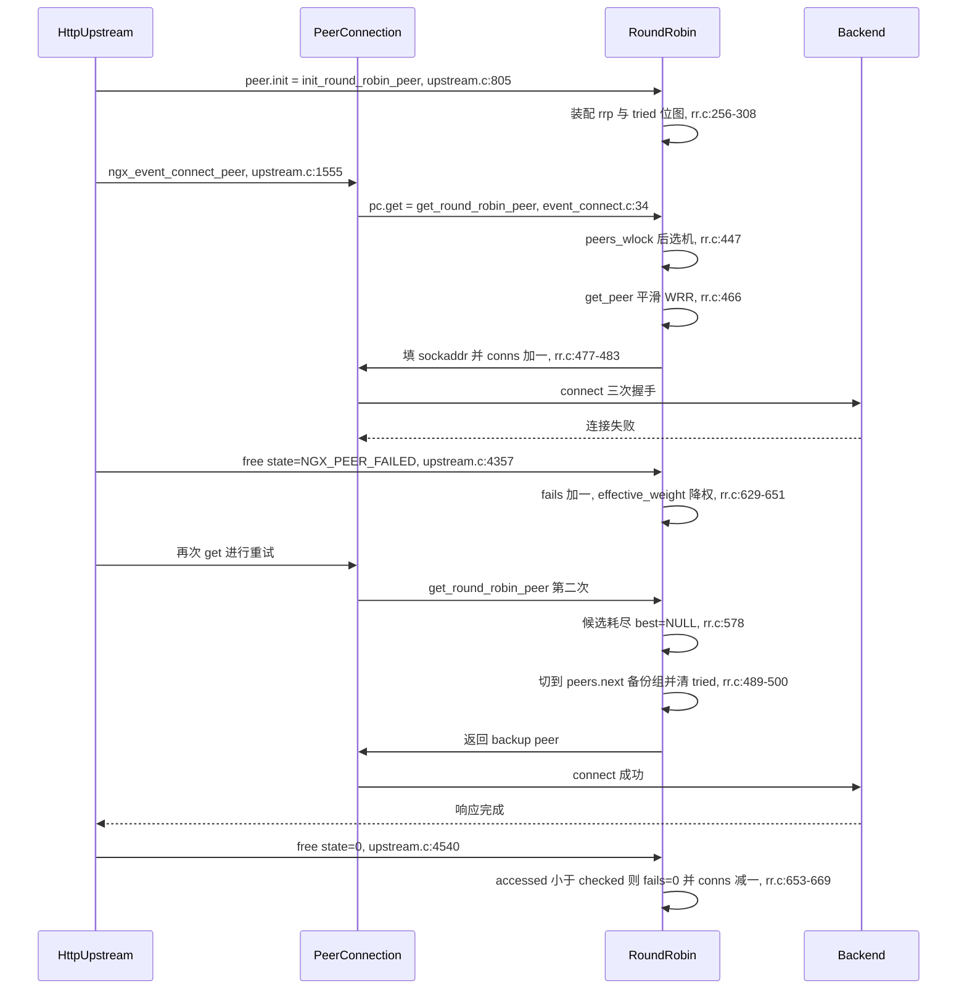

# 负载均衡算法（RR/hash/least_conn/random/ip_hash）（基于 nginx-1.27.0 源码）

> **导读**：读完本文你将掌握——
> 1. nginx 上游负载均衡的插件式框架：`peer.init_upstream`（配置期选算法）→ `peer.init`（请求期装配）→ `peer.get`/`peer.free`（选机与归还）三级回调如何串起来；
> 2. 平滑加权轮询（Smooth Weighted Round-Robin）的精确算法与逐轮推演，`current_weight` 累加、最大者胜出、减去总权重三步为什么能产生"5:1:1"的交错序列；
> 3. `ngx_http_upstream_rr_peer_s` 中 `fails/accessed/checked/conns/max_conns/down` 等状态字段的语义，以及 `max_fails/fail_timeout` 判定窗口的精确边界；
> 4. 失败时 `effective_weight` 如何降权（`-= weight / max_fails`）、如何逐次自愈（每次候选 `+1`），成功后 `fails` 何时清零；
> 5. `hash`（含 `consistent` 一致性哈希/ketama 点分布）、`least_conn`、`random`（含 `two` 两随机取一）、`ip_hash` 四种算法在源码层的实现差异与共同骨架；
> 6. `zone` 指令如何把 peer 状态搬进 slab 共享内存、跨 worker 如何用读写锁保证一致性；
> 7. `keepalive` 空闲连接池的队列结构、复用匹配与全部弃用条件；
> 8. stream 模块下 round-robin 与 http 侧的异同（尤其 `notify` 回调）。
>
> **前置阅读建议**：先了解 `ngx_pool_t` 内存池、`ngx_queue_t` 双向链表、`ngx_slab_pool_t` 共享内存分配器与 `ngx_http_upstream_t` 主流程（建议先读本系列 upstream 请求转发一篇）；对 `ngx_atomic_t` 原子操作有基本概念即可。
>
> **涉及源码清单**（本文所有行号均出自 nginx-1.27.0）：
>
> | 文件 | 行数 | 角色 |
> | --- | --- | --- |
> | src/http/ngx_http_upstream_round_robin.c | 853 | http 侧 RR 核心（所有算法的公共底座） |
> | src/http/ngx_http_upstream_round_robin.h | 157 | peer/peers/rrp 数据结构与锁宏 |
> | src/http/modules/ngx_http_upstream_hash_module.c | 686 | hash 与一致性 hash |
> | src/http/modules/ngx_http_upstream_least_conn_module.c | 314 | least_conn |
> | src/http/modules/ngx_http_upstream_random_module.c | 502 | random / random two |
> | src/http/modules/ngx_http_upstream_ip_hash_module.c | 278 | ip_hash |
> | src/http/modules/ngx_http_upstream_keepalive_module.c | 576 | 空闲连接缓存 |
> | src/http/modules/ngx_http_upstream_zone_module.c | 325 | 共享内存 zone |
> | src/stream/ngx_stream_upstream_round_robin.c | 885 | stream 侧 RR |
> | src/stream/ngx_stream_upstream_round_robin.h | 147 | stream 侧数据结构 |
> | src/event/ngx_event_connect.h、src/event/ngx_event_connect.c | — | `ngx_peer_connection_t` 与 `pc->get` 调用点 |
> | src/http/ngx_http_upstream.c | 6831 | upstream 框架（调用 `peer.init/get/free`） |

---

## 1. 本模块在 nginx 中的位置与职责

nginx 把"上游选哪个后端"这件事抽象成一组函数指针（见 src/event/ngx_event_connect.h:36-73 的 `ngx_peer_connection_s`）：

```c
struct ngx_peer_connection_s {
    ...
    ngx_event_get_peer_pt            get;      /* 选一台后端 */
    ngx_event_free_peer_pt           free;     /* 归还（含成败结论 state） */
    ngx_event_notify_peer_pt         notify;   /* 事件通知（stream 专用） */
    void                            *data;     /* 算法私有数据 */
    ...
};
```

这段结构体声明在 src/event/ngx_event_connect.h:36-73，其中 `NGX_PEER_KEEPALIVE=1 / NGX_PEER_NEXT=2 / NGX_PEER_FAILED=4` 三个 state 位定义在同文件 17-19 行。负载均衡模块的职责就是实现 `get`/`free`（stream 侧再加 `notify`），并挂到 `ngx_http_upstream_srv_conf_t.peer` 上。三级挂载点是：

1. **配置期**：`ngx_http_upstream_init_main_conf` 遍历所有 upstream（src/http/ngx_http_upstream.c:6788-6796），`init = uscfp[i]->peer.init_upstream ? uscfp[i]->peer.init_upstream : ngx_http_upstream_init_round_robin;`——没写算法指令就默认 RR。`hash`/`least_conn`/`random`/`ip_hash` 指令做的唯一事情就是改写 `init_upstream` 指针（例如 src/http/modules/ngx_http_upstream_ip_hash_module.c:268）。
2. **请求期装配**：`ngx_http_upstream_init` 调用 `uscf->peer.init(r, uscf)`（src/http/ngx_http_upstream.c:805），算法模块在此为当前请求分配私有数据 `rrp` 并安装 `get/free`。
3. **连接期**：`ngx_http_upstream_connect` → `ngx_event_connect_peer` → `pc->get(pc, pc->data)`（src/event/ngx_event_connect.c:34）真正选机；失败重试用 `u->peer.free(..., NGX_PEER_FAILED)`（src/http/ngx_http_upstream.c:4357），正常结束用 `free(..., 0)`（src/http/ngx_http_upstream.c:4540）。



图解：所有算法模块（hash/least_conn/random/ip_hash）**都不自己管理后端列表**，它们复用 round_robin.c 构建的 `peers` 链表，只重写"怎么挑"的逻辑；keepalive 模块更特殊，它把真正的算法再包一层，先让底层算法选地址，再在缓存里找可复用连接。zone 模块则是正交的开关，决定 peer 状态放进程私有内存还是 slab 共享内存。

---

## 2. 核心数据结构精讲

### 2.1 `ngx_http_upstream_rr_peer_s`——单个后端节点

声明在 src/http/ngx_http_upstream_round_robin.h:19-56：

| 字段 | 类型 | 语义 | 谁写它 |
| --- | --- | --- | --- |
| `sockaddr/socklen` | `struct sockaddr*` / `socklen_t` | 后端地址 | 初始化时固定（rr.c:95-96） |
| `name` | `ngx_str_t` | 地址的可打印形式（如 "10.0.0.1:8080"） | 初始化时固定 |
| `server` | `ngx_str_t` | `server` 指令里的原始主机名（可能含多地址），一致性 hash 以它做身份（hash_module.c:563-568） | 初始化时固定 |
| `current_weight` | `ngx_int_t` | 平滑 WRR 的运行时累加值，可为负 | `get_peer`（rr.c:565、589） |
| `effective_weight` | `ngx_int_t` | 有效权重：失败降权、成功逐次恢复 | free 降权（rr.c:637）、get 恢复（rr.c:568-570） |
| `weight` | `ngx_int_t` | 配置权重，恒定 | 初始化（rr.c:98） |
| `conns` | `ngx_uint_t` | 当前活跃连接数 | get 时 `++`（rr.c:481），free 时 `--`（rr.c:662） |
| `max_conns` | `ngx_uint_t` | 连接数上限，0 表示不限制 | 初始化（rr.c:101） |
| `fails` | `ngx_uint_t` | 判定窗口内累计失败次数 | free FAILED 时 `++`（rr.c:632） |
| `accessed` | `time_t` | 最近一次失败时间戳 | free FAILED 时更新（rr.c:633） |
| `checked` | `time_t` | 最近一次"探测窗口起点"时间戳 | 选机（rr.c:591-593）与失败（rr.c:634）时更新 |
| `max_fails` | `ngx_uint_t` | 窗口内允许失败次数，0 表示永不标记失败 | 初始化（rr.c:102） |
| `fail_timeout` | `time_t` | 判定窗口/熔断时长（秒） | 初始化（rr.c:103） |
| `slow_start` | `ngx_msec_t` | 声明于 rr.h:38，**开源版从未读写**（grep 全 http 目录无其他引用），属商业版/兼容性预留 | — |
| `start_time` | `ngx_msec_t` | 声明于 rr.h:39，同上未被开源 RR 代码使用 | — |
| `down` | `ngx_uint_t` | 1 表示被 `down` 指令手工摘除 | 初始化（rr.c:104），永不自动修改 |
| `ssl_session/ssl_session_len` | `void*` / `int` | SSL 会话缓存（NGX_HTTP_SSL 时编译，rr.h:43-46） | set/save_session（rr.c:675-837） |
| `lock` | `ngx_atomic_t` | zone 模式下该 peer 的自旋读写锁（rr.h:48-50） | 锁宏（rr.h:105-115） |
| `next` | 指针 | 单链表后继 | 初始化（rr.c:107-108） |

### 2.2 `ngx_http_upstream_rr_peers_s`——一组后端（primary 或 backup）

声明在 src/http/ngx_http_upstream_round_robin.h:61-81：

| 字段 | 语义 |
| --- | --- |
| `number` | 本组 peer 数量（`server` 指令按解析出的地址展开计数，rr.c:54 `n += server[i].naddrs;`） |
| `shpool`（zone 时） | 指向 slab 共享内存池，非 NULL 即表示"状态在共享内存"（rr.h:64-68） |
| `rwlock`（zone 时） | 整组 peers 的读写锁 |
| `zone_next`（zone 时） | 同一个共享 zone 里多个 upstream 的 peers 串成链（zone_module.c:179） |
| `total_weight` | 本组权重和；非 zone 隐式 upstream 时等于 `n`（rr.c:228） |
| `tries` | 本组未被 `down` 的地址数，参与总尝试次数计算（rr.c:57-59） |
| `single:1` | 只有一个后端时置 1，选取走免锁快路径（rr.c:79、449-461） |
| `weighted:1` | 权重不全为 1 时置 1（`w != n`，rr.c:81），仅作标记 |
| `name` | upstream 名字，NGX_BUSY 时用于日志（rr.c:515） |
| `next` | 指向 backup 组；primary 全挂/满时跳过去（rr.c:489-511） |
| `peer` | 本组 peer 单链表头 |

### 2.3 `ngx_http_upstream_rr_peer_data_t`——请求级运行时数据

声明在 src/http/ngx_http_upstream_round_robin.h:128-134：

| 字段 | 语义 |
| --- | --- |
| `config` | 保留（当前恒 0，rr.c:276） |
| `peers` | 当前正在使用的 peers 组（会因回退 backup 被改写为 `peers->next`，rr.c:493） |
| `current` | 本次请求当前选中的 peer，`free` 回调靠它找到要扣账的对象（rr.c:613） |
| `tried` | "已尝试"位图：peer 下标 i 对应 `tried[i/64]` 的第 `i%64` 位（rr.c:543-544） |
| `data` | 内嵌的 64 位位图存储：`number <= 64` 时 `tried = &data` 免分配（rr.c:284-286），否则从请求池分配数组（rr.c:288-295） |

### 2.4 各算法模块的私有结构

- **hash**（src/http/modules/ngx_http_upstream_hash_module.c:13-40）：`ngx_http_upstream_chash_point_t {uint32_t hash; ngx_str_t *server;}` 是环上的一个点；`chash_points_t {number; point[1];}` 用"柔性数组"技巧在 `point[1]` 之后续 `npoints-1` 个点（分配时 `sizeof(...) + sizeof(point) * (npoints-1)`，hash_module.c:311-312）；`hash_peer_data_t` 首字段就是 `rrp`（hash_module.c:32-33 注释 "the round robin data must be first"），因此 `&hp->rrp` 可以直接当作 rrp 传给 RR 函数。
- **random**（src/http/modules/ngx_http_upstream_random_module.c:12-30）：`random_range_t {peer; range;}` 中 `range` 是该 peer 在累计权重轴上的起点，构成有序"权重刻度尺"；`two` 标志选择 two-choice 算法。
- **ip_hash**（src/http/modules/ngx_http_upstream_ip_hash_module.c:13-25）：只存 `addrlen/addr`（客户端地址字节切片）、滚动 `hash` 和 `tries`。
- **keepalive**（src/http/modules/ngx_http_upstream_keepalive_module.c:13-55）：`cache` 与 `free` 两条 `ngx_queue_t` 队列管理固定数量的 `keepalive_cache_t` 槽位；`peer_data_t` 内嵌 `original_get_peer/original_free_peer` 实现装饰器模式。
- **zone**：不新增结构，只把上述 rr 结构整体搬进 slab。

### 2.5 数据结构关系与内存布局



图解：`peers`（组）→ `peer`（节点）是两级单链表；请求级的 `rrp` 只持有三个指针加一个位图，本身很轻。zone 开启后，"同一份" peers/peer 结构会在 master 配置期从 `cf->pool` 拷贝进 slab（zone_module.c:199、278），worker 们操作的都是 slab 里的那份。

---

## 3. 初始化流程

初始化分"配置期"（master 解析 nginx.conf 时）与"运行期"（每个请求开始时）两段。



图解：注意 `keepalive` 的包装顺序——它把自己放在最外层（`us->peer.init = ngx_http_upstream_init_keepalive_peer`，keepalive_module.c:170），把原算法保存进 `original_init_peer`，请求到来时先执行原算法装配、再叠加缓存逻辑（keepalive_module.c:210-222）。这意味着 keepalive 与任何算法都可叠加。

关键初始化细节（后文第 6 节逐行展开）：

- `init_round_robin`（rr.c:30-253）先统计非 backup 的地址数/权重/可尝试数（rr.c:45-60），一次性 `ngx_pcalloc` 出整块 peer 数组（rr.c:74），再用 `peerp = &peer[n].next` 的"指向指针的指针"手法串链（rr.c:107-109）；backup 组同样构建并挂到 `peers->next`（rr.c:183）。一旦出现 backup，primary 与 backup 的 `single` 都被清 0（rr.c:148-149）。
- 隐式 upstream（如 `proxy_pass http://a.com;` 未定义 upstream 块）走域名解析分支，每个 peer 固定 `weight=1、max_fails=1、fail_timeout=10`（rr.c:238-243）。
- `init_round_robin_peer`（rr.c:256-308）安装 `get/free/tries` 与 SSL 会话钩子，并按 `number <= 8*sizeof(uintptr_t)` 决定位图走内嵌 `data` 还是池分配数组（rr.c:284-295）。

---

## 4. 核心执行流程/状态机

### 4.1 平滑加权轮询：算法与六轮推演

RR 的选机核心在静态函数 `ngx_http_upstream_get_peer`（rr.c:521-596），对每个**候选** peer（未尝试过、未 down、未熔断、未满连接）执行三步：

1. **累加**：`peer->current_weight += peer->effective_weight; total += peer->effective_weight;`（rr.c:565-566），并顺手自愈 `if (peer->effective_weight < peer->weight) peer->effective_weight++;`（rr.c:568-570）；
2. **最大者胜出**：`if (best == NULL || peer->current_weight > best->current_weight) best = peer;`（rr.c:572-575）——严格大于，平局时先遍历者赢；
3. **减总权重**：`best->current_weight -= total;`（rr.c:589）。

以三台后端 A:w=5、B:w=1、C:w=1（total=7，全部健康，`effective_weight == weight`）为例，模拟 6 轮（下表状态均为该行"动作之后"的值）：

| 轮次 | 轮前状态 (A,B,C) | 累加后 (A,B,C) | total | 胜出者 | 减 total 后 (A,B,C) |
| --- | --- | --- | --- | --- | --- |
| 1 | (0, 0, 0) | (5, 1, 1) | 7 | A | (-2, 1, 1) |
| 2 | (-2, 1, 1) | (3, 2, 2) | 7 | A（3>2） | (-4, 2, 2) |
| 3 | (-4, 2, 2) | (1, 3, 3) | 7 | B（B、C 同为 3，先到先得） | (-6, -4, 3) |
| 4 | (-6, -4, 3) | (-1, -3, 4) | 7 | C | (-1, -3, -3) |
| 5 | (-1, -3, -3) | (4, -2, -2) | 7 | A | (-3, -2, -2) |
| 6 | (-3, -2, -2) | (2, -1, -1) | 7 | A | (-5, -1, -1) |

6 轮序列为 **A A B C A A**；若继续第 7 轮会再选 A（(0,0,0) 后 A 仍胜），完成一个 7 轮周期 A×5、B×1、C×1，与 5:1:1 的权重比严格一致，且高权重节点的选中被均匀"摊开"而非连发（除首两轮外）。第 3 轮的 B/C 平局值得注意：源码用严格 `>` 比较（rr.c:572），平局由链表顺序决定，因此结果确定、可复现。



图解：所有健康过滤发生在累加之前，因此**被跳过的 peer 既不累加 `current_weight` 也不计入 `total`**——这正是"熔断中的节点不欠债"的关键：它回来时 `current_weight` 不带历史包袱，权重恢复由 `effective_weight++` 独立完成。

### 4.2 peer 生命周期状态机



图解：`down` 是纯静态开关（只来自配置），运行期不会自动置位；"熔断"也并非把 peer 标记成 down，而是靠 `fails >= max_fails && now - checked <= fail_timeout` 这个**时间窗判断**在选机时临时跳过（rr.c:554-557）。

### 4.3 max_fails/fail_timeout 判定窗口与恢复

把三个时间戳字段放在一起看（均以秒为粒度，`ngx_time()` 取缓存时钟）：

- **失败入账**：free 且 `state & NGX_PEER_FAILED` 时 `fails++`，并 `accessed = checked = now`（rr.c:630-634）。`NGX_PEER_FAILED` 由 upstream 框架给出：除 403/404 属于 `NGX_PEER_NEXT`（不算失败，不算重试配额的消耗语义也不同）外，其余失败类型都算 FAILED（src/http/ngx_http_upstream.c:4348-4355）。
- **窗口起点**：`checked` 是窗口的锚点。它在两处被刷新——选机时若 `now - checked > fail_timeout` 则 `checked = now`（rr.c:591-593）；失败时 `checked = now`（rr.c:634）。
- **跳过条件**：`max_fails && fails >= max_fails && now - checked <= fail_timeout`（rr.c:554-557）。三条件同时成立才跳过。所以精确语义是：**从最近一次失败（或最近一次窗口刷新）起再等 `fail_timeout` 秒，peer 自动恢复候选资格**，无需任何主动探测线程。
- **恢复账目**：恢复后的第一次被选中时，第 4.1 节的"自愈"逻辑每轮把 `effective_weight` 加 1 直到回到 `weight`（rr.c:568-570），实现软着陆而非满血复活；一旦某次连接走完且 state 不含 FAILED，`accessed < checked`（失败后 checked 被刷新得更新）成立，`fails = 0` 彻底清账（rr.c:657-659）。

注意 `max_fails=0` 的特殊语义：`max_fails` 为 0 时跳过条件的第一个子式即为假，peer **永不因失败被摘除**（失败只降权）。rr 的 free 里 `if (peer->max_fails)` 才做降权（rr.c:636-643）与此呼应。

### 4.4 降权与恢复的数值演算

free FAILED 时：`effective_weight -= weight / max_fails`（整数除法，rr.c:637），随后钳到 0（rr.c:649-651）。例如 weight=4、max_fails=2：每次失败扣 2，两次失败后 `effective_weight=0`——该 peer 仍会被遍历（累加 0），但除非其他候选也权重归零，否则不可能胜出（`>` 严格比较下 `current_weight` 只会越来越落后），等价于软摘除。恢复期每候选一轮 `+1`：若它每轮都在候选集里，weight=4/max_fails=2 的节点约 4 轮回到满权重，形成"试探性放量"。

---

## 5. 关键时序图

一次"首选失败 → 重试 backup"的完整调用链：



图解：`free` 与下一次 `get` 之间没有锁续接——每次 `get` 都重新 `peers_wlock`（rr.c:447），`free` 只拿读锁加 peer 写锁（rr.c:615-616），锁粒度与持锁时长在 6.5 节细说。backup 的切换是"递归重入"式的：把 `rrp->peers` 换成 `peers->next`、清空 tried 位图后再调一次自身（rr.c:504）；若 backup 也返回 NGX_BUSY，则恢复外层锁语义后返回 NGX_BUSY 给框架（rr.c:506-517）。

keepalive 命中缓存时的时序差异：`get_keepalive_peer` 先调 `original_get_peer`（底层算法照常选地址），随后线性扫 `cache` 队列按 sockaddr 匹配，命中则复用连接并返回 `NGX_DONE`（keepalive_module.c:250-300）——框架收到 NGX_DONE 便跳过 connect 直接发请求（`pc->cached=1`）。

---

## 6. 源码逐段精读

本节按"签名 → 逐块逻辑 → 易错点"的顺序精读核心函数。除特别标注外，http 侧文件为 `src/http/ngx_http_upstream_round_robin.c`（简写 rr.c），其余文件用全名。

### 6.1 `ngx_http_upstream_init_round_robin`：构建 peers 世界

```c
ngx_int_t
ngx_http_upstream_init_round_robin(ngx_conf_t *cf,
    ngx_http_upstream_srv_conf_t *us)
{
    ...
    us->peer.init = ngx_http_upstream_init_round_robin_peer;   /* rr.c:40 */
```

签名：`ngx_int_t (ngx_conf_t *cf, ngx_http_upstream_srv_conf_t *us)`，rr.c:30-253。它是所有算法的公共构造器，分两大分支。

**分支一：显式 upstream（us->servers 非空），rr.c:42-186。**

- 统计 primary（rr.c:45-60）：`n` 累计地址数（一个 `server` 域名解析成几个地址就算几个 peer），`w` 累计 `naddrs * weight`（**权重按地址数放大**——weight 是每个地址的权重），`t` 只累计未 `down` 的地址数作为 `tries`。
- `n == 0` 直接 EMERG "no servers in upstream"（rr.c:62-67）。
- 一次性分配整块 peer 数组（rr.c:74）而非逐个分配：链表遍历只发生在同一块连续内存上，对缓存友好。
- 标志位（rr.c:79-83）：`single = (n == 1)`；`weighted = (w != n)`——只有所有地址权重都为 1 时 `w == n`；`total_weight = w`；`tries = t`。
- 填充字段（rr.c:94-110）：注意 `effective_weight = weight`、`current_weight = 0` 是平滑 WRR 的初始条件；`max_conns/max_fails/fail_timeout/down` 从 server 配置拷贝。
- **backup 组**（rr.c:115-186）重复同样流程，挂到 `peers->next`（rr.c:183）。有一个容易被忽略的副作用：只要存在 backup，rr.c:148-149 会把 primary 和 backup 的 `single` 都清 0，即"有备胎就不是单机"，即使 primary 只有一个地址——因为此时选机失败后需要走 backup 分支，不能走 single 快路径。

**分支二：隐式 upstream（proxy_pass 直接给域名），rr.c:189-252。**

- `us->port == 0` 报 EMERG（rr.c:191-196）。
- `ngx_inet_resolve_host` 在配置期做一次同步解析（rr.c:203），解析结果就是静态 peer 列表。
- 每个 peer 固定 `weight=1`、`max_fails=1`、`fail_timeout=10`（rr.c:238-243）——这解释了为什么未写 upstream 块的转发默认失败 1 次就熔断 10 秒。
- 隐式 upstream 没有 backup（rr.c:250 注释），`peers->next` 保持 NULL。

易错点：`weighted` 只是个标记位，不参与任何选取判断；真正影响数值的是 `total_weight`。另外 `tries` 不含 down 的地址（rr.c:57-59），但 `pc->tries` 用的是宏 `ngx_http_upstream_tries(p) = p->tries + (p->next ? p->next->tries : 0)`（rr.c:13-14），primary+backup 之和。

### 6.2 `ngx_http_upstream_init_round_robin_peer`：请求级装配

签名：`ngx_int_t (ngx_http_request_t *r, ngx_http_upstream_srv_conf_t *us)`，rr.c:256-308。每个请求（准确说每次 upstream 尝试序列开始时）执行一次：

- 从 `r->upstream->peer.data` 取 `rrp`，为空则从请求池分配（rr.c:263-272）——`proxy_pass` 变量解析等场景可能已经建过 rrp（`create_round_robin_peer`，见 6.3）。
- 重置请求级状态：`rrp->peers = us->peer.data; rrp->current = NULL; rrp->config = 0;`（rr.c:274-276）。
- tried 位图两档（rr.c:278-295）：`n` 取 primary/backup 中较大组的数量；`n <= 64`（64 位机）直接用 `rrp->data` 这个 uintptr_t 当位图（零分配）；否则 `n = (n + 63) / 64` 个 uintptr_t 从请求池分配。
- 安装回调（rr.c:297-305）：`get/free/tries` 三件套加 SSL 会话钩子；`peer.tries` 是主备之和（rr.c:299），后续框架还会被 `next_upstream_tries` 指令钳制（upstream.c:813-817）。

`ngx_http_upstream_create_round_robin_peer`（rr.c:311-427）是它的孪生兄弟，服务"变量式 proxy_pass + resolver"的运行期解析结果（`ngx_http_upstream_resolved_t`）：现做 peers/peer 分配（rr.c:335-398）、同样默认 weight=1/max_fails=1/fail_timeout=10（rr.c:392-394）、同样装位图（rr.c:404-416），但 SSL 钩子换成空实现（rr.c:422-423），因为运行期解析的 peer 不支持会话缓存复用。

易错点：这两个函数分配的 peers 是**请求池**生命周期——请求结束即释放，与配置期的 peers（cf->pool）互不影响；而 `us->peer.data` 在 zone 模式下会被 zone 模块重定向到 slab（见 6.10），rrp->peers 因此自然指向共享内存。

### 6.3 `ngx_http_upstream_get_round_robin_peer`：选机外壳

签名：`ngx_int_t (ngx_peer_connection_t *pc, void *data)`，rr.c:430-518，是 `pc->get` 的本体。

```c
    pc->cached = 0;
    pc->connection = NULL;                     /* rr.c:443-444 */
    peers = rrp->peers;
    ngx_http_upstream_rr_peers_wlock(peers);   /* rr.c:447 */
```

- 非-zone 时锁宏展开为空（rr.h:117-125），零开销；zone 时是对 `peers->rwlock` 的写自旋锁（`ngx_rwlock_wlock`，src/core/ngx_rwlock.c:20，自旋上限 `NGX_RWLOCK_SPIN=2048`，src/core/ngx_rwlock.c:15）。
- **single 快路径**（rr.c:449-461）：单后端不做 WRR 数学，只检查 `down` 与 `max_conns`，直接置 `rrp->current = peer`。注意这里没有 tried 位图操作——single 时重试无意义。
- **多机路径**：调静态 `ngx_http_upstream_get_peer(rrp)`（rr.c:466，见 6.4），NULL 则跳 failed 标签。
- 选中后（rr.c:477-483）：填 `pc->sockaddr/socklen/name` 三个出参，`peer->conns++`（zone 时在锁内），解锁返回 NGX_OK。**http 侧显式 `pc->cached = 0`**（rr.c:443），因为外层 keepalive 模块可能之后把它置 1，先清零防串。
- **failed 分支**（rr.c:487-517）：若有 backup 组——把 `rrp->peers` 换成 `peers->next`，清零 backup 对应的 tried 位图（rr.c:493-500），解锁后**递归调用自己**（rr.c:504）。backup 返回非 NGX_BUSY 就直接透传；返回 NGX_BUSY 说明主备全灭，重新拿主组锁、解锁、`pc->name = peers->name`（错误信息里指明 upstream 名）、返回 NGX_BUSY（rr.c:510-517）。

易错点：递归切换 `rrp->peers` 是**有副作用的**——之后 `free` 里 `rrp->peers->single`、锁的对象都是 backup 组。若 backup 只有 1 台，free 走 single 分支（rr.c:618-627）只做 `conns--` 就返回，不会对 single 场景做失败统计（连 `fails++` 都没有）——这是有意为之：单机无可降权可言，只能尽快把 tries 归零让框架放弃。

### 6.4 `ngx_http_upstream_get_peer`：平滑 WRR 核心（本文最关键的 76 行）

签名：`static ngx_http_upstream_rr_peer_t * (ngx_http_upstream_rr_peer_data_t *rrp)`，rr.c:521-596。第 4.1 节已给全流程，这里逐块补足源码细节：

```c
    for (peer = rrp->peers->peer, i = 0;
         peer;
         peer = peer->next, i++)
    {
        n = i / (8 * sizeof(uintptr_t));
        m = (uintptr_t) 1 << i % (8 * sizeof(uintptr_t));

        if (rrp->tried[n] & m) {           /* rr.c:543-548 */
            continue;
        }
```

- **候选过滤四连**（rr.c:546-563）：tried 位 → `down` → `max_fails && fails >= max_fails && now - checked <= fail_timeout` → `max_conns && conns >= max_conns`。注意 `max_fails` 为 0 使整个熔断条件为假（见 4.3）。
- **累加与自愈**（rr.c:565-570）：`current_weight += effective_weight`，`total += effective_weight`，`effective_weight < weight` 则 `+1`。自愈放在这里意味着：**只有当节点处于候选集里它才恢复**——down 掉的节点永远不恢复（down 清不掉），熔断中的节点也不恢复（不可达就不进循环），这恰好符合"恢复应该与可见性同步"的直觉。
- **胜出**（rr.c:572-575）：严格 `>`，平局选链表靠前者；`p = i` 记下标供位图标记。
- **收尾**（rr.c:582-593）：`rrp->current = best`；置 tried 位（rr.c:584-587）；`best->current_weight -= total`（rr.c:589）；若 `now - checked > fail_timeout` 刷新 `checked = now`（rr.c:591-593，为下一轮熔断判定重置窗口锚点）。

易错点一：`total` 只累加**候选**的 `effective_weight`，被过滤的节点不计入——所以"减去 total"减的是"本轮参与分配的总权重"，数学上保证候选集稳定时序列按权重比例循环。

易错点二：`effective_weight` 可能因失败被扣成 0 甚至先为负再钳 0（free 里钳，rr.c:649-651），此时该节点仍会被累加（加 0），但 `current_weight` 相对增速为 0，实际上再难胜出，直到自愈追回。

易错点三：本函数在 zone 模式下运行于 `peers_wlock` 之内（调用方 rr.c:447 拿锁），而对非-zone 单机部署这些锁是空宏，WRR 的进程内一致性靠单线程事件循环保证。

### 6.5 `ngx_http_upstream_free_round_robin_peer`：归还与记账

签名：`void (ngx_peer_connection_t *pc, void *data, ngx_uint_t state)`，rr.c:599-670。

```c
    peer = rrp->current;
    ngx_http_upstream_rr_peers_rlock(rrp->peers);      /* rr.c:615 */
    ngx_http_upstream_rr_peer_lock(rrp->peers, peer);  /* rr.c:616 */
```

- rr.c:611 留着 `/* TODO: NGX_PEER_KEEPALIVE */`：RR 的 free 目前**不区分**"复用连接归还"与"请求结束归还"，这是 keepalive 模块在外层自行处理的原因之一。
- **single 分支**（rr.c:618-627）：只做 `conns--`、置 `pc->tries = 0`、解锁返回——单机不做失败记账（见 6.3 易错点）。
- **FAILED 分支**（rr.c:629-651）：
  - `fails++; accessed = checked = now;`（rr.c:632-634）——同时刷新两个时间戳，`accessed` 记"最后失败时刻"，`checked` 重置熔断窗口起点。
  - `if (peer->max_fails) effective_weight -= peer->weight / peer->max_fails;`（rr.c:636-637）：整数除法，weight=1/max_fails=1 时一次失败扣 1 直接归 0；weight=10/max_fails=3 时每次扣 3。
  - `fails >= max_fails` 打 WARN "upstream server temporarily disabled"（rr.c:639-642）——这只是日志，不是状态翻转。
  - `effective_weight < 0` 钳到 0（rr.c:649-651）。
- **成功分支**（rr.c:653-660）：`if (peer->accessed < peer->checked) peer->fails = 0;`。解读：只要该 peer 从未被失败"踩过"（accessed 未被某次失败刷新到晚于 checked），就清零 fails。由于失败时 accessed=checked 相等，成功时若没有更晚的失败，`accessed == checked` 不满足 `<`？——注意 free FAILED 把两者同时设为 now，而选机路径只刷新 checked（rr.c:591-593）或 hash/random 等算法在 get 时刷新 checked（hash_module.c:272-274）。于是一个"失败过、窗口已过、又成功"的序列里：失败时 accessed=checked=T0；窗口过后选中时若 `now - checked > fail_timeout` 则 checked=T1>T0，此后成功归还时 `accessed(T0) < checked(T1)` 成立 → fails 清零。若窗口还没过就成功（fails 尚未达阈值没被熔断），accessed==checked，不清零，账继续记。这个设计让 `fails` 表达的是"当前窗口内的连续失败史"。
- **收尾**（rr.c:662-669）：`conns--`；`pc->tries` 非 0 则减 1。框架根据 tries 剩余决定还能否重试。

易错点：free 用的是 **peers 读锁 + peer 写锁**，比 get 的 peers 写锁轻——读多写少场景下多个 worker 可同时 free 不同 peer。另外 free 全程信任 `rrp->current` 非空，single 分支也一样；框架保证 free 前一定成功 get 过（upstream.c:4539 判 `u->peer.free && u->peer.sockaddr`）。

### 6.6 hash 模块：普通 hash 与一致性 hash（ketama）

文件 src/http/modules/ngx_http_upstream_hash_module.c。

**指令解析 `ngx_http_upstream_hash`**（hash_module.c:638-686）：`hash $key [consistent];`。第一个参数编译成 complex_value（支持变量组合，hash_module.c:649-655）；`cf->args->nelts == 2` 走普通 hash（`init_hash`，hash_module.c:673-674），第二个参数等于 "consistent" 走一致性 hash（`init_chash`，hash_module.c:676-677），否则 EMERG。flags 允许 weight/max_conns/max_fails/fail_timeout/down 但**不允许 backup**（hash_module.c:666-671）——hash 语义下 backup 组没有自然的键空间映射。两个 init 都先调 `ngx_http_upstream_init_round_robin` 复用 peers 构建（hash_module.c:113、302），只替换 `us->peer.init`。

**普通 hash 选机 `ngx_http_upstream_get_hash_peer`**（hash_module.c:162-282）：

- 退避条件（hash_module.c:181-184）：`hp->tries > 20 || single || key.len == 0` 时直接退回 `get_rr_peer`（初始化时保存的 `ngx_http_upstream_get_round_robin_peer`，hash_module.c:156）。空键退 RR 而非报错，保证可用性优先。
- 哈希公式（hash_module.c:193-211）：注释明言兼容 Cache::Memcached——`((crc32([REHASH] KEY) >> 16) & 0x7fff) + PREV_HASH`。第一轮 REHASH 省略；重试时把递增的 `rehash` 计数器十进制字符串拼在 key 前面重新 crc32，再 `hp->hash += hash` 累加。累加（而非替换）保证重试哈希确定性地"跳"到另一个位置。
- **权重分桶**（hash_module.c:214-222）：`w = hp->hash % total_weight;` 然后沿链表 `while (w >= peer->weight) { w -= peer->weight; peer = peer->next; }`——把哈希空间按权重切成连续桶，`O(n)` 走到目标桶。
- 三项健康检查（down/熔断/满连接，hash_module.c:236-253）与 RR 相同，不通过则 `goto next` 用新的 rehash 再来一轮，超过 20 次退 RR（hash_module.c:256-261）。
- 成功后 `conns++`、按需刷新 `checked`（hash_module.c:270-274）、置 tried 位（hash_module.c:279）。

易错点：普通 hash **不具备一致性**——增删服务器会改变 `total_weight` 与桶边界，几乎全部 key 重新分布。要"只迁移 1/n"需要 consistent 参数。

**请求期装配 `ngx_http_upstream_init_hash_peer`**（hash_module.c:123-159）：

- 分配 `ngx_http_upstream_hash_peer_data_t` 后把 `r->upstream->peer.data` 指向 `&hp->rrp`（hash_module.c:130-135）——注意存的是**内嵌 rrp 的地址**而非 hp 首地址；随后 `ngx_http_upstream_init_round_robin_peer(r, us)` 把这个地址当作自己的 rrp 继续装配（hash_module.c:137），结构体首字段布局（hash_module.c:32-33）正是为这次"以子体传父体"服务的。
- RR 装配完成后再覆盖 get 指针：`r->upstream->peer.get = ngx_http_upstream_get_hash_peer;`（hash_module.c:141）——先复用后覆盖的顺序保证任何时刻 get 都指向有效实现。
- 请求期对 complex key 求值（hash_module.c:145）：`hash $binary_remote_addr`、`hash $request_uri` 或变量拼接都在 `ngx_http_complex_value` 里展开成最终字节串；求出的 `hp->key` 为空串时运行期退 RR（hash_module.c:181 的 `hp->key.len == 0` 条件）。
- 计数器复位（hash_module.c:153-156）：`tries/rehash/hash` 三者清零，`get_rr_peer` 缓存 RR 的 get 函数指针供超限兜底——这是一个"算法自我降级"的通用手法，ip_hash（ip_hash_module.c:142）与 chash 的 get 中同样存在。

**一致性 hash 构环 `ngx_http_upstream_init_chash`**（hash_module.c:285-408）：

- 点数（hash_module.c:308-312）：`npoints = peers->total_weight * 160;`——ketama 标准的每单位权重 160 个虚拟节点；分配 `sizeof(points_t) + sizeof(point_t)*(npoints-1)` 的柔性数组。
- **server 字符串拆 host/port**（hash_module.c:324-358）：兼容 `unix:` 前缀（去前缀取路径做 host，无 port）；否则从右往左扫到第一个 `:`（且其右侧全是数字）拆出 host 与 port，没有冒号则整个串做 host。注释说明公式兼容 Cache::Memcached::Fast：`crc32(HOST \0 PORT PREV_HASH)`。
- **基哈希与链式派生**（hash_module.c:362-388）：`base_hash = crc32(host) 再 update 空字节再 update port`；然后对每台 peer 生成 `weight*160` 个点：`hash = base_hash; ngx_crc32_update(&hash, prev_hash.byte, 4); ngx_crc32_final(hash);`——利用 CRC32 可流式续算的特性，把上一轮的 4 字节 hash 作为增量输入，形成确定性伪随机点列。小端机直接复用 `prev_hash.value = hash`，大端手工拆字节（hash_module.c:380-387），保证跨平台点分布一致。
- **排序去重**（hash_module.c:391-402）：`ngx_qsort` 按升序排，再一前指针去重（相同 hash 保留第一个），`points->number = i + 1`。
- 存进 `hcf->points`（hash_module.c:404-405）。注意点表在 **cf->pool（进程私有）**，即便 zone 开启也不进 slab；点表里的 `server` 指针指向 cf->pool 中构建的 peers，而 zone 拷贝后的 slab peer 的 `server` 是另一份内存——所以运行期匹配用**内容比较**（见下）。

**二分查点 `ngx_http_upstream_find_chash_point`**（hash_module.c:431-460）：在升序点数组里找"第一个 `hash >= 给定值`"的下标；相等直接命中（445-457），循环结束返回 `i`。环回绕由取模天然处理（调用处 `hp->hash % points->number`，hash_module.c:527）。

**请求期与选机**（hash_module.c:463-619）：

- `init_chash_peer`（hash_module.c:463-489）先复用 `init_hash_peer`（complex key 求值、装 rrp），再把 `get` 换成 `get_chash_peer`（hash_module.c:475）；`hash = ngx_crc32_long(hp->key.data, hp->key.len);`（hash_module.c:480）对 key 做一次 32 位 CRC，`hp->hash = find_chash_point(...)`（hash_module.c:484）——**此刻 hp->hash 存的是点数组下标，不是哈希值**。
- `get_chash_peer`（hash_module.c:492-619）：同样 `tries > 20 || single || key.len == 0` 退 RR（hash_module.c:512-515）。取 `server = point[hp->hash % points->number].server;`（hash_module.c:527）锁定目标身份，然后**遍历全部 peer 找 server 字符串内容相等的候选**（hash_module.c:563-568）：

```c
            if (peer->server.len != server->len
                || ngx_strncmp(peer->server.data, server->data, server->len)
                   != 0)
            {
                continue;
            }
```

  这段同时解释了两个设计：一是点表以"server 指令名"为身份，同一 server 的多个地址共享环上份额；二是候选之间再用**平滑 WRR**（hash_module.c:570-580 的累加/自愈/胜出与 RR 完全同款）选具体地址——即一致性 hash 决定"哪台 server"，组内 WRR 决定"哪个 IP"。
- 目标 server 全体候选不可用时 `hp->hash++; hp->tries++;`（hash_module.c:588-589）——沿环顺时针挪到下一个点重找，超过 20 次退 RR（hash_module.c:591-594）。这保持了粘性：优先映射到"环上下一个还在服务的点"，而不是随机换机。
- 命中后（hash_module.c:597-618）与 RR 一样填 pc、`conns++`、刷新 checked、置 tried 位。

### 6.7 least_conn 模块：最少连接 + 平局 WRR

文件 src/http/modules/ngx_http_upstream_least_conn_module.c。指令 `least_conn;` 无参数（least_conn_module.c:21-31），只设 `init_upstream` 与 flags（含 BACKUP，least_conn_module.c:305-311——least_conn 允许 backup 组，RR 语义完整保留）。

`ngx_http_upstream_get_least_conn_peer`（least_conn_module.c:99-288）：

- single 直接转 RR（114-116），连锁都不拿。
- 拿 peers 写锁后扫描候选（135-159），过滤条件与 RR 四连一致。核心比较（167-176）：

```c
        if (best == NULL
            || peer->conns * best->weight < best->conns * peer->weight)
        {
            best = peer;
            many = 0;
            p = i;

        } else if (peer->conns * best->weight == best->conns * peer->weight) {
            many = 1;
        }
```

  这是**带权最少连接**：比较的是 `conns/weight` 比值，交叉相乘避免除法与浮点。注意 `best->conns * peer->weight` 与 `peer->conns * best->weight` 两个乘法在语义上分别是"当前最优的负载×新候选的权重"与"新候选的负载×当前最优的权重"，交叉比较大小等价于比值比较。相等则置 `many=1` 但**不更新 best**——best 仍是链表靠前的那台。
- `many == 1` 时二次扫描（186-232）：从 best 位置继续向后，筛出所有与 best 同比值（`peer->conns * best->weight != best->conns * peer->weight` 则 continue，205-207）且健康的候选，对它们执行与 RR 相同的平滑 WRR（220-231），最终在"并列最少连接"的子集里按权重轮流分配。二次扫描只从 `p` 开始向后，前面的并列者不会回头——精确讲，第一轮的 best 本身也在第二轮被重新累加（190 行从 `peer = best, i = p` 开始，best 自己先被累加一次），因此是"并列子集上的 WRR"，序列仍平滑。
- 收尾（234-255）：`best->current_weight -= total`（注意若非 many 分支，total 为 0，减 0 即无操作——**非平局时 WRR 数学完全不参与**）、刷新 checked、填 pc、`best->conns++`（244）、`rrp->current = best`、置 tried 位、解锁。`conns++` 在锁内完成，保证 zone 模式下多 worker 计数准确。
- failed 分支（257-287）与 RR 的 backup 逻辑逐行同构：切 `peers->next`、清 tried、递归自身。

易错点一：`conns` 的"最少"衡量的是**进行中的连接数**而非历史并发峰值；free 时 `conns--`（由 RR 的 free 完成，least_conn 不重写 free，rr.c:662）。zone 模式下 conns 是跨 worker 的全局值，这正是 least_conn 在多 worker 部署下依然准的原因。

易错点二：UDP/stream 场景下 conns 语义与长连接不同，但模块并不区分协议。

### 6.8 random 模块：加权随机与 two random choices

文件 src/http/modules/ngx_http_upstream_random_module.c。指令 `random [two [least_conn]];`（random_module.c:52-62、452-502）：无参纯随机；`two` 启用两随机取一；第二个参数只接受 `least_conn`（random_module.c:495-499），表示两选一时按最少连接挑。

**权重刻度尺 `ngx_http_upstream_update_random`**（random_module.c:117-150）：为每个 peer 建 `range_t{peer, range}`，`range` 是该 peer 在 `[0, total_weight)` 轴上的起点（141-145 累加生成，天然有序）。非 zone 时配置期就从 cf->pool 建好（random_module.c:113）；**zone 时跳过**（random_module.c:107-111 `if (us->shm_zone) return NGX_OK;`）——因为配置期建好的 ranges 会指向 cf->pool 的 peers，而 zone 初始化随后会把 `us->peer.data` 换成 slab 副本，ranges 就成了悬垂指针。于是改为**首个请求时惰性重建**：`init_random_peer` 检测 `rp->rrp.peers->shpool && rcf->ranges == NULL` 则 `ngx_http_upstream_update_random(NULL, us)`（random_module.c:188-195），此时用 `ngx_alloc`（random_module.c:134，pool 为 NULL 的分支）分配到进程级内存。rcf 是 worker 继承的模块配置，每个 worker 只建一次。

**随机取点 `ngx_http_upstream_peek_random_peer`**（random_module.c:406-429）：

```c
    x = ngx_random() % peers->total_weight;

    i = 0;
    j = peers->number;

    while (j - i > 1) {
        k = (i + j) / 2;

        if (x < rp->conf->ranges[k].range) {
            j = k;

        } else {
            i = k;
        }
    }
```

对随机数 `x` 在有序 `ranges` 上二分，返回权重区间覆盖 x 的 peer 下标——`O(log n)` 加权采样，等价于"轮盘赌"。注意它只"偷看"不落账（不置 tried、不加 conns），故命名 peek。

**纯随机 `get_random_peer`**（random_module.c:203-294）：循环 peek → tried/down/熔断/满连接四项检查（242-264，注意它在**peer 锁内**做检查，246）→ 不合格重抽，`rp->tries > 20` 退 RR（270-273）→ 合格则选中记账。与 hash 模块同构的"重抽 + 兜底"骨架。

**two-choice `get_random2_peer`**（random_module.c:297-403）：拿 peers **写锁**（315，因为要读 conns 比较），循环 peek 两次：

- `if (peer == prev) goto next;`（339-341）两次抽中同一台则重抽（等价重抽一次，不算一次有效对比）。
- 健康检查在锁外做（350-363，wlock 已保证整组状态稳定，无需 peer 锁）。
- 两者都有效时比较（365-373）：

```c
        if (prev) {
            if (peer->conns * prev->weight > prev->conns * peer->weight) {
                peer = prev;
                n = p / (8 * sizeof(uintptr_t));
                m = (uintptr_t) 1 << p % (8 * sizeof(uintptr_t));
            }

            break;
        }
```

  交叉相乘比较 `conns/weight`（与 least_conn 同款公式），**conns/weight 更大的一方落选**，选中较闲者。`least_conn` 参数存在与否其实不改变这段代码——`two` 本身就按连接数挑；差异在于：无 `least_conn` 参数时文档语义是"随机两台中较少连接者"，代码实现完全一致（第二个参数目前只是占位校验）。这是源码可验证的事实：`rcf->two` 只在 init_random_peer 决定 get 指针（random_module.c:176-181），比较逻辑只有一份。
- 选中后记账同 RR 骨架（386-400）。

设计动机（第 7 节详述）：two choices 只需知道两台的本地状态即可逼近全局最优，在 zone 模式下锁竞争远小于 least_conn 的整组扫描。

### 6.9 ip_hash 模块：客户端 IP 粘性

文件 src/http/modules/ngx_http_upstream_ip_hash_module.c。指令 `ip_hash;`（ip_hash_module.c:36-46），flags 不含 BACKUP（270-275）。

**地址切片 `ngx_http_upstream_init_ip_hash_peer`**（ip_hash_module.c:96-145）：

```c
    switch (r->connection->sockaddr->sa_family) {

    case AF_INET:
        sin = (struct sockaddr_in *) r->connection->sockaddr;
        iphp->addr = (u_char *) &sin->sin_addr.s_addr;
        iphp->addrlen = 3;                       /* 只取 IPv4 前三段 */
        break;
```

- AF_INET：取 `s_addr` 的前 3 字节。x86 小端下 `s_addr` 字节序为反序，但这里直接把内存前 3 字节当输入——效果上等价于"IPv4 地址的前三个八位组"（a.b.c 段），即 **/24 粒度**：同 C 段用户粘同一后端。
- AF_INET6（ip_hash_module.c:128-132）：取完整 16 字节 `s6_addr`，addrlen=16——IPv6 没有做前缀归并，地址一变（隐私扩展、移动网络）粘性即失效。
- 其他族（unix 域等，ip_hash_module.c:135-137）：退化到全零 `pseudo_addr`（ip_hash_module.c:80 `static u_char ngx_http_upstream_ip_hash_pseudo_addr[3];`）——所有此类客户端共享同一哈希，落到固定一台。
- 初始 `hash = 89`（ip_hash_module.c:140），89 是精心选的质数种子。

**滚动哈希选机 `ngx_http_upstream_get_ip_hash_peer`**（ip_hash_module.c:148-253）：

- `tries > 20 || single` 退 RR（166-169）。
- 滚动哈希（180-182）：`hash = (hash * 113 + iphp->addr[i]) % 6271;` 对地址字节逐个迭代，113 与 6271（质数）构造散列。随后与 hash 模块同款的权重分桶 `w = hash % total_weight` 线性走链（184-192）。
- 四项健康检查（206-222）不过关则 `goto next`：`++iphp->tries` 超 20 退 RR；**注意 hash 值本轮不更新**——`iphp->hash = hash;` 只在成功路径末尾执行（250），所以重试时从**上次成功选机的哈希值**继续滚动，确定性跳到"该客户端粘性序列里的下一台"，而不是随机漂移。这使得同一客户端的重试序列完全可预测（利于调试与灰度）。
- 成功路径（234-252）：记账同 RR，另存回 `iphp->hash = hash`。

局限（源码可证）：
1. /24 粒度对 IPv4 意味着**同一企业出口下的全部用户被视作一个客户端**，流量天然倾斜；
2. IPv6 取全地址，隐私扩展用户每次连接都可能换机，粘性形同虚设；
3. 粘性键只能是 IP，无法用 cookie/URL（那请用 `hash $cookie_xxx`）；
4. 无 backup 支持（flags 里没有 NGX_HTTP_UPSTREAM_BACKUP，ip_hash_module.c:270-275），主组全灭时直接 NGX_BUSY；
5. 不可与 keepalive 之外的会话复制机制配合——后端故障切换时,原 IP 的会话会整体迁移到粘性序列下一台,无灰度。

### 6.10 zone 模块：peer 状态进共享内存

文件 src/http/modules/ngx_http_upstream_zone_module.c。指令 `zone name [size];`（zone_module.c:23-33）。

**指令解析 `ngx_http_upstream_zone`**（zone_module.c:67-117）：

- 大小可省（默认 0，后续 `ngx_shared_memory_add` 用 tag 匹配同名 zone 时以先声明者为准——实践中通常显式给 size）；size 校验下限 `8 * ngx_pagesize`（zone_module.c:95-99），太小直接 EMERG。
- `uscf->shm_zone = ngx_shared_memory_add(cf, &value[1], size, &ngx_http_upstream_module);`（zone_module.c:105-106）注册共享 zone；`init = ngx_http_upstream_init_zone; data = umcf;`（111-112）；**`uscf->shm_zone->noreuse = 1;`**（114）。

`noreuse = 1` 的含义要到 src/core/ngx_cycle.c 看：reload 时新旧 cycle 的同名同 tag 同 size 且 `!noreuse` 的 zone 才复用旧地址（ngx_cycle.c:464-467）。因此 **upstream zone 在 reload 时总是重新分配并从配置全量拷贝**——fails/conns/current_weight 等"运行时账目"不跨 reload 保留（与 `ssl_session_cache` zone 行为相反）。`init_zone` 里的 `shm_zone->shm.exists` 分支（zone_module.c:134-149）服务于 `exists` 已置位的场景——该标志只在 Windows 上由 `ngx_shm_alloc` 在文件映射已存在时置 1（src/os/win32/ngx_shmem.c:79），此时直接从 `shpool->data` 取回旧 peers 链并逐个 upstream 挂回 `uscf->peer.data`。

**拷贝进 slab `ngx_http_upstream_zone_copy_peers` / `copy_peer`**（zone_module.c:186-260 / 263-325）：

- peers 结构整体 `ngx_memcpy` 进 slab（zone_module.c:199），name 字符串单独 slab 分配（201-214），**`peers->shpool = shpool;`（216）是整个机制的开关**——此后所有锁宏（rr.h:86-115）检测 `peers->shpool` 非 NULL 才真正加锁。
- 每个 peer（zone_module.c:263-325）：`ngx_slab_calloc_locked` 出 dst（272），memcpy 整个结构后**先把指针字段清空再逐个深拷**（279-281 置 NULL，284-303 重建）：`sockaddr` 用 `ngx_sockaddr_t` 尺寸的 slab 块（284，兼容最大地址族），`name.data` 分配 `NGX_SOCKADDR_STRLEN`（289），`server.data` 按源长度分配（298-303）。失败路径逐层回滚释放（308-324），防止 slab 泄漏。
- backup 组同样拷贝并挂 `peers->next`（zone_module.c:228-253）；多个 upstream 共用一个 zone 时通过 `zone_next` 串联（zone_module.c:178-179），`shpool->data` 作链头（164）。

**跨 worker 一致性的锁结构**（rr.h:84-125）：

- 组级读写锁 `peers->rwlock`：get（rr.c:447）/get_chash（hash_module.c:510）/get_random2（random_module.c:315）拿写锁，free（rr.c:615）与纯读路径拿读锁。
- peer 级自旋锁 `peer->lock`：free 记账（rr.c:616）、hash/random 选中的记账（hash_module.c:231、random_module.c:246）单独包住，缩小争用面。
- 实现是原子 CAS 自旋（src/core/ngx_rwlock.c:20-88），写锁自旋上限 `NGX_RWLOCK_SPIN = 2048`（src/core/ngx_rwlock.c:15），超限让出 CPU。读写锁要求读锁嵌套数平衡（`ngx_rwlock_rlock` 只做计数），代码里配对严谨。
- slab 内部分配则由 `shpool->mutex`（`ngx_shmtx` 文件锁/互斥锁）保护——例如 SSL 会话缓存写入（rr.c:784-792）时在 peer 锁内再拿 shpool 锁分配内存。

编译开关：`NGX_HTTP_UPSTREAM_ZONE` 由 auto/modules 按 `--with-stream_upstream_zone`（stream 侧同名宏）控制（auto/modules:929-937、1219-1226）。

易错点：zone 开启后 `current_weight`、`effective_weight`、`fails`、`conns` 全部共享——这是"多 worker 视角一致的负载均衡"的代价：每次 get/free 都有原子操作与潜在自旋。高 QPS 场景下锁争用是可测量开销，two random choices 就是为缓解这一点而生。

### 6.11 keepalive 模块：空闲连接缓存

文件 src/http/modules/ngx_http_upstream_keepalive_module.c。它是**装饰器**：包装任意算法。

**初始化 `ngx_http_upstream_init_keepalive`**（keepalive_module.c:146-189）：默认值 `time=3600000ms（keepalive_time 1h）、timeout=60000ms（keepalive_timeout 60s）、requests=1000`（160-162）；先调 `original_init_upstream`（164，即被包装的算法或默认 RR），保存 `original_init_peer`（168）再把 `us->peer.init` 换成自己（170）；然后一次性分配 `max_cached` 个缓存槽位并全部挂到 `free` 队列（174-186）——`cache` 与 `free` 两条队列，槽位总数恒定。

**装配 `ngx_http_upstream_init_keepalive_peer`**（keepalive_module.c:192-232）：先跑原算法的 init（210），保存原 `get/free`（217-218）再替换为自己的（221-222），SSL 钩子同样透传包装（224-229）。kp 的 `data` 字段保存原算法的 rrp（216），后续透传用。

**取连接 `ngx_http_upstream_get_keepalive_peer`**（keepalive_module.c:235-301）：

- 先调原算法选机（250-254）——地址仍由负载均衡器决定，缓存只是"这个地址上是否有现成连接"。
- 线性扫描 `cache` 队列（260-276），命中条件是 **sockaddr 逐字节相等**：`ngx_memn2cmp((u_char *) &item->sockaddr, (u_char *) pc->sockaddr, item->socklen, pc->socklen) == 0`（267-269）。命中即把槽位从 cache 摘下、还回 free 队列（271-272）。
- 复用前的现场恢复（285-291）：`idle=0、sent=0、log 重绑`；删掉空闲期读定时器（293-295）；`pc->connection = c; pc->cached = 1; return NGX_DONE;`（297-300）——NGX_DONE 告诉框架"无需 connect"。
- 未命中返回 NGX_OK，框架照常走 `ngx_event_connect_peer` 建新连。

**归还 `ngx_http_upstream_free_keepalive_peer`**（keepalive_module.c:304-410）——弃用条件全在这：

```c
    if (state & NGX_PEER_FAILED
        || c == NULL
        || c->read->eof
        || c->read->error
        || c->read->timedout
        || c->write->error
        || c->write->timedout)
    {
        goto invalid;                              /* 323-332 */
    }

    if (c->requests >= kp->conf->requests) {       /* 334-336 */
        goto invalid;
    }

    if (ngx_current_msec - c->start_time > kp->conf->time) {   /* 338-340 */
        goto invalid;
    }

    if (!u->keepalive) {                           /* 342-344 */
        goto invalid;
    }

    if (!u->request_body_sent) {                   /* 346-348 */
        goto invalid;
    }

    if (ngx_terminate || ngx_exiting) {            /* 350-352 */
        goto invalid;
    }

    if (ngx_handle_read_event(c->read, 0) != NGX_OK) {   /* 354-356 */
        goto invalid;
    }
```

逐条解释：FAILED 是算法层的失败结论；`read->eof/error/timedout`、`write->error/timedout` 是传输层病征；`c->requests` 是该连接累计服务的请求数（upstream 建连后自增，src/http/ngx_http_upstream.c:1583），达到 `keepalive_requests`（默认 1000）弃用——防长连接老化与内存/状态累积；连接总年龄超 `keepalive_time`（默认 1h）弃用；`u->keepalive` 为 0 表示本次响应不具备复用条件（协议层不支持或配置禁用）；请求体没发完不能缓存（连接上可能还有未读的 body 边界数据）；进程退出中不再收编；读事件注册失败直接放弃。

**入池与淘汰**（keepalive_module.c:358-405）：

- `free` 队列空（池满）时**淘汰 cache 尾**（LRU：新连接插头、老连接沉尾）：`q = ngx_queue_last(&kp->conf->cache); ... ngx_http_upstream_keepalive_close(item->connection);`（361-368）；否则从 free 队列头取空槽（371-375）。
- 新项插到 cache 头（377），存连接指针、复制 sockaddr（379-401）——**每槽记录对端地址**供下次匹配。
- 空闲期挂读定时器 `kp->conf->timeout`（384，默认 60s），读 handler 换成 `close_handler`、写 handler 换成 dummy（390-391），`c->idle = 1`、日志切回 `ngx_cycle->log`（394-398）。
- 最后一个细节（403-405）：`if (c->read->ready) ngx_http_upstream_keepalive_close_handler(c->read);`——如果归还时读事件已就绪（对端可能已发 FIN），立即跑关闭检测，不等事件循环。

**空闲探活 `ngx_http_upstream_keepalive_close_handler`**（keepalive_module.c:421-461）：`c->close || c->read->timedout` 直接关（436-438）；否则 `recv(c->fd, buf, 1, MSG_PEEK)`（440）窥探：EAGAIN 说明对端没关闭，重挂事件继续等（442-450）；读到任何字节（半关闭/错误）或超时则关闭连接、槽位还回 free 队列（452-461）。MSG_PEEK 不消费数据，纯当"是否 EOF"探测。SSL 连接的关闭走 `ngx_ssl_shutdown` 异步收尾（keepalive_module.c:468-478）。

### 6.12 stream 侧 RR 与 http 侧的异同

文件 src/stream/ngx_stream_upstream_round_robin.c（srr.c）对 src/http/ngx_http_upstream_round_robin.c（hrr.c）。整体是"同一份算法的移植"：`init_round_robin`（srr.c:36-259）与 http 版逐行同构（含 backup 构建、隐式 upstream 的 max_fails=1/fail_timeout=10，srr.c:248-249）；`get_peer` 平滑 WRR（srr.c:530-605）与 hrr.c:521-596 完全一致；`free` 记账（srr.c:608-676）与 hrr.c:599-670 一致（含 `effective_weight -= weight / max_fails`、成功清 fails）。差异集中在五点：

1. **`notify` 回调是 stream 独有的**。装配时多挂一个钩子（srr.c:306），框架在 TCP 连接建立瞬间触发（src/stream/ngx_stream_proxy_module.c:848-850）：

```c
static void
ngx_stream_upstream_notify_round_robin_peer(ngx_peer_connection_t *pc,
    void *data, ngx_uint_t type)
{
    ...
    if (type == NGX_STREAM_UPSTREAM_NOTIFY_CONNECT
        && pc->connection->type == SOCK_STREAM)
    {
        ...
        if (peer->accessed < peer->checked) {
            peer->fails = 0;
        }
        ...
    }
}
```

   （srr.c:679-702）。语义：**TCP 握手成功即清零 fails**——不必等会话结束才恢复信誉；对长会话（如数据库代理）意义重大，否则一次短暂故障后要等整个会话结束才清账。`SOCK_STREAM` 条件把 UDP 会话排除在外（UDP 无"连接成功"概念）。http 侧没有这个钩子，只能靠 free 时的成功归还清零（hrr.c:657-659）。
2. **`pc->cached` 不清零**：http 的 get 显式 `pc->cached = 0`（hrr.c:443），stream 版只置 `pc->connection = NULL`（srr.c:453）——stream 没有对等的 keepalive 连接池模块需要区分 cached 语义。
3. **内存来源**：stream 用 `s->connection->pool`（srr.c:272、298），http 用 `r->pool`。
4. **结构体差异**（src/stream/ngx_stream_upstream_round_robin.h:19-54 vs src/http/ngx_http_upstream_round_robin.h:19-56）：stream 的 `ssl_session` 不受 `#if (NGX_HTTP_SSL)` 包裹而是无条件成员（h:43-44）；兼容填充 `NGX_COMPAT_BEGIN(25)` 对 http 的 32。
5. **free 里没有 `TODO: NGX_PEER_KEEPALIVE` 注释**（对照 hrr.c:611），单机分支同样 `pc->tries = 0`（srr.c:631）。

另外 stream 的上游模块生态在 1.27.0 只有 RR 底座（stream 目录无 hash/least_conn 等对应模块，可 glob 验证 src/stream/modules 下无此类文件），因此 stream proxy 目前只有加权轮询一族。zone 机制两侧对等（auto/modules:1219-1226 定义 `NGX_STREAM_UPSTREAM_ZONE`，锁宏见 src/stream/ngx_stream_upstream_round_robin.h:84-123）。

### 6.13 横切细节：锁宏展开、tried 位图与记账不变量

**锁宏的真实成本**（src/http/ngx_http_upstream_round_robin.h:86-125）。五对宏并非总是函数调用：

- 非 zone 编译（或 `peers->shpool == NULL` 的隐式 upstream）：全部展开为空语句，零开销（rr.h:119-123）。
- zone 编译且 shpool 非 NULL：peers 级 `ngx_rwlock_rlock/wlock/unlock` 作用于 `peers->rwlock`（rr.h:86-102），peer 级作用于 `peer->lock`（rr.h:105-115），底层是 src/core/ngx_rwlock.c:20-88 的原子 CAS 自旋，写锁自旋上限 2048 次（src/core/ngx_rwlock.c:15），解锁是单条原子写（src/core/ngx_rwlock.c:90）。
- 判断依据是**运行时**的 `peers->shpool` 指针而非编译期分支——同一个二进制里，配了 zone 的 upstream 走锁，没配的走空宏。

锁的使用惯例可以从调用点归纳：**"遍历+改权重"的复合操作拿 peers 写锁**（rr.c:447、hash_module.c:510、least_conn_module.c:125、random_module.c:315）；**纯读或单点记账拿 peers 读锁加 peer 写锁**（rr.c:615-616 的 free、hash_module.c:179 的 hash get 开头）；**slab 内存分配再叠 shpool->mutex**（rr.c:784-792）。两类锁绝不可颠倒顺序混用——free 先拿 peers 读锁再拿 peer 写锁，get 拿 peers 写锁后不再拿 peer 写锁（rr.c:466 调 get_peer 时全程持 peers 写锁），避免了 AB-BA 死锁。

**tried 位图的维护规则**。全系列算法对位图只有两种操作：置位与整组清零。

- 置位发生在选中之后：RR（rr.c:584-587）、普通 hash（hash_module.c:279）、chash（hash_module.c:613-616）、least_conn（least_conn_module.c:248-251）、random（random_module.c:291、400）、ip_hash（ip_hash_module.c:249）。
- 清零只发生在**切换 backup 组**时整组刷掉（rr.c:495-500、least_conn_module.c:265-270）——回到 primary 重试的场景在当前框架里不存在，因此不需要精细的按位回收。
- 请求内语义：某 peer 被置位后，本次请求的所有后续 get 都跳过它（rr.c:546-548）。跨请求不保留——`tried` 在请求级 `rrp` 里，init 时清零（rr.c:285-286）。
- single 快路径完全不碰位图（rr.c:449-461），因为单机重试没有"换一台"的意义。

**conns 记账不变量**。get 侧 `++` 与 free 侧 `--` 必须严格配对，六个算法的加法点分别是：rr.c:481、hash_module.c:270、hash_module.c:605、least_conn_module.c:244、random_module.c:286 与 396、ip_hash_module.c:240、srr.c:490；减法统一在 free（rr.c:662、srr.c:668）。两个例外路径要记住：single 的 free 只做 `conns--` 就提前返回（rr.c:618-627），不做失败统计；keepalive 命中缓存时（NGX_DONE）`conns` 已经在底层算法 get 时加过 1，连接复用期间不再重复计。

**http 与 stream 的 RR 快速对照表**：

| 维度 | http（hrr.c / rr.h） | stream（srr.c / srh.h） |
| --- | --- | --- |
| 请求级内存池 | `r->pool`（rr.c:266） | `s->connection->pool`（srr.c:272） |
| `pc->cached` 处理 | get 显式清 0（rr.c:443） | 不触碰，只清 `pc->connection`（srr.c:453） |
| `notify` 回调 | 无此挂钩 | CONNECT 事件清 fails（srr.c:306、679-702） |
| `TODO: NGX_PEER_KEEPALIVE` | 有（rr.c:611） | 无对应注释 |
| `ssl_session` 成员 | `#if (NGX_HTTP_SSL)` 包裹（rr.h:43-46） | 无条件成员（srh.h:43-44） |
| `NGX_COMPAT` 填充 | 32 字节（rr.h:54） | 25 字节（srh.h:52） |
| 可用算法家族 | rr/hash/least_conn/random/ip_hash/keepalive/zone | rr/zone（1.27.0） |
| 平滑 WRR 与熔断逻辑 | rr.c:521-596 | srr.c:530-605，逐行同构 |

表中 srh.h 指 src/stream/ngx_stream_upstream_round_robin.h。读代码时按这张表定位差异，可以避免把 http 侧行为误推到 stream（最典型的就是误以为 stream 也有"会话结束才恢复信誉"——notify 让它提前到连接建立时刻）。

---

## 7. 设计思想与权衡

**为什么所有算法共享 RR 底座？** peers/peer/锁/位图/记账逻辑只有一份实现，hash/least_conn/random/ip_hash 只写"挑选谓词"。代价是每个算法都要拖着 `rrp` 结构（因此 hash/random 的请求级结构把 `rrp` 放第一个字段，hash_module.c:32-33、random_module.c:24-25，靠内存布局前缀兼容）。收益是：tried 位图、backup 回退、熔断窗口、conns 记账、zone 锁全部免费复用，且行为一致性有保证（所有算法的熔断判定逐字相同，见 rr.c:554-557、hash_module.c:241-247、least_conn_module.c:150-155、random_module.c:253-259、ip_hash_module.c:211-217）。

**平滑 WRR 与替代方案**。朴素实现"权重轮转计数器"（每轮把权重份切成原子份额依次发）会导致 AAAAAABC 式突发；nginx 采用的平滑算法把选择压力表示成 `current_weight` 的负债务，每轮全体累加、胜者清偿 total，产出 A A B C A A 的交错序列。代价是每轮 O(n) 扫描 + 对所有候选的写操作；对照方案如 HAProxy 的 deterministic RR（查表跳转）是 O(1) 但调整权重时要重排。nginx 的选择还换来了一个隐藏能力：**effective_weight 的动态降权/自愈天然嵌入**——朴素查表法很难优雅地处理"运行中权重归零再恢复"。

**失败降权 vs 纯熔断**。`max_fails` 熔断是硬开关（窗口内直接跳过），`effective_weight` 是软降级（窗口内仍可被选，只是优先级骤降）。两者叠加的语义：前 `max_fails-1` 次失败靠降权把新流量推开（软），达到阈值后靠窗口跳过（硬），窗口结束靠 `+1` 自愈渐恢复。相比"一次失败直接拉黑 fail_timeout"的粗暴实现，瞬态抖动（单次超时）只损失少量流量。

**O(n) 链表扫描 vs 索引结构**。所有候选过滤都是链表线性扫。对典型几十~几百台后端，扫描成本远低于维护红黑树/堆的复杂度与锁开销；且 zone 模式下 O(n) 持锁时间短于更复杂结构。nginx 的取舍是明确偏向"几百台以内的常见规模"。

**two random choices 的定位**。least_conn 需要：写锁整组 + 全扫 + 比较；two-choice 只需两次加权随机 + 一次比较。在 zone 共享内存、多 worker 高并发下，后者把锁内工作量从 O(n) 降到 O(1)，负载分布用"随机化 + 二选一"逼近 least_conn 的效果（power of two choices 的经典结论）。这就是 random_module.c:365-373 只做一次乘法比较的原因。

**tried 位图的两档设计**。64 台以内零分配（内嵌 uintptr_t），超过才分配数组——绝大多数 upstream 命中快路径。位图用"下标/64、下标%64"手工分词（rr.c:543-544），避免依赖位图库。

**keepalive 为什么在算法外面而不是里面**。连接缓存与"选哪个地址"是正交维度；做成装饰器后（keepalive_module.c:217-222 保存原 get/free），任何算法（含第三方）都自动获得连接复用。代价是 get 时可能"算法选了 A 地址但缓存里是 B 地址的连接"——不会发生：缓存匹配按 sockaddr（keepalive_module.c:267-269），算法选了 A 就只复用 A 的连接，选不到就新建，语义无损。

**zone 的锁粒度权衡**。组级写锁保护"遍历+改权重"的复合操作（简单粗暴但正确），peer 级锁保护记账。SSL 会话缓存则细到 slab 互斥锁。reload 不复用 zone（noreuse=1，zone_module.c:114）看似浪费，实则是正确性选择：配置变了 peers 拓扑会变，旧账目迁移动作复杂且易错，不如重建。

---

## 8. 配置项与调优映射

| 指令 | 作用点 | 语义与源码 | 调参建议 |
| --- | --- | --- | --- |
| `weight` | peer.weight/total_weight | 平滑 WRR 与各 hash 的分桶权重（rr.c:98、hash_module.c:214） | 大权重差距会拉长交错周期；weight 是每地址权重，域名多解析地址时总量放大（rr.c:55） |
| `max_fails` | peer.max_fails | 窗口内失败阈值，0=永不熔断（rr.c:554-557、636） | 内网探活完善时可调大或置 0 交给主动健康检查；默认 1 仅对隐式 upstream（rr.c:242） |
| `fail_timeout` | peer.fail_timeout | 熔断窗口兼窗口锚点时长（rr.c:556、591-593） | 不是"封禁时间"而是"自上次失败/刷新起的观察期"；过短会频繁试错，过长放大故障影响 |
| `max_conns` | peer.max_conns | 并发连接上限（rr.c:561-563、456-458） | zone 模式下全局生效（共享 conns），单机模式仅本 worker；0 不限 |
| `down` | peer.down | 静态摘除，运行期不可变（rr.c:104） | 动态摘除用 max_fails 或第三方 upstream_check 模块 |
| `backup` | peers->next | 主组全灭/全满时启用（rr.c:489-511） | hash 与 ip_hash 的 flags 不含 BACKUP，不可用（hash_module.c:666-671、ip_hash_module.c:270-275） |
| `zone name size` | shpool/rwlock/lock | peer 状态共享；reload 不保留账目（zone_module.c:114、ngx_cycle.c:466） | size 下限 8 页（zone_module.c:95）；开了 zone 才有跨 worker 一致的 least_conn/max_conns/熔断 |
| `least_conn;` | least_conn_module.c:303 | 带权最少连接，平局回落 WRR（167-232） | 请求耗时差异大时优于 RR；需 zone 才跨 worker 准确 |
| `random [two [least_conn]];` | random_module.c:467 | 加权随机 / two-choice（297-403） | 大规模 + zone 高争用场景的锁友好替代；`two` 后第二个参数目前仅作语法校验 |
| `hash $key [consistent];` | hash_module.c:673-683 | 普通 hash / ketama 一致性 hash | 缓存分片用 consistent：每单位权重 160 虚拟节点（hash_module.c:309）；键稳定选择 `$request_uri` 或 `$cookie` |
| `ip_hash;` | ip_hash_module.c:268 | IPv4 /24 粘性、IPv6 全地址粘性（119-138） | 有 NAT 出口或 IPv6 隐私扩展时粘性不可靠，改用 `hash` 指令自定义键 |
| `keepalive N` + `keepalive_time/timeout/requests` | keepalive_module.c:160-162 | 空闲连接池容量/最长复用时长/最长空闲时间/单连接请求上限 | N 按 worker 每进程计（每 worker 独立一份池）；N 不是连接上限而是缓存槽位数（174-186） |

上游框架层的关联指令（不属于负载均衡模块但直接改变行为）：`proxy_next_upstream`/`stream_proxy_next_upstream` 决定哪些失败触发重试与 NGX_PEER_FAILED（src/http/ngx_http_upstream.c:4348-4355 里 403/404 归 NEXT）；`max_fails` 统计口径也受它影响。

---

## 9. 自测题

**Q1：A:w=5、B:w=1、C:w=1 全健康，用 nginx 平滑 WRR 算法写出前 7 轮的选中序列，并说明第 3 轮的平局如何裁决。**

答案：A A B C A A A。第 3 轮 B、C 的 current_weight 同为 3，代码用严格 `>` 比较（src/http/ngx_http_upstream_round_robin.c:572-575），平局由链表顺序决定，B 在 C 之前故选 B。7 轮合计 A×5、B×1、C×1，符合 5:1:1。

**Q2：`current_weight` 在 best 胜出后减去的是什么？为什么减去的是 total 而不是自己的 weight？**

答案：减去 `total`（本轮所有**候选**的 effective_weight 之和，rr.c:566、589）。减 total 使各 peer 的相对差距回到"权重比例决定增速"的尺度上；若只减自身 weight，累加值会无界增长且负债务消失，无法形成交错序列。total 只含候选（被熔断/满连接的节点不计入），保证缺席者不欠债、回归时无历史包袱。

**Q3：max_fails=3、fail_timeout=30s 的后端连续失败 3 次后被跳过。它什么时候重新参与选取？此时 effective_weight 是多少？之后如何回到满权重？**

答案：最后一次失败把 accessed/checked 设为 now（rr.c:630-634），跳过条件要求 `now - checked <= fail_timeout`（rr.c:554-557），所以 30 秒后（下一次 now-checked > fail_timeout 时）重新成为候选。effective_weight 此前每次失败扣 `weight / max_fails`（rr.c:637）并钳非负（rr.c:649-651）：weight=6 时三次失败共扣 6，降为 0。恢复期每轮候选时 `+1`（rr.c:568-570），约 6 轮候选后回到 6。

**Q4：成功归还时 fails 一定清零吗？写出清零需要的精确条件。**

答案：不一定。条件是 `peer->accessed < peer->checked`（rr.c:657-659）。失败时两者同时被置为 now（相等，不满足 `<`）；只有当失败后 checked 又被刷新得更晚（选机时 now-checked > fail_timeout 则 checked=now，rr.c:591-593；或 stream 的 notify 回调在连接建立时刷新，srr.c:695-697）之后，成功归还才满足 accessed < checked 而清零。因此 fails 表达的是"当前观察窗内的失败史"，窗口未过就成功的失败账目会继续累计。

**Q5：一致性 hash 每单位权重生成多少个虚拟节点？某个目标 server 的全部地址都不可用时，下一个候选怎么找？何时放弃粘性退回 RR？**

答案：`npoints = peers->total_weight * 160`，即每单位权重 160 点（hash_module.c:309、368）。目标不可用时 `hp->hash++` 顺时针移到环上下一个点重找（hash_module.c:588-589），保持粘性；`tries > 20`（或 single、key 为空）则退回平滑 RR（hash_module.c:512-515、591-594）。

**Q6：一致性 hash 的点表建在什么内存里？zone 开启后 slab 里的 peer 如何与点表中的 server 关联？**

答案：点表在 cf->pool（进程私有，fork 后各 worker 一份只读副本，hash_module.c:314、404-405），不进 slab。关联靠内容比较：`get_chash_peer` 遍历 slab 中的 peer，用 `peer->server.len/ngx_strncmp` 与点表 server 字符串逐字节比对（hash_module.c:563-568），因为 zone 拷贝后 slab 的 server 是独立内存，指针不可比。同一 server 的多个地址候选用平滑 WRR 选具体地址（hash_module.c:570-580）。

**Q7：least_conn 如何在两台后端 8 连接/权重 2 与 12 连接/权重 3 之间比较？找出并列时的处理流程。**

答案：交叉相乘比较 conns/weight：`8*3=24` vs `12*2=24`，相等——many=1（least_conn_module.c:174-176）。随后从 best 位置二次扫描（186-232），筛出所有比值相同的健康候选（205-207），对它们执行平滑 WRR（220-231）决定具体谁接客；非平局时 total 为 0，`current_weight -= total` 无实际效果（234）。

**Q8：random two 的两台候选比较公式是什么？它相对 least_conn 在 zone 部署下的优势是什么？**

答案：`peer->conns * prev->weight > prev->conns * peer->weight` 则选 prev（random_module.c:365-373），即取 conns/weight 较小者。优势：least_conn 需要整组写锁 + O(n) 扫描（least_conn_module.c:125、135），two-choice 只需锁内 O(1) 比较，多 worker 高并发下显著降低共享内存锁争用，同时用随机化逼近 least_conn 的均衡度。

**Q9：ip_hash 对 IPv4 取地址的哪几个字节？对 IPv6 与 unix 域套接字分别怎么处理？这带来哪些局限？**

答案：IPv4 取 `sin_addr.s_addr` 内存前 3 字节，即 /24 前三段（ip_hash_module.c:121-125）；IPv6 取完整 16 字节（128-132）；其他地址族退化为全零 3 字节 pseudo_addr，所有此类客户端同哈希（80、135-137）。局限：IPv4 /24 把同一 NAT 出口的用户视作一人造成倾斜；IPv6 隐私扩展/移动网络换址即失去粘性；不支持 backup（flags 无 BACKUP，270-275）；粘性键固定为 IP，无法自定义。

**Q10：zone 模块把 peer 状态搬进共享内存后，reload（SIGHUP）时账目保留吗？依据是什么？跨 worker 一致性靠哪些锁？**

答案：不保留。`uscf->shm_zone->noreuse = 1`（zone_module.c:114），而 reload 时 zone 复用要求 `!noreuse`（src/core/ngx_cycle.c:464-467），所以 reload 总是重新分配 slab 并从配置全量拷贝（zone_module.c:162-180）；init_zone 的 exists 分支只服务 Windows 文映射已存在的场景（src/os/win32/ngx_shmem.c:79 置 exists）。一致性靠两级自旋读写锁：组级 `peers->rwlock`（get 写锁/free 读锁，rr.h:86-102）加 peer 级 `peer->lock`（记账，rr.h:105-115），slab 内存分配再由 `shpool->mutex` 保护（rr.c:784-792）。

---

> 附：本文所有行为描述均以 nginx-1.27.0 源码为准；`slow_start/start_time` 字段在开源 RR 中的"未使用"结论来自对 src/http 全目录的 grep（仅声明于 rr.h:38-39，无读写点），如在其他分支/商业版中启用属正常差异，此处标注为开源版事实。
