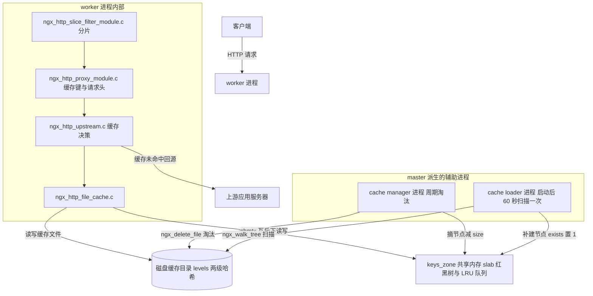
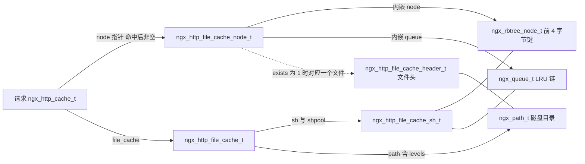
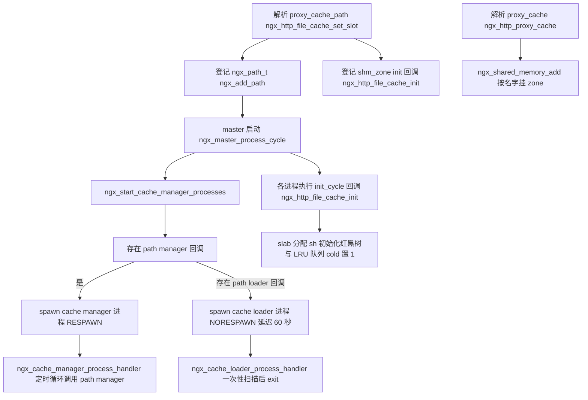
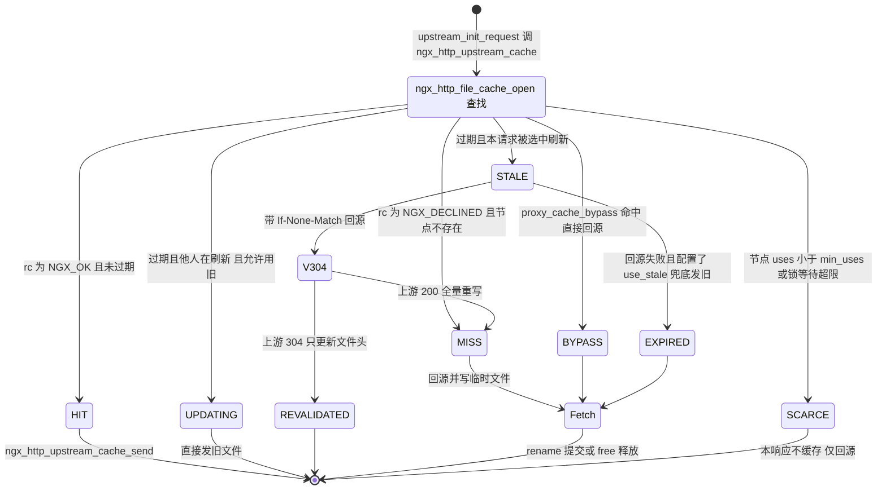
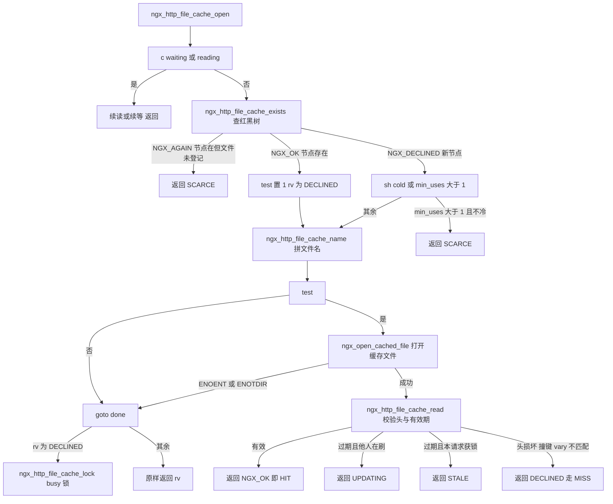
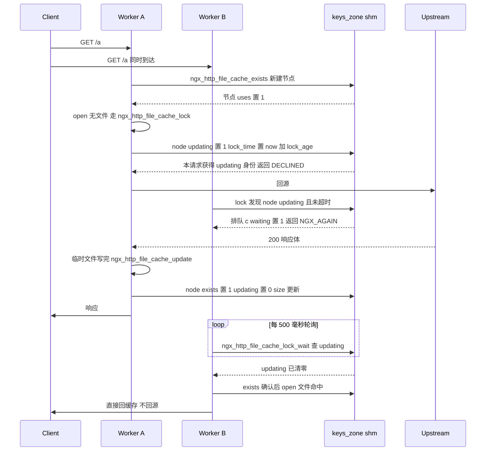
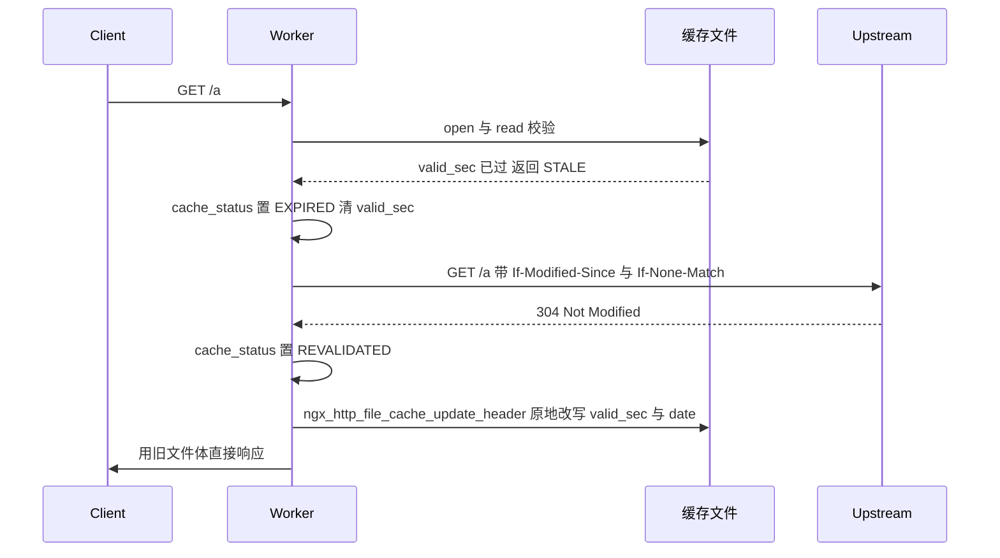
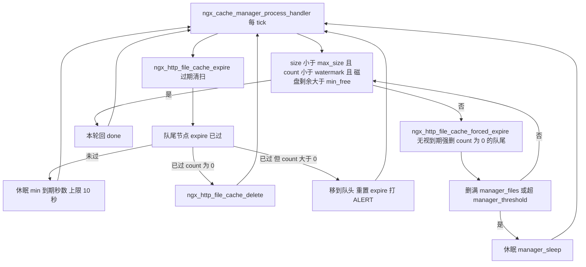

# 代理缓存（file_cache/loader/manager）（基于 nginx-1.27.0 源码）

> **导读**：读完本文你将掌握——nginx 代理缓存从一条 `proxy_cache_key` 到磁盘上两级目录文件的完整映射过程；keys_zone 共享内存里红黑树 + LRU 队列如何支撑百万级缓存条目；`HIT/MISS/EXPIRED/STALE/UPDATING/REVALIDATED/BYPASS/SCARCE` 八种状态在代码里的确切分叉点；busy 锁如何保证"并发回源只放行一个"；回源响应如何经临时文件 rename 原子提交；cache manager 的 LRU 淘汰与 `min_free` 兜底如何配合；cache loader 的限速扫描算法；以及 slice 模块如何把 Range 分片变成可缓存的子请求。
>
> **前置阅读建议**：先了解 nginx 事件驱动框架（`ngx_process_events_and_timers`）、共享内存 slab 分配器（`ngx_slab_pool_t`）、红黑树（`ngx_rbtree_t`）与 upstream 主流程（`ngx_http_upstream_init_request`）。文中引用均标注为 `文件:起始行-结束行`，行号取自本仓库（nginx-1.27.0，见 src/core/nginx.h:13）。
>
> **涉及源码清单**（动笔前已逐一通读）：
> - src/http/ngx_http_file_cache.c（核心：查找/读写/淘汰/loader/manager，共 2799 行）
> - src/http/ngx_http_cache.h（全部缓存数据结构与状态码定义）
> - src/http/modules/ngx_http_proxy_module.c（proxy_cache_* 指令、缓存键、缓存态请求头）
> - src/http/modules/ngx_http_slice_filter_module.c（Range 分片过滤器）
> - src/os/unix/ngx_process_cycle.c（cache manager/loader 辅助进程）
> - 辅助引用：src/http/ngx_http_upstream.c（缓存决策树）、src/http/modules/ngx_http_not_modified_filter_module.c（304 过滤器）、src/core/ngx_file.c（哈希文件名/rename）、src/event/ngx_event_pipe.c（临时文件落盘）

## 1. 本模块在 nginx 中的位置与职责

代理缓存不是独立模块，而是三块代码的合奏：

1. **ngx_http_file_cache.c**：缓存机制本体。它实现了"请求 ↔ 缓存文件"的全部交互：算键、查共享内存、开文件、校验头、加锁、写临时文件、rename 提交；同时把两个回调 `path->manager` 与 `path->loader` 注册进全局 paths 数组（src/http/ngx_http_file_cache.c:2675-2676），供辅助进程调用。
2. **upstream/proxy 模块**：决定"要不要用缓存、用哪个 zone、缓存键是什么、哪些响应头决定新鲜度"。
3. **两个辅助进程**：cache manager 周期性做 LRU 淘汰；cache loader 在启动后一次性扫描目录重建内存索引（src/os/unix/ngx_process_cycle.c:59-65）。



图解：worker 是唯一对缓存文件做"读与写提交"的执行者；manager 与 loader 只碰共享内存索引和目录树，不参与请求路径。共享内存（keys_zone）是所有进程同步点——红黑树提供 O(log n) 键查找，侵入式双链队列提供 LRU 淘汰序。每条 `proxy_cache_path` 对应一个 zone、一个磁盘目录、一对回调。

## 2. 核心数据结构精讲

### 2.1 请求级缓存对象 ngx_http_cache_t（struct ngx_http_cache_s）

定义在 src/http/ngx_http_cache.h:65-125，每个开启缓存的请求一份（由 `ngx_http_file_cache_new` 分配，src/http/ngx_http_file_cache.c:175-194）。

| 字段 | 类型 | 含义 |
|---|---|---|
| `file` | ngx_file_t | 缓存文件句柄与路径（fd 打开期间有效） |
| `keys` | ngx_array_t | 缓存键分片数组（proxy_cache_key 求值结果可有多段） |
| `crc32` | uint32_t | 键分片的 crc32，用于撞键校验 |
| `key[16]` | u_char | 当前生效的 md5 键（可能是主键或 Vary 变体键） |
| `main[16]` | u_char | 主键副本（换用变体键后仍可切回，src/http/ngx_http_file_cache.c:260） |
| `uniq` | ngx_file_uniq_t | 文件 inode+时间戳指纹，防"文件被换" |
| `valid_sec / updating_sec / error_sec` | time_t | 新鲜期截止 / stale-while-revalidate 窗口截止 / stale-if-error 窗口截止 |
| `last_modified / date` | time_t | 上游 Last-Modified 与响应时间，用于条件请求 |
| `etag / vary` | ngx_str_t | 上游 Etag 与 Vary 原文（各限 128 字节，头文件 27-28 行） |
| `variant[16]` | u_char | Vary 头算出的变体键 md5 |
| `header_start / body_start` | size_t | 文件内响应头区起点 / 响应体起点 |
| `length / fs_size` | off_t | 文件长度 / 按 fs 块大小向上取整的占块数 |
| `min_uses` | ngx_uint_t | proxy_cache_min_uses，节点 uses 达标前不落盘 |
| `error / valid_msec` | ngx_uint_t | 缓存的错误状态码（如 404）/ 上次校验耗时的毫秒低位 |
| `buf` | ngx_buf_t | 读入内存的文件头区 |
| `file_cache / node` | 指针 | 所属缓存实例 / 共享内存节点（命中后非空） |
| `lock_timeout / lock_age / lock_time / wait_time` | ngx_msec_t | proxy_cache_lock_timeout / proxy_cache_lock_age / 节点锁截止 / 本请求等待截止 |
| `wait_event` | ngx_event_t | 锁等待定时器（500ms 轮询，见 6.6） |
| 位域 `lock/waiting/updated/updating/exists/temp_file/purged/reading/secondary/update_variant/background/stale_updating/stale_error` | unsigned:1 | 请求生命周期内的互斥/路径标记，语义见表后说明 |

位域中四个最易混淆：`updating` 表示"本请求被选中去回源刷新"；`waiting` 表示"本请求在锁队列里轮询等别人刷新"；`secondary` 表示"当前用的是 Vary 变体二级键"；`temp_file` 表示"回源产物走临时文件、成败须提交或删除"。

### 2.2 共享内存节点 ngx_http_file_cache_node_t

src/http/ngx_http_cache.h:39-62。每个缓存条目一个，常驻 keys_zone：

| 字段 | 类型 | 含义 |
|---|---|---|
| `node` | ngx_rbtree_node_t | 红黑树节点；其 `key`（uint32）存放 md5 前 4 字节 |
| `queue` | ngx_queue_t | 挂到 `sh->queue` 的 LRU 链 |
| `key[12]` | u_char | md5 剩余 12 字节（16 − sizeof(ngx_rbtree_key_t)，见头文件 43-44 行） |
| `count:20` | 位域 | 引用计数：正在 open/read 的请求数；manager 只淘汰 count==0 的节点 |
| `uses:10` | 位域 | 累计命中次数，用于 min_uses 判定 |
| `valid_msec:10` | 位域 | 校验耗时毫秒低位 |
| `error:10` | 位域 | 缓存的负响应状态码 |
| `exists:1` | 位域 | 磁盘文件确认存在 |
| `updating:1` | 位域 | busy 锁：有 worker 正在回源刷新 |
| `deleting:1` | 位域 | manager 正在 unlink 该文件（解锁间隙防复用） |
| `purged:1` | 位域 | 预留（1.27.0 中仅置位清理） |
| `uniq / expire / valid_sec / body_start / fs_size / lock_time` | 各类型 | 与请求级字段同名语义；`expire` = 最后一次访问 + inactive，是 LRU 时钟 |

设计要点：20 位 count + 10 位 uses 挤在同一个字里，一个节点在 64 位平台约 96 字节，1MB keys_zone（最低 2 页，src/http/ngx_http_file_cache.c:2517-2521）即可放下上万个条目——**节点只存元数据，绝不存响应体**。

### 2.3 zone 级共享状态 ngx_http_file_cache_sh_t

src/http/ngx_http_cache.h:147-156：

| 字段 | 含义 |
|---|---|
| `rbtree + sentinel` | 全部节点按 16 字节 md5 键有序 |
| `queue` | inactive LRU 队列：头=最近访问，尾=最久未用 |
| `cold` | 尚未完成 loader 扫描；影响 open 时是否尝试开文件（file_cache.c:324） |
| `loading` | loader 正在扫描（存 loader 进程 pid，file_cache.c:2119） |
| `size` | 全部 exists 节点的 fs_size 之和（块数），与 max_size 比较 |
| `count` | 节点总数，与 watermark 比较 |
| `watermark` | slab 分配失败时收缩触发的节点数水位（file_cache.c:2342-2349） |

### 2.4 缓存实例 ngx_http_file_cache_t（每条 proxy_cache_path 一个）

src/http/ngx_http_cache.h:159-187：`sh/shpool`（共享区与 slab 池）、`path`（ngx_path_t，含 levels）、`min_free/max_size/bsize/inactive`（容量与活跃参数；`max_size` 在 init 时除以 `bsize` 折算为块数，file_cache.c:118、132）、`files/last`（每轮限速计数器）、`loader_files/loader_sleep/loader_threshold` 与 `manager_files/manager_sleep/manager_threshold`（两组限速三件套）、`use_temp_path`。

### 2.5 磁盘文件头 ngx_http_file_cache_header_t

src/http/ngx_http_cache.h:128-144，定长结构体，紧跟其后的可变区是键尾标：

| 字段 | 类型 | 含义 |
|---|---|---|
| `version` | ngx_uint_t | 格式版本，当前 NGX_HTTP_CACHE_VERSION=5（头文件 30 行）；不符则整个文件作废（file_cache.c:568-572） |
| `valid_sec` | time_t | 新鲜期截止时刻 |
| `updating_sec` | time_t | stale-while-revalidate 窗口截止 |
| `error_sec` | time_t | stale-if-error 窗口截止 |
| `last_modified` | time_t | 上游 Last-Modified（-1 表示无） |
| `date` | time_t | 写缓存时刻，revalidate 后作为新响应时间 |
| `crc32` | uint32_t | 缓存键 crc32 |
| `valid_msec` | u_short | 校验耗时毫秒 |
| `header_start` | u_short | 响应头区结束偏移（即 KEY 尾标+头文本长度之后） |
| `body_start` | u_short | 响应体起始偏移 |
| `etag_len + etag[128]` | u_char | 上游 Etag |
| `vary_len + vary[128]` | u_char | 上游 Vary 头原文 |
| `variant[16]` | u_char | Vary 变体键 md5 |

头之后是 `{LF, 'K','E','Y',':',' '}` 六字节尾标（file_cache.c:79），再接缓存键原文与一个 LF（file_cache.c:1352-1361）。**文件布局 = 定长头 + KEY 尾标 + 键原文 + LF + 上游原始响应头 + 响应体**。



图解：请求对象是短暂的，节点是跨进程持久的；两者通过 `c->node` 单向连接，请求退出时必须归还 count（`ngx_http_file_cache_free`）。红黑树与 LRU 队列共享同一批节点，是"一套内存两种视图"。文件头只在磁盘上存在，读取后字段逐一拷入 `ngx_http_cache_t`（file_cache.c:621-629）。

## 3. 初始化流程

初始化分三个阶段：配置解析、共享内存挂接、辅助进程孵化。



图解：配置期把"目录回调 + 共享内存 init 回调"都登记好；master 依据是否存在回调决定孵化哪种辅助进程；随后每个进程独立执行 zone init，谁先到谁建共享数据，后来者复用。

- **指令解析**：`proxy_cache_path` 的所有参数解析与默认值集中在 `ngx_http_file_cache_set_slot`（src/http/ngx_http_file_cache.c:2378-2722）：`inactive=600s`、`loader_files=100`、`loader_sleep=50ms`、`loader_threshold=200ms`、`manager_files=100`、`manager_sleep=50ms`、`manager_threshold=200ms`、`max_size=NGX_MAX_OFF_T_VALUE`、`min_free=0`、`use_temp_path=1`（2407-2420）；`levels=` 每级只能是 1 或 2 字符且最多 3 级（2443、2462，`NGX_MAX_PATH_LEVEL=3` 见 src/core/ngx_file.h:42）；`keys_zone` 大小不得小于 2 页（2517-2521）。`proxy_cache` 指令把 zone 名或变量挂到 location 配置（src/http/modules/ngx_http_proxy_module.c:4774-4830，支持 `proxy_cache $var` 动态选 zone）。
- **共享内存初始化** `ngx_http_file_cache_init`（src/http/ngx_http_file_cache.c:82-172）：reload 时校验 path 与 levels 未变后复用旧 `sh`（93-115）；首次则 slab 分配 `sh`、初始化红黑树（自定义插入比较函数）与队列、`cold=1`、`watermark=(ngx_uint_t)-1`（137-153），并把 `max_size` 折算为磁盘块数（118、132、157）。
- **进程孵化**：`ngx_start_cache_manager_processes`（src/os/unix/ngx_process_cycle.c:352-392）遍历 `ngx_cycle->paths`，任一路径有 `manager` 回调则 spawn manager（RESPAWN，崩了会自动重生）；任一路径有 `loader` 回调则 spawn loader（**NORESPAWN**，跑完即退，387-389）。loader 通过 `ngx_cache_loader_ctx` 携带 60 秒延迟（59-65 行：`ngx_cache_manager_ctx_t ... 60000`），即 `ngx_add_timer(&ev, ctx->delay)`（1119）——这就是"启动后 60s 才开始加载"的出处。

## 4. 核心执行流程/状态机

一个请求在缓存子系统里只会走出以下状态机（状态名即 `$upstream_cache_status` 的取值，字符串表见 src/http/ngx_http_file_cache.c:68-76）：



图解：EXPIRED 在 nginx 内部有两层含义——文件确已过期（`STALE` 原始返回），以及"过期后决定回源"（`u->cache_status` 被改写为 EXPIRED，src/http/ngx_http_upstream.c:957）。`$upstream_cache_status` 里看到的 EXPIRED 属于后者。

`ngx_http_file_cache_open` 是状态机的分叉核心，其内部判定流程如下：



图解：`test` 标志决定是否真的去开文件——只有"节点声称文件存在（exists 或 uses 达标）"或"zone 尚冷（loader 未跑完，宁可试一次）"才会开文件；新请求（DECLINED 路径）不开文件，直接进入 busy 锁申请，随后回源。

## 5. 关键时序图

### 5.1 MISS + busy 锁：并发回源只放行一个



图解：锁记录在共享内存节点上（`node->updating` + `node->lock_time`），不依赖任何请求本地状态，因此跨 worker 有效。等待方不是被唤醒而是 500ms 定时轮询（src/http/ngx_http_file_cache.c:455、534）；`proxy_cache_lock_timeout` 到点后放弃等待并放弃缓存资格（`SCARCE`），`proxy_cache_lock_age` 到点后允许后来者抢走 updating 身份（422-427 行的 `timer <= 0` 分支）。

### 5.2 EXPIRED：条件回源 revalidate 与后台更新



图解：revalidate 只交换头部，不动文件体。改写文件头前会核对 `uniq` 与 `length`，防止文件已被 manager 删除或被他人替换后误写（src/http/ngx_http_file_cache.c:1541-1548）。若配置 `proxy_cache_background_update on`，worker 会先克隆一个 `NGX_HTTP_SUBREQUEST_BACKGROUND` 的子请求去回源（src/http/ngx_http_upstream.c:1117-1138），主请求立即用旧内容应答。

## 6. 源码逐段精读

本节是全文主体，按请求生命周期逐函数剖析。所有摘录不超过 15 行。

### 6.1 缓存键生成：ngx_http_file_cache_create_key

签名：`void ngx_http_file_cache_create_key(ngx_http_request_t *r)`（src/http/ngx_http_file_cache.c:227-261）。

```c
    ngx_crc32_init(c->crc32);
    ngx_md5_init(&md5);

    key = c->keys.elts;
    for (i = 0; i < c->keys.nelts; i++) {
        ...
        len += key[i].len;

        ngx_crc32_update(&c->crc32, key[i].data, key[i].len);
        ngx_md5_update(&md5, key[i].data, key[i].len);
    }

    c->header_start = sizeof(ngx_http_file_cache_header_t)
                      + sizeof(ngx_http_file_cache_key) + len + 1;
    ...
    ngx_md5_final(c->key, &md5);
```

逐块逻辑：
1. 遍历 `c->keys`（proxy 模块 push 进来的各段字符串），对同一份字节流同时算 md5 与 crc32（250-251 行）。
2. `header_start` 在此刻预定：定长头 88 字节量级 + 6 字节 `"\nKEY: "` + 键原文 + 1 字节 LF（254-255 行）。它同时也是读文件时要读入内存的字节数依据。
3. `ngx_memcpy(c->main, c->key, NGX_HTTP_CACHE_KEY_LEN)`（260 行）备份主键，供 Vary 变体切换后返回（见 6.9）。

键的来源在 proxy 模块：`ngx_http_proxy_create_key`（src/http/modules/ngx_http_proxy_module.c:1137-1230）。若配置了 `proxy_cache_key`，则直接对复杂值求值入数组（1159-1166）；否则用 `ctx->vars.key_start`（scheme 与 proxy_host 组成的前缀）+ 转义后 URI + `?args` 拼接（1168-1229）。**易错点**：默认键含 `$args`，query 变化即换键；而 `$slice_range` 之类变量必须显式写进 `proxy_cache_key`，否则分片无法区分。

### 6.2 缓存决策入口：ngx_http_upstream_cache

签名：`static ngx_int_t ngx_http_upstream_cache(ngx_http_request_t *r, ngx_http_upstream_t *u)`（src/http/ngx_http_upstream.c:825-1003）。

- 836-838 行：方法不在 `proxy_cache_methods`（默认 GET|HEAD，merge 处再强制并入，src/http/modules/ngx_http_proxy_module.c:3684）直接 `NGX_DECLINED` 跳过缓存。
- 846-848 行：`proxy_cache_convert_head`（默认 on）把 HEAD 转成 GET 去上游取全量：

```c
        if (r->method == NGX_HTTP_HEAD && u->conf->cache_convert_head) {
            u->method = ngx_http_core_get_method;
        }
```

- 850-860 行：建请求级 `ngx_http_cache_t`、调用 `u->create_key`（即 proxy 的 create_key）、再 `ngx_http_file_cache_create_key`。
- 862-871 行：**头区预算检查**——`header_start + 256 > buffer_size` 则报错并放弃缓存。proxy_cache_key 太长会让整个 location 退化为不缓存，这是最常被忽略的隐性限制。
- 881-892 行：`cache_bypass` 谓词命中 → `cache_status=BYPASS` 并返回 DECLINED（此时连 open 都不做，节点登记推迟到响应阶段，见 6.10）。
- 894-898 行：装载三个锁参数并预置 `cache_status=MISS`。
- 901 行：进入 `ngx_http_file_cache_open`，随后 switch 决定 HIT/STALE/UPDATING/DECLINED/SCARCE/AGAIN 的翻译（906-994）。关键翻译规则：
  - `NGX_OK` → `cache_status=HIT`，直接返回 OK（940-948）；
  - `STALE` → 先尝试后台更新（910-922），不满足则清零三个有效期字段、置 `cache_status=EXPIRED`、`u->buffer.start=NULL`（950-959）；
  - `DECLINED` → MISS，复用或重分配 u->buffer（961-971）；
  - `SCARCE` → `u->cacheable=0`：**继续回源但响应不会写缓存**（973-976）；
  - `NGX_AGAIN` → 返回 `NGX_BUSY`，init_request 把 `write_event_handler` 换成自己原地重入（src/http/ngx_http_upstream.c:576-578）；
  - default（如缓存的 404/502 状态码）→ 视为 HIT 直接返回该状态码（987-993）。
- 996-1002 行：返回 DECLINED 前做 `ngx_http_upstream_cache_check_range`（src/http/ngx_http_upstream.c:1141-1187）：配置了 `proxy_cache_max_range_offset` 且 Range 起始超过阈值、或是无上界的 `-N` 后缀时，令 `u->cacheable=0`——超大分片不值得污染缓存。

### 6.3 打开缓存：ngx_http_file_cache_open

签名：`ngx_int_t ngx_http_file_cache_open(ngx_http_request_t *r)`（src/http/ngx_http_file_cache.c:264-401）。

```c
    c->buffer_size = c->body_start;

    rc = ngx_http_file_cache_exists(cache, c);
    ...
    if (rc == NGX_OK) {

        if (c->error) {
            return c->error;
        }

        c->temp_file = 1;
        test = c->exists ? 1 : 0;
        rv = NGX_DECLINED;

    } else { /* rc == NGX_DECLINED */

        test = cache->sh->cold ? 1 : 0;
```

逐块逻辑：
1. 297 行：把"读头缓冲大小"临时定为 body_start——冷缓存时它等于 `proxy_buffer_size`，热缓存时已被节点上的真实 body_start 收窄（6.4 中 916-918 行）。
2. 299 行：查共享内存。三种返回：`NGX_AGAIN`（节点在但 `uses < min_uses` 或 `exists=0`）→ `SCARCE`（308-310）；`NGX_OK`（节点在且文件确认存在）→ `test=1`；`NGX_DECLINED`（新节点）→ `test` 取决于 `sh->cold`（324 行）——loader 没跑完时宁可开一次文件，避免把磁盘上已存在的文件当作"待回源"。
3. 340 行 `ngx_http_file_cache_name`：由 16 字节 md5 拼出磁盘路径（见 6.5）。
4. 359-376 行：走 core 的 `open_file_cache` 打开文件；`ENOENT/ENOTDIR` 转入 done（正常 miss），其他错误视为致命。`of.directio = NGX_OPEN_FILE_DIRECTIO_OFF`（356 行）：头区小读不走 directio，绕开其块对齐限制。
5. 381-392 行：拿到 fd 后记录 `uniq/length/fs_size`，分配 `body_start` 大小的头缓冲，转入 `ngx_http_file_cache_read`。
6. 394-400 行 done：`rv==NGX_DECLINED`（需要回源）→ 进 busy 锁；否则原样返回 rv（SCARCE 等）。

**易错点**：`c->error` 来自节点的负响应缓存（`intercept_errors` + `proxy_cache_valid 404 ...` 时由 src/http/ngx_http_upstream.c:2745-2746 写入节点），open 在 314-316 行直接把它当返回值抛回 upstream。

### 6.4 共享内存节点登记与查找：exists / lookup / rbtree_insert_value

签名：`static ngx_int_t ngx_http_file_cache_exists(ngx_http_file_cache_t *cache, ngx_http_cache_t *c)`（src/http/ngx_http_file_cache.c:880-990）。

```c
    if (fcn->exists || fcn->uses >= c->min_uses) {

        c->exists = fcn->exists;
        if (fcn->body_start && !c->update_variant) {
            c->body_start = fcn->body_start;
        }

        rc = NGX_OK;

        goto done;
    }

    rc = NGX_AGAIN;
```

逐块逻辑：
1. 890-892 行：优先复用 `c->node`（请求二次进入 open，如锁等待后），否则按键查找。
2. 895-900 行：命中即摘出 LRU 队列（等会插回头部），首次接触本节点时 `uses++、count++`——count 是"我正在用"的引用，manager 靠它避免删除活文件。
3. 902-911 行：节点缓存的是负响应（`fcn->error`）且仍在有效期内 → 直接返回 OK，open 层把它当状态码返回。
4. 913-927 行：`exists || uses >= min_uses` 决定能否开文件；不达标返回 `NGX_AGAIN`（→ SCARCE）。**proxy_cache_min_uses 的落地就在这一处**。
5. 930-949 行：新节点路径。slab 分配失败时先 `set_watermark` 收缩水位，解锁、强制淘汰一轮、再加锁重试一次（933-948）——共享内存不足时用"挤掉 LRU 尾巴"换新条目。
6. 953-958 行：键入树：md5 前 4 字节 memcpy 进 `node.key` 作为树排序键，剩余 12 字节拷入 `fcn->key`。
7. 963-973 行 `renew:` 段把 exists/valid_sec 等清零——无论是全新节点还是"错误节点过期重用"都从这里回到白纸状态。
8. 977-983 行 `done:`：`expire = now + inactive` 并插队头（LRU 刷新），把 uniq/error/node 回填请求对象。

查找 `ngx_http_file_cache_lookup`（1028-1070）：先按 4 字节树键走到相等节点，再 memcmp 剩余 12 字节；不等则继续按剩余字节大小序左/右下行。也就是说**同一棵树里前 4 字节相同的键按 12 字节尾序混排**，插入函数 `ngx_http_file_cache_rbtree_insert_value`（1073-1113）维持同一规则，保证红黑树无重复键。

### 6.5 文件名与两级目录：ngx_http_file_cache_name

签名：`static ngx_int_t ngx_http_file_cache_name(ngx_http_request_t *r, ngx_path_t *path)`（src/http/ngx_http_file_cache.c:993-1025）。

1. 1005-1006 行：路径总长 = 目录名 + 1（斜杠）+ 分层深度 `path->len` + 32 个十六进制字符（16 字节 md5）。
2. 1016 行：`ngx_hex_dump` 把 md5 转成 32 字符小写十六进制。
3. 1019 行：`ngx_create_hashed_filename`（src/core/ngx_file.c:241-262）从**字符串尾部**取字符插斜杠：`levels=1:2` 时，`.../b7f54b2df7773722fa38a44f36eda3c0` 变为 `.../c/29/b7f54b2df7773722fa38a44f36eda3c0`——即末 2 位、再往前 1 位各成一级目录。目录层由 md5 尾部构成，分布天然均匀。

**易错点**：改 `levels` 会导致旧目录树失效——init 阶段 reload 校验 levels 一致，不一致直接拒绝启动（src/http/ngx_http_file_cache.c:104-111）。

### 6.6 busy 锁：ngx_http_file_cache_lock 与 lock_wait

签名：`static ngx_int_t ngx_http_file_cache_lock(ngx_http_request_t *r, ngx_http_cache_t *c)`（src/http/ngx_http_file_cache.c:404-460）。

```c
    ngx_shmtx_lock(&cache->shpool->mutex);

    timer = c->node->lock_time - now;

    if (!c->node->updating || (ngx_msec_int_t) timer <= 0) {
        c->node->updating = 1;
        c->node->lock_time = now + c->lock_age;
        c->updating = 1;
        c->lock_time = c->node->lock_time;
    }

    ngx_shmtx_unlock(&cache->shpool->mutex);
```

逐块逻辑：
1. `c->lock` 即 `proxy_cache_lock`（默认 off，src/http/modules/ngx_http_proxy_module.c:3699-3700），未开锁直接 DECLINED 回源（410-412）。
2. 422-427 行是"只放行一个"的全部实现：节点未上锁、或锁已超过 `lock_age`（默认 5s，3705-3706 行）——后者保证上一个刷新者卡死（如上游挂起）时，后来者能抢到 updating 身份继续回源，锁永不死锁。
3. 435-437 行：抢到锁（`c->updating=1`）返回 DECLINED → 回源并最终写缓存。
4. 439-441 行：`lock_timeout==0`（配置为 0，或上一轮等待已超时）→ `SCARCE`，放弃等待也放弃写缓存资格。
5. 443-459 行：进入等待：`c->waiting=1`、设 500ms 定时器（455 行取 `min(剩余等待, 500)`）、`r->main->blocked++`、返回 `NGX_AGAIN`（upstream 翻译为 `NGX_BUSY`）。

等待端 `ngx_http_file_cache_lock_wait_handler`（463-499）→ `ngx_http_file_cache_lock_wait`（502-539）：
- 511-518 行：总等待超过 `proxy_cache_lock_timeout`（默认 5s，3702-3703 行）→ 记 `cache lock timeout`、`c->lock_timeout=0`、返回 OK；下一轮 lock 走 SCARCE 分支。
- 527-536 行：节点仍在 updating → 续 500ms 定时器返回 AGAIN；否则 OK → handler 清 `waiting`、`blocked--`、`r->write_event_handler(r)` 重入 `ngx_http_upstream_init_request`，此时再查缓存多数直接 HIT。

**为什么用轮询而不是唤醒队列**：跨进程事件通知需要额外广播机制；nginx 选择"每 500ms 最多查一次共享内存"的折中，代价是平均半秒的响应延迟，换取零锁竞争复杂度。若缓存键热点极高，可调小 `proxy_cache_lock_timeout` 并接受部分请求穿透。

### 6.7 读取与校验：ngx_http_file_cache_read

签名：`static ngx_int_t ngx_http_file_cache_read(ngx_http_request_t *r, ngx_http_cache_t *c)`（src/http/ngx_http_file_cache.c:542-680）。

读文件由 `ngx_http_file_cache_aio_read`（683-736）承担：`aio on` 走文件 AIO（695-714，挂 60 秒兜底定时器）、`aio threads` 走线程池（718-731）、否则同步 `ngx_read_file`。以下按校验顺序（每一项失败都返回 DECLINED 走 MISS，绝不可能发坏数据）：

1. **短文件**：`n < header_start` → "cache file is too small"（560-564）。
2. **版本**：`h->version != NGX_HTTP_CACHE_VERSION`（568-572）——nginx 升级头格式后旧文件自动整体作废。
3. **撞键**：`h->crc32 != c->crc32 || h->header_start != c->header_start`（574-578）。
4. **键原文比对**：跳过定长头与尾标，逐段 memcmp 请求的 keys（580-593）。md5 16 字节空间极难碰撞，但 crc32+原文双重校验后，伪造碰撞在工程上不可行。
5. **头长度**：`h->body_start > c->body_start` → "too long header"（595-600）：防止磁盘头比本次配置的 buffer 大（例如换小了 proxy_buffer_size 后读旧文件）。
6. **Vary**：`h->vary_len` 上限 128（602-607）；有 Vary 则对当前请求头重算变体哈希（610 行调 `ngx_http_file_cache_vary`，见 6.9），与 `h->variant` 不符 → `ngx_http_file_cache_reopen`（1268-1299）：释放当前节点、置 `secondary=1`、`c->key = c->variant`、重新 open——此时查找的就是"主键文件 + 变体哈希"派生的二级键。
7. **回填与登记**：头字段逐项拷入 `c`，`r->cached=1`（619-631）；zone 仍冷则代 loader 完成节点登记（635-650，置 exists/uniq/fs_size 并累加 `sh->size`）。
8. **有效期判定**（652-677）：

```c
    if (c->valid_sec < now) {
        c->stale_updating = c->valid_sec + c->updating_sec >= now;
        c->stale_error = c->valid_sec + c->error_sec >= now;

        ngx_shmtx_lock(&cache->shpool->mutex);

        if (c->node->updating) {
            rc = NGX_HTTP_CACHE_UPDATING;

        } else {
            c->node->updating = 1;
            c->updating = 1;
            c->lock_time = c->node->lock_time;
            rc = NGX_HTTP_CACHE_STALE;
        }
```

过期后：`stale-while-revalidate` 窗口内 `stale_updating=1`，`stale-if-error` 窗口内 `stale_error=1`（两者都来自上游 Cache-Control 的解析，见 6.16）；节点已被他人 updating → 返回 UPDATING；否则本请求抢到 updating 身份返回 STALE。未过期则返回 NGX_OK → HIT。

### 6.8 命中发送：ngx_http_upstream_cache_send 与 ngx_http_cache_send

`ngx_http_upstream_cache_send`（src/http/ngx_http_upstream.c:1049-1113）：
1. 1058-1061 行：`header_start == body_start` 说明文件里没存响应头，按 HTTP/0.9 直接 `ngx_http_cache_send` 发体。
2. 1065-1066 行：`u->buffer = *c->buf` 且 `pos += c->header_start`——把"缓存头缓冲"改挂为 upstream 响应缓冲，缓冲区里此刻是**当年存下来的上游响应头原文**。
3. 1086 行 `u->process_header(r)`：proxy 的 `ngx_http_proxy_process_header`（src/http/modules/ngx_http_proxy_module.c:1880-2039）原样解析这批头，经 `headers_in_hash` 的 handler 复制到 `r->headers_out`。
4. 1090 行 `ngx_http_upstream_process_headers` 做头转发与拦截；随后 `ngx_http_cache_send`。
5. 头解析失败（缓存文件损坏）返回 `NGX_HTTP_UPSTREAM_INVALID_HEADER`，init_request 层把它降级为 MISS 重新回源（src/http/ngx_http_upstream.c:595-601）。

`ngx_http_cache_send`（src/http/ngx_http_file_cache.c:1624-1671）构造一个纯文件 buf：`file_pos=body_start`、`file_last=c->length`、`last_buf`（主请求）、`in_file=1`，交给 `ngx_http_output_filter`。**响应体从此走 sendfile 式零拷贝路径，若命中后客户端带 Range，由 range 过滤器在输出链上切分**。

### 6.9 头部构造与 Vary：set_header / update_variant / vary

`ngx_http_file_cache_set_header`（src/http/ngx_http_file_cache.c:1302-1364）：写缓存前把 `ngx_http_cache_t` 的元数据序列化进磁盘头（1319-1328）；etag/vary 各自限 128 字节（1330-1346）；有 Vary 时当场算出 `c->variant` 存入头（1344-1345）；随后写 `"\nKEY: "` 尾标 + 键原文 + LF（1352-1361）。调用点在回源路径上、响应头已经收齐时：`u->buffer.start` 的头部空间被覆盖写入（见 6.10）。

变体哈希由 `ngx_http_file_cache_vary`（1116-1162）计算：以主键 16 字节为种子，按 Vary 列出的每个头名（整体转小写）追加 `name + ":" + 头值 + CRLF` 进 md5。头值提取在 `ngx_http_file_cache_vary_header`（1165-1265）：Accept-Charset/Encoding/Language 三个头做空白归一化（1237-1263），其余头原样参与。

`ngx_http_file_cache_update_variant`（1367-1414）处理一个精巧场景：请求用二级键缓存成功后，若新响应**不再带 Vary**（或 variant 恰好等于当前键），则递减二级节点计数、切回 `c->main` 主键重新登记节点——保证后续请求回到主键文件上写缓存，避免"主键文件永远存的是某个变体"。

### 6.10 回源写缓存：谓词、有效期计算、临时文件与 rename 提交

回源响应头收齐后进入 `ngx_http_upstream_send_response`（src/http/ngx_http_upstream.c:3013 起）前的缓存决策段（3136-3225）：

```c
    if (u->cacheable) {
        time_t  now, valid;

        now = ngx_time();

        valid = r->cache->valid_sec;

        if (valid == 0) {
            valid = ngx_http_file_cache_valid(u->conf->cache_valid,
                                              u->headers_in.status_n);
            if (valid) {
                r->cache->valid_sec = now + valid;
            }
        }

        if (valid) {
            r->cache->date = now;
            r->cache->body_start = (u_short) (u->buffer.pos - u->buffer.start);
```

逐块逻辑：
1. 3143-3151 行：`proxy_no_cache` 谓词在**响应阶段**再测一次（与请求阶段的 bypass 相对）；命中则 `u->cacheable=0`。
2. 3155-3163 行：BYPASS 请求此时才补做 `ngx_http_file_cache_create`（登记节点 + 确定文件名，src/http/ngx_http_file_cache.c:197-224），使响应可被缓存。
3. 3175-3181 行：有效期优先级——上游头已解析出的 `valid_sec`（X-Accel-Expires > Cache-Control > Expires，见 6.16）优先；否则查 `proxy_cache_valid`（`ngx_http_file_cache_valid` 按 status 匹配数组，`any` 即 status 0 通配，src/http/ngx_http_file_cache.c:2352-2375）。两者都没有 → `u->cacheable=0`，本次不缓存（3209-3211）。
4. 3183-3207 行：定 `date/body_start`（头区实际长度）、200/206 记录 `last_modified/etag` 供后续条件请求；然后 `ngx_http_file_cache_set_header` 把头写进 `u->buffer.start`——**响应头与文件头在同一块内存里就地成型**。
5. 3217-3219 行：不可缓存则立即 `ngx_http_file_cache_free` 释放节点引用。

临时文件管线在 3242-3305 行配置：`p->cacheable` 置位时 `temp_file->persistent=1`（响应结束不自动删）；`use_temp_path=off` 时临时文件直接建在缓存目录（3259-3262，文件名 = 目标名 + 10 位数字后缀，loader 正是靠这个后缀跳过半成品，src/http/ngx_http_file_cache.c:2236-2240）；`p->buf_to_file`（3293-3305）钉住含文件头的缓冲，保证临时文件**从头就是"文件头 + 响应体"的最终布局**。数据流经 `ngx_event_pipe_write_chain_to_temp_file`（src/event/ngx_event_pipe.c:741-906）边收边写。

收尾判定在 `ngx_http_upstream_process_request`（src/http/ngx_http_upstream.c:4134-4240）：`upstream_done` 或"eof 且长度对账通过"（4189-4198，Content-Length 与已写字节数一致）→ `ngx_http_file_cache_update`；错误或长度不符 → `ngx_http_file_cache_free` 删临时文件。

`ngx_http_file_cache_update`（src/http/ngx_http_file_cache.c:1417-1489）是提交原子点：

```c
    rc = ngx_ext_rename_file(&tf->file.name, &c->file.name, &ext);
    ...
    ngx_shmtx_lock(&cache->shpool->mutex);

    c->node->count--;
    c->node->error = 0;
    c->node->uniq = uniq;
    c->node->body_start = c->body_start;

    cache->sh->size += fs_size - c->node->fs_size;
    c->node->fs_size = fs_size;

    if (rc == NGX_OK) {
        c->node->exists = 1;
    }
```

`ngx_ext_rename_file`（src/core/ngx_file.c:660-757）先改权限/时间，再 rename；目标目录缺失则 `create_full_path` 后重试；跨文件系统（EXDEV）退化为 copy+rename。rename 成功后 fd_info 取 `uniq` 与块数，锁内一次更新节点并归还 count、清 updating。**reader 不会读到半成品**：文件要么以旧名（临时名）不可达，要么以最终名完整出现——两级目录下的 rename 是同目录原子操作。

### 6.11 条件回源 revalidate：test_next 与 update_header

`ngx_http_upstream_test_next`（src/http/ngx_http_upstream.c:2528-2663）在收到上游状态码后先于正常处理执行。revalidate 分支（2598-2658）：

```c
    if (status == NGX_HTTP_NOT_MODIFIED
        && u->cache_status == NGX_HTTP_CACHE_EXPIRED
        && u->conf->cache_revalidate)
    {
        ...
        u->cache_status = NGX_HTTP_CACHE_REVALIDATED;
        rc = ngx_http_upstream_cache_send(r, u);
        ...
        if (valid) {
            r->cache->valid_sec = valid;
            r->cache->updating_sec = updating;
            r->cache->error_sec = error;

            r->cache->date = now;

            ngx_http_file_cache_update_header(r);
        }
```

发往上游的条件请求头来自缓存态请求头模板 `ngx_http_proxy_cache_headers`（src/http/modules/ngx_http_proxy_module.c:850-867）：`If-Modified-Since: $upstream_cache_last_modified`、`If-None-Match: $upstream_cache_etag`，同时清空 `Range` 与 `If-Range`——**回源永远请求完整 200 或 304，客户端的 Range 由本机输出链处理**。两个变量只在 `proxy_cache_revalidate on` 且 `cache_status==EXPIRED` 时存在（src/http/ngx_http_upstream.c:5993-6043）。

`ngx_http_file_cache_update_header`（src/http/ngx_http_file_cache.c:1492-1621）做"原地改头"：
1. 1511-1528 行：O_RDWR 打开缓存文件；ENOENT（已被删）静默返回。
2. 1541-1548 行：`c->uniq != ngx_file_uniq(&fi) || c->length != ngx_file_size(&fi)` → 文件已被替换，放弃。
3. 1564-1574 行：再次核对 version/last_modified/crc32/header_start/body_start，全部一致才允许覆盖。
4. 1581-1613 行：重写整个定长头（valid_sec 换新、date=now），文件体一个字节不动。

### 6.12 释放与兜底：free 与 pool cleanup

`ngx_http_file_cache_free`（src/http/ngx_http_file_cache.c:1674-1736）：
- 1692-1696 行：count--；若本请求持 updating 且 `lock_time` 未变（没被人抢走）则清节点 updating。
- 1698-1705 行：`c->error`（经 intercept_errors 缓存的负响应）写入节点，供后续 open 直接返回该状态码。
- 1706-1712 行：节点没用起来（`!exists && count==0 && min_uses==1`）就当场从树和队列里摘除释放——**min_uses>1 的节点不删**，等 uses 攒够。
- 1719-1731 行：`temp_file` 标记的请求若临时文件还在，删除之。

`ngx_http_file_cache_cleanup`（1739-1757）挂在请求内存池上，请求异常退出时兜底调用 free；若当时正在 updating 还会打 ALERT "stalled cache updating"——配合 6.6 的 lock_age 超时，这是僵死刷新者被系统自愈的两道保险。

### 6.13 cache manager：LRU 清理

manager 主体 `ngx_http_file_cache_manager`（src/http/ngx_http_file_cache.c:2021-2105）每个 tick 做两件事：过期清扫与容量回收。

**过期清扫** `ngx_http_file_cache_expire`（1859-1967）：从 LRU 队尾（最久未用）取节点，`wait = fcn->expire - now`：
- `wait > 0`：最近的一个都没到期 → 截断到 10 秒后唤醒（1906-1908）；
- `count == 0` → 立即删除（1916-1919）；
- `deleting` 置位（别的 manager 正在删）→ 等 1 秒（1921-1924）；
- `count > 0`（有人引用但长期占尾）→ 摘出插队头、`expire` 重置 +inactive、打 ALERT "ignore long locked inactive cache entry"（1931-1943）——既不清数据也不死循环；
- 每删满 `manager_files`（默认 100）或累计耗时 `manager_threshold`（默认 200ms）即让出（1947-1959）。

**删除** `ngx_http_file_cache_delete`（1970-2018）：`sh->size -= fs_size`；拼文件名后 `count++、deleting=1`、**解锁**去 `unlink`（磁盘操作不该持锁）、重锁后 `count--、deleting=0`；count 归零才从树和队列摘除释放。`deleting` 位防止 unlink 间隙中节点被复用导致误删新文件。

**容量回收**（2041-2094）：`size >= max_size` 或 `count >= watermark` 或磁盘剩余 `ngx_fs_available <= min_free` 时，循环调 `ngx_http_file_cache_forced_expire`（1760-1856）：无视 expire 直接从队尾找 `count==0` 的节点删，直到满足条件；全部被锁则移动队头并设 sentinel 防回环（1796-1848），最多试 20 个。

**水位** `ngx_http_file_cache_set_watermark`（2342-2349）：`count - count/8`，仅在 slab 分配失败时设置（933、2286）——keys_zone 塞满时先按当前节点数收缩 12.5%，再由 manager 把数量压回水位之下（2054 行的 `count < watermark` 判定）。

**min_free** 是磁盘级兜底：`max_size` 是逻辑上限，`min_free` 防"写满磁盘"，两者任一触发都走 forced_expire（2054-2075）。注意 `min_free` 在不支持 statfs/statvfs 的平台被忽略并告警（2556-2574）。



图解：manager 的每次唤醒都同时受三个约束——时间预算（threshold）、数量配额（files）、删除可行性（count==0）。队列是唯一的淘汰数据源，红黑树只负责查找，这保证"冷数据永远从尾部出去"。

### 6.14 cache loader：启动扫描限速

`ngx_http_file_cache_loader`（src/http/ngx_http_file_cache.c:2108-2151）：

```c
    if (!cache->sh->cold || cache->sh->loading) {
        return;
    }

    if (!ngx_atomic_cmp_set(&cache->sh->loading, 0, ngx_pid)) {
        return;
    }
    ...
    if (ngx_walk_tree(&tree, &cache->path->name) == NGX_ABORT) {
        cache->sh->loading = 0;
        return;
    }

    cache->sh->cold = 0;
    cache->sh->loading = 0;
```

- `cold`/`loading` 双闸：冷标志保证只扫一次；cmp_set 把 loader 进程 pid 写进 loading，防多个缓存目录并发时的重入。
- 目录遍历用通用树遍历 `ngx_walk_tree`，回调表：文件→`ngx_http_file_cache_manage_file`、进目录→`ngx_http_file_cache_manage_directory`（跳过 `.../temp` 临时目录，2193-2203）、特殊文件→`ngx_http_file_cache_delete_file`（直接删除非普通文件，2327-2339）。
- **限速算法**在 `manage_file`（2161-2190）：每处理一个文件计数 +1，达到 `loader_files`（默认 100）→ `ngx_http_file_cache_loader_sleep`（2206-2215：`ngx_msleep(loader_sleep)` 默认 50ms，并重置计数与计时基准）；未达配额但距基准已耗 `loader_threshold`（默认 200ms）→ 同样休眠。每批的 60 秒预算来自进程孵化时的启动延迟（见第 3 节），不是每批超时——loader 全程只跑一次，跑完 `exit(0)`（src/os/unix/ngx_process_cycle.c:1168-1191）。
- `add_file`（2218-2269）：文件名长度不足 32 直接失败；**末尾 11 字节匹配 `.十位数字` 的是临时文件，跳过**（2236-2240）；文件小于定长头判损坏；从文件名末 32 个十六进制字符反解 md5 键（2254-2266）；`fs_size` 按 `ngx_fs_bsize` 折算。
- `add`（2272-2324）：锁内查树，新键则建节点（`uses=1、exists=1`、累加 `sh->size`），已有键仅刷新 LRU；slab 失败则 set_watermark 并以每秒至多一条的频率打 ALERT（2286-2292）。
- 遍历被 `ngx_quit/ngx_terminate` 打断时返回 `NGX_ABORT`（2189）：`loading` 清零但 **cold 保持 1**——worker 侧 6.3 中 `test = sh->cold` 的兜底开文件逻辑在下次 reload 前持续生效。

### 6.15 proxy_cache_use_stale 的全部落点

`cache_use_stale` 位掩码（默认 OFF，src/http/modules/ngx_http_proxy_module.c:3666-3678）共有四处消费点：

1. **UPDATING 即刻用旧**：src/http/ngx_http_upstream.c:926-938——open 返回 UPDATING（过期但有人在刷）时，`use_stale & FT_UPDATING` 或 `c->stale_updating`（stale-while-revalidate 窗口）成立且本请求不是后台子请求 → 直接发旧文件。
2. **STALE 先行后台更新**：910-922 行——STALE 且满足 use_stale/updating 条件且 `proxy_cache_background_update on` → 克隆后台子请求刷新，主请求发旧。
3. **可重试状态码**：`ngx_http_upstream_test_next` 的 next_errors 循环（src/http/ngx_http_upstream.c:2562-2591）——`cache_status==EXPIRED && (use_stale & un->mask)`（如 502/503/504）→ reinit 后 `cache_status=STALE` 发旧文件。
4. **不可重试最终失败**：finalize 路径（src/http/ngx_http_upstream.c:4430-4455）——`EXPIRED && ((use_stale & ft_type) || r->cache->stale_error)` → 发旧文件。`stale_error` 对应 `stale-if-error` 窗口（6.7 第 8 步）。

即：**官方文档列举的 error/timeout/invalid_header/updating/http_500/http_502/... 每一项都对应一个具体的 `NGX_HTTP_UPSTREAM_FT_*` 位，而 stale_error 是来自上游 Cache-Control 的运行时开关**。

### 6.16 上游响应头如何决定新鲜度

四个 handler 注册在 upstream 头表（src/http/ngx_http_upstream.c:256、261、284、292 行附近）：

- `ngx_http_upstream_process_accel_expires`（4997-5069）：`X-Accel-Expires` 数字 N → `valid_sec = now + N`；`@时间戳` → 绝对时刻 valid_sec；值为 0 → `u->cacheable=0`。**优先级最高**，其后 Cache-Control/Expires 的主段直接被跳过（4844-4846、4978-4980 的 `valid_sec != 0` 判定）。
- `ngx_http_upstream_process_cache_control`（4814-4941）：`no-cache/no-store/private` → `headers_in.no_cache=1`（后续 3227 行把 cacheable 归零）；`s-maxage=` 优先于 `max-age=`；值为 0 视为 no_cache；`stale-while-revalidate=` → `updating_sec/error_sec`；`stale-if-error=` → `error_sec`。解析是朴素子串扫描（`ngx_strlcasestrn`），**容错极强但语义上允许多值，取先出现者**。
- `ngx_http_upstream_process_expires`（4945-4994）：`Expires` 早于当前时间 → `headers_in.expired=1`（视为不可缓存）；否则 `valid_sec = expires` 绝对时刻。
- `ngx_http_upstream_process_set_cookie`（4790-4810）：只要没配 `proxy_ignore_headers Set-Cookie`，出现即 `u->cacheable=0`。
- `ngx_http_upstream_process_vary`（5237-5311）：`Vary: *` 或拼接后超过 128 字节 → `u->cacheable=0`；多行 Vary 以逗号拼接（5270-5300）后存入 `r->cache->vary`。

### 6.17 slice 模块：Range 分片与缓存的配合

`ngx_http_slice_filter_module`（全文 550 行）核心是把一个客户端 Range 拆成一串对齐子请求，每个子请求独立走代理缓存。

- `$slice_range` 变量 `ngx_http_slice_range_variable`（394-444）：主请求首次求值时建 ctx，起点向下取整到 `slice` 边界（429 行 `ctx->start = slcf->size * (ngx_http_slice_get_start(r) / slcf->size)`），生成 `bytes=start-end`。`proxy_cache_key` 必须包含 `$slice_range`，否则所有分片共用一个键互相覆盖。
- `ngx_http_slice_get_start`（447-493）：带 `If-Range`、多区间、无上界 `-N` 一律返回 0——这些场景整文件回源，避免分片失效。
- 头过滤 `ngx_http_slice_header_filter`（101-214）：子请求响应必须是 206（116-126）；跨分片校验 Etag 一致（130-144，分片间上游内容变了立即报错）；`ngx_http_slice_parse_content_range`（290-391）溢出安全地解析 `Content-Range`；区间与预期不符即出错（166-171）；随后**把 206 改写成对主请求透明的 200 语义**：status=200、`content_length_n=完整长度`、删 Content-Range/Accept-Ranges、`allow_ranges=1、subrequest_ranges=1、single_range=1`（176-190）。
- 体过滤 `ngx_http_slice_body_filter`（217-287）：抹掉分片响应的 `last_buf`（231-238，防止主请求提前收尾）；分片传完且未到请求终点 → `ngx_http_subrequest(..., NGX_HTTP_SUBREQUEST_CLONE)` 发起下一片（266-273）；全部完成 → `ngx_http_send_special(r, NGX_HTTP_LAST)`（256-260）。

与缓存的配合链路：每片子请求是带 `Range` 的 GET → proxy 发上游时 Range 被 `ngx_http_proxy_cache_headers` 清掉、由 slice 的 `Range` 头模板接力（实际经 `$slice_range` 进 `proxy_set_header Range $slice_range`）→ 上游 206 被 `proxy_cache_valid 206 ...` 缓存为独立文件；客户端下一次同区间请求 → 子请求键命中 → 直接从缓存文件发送。`proxy_cache_max_range_offset` 需要设得大于 slice 尺寸，否则分片全被判定为"过大不缓存"（6.2）。

### 6.18 缓存与客户端 304/Range 的交互

- **HIT + If-None-Match/If-Modified-Since → 304**：命中路径里 `r->disable_not_modified = !u->cacheable`（src/http/ngx_http_upstream.c:2949），HIT 时 cacheable 为 1，304 过滤器放行；`ngx_http_not_modified_header_filter`（src/http/modules/ngx_http_not_modified_filter_module.c:54-109）在 status 为 200 且匹配 `If-Modified-Since`（默认 exact 语义）或 `If-None-Match`（弱比较）时改写 304 并清 Content-Length。**命中缓存发 304 完全不回源**。
- **HIT + Range**：缓存命中后 `r->cached=1`，upstream 复制 `Accept-Ranges` 时直接置 `r->allow_ranges=1`（src/http/ngx_http_upstream.c:5573-5578）——range 过滤器对 `ngx_http_cache_send` 的文件 buf 按区间切分，零回源。
- **回源（未命中）+ Range**：cacheable 响应允许 ranges 但强制 `single_range=1`（5580-5584），因为响应体正在顺序写入临时文件，无法回跳。
- **revalidate + Range**：回源条件请求清空 `Range/If-Range`（src/http/modules/ngx_http_proxy_module.c:864-865），上游总回完整资源。
- **304 与缓存文件**：客户端 304 由过滤器生成，不触碰缓存文件；上游 304 才会走 `ngx_http_file_cache_update_header`（6.11）。

### 6.19 状态变量与日志

`$upstream_cache_status` 实现 `ngx_http_upstream_cache_status`（src/http/ngx_http_upstream.c:5970-5990）：`n = r->upstream->cache_status - 1` 后查字符串表（src/http/ngx_http_file_cache.c:68-76，顺序 MISS/BYPASS/EXPIRED/STALE/UPDATING/REVALIDATED/HIT）——这正是状态码从 1 开始编号的原因：数组下标零基对齐。字符串表里没有 SCARCE，因为 SCARCE 只在中间传递，从未赋给 `u->cache_status`。

## 7. 设计思想与权衡

1. **元数据与数据分离**：keys_zone 只存 96 字节级节点，响应体全在磁盘。换来的收益是共享内存极小（1MB 量级撑十万条目）与 sendfile 零拷贝发送；代价是每次命中都要一次磁盘 open + 头区读（可用 core `open_file_cache` 与 `aio threads` 缓解）。
2. **md5 两级目录 vs 全平铺/单级**：平铺会让单目录文件数上百万，`unlink/lookup` 性能崩塌；nginx 取 md5 尾部 1-2 字符分层（6.5），目录树深度固定、分布均匀，且 loader/manager 都能用"文件名即键"的原则反解索引，无需额外数据库。
3. **红黑树 + 侵入式 LRU 队列**：查找 O(log n)、淘汰 O(1)，同一块内存两种视图（图 2）。对比方案：哈希表查找 O(1) 但扩容在 slab 里很痛苦；跳表实现复杂。红黑树代码 nginx 已有且久经考验。
4. **单把 shmtx 串行化一切节点操作**：节点操作都极短（几十条指令），全局锁简单且够用；唯一的长临界区是 forced_expire 内的"解锁 unlink"（6.13），nginx 明确把它拆出锁外。代价是所有 zone 共享一个锁的热点——worker 极多时可观察到 shmtx 竞争。
5. **busy 锁：轮询而非广播**（6.6）：实现零跨进程唤醒；代价是最多 500ms 的等待粒度。同类的 shpool wait queue（ngx_resolver 用过）更精确但复杂度显著更高。
6. **临时文件 + rename 提交**：并发读者永远看不到半成品；跨文件系统时退化为 copy（src/core/ngx_file.c:728-757），正确性不牺牲。代价是 `use_temp_path=on` 时 rename 可能跨盘变 copy——生产上常配 `use_temp_path=off` 让临时文件与目标同目录。
7. **stale-while-revalidate 与 background_update 的双轨制**：SWR 是上游声明的运行时策略（无需配置），background_update 是运维声明的站点级策略；前者窗口由 `updating_sec` 记在文件头里，后者由子请求实现。两者叠加使"过期瞬间"的延迟毛刺趋近于零。
8. **min_free 兜底 vs 纯 max_size**：max_size 是声明式预算，min_free 是防御式底线（防同盘日志/其他进程写爆）。两者都触发 forced_expire，逻辑复用同一套 LRU 尾部扫描。
9. **loader 冷启动限速**：数百万缓存文件的启动扫描如果全速进行会挤占 IO，nginx 用"100 个文件/50ms"的恒定速率摊平冲击；期间 `cold=1` 让 worker 直接开文件兜底（6.3 第 2 步），冷启动阶段命中率不受影响。

## 8. 配置项与调优映射

| 指令 | 代码锚点 | 调优建议 |
|---|---|---|
| `proxy_cache_path levels= keys_zone= inactive= max_size= min_free= use_temp_path= loader_files= loader_sleep= loader_threshold= manager_files= manager_sleep= manager_threshold=` | src/http/ngx_http_file_cache.c:2378-2722 | `keys_zone` 按条目数×96B 估（建议 ≥ 预期条目数的 1.5 倍）；`inactive` 应大于最长访问间隔，否则热文件也会被 LRU 清掉；`use_temp_path=off` 避免 rename 跨盘 |
| `proxy_cache zone 或 $var` | ngx_http_proxy_module.c:4774-4830 | 变量形式可按租户分流到不同 zone |
| `proxy_cache_key` | 同文件 4833-4858 与 src/http/modules/ngx_http_proxy_module.c:1137-1230 | 必含全部区分维度（Host、$slice_range 等）；过长会触发 header_start+256 检查失效（src/http/ngx_http_upstream.c:862-871） |
| `proxy_cache_valid [codes] time` | src/http/ngx_http_file_cache.c:2725-2799、2352-2375 | 兜底 TTL；上游给了 Cache-Control 时不生效（6.16 优先级） |
| `proxy_cache_min_uses` | src/http/ngx_http_file_cache.c:913-927 | 抑制一次性 URL 占缓存；调大后注意 SCARCE 期间不缓存 |
| `proxy_cache_lock / lock_timeout / lock_age` | src/http/ngx_http_file_cache.c:404-460 | 热点防击穿三件套；`lock_timeout` 小于上游 P99 延迟会导致穿透；`lock_age` 是刷新者自愈上限 |
| `proxy_cache_use_stale error timeout http_502 ... updating` | src/http/ngx_http_upstream.c:910-938、2562-2591、4430-4455 | 至少开 `updating error timeout http_500 http_502 http_503 http_504`；OFF 会屏蔽全部 |
| `proxy_cache_background_update` | 同文件 1117-1138 | 与 use_stale updating 搭配实现先发旧再刷新 |
| `proxy_cache_revalidate` | src/http/ngx_http_upstream.c:2598-2658 | 上游支持条件请求时大幅省带宽 |
| `proxy_cache_bypass / proxy_no_cache` | 881-892、src/http/ngx_http_upstream.c:3143-3151 | 请求态/响应态双谓词；注意 BYPASS 仍会写缓存 |
| `proxy_cache_convert_head` | 846-848 | 默认 on；上游拒绝 GET 转 HEAD 时关掉 |
| `proxy_cache_methods` | src/http/modules/ngx_http_proxy_module.c:3684 | 始终强制含 GET/HEAD |
| `proxy_cache_max_range_offset` | src/http/ngx_http_upstream.c:1141-1187 | 大于 slice 尺寸；0 表示全部 Range 不缓存 |
| `proxy_ignore_headers X-Accel-Expires Expires Cache-Control Set-Cookie Vary` | src/http/ngx_http_upstream.c:4833-4835、4925-4927、4970、5025、5257 | 上游头不可信时的修正开关 |
| `slice size` + `$slice_range` | src/http/modules/ngx_http_slice_filter_module.c:51-61、394-444 | 一般取 1-50MB；必须写入 proxy_cache_key |
| `aio threads`、`output_buffers` | src/http/ngx_http_file_cache.c:683-736 | 机械盘/大文件场景用 threads 化解头区同步读 |
| `$upstream_cache_status` | src/http/ngx_http_upstream.c:5970-5990 | 日志观测命中率的唯一入口 |

## 9. 自测题

**Q1：缓存文件名与两级目录是怎么从 proxy_cache_key 推导出来的？**

答：键分片拼接后 md5 出 16 字节（src/http/ngx_http_file_cache.c:240-258），`ngx_http_file_cache_name` 将其转为 32 位十六进制字符串（1016 行），`ngx_create_hashed_filename` 从尾部按 levels 取字符插斜杠（src/core/ngx_file.c:241-262），如 `levels=1:2` 得 `<path>/c/29/b7f54b2df7773722fa38a44f36eda3c0`。

**Q2：共享内存节点如何同时支撑查找与淘汰？**

答：节点内嵌 `ngx_rbtree_node_t`（键=md5 前 4 字节+12 字节尾序比较）与 `ngx_queue_t`（inactive LRU，头新尾旧）。每次访问 `expire=now+inactive` 并插队头（src/http/ngx_http_file_cache.c:977-979）；manager 恒从队尾扫起（1900 行）。

**Q3：cache manager 判断"该删谁"的三个条件是什么？**

答：①节点 `expire` 已过（inactive 时钟）；②容量 `sh->size >= max_size` 或 `count >= watermark`；③磁盘剩余 `ngx_fs_available <= min_free`（src/http/ngx_http_file_cache.c:2054-2068）。①走 expire，②③走 forced_expire。

**Q4：count 与 uses 位域各控制什么？为什么 manager 永不删 count>0 的节点？**

答：count 是"正在打开/读取该文件的请求数"，删除会造成读者 fd 失效与数据竞争；uses 是累计访问次数，决定 `proxy_cache_min_uses` 是否达标（913 行）。manager 遇到 count>0 只能把它移到队头并重置 expire（1937-1939）。

**Q5：并发 MISS 时如何保证只有一个 worker 回源？等待者超时后为什么不再写缓存？**

答：`ngx_http_file_cache_lock` 在节点上置 `updating=1`，抢到的返回 DECLINED 去回源（422-437）；等待者 500ms 轮询。`proxy_cache_lock_timeout` 到点后 `lock_timeout=0`，下一轮 lock 返回 SCARCE（439-441），upstream 把 SCARCE 翻译为 `u->cacheable=0`（src/http/ngx_http_upstream.c:973-976）——避免同一资源被多份响应竞争写入。

**Q6：回源完成后写缓存为什么必须经 rename？中途失败的临时文件谁来删？**

答：rename 保证目标路径原子出现，读者不可能读到半截文件（src/http/ngx_http_file_cache.c:1456）。失败时 `ngx_http_file_cache_free` 依 `temp_file` 标记删除临时文件（1719-1731）；请求异常退出由 pool cleanup 兜底（1739-1757），再有 updater 僵死由 `lock_age` 超时自愈。

**Q7：proxy_cache_use_stale 里 updating 与 http_502 分别在代码哪个位置生效？stale_error 又是什么？**

答：updating 生效于 open 返回 UPDATING 的翻译（src/http/ngx_http_upstream.c:926-938）；http_502 等状态码生效于 test_next 的可重试表（2562-2591）与 finalize 的终判（4430-4455）。`stale_error` 不是配置，而是上游 `stale-if-error` 窗口推导出的运行时标志（src/http/ngx_http_file_cache.c:656），同样在 4431 行消费。

**Q8：proxy_cache_revalidate 开启后，304 响应如何让旧文件重新有效？期间文件体会被重写吗？**

答：收到 304 且 cache_status 为 EXPIRED 时（2598-2601），保留或重算 `valid_sec`，然后 `ngx_http_file_cache_update_header` 在核对 uniq/length/头字段后原地重写定长头（src/http/ngx_http_file_cache.c:1541-1613）；文件体一个字节不动。

**Q9：loader 每秒大约能扫多少文件？扫描期间 worker 的查找行为有何不同？**

答：默认 `loader_files=100` 个文件后睡 `loader_sleep=50ms`，约 2000 文件/秒的恒定速率；单批若 200ms（`loader_threshold`）先到同样休眠（src/http/ngx_http_file_cache.c:2161-2190）。扫描期间 `sh->cold=1`，worker 对新节点也会尝试直接开文件（324 行 `test = sh->cold`），磁盘上有文件即可命中。

**Q10：客户端带 Range 请求命中缓存时为什么不需要回源？回源过程中为什么强制 single_range？**

答：命中时 `r->cached=1`，upstream 复制 Accept-Ranges 的 handler 直接置 `allow_ranges=1`（src/http/ngx_http_upstream.c:5573-5578），range 过滤器在输出链上对文件 buf 切分。回源时响应体正被顺序写入临时文件，随机跳读不成立，故 `allow_ranges=1 且 single_range=1`（5580-5584）。

**Q11（附加）：slice 模块依赖缓存吗？去掉 proxy_cache 会发生什么？**

答：slice 只是"Range 对齐分片 + 逐片子请求"，不强制依赖缓存；但没有缓存时每片都打上游，收益全无。且若 `proxy_cache_key` 不含 `$slice_range`，各分片共享同一键，最后一个分片的响应会覆盖先前分片——表现为响应体错乱，这是 slice+cache 组合最经典的配置事故。
