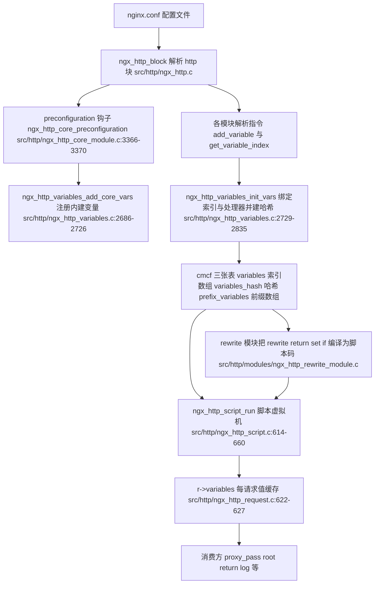
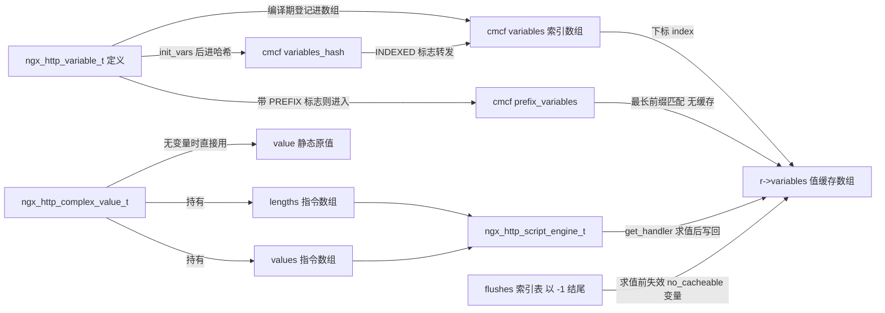
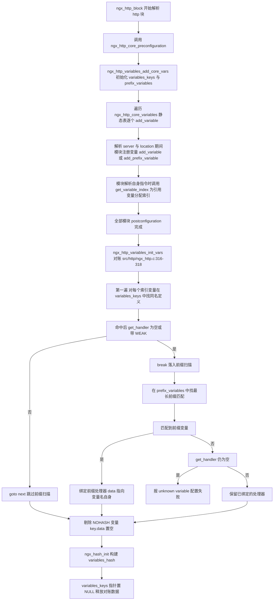
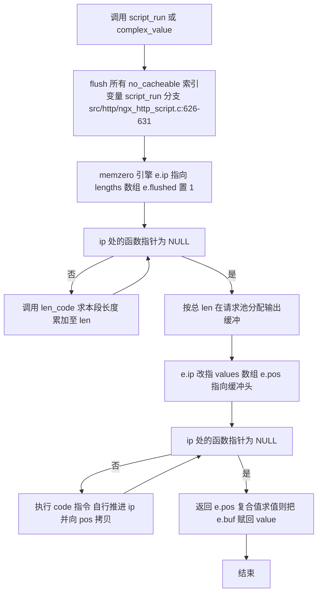
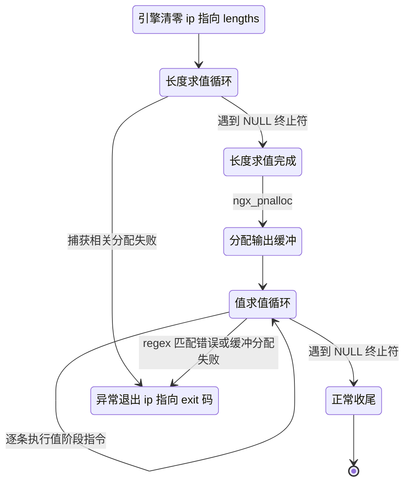
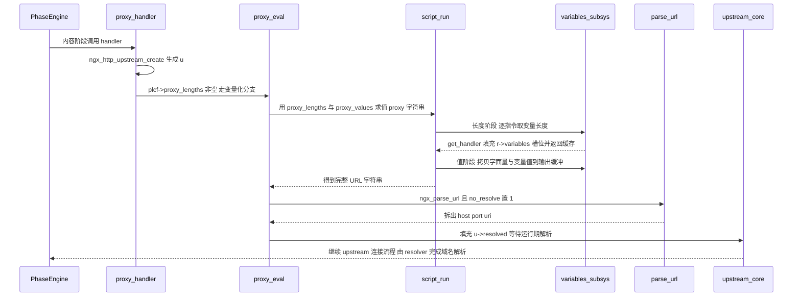
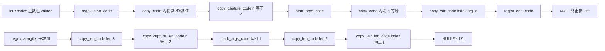

# 变量系统与脚本引擎（基于 nginx-1.27.0 源码）

> **导读**：读完本文你将掌握——
> 1. nginx 变量三要素 `get_handler / set_handler / data / flags` 的确切含义，以及索引变量与按名查找两条读取路径在数据结构与性能上的本质差异；
> 2. `ngx_http_compile_complex_value` 如何把配置字符串编译成 `ngx_http_script_code_t` 指令序列，`ngx_http_script_run` 又如何驱动这套"两阶段"虚拟机求值；
> 3. `rewrite / return / set / if` 四条指令如何在同一个脚本引擎上落地，正则命名捕获如何写进 `r->variables`；
> 4. `proxy_pass` 含变量后 upstream 解析被推迟到运行期的来龙去脉；
> 5. stream 子系统对这套机制的同构复制与差异点。
>
> **前置阅读建议**：先了解 nginx 配置解析流程（`ngx_conf_parse`、`ngx_conf_t`）、内存池（`ngx_palloc`/`ngx_pnalloc`）与 HTTP 请求处理阶段（phase engine）。文中所有结论均给出 `文件:行号` 出处，行号来自 nginx-1.27.0 真实源码。
>
> **涉及源码清单**（本篇逐行精读的文件加粗）：
> - **src/http/ngx_http_variables.c**（2835 行）
> - **src/http/ngx_http_variables.h**（117 行）
> - **src/http/ngx_http_script.c**（1900 行）
> - **src/http/ngx_http_script.h**（269 行）
> - src/http/modules/ngx_http_rewrite_module.c（1020 行，脚本引擎最大用户）
> - src/http/modules/ngx_http_proxy_module.c（proxy_pass 变量化路径）
> - src/stream/ngx_stream_variables.c、src/stream/ngx_stream_script.c（stream 同构实现）
> - src/core/ngx_string.h（`ngx_variable_value_t` 定义）

---

## 1. 本模块在 nginx 中的位置与职责

变量系统与脚本引擎是 nginx 配置模型与请求处理模型之间的"翻译层"：

- **编译期（reload/启动时）**：把配置文件里形如 `"pref_${var}_suffix$1"` 的字符串编译为一段不可变的**指令序列**（bytecode），连同变量注册表一起固化进 `ngx_http_core_main_conf_t`；
- **运行期（每个请求）**：由一个极简虚拟机反复执行这些指令序列，从 `r->variables` 取值、拼接、写回，产出最终字符串。



**图解读**：变量子系统不是一个"模块"，而是 http 核心的一部分：注册表挂在 `ngx_http_core_main_conf_t`（下文简称 cmcf）上，值缓存挂在每个请求 `r->variables` 上。配置解析阶段各模块通过 `ngx_http_add_variable`/`ngx_http_get_variable_index` 两种入口把变量名登记进 cmcf；`ngx_http_variables_init_vars` 在所有模块解析完后做"两表对账"（详见第 3 节），把处理器、标志、索引绑定齐，并构建运行期哈希。运行期则由 `ngx_http_script_run` 与 `ngx_http_complex_value` 两个执行器驱动指令序列，向上服务于 rewrite 模块的 rewrite/return/set/if、proxy_pass 变量化、`root`/`alias` 复杂值、SSI 等大量消费方。

---

## 2. 核心数据结构精讲

### 2.1 值类型 `ngx_variable_value_t` —— 一个 32 字节对齐前的位域包裹

定义于 src/core/ngx_string.h:28-37：

```c
typedef struct {
    unsigned    len:28;

    unsigned    valid:1;
    unsigned    no_cacheable:1;
    unsigned    not_found:1;
    unsigned    escape:1;

    u_char     *data;
} ngx_variable_value_t;
```

| 字段 | 位宽 | 含义 |
|---|---|---|
| `len` | 28 位 | 值长度，上限约 256MB；`$1`~`$9` 捕获、header 拼接结果都存这里 |
| `valid` | 1 位 | 缓存有效标志：为 1 时索引路径直接返回缓存值 |
| `no_cacheable` | 1 位 | 该值不可缓存（如 `$uri`、`$msec`），flush 时强制失效 |
| `not_found` | 1 位 | 负缓存：变量确实不存在，避免重复计算 |
| `escape` | 1 位 | 供 log 模块等做转义决策的提示位（本文不展开） |
| `data` | 指针 | 指向值内存；可能是请求内存池分配，也可能直接指向请求结构体内部字段 |

`ngx_http_variable_value_t` 就是它的别名（src/http/ngx_http_variables.h:17）。头文件还提供静态初始化宏 `ngx_http_variable(v)`（src/http/ngx_http_variables.h:19），被用来定义全局单例 `ngx_http_variable_null_value`（空串）与 `ngx_http_variable_true_value`（字符串 "1"）（src/http/ngx_http_variables.c:405-408），这两个单例在脚本引擎的布尔运算中大量复用。

**易错点**：`valid` 与 `not_found` 语义不同——前者是"算出来了"，后者是"算过了但不存在"。`ngx_http_get_indexed_variable` 的缓存判断把两者并在一起（见 6.3 节），所以"不存在"也会被缓存。

### 2.2 变量定义 `ngx_http_variable_t` —— 变量三要素所在

定义于 src/http/ngx_http_variables.h:37-44：

```c
struct ngx_http_variable_s {
    ngx_str_t                     name;   /* must be first to build the hash */
    ngx_http_set_variable_pt      set_handler;
    ngx_http_get_variable_pt      get_handler;
    uintptr_t                     data;
    ngx_uint_t                    flags;
    ngx_uint_t                    index;
};
```

| 字段 | 类型 | 含义与要点 |
|---|---|---|
| `name` | `ngx_str_t` | 变量名，**刻意放在首字段**以便哈希表直接按对象首址取 key；注册时统一转小写（`ngx_strlow`，src/http/ngx_http_variables.c:469） |
| `set_handler` | 函数指针 | 可写变量的写处理器，签名 `void (r, v, data)`（src/http/ngx_http_variables.h:23-24）；绝大多数变量为 NULL |
| `get_handler` | 函数指针 | 读处理器，签名 `ngx_int_t (r, v, data)`（src/http/ngx_http_variables.h:25-26）；把结果填进调用方传入的 `v` 并返回 `NGX_OK` |
| `data` | `uintptr_t` | 处理器的私有参数。最常见用法是"字段相对 `r` 的偏移量"，配合 `(ngx_str_t *)((char *)r + data)` 直取请求字段（src/http/ngx_http_variables.c:754） |
| `flags` | 位集 | 语义见下表 |
| `index` | `ngx_uint_t` | 该变量在 `cmcf->variables` 数组中的下标；仅对被索引的变量有意义 |

flags 常量表（src/http/ngx_http_variables.h:29-34）：

| 标志 | 值 | 含义 |
|---|---|---|
| `NGX_HTTP_VAR_CHANGEABLE` | 1 | "可重复定义"：同名变量再次注册时若原变量带此标志则放行并复用（src/http/ngx_http_variables.c:445-456），否则报 `the duplicate "%V" variable` |
| `NGX_HTTP_VAR_NOCACHEABLE` | 2 | get 求值结果不缓存，每次读取重新计算（src/http/ngx_http_variables.c:642-644） |
| `NGX_HTTP_VAR_INDEXED` | 4 | 运行期标记：该名字已进入索引数组，按名查找时转发到索引路径（src/http/ngx_http_variables.c:692-694） |
| `NGX_HTTP_VAR_NOHASH` | 8 | 只走索引、不进运行期哈希（构建哈希前剔除，src/http/ngx_http_variables.c:2808-2814） |
| `NGX_HTTP_VAR_WEAK` | 16 | "弱定义"，典型用户是 `set` 指令（src/http/modules/ngx_http_rewrite_module.c:918-919）；允许被其他注册者覆盖，且初始化匹配时落入前缀扫描分支 |
| `NGX_HTTP_VAR_PREFIX` | 32 | 前缀变量：匹配所有以该名字开头的变量名，如 `arg_`、`http_`（注册分流见 src/http/ngx_http_variables.c:429-431） |

### 2.3 正则捕获登记 `ngx_http_regex_t`

带命名捕获的正则（如 `~^(?<host>[^/]+)`）编译产物（src/http/ngx_http_variables.h:65-79）：

| 结构/字段 | 含义 |
|---|---|
| `ngx_http_regex_variable_t.capture` | 该命名组在 PCRE 捕获数组中的起始下标（写成 `2*n`，因为 PCRE 每 group 占两个 int：起点与终点） |
| `ngx_http_regex_variable_t.index` | 目标变量在 `cmcf->variables` 里的索引 |
| `ngx_http_regex_t.regex` | 编译后的 `ngx_regex_t` |
| `ngx_http_regex_t.ncaptures` | 捕获组总数（含匿名组） |
| `ngx_http_regex_t.variables/nvariables` | 命名组 → 变量索引的映射表 |
| `ngx_http_regex_t.name` | 原始 pattern 文本，用于日志 |

### 2.4 运行引擎 `ngx_http_script_engine_t` —— 虚拟机的全部状态

定义于 src/http/ngx_http_script.h:17-36：

| 字段 | 含义 |
|---|---|
| `ip` | 指令指针，指向当前指令码首地址；每条指令**自己**负责把 `ip` 推进到下一条 |
| `pos` | 值阶段输出游标，指向输出缓冲中的写位置 |
| `sp` | 值栈指针（stack pointer），`if` 条件求值、`set` 取右值时用；`sp` 在 rewrite 处理器里按 `rlcf->stack_size` 分配，默认 10（src/http/modules/ngx_http_rewrite_module.c:166-167、250） |
| `buf` | 当前正在产出的整段字符串（regex 替换、complex value 中间缓冲） |
| `line` | 正则匹配的目标串（一般是 `r->uri` 或栈顶弹出的值） |
| `args` | "重写后的参数区"起点：值阶段遇到 `?` 时由 `ngx_http_script_start_args_code` 打点（src/http/ngx_http_script.c:1030），`regex_end` 据此切分 uri 与 args |
| `flushed` | 1 表示求值前已统一 flush 过 no_cacheable 变量，取值走 `get_indexed_variable` 即可（len 与 value 两阶段语义见 6.9 节） |
| `skip / quote / is_args / log` | 位标志：跳过输出、重定向转义、是否处于 args 区、是否输出 rewrite 日志 |
| `status` | 引擎执行结果：`NGX_DECLINED` 兜底，或被 `return`/`rewrite` 覆写为具体响应码 |
| `request` | 所属请求 |

### 2.5 编译上下文 `ngx_http_script_compile_t` 与 complex value

编译上下文（src/http/ngx_http_script.h:39-63）关键字段：

| 字段 | 含义 |
|---|---|
| `source` | 待编译的原始字符串 |
| `flushes/lengths/values` | 三个**指针的指针**：指向调用方持有的 `ngx_array_t *`，编译器按需创建并填充 |
| `variables` | 调用方预估的 `$` 个数（用于预分配数组容量），编译开始后清零复用为实际计数 |
| `ncaptures / captures_mask / dup_capture` | 捕获相关：`$1`~`$9` 使用位掩码登记，重复使用同一编号则置 `dup_capture`（src/http/ngx_http_script.c:486-490） |
| `size` | 纯字面量累计长度，供 `rewrite` 的 regex_start 码使用（src/http/modules/ngx_http_rewrite_module.c:405） |
| `main` | 保存"数组搬迁时要修正的指针"（见 6.8 节重定位机制） |
| `compile_args / args` | 是否处理尾部 `?` 语义（rewrite 指令用） |
| `complete_lengths / complete_values` | 编译结束时是否追加 NULL 终止符 |
| `zero` | 值末尾补 `\0`（`set_complex_value_zero_slot` 路径，src/http/ngx_http_script.c:278-313） |
| `conf_prefix / root_prefix` | 相对路径前缀补全（`-p`/`-c` 语义） |

编译产物 `ngx_http_complex_value_t`（src/http/ngx_http_script.h:66-75）：

```c
typedef struct {
    ngx_str_t                   value;    /* 无变量时的静态原值 */
    ngx_uint_t                 *flushes;  /* 以 -1 结尾的索引表：求值前需失效的变量 */
    void                       *lengths;  /* 长度阶段指令数组 */
    void                       *values;   /* 值阶段指令数组 */
    union {
        size_t                  size;
    } u;
} ngx_http_complex_value_t;
```

调用方封装 `ngx_http_compile_complex_value_t`（src/http/ngx_http_script.h:78-86）把 `ccv->value` + 标志位喂给编译器。

### 2.6 指令（操作码）结构体一览

所有指令结构体的首字段都是 `ngx_http_script_code_pt code`——一个 `void (ngx_http_script_engine_t *)` 函数指针（src/http/ngx_http_script.h:89-96）。**"指向函数的指针本身就是操作码"** 是整套引擎最核心的设计。

| 指令结构体 | 字段 | 用途 | 定义位置 |
|---|---|---|---|
| `ngx_http_script_copy_code_t` | `len` | 字面量拷贝，字节序列内联在结构体后 | script.h:93-96 |
| `ngx_http_script_var_code_t` | `index` | 按索引读变量（拷贝到输出或压栈）与 `set` 写变量共用 | script.h:99-102 |
| `ngx_http_script_var_handler_code_t` | `handler/data` | 调用变量自定义 `set_handler`（如 `$args`、`$limit_rate`） | script.h:105-109 |
| `ngx_http_script_copy_capture_code_t` | `n` | 拷贝第 `n/2` 号捕获组 | script.h:112-115 |
| `ngx_http_script_regex_code_t` | `regex/lengths/size/status/next/uri/args/add_args/redirect/break_cycle/test/negative_test` | rewrite/if 的正则头指令 | script.h:120-140 |
| `ngx_http_script_regex_end_code_t` | `uri/args/add_args/redirect` | 正则替换收尾：切分 args、写回 uri、发 302 | script.h:143-153 |
| `ngx_http_script_full_name_code_t` | `conf_prefix` | 补全配置/安装前缀 | script.h:158-161 |
| `ngx_http_script_return_code_t` | `status + 内嵌 text(complex value)` | `return` 指令 | script.h:164-168 |
| `ngx_http_script_file_code_t` | `op` | `if` 的 `-f/-d/-e/-x` 文件测试 | script.h:183-186 |
| `ngx_http_script_if_code_t` | `next/loc_conf` | `if` 体的条件跳转 | script.h:189-193 |
| `ngx_http_script_complex_value_code_t` | `lengths` | `set` 右值含变量时：内嵌子 length 引擎预分配缓冲 | script.h:196-199 |
| `ngx_http_script_value_code_t` | `value/text_len/text_data` | `set` 右值纯静态时直接压栈 | script.h:202-207 |

### 2.7 三张注册表与每请求值缓存

cmcf 中与本主题相关的字段（src/http/ngx_http_core_module.h:161-173）：

| 字段 | 类型 | 生命周期与用途 |
|---|---|---|
| `variables` | `ngx_array_t` of `ngx_http_variable_t` | 索引表：被 `get_variable_index` 引用到的变量按顺序登记，下标即 index；**运行期只读** |
| `variables_hash` | `ngx_hash_t` | 名字 → 变量定义的运行期哈希，按名查找第一跳 |
| `prefix_variables` | `ngx_array_t` | 前缀变量数组（`arg_`、`http_`、`cookie_`…），运行期线性扫描取最长匹配 |
| `variables_keys` | `ngx_hash_keys_arrays_t *` | 配置期暂存的"名字集合"，init_vars 对账后释放置 NULL（src/http/ngx_http_variables.c:2832） |
| `ncaptures` | `ngx_uint_t` | 全配置最大捕获组数 ×2，用于预分配 `r->captures` |

每个请求创建时按索引表大小一次性分配值缓存（src/http/ngx_http_request.c:622-627）：

```c
r->variables = ngx_pcalloc(r->pool, cmcf->variables.nelts
                                    * sizeof(ngx_http_variable_value_t));
```

### 2.8 字段关系图



**图解读**：定义（`ngx_http_variable_t`）与值（`ngx_variable_value_t`）彻底分离：定义常驻 cmcf，一份；值按请求在 `r->variables` 里各留一份槽位，槽位下标即变量 `index`。complex value 持有两段指令数组与可选的静态原值；`flushes` 是编译器顺手记录的"该值依赖哪些 no_cacheable 变量"清单，供求值前精准失效。

---

## 3. 初始化流程



**图解读**：
1. `ngx_http_core_preconfiguration` 在解析任何 server/location 之前就把 `ngx_http_core_variables[]` 静态表（40 余个内建变量，src/http/ngx_http_variables.c:164-402）灌进 `variables_keys`（src/http/ngx_http_variables.c:3366-3370、2716-2723）。这张静态表同时覆盖了普通变量与前缀变量——前缀项靠 `NGX_HTTP_VAR_PREFIX` 标志被 `ngx_http_add_variable` 分流到 `ngx_http_add_prefix_variable`（src/http/ngx_http_variables.c:429-431）。
2. 之后各模块解析指令：`set`/`map`/`geo` 等调用 `ngx_http_add_variable` 注册**定义**，所有指令参数中出现的 `$name` 经 `ngx_http_get_variable_index` 登记为**引用**（索引表追加一项，src/http/ngx_http_variables.c:585-604）。
3. `ngx_http_variables_init_vars`（src/http/ngx_http.c:316-318 调用；本体 src/http/ngx_http_variables.c:2729-2835）做对账：把"索引表中的名字"与"keys 中的定义"连起来，绑定 `get_handler`/`data`/`flags`，并在定义上打 `INDEXED` 标记、回填 `index`（src/http/ngx_http_variables.c:2753-2763）。若定义无处理器或带 `WEAK`，则继续尝试前缀匹配（2775-2794）；两边都落空且无处理器 → `unknown "%V" variable` 直接导致启动失败（2796-2801）。最后构建 `variables_hash`（2817-2830）。

---

## 4. 核心执行流程 / 状态机

### 4.1 两阶段求值总流程



**图解读**：同一个字符串被编译成**两段**指令数组：`lengths` 数组只包含 `*_len_code` 型函数，跑一遍算出精确总长度；分配恰好够用的缓冲后，`values` 数组跑第二遍完成拷贝。两阶段避免了"边拼边扩容"，代价是变量 get_handler 可能被调用两次——缓解手段正是 `r->variables` 的值缓存（第一次求值后 `valid=1`，第二次直接命中）。`complex_value`（src/http/ngx_http_script.c:57-104）在进入两阶段之前还有一条捷径：`lengths == NULL` 说明整个串无变量，直接返回编译期保存的静态 `value`（66-69 行）。

### 4.2 引擎状态视角



**图解读**：引擎没有显式的"暂停/恢复"，每条指令执行完都回到同一段 `while (*(uintptr_t *) e.ip)` 驱动循环；唯一的"跳转"能力来自两类特殊指令——把 `e.ip` 改写为 `ngx_http_script_exit`（一个值为 NULL 的哨兵地址，src/http/ngx_http_script.c:30-32）立即终止，或按指令内的 `next` 相对偏移跳过一段代码（`if` 为假、正则不匹配）。异常路径统一置 `e.status` 再 exit。

---

## 5. 关键时序图：带变量的 proxy_pass 一次求值



**图解读**：注意 `ngx_http_proxy_eval` 中 `url.no_resolve = 1`（src/http/modules/ngx_http_proxy_module.c:1085）——解析出的 `url.host` 不会在本地做 DNS 查询，而是连同端口一起塞进 `u->resolved`（1115-1129 行），交给 upstream 框架在连接时按需触发运行期 resolver。这就是"变量化 proxy_pass 不再于配置期解析 upstream"的机制细节，6.12 节展开。

---

## 6. 源码逐段精读

本节为全文主体，逐函数拆解。每小节先给签名与出处，再按代码顺序讲逻辑块，最后列易错点。

### 6.1 变量注册：`ngx_http_add_variable` / `ngx_http_add_prefix_variable`

```c
ngx_http_variable_t *
ngx_http_add_variable(ngx_conf_t *cf, ngx_str_t *name, ngx_uint_t flags)
```
出处：src/http/ngx_http_variables.c:414-490。

逐块逻辑：
1. **名字校验**：空名直接 `invalid variable name "$"`（423-427 行）。
2. **前缀分流**：带 `NGX_HTTP_VAR_PREFIX` 的名字（如 `"arg_"`）不走哈希登记，转交 `ngx_http_add_prefix_variable`（429-431 行），后者在 `cmcf->prefix_variables` 数组里线性查重、查不到则追加（493-545 行）。
3. **查重放行规则**：在 `cmcf->variables_keys` 里 `ngx_strncasecmp` 找同名项（436-441 行）；命中时若旧定义**不带** `CHANGEABLE` 则报 `the duplicate "%V" variable`（445-449 行）——这就是"重复定义变量报错"的根源；若旧定义可变，则直接复用旧对象（455 行），并把本次注册的 flags 中非 WEAK 部分合并进去（451-453 行）。
4. **新建定义**：`ngx_palloc` 定义体，`ngx_strlow` 归一化小写（458-469 行），`set_handler/get_handler/data` 先置空（471-475 行），`ngx_hash_add_key` 存入 keys 集合；`NGX_BUSY` 表示冲突（477-487 行）。

易错点：
- `add_variable` 注册的是"名字与处理器"，**不分配运行期 index**；index 由引用方 `get_variable_index` 决定。一个只定义不引用的变量不会出现在 `cmcf->variables` 里。
- 复用旧对象时返回的指针就是旧定义——修改它等价于修改所有已登记引用。

### 6.2 索引分配：`ngx_http_get_variable_index`

```c
ngx_int_t ngx_http_get_variable_index(ngx_conf_t *cf, ngx_str_t *name)
```
出处：src/http/ngx_http_variables.c:548-605。

逐块逻辑：
1. 首次调用时惰性初始化 `cmcf->variables` 数组，容量 4（565-571 行）。
2. 线性扫描已有索引项，同名（`ngx_strncasecmp`）直接返回旧下标（574-582 行）——**同一个变量名在整个配置里永远只有一个 index**。
3. 没有则 `ngx_array_push` 一个新定义：小写化名字、清零处理器、`flags = 0`，`index = nelems - 1`（585-604 行），返回下标。

易错点：
- 此时 `get_handler` 还是 NULL，`flags` 也是 0；真正的处理器要到 `init_vars` 才绑定。任何在解析期就读取 `v[index].get_handler` 的代码都是错的。
- 该函数在编译器 `ngx_http_script_add_var_code`（src/http/ngx_http_script.c:894）与 rewrite 模块（src/http/modules/ngx_http_rewrite_module.c:877、924）中都会调用，所以**引用即索引**。

### 6.3 运行期读取三入口：indexed / flushed / by-name

**入口一：`ngx_http_get_indexed_variable`**（src/http/ngx_http_variables.c:608-655）

```c
    if (r->variables[index].not_found || r->variables[index].valid) {
        return &r->variables[index];
    }
```
（622-624 行）

逐块逻辑：
1. 越界防御：index 超过 `variables.nelts` 报 ALERT（616-620 行）。
2. **缓存命中**：`valid` 或 `not_found` 任一为真即返回槽位——注意负结果同样缓存。
3. **深度护栏**：静态全局 `ngx_http_variable_depth` 初值 100（411 行），为 0 时报 `cycle while evaluating variable`（628-633 行），防变量互引成环。
4. 调用 `get_handler(r, &r->variables[index], v[index].data)`（637-638 行）：**处理器直接把结果写进请求槽位**；成功后若带 `NOCACHEABLE` 则标记 `no_cacheable`（642-644 行）。
5. 失败则把槽位改成 `not_found`（651-654 行）。

**入口二：`ngx_http_get_flushed_variable`**（658-675 行）

```c
    if (v->valid || v->not_found) {
        if (!v->no_cacheable) {
            return v;
        }
        v->valid = 0;
        v->not_found = 0;
    }
    return ngx_http_get_indexed_variable(r, index);
```

差异仅一点：缓存命中前先看 `no_cacheable`，不可缓存则清标志强制重算。它是"需要新鲜值"场景（如 rewrite 阶段多轮判断）的入口。

**入口三：`ngx_http_get_variable`（按名查找）**（678-745 行）

逐块逻辑：
1. `ngx_hash_find(&cmcf->variables_hash, key, ...)` 精确命中（689 行）。
2. 命中项若带 `INDEXED` 标志，**转发到索引路径** `get_flushed_variable`（692-694 行）——保证同名变量无论从哪条路径读，都读到同一份缓存。
3. 否则在请求池临时 `palloc` 一个 value、直接调处理器（704-709 行），**结果不进 `r->variables`，每次都重算**；同样受深度护栏保护（696-702 行）。
4. 哈希未命中则线性扫描 `prefix_variables`，取**最长前缀**匹配者调用其处理器，`data` 传入完整变量名（720-740 行）。
5. 全部落空返回 `not_found = 1` 的值对象（742-744 行）。

**两条路径性能对比**（本节核心结论）：

| 维度 | 索引路径 | 按名路径 |
|---|---|---|
| 查找 | 数组下标 O(1) | 哈希查找 O(1)+ 前缀线性扫描 O(P) |
| 结果缓存 | 写入 `r->variables[index]`，二次读取零开销 | 临时 palloc，**每次重新求值** |
| 请求内存 | 槽位随请求一次性分配 | 每次调用分配 `sizeof(ngx_variable_value_t)` |
| 使用者 | 脚本引擎变量指令、header 处理 | SSI（src/http/modules/ngx_http_ssi_filter_module.c:1795、2298）、perl 模块等动态取名场景 |

前缀变量（`arg_xxx`/`http_xxx`/`cookie_xxx`）只能走按名路径，因此 `if ($arg_t = 1)` 这类高频用法里 `arg_` 前缀变量还有 `NOCACHEABLE` 标志（src/http/ngx_http_variables.c:398-399），语义上"永远读最新 query"。

### 6.4 内建变量清单与实现套路

`ngx_http_core_variables[]` 静态表定义于 src/http/ngx_http_variables.c:164-402。表中每个元素按 `{ name, set_handler, get_handler, data, flags, index }` 顺序初始化。核心内建变量与实现位置对照表：

| 变量 | get_handler | data 语义 | flags | 实现位置 |
|---|---|---|---|---|
| `http_host` / `http_user_agent` / `http_referer` / `http_via` / `http_x_forwarded_for` | `ngx_http_variable_header` | `r->headers_in.*` 成员偏移 | 0 | 注册 166-183；实现 810-815 |
| `http_cookie` | `ngx_http_variable_cookies` | `headers_in.cookie` 偏移 | 0 | 注册 185-186；实现 818-823 |
| `content_length` | `ngx_http_variable_content_length` | 0 | 0 | 注册 188-189；实现 1181-1219 |
| `host` | `ngx_http_variable_host` | 0 | 0 | 注册 194；实现 1222-1244 |
| `binary_remote_addr` | 同名函数 | 0 | 0 | 注册 196-197；实现 1247-1296 |
| `remote_addr` / `remote_port` | 同名函数 | 0 | 0 | 注册 199-201；实现 1299-1336 |
| `proxy_protocol_addr` / `_port` / `server_addr` / `_port` | 同名函数 | `ngx_proxy_protocol_t` 成员偏移 | 0 | 注册 203-217；实现 1339-1394 |
| `proxy_protocol_tlv_` | `ngx_http_variable_proxy_protocol_tlv` | 完整变量名 | PREFIX | 注册 219-221；实现 1397-1427 |
| `server_addr` / `server_port` | 同名函数 | 0 | 0 | 注册 223-225；实现 1430-1488 |
| `server_protocol` / `request_uri` | `ngx_http_variable_request` | `http_protocol`/`unparsed_uri` 偏移 | 0 | 注册 227-235；实现 748-768 |
| `uri` / `document_uri` | `ngx_http_variable_request` | `uri` 偏移 | NOCACHEABLE | 注册 237-243 |
| `request` | `ngx_http_variable_request_line` | 0 | 0 | 注册 245；实现 1034-1067 |
| `document_root` / `realpath_root` | 同名函数 | 0 | NOCACHEABLE | 注册 247-251；实现 1572-1610、1613-1683 |
| `query_string` | `ngx_http_variable_request` | `args` 偏移 | NOCACHEABLE | 注册 253-255 |
| `args` | `ngx_http_variable_request` | `args` 偏移 | CHANGEABLE\|NOCACHEABLE | 注册 257-261 |
| `is_args` | `ngx_http_variable_is_args` | 0 | NOCACHEABLE | 注册 263-264；实现 1553-1569 |
| `request_filename` | 同名函数 | 0 | NOCACHEABLE | 注册 266-268；实现 1686-1706 |
| `server_name` / `request_method` / `remote_user` | 同名函数 | 0 | —/NOCACHEABLE/— | 注册 270-276；实现 1709-1743、1746-1770 |
| `bytes_sent` / `body_bytes_sent` / `pipe` / `request_completion` | 同名函数 | 0 | — | 注册 278-289；实现 1773-2108 |
| `request_body` / `request_body_file` | 同名函数 | 0 | 0 | 注册 291-297；实现 2111-2189 |
| `request_length` / `request_time` / `request_id` | 同名函数 | 0 | NOCACHEABLE | 注册 299-307；实现 2192-2280 |
| `status` | `ngx_http_variable_status` | 0 | NOCACHEABLE | 注册 309-311；实现 1836-1866 |
| `sent_http_content_type` 等 8 个 | 各 sent_* 函数 | `headers_out.*` 偏移 | 0 | 注册 313-338 |
| `limit_rate` | get=`ngx_http_variable_request_get_size`，**set**=`ngx_http_variable_set_limit_rate` | `limit_rate` 偏移 | CHANGEABLE\|NOCACHEABLE | 注册 340-343；get 788-807；set 2068-2088 |
| `connection` / `connection_requests` / `connection_time` | 同名函数 | 0 | —/—/NOCACHEABLE | 注册 345-352；实现 2283-2347 |
| `nginx_version` / `hostname` / `pid` / `msec` / `time_iso8601` / `time_local` | 同名函数 | 0 | 时间类 NOCACHEABLE | 注册 354-370；实现 2350-2467 |
| `tcpinfo_rtt` 等 4 个 | `ngx_http_variable_tcpinfo` | 枚举号 0~3 | NOCACHEABLE | 注册 372-384；实现 1126-1178 |
| `http_` / `sent_http_` / `sent_trailer_` / `cookie_` / `arg_` | 各 unknown/cookie/argument 函数 | 完整变量名 | PREFIX（`arg_` 另加 NOCACHEABLE） | 注册 386-399；实现 894-921、1070-1123 |

头文件里 157-162 行的注释点明了 `http_host` 等四个变量存在专表项的原因：通用 `http_` 前缀路径要遍历 header 链表逐个比对，而 `Host`/`User-Agent` 等在解析阶段就已摘到 `headers_in` 的专属字段，专表项+偏移量读取是纯指针运算。

**实现套路归纳**（四种）：
1. **偏移量直取型**：`data` 是 `offsetof(ngx_http_request_t, 字段)`，处理器一行 `s = (ngx_str_t *)((char *) r + data)`（748-768 行），零分配。
2. **header 链表拼接型**：`ngx_http_variable_headers_internal`（826-891 行）先累计长度，单条 header 直接引用其内存（858-863 行），多条才分配拼接，分隔符由入口指定（`,` 或 `;`）。
3. **前缀解析型**：`data` 是完整变量名，处理器剥掉前缀（如 `arg_` 后的 4 字节，1108-1109 行）再解析（`ngx_http_arg`，1111 行）。
4. **格式化计算型**：`ngx_pnalloc` 定长缓冲 + `ngx_sprintf`，如 `$msec`（2399-2420 行）、`$request_time`（2213-2239 行）。

### 6.5 可写变量：`set_handler` 的两个代表

可写变量极少，注册表里只有 `args` 与 `limit_rate` 两个带 `set_handler`：

- `$args` 的写处理器 `ngx_http_variable_set_args`（1543-1550 行）：把新值直接回填 `r->args`，并**顺手 `r->valid_unparsed_uri = 0`**——因为 query 变了，`$request_uri` 缓存失效语义随之改变。
- `$limit_rate` 的写处理器 `ngx_http_variable_set_limit_rate`（2068-2088 行）：`ngx_parse_size` 解析，失败仅告警不生效，成功则写 `r->limit_rate` 并置 `r->limit_rate_set = 1`。

`set` 指令对**内建**可写变量的写路径走 `ngx_http_script_var_set_handler_code`（见 6.11 节），对自己的变量走 `set_var_code`。

### 6.6 正则命名捕获写入 `r->variables`

**编译期**：`ngx_http_regex_compile`（src/http/ngx_http_variables.c:2541-2611）
1. `ngx_regex_compile` 编译 pattern（2555-2558 行）。
2. 记录 `ncaptures` 并抬高 cmcf 级最大值 `cmcf->ncaptures = ngx_max(...)`（2566-2570 行）——它决定每个请求 `r->captures` 的预分配大小（2624-2634 行）。
3. 无命名捕获则直接返回（2574-2576 行）。有则解析 PCRE 的名字表：每个名字占 `rc->name_size` 字节，前两字节大端组号（2586-2594 行）：
   ```c
   rv[i].capture = 2 * ((p[0] << 8) + p[1]);
   ```
   （2590 行）组号乘 2 是因为 PCRE 捕获数组每组占两个 int。
4. 每个名字执行 `ngx_http_add_variable(cf, &name, NGX_HTTP_VAR_CHANGEABLE)`（2595 行）注册变量，再 `ngx_http_get_variable_index` 拿索引（2600 行），**并将 get_handler 设为 `ngx_http_variable_not_found`**（2605 行）——即"正则未执行前该变量不存在"。

**运行期**：`ngx_http_regex_exec`（2614-2681 行）
1. 按 `cmcf->ncaptures` 预分配/复用 `r->captures`（2627-2634 行）。
2. `ngx_regex_exec` 求匹配；`NGX_REGEX_NO_MATCHED` → `NGX_DECLINED`（2640-2644 行）。
3. 匹配成功则把每个命名组的 `[start, end)` 写进对应变量槽位（2653-2663 行）：
   ```c
   vv->len = r->captures[n + 1] - r->captures[n];
   vv->valid = 1;
   vv->data = &s->data[r->captures[n]];
   ```
   **值内存直接指向被匹配字符串本身，零拷贝**。
4. 记录 `r->ncaptures = rc * 2` 与 `r->captures_data`（2677-2678 行），供 `$1..$9` 捕获指令后续读取。

易错点：命名捕获变量是 `CHANGEABLE` 且属"引用即索引"——同一 pattern 里 `(?<x>...)` 与配置中 `$x` 共享同一 index；`$1` 与命名组可同时使用，`dup_capture` 只约束 `$N` 数字重复（src/http/ngx_http_script.c:486-490）。

### 6.7 编译器前端：`ngx_http_compile_complex_value`

签名：`ngx_int_t ngx_http_compile_complex_value(ngx_http_compile_complex_value_t *ccv)`，出处 src/http/ngx_http_script.c:138-239。

逐块逻辑：
1. **变量预扫描**：数一遍 `$`；后随 `1`~`9` 计入 `nc`（捕获），否则计入 `nv`（变量）（148-160 行）。
2. **前缀补全**：串不以 `$` 开头且调用方要求 `conf_prefix/root_prefix` 时先做 `ngx_conf_full_name` 并清标志（162-171 行）。
3. **静态捷径**：`nv == 0 && nc == 0` 时把原串存进 `complex_value->value` 直接返回（173-180 行）——运行期 `complex_value` 第一步检查 `lengths == NULL` 走这条捷径。
4. **数组预分配**：`flushes` 按变量数、`lengths` 按"每变量两个 copy 码 + 一个 var 码 + 终止符"、`values` 再加上源串长度按指针对齐（182-207 行）——容量是上界估计，数组可自动扩容。
5. **组装编译上下文** 并调 `ngx_http_script_compile`（213-228 行）。
6. **收尾**：flushes 实际非空则以 `(ngx_uint_t) -1` 收尾（230-233 行），把三个数组首地址挂到 `complex_value` 上（235-236 行）。

配套的 slot 包装：`ngx_http_set_complex_value_slot`（242-275 行）供模块 `ngx_command_t` 直接挂接；`*_zero_slot` 追加 `\0` 终止（278-313 行）；`*_size_slot` 对静态值预解析尺寸存入 `u.size`（316-343 行），运行期 `ngx_http_complex_value_size` 静态路径零脚本执行（107-135 行）。

### 6.8 编译器主体：`ngx_http_script_compile` 逐块精读

签名：`ngx_int_t ngx_http_script_compile(ngx_http_script_compile_t *sc)`，出处 src/http/ngx_http_script.c:459-611。这是一个**手写字符扫描器**，把源串切分为"字面量 / `$name` / `$N` / `?`"四类片段。

1. **初始化数组**（466 行 → `ngx_http_script_init_arrays`，681-722 行）：按 `sc->variables` 预估值创建 flushes/lengths/values 三个数组，随后 `sc->variables = 0` 复用为真实计数。
2. **主循环**逐字符扫描（470 行起）：
   - **`$N` 数字捕获**（474-505 行）：`$` 后紧跟 `1`~`9` 时，置位 `captures_mask` 对应位，重复使用同一编号置 `dup_capture`（486-490 行），调 `ngx_http_script_add_capture_code(sc, n)` 追加捕获指令（492 行）；无 PCRE 时报错（500-503 行）。
   - **`$name` 变量**（507-558 行）：支持 `$name` 与 `${name}` 两种写法（507-519 行）；名字字符集限定 `[A-Za-z0-9_]`（530-534 行）；`${` 未闭合报 `the closing bracket ... is missing`（541-546 行）；空名报 `invalid variable name`（548-549 行）。随后 `sc->variables++`（552 行）并调 `ngx_http_script_add_var_code`（554 行）。
   - **尾部 `?`**（561-572 行）：仅当 `sc->compile_args` 为真（rewrite 指令路径）时，把"之后是 args 区"编译为 `mark_args/start_args` 指令对，且只处理第一个 `?`（`compile_args` 随即清零，563 行）。
   - **普通字面量**（574-601 行）：一直吃到下一个 `$` 或（`compile_args` 模式下的）`?`，累计 `sc->size`，调 `ngx_http_script_add_copy_code`，末片传 `last=1` 供 zero 补 `\0` 用。
3. **收尾**：`ngx_http_script_done`（604 行 → 725-767 行）：按需追加 zero 拷贝码（731-739 行）、full_name 码（741-745 行），并给 `complete_lengths/complete_values` 的数组各追加一个 `NULL` 终止符（747-764 行）——这正是运行循环 `while (*(uintptr_t *) e.ip)` 的退出条件。

### 6.9 代码数组、重定位与终止符

**`ngx_http_script_start_code`**（770-781 行）：按 256 字节起步创建指令数组。
**`ngx_http_script_add_code`**（784-805 行）是理解引擎可靠性的关键：

```c
    elts = codes->elts;
    new = ngx_array_push_n(codes, size);
    ...
    if (code) {
        if (elts != codes->elts) {
            p = code;
            *p += (u_char *) codes->elts - elts;
        }
    }
```

`ngx_array_push_n` 可能触发数组整体搬迁；`code` 参数是调用方**此前**拿到的"指向数组内部某条已写入指令"的指针（如 `rewrite` 里的 `regex`、`if` 里的 `if_code`）。一旦检测到底址变化，就把这个保存的指针按差值平移（798-801 行），保证后续对 `regex->next`、`if_code->next` 的写入仍落在正确对象上。这是"数组可扩容 + 内部互相引用"得以并存的机制。

**指令里记录相对偏移**而不是绝对地址：`if_code->next` 在 if 体编译完后以 `codes->elts + nelts - (u_char *)if_code` 计算并保存（src/http/modules/ngx_http_rewrite_module.c:636-637），`regex->next` 同理（434-435 行）。运行期跳转写成 `e->ip += code->next`（src/http/ngx_http_script.c:1090、1550），彻底免疫数组搬迁。

### 6.10 运行器：`ngx_http_script_run` 与 `ngx_http_complex_value`

**`ngx_http_script_run`**（src/http/ngx_http_script.c:614-660）：
1. **统一 flush**：遍历全部索引变量，`no_cacheable` 者清 `valid`（626-631 行）——保证"本次求值串内引用到的任何变量"先失效再读，等价于全局悲观失效；这正是 `flushed = 1` 的语义。
2. 长度阶段循环（639-642 行）→ `ngx_pnalloc` 精确分配（645-649 行）→ 值阶段循环（654-657 行）→ 返回 `e.pos`。
3. 调用方传 `len` 作为**额外预留**：如 `$realpath_root` 路径求值时 `reserved=1` 预留 `\0`（src/http/ngx_http_variables.c:1631-1638）。

**`ngx_http_complex_value`**（57-104 行）差异：
- 多一步 `ngx_http_script_flush_complex_value`（35-54 行）：只 flush 该 complex value 自身 `flushes` 索引表中列出的 no_cacheable 变量（编译期由 `add_var_code` 顺手登记，src/http/ngx_http_script.c:900-907）——**精准失效**，比 `script_run` 的全局失效便宜得多。
- 结束时把 `e.buf` 赋回 `*value`（101 行）；长度阶段 `e.flushed = 1` 走 `get_indexed_variable`，而值阶段若变量指令读到 `not_found` 则跳过输出（len 阶段已按 0 计）。

### 6.11 指令集逐条讲解

长度阶段函数前缀 `*_len_code` 返回 `size_t`；值阶段函数返回 `void`。`e->ip` 均由指令内部推进。

| # | 指令 | 结构体 | 长度阶段 | 值阶段 | 行为 | 出处 |
|---|---|---|---|---|---|---|
| 1 | copy | copy_code_t | `copy_len_code` 返回 `code->len` | `copy_code` 从指令体内联字节拷到 `pos` | 字面量；`skip` 为真时只推进不拷贝；步进按 8 字节对齐 | script.c:852-862、865-885 |
| 2 | var(输出型) | var_code_t | `copy_var_len_code` | `copy_var_code` | 读索引变量值拷到输出；`flushed` 决定走 indexed 还是 flushed 入口 | script.c:888-930、933-955、958-987 |
| 3 | capture | copy_capture_code_t | `copy_capture_len_code` | `copy_capture_code` | 从 `r->captures` 取第 `n`（已是 `2*k`）组；处于 args 区或 redirect 引用模式且 URI 曾转义时按 `NGX_ESCAPE_ARGS` 计算并执行转义长度 | script.c:1299-1331、1334-1409 |
| 4 | mark_args / start_args | `uintptr_t` | `mark_args_code` 恒返 1 并置 `is_args` | `start_args_code` 打点 `e->args = e->pos` | rewrite 替换串尾部 `?`：其后的输出归属 args 区 | script.c:990-1010、1013-1020、1023-1032 |
| 5 | regex_start | regex_code_t | ——（regex 不参与外层 length 引擎） | `regex_start_code` | 见 6.12 | script.c:1037-1191 |
| 6 | regex_end | regex_end_code_t | —— | `regex_end_code` | 见 6.12 | script.c:1194-1296 |
| 7 | full_name | full_name_code_t | 返回 `conf_prefix ? conf 前缀 : 安装前缀` 的长度 | `full_name_code` 调 `ngx_get_full_name` 原地补全 | root 等相对路径补全 | script.c:1414-1485 |
| 8 | return | return_code_t | —— | `return_code` | 见 6.13 | script.c:1488-1506 |
| 9 | break | `uintptr_t` | —— | `break_code` | 若 URI 已被正则改写过则清 `valid_location/uri_changed`，随后 exit | script.c:1509-1522 |
| 10 | if | if_code_t | —— | `if_code` | 弹栈判真假：真则顺延执行 if 体；假则 `e->ip += code->next` 整体跳过 | script.c:1525-1551 |
| 11 | equal / not_equal | `uintptr_t` | —— | 同名 code | 弹两个操作数比较，把结果（true/null 单例）写回栈顶下一位 | script.c:1554-1607 |
| 12 | file | file_code_t | —— | `file_code` | `-f/-d/-e/-x` 及其否定：走 `open_file_cache` 的 `test_only` 探测，按 `of.is_file/is_dir/is_link/is_exec` 置真假值 | script.c:1610-1748 |
| 13 | complex_value | complex_value_code_t | —— | `complex_value_code` | `set` 右值含变量：启子引擎跑内嵌 lengths 数组算总长，分配缓冲后把"缓冲头指针+总长"压栈，后续指令继续向该缓冲填内容 | script.c:1751-1790 |
| 14 | value | value_code_t | —— | `value_code` | `set` 右值纯静态：直接压栈 `(text_len, text_data)` | script.c:1793-1809 |
| 15 | set_var | var_code_t | —— | `set_var_code` | 弹栈一次，把值写入 `r->variables[code->index]` 槽位并置 `valid=1` | script.c:1812-1845 |
| 16 | var_set_handler | var_handler_code_t | —— | `var_set_handler_code` | 弹栈后调变量自定义 `set_handler`（写 `$args`/`$limit_rate` 等内建可写变量时编译成此码） | script.c:1848-1863 |
| 17 | var(压栈型) | var_code_t | —— | `var_code` | `get_flushed_variable` 取值压栈（if 条件的变量操作数）；不存在则压 null 单例 | script.c:1866-1893 |
| 18 | nop | `uintptr_t` | —— | `nop_code` | 仅推进 ip | script.c:1896-1900 |

**两组易混指令的辨析**：
- `copy_var_code`（#2）把变量值**拷进输出缓冲**，服务于 complex value 拼串；`var_code`（#17）把变量值**压栈**，服务于 `if` 条件求值。两者共用 `ngx_http_script_var_code_t`，仅函数指针不同。
- `set_var_code`（#15）写 `r->variables[index]`，是 `set $foo` 的默认路径；`var_set_handler_code`（#16）调 `set_handler`，是 `set $args`/`set $limit_rate` 的路径——分叉点在 `ngx_http_rewrite_set` 的 `if (v->set_handler)`（src/http/modules/ngx_http_rewrite_module.c:938-950）。

**regex_start_code 精读**（script.c:1037-1191）：
1. 匹配目标：`code->uri` 为真取 `r->uri`（rewrite 指令），否则从栈顶弹出串（if 的 `~` 条件对右侧值匹配，1055-1061 行）。
2. `ngx_http_regex_exec` 三分支：不匹配 → `test` 模式按 `negative_test` 压真假值后整条返回（1074-1088 行），rewrite 模式则 `e->ip += code->next` 跳到 regex_end 之后（1090 行）；出错 → exit 并置 500（1094-1098 行）；匹配 → test 模式压真值（1105-1119 行）。
3. rewrite 模式：有 `status` 则设置并视 `redirect` 决定是否 exit（1121-1128 行）；`uri` 模式置 `r->internal = 1`、`valid_unparsed_uri = 0`，按 `break_cycle` 决定 `uri_changed`（1130-1141 行）。
4. 计算替换结果缓冲：无内嵌 lengths（替换串无变量）时用 `code->size` + 各捕获长度 + URI 转义膨胀（1143-1155 行）；有则再启一个子引擎跑 `code->lengths`（1157-1173 行）；`add_args` 且原 args 非空再加 1 字节（1175-1177 行）。
5. 分配缓冲、置 `quote = code->redirect`（重定向串要转义）、`e->pos = e->buf.data`，推进 ip 进入替换串的值阶段指令（1179-1190 行）。

**regex_end_code 精读**（script.c:1194-1296）：
1. `redirect` 分支：先 `ngx_unescape_uri` 反转义（1210-1222 行），`add_args` 时补 `?` 或 `&` 再拼原 args（1224-1227 行），随后清旧 Location、把 `e->buf` 塞进 `headers_out.location`（1236-1248 行）——这就是 `rewrite ... redirect` 发 302 的落点。
2. 非 redirect：`e->args` 有值说明替换串带 `?`，以打点位置切分 `r->uri` 与 `r->args`（1254-1266 行）；无 `?` 且 `!add_args` 则清空 `r->args`（1267-1273 行）；`uri` 模式把 `e->buf` 写回 `r->uri`，空 URI 报错，`ngx_http_set_exten` 重算扩展名（1281-1293 行）。

### 6.12 rewrite / return / set / if 在脚本引擎上的实现

rewrite 模块把四条指令全部编译进 `lcf->codes` 一个数组（src/http/modules/ngx_http_rewrite_module.c:13-20），该数组同时挂到 `NGX_HTTP_SERVER_REWRITE_PHASE` 与 `NGX_HTTP_REWRITE_PHASE` 两个阶段（271-294 行）。阶段处理器 `ngx_http_rewrite_handler`（136-184 行）就是一次裸 VM 执行：

```c
    e->ip = rlcf->codes->elts;
    e->request = r;
    e->quote = 1;
    e->log = rlcf->log;
    e->status = NGX_DECLINED;

    while (*(uintptr_t *) e->ip) {
        code = *(ngx_http_script_code_pt *) e->ip;
        code(e);
    }

    return e->status;
```
（172-183 行；栈按 `stack_size`（默认 10，250 行）预分配于 166-167 行。）

**`rewrite` 的编译**（`ngx_http_rewrite`，297-438 行）：
1. 先放 regex_start 码，`regex->uri = 1`（311-341 行）。
2. 替换串以 `?` 结尾则剥掉且不 `add_args`，否则 `add_args = 1`（343-350 行）。
3. 替换串以 `http://`/`https://`/`$scheme` 开头 → `status=302, redirect=1, last=1`（354-361 行）；第四参数 `last/break/redirect/permanent` 分别置标志（363-386 行），`break` 对应 `break_cycle`。
4. 替换串经 `ngx_http_script_compile` 编译，`lengths` 挂到 `regex->lengths`、`values` 直接进 `lcf->codes` 主流（388-401 行）；无变量且无重复捕获则 `regex->lengths = NULL`（408-410 行），运行期走 `code->size` 快路径。
5. 追加 regex_end 码（412-423 行）；`last` 再追加一个 NULL——**提前终止数组**（425-432 行）。多条 rewrite 从上到下串在同一个数组里，靠这段 NULL 分隔成多条"小程序"，上一条 last 即停止执行后续。`regex->next` 在最后回填为 regex_end 之后的位置（434-435 行）。

**`return` 的编译**（441-510 行）：`status` 解析失败但参数以 `http(s)://`/`$scheme` 开头 → 视为 302 + 文本 URL（467-481 行）；带第二个参数则编成 complex value 存进 `ret->text`（499-507 行）。运行期 `ngx_http_script_return_code`（script.c:1488-1506）：

```c
    if (code->status < NGX_HTTP_BAD_REQUEST
        || code->text.value.len
        || code->text.lengths)
    {
        e->status = ngx_http_send_response(e->request, code->status, NULL,
                                           &code->text);
    } else {
        e->status = code->status;
    }
```
状态码 < 400（如 204/302）或带响应文本时走 `ngx_http_send_response`（它会为 3xx 生成 Location），否则仅把状态码记入 `e->status` 交由后续阶段处理。

**`set` 的编译**（896-962 行）：
1. 变量名必须以 `$` 开头（909-913 行）。
2. `ngx_http_add_variable(cf, ..., CHANGEABLE|WEAK)`（918-919 行）——**WEAK 使同名内建/他处定义可共存**；再取 index（924 行）。
3. 新变量无 get_handler 时设为 `ngx_http_rewrite_var`（929-932 行）：读取未初始化的 set 变量返回空并按 `uninitialized_variable_warn` 告警（187-218 行，注释同时说明 set 写入走 `r->variables` 槽位、读取默认走索引路径）。
4. 右值 `ngx_http_rewrite_value`（965-1019 行）：无 `$` 时编 `value_code` 静态压栈（976-994 行，非数字文本也能存，`ngx_atoi` 失败仅影响 `value` 字段）；有 `$` 时编 `complex_value_code` + 内嵌 lengths（997-1017 行）。
5. 写路径分叉：变量自带 `set_handler`（内建可写变量）→ `var_set_handler_code`（938-950 行）；否则 `set_var_code` 直写槽位（952-961 行）。

**`if` 的编译**（532-644 行）：
1. 伪造一个匿名气泡 loc_conf：为新 if 块创建全套模块 loc_conf 并注册进父 location 的 locations 树（547-588 行）。
2. 条件编译 `ngx_http_rewrite_if_condition`（647-864 行）：
   - 变量单操作数：编 `var_code` 压栈（695-709 行 → `ngx_http_rewrite_variable`，867-893 行）；
   - `= / !=`：先编右值再追加 `equal/not_equal` 码（716-747 行）；
   - `~ / ~* / !~ / !~*`：编 regex_start 码，`test=1`，`next` 仅为一跳（749-783 行）；
   - `-f/-d/-e/-x` 及否定：编 `file_code`（789-858 行）。
3. 紧接着压入 `if_code`（594-599 行），if 体内指令继续编进**同一个** codes 数组（`nlcf->codes = lcf->codes`，604-607 行），体编译完后回填 `if_code->next` = 体尾相对偏移（631-637 行）。运行期 `ngx_http_script_if_code`（script.c:1525-1551）弹栈判值：真且带 `loc_conf` 则 `r->loc_conf = code->loc_conf` 并 `ngx_http_update_location_config`（1538-1541 行）——**if 为真只是切换 location 配置上下文**，并不产生独立"代码块调用"。

### 6.13 proxy_pass 延迟求值的后果

配置期（`ngx_http_proxy_pass`，src/http/modules/ngx_http_proxy_module.c:4113-4165）：

```c
    n = ngx_http_script_variables_count(url);

    if (n) {
        ...
        sc.lengths = &plcf->proxy_lengths;
        sc.values  = &plcf->proxy_values;
        ...
        if (ngx_http_script_compile(&sc) != NGX_OK) {
            return NGX_CONF_ERROR;
        }
        ...
        return NGX_CONF_OK;
    }
```
（4142-4164 行）

含变量时**提前 return**：后续的静态 URL 解析、`ngx_parse_url`、upstream 挂接代码根本不会执行，`plcf->upstream.upstream` 保持 NULL。也就是说：

1. **无法引用 upstream 块**：`upstream` 名单是在配置期挂到 `plcf->upstream` 的，变量分支不经过这条路径，故 `proxy_pass http://$backend;`（`$backend` 为 upstream 名）不会按 upstream 组工作（组语义依赖配置期绑定；运行期只按字符串解析主机名——若确需 upstream 组+变量，需用 `upstream` 的动态模块或 map+多 location，此为行为差异结论，源自上述编译分支结构）。
2. **不做配置期 DNS 解析**：静态路径在配置期即完成域名解析并缓存进 upstream；变量路径完全没有这一步。
3. **运行期路径**（`ngx_http_proxy_handler` 960-971 行 → `ngx_http_proxy_eval` 1034-1132 行）：每次请求执行 `ngx_http_script_run` 拼出完整 URL（1044-1049 行），`ngx_parse_url` 且 `url.no_resolve = 1`（1085 行）拆出 host/port/uri，最后只填 `u->resolved`（1115-1129 行），域名解析交给 upstream 连接阶段的运行期 resolver。
4. **运维后果**：必须配置 `resolver` 指令，否则带域名变量的 proxy_pass 在运行期解析失败；每次请求都要走一遍脚本求值 + URL 解析，且不享受 upstream 组的负载均衡/保活等能力（连接目标由 `u->resolved` 单地址决定）。

### 6.14 stream 侧同构实现对照

stream 子系统复制了同一套三件套（src/stream/ngx_stream_variables.c、ngx_stream_script.c），会话对象换成 `ngx_stream_session_t *s`：

| 机制 | http 侧 | stream 侧 | 备注 |
|---|---|---|---|
| 标志位 | `NGX_HTTP_VAR_*` | `NGX_STREAM_VAR_*` | 取值逐一同为 1/2/4/8/16/32（ngx_stream_variables.h:29-34） |
| 定义结构 | `ngx_http_variable_s` | `ngx_stream_variable_s` | 字段布局相同（ngx_stream_variables.h:37-44） |
| 三入口 | get_indexed/get_flushed/get_variable | 同名三函数 | 344-482 行，逻辑同构 |
| 注册与对账 | add_core_vars 2686-2726 / init_vars 2729-2835 | add_core_vars 1193-1232 / init_vars 1236-1340 | 含 NOHASH 剔除与哈希构建 |
| 编译器 | `ngx_http_script_compile` | `ngx_stream_script_compile`（364 行起） | 同为四类片段扫描 |
| VM 运行 | `ngx_http_script_run`（r->pool 分配） | `ngx_stream_script_run`（522 行改用 **`s->connection->pool`**） | 这是少数实现差异之一 |
| 指令集 | 18 条（含 regex/args/return/if/file/value） | 仅 copy/capture/var/full_name/complex_value/value/set_var/nop 等基础子集 | stream 无 rewrite 语义，故无 regex_start/regex_end、无 mark_args/start_args、无 return/if/file 码（对照两文件函数清单可证） |
| 正则捕获 | `ngx_http_regex_compile/exec` 写 `r->variables` | `ngx_stream_regex_compile/exec`（1049/1122 行）写 `s->variables` | 主要由 map 模块消费 |
| `set` 指令 | rewrite 模块编入脚本码 | 独立模块 `ngx_stream_set_module.c`：阶段处理器直接写 `s->variables[index]`（99-103 行），不经过 VM | 同样的 `WEAK` 注册（182 行）与 `set_handler` 分叉（212 行） |

### 6.15 编译产物实例走读：一条 rewrite 规则的完整一生

以一条典型规则为例，把 6.8~6.12 节的机制串起来：

```nginx
rewrite ^/a/(.*)$ /b/$1?q=$arg_q last;
```

**编译期**（`ngx_http_rewrite`，src/http/modules/ngx_http_rewrite_module.c:297-438）依次产出：

1. regex_start 码写入 `lcf->codes` 主数组（311-339 行）：`regex->regex` 为编译后的 pattern，`uri = 1`，`name` 存原文本；尾字符非 `?` → `add_args = 1`（343-350 行）；第四参数 `last` → 本条之后追加数组终止符（363-365、425-432 行）。
2. 替换串 `/b/$1?q=$arg_q` 交给 `ngx_http_script_compile`，`sc.compile_args = !regex->redirect = 1`（397 行）。扫描器切分出五个片段（src/http/ngx_http_script.c:470-602）：
   - 字面量 `/b/` → copy 码；
   - `$1` → capture 码，`code->n = 2`（1299-1331 行，组号乘 2）；
   - `?` → args 码对：lengths 侧 `mark_args_code`（恒返 1，给 `?` 预留 1 字节），values 侧 `start_args_code`（1013-1032 行）；
   - 字面量 `q=` → copy 码；
   - `$arg_q` → var 码，编译时 `ngx_http_get_variable_index` 取得索引并把该索引登记进本值依赖的 flushes 表（888-930 行）。
3. `sc.variables == 2`（`$1` 与 `$arg_q`）非零 → `regex->lengths` 保留（408-410 行不置 NULL），运行期走子引擎算长路径。
4. regex_end 码追加（412-423 行），`uri/add_args` 从 regex 复制；`last` 的 NULL 终止主数组；`regex->next` 回填为 regex_end 之后的相对偏移（434-435 行）。

**指令数组布局**：



**图解读**：主数组是值阶段程序，regex 的 lengths 子数组只参与 regex_start 内部的子引擎求长（src/http/ngx_http_script.c:1157-1173）；两段都以 NULL 结尾，主数组的 NULL 同时是 rewrite 阶段处理器 VM 主循环的退出条件（src/http/modules/ngx_http_rewrite_module.c:178-181）。

**运行期一次执行**（rewrite 阶段处理器驱动）：
1. `regex_start_code`：`uri=1` 取 `r->uri` 匹配；成功后因 `lengths != NULL` 启子引擎对 lengths 数组求和得 `e->buf.len`（src/http/ngx_http_script.c:1158-1172），`add_args && r->args.len` 再加 1 字节分隔符（1175-1177 行），分配缓冲，`quote = redirect = 0`，ip 进入主数组下一条（1179-1190 行）。
2. copy/capture/start_args/copy/var 五条指令依次向 `e->pos` 填充；`start_args_code` 把 `?` 之后的位置记入 `e->args`（1023-1032 行）。注意 `$arg_q` 若在 query 中不存在，lengths 阶段返回 0、values 阶段跳过输出（950-954、978-985 行），长度与内容自然一致。
3. `regex_end_code`：`redirect = 0` 走非重定向分支；`e->args` 非空 → `r->uri` 取 `e->args` 之前部分，`add_args && r->args.len` 时补 `&` 拼接原 args 并回填 `r->args`（src/http/ngx_http_script.c:1254-1266 行）；随后 `r->uri = e->buf`，空 URI 报 500，`ngx_http_set_exten` 重算扩展名（1281-1293 行）。
4. ip 遇 NULL，VM 结束，处理器返回 `e->status`（仍为初始 `NGX_DECLINED`，src/http/modules/ngx_http_rewrite_module.c:176-183 行）；`r->uri_changed` 已被 regex_start 置 1（src/http/ngx_http_script.c:1130-1141 行），phase engine 随后发起内部重定向（`last` 语义），重新走找配置与 server rewrite 阶段——`break` 的区别仅在于 `break_cycle` 使 `uri_changed = 0` 且 `valid_location = 0`（1134-1137 行），从而停留在当前 location 继续内容阶段。

---

## 7. 设计思想与权衡

1. **"函数指针即操作码"的自解释指令**。每条指令首字段是执行函数指针，VM 主循环只有一次解引用加一次调用（src/http/ngx_http_script.c:96-99、654-657），没有 switch 分发表，也没有操作码编号；指令自行推进 `ip`，天然支持变长指令（copy 码把字面量内联在结构体后，src/http/ngx_http_script.c:840-846、880-881 行的对齐步进）。代价是指令体积略大、无法做静态校验，但对"编译一次、每个请求跑多次"的场景，解释开销降到最低。
2. **两段式指令数组（lengths/values）**。预计算精确长度再一次性分配，避免了字符串拼接的多次 realloc 与内存浪费；代价是变量可能求值两遍，因此用 `r->variables` 值缓存兜底（src/http/ngx_http_variables.c:622-624）。替代方案"边拼边扩容"实现更简单，但每请求可能多次分配大块内存，对高 QPS 场景不划算。
3. **索引优先，按名兜底**。脚本引擎编译期就把 `$name` 固定成下标（`add_var_code`，src/http/ngx_http_script.c:894），运行期 O(1) 取槽位并享受缓存；按名路径只留给无法编译期定名的场景（SSI、perl、map 正则值），并且命中 `INDEXED` 标志时主动转发回索引路径（src/http/ngx_http_variables.c:692-694）保证两条路径读到同一份数据。
4. **valid / no_cacheable / not_found 三位一体的缓存语义**。"不存在"也被缓存（负缓存）避免重复探测；时间类变量统一 `NOCACHEABLE`，由 `script_run` 全局失效或 `complex_value` 按 flushes 精准失效（两种失效粒度的取舍见 6.10 节）。
5. **WEAK/CHANGEABLE 支持协作式定义**。`set` 用 WEAK 注册，允许与内建或第三方定义共存而不炸配置；CHANGEABLE 控制真正的重复定义冲突（src/http/ngx_http_variables.c:445-456）。副作用是 `set $arg_x` 这类与前缀变量重名的写法会在 init_vars 前缀覆盖后失去 set 语义（见 6.3/6.12 分析与下节易错点）。
6. **相对偏移跳转 + 指针重定位**。所有跨指令引用（if_code->next、regex->next）保存相对偏移，编译期数组扩容由 `add_code` 平移保存的指针（src/http/ngx_http_script.c:798-801），两者配合让"不断追加的数组"能承载带前向引用的程序。
7. **与替代方案的对比**：若改用"每请求重新解析字符串"方案，省去编译器但引入每请求扫描与哈希查找，热点路径开销显著；若改用通用脚本语言（如嵌入式 Lua），表达力更强但引入栈机与 GC，违背 nginx 无阻塞、确定性的内存模型。nginx 的取舍是：表达力换性能与可预测性——所以 if 只有五种条件、set 只有一元赋值，复杂的全交给上游语言或 njs。

## 8. 配置项与调优映射

| 配置指令 | 作用的代码 | 调优建议 |
|---|---|---|
| `variables_hash_max_size` / `variables_hash_bucket_size` | 注册 src/http/ngx_http_core_module.c:185-196；默认 1024/64，bucket 按 cacheline 对齐 3422-3426 行；构建入口 ngx_http_variables.c:2817-2830 | 自定义变量多且报 `could not build variables_hash` 时调大 max_size；bucket_size 影响每桶冲突率，默认 64 字节足以容纳常用名 |
| `set` / `rewrite` / `return` / `break` / `if` / `rewrite_log` / `uninitialized_variable_warn` | src/http/modules/ngx_http_rewrite_module.c:44-101 | `rewrite_log on` 让 regex_start/end 输出 NOTICE 日志（src/http/ngx_http_script.c:1066-1070、1100-1103、1231-1234、1275-1279）便于定位 rewrite 链；`uninitialized_variable_warn off` 可压掉未初始化变量告警（187-218 行） |
| `proxy_pass` 是否含变量 | 编译分支 src/http/modules/ngx_http_proxy_module.c:4142-4164 | 需要动态上游时配 `resolver`；纯静态上游务必保持无变量写法以获得配置期解析与 upstream 组能力 |
| `root` / `alias` 含变量 | `document_root` get 处理器内走 `ngx_http_script_run`，src/http/ngx_http_variables.c:1588-1607 | 路径变量越多每请求脚本开销越大；静态前缀写死、仅变化部分用变量 |
| `map` / `geo`（间接） | map 结果变量经 `ngx_http_map_find`，src/http/ngx_http_variables.c:2470-2527 | map 的正则项触发 `ngx_http_regex_exec`，热点路径尽量用静态映射项 |
| `set` 命名注意 | init_vars 前缀覆盖，src/http/ngx_http_variables.c:2775-2794 | 避免用 `set` 写 `arg_*`、`http_*`、`cookie_*` 等与前缀变量重名的名字——前缀处理器会覆盖读路径（易错点，6.3/6.12 节） |

通用性能建议：热路径字符串能不用变量就不用（静态值走 complex value 的零执行捷径，src/http/ngx_http_script.c:66-69）；每请求引用的 NOCACHEABLE 变量（`$request_time`、`$msec` 等）在一条 script 里只写一次；避免变量互相引用成环——深度上限 100（src/http/ngx_http_variables.c:411）。

## 9. 自测题

**Q1：为什么 complex value 要编译成 lengths/values 两段指令数组，而不是一段？**

答：第一段只算总长度，使运行期可以用 `ngx_pnalloc` 一次性分配精确大小的输出缓冲（src/http/ngx_http_script.c:639-649）；若只有一段，只能边拼边扩容或按上界多分配。代价是变量可能求值两遍，由 `r->variables` 的 valid/not_found 缓存抵消（src/http/ngx_http_variables.c:622-624）。

**Q2：`ngx_http_get_indexed_variable` 的缓存命中条件是什么？"变量不存在"会被缓存吗？**

答：条件是 `r->variables[index].not_found || r->variables[index].valid`（src/http/ngx_http_variables.c:622-624），所以不存在也会被负缓存；`get_flushed_variable` 额外要求 `!no_cacheable` 才直接返回缓存（658-675 行）。

**Q3：`set $arg_foo 1;` 之后读取 `$arg_foo` 会得到什么？为什么？**

答：得到的是 query string 中的真实参数值而非 "1"。`set` 以 `CHANGEABLE|WEAK` 注册了 `arg_foo`（src/http/modules/ngx_http_rewrite_module.c:918-919），init_vars 时该名字与 keys 匹配但带 WEAK，落入前缀扫描（src/http/ngx_http_variables.c:2765-2794），被 `arg_` 前缀变量覆盖了 get_handler 与 data（2788-2791 行），读取永远走 `ngx_http_variable_argument`。写操作本身仍写槽位但随即被读路径覆盖。

**Q4：`ngx_http_get_variable` 按名查到带 `INDEXED` 标志的变量时做什么？**

答：转发到 `ngx_http_get_flushed_variable(r, v->index)`（src/http/ngx_http_variables.c:692-694），从而与索引路径共享同一份 `r->variables` 缓存，避免双份状态。

**Q5：`ngx_http_script_add_code` 的第三个参数 `code` 是干什么的？**

答：是调用方先前拿到的"指向数组内部已写入对象"的指针。`ngx_array_push_n` 扩容搬迁后，若检测到 `elts` 底址变化，就按差值平移该指针（src/http/ngx_http_script.c:790-801），保证随后写入的 `next` 相对偏移落在正确对象上。

**Q6：`copy_code` 执行时 `e->ip` 的步进为什么要按 `sizeof(uintptr_t)` 对齐？**

答：copy 指令把字面量内联在结构体之后，下一条指令必须从对齐地址开始才能以 `uintptr_t` 解引用函数指针（src/http/ngx_http_script.c:880-881 的 `& ~(sizeof(uintptr_t) - 1)`），同时保证 lengths/values 两个数组的元素边界一致。

**Q7：`regex->next` 为什么存相对偏移而不是绝对指针？**

答：编译期 codes 数组会持续 `ngx_array_push_n` 扩容搬迁，绝对指针会失效；相对偏移（src/http/modules/ngx_http_rewrite_module.c:434-435、636-637）在运行期以 `e->ip += code->next` 使用（src/http/ngx_http_script.c:1090、1550），与数组底址无关。

**Q8：`if ($var)` 为真时引擎做了什么"进入 if 体"的动作？**

答：没有跳转动作——条件为真就顺序执行紧随其后的指令（即编译期排在 if_code 之后的体内码），同时若 `if_code->loc_conf` 非空则把 `r->loc_conf` 切到 if 块的配置并 `ngx_http_update_location_config`（src/http/ngx_http_script.c:1535-1545）；为假才 `e->ip += code->next` 跳过整个体（1550 行）。

**Q9：proxy_pass 含变量后，upstream 解析行为发生哪些变化？**

答：配置期不再解析 URL 也不挂接 upstream（变量分支在 `ngx_http_proxy_pass` 中提前 return，src/http/modules/ngx_http_proxy_module.c:4144-4164）；运行期每次请求由 `ngx_http_proxy_eval` 执行脚本求值 URL，`ngx_parse_url` 时 `no_resolve = 1`（1085 行），只填 `u->resolved`（1115-1129 行），域名解析推迟给运行期 resolver——因此必须配置 `resolver`，且失去 upstream 组的负载均衡语义。

**Q10：stream 侧脚本引擎与 http 侧有哪些具体差异？**

答：① 会话对象与内存池不同，输出缓冲分配在 `s->connection->pool`（src/stream/ngx_stream_script.c:522）而非 `r->pool`；② 指令集是子集，无 regex_start/regex_end、无 args 区处理（mark_args/start_args）、无 return/if/file 码，正则捕获由 map 模块经 `ngx_stream_regex_exec` 消费；③ stream 的 `set` 不经 VM，由 `ngx_stream_set_module` 阶段处理器直接写 `s->variables[index]`（src/stream/ngx_stream_set_module.c:93-103）。注册、对账、三入口与编译器结构则逐一同构（flags 取值完全一致，ngx_stream_variables.h:29-34）。
