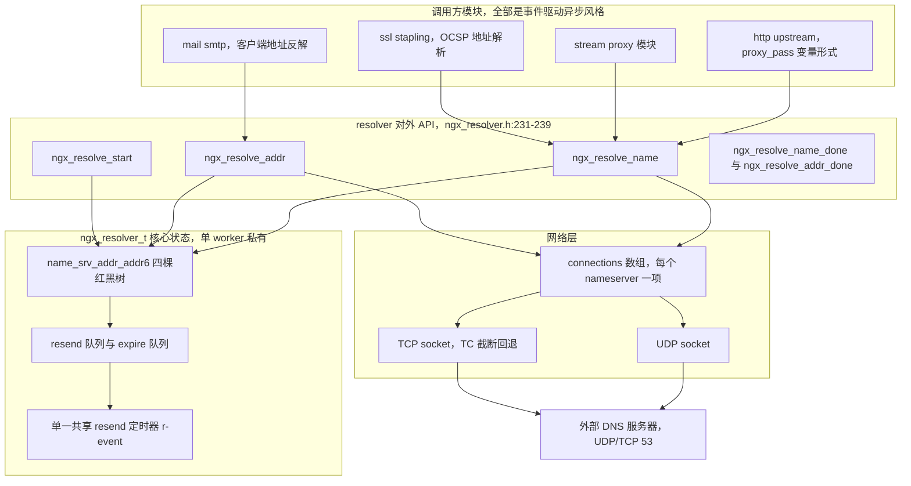
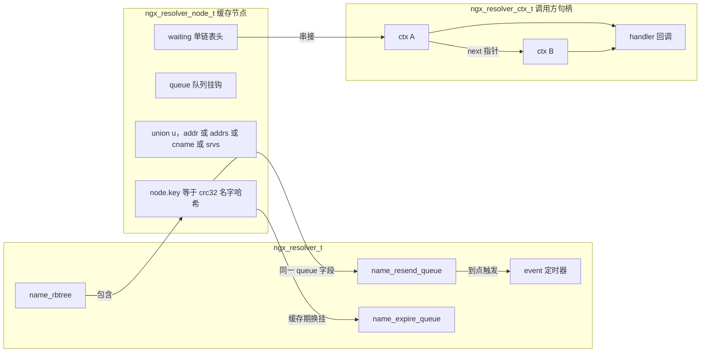
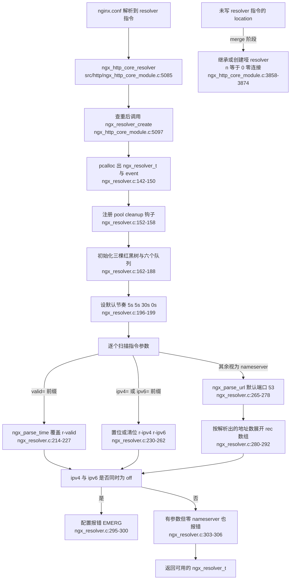
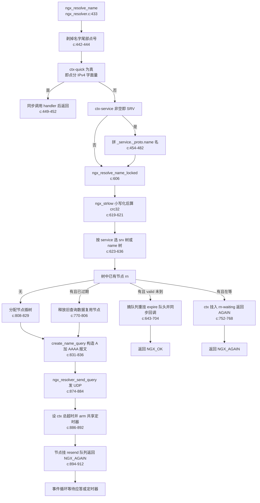
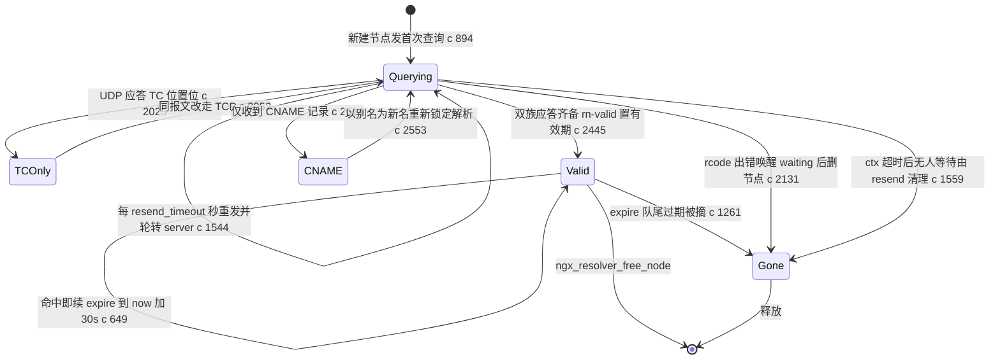
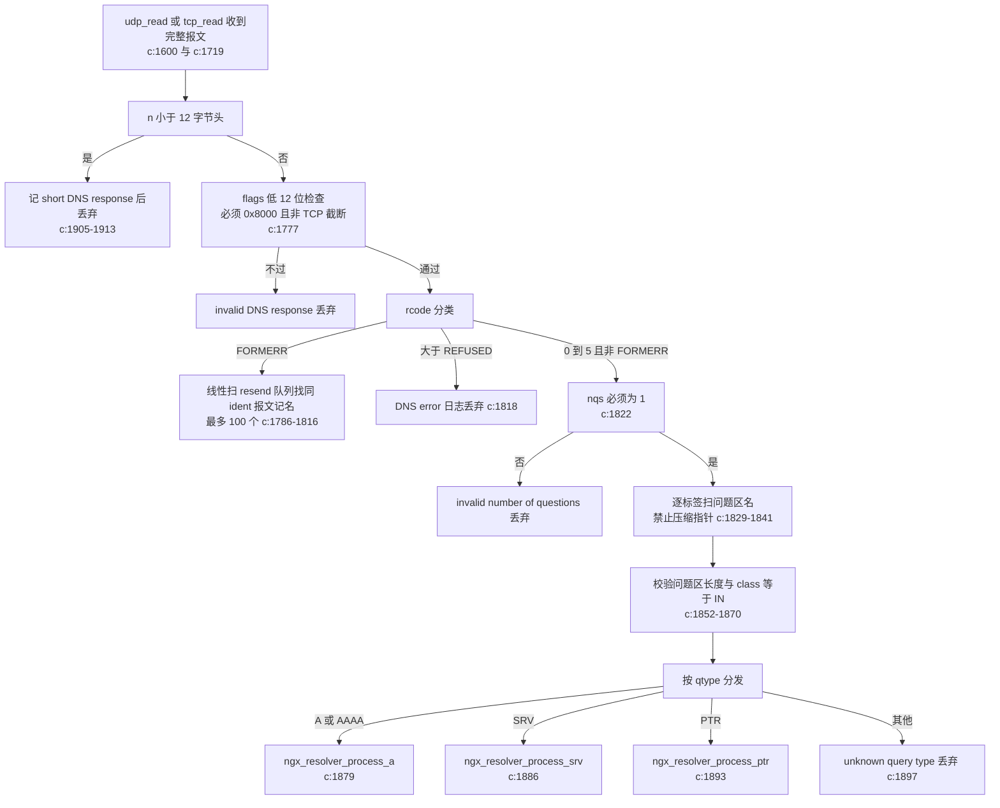
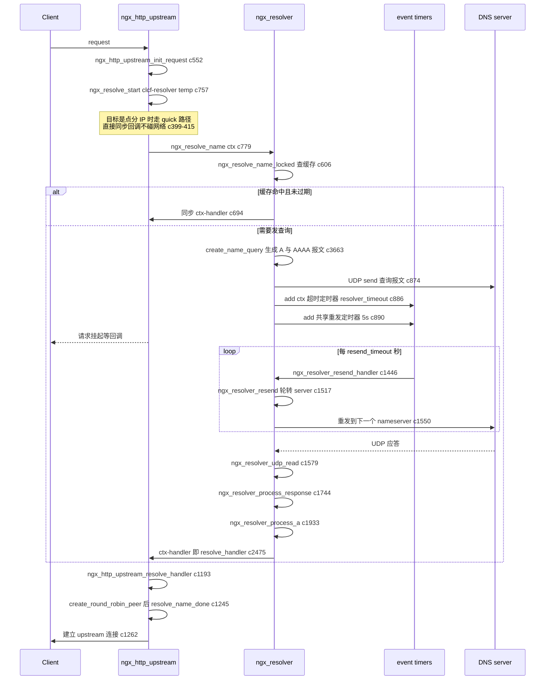
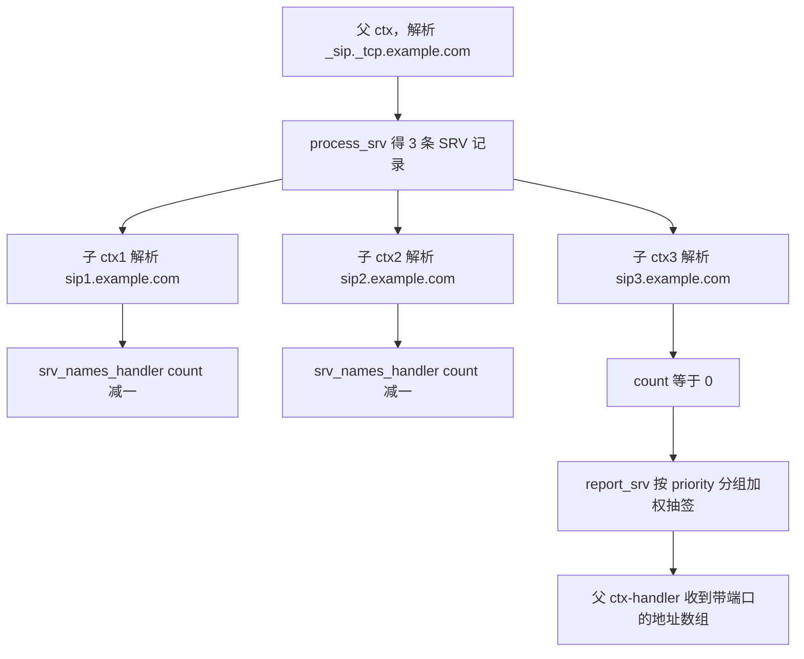

# DNS 解析器（基于 nginx-1.27.0 源码）

> **导读**：读完本文你将掌握：nginx 核心解析器 `ngx_resolver_t` 的完整数据结构（三棵红黑树 + 两类双端队列 + 单一共享定时器）；一次 `proxy_pass $var` 从 UDP 查询构造、nameserver 轮转、超时重发，到应答校验、A/AAAA 双栈合并、CNAME 链跟随、SRV 二级解析、PTR 反解的全链路代码走读；缓存 TTL 与 `valid=` 覆盖、`resolver_timeout` 与内部 5 秒重发节奏的分工；TC 截断回退 TCP、SERVFAIL/NXDOMAIN 等失败路径的精确行为；以及这套设计与 `getaddrinfo`、c-ares 等替代方案的权衡。
>
> **前置阅读建议**：熟悉 `ngx_rbtree_t`（红黑树）与 `ngx_queue_t`（侵入式双端队列）的基本操作；了解 nginx 事件框架中 `ngx_event_t` 定时器与 `handler` 回调模型；看过《upstream 模块》中 `ngx_http_upstream_resolved_t` 的用法。本文所有行号均来自 nginx-1.27.0 源码，可对照阅读。
>
> **涉及源码清单**：
>
> - `src/core/ngx_resolver.h`（242 行）—— 类型定义与对外 API
> - `src/core/ngx_resolver.c`（4741 行）—— 全部实现
> - `src/http/ngx_http_core_module.c` —— `resolver` / `resolver_timeout` 指令与哑 resolver 兜底
> - `src/http/ngx_http_upstream.c` / `src/http/ngx_http_upstream.h` —— 运行期解析接入点
> - `src/mail/ngx_mail_smtp_handler.c` —— PTR 反解接入点
> - `src/http/modules/ngx_http_upstream_zone_module.c` —— upstream 共享内存（与 resolver 缓存无关，见 2.6）

---

## 1. 本模块在 nginx 中的位置与职责

`src/core/ngx_resolver.c` 是 nginx 的**异步、事件驱动、带进程内缓存的递归 DNS stub 解析器**。它不做区域传送、不当权威服务器，只完成一件事：把域名或地址变成对端可连接的 `sockaddr`（或把地址变回名字），并且不阻塞任何 worker 线程。它的上游是各协议模块，下游是操作系统 socket 与外部 DNS 服务器：



**图解读**：所有调用方只经由四个公开函数（`src/core/ngx_resolver.h:231-239`）与解析器交互；解析器内部用红黑树做"名字/地址 → 应答"的进程内缓存，用队列管理"待重发"与"待淘汰"两个生命周期，用**一个**挂在 `r->event` 上的定时器统一驱动重发节奏（`src/core/ngx_resolver.c:190-193`）。网络层为每个 nameserver 地址维护一个 `ngx_resolver_connection_t`（下文简称 `rec`），UDP socket 常驻复用，TCP socket 仅在应答被截断（TC 位）时按需建立。

它的三个关键职责边界：

1. **异步化**：`ngx_resolve_name()` 提交后立即返回 `NGX_AGAIN`，结果通过 `ctx->handler` 回调交付（`src/core/ngx_resolver.c:432-511`）；
2. **缓存化**：命中且未过期的条目直接同步回调，不产生网络流量（`src/core/ngx_resolver.c:643-704`）；
3. **容错化**：nameserver 轮转、固定 5 秒重发、TC 回退 TCP、双栈部分应答等待，全部内建（后文逐一落到行号）。

---

## 2. 核心数据结构精讲

### 2.1 顶层容器 `ngx_resolver_s`（src/core/ngx_resolver.h:148-194）

| 字段 | 行号 | 类型 | 含义与设计意图 |
|---|---|---|---|
| `event` | h:150 | `ngx_event_t *` | 全解析器唯一的重发定时器事件，handler 为 `ngx_resolver_resend_handler` |
| `log` | h:152 | `ngx_log_t *` | 指向 cycle 日志；所有解析日志走它 |
| `ident` | h:155 | `ngx_int_t` | 事件 ident，固定置 -1（`src/core/ngx_resolver.c:194`），保证可被 `ngx_event_del_timer` 体系识别 |
| `connections` | h:158 | `ngx_array_t` | `ngx_resolver_connection_t` 数组，每个 nameserver **地址**一项（一个主机名可能展开成多项） |
| `last_connection` | h:159 | `ngx_uint_t` | 全局游标，让每个新解析请求从不同 server 起步，实现"简单轮转负载均衡"（h:157 注释原话） |
| `name_rbtree`/`srv_rbtree`/`addr_rbtree` | h:161-168 | `ngx_rbtree_t` | 三棵缓存树：域名→A/AAAA、SRV 名→SRV 记录、地址→PTR；各自带 sentinel |
| `*_resend_queue` | h:170-172 | `ngx_queue_t` | 等待重发的节点队列（含未决查询） |
| `*_expire_queue` | h:174-176 | `ngx_queue_t` | 已缓存、等待淘汰的节点队列 |
| `ipv4` / `ipv6` | h:178-186 | 位域 | 双栈开关；`ipv6` 存在时额外有 `addr6_rbtree` 与 addr6 的两套队列 |
| `resend_timeout`/`tcp_timeout`/`expire`/`valid` | h:188-191 | `time_t` | 四个全局节奏参数，默认 5/5/30/0 秒（`src/core/ngx_resolver.c:196-199`），除 `valid` 可由 `resolver` 指令的 `valid=` 参数修改外均为硬编码 |
| `log_level` | h:193 | `ngx_uint_t` | 解析错误日志级别，默认 `NGX_LOG_ERR`（c:202） |

### 2.2 缓存节点 `ngx_resolver_node_t`（src/core/ngx_resolver.h:92-145）

这是整个解析器最精妙的结构：**一个节点同时是红黑树元素、队列元素和待唤醒回调链的头**。

| 字段 | 行号 | 含义 |
|---|---|---|
| `node` | h:93 | 红黑树节点；`node.key` 存名字的 CRC32 哈希或整型 IPv4 地址 |
| `queue` | h:94 | 侵入式队列挂钩，同一时刻只挂在 resend 或 expire 两个队列之一 |
| `name` | h:97 | A 查询：待解析名；PTR：已解析出的主机名（h:96 注释明确标注双重语义） |
| `addr6` | h:101 | 仅 PTR/addr6 树使用：要反解的 IPv6 地址（IPv4 反解直接用 `node.key`，见 h:100 注释） |
| `nlen` / `qlen` | h:104-105 | 名字长度 / 已构造 DNS 报文长度 |
| `query` / `query6` | h:107-110 | A 与 AAAA 两份查询报文（可能同一次分配，见 6.9） |
| `u` | h:112-117 | 联合体：`addr`（单 IPv4）、`addrs`（IPv4 数组）、`cname`（别名串）、`srvs`（SRV 数组） |
| `code` | h:119 | 暂存的 rcode：当一族应答出错而另一族未决时先记下（c:2114） |
| `naddrs` / `naddrs6` | h:120,130 | 地址个数；**哨兵值 `(u_short)-1` 表示"该族查询尚未收到应答"** |
| `cnlen` | h:122 | CNAME 长度，非 0 表示该节点当前只解析到别名 |
| `u6` | h:125-128 | `addr6`（单 IPv6）或 `addrs6`（数组） |
| `expire` | h:133 | 双语义：挂在 resend 队列时是"下次重发时刻"；挂在 expire 队列时是"缓存淘汰时刻" |
| `valid` | h:134 | 缓存有效期截止时刻 `ngx_time() + ttl 或 r->valid` |
| `ttl` | h:135 | 应答中各 RR TTL 的最小值（c:2210），初始为 `NGX_MAX_UINT32_VALUE`（c:901） |
| `tcp` / `tcp6` | h:137-140 | 标记该族查询已因 TC 切到 TCP 重发 |
| `last_connection` | h:142 | 本节点当前使用的 nameserver 下标，重发时自增轮转（c:1546-1548） |
| `waiting` | h:144 | 等待本结果的 `ngx_resolver_ctx_t` 单链表头 |

### 2.3 调用方句柄 `ngx_resolver_ctx_t`（src/core/ngx_resolver.h:197-228）

| 字段 | 行号 | 含义 |
|---|---|---|
| `next` | h:198 | 串起"同一个调用发起的一串 ctx"（CNAME 链会追加）；也用作 `waiting` 链表节点 |
| `resolver` / `node` | h:199-200 | 所属解析器 / 正在等待的缓存节点 |
| `state` | h:205 | 结果码：`NGX_OK`、`NGX_AGAIN`（未决）、DNS rcode（1-5）、`NGX_RESOLVE_TIMEDOUT` |
| `name` / `service` | h:206-207 | 待解析名；SRV 场景的服务名（见 6.12 的兼容性说明） |
| `valid` | h:209 | 本次结果在调用方侧的有效期（回传 `rn->valid` 或错误兜底 10 秒） |
| `naddrs` / `addrs` / `addr` / `sin` | h:210-213 | 结果地址数组；单地址时直接内嵌在 ctx 的 `sin` 上，避免额外分配 |
| `count` / `nsrvs` / `srvs` | h:215-217 | SRV 二级解析的扇出计数与子结果表 |
| `handler` / `data` | h:219-220 | 完成回调与调用方私有数据 |
| `timeout` | h:221 | 整个解析的总预算毫秒数，来自 `resolver_timeout`（`src/http/ngx_http_core_module.c:775` 处赋值） |
| `quick` | h:223 | 目标本就是点分 IPv4 字面量：跳过网络，同步返回 |
| `async` | h:224 | 标记回调发生在事件循环异步上下文（调用方据此决定是否 `ngx_http_run_posted_requests` 等） |
| `cancelable` | h:225 | 定时器是否可被关闭流程取消 |
| `recursion` | h:226 | CNAME 链深度计数，上限 `NGX_RESOLVER_MAX_RECURSION` = 50（h:37） |
| `event` | h:227 | 该 ctx 自己的超时定时器（总预算计时器） |

### 2.4 连接与结果辅助结构（src/core/ngx_resolver.h:43-89）

- `ngx_resolver_connection_t`（h:43-53）：一个 nameserver 地址的连接上下文，`udp`/`tcp` 两个 `ngx_connection_t` 槽位、地址 `sockaddr`、独立 `log`（挂 `ngx_resolver_log_error` 以在报错时带上 server 名，c:1286-1291）、预分配的 TCP 读写缓冲。
- `ngx_resolver_addr_t`（h:61-67）：交付给调用方的单个地址（sockaddr + 权威名 + SRV priority/weight）。
- `ngx_resolver_srv_t`（h:70-75）：SRV RR 的解析中间产物；`ngx_resolver_srv_name_t`（h:78-89）是 SRV 二级解析期间挂在 ctx 上的"每个目标名一个子 ctx"的表项。
- 报文线格式结构体直接按字节布局定义（`src/core/ngx_resolver.c:19-51`）：12 字节头 `ngx_resolver_hdr_t`、问题区 `ngx_resolver_qs_t`（type+class）、答案区定长前缀 `ngx_resolver_an_t`（type+class+ttl+rdlength）。

### 2.5 节点内存布局与关系图



**图解读**：`rn` 只有一份内存，却同时被三种容器索引——红黑树负责"按键查找"，resend/expire 队列负责"按时间调度"（同一 `queue` 挂钩换队列即切换生命周期，c:647-651 与 c:894-896），`waiting` 链表负责"一对多唤醒"。多个并发请求同名时只发一份 DNS 报文，所有 ctx 挂到 `rn->waiting`，应答到达后逐个回调（c:2455-2476）。

### 2.6 关于"resolver zone"与共享内存的澄清

**ngx_resolver 本身没有任何共享内存布局。** 所有缓存节点经 `ngx_resolver_alloc()` 分配，而它就是裸 `ngx_alloc()`（malloc），见 `src/core/ngx_resolver.c:4154-4166`；因此：

- 缓存是 **worker 进程私有**的：4 个 worker 对同一域名各持一份缓存、各发各的 DNS 查询；
- reload 之后缓存全部丢弃（`ngx_resolver_cleanup` 在 pool 清理时遍历四棵树释放一切，c:312-357）；
- 函数体内成对的 `/* lock name mutex */`、`/* unlock alloc mutex */` 注释（如 c:478、c:589）是历史遗留——早期版本解析器带互斥锁，现在的单线程事件模型下只保留注释作分段标记。

nginx 里与"zone"相关的共享内存在 upstream 一侧：`upstream zone` 指令通过 `ngx_shared_memory_add()` 建立 slab 池共享 **peers 数据**（`src/http/modules/ngx_http_upstream_zone_module.c:105-114`），但 1.27.0 开源版的 `upstream server` 指令没有 `resolve`/`service` 参数（在整个 `src/http/ngx_http_upstream.c` 中 grep 不到该参数的解析代码），DNS 结果从不进入共享内存。

---

## 3. 初始化流程

解析器是纯配置期对象：`resolver` 指令在 `http/server/location` 上下文各建一个 `ngx_resolver_t`，随 pool 生命周期存亡。



**图解读**：三个易被忽略的分支。其一，`resolver` 的参数不是"纯 nameserver 列表"，`valid=`、`ipv4=`、`ipv6=` 三个前缀在同一层被拦截（c:214-262），其余字符串才走 `ngx_parse_url`（默认端口 53，c:268）；一个形如主机名的 nameserver 会展开成多个 `rec`（c:287-292 的 `for (j = 0; j < u.naddrs; j++)` 循环）。其二，`ipv4=off ipv6=off` 与"只写了参数没写 server"都是配置期 EMERG（c:295-306）。其三，**未配置 resolver 也能正常启动**：http 框架在 merge 阶段会创建"哑 resolver"（0 个 nameserver），运行期数字 IP 照样解析成功，域名则得到 `NGX_NO_RESOLVER` 并报 `no resolver defined to resolve`（`src/http/ngx_http_upstream.c:764-770`）——这正是 `ngx_resolver_create(cf, NULL, 0)` 传入 `n=0` 的用途（`src/http/ngx_http_core_module.c:3860-3873`）。

---

## 4. 核心执行流程/状态机

### 4.1 一次名字解析的主流程



**图解读**：注意三条"不发网络包"的快速路径——`quick` 字面量（c:449）、缓存命中（c:643）、以及"别人正在查同名"的搭车等待（c:752，新 ctx 只挂 `waiting` 链表，连报文都不用重发）。`NGX_DECLINED`（名字非法，如空标签或标签超 255 字节，c:3742-3744）会在删掉刚插的节点后直接以 `NGX_RESOLVE_NXDOMAIN` 回调（c:842-859）。

### 4.2 缓存节点 `rn` 的生命周期状态机



**图解读**：`Valid` 态的节点留在树里对外服务，只要不断命中就把 `expire` 刷新为 `now + r->expire`（30 秒，c:649）；真正把它请出内存的是 `ngx_resolver_expire`——但它在每次调用中**最多摘 2 个**最老节点（c:1252 的 `for (i = 0; i < 2; i++)`），调用点只在 `ngx_resolve_name_done`/`ngx_resolve_addr_done` 里，即"用查询的行为顺带做增量清扫"。错误态（SERVFAIL/NXDOMAIN/REFUSED）**不写缓存**：节点直接删除（c:2134-2149），下次同名查询会重新发网——nginx 没有负缓存。

### 4.3 应答入口 `ngx_resolver_process_response` 的分流



**图解读**：入口处有两个反直觉的严格检查。第一，`flags & 0xf870` 必须恰为 `0x8000`（c:1777）——即 QR=1、opcode=0、Z/AD/CD 全 0，任何一位不符都当非法报文丢弃；同时"TCP 传输的报文若还带 TC 位"也判非法（同一行的 `trunc && tcp`）。第二，问题区的域名**不允许出现压缩指针**（c:1831-1834 直接报错），因为问题区本该是全名，出现指针多半是恶意或畸形报文；答案区的名字才允许指针（c:2164-2167 遇 `0xc0` 跳 2 字节）。

---

## 5. 关键时序图

以 `proxy_pass http://$backend;`（变量形式）的一次运行期解析为例，标出每一跳的函数：



**图解读**：两个定时器分工明确——**ctx 级**的总预算定时器到期即以 `NGX_RESOLVE_TIMEDOUT` 回调（c:4096-4106），时长由 `resolver_timeout`（默认 30 秒）决定；**解析器级**的共享定时器只管"每 5 秒重发一次并把目标换到下一个 nameserver"（c:1544-1554）。后者永不放弃，直到前者到点或应答到达——所以 DNS 故障时请求的等待上限恰是 `resolver_timeout`。TCP 回退路径相同，只是 `ngx_resolver_send_tcp_query` 先补两字节长度前缀再写缓冲（c:1433-1435）。

---

## 6. 源码逐段精读

本章按"创建 → 发起 → 发送 → 接收 → 解析 → 回收"的顺序逐函数精读。引用格式为 `文件:起始行-结束行`，摘录均为原文截取。

### 6.1 `ngx_resolver_create()` —— 解析器对象与 nameserver 表的诞生

**签名**（src/core/ngx_resolver.c:132-133）：

```c
ngx_resolver_t *
ngx_resolver_create(ngx_conf_t *cf, ngx_str_t *names, ngx_uint_t n)
```

`names`/`n` 是 `resolver` 指令去掉指令名后的参数数组。函数先摆好"骨架"：分配对象与事件（c:142-150）、挂 pool cleanup（c:152-158，reload/退出时由 `ngx_resolver_cleanup` 收尸）、初始化三棵树与六个队列（c:162-188）、给共享定时器装上 handler 并设 `cancelable = 1`（c:190-193，保证 nginx 平滑退出时该定时器可被清理）。随后是四个默认节奏值（c:196-199）：

```c
    r->resend_timeout = 5;
    r->tcp_timeout = 5;
    r->expire = 30;
    r->valid = 0;

    r->log = &cf->cycle->new_log;
    r->log_level = NGX_LOG_ERR;
```

`valid = 0` 是个关键哨兵：它表示"缓存有效期跟随 DNS 应答里的 TTL"；一旦配置了 `valid=`，c:2445 处的 `r->valid ? r->valid : rn->ttl` 三元表达式就会整体覆盖 TTL。`valid=` 的解析（c:214-227）：

```c
        if (ngx_strncmp(names[i].data, "valid=", 6) == 0) {
            s.len = names[i].len - 6;
            s.data = names[i].data + 6;

            r->valid = ngx_parse_time(&s, 1);

            if (r->valid == (time_t) NGX_ERROR) {
                ngx_conf_log_error(NGX_LOG_EMERG, cf, 0,
                                   "invalid parameter: %V", &names[i]);
                return NULL;
            }

            continue;
        }
```

紧随其后的 `ipv4=`/`ipv6=` 分支（c:229-263）只接受字面 `on`/`off`，且 `ipv4 + ipv6 == 0` 时报 EMERG（c:295-300）——双栈可以只开一半，但不能全关。

**nameserver 展开**（c:265-292）：每个非参数项走 `ngx_parse_url`（`default_port = 53`），然后按**解析出的地址数**批量 push `rec`。也就是说 `resolver localhost;` 若 localhost 同时有 v4/v6 记录，`connections` 里会有多项，轮转时它们是独立的候选。

**易错点**：(1) `rec` 数组是 `ngx_array_push_n` 扩出来的，`ngx_resolver_connection_t` 的 `log` 字段是惰性初始化的——首次使用时才从 `r->log` 拷贝并挂上 `ngx_resolver_log_error`（c:1286-1291），所以 c:339-355 的 cleanup 对 `rec[i].udp/tcp/read_buf/write_buf` 都做了判空；(2) 该函数在配置期运行，此时还没有事件循环，因此它**不建 socket**，socket 全部推迟到第一次发查询时（见 6.8）。

### 6.2 `ngx_resolve_start()` —— 快速路径与"哑 resolver"的交汇点

**签名**（c:393-394）：

```c
ngx_resolver_ctx_t *
ngx_resolve_start(ngx_resolver_t *r, ngx_resolver_ctx_t *temp)
```

`temp` 非空时先做**字面量检测**（c:399-415）：

```c
        if (addr != INADDR_NONE) {
            temp->resolver = r;
            temp->state = NGX_OK;
            temp->naddrs = 1;
            temp->addrs = &temp->addr;
            temp->addr.sockaddr = (struct sockaddr *) &temp->sin;
            temp->addr.socklen = sizeof(struct sockaddr_in);
            ngx_memzero(&temp->sin, sizeof(struct sockaddr_in));
            temp->sin.sin_family = AF_INET;
            temp->sin.sin_addr.s_addr = addr;
            temp->quick = 1;

            return temp;
        }
```

注意返回的是**调用方栈上的 `temp` 本身**（`quick = 1`）：后续 `ngx_resolve_name()` 见 `quick` 直接同步回调（c:449-452），`ngx_resolve_name_done()` 见 `quick` 直接 return（c:527-529），全程不进树、不分配、不碰 `r`。这就是 `proxy_pass http://127.0.0.1:8080/` 这类配置零 DNS 开销的机制。`NGX_NO_RESOLVER`（h:35，值为 `(void *) -1`）在 `r->connections.nelts == 0` 时返回（c:418-420）——上文 3 节所述"哑 resolver"正是借这条路径把"没配 resolver"归一成统一的运行期错误。

### 6.3 `ngx_resolve_name()` —— 提交入口与 SRV 名字拼装

**签名**（c:432-433）。三件事：

1. **尾点剥离**（c:442-444）：`ctx->name` 以 `.` 结尾时剥掉——这是对 FQDN 书写习惯的容忍；
2. **SRV 服务名拼装**（c:454-476）：`ctx->service` 非空时构造查询名。若 service 里没有 `.`，按 `_service._proto.name` 规则拼（c:461 的 `slen += sizeof("_._tcp") - 1`），生成如 `_sip._tcp.example.com`；若有 `.` 则直接 `service.name` 拼接。随后拼好的临时名传给 `ngx_resolve_name_locked`，用完即释放（c:480-482）；
3. **返回值三态**（c:490-510）：`NGX_OK`（同步完成或失败已回调）、`NGX_AGAIN` 折算成 `NGX_OK`（异步进行中，c:496-498）、`NGX_ERROR`（连 ctx 都没建成，注意此时要释放 `ctx->event`，c:502-504）。

**易错点**：`ctx->service` 在 1.27.0 开源树内**没有任何模块赋值**（`src/` 全树 grep `->service = ` 与 `ctx->service` 无命中），SRV 全链路（process_srv、report_srv 等）实为预留 API——stream 模块的 `proxy_pass` 也只走 A/AAAA 路径。读代码时不要误以为线上有 SRV 流量。

### 6.4 `ngx_resolve_name_locked()` —— 缓存、搭车、新建三岔口（全文件最核心）

**签名**（c:605-607）：

```c
static ngx_int_t
ngx_resolve_name_locked(ngx_resolver_t *r, ngx_resolver_ctx_t *ctx,
    ngx_str_t *name)
```

**第一步：归一化与选树**（c:619-636）。`ngx_strlow` 原地小写化后用 `ngx_crc32_short` 算哈希（c:619-621）；`ctx->service.len` 决定查 `srv_rbtree` 还是 `name_rbtree`，resend/expire 队列也随之切换——SRV 与普通名在缓存层完全平行。

**第二步：命中分支（rn 非空）**。先看 `rn->valid >= ngx_time()`（c:643）。命中时把节点从 expire 队列摘下、`expire` 刷新为 `now + r->expire`、重新插队头（c:647-651）——**LRU 语义就靠这次"摘了重插"实现**，队尾永远是最久未用。随后统计总地址数（c:653-656，`(u_short)-1` 视为 0）：

```c
            naddrs = (rn->naddrs == (u_short) -1) ? 0 : rn->naddrs;
#if (NGX_HAVE_INET6)
            naddrs += (rn->naddrs6 == (u_short) -1) ? 0 : rn->naddrs6;
#endif
```

有多地址时 `ngx_resolver_export(r, rn, 1)` 导出——注意第三参 `rotate = 1`（c:664）：**缓存命中路径每次随机旋转地址序**（见 6.18），实现请求级 round-robin；而新鲜应答写入缓存的路径用 `rotate = 0`（c:2437）保持服务器给出的顺序。接着把 `rn->waiting` 整条链摘下来逐个回调（c:670-697），`do-while` 遍历 `ctx->next` 链并回填 `state/valid/naddrs/addrs`——单地址且 v4 时直接复用 ctx 内嵌的 `sin`（c:681-687），不额外分配。

命中但 `naddrs == 0` 时（即此前解析结果为空）走 c:707-722：若有 SRV 结果则交给 `ngx_resolver_resolve_srv_names` 二次解析；若是纯 CNAME（`rn->cnlen` 非零）则**递归**（c:724-732）：

```c
            /* NGX_RESOLVE_CNAME */

            if (ctx->recursion++ < NGX_RESOLVER_MAX_RECURSION) {

                cname.len = rn->cnlen;
                cname.data = rn->u.cname;

                return ngx_resolve_name_locked(r, ctx, &cname);
            }
```

递归超限（50 层，h:37）时以 `NGX_RESOLVE_NXDOMAIN` 兜底回调，且 `ctx->valid = now + (r->valid ? r->valid : 10)`（c:741）——这是"错误结果 10 秒有效期"的少数落地点之一，但注意它只回填到 ctx，节点仍在缓存里。

**第三步：命中但已过期**（c:770-806）。节点留在树里但 `valid` 已过：摘出队列、释放旧 `query/query6/cname/addrs/srvs` 全部数据，**复用同一个 `rn`** 进入新建流程。这种"原地复活"避免了红黑树删除再插入的开销。

**第四步：命中且正在等待**（c:752-768）——搭车路径：

```c
        if (rn->waiting) {
            if (ngx_resolver_set_timeout(r, ctx) != NGX_OK) {
                return NGX_ERROR;
            }

            last->next = rn->waiting;
            rn->waiting = ctx;
            ctx->state = NGX_AGAIN;
            ctx->async = 1;

            do {
                ctx->node = rn;
                ctx = ctx->next;
            } while (ctx);

            return NGX_AGAIN;
        }
```

新 ctx 挂到 `waiting` 链头，零网络开销；自己的 `timeout` 定时器照设（`ngx_resolver_set_timeout`，c:4072-4093），保证上游搭车者也有独立的总预算。

**第五步：全新节点**（c:808-829）。`ngx_resolver_dup` 复制名字（节点寿命与 ctx 无关，不能引用 ctx 里的内存），`node.key = hash`，`ngx_rbtree_insert` 挂树。随后构造查询（c:831-836，按 service 选 SRV 或普通名查询构造器）、初始化轮转游标（c:861-864 的 `rn->last_connection = r->last_connection++`，配合取模让相邻请求命中不同 server）、设哨兵（c:866-872）：

```c
    rn->naddrs = r->ipv4 ? (u_short) -1 : 0;
    rn->tcp = 0;
#if (NGX_HAVE_INET6)
    rn->naddrs6 = r->ipv6 ? (u_short) -1 : 0;
    rn->tcp6 = 0;
#endif
    rn->nsrvs = 0;
```

`(u_short)-1` 的语义在此定型：**该族查询在途**。`ipv6=off` 时直接置 0，表示"v6 无需等待"，双族汇聚逻辑便只剩 v4 一族。

**发送与收尾**（c:874-912）：`ngx_resolver_send_query` 失败立即换下一个 server 重试一次（c:876-884 的注释 "immediately retry once on failure"）；`ngx_resolver_set_timeout` 给 ctx 上总预算定时器；共享定时器空闲时按 `resend_timeout * 1000` 毫秒 arm 起来（c:890-892）；节点挂 resend 队头并初始化 `expire = now + resend_timeout`、`ttl = NGX_MAX_UINT32_VALUE`、`waiting = ctx`（c:894-902）。失败出口 c:914-926 删树节点并释放三件套，防止半初始化节点泄漏。

### 6.5 `ngx_resolve_addr()` —— 正解的镜像路径（c:930-1148）

与 6.4 结构完全同构，只有键不同：`AF_INET` 时 `rn->node.key = ntohl(addr)`（c:975、c:1059），直接以**主机序 IPv4 地址**为红黑树键，无哈希无冲突比较；`AF_INET6` 时 `key = crc32(s6_addr)` 并以 16 字节 memcmp 二次比较（c:960、c:1053-1054）。命中回调时用 `ngx_resolver_dup` 拷一份 `rn->name` 给 ctx（c:998-1005），回调完立刻释放（c:1014）——因为 `rn->name` 归节点所有，而 ctx 交付的数据归调用方短暂所有。发送与收尾（c:1070-1125）与 6.4 的 c:831-912 逐行对应，差别仅是 `naddrs = (u_short)-1` 无条件设置（c:1079-1083），因为反解只有一族。

### 6.6 `ngx_resolve_name_done()` / `ngx_resolve_addr_done()` —— 取消与释放

调用方放弃等待（请求结束、超时自定义处理等）时必须调用。核心是**从 waiting 链摘除自己**（c:554-576）：

```c
    if (ctx->state == NGX_AGAIN || ctx->state == NGX_RESOLVE_TIMEDOUT) {

        rn = ctx->node;

        if (rn) {
            p = &rn->waiting;
            w = rn->waiting;

            while (w) {
                if (w == ctx) {
                    *p = w->next;

                    goto done;
                }
```

找不到自己时打 `NGX_LOG_ALERT` 级 "could not cancel %V resolving"（c:573-574）——这通常意味着回调已被派发、ctx 生命周期已被回调侧接管，此时再 done 是调用方的 bug。SRV 父 ctx 的 done 会级联 done 所有子 ctx 并释放 `srvs` 表（c:537-552）。最后调用 `ngx_resolver_expire` 做一次增量清扫（c:580-585），释放 ctx 本体（c:591-595），并在全部 resend 队列皆空时摘掉共享定时器（c:599-601）——**空转定时器的及时熄灭**，避免无查询时每 5 秒空醒。

### 6.7 三个时间函数：expire、resend_handler、resend

**`ngx_resolver_expire()`**（c:1240-1274）：从 expire 队尾（最老）向前摘，`now > rn->expire` 才释放，且单次调用最多摘 2 个（c:1252）：

```c
    for (i = 0; i < 2; i++) {
        if (ngx_queue_empty(queue)) {
            return;
        }

        q = ngx_queue_last(queue);

        rn = ngx_queue_data(q, ngx_resolver_node_t, queue);

        if (now <= rn->expire) {
            return;
        }
```

把清扫成本摊到每次 done 调用上，避免一次性大扫除造成的时延毛刺。**但注意**：`expire` 字段是双语义的——resend 队列里它表示"下次重发时刻"（c:894），expire 队列里才是"淘汰时刻"（c:2446）。挂错队列的时刻值毫无意义，代码靠"节点换队列时必然重写 `expire`"保证正确（对比 c:894-896 与 c:2445-2448）。

**`ngx_resolver_resend_handler()`**（c:1445-1513）：共享定时器到期回调。对 name、srv、addr、addr6 四组 resend 队列各调一次 `ngx_resolver_resend`，取四个返回值（各队列距下次到期的秒数）的**最小值**重新 arm 定时器（c:1483-1512）；全 0（全空）则不再 arm。

**`ngx_resolver_resend()`**（c:1516-1563）：核心重发循环（c:1544-1556）：

```c
        if (rn->waiting) {

            if (++rn->last_connection == r->connections.nelts) {
                rn->last_connection = 0;
            }

            (void) ngx_resolver_send_query(r, rn);

            rn->expire = now + r->resend_timeout;

            ngx_queue_insert_head(queue, q);

            continue;
        }

        ngx_rbtree_delete(tree, &rn->node);

        ngx_resolver_free_node(r, rn);
```

三个要点：(1) **轮转**发生在每次重发时——`++last_connection` 换下一个 nameserver，配合初始 `r->last_connection++`，实现"首查分散 + 重发遍历"；(2) **重发永不放弃**：只要还有 waiting，就 5 秒一次无限循环，放弃权完全交给 ctx 级超时；(3) **无人等待即销毁**：`waiting == NULL` 的在途节点（所有等待者都已取消）直接删树释放。

### 6.8 发送路径：UDP 优先、TCP 兜底

**`ngx_resolver_send_query()`**（c:1277-1317）按族分发：`rn->query && rn->naddrs == (u_short)-1` 才发 A 报文（c:1293-1300），v6 同理（c:1304-1312）。这两个条件说明重发是**按族幂等**的：某一族已有结果（naddrs 非 -1）就不再重发它。

**`ngx_resolver_send_udp_query()`**（c:1320-1355）：socket 惰性建立（c:1326-1334，首次才 `ngx_udp_connect`），然后一次性 `ngx_send` 整个报文，字节数不符即失败（c:1342-1345）。失败时**关闭连接**并返回 `NGX_ERROR`——上游（6.4 的 c:874-884）随即换下一个 server 重试。UDP socket 的建立（c:4457-4540）有个重要细节：`connect(s, rec->sockaddr, rec->socklen)`（c:4509）——**已连接 UDP**，内核只把该对端的报文递上来，天然过滤了非目标 server 的伪造应答；read 事件以 `NGX_CLEAR_EVENT`（epoll/kqueue 边沿）注册（c:4523-4528）。

**`ngx_resolver_send_tcp_query()`**（c:1358-1442）：TCP 只在 TC 回退时使用。首次使用时分配读缓冲 `2 + 65535`（c:15，容纳最大 DNS/TCP 报文）与写缓冲 8192（c:16），connect 后把 write handler 设为 `ngx_resolver_tcp_write` 并 arm `tcp_timeout` 定时器（c:1417-1423）。每次发送都追加 **2 字节大端长度前缀**（c:1433-1435）：

```c
    *b->last++ = (u_char) (qlen >> 8);
    *b->last++ = (u_char) qlen;
    b->last = ngx_cpymem(b->last, query, qlen);
```

缓冲是持久化的（`rec->write_buf` 常驻），写不完的部分留在缓冲里等 `ngx_resolver_tcp_write` 事件驱动续写（c:1617-1671），每有进展就重置 `tcp_timeout`（c:1657-1659）。TCP 建连（c:4543-4725）完整处理了非阻塞 `EINPROGRESS`（c:4609-4643）与 kqueue/select 两套事件模型。

### 6.9 查询报文构造：三个 create_*_query

**`ngx_resolver_create_name_query()`**（c:3663-3788）最值得精读。**一次分配装两份报文**（c:3677-3692）：

```c
#if (NGX_HAVE_INET6)
    p = ngx_resolver_alloc(r, len * (r->ipv4 + r->ipv6));
#else
    p = ngx_resolver_alloc(r, len);
#endif
    if (p == NULL) {
        return NGX_ERROR;
    }

    rn->qlen = (u_short) len;
    rn->query = p;

#if (NGX_HAVE_INET6)
    if (r->ipv6) {
        rn->query6 = r->ipv4 ? (p + len) : p;
    }
#endif
```

`len * (ipv4 + ipv6)` 把 A 与 AAAA 报文背靠背放进同一块内存，`query6` 只是偏移指针——双栈查询零碎片分配。头部填充（c:3697-3714）：ident 取 `ngx_random()` 高 16 位（c:3698-3704），flags 写 `0x0100`（RD=1，期望递归），计数区 `QD=1` 其余 0。问题区置 `type=A, class=IN`（c:3721-3724）。

**名字转线格式**是从后往前回填的经典技巧（c:3726-3757）：

```c
    for (s = name->data + name->len - 1; s >= name->data; s--) {
        if (*s != '.') {
            *p = *s;
            len++;

        } else {
            if (len == 0 || len > 255) {
                return NGX_DECLINED;
            }

            *p = (u_char) len;
            len = 0;
        }

        p--;
    }
```

先把终止 `\0` 写在缓冲末尾，再倒序扫名字：遇字母拷贝、遇点回填当前段长——把 `www.example.com` 变成 `\3www\7example\3com\0`（c:3726 注释原话）。空段（连续点）与超长段（>255）返回 `NGX_DECLINED`（c:3742-3744、c:3753-3755），上层（c:842-859）随即删节点并以 NXDOMAIN 回调。v6 报文在 c:3759-3785 生成：直接 `ngx_memcpy` 复制 v4 报文再改 ident 与 `type_lo = NGX_RESOLVE_AAAA`——**两份报文除 ident 与 qtype 外逐字节相同**。

**`ngx_resolver_create_srv_query()`**（c:3791-3876）与前者同构，`type_lo = NGX_RESOLVE_SRV`（c:3837），单份报文。

**`ngx_resolver_create_addr_query()`**（c:3879-3972）构造 PTR 反解名。IPv4 逐字节十进制倒排（c:3957-3961），IPv6 逐 nibble 十六进制倒排（c:3941-3945），再追加 arpa 后缀与 `type=PTR, class=IN`（c:3963-3967）：

```c
    default: /* AF_INET */

        sin = (struct sockaddr_in *) addr->sockaddr;
        inaddr = ntohl(sin->sin_addr.s_addr);

        for (n = 0; n < 32; n += 8) {
            d = ngx_sprintf(&p[1], "%ud", (inaddr >> n) & 0xff);
            *p = (u_char) (d - &p[1]);
            p = d;
        }

        p = ngx_cpymem(p, "\7in-addr\4arpa\0", 14);
```

`1.2.3.4` 变成 `4.3.2.1.in-addr.arpa`；`ngx_sprintf` 返回写指针、`d - &p[1]` 得段长的写法是 nginx 风格的紧凑惯用法。

### 6.10 接收路径：从 socket 到分发器

**`ngx_resolver_udp_read()`**（c:1578-1614）：已连接 UDP 的读事件 handler，循环 `ngx_udp_recv` 到 `NGX_AGAIN` 为止（c:1589-1602），每包一个 4096 栈缓冲（`NGX_RESOLVER_UDP_SIZE`，c:13）直接交 `ngx_resolver_process_response`。注意读循环里 `rev->ready` 控制——epoll 边沿触发下必须一次读干。

**`ngx_resolver_tcp_read()`**（c:1674-1740）：按 2 字节前缀切帧（c:1704-1722）：

```c
        for ( ;; ) {
            p = b->pos;
            size = b->last - p;

            if (size < 2) {
                break;
            }

            qlen = (u_short) *p++ << 8;
            qlen += *p++;

            if (size < (size_t) (2 + qlen)) {
                break;
            }

            ngx_resolver_process_response(r, p, qlen, 1);
```

半包继续等、整包逐个处理，处理后 `ngx_movemem` 把剩余字节挪回缓冲头（c:1724-1727）。

**`ngx_resolver_process_response()`**（c:1743-1929）是总闸，检查顺序见 4.3 的流程图。补充两个精读点：FORMERR（rcode=1）的特判（c:1786-1816）——报文里通常没有可解析的问题区，于是**线性扫描 name_resend_queue 最多 100 个节点**，用 `rn->query[0..1]` 比对 ident 找到肇事查询，把名字打进日志（c:1915-1921）；问题区长度预检（c:1852-1856）`i + sizeof(ngx_resolver_qs_t) + nan * (2 + sizeof(ngx_resolver_an_t)) > n` 保证后面 `nan` 个答案的定长头都落在包内——可变长的 rdata 再由各 processor 自行校验。

### 6.11 `ngx_resolver_process_a()` —— A/AAAA 应答与 CNAME 链（重头戏）

**签名**（c:1932-1935）。函数近 650 行，分五段。

**段一：以问题名回查节点**（c:1954-1974）。`ngx_resolver_copy` 解出问题区名，`ngx_crc32_short` 算哈希，`ngx_resolver_lookup_name` 查树；查不到即"unexpected DNS response"丢弃——**应答驱动，不是请求驱动**，解析器从不维护"在途请求表"，全靠缓存树自寻址。

**段二：族与 ident 校验**（c:1976-2021）。对 AAAA 应答要求 `rn->query6 != NULL && rn->naddrs6 == (u_short)-1`（c:1981，该族确在等待），A 同理（c:2000）；随后比对响应 ident 与**查询报文里存的 ident**（c:2012、c:2015-2021）——ident 是从 `rn->query` 原始字节里读出来的，不是另存的字段，省内存也保证一致：

```c
        qident = (rn->query[0] << 8) + rn->query[1];
    }

    if (ident != qident) {
        ngx_log_error(r->log_level, r->log, 0,
                      "wrong ident %ui in DNS response for %V, expect %ui",
                      ident, &name, qident);
        ngx_resolver_free(r, name.data);
        goto failed;
    }
```

**段三：TC 截断回退 TCP**（c:2025-2061）。UDP 应答 TC 位置位时：若已无等待者直接删节点；否则取当前 `rec`，置 `rn->tcp = 1`（或 `tcp6`），**同一份报文**改用 `ngx_resolver_send_tcp_query` 重发（c:2050-2055），重挂 resend 队列刷新 `expire`（c:2057-2059）。注意此前入口处已把"TCP 传来的 TC 应答"判非法（c:1777），所以 TCP 路径不会再触发本分支，不存在 A↔TCP 死循环。

**段四：rcode 与双族汇聚**（c:2064-2152）。三个层次：

1. `code == 0 && rn->code` → 沿用另一族先到的错误码（c:2064-2066）；
2. `code == 0 && nan == 0` → rcode 成功但零答案，视为 `NGX_RESOLVE_NXDOMAIN`（c:2068-2101）；**若另一族还在途则先记 `naddrs = 0` 等它**（c:2077-2079 的 `goto next`），两族都到且有一族有地址则跳去导出（c:2081-2097 的 `goto export`）；
3. `code != 0` → 该族失败：置 `naddrs = 0`；另一族在途则只把 code 暂存进 `rn->code` 等待（c:2113-2116）；另一族已到则**删节点、唤醒全部 waiting、释放**（c:2131-2151）——错误结果不入缓存：

```c
        next = rn->waiting;
        rn->waiting = NULL;

        ngx_queue_remove(&rn->queue);

        ngx_rbtree_delete(&r->name_rbtree, &rn->node);

        /* unlock name mutex */

        while (next) {
            ctx = next;
            ctx->state = code;
            ctx->valid = ngx_time() + (r->valid ? r->valid : 10);
            next = ctx->next;

            ctx->handler(ctx);
        }
```

**段五：答案区解析与导出**（c:2154-2584）。第一遍扫 `nan` 个答案只做形状校验并统计 `naddrs`（c:2158-2275）：标签扫描遇 `0xc0` 高位按压缩指针跳 2 字节（c:2164-2167），RR 头解出 type/class/len/ttl（c:2192-2198），`class != 1` 丢弃整包（c:2200-2204），`ttl < 0` 钳 0 后与现有 `rn->ttl` 取最小（c:2206-2210）——**节点 TTL 是全包最小值**，因为 A 与 AAAA 两族共享一个节点。type 只认 A（len 必须 4，c:2216-2234）、AAAA（len 必须 16，c:2237-2256）、CNAME（记下 rdata 指针，c:2258-2262）、DNAME（静默跳过，c:2264-2266）。

第二遍按同样步进回填地址（c:2330-2391）。单地址直接写进联合体内嵌存储 `rn->u.addr`，多地址才 `ngx_resolver_alloc` 数组（c:2311-2323）——又一处按需分配。回填中若一族填完而另一族仍为 `-1` 则 `goto next` 继续等（c:2362-2367）。

**导出与唤醒**（c:2413-2489）是最终出口：两族均非 `-1` 且总数大于 0 时，`ngx_resolver_export` 生成 `ngx_resolver_addr_t` 数组（多地址时），然后（c:2443-2448）：

```c
        ngx_queue_remove(&rn->queue);

        rn->valid = ngx_time() + (r->valid ? r->valid : (time_t) rn->ttl);
        rn->expire = ngx_time() + r->expire;

        ngx_queue_insert_head(&r->name_expire_queue, &rn->queue);
```

`valid` 三元式就是 **`valid=` 覆盖 TTL** 的唯一生效点；`expire` 重写为缓存淘汰语义后节点从 resend 队列换挂 expire 队列。随后释放 `rn->query`（结果已定，报文不再需要，c:2483-2487），逐个唤醒 waiting。

**CNAME 链跟随**（c:2492-2558）：答案里没有任何地址却有 CNAME 时，先把别名串拷出存进 `rn->u.cname`/`cnlen`（c:2505-2515），节点同样进缓存（c:2517-2520）——**别名本身也是可缓存的中间结果**。然后对 waiting 链递增 `ctx->recursion`，超 50 层以 NXDOMAIN 回调（c:2531-2547），否则把整条 ctx 链的 `node` 置 NULL 后**带着别名重新进入 `ngx_resolve_name_locked`**（c:2549-2553）：

```c
            for (next = ctx; next; next = next->next) {
                next->node = NULL;
            }

            (void) ngx_resolve_name_locked(r, ctx, &name);
```

递归返回后 ctx 可能又处于 `NGX_AGAIN`，也可能同步命中——调用方（原始 handler）会在其中的某一层被回调，这正是 6.3 中 `ctx->next` 链存在的意义：CNAME 链上的每一次换名都把原 ctx 链原样接力。


**图解读**：链上每跳都可能命中缓存提前终止；`recursion` 计数挂在 ctx 上而非节点上，所以同一 ctx 反复进链也能累计，50 层上限防的是 DNS 环（服务器把 A 的 CNAME 指回 B、B 指回 A）。

### 6.12 SRV 应答与二级解析扇出（c:2587-3098、c:4302-4408）

**`ngx_resolver_process_srv()`**（c:2587-2967）前半（ident 校验、TC→TCP、rcode 处理）与 process_a 逐段平行（c:2625-2694）。答案区解析（c:2700-2791）对 SRV RR 先做 `ngx_resolver_copy(r, NULL, ...)` **只校验 rdata 里的名字可解**（c:2764-2768，name 传 NULL 即"纯校验模式"，见 6.15），再统一分配 `srvs` 数组回填（c:2797-2856）：

```c
                srvs[j].priority = (buf[i] << 8) + buf[i + 1];
                srvs[j].weight = (buf[i + 2] << 8) + buf[i + 3];

                if (srvs[j].weight == 0) {
                    srvs[j].weight = 1;
                }

                srvs[j].port = (buf[i + 4] << 8) + buf[i + 5];
```

weight 0 抬成 1（c:2839-2841）避免加权抽签时被 0 权重吞掉区间；随后**仅按 priority 排序**（c:2858-2859，`ngx_resolver_cmp_srvs` 返回 `p1 - p2`，c:4728-4741）——weight 的随机性留给 `report_srv` 的运行时抽签。节点进 srv_expire 队列缓存后，对每个 waiting ctx 调 `ngx_resolver_resolve_srv_names`（c:2874-2879）。

**`ngx_resolver_resolve_srv_names()`**（c:2970-3037）：把父 ctx 的 `count = nsrvs`（c:2983），为每个 SRV 目标名造一个子 ctx——`handler = ngx_resolver_srv_names_handler`、`data = 父ctx`、`timeout = 父timeout`（c:3007-3021）——再 `ngx_resolve_name` 逐个发起普通 A/AAAA 解析。**SRV 解析被翻译成"n 个并发的普通名字解析 + 计数汇聚"**。

**`ngx_resolver_srv_names_handler()`**（c:3040-3098）：子结果到达时 `ctx->count--`（c:3054），把地址数组连同 SRV 端口一起固化（`ngx_inet_set_port`，c:3084）；`count == 0` 时调 `ngx_resolver_report_srv` 汇总（c:3095-3097）。

**`ngx_resolver_report_srv()`**（c:4302-4408）：按 priority 分组做 RFC 2782 式加权抽签（c:4354-4399）：

```c
        w = ngx_random() % nw;

        for (k = i; k < j; k++) {
            if (w < srvs[k].naddrs * srvs[k].weight) {
                break;
            }

            w -= srvs[k].naddrs * srvs[k].weight;
        }
```

组内以 `naddrs * weight` 为权重随机选起点，再把该 SRV 的全部地址连续铺进结果数组——低 priority 组（数值小者优先）整体排在前面。



**图解读**：任何子 ctx 失败会让父 ctx 整体报 `NGX_ERROR`（c:4315-4321）；全部无地址则取首个 NXDOMAIN 风格的 state 上报（c:4326-4340）。再次强调：1.27.0 开源树内没有模块会设置 `ctx->service`，本节代码处于"待命"状态。

### 6.13 `ngx_resolver_process_ptr()` —— 反向解析（c:3101-3415）

PTR 应答的问题名是 `a.b.c.d.in-addr.arpa` 或 nibble 化的 `*.ip6.arpa`。函数先把问题名**解码回二进制地址**（c:3134-3150）：

```c
    addr = 0;
    i = sizeof(ngx_resolver_hdr_t);

    for (mask = 0; mask < 32; mask += 8) {
        len = buf[i++];

        octet = ngx_atoi(&buf[i], len);
        if (octet == NGX_ERROR || octet > 255) {
            goto invalid_in_addr_arpa;
        }

        addr += octet << mask;
        i += len;
    }
```

注意 `mask` 从 0 递增：问题名是**倒排**的（最低位 octet 在前），逐段左移拼回正序地址；随后 `ngx_strcasecmp` 匹配 `\7in-addr\4arpa`（c:3149-3150，`\7`/`\4` 是长度前缀字节）。IPv6 分支（c:3164-3204）逐 nibble 十六进制还原，`addr6.s6_addr[octet]` 从 15 倒着填。拿到地址后按族查 `addr_rbtree`（键即地址本身）或 `addr6_rbtree`（c:3154、c:3198）——**不靠名字哈希，靠地址键直接命中当初 `ngx_resolve_addr` 建的节点**。

ident 校验（c:3223-3231）后，扫答案区只认 PTR（c:3325-3327）与 CNAME，命中 PTR 时 `ngx_resolver_copy` 解出主机名并做一次**语义换位**（c:3356-3370）：

```c
    if (name.len != (size_t) rn->nlen
        || ngx_strncmp(name.data, rn->name, name.len) != 0)
    {
        if (rn->nlen) {
            ngx_resolver_free(r, rn->name);
        }

        rn->nlen = (u_short) name.len;
        rn->name = name.data;
```

PTR 节点的 `rn->name` 存的是**解析结果**（h:96-97 注释的双重语义在此兑现）：名字与旧值不同则替换节点存储，再 `dup` 一份交给 waiting ctx（c:3388 回填 `ctx->name`）。有效期同样走 `r->valid ? r->valid : ttl`（c:3374）。

**使用场景**：树内唯一调用方是 mail 模块的 SMTP 客户端反解（`src/mail/ngx_mail_smtp_handler.c:80-95`）：

```c
    ctx = ngx_resolve_start(cscf->resolver, NULL);
    if (ctx == NULL) {
        return;
    }

    ctx->name.len = ...（此处从略，见源文件）
    ctx->handler = ngx_mail_smtp_resolve_addr_handler;
    ctx->data = s;
    ctx->timeout = cscf->resolver_timeout;

    s->resolver_ctx = ctx;

    if (ngx_resolve_addr(ctx) != NGX_OK) {
```

即 SMTP 会话建立时对客户端 IP 做 PTR 查询（对应 C 库 `getnameinfo` 的用途），结果交给 `ngx_mail_smtp_resolve_addr_handler` 决定是否继续反查正向 A 记录做 FCrDNS 验证。http/stream 树内没有反解调用点。

### 6.14 查找与红黑树插入（c:3418-3658）

**`ngx_resolver_lookup_name()`**（c:3418-3456）：标准 BST 下行按 `hash` 比较，**键相等时并不立即命中**，还要 `ngx_memn2cmp` 比较名字本体（c:3440-3450）——CRC32 只是粗筛，碰撞由名字定序消解：

```c
        /* hash == node->key */

        rn = ngx_resolver_node(node);

        rc = ngx_memn2cmp(name->data, rn->name, name->len, rn->nlen);

        if (rc == 0) {
            return rn;
        }

        node = (rc < 0) ? node->left : node->right;
```

**`ngx_resolver_rbtree_insert_value()`**（c:3577-3615）是自定义插入回调：键相等时同样按名字定左右（c:3594-3601），保证"同哈希异名"共存一树；新节点染红挂叶（c:3610-3614），再由通用 `ngx_rbtree_insert` 做平衡修复。`addr_rbtree` 用通用 `ngx_rbtree_insert_value`（c:168-169）——地址本身即全序键，无第二级比较；`addr6_rbtree` 用 memcmp 版插入回调（c:3620-3658）。

**为什么用"哈希 + 名字"而不是直接名字字典序**：哈希树高度近似 O(log n) 且与名字长度无关，比较成本集中在碰撞处理；同时 `node.key` 是 `uint32_t`，与 `addr_rbtree` 的整型键统一了树节点布局。

### 6.15 `ngx_resolver_copy()` —— 名字压缩指针的安全解包（c:3975-4069）

**两遍扫描**。第一遍只算展开后长度并做安全检查（c:3992-4022）：

```c
    for (i = 0; i < 128; i++) {
        n = *p++;

        if (n == 0) {
            goto done;
        }

        if (n & 0xc0) {
            if ((n & 0xc0) != 0xc0) {
                err = "invalid label type in DNS response";
                goto invalid;
            }
```

四个防护一次看全：(1) **指针跳转上限 128 次**（c:3992 上方注释：压缩指针可构造死循环，128 足以展开 255 字节名字）——防指针环；(2) 标签类型只认 `0xc0` 前缀，其他（`0x40` EDNS 位图标签等）报 "invalid label type"；(3) 指针目标 `p = &buf[n]` 后立刻检查 `p >= last`（c:4018-4021）——防越界读；(4) `n == 0` 即根结束。第二遍（c:4050-4068）真正展开：逐标签 `ngx_strlow` 小写化拷贝、补 `.`，指针则跳转续抄。`name == NULL` 时第一遍后直接返回 `NGX_OK`（c:4034-4036）——这就是 6.12 里 SRV rdata 的"只校验不分配"用法（c:2764）。

**易错点**：第一遍统计的 `len` 已含每标签后的分隔符（`len += 1 + n`，c:4014），因此第二遍结束时 `name->len = dst - name->data - 1` 要减掉末尾多写的那个点（c:4054）。

### 6.16 超时定时器：`ngx_resolver_set_timeout()` / `ngx_resolver_timeout_handler()`

（c:4072-4106）

```c
    if (ctx->event || ctx->timeout == 0) {
        return NGX_OK;
    }

    ctx->event = ngx_resolver_calloc(r, sizeof(ngx_event_t));
    if (ctx->event == NULL) {
        return NGX_ERROR;
    }

    ctx->event->handler = ngx_resolver_timeout_handler;
    ctx->event->data = ctx;
    ctx->event->log = r->log;
    ctx->event->cancelable = ctx->cancelable;
    ctx->ident = -1;

    ngx_add_timer(ctx->event, ctx->timeout);
```

`ctx->timeout == 0` 表示调用方不要总预算（如 mail 某些路径），此时解析器**永不超时**，靠重发循环维持。到期 handler 只有一件事：`ctx->state = NGX_RESOLVE_TIMEDOUT` 后调 `ctx->handler`（c:4096-4106）——**节点不删、重发不停**，若调用方随后 `done` 摘除自己且无其他等待者，节点才由 resend 循环的"无人等待即销毁"分支回收（c:1559-1561）。`cancelable` 透传自 ctx（h:225），决定 worker 关闭时该定时器可否被 `ngx_event_cancel_timers` 直接取消。

### 6.17 内存管理：malloc 族与 `ngx_resolver_free_node()`

分配四件套（c:4154-4216）全部直通 malloc/free，配对出现：`ngx_resolver_free`（带"锁"注释）与 `ngx_resolver_free_locked`（在已知持锁段内用的别名，实现完全相同，c:4184-4199）——又一次印证注释里的互斥锁已死、配对纪律仍在。**不走内存池**的原因：缓存节点寿命横跨无数请求，不能绑死任何一个请求池，也不能让 cycle pool 无限增长。

**`ngx_resolver_free_node()`**（c:4109-4151）展示了联合体释放的精确条件：

```c
    if (rn->naddrs > 1 && rn->naddrs != (u_short) -1) {
        ngx_resolver_free_locked(r, rn->u.addrs);
    }
```

只有"多地址"时 `u.addrs` 才是堆指针：单地址存的是内嵌 `u.addr`，`(u_short)-1` 是在途哨兵不是指针——三个条件缺一不可，否则把标量当地址 free 会直接崩溃。`cname` 用 `cnlen` 非零判断（c:4124-4126），`srvs` 逐名释放后再释放数组（c:4138-4146）。

### 6.18 `ngx_resolver_export()` 与 cleanup

**`ngx_resolver_export()`**（c:4219-4299）把节点的 v4+v6 地址导出成交付用的 `ngx_resolver_addr_t` 数组。`rotate` 参数（c:4250）：

```c
    i = 0;
    d = rotate ? ngx_random() % n : 0;
```

`rotate = 1`（缓存命中路径，c:664）时从随机槽位环形铺地址——**每次命中返回不同顺序**，调用方拿到的是天然 round-robin 的地址表；`rotate = 0`（新鲜应答路径，c:2437）按 DNS 应答原序。v4 块与 v6 块分别独立随机起点（c:4253、c:4276），交错填进同一下标空间。

**`ngx_resolver_cleanup()` / `ngx_resolver_cleanup_tree()`**（c:312-390）：pool 销毁时对四棵树循环"取最小节点 → 摘队列 → 逐个 free waiting ctx（连带其定时器）→ 删树 → free node"（c:366-389），最后关连接、释放 TCP 缓冲（c:336-356）。

**`ngx_resolver_strerror()`**（c:4411-4431）：rcode 1-5 映射为 "Format error"/"Server failure"/"Host not found"/"Unimplemented"/"Operation refused"，`NGX_ETIMEDOUT` 映射 "Operation timed out"——上游日志里 `(%i: %s)` 的第二段就出自这里（如 `src/http/ngx_http_upstream.c:1216-1218`）。

---

## 7. 设计思想与权衡

**1. 单棵进程内红黑树缓存 + 无共享内存。** 对比方案 A（像 upstream zone 那样把 DNS 缓存放 slab 共享池）：收益是 worker 间去重查询，代价是 slab 分配器管理变长 DNS 数据的复杂度与锁竞争，且 nginx 官方直到今天也没有这么做——每个 worker 独立缓存，用重复查询换实现简单与零锁。`ngx_resolver_alloc` 直通 malloc（c:4154-4166）也回避了"缓存条目比任何池都长寿"的归属问题。

**2. 单一共享重发定时器而非每查询一个定时器。** 万级并发解析时，每查询一个 `ngx_event_t` 定时器会压垮定时器堆；nginx 用四个 resend 队列 + 一个事件（c:1445-1513）把重发调度降为 O(队列长) 扫描 + 单次 arm，代价是重发粒度粗（固定 5 秒、对齐到同一节拍），不能做指数退避。

**3. `(u_short)-1` 哨兵表达"双族在途"。** A/AAAA 双栈汇聚是解析器里最绕的状态机；用一个哨兵值区分"未答/零答/有答"三态（c:866-869），让"等待另一族"与"合并导出"都能用同一套算术表达（c:2413-2421）。替代方案是给节点加状态字段或两个布尔位——可读性未必更好，还要多占内存。

**4. 应答自寻址（无在途请求表）。** 响应处理只靠"问题名哈希 + ident"回查缓存树（c:1954-1974），不需要独立的 hash-of-pending-queries。代价是**树里必须先有节点**，于是缓存与在途状态被迫合体成一个 `rn`——这也解释了 `expire` 字段为何被迫双语义。

**5. 无负缓存。** rcode 出错即删节点（c:2131-2149）。对 upstream 场景，NXDOMAIN 大概率是配置错误，快速重试比缓存错误更安全；但面对"频繁查询不存在域名"的流量（如扫描器打 Host 头），解析器会持续对外发查询——这是它相对 c-ares/bind 等带负缓存实现的明确短板，只能靠调用方（如 `valid=` 语义的 10 秒错误有效期回填 ctx，c:2143）缓解。

**6. 与 `getaddrinfo` 的对比。** `getaddrinfo` 是阻塞调用，在单线程事件框架里不可用；nginx 解析器本质上是"事件驱动化的 getaddrinfo"，但只支持 IN 类、只认 A/AAAA/CNAME/SRV/PTR，不做 `/etc/hosts`、NIS 或 NSS 插件——`/etc/hosts` 的语义由调用方在别处处理。与 c-ares 相比：c-ares 提供更完整的 DNS 协议面（EDNS0、DNSSEC、TCP 全量），nginx 选择"UDP 优先 + TC 回退 TCP"的最小集（c:2025-2061），报文上限 512 字节时才见 TCP——换来约 1600 行核心代码的极简实现。

**7. 每请求随机旋转（缓存命中 rotate=1，c:664）实现了"免费"的客户端负载均衡**，但注意新鲜路径 rotate=0（c:2437）：首个 `resolver_timeout` 窗口内的请求共享同一顺序，负载均衡的随机性以缓存命中的密度为前提。

---

## 8. 配置项与调优映射

| 配置面 | 语法 | 代码落点 | 说明 |
|---|---|---|---|
| `resolver address ... [valid=time] [ipv4=on/off] [ipv6=on/off]` | http/server/location | 指令表 `src/http/ngx_http_core_module.c:724-729`，处理函数 c:5085-5103，参数解析 `src/core/ngx_resolver.c:213-263` | `valid=` 覆盖 TTL（生效点 c:2445）；`ipv6=off` 可消除双族等待 |
| `resolver_timeout time` | http/server/location，默认 30s | 指令表 `ngx_http_core_module.c:731-736`，默认合并 c:3855-3856，生效点 `ngx_resolver_set_timeout`（c:4090） | 单次解析总预算；到期回调 `NGX_RESOLVE_TIMEDOUT`，upstream 侧转为 502 |
| 无 `resolver` 指令 | — | 哑 resolver 兜底 `ngx_http_core_module.c:3858-3874` | 数字 IP 仍可用；域名报 `no resolver defined` 并返回 502 |
| （无此指令）`resend_timeout = 5s` | — | c:196 | 重发周期，同时决定"缓存命中续期 30s"以外的所有节奏 |
| （无此指令）`tcp_timeout = 5s` | — | c:197 | TCP 写空闲超时，有进展即重置（c:1657-1659） |
| （无此指令）`expire = 30s` | — | c:198 | 节点在 expire 队列中的保底驻留；**不存在名为 `resolver_expire` 的指令**，30 秒不可配 |
| （无此指令）`valid = 0` | `resolver` 的参数 | c:199 | 不配 `valid=` 时缓存有效期 = 应答最小 TTL |

调优建议（对应到代码行为）：

1. **降 DNS 压力**：上游服务 TTL 很短时，`resolver ... valid=60s;` 直接拉长缓存（c:2445 的三元式整体替换 TTL）；代价是故障切换变慢。
2. **压 502 延迟**：`resolver_timeout` 从默认 30s 降到 1-2s（`ngx_http_core_module.c:3855`），配合 `proxy_next_upstream` 让请求尽快换路；重发节奏 5s 不受此影响，但 2s 预算内大约只有首查 + 0~1 次重发机会，多 nameserver 时轮转可能来不及覆盖所有 server——预算应设为 `N × 5s` 的整数倍附近才能遍历 N 个 server（c:1546-1548 每次 5 秒换一个）。
3. **纯 v4 上游**：`ipv6=off` 让 `rn->naddrs6` 建节点即 0（c:869），双族汇聚立即满足，省一半等待窗口。
4. **多 nameserver 容灾**：配置 2-3 个 server；发送失败立即换下一个重试一次（c:876-884），重发继续轮转（c:1546-1548），单 server 故障不影响收敛。
5. **观测**：`error_log ... debug;` 后 `resolver DNS response %ui fl:%04Xi %ui/%ui/%ud/%ud`（c:1770-1774）会打印 ident/flags/计数四元组，是排查 TC、rcode 的第一入口；错误级别由 `r->log_level`（默认 err，c:202）控制。

---

## 9. 自测题

**Q1：`rn->naddrs` 的三个取值域分别是什么含义？**

答：`(u_short)-1` 表示该族（A）查询仍在途、尚未收到任何应答（建节点时设置，c:866）；`0` 表示已收到应答但没有该族地址（NXDOMAIN 或空答案，c:2089）；`n > 0` 表示有 n 个 IPv4 地址（c:2322）。导出条件要求两族都不是 `-1` 且总和大于 0（c:2413-2421）。

**Q2：为什么 `ngx_resolver_node_t.expire` 一个字段能同时服务重发与淘汰两个时钟？**

答：因为节点的 `queue` 挂钩同一时刻只挂在 resend 或 expire 一个队列上，换队列时必然重写 `expire`：发送期写 `now + resend_timeout`（c:894），入缓存期写 `now + r->expire`（c:2446）。两个时钟从不并存，字段得以复用。

**Q3：`resolver_timeout` 与内部 5 秒重发是什么关系？DNS 全挂时请求最多等多久？**

答：`resolver_timeout` 是 ctx 级总预算（c:4090），到期以 `NGX_RESOLVE_TIMEDOUT` 回调（c:4103）；5 秒重发是解析器内部节奏且永不放弃（c:1552）。请求等待上限 = `resolver_timeout`（http 默认 30 秒，`ngx_http_core_module.c:3856`），upstream 把超时转为 502（`ngx_http_upstream.c:1214-1221`）。

**Q4：UDP 应答带 TC 位时 nginx 做什么？会不会死循环回退？**

答：置 `rn->tcp = 1`（或 `tcp6`）后把**同一份原始查询报文**经两字节长度前缀改走 TCP 重发（c:2041-2055、c:1433-1435），并重挂 resend 队列。不会死循环：入口检查 `(trunc && tcp)` 把 TCP 传来的 TC 应答直接判非法丢弃（c:1777），回退最多发生一次。

**Q5：`resolver ... valid=30s;` 影响哪一行代码？SERVFAIL 也会被缓存 30 秒吗？**

答：影响 `rn->valid = ngx_time() + (r->valid ? r->valid : (time_t) rn->ttl)`（c:2445）与 PTR 的 c:3374。SERVFAIL 不会：错误路径直接删节点（c:2134-2149），只往 ctx 回填 `valid = now + (r->valid ? r->valid : 10)`（c:2143）供调用方参考——nginx 对错误码没有树内负缓存。

**Q6：CNAME 链如何跟随？递归上限多少？超限后返回什么？**

答：答案区只有 CNAME 时，别名串存进 `rn->u.cname` 并把节点入缓存（c:2505-2520），然后对 waiting 链 `ctx->recursion++`，带着别名重新调用 `ngx_resolve_name_locked`（c:2553）。上限 `NGX_RESOLVER_MAX_RECURSION = 50`（h:37），超限后整条 ctx 链以 `NGX_RESOLVE_NXDOMAIN` 回调（c:2533-2547）。

**Q7：为什么缓存命中时返回的地址顺序会变，而刚解析完的第一次却保持应答原序？**

答：命中路径调 `ngx_resolver_export(r, rn, 1)`，`rotate=1` 使导出起点 `ngx_random() % n`（c:4250），形成请求级 round-robin（c:664）；新鲜应答路径用 `rotate=0` 保持 DNS 应答顺序（c:2437）。

**Q8：未配置 `resolver` 指令时，`proxy_pass http://example.com;`（变量形式）会发生什么？换成 IP 字面量呢？**

答：merge 阶段 http 框架已创建哑 resolver（0 连接，`ngx_http_core_module.c:3867`），运行期 `ngx_resolve_start` 返回 `NGX_NO_RESOLVER`（c:418-420），upstream 报 `no resolver defined to resolve` 并 502（`ngx_http_upstream.c:764-770`）。IP 字面量走 `quick` 路径（c:399-415）同步返回，完全不需要 resolver。

**Q9：`ngx_resolver_copy` 如何防压缩指针环？为什么 SRV 解析会调用它两次？**

答：第一遍扫描限制指针跳转至多 128 次（c:3992），并校验标签类型只能是 `0xc0`、跳转目标不越 `last`（c:4000-4021）；第二遍才展开拷贝。SRV 第一次调用传 `name = NULL`（c:2764-2768）纯校验 rdata 中名字的合法性（防畸形包后续越界），第二次（c:2845-2850）才真正分配拷贝目标主机名。

**Q10：PTR 查询的缓存节点用什么做红黑树键？`rn->name` 存的是什么？**

答：IPv4 用 `ntohl` 后的主机序地址本身作 `node.key`（c:975、c:1059），IPv6 用 CRC32 哈希加 16 字节 memcmp（c:960、c:3560）。PTR 节点的 `rn->name` 存的是**反解结果主机名**而非待查名（h:96-97 注释的 PTR 语义），应答换名时会替换并重新 dup 一份交付（c:3356-3370）。

**Q11（附加）：为什么说"解析器从不维护在途请求表"？**

答：应答处理只做"问题名哈希 + ident 比对 + 树查找"（c:1954-1974、c:2015-2021），在途信息就是缓存树上的 `rn` 本身（`waiting` 链 + `naddrs == -1` 哨兵）。这把"缓存"与"未决请求"合体成同一数据结构，是整个模块所有设计取舍的源头。

---

*全文完。本文所有行号基于 nginx-1.27.0 原始发行版源码，`h:` 前缀指 `src/core/ngx_resolver.h`，`c:` 前缀指 `src/core/ngx_resolver.c`，其余文件以完整相对路径标注。*
