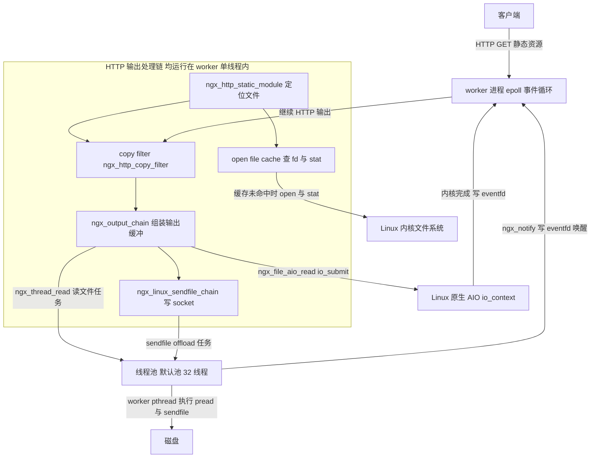
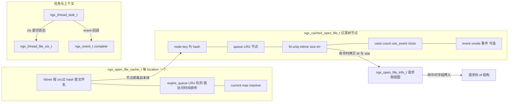
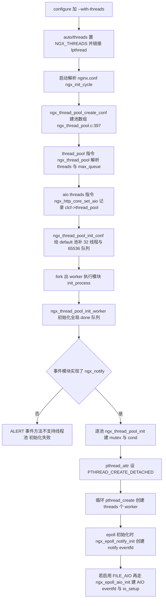
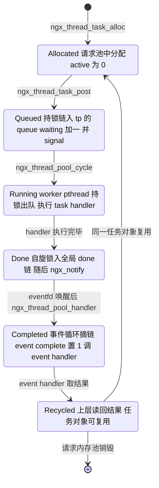
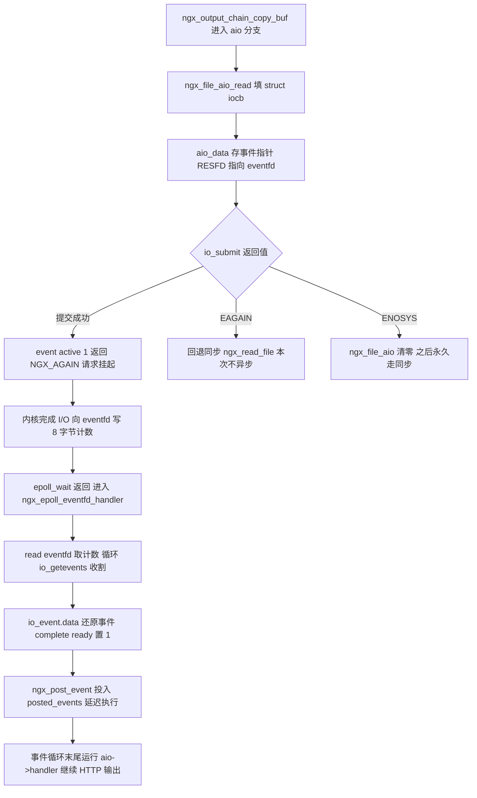
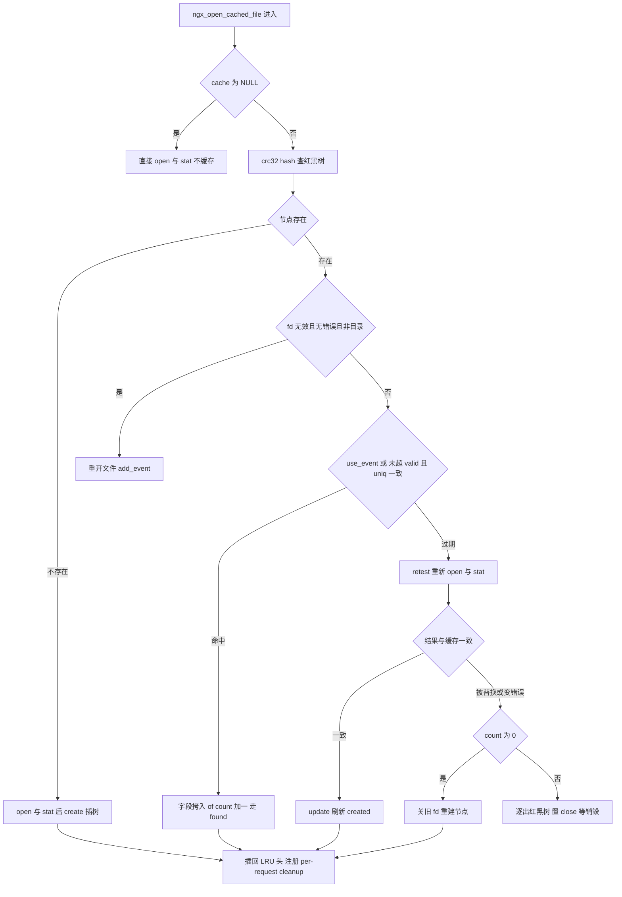

# 线程池与异步文件 I/O（基于 nginx-1.27.0 源码）

> **导读**：读完本文你将掌握——nginx 线程池"任务队列 + worker pthread + 完成回调回投事件循环"三要素的完整实现；`aio threads` 与 `aio on` 两条异步文件读路径在源码中的分叉点；Linux 原生 AIO 的 `io_setup/io_submit/io_getevents` 与 eventfd 完成通知机制；directio 的启用条件、与 sendfile 的互斥代码点以及对齐要求；copy filter 如何把 AIO/线程池挂钩进输出链；open file cache 的 fd/stat 缓存结构、`min_uses/valid/errors/inactive` 清理策略及其在静态文件热路径上的作用；大文件 sendfile 的边界（`NGX_SENDFILE_LIMIT`、`sendfile_max_chunk`、2G 限制）。
>
> **前置阅读建议**：先了解 nginx 事件驱动框架（`ngx_event_t`、`ngx_event_actions`、epoll 事件模块）与 filter 链（body filter 链式挂接）；了解 `ngx_output_chain` 的缓冲组装角色更佳。本文所有结论均落到 1.27.0 源码行号，可对照阅读。
>
> **涉及源码清单**（本文精读文件）：
> - `src/core/ngx_thread_pool.c` / `src/core/ngx_thread_pool.h`（线程池本体）
> - `src/os/unix/ngx_thread.h`、`ngx_thread_mutex.c`、`ngx_thread_cond.c`、`ngx_thread_id.c`（pthread 封装）
> - `src/os/unix/ngx_file_aio_read.c`（FreeBSD 文件 AIO）、`src/os/unix/ngx_linux_aio_read.c`（Linux 原生 AIO）
> - `src/core/ngx_open_file_cache.c` / `.h`（打开文件缓存）
> - 关联文件：`src/event/modules/ngx_epoll_module.c`、`src/core/ngx_output_chain.c`、`src/os/unix/ngx_linux_sendfile_chain.c`、`src/os/unix/ngx_files.c`、`src/http/ngx_http_copy_filter_module.c`、`src/http/ngx_http_core_module.c`、`src/core/ngx_spinlock.c`、`src/core/ngx_file.h`、`src/core/ngx_buf.h`、`src/event/ngx_event.h`

---

## 1. 本模块在 nginx 中的位置与职责

nginx 的 worker 进程是**单线程事件循环**（epoll/kqueue），任何一个阻塞的 `read()/stat()/open()` 都会卡住该进程上成千上万的连接。磁盘 I/O 恰恰是最常见的阻塞源：机械盘随机读一次可达数毫秒。为此 nginx 提供了三条"把磁盘等待从事件循环中摘出去"的路径：

1. **线程池（thread pool）**：`--with-threads` 编译（`auto/threads:16` 定义 `NGX_THREADS`），由 `ngx_thread_pool.c` 实现一组 worker pthread，worker 事件循环只负责"投递任务/收割结果"，磁盘读写、`sendfile` offload 都在线程里完成；
2. **Linux 原生 AIO**：`ngx_linux_aio_read.c` 把 `PREAD` 请求经 `io_submit` 交给内核，内核完成后通过 eventfd 唤醒 epoll；
3. **打开文件缓存（open file cache）**：把 `open()/stat()` 的结果缓存起来，让静态文件热路径在命中时连系统调用都不用做。

线程池与两条 AIO 路径并不是互斥的"备胎"，它们共同嵌在 **输出链（output chain）→ copy filter → sendfile** 这条发送路径上；而 open file cache 位于更上游的"找文件"阶段。整体位置如下：



**图解**：所有方框内的模块都跑在 worker 事件循环线程里；虚线外的两个执行体（线程池 worker pthread、内核 AIO）是仅有的"离场执行者"。无论是线程池还是原生 AIO，完成后都通过同一个 eventfd 把事件回投进 epoll，最终回到 copy filter 继续输出——这就是"异步文件 I/O"在 nginx 中的统一形态：**提交时立刻返回 `NGX_AGAIN`，完成时由事件循环重新驱动**。

## 2. 核心数据结构精讲

### 2.1 任务对象：`ngx_thread_task_t`（src/core/ngx_thread_pool.h:17-23）

| 字段 | 类型 | 含义 |
|---|---|---|
| `next` | `ngx_thread_task_t *` | 侵入式单链表指针：排队时链入 `tp->queue`，完成后链入全局 `ngx_thread_pool_done`，同一字段两用 |
| `id` | `ngx_uint_t` | 进程级自增任务号（`ngx_thread_pool_task_id`，src/core/ngx_thread_pool.c:101），仅用于日志与防重复提交 |
| `ctx` | `void *` | 传给 `handler` 的上下文；`ngx_thread_task_alloc` 把它安排在任务结构体**紧随其后的同一块内存** |
| `handler` | `void (*)(void *data, ngx_log_t *log)` | 在 **worker pthread** 中执行的函数，如 `ngx_thread_read_handler`、`ngx_linux_sendfile_thread_handler` |
| `event` | `ngx_event_t` | 完成事件：`event.active=1` 表示已提交在途；`event.complete=1` 表示结果可读；`event.handler` 是在 worker 事件循环中执行的回调 |

`event` 是整个设计的枢纽：它让"线程中执行的函数"与"事件循环中执行的函数"共用一个调度原语。注意 `ngx_event_t` 里还有一个 `data` 指针，提交方（如 copy filter）会把它改写成 `ngx_http_request_t *`，回调时据此找回请求。

### 2.2 线程池本体：`ngx_thread_pool_s`（src/core/ngx_thread_pool.c:29-43）

| 字段 | 类型 | 含义 |
|---|---|---|
| `mtx` | `ngx_thread_mutex_t` | 保护 `queue/waiting` 的 pthread 互斥量，类型为 `PTHREAD_MUTEX_ERRORCHECK`（见 6.8 节） |
| `queue` | `ngx_thread_pool_queue_t` | 任务队列：`first` 指向队首，`last` 是**指向尾节点 next 指针的指针**，入队 O(1) |
| `waiting` | `ngx_int_t` | 等待处理的任务数（含正在出队的），允许为负，见 6.2 节 |
| `cond` | `ngx_thread_cond_t` | 与 `mtx` 配对的条件变量，投递任务时 signal 一次 |
| `log` | `ngx_log_t *` | 创建时的日志对象，worker 线程复用它打日志（线程不安全场景极少，nginx 接受此取舍） |
| `name/threads/max_queue` | — | 池名、线程数、队列上限，来自 `thread_pool` 指令 |
| `file/line` | — | 指令所在配置文件与行号，报错时定位用 |

队列宏 `ngx_thread_pool_queue_init`（src/core/ngx_thread_pool.c:24-26）把 `first=NULL; last=&first`——`last` 指向"存放最后一个元素 next 的地址"，初始即指向 `first` 本身，这是经典的尾插技巧。除此之外还有三个**进程级静态变量**（src/core/ngx_thread_pool.c:101-103）：任务号计数器 `ngx_thread_pool_task_id`、自旋锁 `ngx_thread_pool_done_lock`、完成队列 `ngx_thread_pool_done`。

### 2.3 线程文件 I/O 上下文：`ngx_thread_file_ctx_t`（src/os/unix/ngx_files.c:80-91）

| 字段 | 含义 |
|---|---|
| `fd/write` | 目标 fd 与读/写方向标志（读写共用一个 handler 入口结构） |
| `buf/size` | 读：用户缓冲与长度 |
| `chain/offset` | 写：pwritev 的 iovec 链与偏移 |
| `nbytes/err` | 结果：字节数或 errno，worker 事件循环在 `event.complete` 后读取 |

### 2.4 AIO 完成上下文：`ngx_event_aio_t`（src/event/ngx_event.h:143-161）

| 字段 | 含义 |
|---|---|
| `data/handler` | 完成时回填给上层（如 copy filter 塞入请求指针与其事件处理函数） |
| `file/fd` | 所属文件 |
| `res` | Linux 专用（`NGX_HAVE_EVENTFD`）：`io_event.res` 原始返回值，`>=0` 为字节数，`<0` 为负 errno |
| `err/nbytes` | 无 eventfd 平台（FreeBSD）用的错误码与字节数 |
| `aiocb` | 平台相关：Linux 是 `struct iocb`，FreeBSD 是 `struct aiocb` |
| `event` | 挂到 kqueue/eventfd 上的事件 |

### 2.5 输出链异步字段：`ngx_output_chain_ctx_t`（src/core/ngx_buf.h:78-110）与 `ngx_file_t`（src/core/ngx_file.h:16-39）

`ngx_output_chain_ctx_t` 的关键字段：`aio:1`（有在途异步操作）、`aio_handler`（`aio on` 时由 copy filter 注入）、`thread_handler/thread_task`（`aio threads` 时注入）、`directio:1/unaligned:1/alignment`（directio 对齐状态）、`bufs`（`output_buffers` 配置）、`sendfile/need_in_memory/need_in_temp`（是否允许零拷贝直发）。`ngx_file_t` 则挂了三个线程池钩子：`thread_handler`（提交回调）、`thread_ctx`（通常是请求指针）、`thread_task`（每个文件复用的任务对象），以及 `aio`（`ngx_event_aio_t *`）与 `directio:1` 标志。

### 2.6 open file cache 三件套

**缓存条目 `ngx_cached_open_file_s`**（src/core/ngx_open_file_cache.h:54-88）：红黑树节点 `node`（key 是文件名 crc32 hash）+ LRU 队列节点 `queue` + 缓存数据（`fd/uniq/mtime/size/err`）+ 引用计数（`uses` 累计使用次数、`count:24` 当前正在使用的请求数）+ 状态位（`close/use_event/is_dir/is_file/is_directio` 等）+ 可选的 vnode 事件 `event`。

**请求侧视图 `ngx_open_file_info_t`**（src/core/ngx_open_file_cache.h:19-51）：调用方填入策略（`valid/min_uses/errors/events/read_ahead/directio`），返回时填入结果（`fd/uniq/mtime/size/fs_size/err/is_*`）。

**缓存容器 `ngx_open_file_cache_t`**（src/core/ngx_open_file_cache.h:91-99）：`rbtree + sentinel` 按文件名 hash 查找，`expire_queue` 按 LRU 排序，`current/max/inactive` 控制容量与保活时长。



**图解**：缓存条目"就是"红黑树节点——`node` 字段内嵌在条目结构体首部，查找后通过类型转换直接得到条目，无需额外指针；同一个条目同时挂在 LRU 队列上管理生命周期。任务对象同样是"结构体尾挂 ctx"的紧凑布局，一次分配、零碎片。

## 3. 初始化流程



**图解**：注意初始化的两个阶段——**配置阶段**（D~G）只做"登记池与参数校验"，此时还没有任何线程；**进程阶段**（H~N）在 fork 出 worker 进程后才真正 `pthread_create`，保证线程都活在正确的进程里。default 池的默认参数补齐发生在 `ngx_thread_pool_init_conf`（src/core/ngx_thread_pool.c:439-440：`threads = 32; max_queue = 65536;`），而不是指令解析时——因为 default 池可能是 `aio threads` 隐式创建的，从未写过 `thread_pool` 指令。

`J` 节点是硬性门槛：`ngx_thread_pool_init` 检查 `ngx_notify == NULL` 直接报错（src/core/ngx_thread_pool.c:114-118）。目前实现了 `actions.notify` 的事件模块只有 epoll（src/event/modules/ngx_epoll_module.c:192）、kqueue（src/event/modules/ngx_kqueue_module.c:89）与 eventport（src/event/modules/ngx_eventport_module.c:186）；select/poll 等没有跨线程唤醒通道，配了线程池也无法工作。

## 4. 核心执行流程/状态机

### 4.1 一个任务的完整生命周期



**图解**：`Allocated→Queued→Running` 都在同一次互斥量加锁窗口内切换，`waiting` 计数贯穿其中（见 6.2/6.3 节的负数语义）。`Done` 与 `Completed` 之间是**跨线程边界**：生产者（worker pthread）与消费者（事件循环）通过自旋锁 + 内存屏障 + eventfd 三件套衔接。`Recycled→Allocated` 的复用很关键：每个 `ngx_file_t` 只有一个 `thread_task`（src/os/unix/ngx_files.c:105-116），第二次提交前会先在 `event.complete` 分支里把结果读走。

### 4.2 Linux 原生 AIO 的提交/收割循环



**图解**：Linux 原生 AIO 是"内核做、事件收"的模式，提交与收割之间没有 nginx 自己的线程；`EAGAIN`（AIO 请求槽满）与 `ENOSYS`（内核不支持）两条回退分支保证了功能降级而非失败。收割后事件先入 `ngx_posted_events` 队列**延迟到本轮事件分发末尾**执行，避免在 eventfd 的处理现场重入请求逻辑。

## 5. 关键时序图：`aio threads` 一次静态文件输出

```mermaid
sequenceDiagram
    participant EV as Worker epoll loop
    participant CF as copy filter
    participant OC as ngx_output_chain
    participant TP as thread pool default
    participant WK as worker pthread
    participant HD as completion dispatcher

    EV->>CF: write 事件驱动 ngx_http_writer
    CF->>OC: ngx_output_chain 传入文件 buf
    OC->>OC: as_is 安装 file 的 thread_handler
    OC->>OC: copy_buf 走 threads 分支
    OC->>TP: ngx_thread_read 复用 thread_task
    TP->>TP: ngx_thread_task_post 加锁入队并 signal
    TP-->>OC: 返回 NGX_AGAIN 请求挂起 blocked 加一
    TP->>WK: pthread_cond_signal 唤醒一个 worker
    WK->>WK: cycle 出队 执行 pread 读盘
    WK->>HD: 自旋锁入 done 链 调 ngx_notify
    HD->>HD: ngx_epoll_notify 向 eventfd 写 1
    EV->>HD: epoll_wait 返回 notify_handler
    HD->>HD: 摘走 done 链 置 event complete 1
    HD->>CF: ngx_http_copy_thread_event_handler
    CF->>CF: blocked 减一 r aio 清零 删定时器
    CF->>EV: write_event_handler 重新驱动
    EV->>OC: 再次进入 copy filter 与 output chain
    OC->>OC: thread_task complete 分支取回 nbytes
    OC->>CF: 缓冲就绪 output_filter 继续发送
```



**图解**：一跳一行地看——`OC→TP` 是"提交"，`TP-->>OC` 的 `NGX_AGAIN` 让事件循环**立即解放**去服务其他连接；`WK→HD` 是跨线程边界，worker pthread 用 `ngx_notify`（Linux 上即写 eventfd，src/event/modules/ngx_epoll_module.c:764-778）把完成事件塞回事件循环；`HD→CF` 之后的路径完全回到单线程世界，与普通事件处理无异。两次进入 `OC` 之间，请求通过 `r->main->blocked` 与 `r->aio` 标志防止被提前终结（src/http/ngx_http_copy_filter_module.c:291-295）。

## 6. 源码逐段精读

本节按"任务对象 → 提交 → 执行 → 收割 → 同步原语 → 原生 AIO → 线程读写 → 输出链 → copy filter → sendfile offload → open file cache"的依赖顺序展开，每段给出签名、逐块逻辑与易错点。

### 6.1 `ngx_thread_task_alloc`：一次分配挂两块内存（src/core/ngx_thread_pool.c:214-227）

```c
ngx_thread_task_t *
ngx_thread_task_alloc(ngx_pool_t *pool, size_t size)
{
    ngx_thread_task_t  *task;

    task = ngx_pcalloc(pool, sizeof(ngx_thread_task_t) + size);
    if (task == NULL) {
        return NULL;
    }

    task->ctx = task + 1;

    return task;
}
```

- **签名**：`ngx_thread_task_t *ngx_thread_task_alloc(ngx_pool_t *pool, size_t size)`，从指定内存池分配 `sizeof(ngx_thread_task_t) + size` 字节，`size` 是调用方 ctx 的尺寸。
- **逐块逻辑**：`task + 1` 指针算术让 `ctx` 恰好落在任务结构体之后（src/core/ngx_thread_pool.c:224），两者同生共死；`ngx_pcalloc` 清零保证 `event.active/complete` 初始为 0。
- **易错点**：任务内存来自**调用方的池**——copy filter 传 `r->pool`（src/os/unix/ngx_files.c:108），sendfile offload 传 `c->pool`（src/os/unix/ngx_linux_sendfile_chain.c:330）。请求结束后任务随池释放，因此**绝不允许任务还在线程里跑时请求就终结**，这正是 copy filter 用 `r->main->blocked` 挂住请求的原因（见 6.20 节）。

### 6.2 `ngx_thread_task_post`：提交任务（src/core/ngx_thread_pool.c:230-274)

```c
ngx_int_t
ngx_thread_task_post(ngx_thread_pool_t *tp, ngx_thread_task_t *task)
{
    if (task->event.active) {
        ngx_log_error(NGX_LOG_ALERT, tp->log, 0,
                      "task #%ui already active", task->id);
        return NGX_ERROR;
    }
    ...
    if (tp->waiting >= tp->max_queue) {
        (void) ngx_thread_mutex_unlock(&tp->mtx, tp->log);
        ngx_log_error(NGX_LOG_ERR, tp->log, 0,
                      "thread pool \"%V\" queue overflow: %i tasks waiting",
                      &tp->name, tp->waiting);
        return NGX_ERROR;
    }

    task->event.active = 1;
    task->id = ngx_thread_pool_task_id++;
    task->next = NULL;

    if (ngx_thread_cond_signal(&tp->cond, tp->log) != NGX_OK) {
        (void) ngx_thread_mutex_unlock(&tp->mtx, tp->log);
        return NGX_ERROR;
    }

    *tp->queue.last = task;
    tp->queue.last = &task->next;

    tp->waiting++;

    (void) ngx_thread_mutex_unlock(&tp->mtx, tp->log);
```

- **逐块逻辑**：
  1. **防重复提交**：`event.active` 在途即拒绝（src/core/ngx_thread_pool.c:233-237）。上层靠它判断"该任务还有结果没收"。
  2. **加锁**：所有队列操作都在 `tp->mtx` 内（239）。
  3. **限流**：`waiting >= max_queue` 时直接报错拒单（243-250），注意不是阻塞等待——调用方（事件循环）不能睡，所以语义是"队列满即失败"。
  4. **标记 + 编号**：`active=1`、分配进程级自增 `id`（252-254）。
  5. **先 signal 后入队**（257-263）：两者都在锁内，唤醒一个 worker，再把任务尾插进队列（`*last = task; last = &task->next`），最后 `waiting++`。
- **为什么"先 signal 后入队"是安全的**：pthread 语义下，被唤醒的 worker 必须**重新取得互斥量**才能检查队列；而此刻提交者还持着锁，所以 worker 醒来时必然能看到已入队的任务——不存在经典"唤醒丢失"问题。关键在于 **signal 必须与入队在同一个临界区**：若先解锁再 signal，就可能出现"worker 检查完队列为空、正要 cond_wait，而 signal 在其真正睡眠前掠过"的丢失窗口。这个顺序还让 worker 的唤醒延迟最小（signal 在临界区内完成，无需额外系统调用延迟）。
- **易错点**：`max_queue` 检查针对的是 `waiting` 而非队列长度——`waiting` 由 worker 在**出队前**递减（见 6.3 节 src/core/ngx_thread_pool.c:312 的注释 "the number may become negative"），因此它统计的是"已提交但尚未被 worker 认领"的任务数，可能短暂为负；`max_queue=0` 意味着**任何提交都会溢出**（0>=0 成立），配置时须注意。

### 6.3 `ngx_thread_pool_cycle`：worker pthread 主循环（src/core/ngx_thread_pool.c:277-361）

```c
static void *
ngx_thread_pool_cycle(void *data)
{
    ngx_thread_pool_t *tp = data;
    ...
    sigfillset(&set);

    sigdelset(&set, SIGILL);
    sigdelset(&set, SIGFPE);
    sigdelset(&set, SIGSEGV);
    sigdelset(&set, SIGBUS);

    err = pthread_sigmask(SIG_BLOCK, &set, NULL);
    ...
    for ( ;; ) {
        if (ngx_thread_mutex_lock(&tp->mtx, tp->log) != NGX_OK) {
            return NULL;
        }

        /* the number may become negative */
        tp->waiting--;

        while (tp->queue.first == NULL) {
            if (ngx_thread_cond_wait(&tp->cond, &tp->mtx, tp->log)
                != NGX_OK)
            {
                (void) ngx_thread_mutex_unlock(&tp->mtx, tp->log);
                return NULL;
            }
        }

        task = tp->queue.first;
        tp->queue.first = task->next;

        if (tp->queue.first == NULL) {
            tp->queue.last = &tp->queue.first;
        }
        ...
        task->handler(task->ctx, tp->log);
        ...
        task->next = NULL;

        ngx_spinlock(&ngx_thread_pool_done_lock, 1, 2048);

        *ngx_thread_pool_done.last = task;
        ngx_thread_pool_done.last = &task->next;

        ngx_memory_barrier();

        ngx_unlock(&ngx_thread_pool_done_lock);

        (void) ngx_notify(ngx_thread_pool_handler);
    }
}
```

- **逐块逻辑**：
  1. **屏蔽信号**（293-304）：线程继承进程信号掩码前先把几乎所有信号挡住，只留 `SIGILL/SIGFPE/SIGSEGV/SIGBUS` 四个硬件异常信号——异常要落到出错线程上才能产生 core 与准确现场；同步信号一律由主线程处理。
  2. **取任务**（306-332）：加锁 → `waiting--`（先把名额让出来再睡觉，允许负数，见 6.2 节）→ `while (queue.first == NULL) cond_wait` 用 while 而非 if 防御虚假唤醒 → 头摘任务，队列空了把 `last` 归位到 `&queue.first` → 解锁。
  3. **执行**（342）：`task->handler(task->ctx, tp->log)`，例如 `pread` 或线程版 `sendfile`。此时**不持有任何锁**，磁盘 I/O 再慢也不影响其他 worker 或事件循环。
  4. **移交完成队列**（348-359）：把任务链入**进程级全局** `ngx_thread_pool_done`（所有池共用一条完成链）；自旋锁 `ngx_spinlock(&ngx_thread_pool_done_lock, 1, 2048)` 保护，入链后 `ngx_memory_barrier()` 保证链表写对事件循环可见，再 `ngx_notify(ngx_thread_pool_handler)` 跨线程唤醒。
- **易错点**：
  - 完成链是**全局单链**而非每池一条：多个池的完成事件串在一起，由 `ngx_thread_pool_handler` 一次摘完，减少 eventfd 通知次数与锁竞争次数。
  - `ngx_notify` 返回值被显式丢弃 `(void)`——即便唤醒失败，任务也已入 done 链，事件循环稍后仍会在下一轮 epoll 事件中收割（Linux 下 eventfd 计数只增不减，下次任意通知都会带上旧计数，见 6.11 节）。但极端情况下（此后再无任何 notify）可能延迟处理，这是接受的取舍。
  - worker 是 **detached** 线程（src/core/ngx_thread_pool.c:140），退出全靠"投毒"任务（见 6.6 节），不能 pthread_join。

### 6.4 `ngx_thread_pool_handler`：事件循环侧收割（src/core/ngx_thread_pool.c:364-394）

```c
static void
ngx_thread_pool_handler(ngx_event_t *ev)
{
    ...
    ngx_spinlock(&ngx_thread_pool_done_lock, 1, 2048);

    task = ngx_thread_pool_done.first;
    ngx_thread_pool_done.first = NULL;
    ngx_thread_pool_done.last = &ngx_thread_pool_done.first;

    ngx_memory_barrier();

    ngx_unlock(&ngx_thread_pool_done_lock);

    while (task) {
        ...
        event = &task->event;
        task = task->next;

        event->complete = 1;
        event->active = 0;

        event->handler(event);
    }
}
```

- **逐块逻辑**：它在 worker 事件循环线程中运行（由 eventfd 唤醒，见 6.11 节）。加自旋锁 → **整链摘走**（`first=NULL`、`last=&first`，O(1)）→ 解锁 → 遍历：先取 `next` 再回调（回调中可能复用/重置任务），置 `complete=1; active=0`，最后调 `event->handler`。
- **设计点**：摘链与分派分离——持锁时间只有几条指针操作，回调（可能触发整个 HTTP 输出状态机）在锁外执行；`complete=1` 先于回调，保证回调里上层能立刻读到结果。
- **易错点**：回调可能**重新投递任务**（例如继续读下一块），复用同一个任务对象时 `event.active` 已清 0，`ngx_thread_task_post` 才不会误报 "already active"。若回调重入自身导致 done 链又添了任务，不会在本轮被处理（链已被摘走），留待下一次 notify——不会丢，只会晚一轮。

### 6.5 线程池的创建、配置校验与进程级初始化

**`ngx_thread_pool_create_conf / init_conf`**（src/core/ngx_thread_pool.c:397-452）：配置阶段建立 `ngx_array_t pools`（预分配 4 个指针槽）；`init_conf` 遍历所有池，`threads` 为 0 且名字是 "default" 的补默认值——`threads=32`、`max_queue=65536`（439-440）；非 default 却没配 `threads` 的报 `unknown thread pool` 错（444-448）。**这组默认值是源码硬编码**，不是文档口号。

**`thread_pool` 指令解析 `ngx_thread_pool`**（src/core/ngx_thread_pool.c:455-515）：`NGX_MAIN_CONF|NGX_DIRECT_CONF|NGX_CONF_TAKE23`（65-66），即 `thread_pool name threads=N [max_queue=M]`。解析要点：显式声明重复报错（470-474）；`max_queue` 无参数时仍默认 65536（476）；`threads=` 缺失或为 0 报错（507-512）——**显式声明池必须给出 threads**，默认值只属于隐式 default 池。

**`ngx_thread_pool_add / get`**（518-579）：`add` 先查重（`name == NULL` 时用 "default"，524-526），不存在则 `ngx_pcalloc` 新池并记下配置文件位置（539-541），压入数组；`get` 按 name 线性查找。`aio threads=fast` 这样的指令就靠它把名字解析成池指针（见 6.19 节）。

**`ngx_thread_pool_init_worker`**（582-613）：只有 `NGX_PROCESS_WORKER` 与 `NGX_PROCESS_SINGLE` 进程执行（589-593），master/cache manager 不建线程；先初始化全局 done 队列（602），再逐池调用 `ngx_thread_pool_init`。

**`ngx_thread_pool_init`**（106-168）核心动作：检查 `ngx_notify` 可用（114-118）；初始化队列/mutex/cond（120-129）；`pthread_attr_setdetachstate(PTHREAD_CREATE_DETACHED)`（140）后循环 `pthread_create(&tid, &attr, ngx_thread_pool_cycle, tp)` 创建 `tp->threads` 个 worker（156-163），入口参数就是池指针——**每个 worker 都知道自己属于哪个池**，锁与条件变量都取自它。

### 6.6 `ngx_thread_pool_destroy` 与 exit_handler：给线程"投毒"（src/core/ngx_thread_pool.c:171-211）

```c
static void
ngx_thread_pool_destroy(ngx_thread_pool_t *tp)
{
    ...
    task.handler = ngx_thread_pool_exit_handler;
    task.ctx = (void *) &lock;

    for (n = 0; n < tp->threads; n++) {
        lock = 1;

        if (ngx_thread_task_post(tp, &task) != NGX_OK) {
            return;
        }

        while (lock) {
            ngx_sched_yield();
        }

        task.event.active = 0;
    }

    (void) ngx_thread_cond_destroy(&tp->cond, tp->log);
    (void) ngx_thread_mutex_destroy(&tp->mtx, tp->log);
}
```

worker 进程退出（`exit_process`，模块表 src/core/ngx_thread_pool.c:93）时，对每个线程投递一个**栈上的**特殊任务：handler 是 `ngx_thread_pool_exit_handler`（203-211），它把 `*lock` 清 0 然后 `pthread_exit(0)`。提交者自旋等待 `lock` 变 0（190-192），确认该线程真的退出了才投下一个——因为任务对象是复用的栈变量，且必须保证所有线程都消化完毒药后才能销毁 `cond/mutex`。`task.event.active = 0`（194）是绕开 post 的防重复检查：栈上任务的 `event` 每轮被 worker 置 `complete=1/active=0` 前，完成回调 `ngx_thread_pool_handler` 只会清 `active`，而毒任务的 event.handler 是垃圾值，绝不能真的触发，所以这里手动清位。这是一段**充分利用内部约定的关闭序列**，改动任何一步都可能挂死退出流程。

### 6.7 pthread 封装：mutex/cond/tid

**`ngx_thread_mutex_create`**（src/os/unix/ngx_thread_mutex.c:77-112）：显式 `pthread_mutexattr_settype(PTHREAD_MUTEX_ERRORCHECK)`（90）。文件头的大段注释（11-74）解释了选型：`NORMAL` 最快但重复加锁未定义；`ERRORCHECK` 性能几乎相同却带轻量死锁检测——对调试友好的折中。`lock/unlock/wait/signal` 都是薄封装（131-165、src/os/unix/ngx_thread_cond.c:42-76），失败打日志返回 `NGX_ERROR`。

**`ngx_thread_cond_wait`**（src/os/unix/ngx_thread_cond.c:57-76）：直接 `pthread_cond_wait`，注意它把 `#if 0` 的 `ngx_time_update()` 留在源码里——nginx 曾想让工作线程顺带刷新缓存时钟，最终放弃（worker 线程碰 `ngx_cached_err_log_time` 这类全局缓存会引入另一层同步）。

**线程 id**：`ngx_thread_tid` 在 Linux 上是 `syscall(SYS_gettid)`（src/os/unix/ngx_thread_id.c:20-24），`ngx_log_tid` 让日志能区分线程（src/os/unix/ngx_thread.h:59-61）。

### 6.8 `ngx_spinlock` 与 done 链表的跨线程一致性（src/core/ngx_spinlock.c:12-53）

```c
for ( ;; ) {
    if (*lock == 0 && ngx_atomic_cmp_set(lock, 0, value)) {
        return;
    }

    if (ngx_ncpu > 1) {
        for (n = 1; n < spin; n <<= 1) {
            for (i = 0; i < n; i++) {
                ngx_cpu_pause();
            }
            if (*lock == 0 && ngx_atomic_cmp_set(lock, 0, value)) {
                return;
            }
        }
    }

    ngx_sched_yield();
}
```

指数退避的自旋锁：先 `ngx_cpu_pause()` 自旋 1、2、4…2048 次（`spin=2048` 即调用方传值），仍抢不到就 `sched_yield` 让出 CPU。临界区（摘/挂一条链）只有几条指令，自旋远比 futex 睡眠划算。`ngx_memory_barrier()`（src/core/ngx_thread_pool.c:355、378）在解锁后补一道路障，确保链表指针的写入顺序对另一个 CPU 核可见——x86 上 store 序本就保守，这里主要照顾弱序架构。注意 `ngx_thread_pool_done_lock` 是 `ngx_atomic_t`（103），在无原子操作编译环境下 `ngx_spinlock` 直接 `#error`（src/core/ngx_spinlock.c:45-49），线程池功能隐含依赖原子指令。

### 6.9 Linux 原生 AIO：`ngx_linux_aio_read.c` 全函数精读

**`io_submit` 包装**（src/os/unix/ngx_linux_aio_read.c:20-24）：glibc 不提供 `aio_context_t` 版 `io_submit` 声明，nginx 直接 `syscall(SYS_io_submit, ctx, n, paiocb)`；`io_getevents` 同理包装在 epoll 模块（src/event/modules/ngx_epoll_module.c:240-245）。

**`ngx_file_aio_init`**（27-46）：为每个 `ngx_file_t` 首次异步读时分配 `ngx_event_aio_t`，`event.ready = 1` 表示"当前没有在途 AIO"，并挂到 `file->aio`。

**`ngx_file_aio_read`**（49-134），这是 `aio on` 的入口：

```c
    if (!ngx_file_aio) {
        return ngx_read_file(file, buf, size, offset);
    }
    ...
    if (ev->complete) {
        ev->active = 0;
        ev->complete = 0;

        if (aio->res >= 0) {
            ngx_set_errno(0);
            return aio->res;
        }

        ngx_set_errno(-aio->res);
        ngx_log_error(NGX_LOG_CRIT, file->log, ngx_errno,
                      "aio read \"%s\" failed", file->name.data);
        return NGX_ERROR;
    }
```

- **状态机入口三分支**：全局开关 `ngx_file_aio` 为 0 走同步（58-60）；`ev->complete` 表示上次提交的结果已就绪——**第二次调用进来是"收结果"**，不是再读（79-94）：`res>=0` 返回字节数，`res<0` 取负得 errno 报错。
- **构造 iocb**（96-105）：`aio_data = ev` 让内核把事件指针原样带回；`aio_lio_opcode = IOCB_CMD_PREAD`；`aio_flags = IOCB_FLAG_RESFD; aio_resfd = ngx_eventfd` ——**resfd 机制**：内核完成时向这个 eventfd 写完成计数，nginx 才能把 AIO 完成混进 epoll。
- **提交**（111-117）：成功返回 `NGX_AGAIN`，`active=1; ready=0; complete=0`。
- **回退分支**（119-133）：`EAGAIN`（AIO 上下文请求槽满，默认 32 个，见 `worker_aio_requests` src/event/modules/ngx_epoll_module.c:168-172 与 1048 行默认值）→ 本次同步读；`ENOSYS` → `ngx_file_aio = 0` 永久禁用再同步读。**从不向上层报"平台不支持"的错**，一切降级为功能等价的同步路径。

**`ngx_file_aio_event_handler`**（137-148）：事件循环收割后调 `aio->handler(ev)`——注意它不做 aio_error/aio_return（那是 FreeBSD 版的事），结果已由 eventfd handler 从 `io_event.res` 填进 `aio->res`。

### 6.10 eventfd 的两端：AIO 完成通知与跨线程 notify

**AIO 侧初始化** `ngx_epoll_aio_init`（src/event/modules/ngx_epoll_module.c:248-317）：`eventfd(0,0)` 创建计数 fd → `ioctl(FIONBIO)` 置非阻塞 → **`io_setup(epcf->aio_requests, &ngx_aio_ctx)`** 建立 AIO 上下文（278-282）→ 把 eventfd 以 `EPOLLIN|EPOLLET` 注册进 epoll（292-295）。任何一步失败都会 `ngx_file_aio = 0`（316），原生 AIO 静默禁用。

**收割** `ngx_epoll_eventfd_handler`（941-1005）：

```c
    n = read(ngx_eventfd, &ready, 8);
    ...
    while (ready) {
        events = io_getevents(ngx_aio_ctx, 1, 64, event, &ts);
        ...
        for (i = 0; i < events; i++) {
            ...
            e = (ngx_event_t *) (uintptr_t) event[i].data;

            e->complete = 1;
            e->active = 0;
            e->ready = 1;

            aio = e->data;
            aio->res = event[i].res;

            ngx_post_event(e, &ngx_posted_events);
        }
    }
```

先 `read` 出累计完成数 `ready`，再按每轮最多 64 个 `io_getevents` 收割（981），`event[i].data` 正是提交时塞的 `ngx_event_t *`；置位后 `ngx_post_event` 投入延迟队列，**不在 epoll 分发现场直接跑 HTTP 状态机**。若收割数不足 `ready`（内核计数与实际事件偶尔不同步的防御），循环退出后剩余计数由下一轮事件处理。

**跨线程 notify 侧** `ngx_epoll_notify_init/notify/notify_handler`（385-457、764-778）：`ngx_epoll_notify(handler)` 把 handler 存进 `notify_event.data` 后向 notify_fd 写 8 字节；事件循环读到后 `ngx_epoll_notify_handler` 取出 handler 调用（455-456）。一个精妙细节（439-453）：EPOLLET 边沿触发下，多次 write 只产生**一次** epoll 唤醒，eventfd 计数会不断累积；nginx 用 `ev->index` 自增计数器，**每 2^32-1 次唤醒才 read 一次清零**，平时只调 handler——既防止计数溢出，又省下绝大多数 read 系统调用。

### 6.11 FreeBSD 文件 AIO 对照：`ngx_file_aio_read.c`

同为 `ngx_file_aio_read` 符号，FreeBSD 版（src/os/unix/ngx_file_aio_read.c:61-145）走 POSIX aio 接口：`aiocb` 指定 `sigev_notify = SIGEV_KEVENT` 并把完成事件直接投递到 nginx 的 kqueue（110-114）；提交后立刻调 `ngx_file_aio_result`（148-200）——FreeBSD 特性：**数据已在 VM cache 时 aio_error 立即返回 0，可直接拿到结果**（文件头注释 13-28），此时根本不用等事件；否则返回 `NGX_AGAIN` 等 kqueue 事件。`NGX_EINPROGRESS` 分支里有个防御（168-177）：事件已 ready 却仍在进行中，说明 kqueue 多次触发，重置 ready 并告警。完成 handler（203-216）先 `ngx_file_aio_result` 拿结果，非 AGAIN 才把控制权交给 `aio->handler`。与 Linux 版对比：**FreeBSD 把"完成"挂在 kqueue filter 上，Linux 挂在 eventfd 上，但 `ngx_file_aio_read` 对上层暴露的状态机（active/ready/complete 三态 + AGAIN/ERROR 语义）完全一致**——这就是抽象层价值。

### 6.12 `ngx_thread_read` / `ngx_thread_write_chain_to_file`：线程池文件读写任务（src/os/unix/ngx_files.c:94-189、478-584）

```c
ssize_t
ngx_thread_read(ngx_file_t *file, u_char *buf, size_t size, off_t offset,
    ngx_pool_t *pool)
{
    ...
    task = file->thread_task;

    if (task == NULL) {
        task = ngx_thread_task_alloc(pool, sizeof(ngx_thread_file_ctx_t));
        if (task == NULL) {
            return NGX_ERROR;
        }
        task->event.log = file->log;
        file->thread_task = task;
    }

    ctx = task->ctx;

    if (task->event.complete) {
        task->event.complete = 0;
        ...
        if (ctx->err) {
            ngx_log_error(NGX_LOG_CRIT, file->log, ctx->err,
                          "pread() \"%s\" failed", file->name.data);
            return NGX_ERROR;
        }
        return ctx->nbytes;
    }

    task->handler = ngx_thread_read_handler;
    ctx->write = 0;
    ctx->fd = file->fd;
    ctx->buf = buf;
    ctx->size = size;
    ctx->offset = offset;

    if (file->thread_handler(task, file) != NGX_OK) {
        return NGX_ERROR;
    }

    return NGX_AGAIN;
}
```

- **同一个函数两个角色**：第一次调用→填 ctx、设 `handler = ngx_thread_read_handler`、经 `file->thread_handler` 提交、返回 `NGX_AGAIN`；完成后的第二次调用→`event.complete` 分支读 `ctx->nbytes/err` 返回真实字节数。状态全存在 `file->thread_task`（每文件一个，105-116），上层无需自建状态。
- **worker 侧 handler**（157-183）：一次 `pread(ctx->fd, ctx->buf, ctx->size, ctx->offset)`（166），成功记 `nbytes`，失败记 `err`——**worker 里绝不做日志级别的重试或缓存刷新**，只记结果。
- **写路径**（478-537）结构对称：完成分支校验 `ctx->write` 方向（508-512，读写误用时 ALERT）、更新 `file->offset`（520）；worker handler 用 `pwritev`（569）写 iovec 链并循环处理 `EINTR`。调用方是 `ngx_write_chain_to_file` 的线程分支（src/core/ngx_file.c:130），供 `aio_write` 场景（如 proxy 缓存写盘）使用。
- **易错点**：`task->event.log = file->log`（113）很重要——事件循环收割时以 event 的 log 打日志，若不设会丢请求上下文。

### 6.13 `ngx_output_chain` 主循环：异步挂起如何贯穿（src/core/ngx_output_chain.c:41-246)

- **快速通道**（48-72）：`ctx->in/busy` 全空且无在途 AIO（`!ctx->aio`）时，单 buf 且"原样可发"就直接 `output_filter`，不进复杂循环。
- **异步返回点**（88-92）：`if (ctx->aio) return NGX_AGAIN;` ——循环每轮开头检查，一旦上一轮 `copy_buf` 提交了异步读，立刻带 `NGX_AGAIN` 退出整条 filter 链，请求挂起。
- **主循环**（94-225）：逐 buf 判 `as_is`；不能直发的文件 buf 走"取缓冲→拷贝"两步。`copy_buf` 返回 `NGX_AGAIN` 且已有未发数据时 `break` 先发已组好的部分（198-204），否则直接把 AGAIN 上抛。
- **输出与回收**（236-244）：`output_filter` 真正发送，`ngx_chain_update_chains` 把发完的 buf 挪进 `ctx->free` 供复用。

### 6.14 `ngx_output_chain_as_is`：直发/需拷贝的裁决与钩子安装（249-306）

```c
#if (NGX_THREADS)
    if (buf->in_file) {
        buf->file->thread_handler = ctx->thread_handler;
        buf->file->thread_ctx = ctx->filter_ctx;
    }
#endif

    sendfile = ctx->sendfile;

#if (NGX_SENDFILE_LIMIT)
    if (buf->in_file && buf->file_pos >= NGX_SENDFILE_LIMIT) {
        sendfile = 0;
    }
#endif

#if !(NGX_HAVE_SENDFILE_NODISKIO)
    if (buf->in_file && buf->file->directio) {
        sendfile = 0;
    }
#endif
```

- **钩子安装点**（258-263）：`aio threads` 模式下，**每个经过的文件 buf 的 `ngx_file_t` 都被装上 thread_handler**——这一步是 sendfile offload 的前提（sendfile 发送时见 `file->file->thread_handler` 非空就走线程，见 6.17 节），也是读文件走 `ngx_thread_read` 的前提（copy filter 把 `ctx->thread_handler` 设为 `ngx_http_copy_thread_handler`）。
- **三道 sendfile 关闸**：超过 `NGX_SENDFILE_LIMIT` 的文件区间禁用（267-273）；directio 打开且平台没有 `SF_NODISKIO` 时禁用（275-286）——directio 的页不在 page cache，sendfile 会阻塞或性能极差；`NGX_HAVE_SENDFILE_NODISKIO` 目前仅 FreeBSD 定义（auto/os/freebsd:50），所以 **Linux 上 directio 与 sendfile 事实上互斥**。
- **拷贝条件**（288-303）：禁了 sendfile 的文件 buf 必须有内存副本（`buf->in_file = 0` 强转内存 buf），下游 filter 还可能要求 `need_in_memory`（如需改写响应体）或 `need_in_temp`。

### 6.15 `ngx_output_chain_add_copy`：`NGX_SENDFILE_LIMIT` 的 buf 拆分（309-375）

Linux 上 `NGX_SENDFILE_LIMIT` 定义为 `0x80000000`（src/os/unix/ngx_linux_config.h:78，即 2G）——内核 `sendfile()` 对单次 count 的上限（src/os/unix/ngx_linux_sendfile_chain.c:38-44 的注释详述了 2.6.16 前后的行为差异）。当文件 buf 的区间**跨越** 2G 边界时（335-337），add_copy 在边界处把它拆成两个 buf：前段留在 sendfile 路径，后段 `file_pos` 已 `>= LIMIT` 走读内存路径（346-356），避免一次 sendfile 塞进越界长度。注意此宏在 `#if 0` 的注释里还有一个 4096 的实验值（src/core/ngx_output_chain.c:13-15），说明作者曾用它测量"超过多少字节后 sendfile 不划算"。

### 6.16 directio 对齐：`align_file_buf` 与 `get_buf`（378-501）

文件头注释（17-25）是理解此段的关键：Linux 的 `O_DIRECT` 要求**偏移、长度、用户缓冲地址**都对齐到文件系统逻辑块（通常 512B，XFS 可能 4096B），否则 `read()` 直接 `EINVAL`。

- **`ngx_output_chain_align_file_buf`**（378-425）：仅当 `in->file->directio` 才介入（386-388），置 `ctx->directio = 1`。计算 `file_pos` 距上一个对齐边界的差（392），不为 0 就分配一块"补齐头"临时 buf，把非对齐的头部先读进内存；并置 `ctx->unaligned = 1`（420-422，`NGX_HAVE_ALIGNED_DIRECTIO` 平台）。刻意**不设 buf tag**（415-418 注释），让这块补齐 buf 不进 `free` 复用链——它的生命周期只对齐这一次操作。
- **`ngx_output_chain_get_buf`**（428-501）：directio 模式下用 `ngx_pmemalign(pool, size, ctx->alignment)` 分配**地址对齐**的缓冲（478），这样对齐区间内的读取可以 O_DIRECT 直读该缓冲；非 directio 场景普通 `ngx_palloc`。对链尾小尾巴还有优化：小于 buf 尺寸的末块按实际大小分配且不回收复用（439-463）。

### 6.17 `ngx_output_chain_copy_buf`：读文件的三岔口（504-655）

```c
#if (NGX_HAVE_ALIGNED_DIRECTIO)
    if (ctx->unaligned) {
        if (ngx_directio_off(src->file->fd) == NGX_FILE_ERROR) { ... }
    }
#endif

#if (NGX_HAVE_FILE_AIO)
    if (ctx->aio_handler) {
        n = ngx_file_aio_read(src->file, dst->pos, (size_t) size,
                              src->file_pos, ctx->pool);
        if (n == NGX_AGAIN) {
            ctx->aio_handler(ctx, src->file);
            return NGX_AGAIN;
        }
    } else
#endif
#if (NGX_THREADS)
    if (ctx->thread_handler) {
        src->file->thread_task = ctx->thread_task;
        src->file->thread_handler = ctx->thread_handler;
        src->file->thread_ctx = ctx->filter_ctx;

        n = ngx_thread_read(src->file, dst->pos, (size_t) size,
                            src->file_pos, ctx->pool);
        if (n == NGX_AGAIN) {
            ctx->thread_task = src->file->thread_task;
            return NGX_AGAIN;
        }
    } else
#endif
    {
        n = ngx_read_file(src->file, dst->pos, (size_t) size, src->file_pos);
    }

#if (NGX_HAVE_ALIGNED_DIRECTIO)
    if (ctx->unaligned) {
        ...
        if (ngx_directio_on(src->file->fd) == NGX_FILE_ERROR) { ... }
        ngx_set_errno(err);
        ctx->unaligned = 0;
    }
#endif
```

- **directio 补齐读的两段式开关**：非对齐头部读之前 `ngx_directio_off`（561-566，Linux 上即 `fcntl F_SETFL` 去掉 `O_DIRECT`，src/os/unix/ngx_files.c:850-862），读完立刻 `ngx_directio_on` 恢复（604-618），期间用局部 `err` 保存并恢复 errno。**先关再读再开**意味着这三次 fcntl 都在事件循环线程内——非对齐头部很短（最多 alignment-1 字节），代价可接受。
- **三岔口优先级**：`aio_handler`（`aio on`）> `thread_handler`（`aio threads`）> 同步 `ngx_read_file`。AIO 分支 AGAIN 时回调 `ctx->aio_handler`（即 `ngx_http_copy_aio_handler`）挂请求；threads 分支 AGAIN 时把 `file->thread_task` 存回 `ctx->thread_task`（591，任务对象在 ctx 与 file 之间往返）。
- **拷贝语义**：读满后若允许 sendfile，dst buf 保留 `in_file=1` 指向同一文件区间（635-643）——**"拷贝"的只是 buf 描述符的归属**，数据仍可零拷贝直发；禁 sendfile 时 `dst->in_file = 0`，dst 变纯内存 buf。

### 6.18 copy filter 主体：AIO/线程池的 HTTP 层挂接（src/http/ngx_http_copy_filter_module.c:82-158）

```c
#if (NGX_HAVE_FILE_AIO)
        if (ngx_file_aio && clcf->aio == NGX_HTTP_AIO_ON) {
            ctx->aio_handler = ngx_http_copy_aio_handler;
        }
#endif

#if (NGX_THREADS)
        if (clcf->aio == NGX_HTTP_AIO_THREADS) {
            ctx->thread_handler = ngx_http_copy_thread_handler;
        }
#endif
```

ctx 只在首次进入时构建（98-104）：`sendfile` 取自连接（109），`need_in_memory` 来自子请求/过滤器的标记（110-111），`alignment` 来自 `directio_alignment`（114）。两个 `#if` 分支是**两条异步路径的分叉点**：`aio on` 挂 `aio_handler`，`aio threads` 挂 `thread_handler`（枚举定义 src/http/ngx_http_core_module.h:34-36）。之后 `ctx->aio = r->aio`（141-143）同步请求级在途标志，`ngx_output_chain` 返回后按 `ctx->in` 是否清空设置 `NGX_HTTP_COPY_BUFFERED`（147-152），供上游判断"响应是否已全部交给输出链"。copy filter 通过 postconfiguration 挂在 body filter 链头（389-396），`output_buffers` 指令默认 **2 个 × 32KB**（377-386 的 merge `ngx_conf_merge_bufs_value(conf->bufs, prev->bufs, 2, 32768)`）。

### 6.19 `ngx_http_copy_aio_handler` / event_handler：`aio on` 的挂起与恢复（163-225）

提交回调（163-178）：把 `file->aio->data` 指回请求、handler 指向 `ngx_http_copy_aio_event_handler`，`ngx_add_timer(&file->aio->event, 60000)` 上 60 秒看门狗，然后 `r->main->blocked++; r->aio = 1; ctx->aio = 1`。**blocked 计数防止请求在 AIO 在途时被 finalize**（finalize 会释放请求内存池，而任务内存来自该池）。恢复回调（181-223）：60 秒超时只打 ALERT "aio operation took too long" 并返回（197-202）——**看门狗不撤销挂起**，等真实完成到来再走正常路径；正常完成则删定时器、`blocked--; r->aio = 0`，请求已终结时直接触发连接写事件收尾（211-217），否则 `r->write_event_handler(r)` 继续输出并 `ngx_http_run_posted_requests`。

### 6.20 `ngx_http_copy_thread_handler` / event_handler：`aio threads` 的挂起与恢复（228-358）

```c
static ngx_int_t
ngx_http_copy_thread_handler(ngx_thread_task_t *task, ngx_file_t *file)
{
    ...
    r = file->thread_ctx;

    if (r->aio) {
        c = r->connection;
#if (NGX_HTTP_V2)
        if (r->stream) {
            c = r->stream->connection->connection;
        }
#endif
        if (task == c->sendfile_task) {
            return NGX_OK;
        }
    }

    clcf = ngx_http_get_module_loc_conf(r, ngx_http_core_module);
    tp = clcf->thread_pool;

    if (tp == NULL) {
        if (ngx_http_complex_value(r, clcf->thread_pool_value, &name) != NGX_OK) {
            return NGX_ERROR;
        }
        tp = ngx_thread_pool_get((ngx_cycle_t *) ngx_cycle, &name);
        ...
    }

    task->event.data = r;
    task->event.handler = ngx_http_copy_thread_event_handler;

    if (ngx_thread_task_post(tp, task) != NGX_OK) {
        return NGX_ERROR;
    }

    ngx_add_timer(&task->event, 60000);

    r->main->blocked++;
    r->aio = 1;

    ctx = ngx_http_get_module_ctx(r, ngx_http_copy_filter_module);
    ctx->aio = 1;

    return NGX_OK;
}
```

- **池解析**（263-280）：`aio threads=fast` 在配置期已把池指针存进 `clcf->thread_pool`（src/http/ngx_http_core_module.c:4788）；若名字含变量（`aio threads=$tp_name`），配置期只编译了 complex value（4766-4776），运行期在此 `ngx_http_complex_value` 求值再 `ngx_thread_pool_get`——**按请求动态选池**的能力来源于此。
- **并发容忍**（242-261）：请求已有在途异步操作且本次正是连接的 `sendfile_task`（HTTP/2 下多个子请求共享主连接写事件，可能重复触发 sendfile 提交）时直接 `NGX_OK`，不重复投递。
- **提交与挂起**（282-296）：与 AIO 版对称的 `blocked++/r->aio=1/ctx->aio=1`，60 秒定时器挂在 `task->event` 上。
- **恢复回调** `ngx_http_copy_thread_event_handler`（301-356）：删定时器、`blocked--; r->aio = 0`；HTTP/2 特殊处理（329-341）：置 `c->write->ready=1; active=0` 强制下一轮处理主连接，确保 sendfile 线程结果被主连接消费；请求已 done/terminated 时直接 `c->write->handler(c->write)` 触发连接收尾（343-350），否则走 `write_event_handler`。

### 6.21 sendfile offload：`ngx_linux_sendfile_thread`（src/os/unix/ngx_linux_sendfile_chain.c:231-434）

```c
static ssize_t
ngx_linux_sendfile(ngx_connection_t *c, ngx_buf_t *file, size_t size)
{
    ...
#if (NGX_THREADS)
    if (file->file->thread_handler) {
        return ngx_linux_sendfile_thread(c, file, size);
    }
#endif
    ...
    n = sendfile(c->fd, file->file->fd, &offset, size);
```

- **分叉点**（242-246）：6.14 节装上的 `thread_handler` 在这里被消费——只要非空，`sendfile(2)` 调用整体搬到线程池。任务 ctx 是 `ngx_linux_sendfile_ctx_t`（306-313：file/socket/size/sent/err）。
- **提交**（316-394）：任务复用 `c->sendfile_task`（每连接一个，327-339）；`ctx->file/socket/size` 填好后经 `file->file->thread_handler(task, file->file)` 提交——注意**这个 thread_handler 就是 6.20 节的 `ngx_http_copy_thread_handler`**，所以 sendfile 任务同样走"挂请求 + 60 秒看门狗 + eventfd 回投"的全套流程，只是 worker 侧 handler 换成了 `ngx_linux_sendfile_thread_handler`（397-434，线程内调 `sendfile(2)`，`EINTR` 重试）。提交成功返回 `NGX_DONE`，主循环看到 DONE 直接 `return in`（183-186），整条链带着未发送的链表退出，等恢复事件。
- **结果分支**（344-381）：`ctx->err == NGX_EAGAIN` 时若 `wev->complete` 置位（等待期间 socket 又变可写）返回 0 强制重试，否则 `NGX_AGAIN`；`sent==0` 报文件被截断（367-378）；正常返回 `ctx->sent`。
- **易错点**：文件偏移在提交前已冻结进 `ctx`，等待期间 buf 可能被上层改动，因此恢复后主循环有"实发不足则回退 `send` 指针重发"的逻辑（209-222 注释解释了 Linux 4.3+ sendfile 可能中断且无指示的问题）。

### 6.22 open file cache：初始化与查找命中（src/core/ngx_open_file_cache.c:56-486）

**`ngx_open_file_cache_init`**（56-85）：红黑树 + sentinel + LRU 队列初始化，`max/inactive` 存入；向 `location` 配置所在内存池注册清理函数 `ngx_open_file_cache_cleanup`（76-82），进程退出时逐条关 fd（88-140）。

**`ngx_open_cached_file`**（143-486）是缓存核心，按调用方传入的 `of` 分支：

```c
    now = ngx_time();
    hash = ngx_crc32_long(name->data, name->len);
    file = ngx_open_file_lookup(cache, name, hash);

    if (file) {
        file->uses++;
        ngx_queue_remove(&file->queue);
        ...
        if (file->use_event
            || (file->event == NULL
                && (of->uniq == 0 || of->uniq == file->uniq)
                && now - file->created < of->valid
                ...))
        {
            if (file->err == 0) {
                of->fd = file->fd;
                of->uniq = file->uniq;
                of->mtime = file->mtime;
                of->size = file->size;
                ... 
                if (!file->is_dir) {
                    file->count++;
                    ngx_open_file_add_event(cache, file, of, pool->log);
                }
            } else {
                of->err = file->err;
                ...
            }
            goto found;
        }
```

- **查找**：key 是文件名 `crc32_long`（207），红黑树冲突时 `strcmp` 二次定位（`ngx_open_file_lookup`，1186-1223）。命中即 `uses++` 并把节点挪出 LRU 队列（215，稍后在 `found` 处重新插头）。
- **命中判定**（230-238）：三选一——注册了 vnode 事件且未触发（`use_event`，事件会主动失效缓存）；或还没事件且 `uniq` 匹配且 **`now - created < of->valid`**。注意 `valid` 的基准是 `created`（缓存条目建立/最近一次 revalidate 的时刻），不是 `accessed`。
- **命中即拷贝**（240-268）：fd、stat 全套字段直接赋给请求侧 `of`，**零系统调用**；文件 `count++` 表示有一个请求正持有该 fd。若缓存的是错误条目（`file->err`），同样直接返回错误——这就是 `open_file_cache errors on` 的效果。
- **retest 分支**（271-349）：过期的条目用缓存 fd 重新 stat 比对 `uniq`（289；inode+device 即 uniq，防"文件被替换但路径同"）；目录有 `test_dir` 快路径（275-284，单次 stat 兼判文件变目录）；结果分"还是它（update）/被替换（count==0 则关旧 fd 重建，331-349）/变错误（update 错误）"。
- **未命中**（352-392）：真实 open+stat，`current >= max` 时先强制过期 LRU 尾（362-364），再分配节点插入红黑树与队列。
- **收尾 `found`**（426-451）：`accessed = now`、节点插回 LRU 头，并给请求注册 per-request cleanup（`ngx_open_file_cleanup`）。

### 6.23 `ngx_open_and_stat_file`：read_ahead 与 directio 的落地点（839-945)

```c
        if (of->read_ahead && ngx_file_size(&fi) > NGX_MIN_READ_AHEAD) {
            if (ngx_read_ahead(fd, of->read_ahead) == NGX_ERROR) { ... }
        }

        if (of->directio <= ngx_file_size(&fi)) {
            if (ngx_directio_on(fd) == NGX_FILE_ERROR) { ... }
            else {
                of->is_directio = 1;
            }
        }
```

- open 一律 `O_NONBLOCK`（869-878 的注释：防 FIFO 挂死，对普通文件无副作用）；`openat` 系列在 `disable_symlinks` 开启时逐级打开并校验属主（613-777）。
- **`read_ahead`**：文件大于 128KB（`NGX_MIN_READ_AHEAD`，21 行）才发 `posix_fadvise(POSIX_FADV_SEQUENTIAL)` 预读提示（src/os/unix/ngx_files.c:820）。
- **directio 启用条件**：`of->directio <= 文件大小` 才 `ngx_directio_on(fd)`（922-930）——`directio 8m` 表示"大于等于 8M 的文件才绕过页缓存"；`directio off` 时 `of->directio` 为 `NGX_OPEN_FILE_DIRECTIO_OFF = NGX_MAX_OFF_T_VALUE`（src/core/ngx_open_file_cache.h:16），条件永假。成功则 `of->is_directio = 1`，随后 static 模块把它写进 `b->file->directio`（src/http/modules/ngx_http_static_module.c:272），最终被 6.14 节的 as_is 用来关 sendfile。

### 6.24 vnode 事件：让"文件被改"主动失效缓存（953-1014、1077-1091、1226-1253)

**`ngx_open_file_add_event`**（953-1014）的注册门槛（959-966）：平台支持 `NGX_USE_VNODE_EVENT` 且 `of->events`（`open_file_cache_events on`）且该条目 `uses >= of->min_uses`——**min_uses 的第一重语义：冷文件不值得占 kqueue/epoll 的 vnode 监听**。事件处理器是 `ngx_open_file_cache_remove`（1226-1253）：文件被删改时立即把条目逐出红黑树并关 fd（`close=1` 走 `ngx_close_cached_file`）。注册后 `use_event` 并不立即置 1（1006-1011 注释解释了 open 与 add_event 之间的竞态），要等**下一次访问 revalidate 一致后**才信任事件（303-313）。`del_event`（1077-1091）按 `count` 是否为 0 选择 `NGX_FLUSH_EVENT/CLOSE_EVENT` 删除方式。

### 6.25 清理与过期：count/min_uses/inactive 的三套语义（1017-1142)

**`ngx_open_file_cleanup`**（1017-1028）：请求结束时的 per-request cleanup——`count--` 后调 `ngx_close_cached_file(cache, file, min_uses, log)`，并顺手强制过期 1~2 条旧目（1127 行调用 `ngx_expire_old_cached_files(cache, 1, ...)`，分摊清理成本）。

**`ngx_close_cached_file`**（1031-1074）：`file->uses >= min_uses || file->count` 之一成立就**保留 fd**（1047-1049）——**min_uses 的第二重语义：至少被用过 min_uses 次才值得把 fd 留在缓存里**，否则用完即关、条目仍留（fd 置 `NGX_INVALID_FILE`，下次命中走 217-228 的重开分支）。`close=1` 的条目（已逐出红黑树等销毁）在 `count==0` 时释放节点内存（1068-1073）。

**`ngx_expire_old_cached_files`**（1094-1142）：参数 `n` 的语义（1104-1108 注释）：0=强制淘汰 LRU 尾一条 + 顺带清 1~2 条不活跃条目（容量达到 max 时调用）；1=只清不活跃条目。不活跃判定 `now - file->accessed <= cache->inactive`（1120）——**`inactive` 看的是 `accessed`，与 `valid` 看的 `created` 相互独立**：valid 管"stat 信息多旧可接受"，inactive 管"多久没人用就清"。

### 6.26 红黑树插入与 LRU 顺序（1145-1183）

`ngx_open_file_cache_rbtree_insert_value`（1145-1183）：hash 相同按 `strcmp(file->name, temp->name)` 左右分叉——不同文件名可能撞 hash，必须名字可比才能全序。LRU 队列头是"最新"，尾是"最旧"；命中、revalidate、请求结束都会把节点挪到队头（215/430/1043-1045）。



**图解**：这张决策图覆盖了 6.22 节的全部分支。三条通往 `Q` 的路径都做同一件事——刷新 `accessed`、`uses` 语义上的"使用"，并把 per-request cleanup 挂上，保证请求持有的 fd 引用最终一定归还。

## 7. 设计思想与权衡

**1) 为什么"完成回投事件循环"而不是"worker 直接处理结果"？** worker 线程若直接碰请求状态，nginx 全部单线程假设（无锁的请求状态机、内存池分配）都要加锁重写。nginx 的答案是**把线程池做成纯 I/O 执行器**：线程只写回 `nbytes/err`，所有状态迁移回到事件循环（src/core/ngx_thread_pool.c:382-393 的分派循环）。代价是一次 eventfd 上下文切换，收益是 HTTP 层零锁。

**2) 自旋锁 + 全局 done 链 vs 每池一条完成链。** 多池共享一条 done 链（101-103）看似增加竞争，实际临界区只有两次指针写，且**一次 notify 能收割所有池的完成事件**，epoll 唤醒次数与 `ngx_thread_pool_handler` 调用次数都最小化。与之对比，为每个池配独立 eventfd 会成倍增加 epoll 注册与唤醒开销。

**3) `NGX_AGAIN` 语义复用。** 三条异步路径（原生 AIO、线程读、线程 sendfile）对上层全部表现为"AGAIN=挂起，再调=收结果"，这与 socket 非阻塞 I/O 的语义完全同构（6.12、6.21 节）。上层 `ngx_output_chain` 不需要知道底下是谁，两套 `#if` 分支之外零改动。对比替代方案（如为线程 I/O 单独发明一套回调协议），这显著压缩了认知与维护成本。

**4) 原生 AIO vs 线程池。** Linux 原生 AIO（`io_submit` + `IOCB_FLAG_RESFD`）免线程切换、深度大，但要求对齐、内核态成本高、只支持 PREAD 类操作；线程池能跑任意代码（`sendfile` offload 是 AIO 做不到的——sendfile 的目标是 socket，AIO 管不了），还能做 `pwritev` 写盘。nginx 把选择权交给 `aio on/threads` 并都保留同步回退（6.9、6.17 节的 EAGAIN/ENOSYS 分支）。实践中 `aio threads` 是 Linux 上的通用推荐，`aio on` 依赖内核版本与文件系统（注释 src/os/unix/ngx_linux_aio_read.c:6-12 提到 ext4 需要内核 4.18+ 才完整支持）。

**5) open file cache 用"事件失效 + 定期 revalidate"混合策略。** 纯 TTL（valid）实现简单但有最长陈旧窗口；纯 vnode 事件精确但要为每文件付监听成本。nginx 的组合是：TTL 兜底 + 热文件（uses>=min_uses）挂事件主动失效 + 事件触发过一次后才完全信任（6.24 节的竞态注释）。`count` 引用计数则保证"有人正在用的 fd 绝不被过期回收"（1047-1049、1054-1056）。

**6) 任务对象单份复用（每文件/每连接一个 task）。** `file->thread_task`、`c->sendfile_task` 复用避免了高频分配，但也制造了"一个文件同时只能有一个在途任务"的隐式约束——这也是 6.20 节那段"容忍并发 sendfile 提交"防御代码存在的原因。这是典型的 nginx 式取舍：用不变式换性能。

## 8. 配置项与调优映射

| 指令 | 默认值（源码出处） | 作用的代码路径 | 调优建议 |
|---|---|---|---|
| `--with-threads`（编译） | 关（auto/threads:5-20） | 决定 `NGX_THREADS`，是否编译 ngx_thread_pool.c | Linux 静态文件服务建议开启 |
| `thread_pool name threads=N max_queue=M` | 隐式 default 池 32 线程/65536 队列（src/core/ngx_thread_pool.c:439-440；显式声明时 max_queue 仍默认 65536，476） | 池参数，worker 数即并发磁盘 I/O 上限 | 机械盘多池隔离冷热；SSD 可适度加大 threads；max_queue 0 会导致任何提交溢出报错 |
| `aio off/on/threads[=name]` | off（src/http/ngx_http_core_module.c:3817） | `aio on`→`ngx_file_aio_read`（6.9）；`aio threads`→copy filter 挂 thread_handler（6.18）；支持 `$var` 按请求选池（6.20） | Linux 通用场景用 `aio threads`；`aio on` 仅在内核/文件系统支持良好时考虑 |
| `aio_write on/off` | off（3818） | 写路径走 `ngx_thread_write_chain_to_file`（src/core/ngx_file.c:130） | 大文件上传落盘（proxy 缓存写）可开 |
| `sendfile on/off` | off（3811） | `as_is` 判定（6.14），关闭后文件必须读入内存再 write | 与 `aio threads` 配合实现 sendfile offload |
| `sendfile_max_chunk size` | 2M（3812-3813） | 限制单次 sendfile 长度，防止单连接独占磁盘带宽 | 高并发小文件场景适当调小 |
| `output_buffers number size` | 2 × 32K（src/http/ngx_http_copy_filter_module.c:383） | copy filter 的拷贝缓冲（`ctx->bufs`） | `aio threads` 且禁 sendfile 的路径读盘即用此缓冲；大文件可调大减少轮次 |
| `directio size/off` | off（即 NGX_MAX_OFF_T_VALUE，src/http/ngx_http_core_module.c:3825-3826） | `ngx_open_and_stat_file` 中 `ngx_directio_on`（6.23）；as_is 中与 sendfile 互斥（6.14） | 典型 `directio 8m` 只对大文件绕过页缓存；注意 Linux 对齐要求（512B，XFS 4096B），配套 `directio_alignment` |
| `directio_alignment size` | 512（3827-3828） | `ngx_output_chain_align_file_buf/get_buf` 的对齐粒度（6.16） | XFS 等大块设备设 4096 |
| `read_ahead size` | 0（3824） | open 后 `posix_fadvise` 预读提示（6.23） | 顺序读大文件可设 256k~1m |
| `open_file_cache max=N inactive=t` | off（须显式 max；inactive 默认 60s，src/http/ngx_http_core_module.c:4966） | 缓存容器（6.22）；`ngx_open_file_cache_init`（5018） | 静态站点强烈建议开启，max 按热点文件数 ×2 |
| `open_file_cache_valid t` | 60s（3907-3908） | 命中判定的 `now - created < of->valid`（6.22） | 低频变更目录可 5m~1h |
| `open_file_cache_min_uses n` | 1（3910-3911） | vnode 事件注册门槛（6.24）与 fd 保留门槛（6.25） | 调大可让冷文件不占监听与 fd |
| `open_file_cache_errors on/off` | off（3913-3914） | 是否缓存 ENOENT 等负结果（6.22 命中分支 258-266） | 抗目录遍历攻击/扫描流量时 on |
| `open_file_cache_events on/off` | off（3916-3917） | vnode 事件主动失效（6.24） | 追求即时一致且文件量大时评估监听成本 |
| `worker_aio_requests n` | 32（src/event/modules/ngx_epoll_module.c:1048） | `io_setup` 的 AIO 请求槽深（6.9） | 仅 `aio on` 相关；槽满自动回退同步读 |
| 大文件 sendfile 边界 | `NGX_SENDFILE_LIMIT = 0x80000000`（src/os/unix/ngx_linux_config.h:78）；`NGX_SENDFILE_MAXSIZE = 2G-1`（src/os/unix/ngx_linux_sendfile_chain.c:46） | 跨 2G 的 buf 被 add_copy 拆分（6.15）；单次 sendfile 计数上限 | 无需配置，理解"超过 2G 区间自动退化为读内存路径"即可 |

**参数联动提示**：`aio threads` + `sendfile on` 时，文件区间在 2G 内走线程 sendfile offload，超过 2G 的部分自动转"线程读入 output_buffers 再 writev"；`directio` 一旦生效，`sendfile` 被强制关闭（6.14），数据全部经 `output_buffers` 中转，此时 `output_buffers` 大小直接决定磁盘 I/O 轮次。

## 9. 自测题

**Q1：`ngx_thread_task_post` 里 `pthread_cond_signal` 发生在任务入队之前（src/core/ngx_thread_pool.c:257-263），为什么不会丢任务？**

答案：signal 与入队在同一个互斥量临界区内。被唤醒的 worker 必须重新拿到 `tp->mtx` 才能检查 `queue.first`，而此刻提交者仍持锁，醒来时任务必然已在队列中。真正的丢失风险（signal 落在"worker 检查完队列为空但尚未 cond_wait"的窗口）只有在"解锁后 signal"的写法下才可能出现；nginx 把 signal 放进临界区，从根上消除了该窗口。另外 worker 用 `while (tp->queue.first == NULL)` 循环等待（src/core/ngx_thread_pool.c:314-321），还能防御虚假唤醒。

**Q2：`tp->waiting` 什么时候会变成负数？`max_queue` 检查的是什么？**

答案：worker 在加锁后、尚未确认有任务时就执行 `tp->waiting--`（src/core/ngx_thread_pool.c:312，注释 "the number may become negative"），随后才在 cond_wait 里等任务。因此 `waiting` 表示"已提交但尚未被某个 worker 认领"的任务数，短暂为负是设计内行为。`max_queue` 在 post 时以 `waiting >= max_queue` 判溢出（243），统计口径是"排队中 + 正在认领"，而非纯队列长度。

**Q3：线程池为什么要求事件模块实现 `ngx_notify`？它完成了什么？**

答案：worker pthread 不能直接操纵请求状态，只能把完成事件"还给"worker 事件循环。`ngx_notify` 是事件模块提供的跨线程唤醒抽象（src/event/ngx_event.h:408）；epoll 上它等于向 notify eventfd 写 8 字节（src/event/modules/ngx_epoll_module.c:764-778），epoll_wait 返回后 `ngx_thread_pool_handler` 摘走 done 链逐个回调。没有该能力的事件模块（如 select/poll）无法被线程池使用，初始化即报错（src/core/ngx_thread_pool.c:114-118）。

**Q4：`aio threads` 时哪些操作会进线程池？各自任务的 worker 侧 handler 是什么？**

答案：三类。① 文件读：`ngx_output_chain_copy_buf` 的 threads 分支调 `ngx_thread_read`，worker 侧 `ngx_thread_read_handler` 执行 `pread`（src/os/unix/ngx_files.c:166）；② sendfile offload：`ngx_linux_sendfile` 发现 `file->file->thread_handler` 非空即转 `ngx_linux_sendfile_thread`，worker 侧 `ngx_linux_sendfile_thread_handler` 在线程内调 `sendfile(2)`（src/os/unix/ngx_linux_sendfile_chain.c:413）；③ 文件写（`aio_write` 场景）：`ngx_thread_write_chain_to_file`，worker 侧 `pwritev`（src/os/unix/ngx_files.c:569）。HTTP 文件缓存头读取同样走 `ngx_thread_read`（src/http/ngx_http_file_cache.c:725）。

**Q5：Linux 原生 AIO 的完成通知为什么用 `IOCB_FLAG_RESFD`？收割发生在哪个函数里？**

答案：`aio_resfd = ngx_eventfd` 让内核在 I/O 完成时向该 eventfd 写计数，完成事件从而混入 epoll 统一分发（src/os/unix/ngx_linux_aio_read.c:104-105）。收割在 `ngx_epoll_eventfd_handler`：read 出计数后循环 `io_getevents(ngx_aio_ctx, 1, 64, ...)`，从 `io_event.data` 还原 `ngx_event_t *`，置 `complete/ready` 后 post 到 `ngx_posted_events` 延迟执行（src/event/modules/ngx_epoll_module.c:941-1005）。

**Q6：`directio` 生效时为什么 sendfile 被关闭？在哪个函数里实现？补齐非对齐头部的读流程是什么？**

答案：O_DIRECT 的页不在 page cache，sendfile 要么失败要么触发昂贵的同步路径；除非平台支持 `SF_NODISKIO`（目前仅 FreeBSD，auto/os/freebsd:50）。实现点在 `ngx_output_chain_as_is`：`buf->file->directio` 为真时 `sendfile = 0`（src/core/ngx_output_chain.c:275-286）。非对齐头部由 `ngx_output_chain_align_file_buf` 分配补齐 buf，`ngx_output_chain_copy_buf` 在读之前 `ngx_directio_off`、读完立即 `ngx_directio_on` 恢复（561-618），保证主区间仍走 O_DIRECT；主体缓冲必须 `ngx_pmemalign` 按 `directio_alignment`（默认 512）对齐（478）。

**Q7：`open_file_cache_valid` 与 `inactive` 各自以什么时间为基准？作用有何不同？**

答案：`valid` 以条目的 `created`（建立或最近一次 revalidate 时刻）为基准，判定缓存的 stat 信息是否还可信（src/core/ngx_open_file_cache.c:233 的 `now - file->created < of->valid`）；`inactive` 以 `accessed`（最近一次被任何请求使用）为基准，判定条目多久没人用后可被淘汰（1120 的 `now - file->accessed <= cache->inactive`）。前者管"数据新鲜度"，后者管"容量与保活"。

**Q8：`open_file_cache_min_uses` 有哪两重语义？**

答案：① vnode 事件注册门槛：`file->uses < of->min_uses` 的文件不注册监听事件（959-966），冷文件不值得占监听资源；② fd 保留门槛：请求结束时 `file->uses >= min_uses || file->count` 才保留 fd，否则 fd 关闭但条目保留，下次命中需重新 open（`ngx_close_cached_file`，1047-1049 与 217-228 的重开分支）。

**Q9：copy filter 的完成回调里 `r->main->blocked++` 的意义是什么？60 秒定时器超时后会发生什么？**

答案：任务内存来自请求内存池（`ngx_thread_task_alloc(r->pool, ...)`），若线程仍在执行时请求被 finalize、内存池销毁，worker 会访问已释放内存。`blocked++` 与 `r->aio=1` 挂住请求直到结果收回（src/http/ngx_http_copy_filter_module.c:291-295）。定时器超时只打 ALERT "thread operation took too long" 并返回，**不撤销挂起也不判失败**（315-320）；真实完成到来后仍会走正常恢复路径，超时分支只是慢告警。

**Q10：一个 3GB 的静态文件在 `aio threads` + `sendfile on`（默认 `NGX_SENDFILE_LIMIT`）下如何被发送？**

答案：`NGX_SENDFILE_LIMIT` 为 0x80000000（2G，src/os/unix/ngx_linux_config.h:78）。`ngx_output_chain_add_copy` 在 2G 边界把文件 buf 拆成两段（src/core/ngx_output_chain.c:331-361）：前 2G 内 `file_pos < LIMIT` 走线程池 sendfile offload（`ngx_linux_sendfile_thread`）；越过 2G 后 `as_is` 判定 `file_pos >= NGX_SENDFILE_LIMIT` 禁用 sendfile（267-273），数据经 `ngx_thread_read` 读入 `output_buffers` 再由 writev 发送。整个过程对上层仍是同一条 `NGX_AGAIN`/完成的异步状态机。
