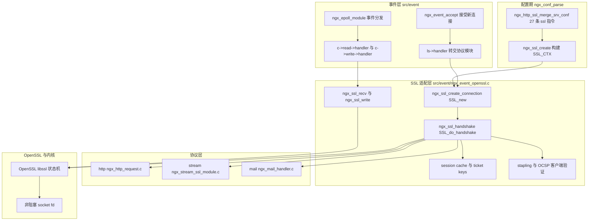
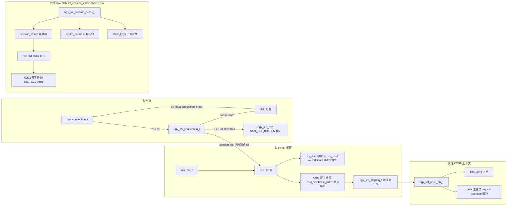
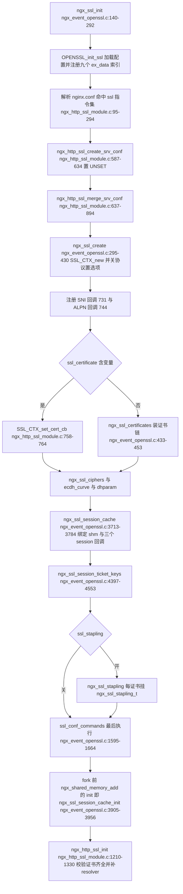
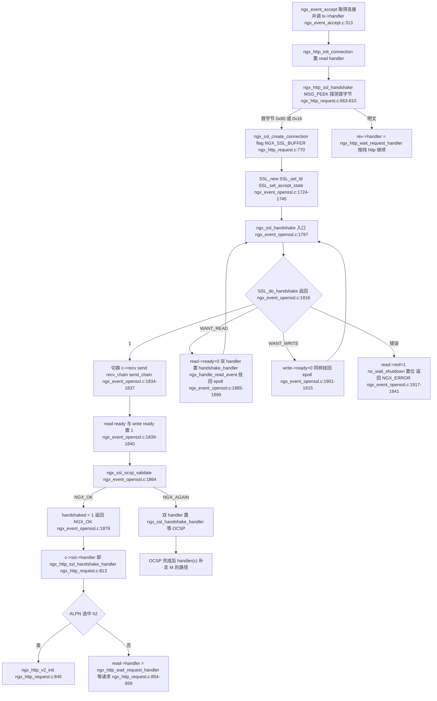
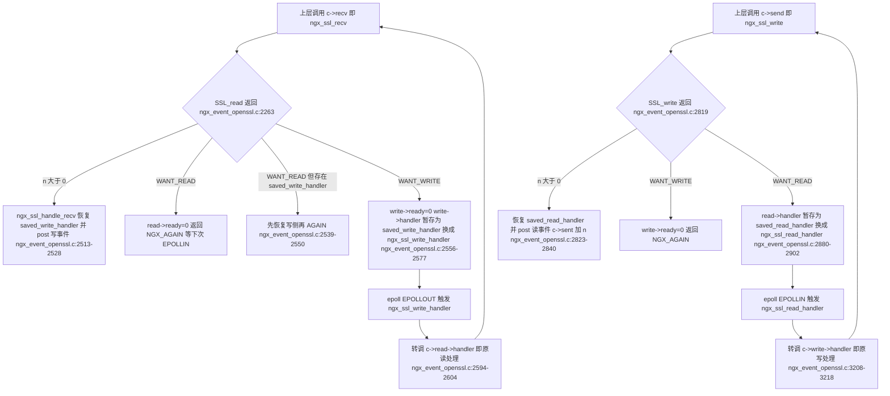
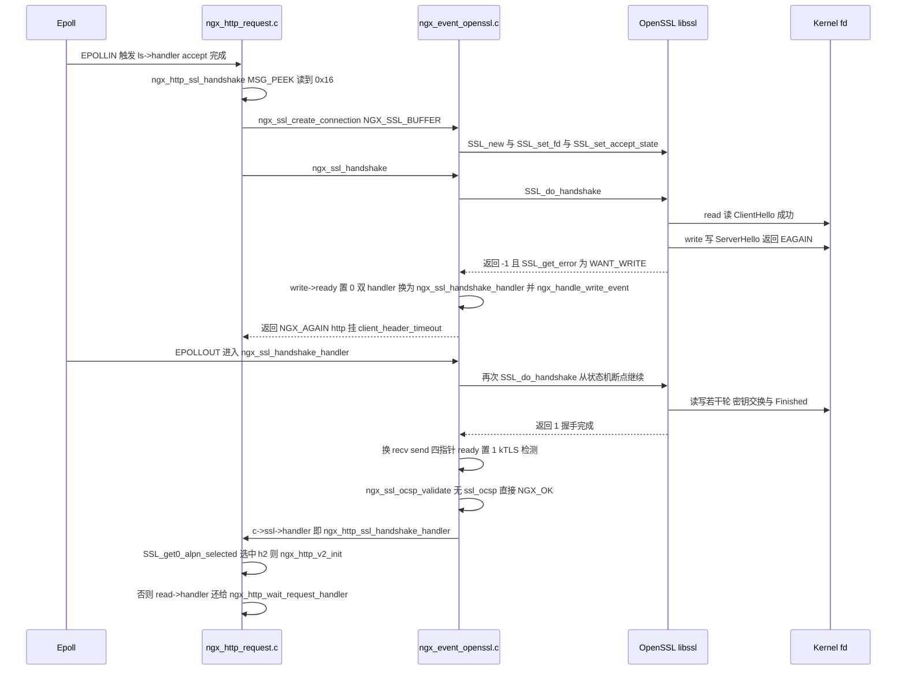
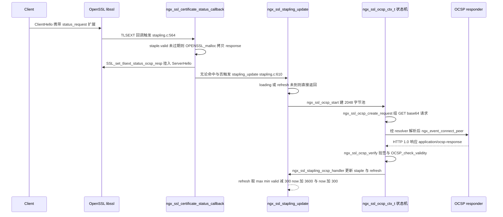
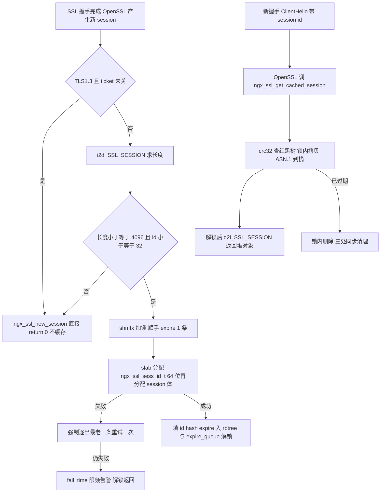

# SSL/TLS 实现细节（基于 nginx-1.27.0 源码）

> **导读**：读完本文你将掌握——nginx 如何用一块 `ngx_ssl_connection_t` 把 OpenSSL 状态机"焊"进自己的事件循环；`SSL_do_handshake` 返回 `WANT_READ/WANT_WRITE` 之后 fd 是怎样挂回 epoll 的；协议位掩码、cipher、curve 配置如何一步步落到 `SSL_CTX`；ALPN 回调里 `http/1.1` 与 `h2` 的分流实现；session 复用两种模式（slab 共享内存内建 cache 与 session ticket 密钥轮转）的数据结构与代码路径；客户端证书验证与 SNI 多证书回调；OCSP stapling 的 resolver+fetch+定时刷新异步流程；`ngx_ssl_recv/send` 的缓冲与 `write_ready` 语义，以及 SSL 下 sendfile 的真实限制；最后落到 stream/mail 的 `ssl` 与 `starttls` 切换点。
>
> **前置阅读建议**：先了解 nginx 事件框架（`ngx_event_t`、`ngx_handle_read_event/ngx_handle_write_event`、posted events、`ngx_epoll_module`）与内存池/slab（`ngx_palloc`、`ngx_slab_pool_t`）、红黑树/队列（`ngx_rbtree_t`、`ngx_queue_t`），再读本文。对 OpenSSL 只需知道 `SSL/SSL_CTX/SSL_SESSION/BIO` 的基本关系。
>
> **涉及源码清单**（均已通读，本文所有行号引用皆出自这些文件的真实内容）：
> - `src/event/ngx_event_openssl.c`（6068 行）
> - `src/event/ngx_event_openssl.h`（339 行）
> - `src/event/ngx_event_openssl_stapling.c`（2778 行）
> - `src/http/modules/ngx_http_ssl_module.c`（1358 行）
> - `src/http/modules/ngx_http_ssl_module.h`（71 行）
> - `src/event/ngx_event_accept.c`（572 行）
> - 辅助验证：`src/http/ngx_http_request.c`、`src/stream/ngx_stream_ssl_module.c`、`src/mail/ngx_mail_handler.c`、`src/mail/ngx_mail_smtp_handler.c`、`src/http/ngx_http_upstream.c`、`src/core/ngx_output_chain.c`、`src/core/ngx_connection.h`

---

## 1. 本模块在 nginx 中的位置与职责

nginx 的 SSL 代码分两层：

- **核心适配层** `src/event/ngx_event_openssl.c/.h`（加上 stapling 文件）：不感知任何协议语义，只负责"OpenSSL 状态机 ↔ 事件循环"的双向翻译，以及证书、session 复用、OCSP 等与协议无关的基础设施。它对上提供 `ngx_ssl_create`（配置期构建 `SSL_CTX`）与 `ngx_ssl_create_connection`（连接期构建 `SSL`），对下把 `SSL_read/SSL_write/SSL_do_handshake` 的返回值翻译成 nginx 的 `NGX_OK/NGX_AGAIN/NGX_ERROR` 三态。
- **协议模块层**：`ngx_http_ssl_module` 持有 `ngx_http_ssl_srv_conf_t`（内嵌 `ngx_ssl_t`），负责 27 条 `ssl_*` 指令、23 个 `$ssl_*` 变量、SNI/ALPN/证书回调；stream/mail 各自的 ssl 模块是同一套适配层在其他协议上的复用。



图解读：配置期产物是一个挂在 server 配置上的 `ngx_ssl_t`（内含 `SSL_CTX`）；新连接经 `ngx_event_accept` → `ls->handler`（http 里是 `ngx_http_init_connection`）进入协议模块，协议模块调用 `ngx_ssl_create_connection` 后开始握手；握手与收发的每一次 OpenSSL 返回都会回到 `c->read->handler/c->write->handler`，即回到 epoll 驱动的主循环。适配层与协议层之间唯一的"回调钩子"是 `c->ssl->handler`——一个 `ngx_connection_handler_pt`，由协议模块在 `ngx_ssl_handshake` 返回 `NGX_AGAIN` 时注册（见第 6.8 节）。

一个必须先澄清的常见误传：**nginx 并没有"自制内存 BIO"**。它用 `SSL_set_fd` 把 fd 直接交给 OpenSSL 内建的 socket BIO（`src/event/ngx_event_openssl.c:1731`），OpenSSL 内部直接对非阻塞 fd 做系统调用，`EAGAIN` 被翻译成 `WANT_READ/WANT_WRITE` 返回给 nginx；桥接靠的是"切换 handler + `ngx_handle_read_event/ngx_handle_write_event` 挂回 epoll"，而不是 BIO。nginx 真正触碰 BIO 的只有两处：握手期给 wbio 补一个 16K 写缓冲（`ngx_ssl_info_callback`，`src/event/ngx_event_openssl.c:1171-1194`），以及 kTLS 检测 `BIO_get_ktls_send`（`src/event/ngx_event_openssl.c:1854-1862`）。第 4、6 节会把这个桥接讲透。

---

## 2. 核心数据结构精讲

### 2.1 `ngx_ssl_t`——每个 server 一份的"SSL_CTX 握手柄"

定义于 `src/event/ngx_event_openssl.h:89-93`：

| 字段 | 类型 | 含义 | 谁写它 |
|---|---|---|---|
| `ctx` | `SSL_CTX *` | 本 server 全部连接共享的 OpenSSL 上下文，承载证书/私钥/cipher/回调 | `ngx_ssl_create`（`ngx_event_openssl.c:298`） |
| `log` | `ngx_log_t *` | 配置期日志 | `ngx_http_ssl_merge_srv_conf`（`ngx_http_ssl_module.c:697`） |
| `buffer_size` | `size_t` | 输出聚合缓冲与握手 BIO 缓冲大小，默认 `NGX_SSL_BUFSIZE` 16384（`ngx_event_openssl.h:188`） | `ssl_buffer_size` 指令（`ngx_http_ssl_module.c:786`） |

`ngx_ssl_t` 被内嵌进各协议的 srv conf，如 `ngx_http_ssl_srv_conf_t.ssl`（`src/http/modules/ngx_http_ssl_module.h:18`）。

### 2.2 `ngx_ssl_connection_t`——每连接一块的"状态机粘合剂"

定义于 `src/event/ngx_event_openssl.h:96-131`（struct 名 `ngx_ssl_connection_s`，typedef 在 `ngx_event_openssl.h:96` 附近由 `ngx_core.h` 侧声明为 `ngx_ssl_connection_t`）。这是全文最核心的结构，逐字段解释：

| 字段 | 含义与用法 |
|---|---|
| `connection` | `SSL *`，本连接的 OpenSSL 对象；经 ex_data `ngx_ssl_connection_index` 反向挂到 `ngx_connection_t`（`ngx_ssl_create_connection`，`ngx_event_openssl.c:1747-1750`） |
| `session_ctx` | session 复用/出票用的 `SSL_CTX`。SNI 切换证书后它**仍指向初始 ctx**（`ngx_event_openssl.c:1716` 赋值，此后不改），保证 ticket/cache 的 key 与"最初接客的 server"一致 |
| `last` | 最近一次 `SSL_read` 类调用的翻译结果，取值 `NGX_OK/NGX_AGAIN/NGX_DONE/NGX_ERROR`，是 recv 路径的状态寄存器（`ngx_event_openssl.c:2240-2250, 2271`） |
| `buf` | `NGX_SSL_BUFFER` 模式下的 16K 聚合输出缓冲（`ngx_buf_t *`），延迟创建（`ngx_event_openssl.c:2659-2679`） |
| `buffer_size` | 从 `ngx_ssl_t.buffer_size` 拷贝来的连接级副本，SNI 回调里可按新 server 再覆盖（`ngx_http_request.c:950`） |
| `handler` | 握手完成/超时后协议层要回调的函数，http 设为 `ngx_http_ssl_handshake_handler`（`ngx_http_request.c:789`），stream/mail 各有对应 |
| `session` | TLS1.3 下客户端保存的 `SSL_SESSION` 引用（配合 `save_session`，`ngx_event_openssl.c:106-107, 1758-1769`） |
| `save_session` | upsteam 客户端模式下存储新 session 的回调（`ngx_ssl_new_client_session`，`ngx_event_openssl.c:1684-1700`） |
| `saved_read_handler` / `saved_write_handler` | **桥接的关键**：`SSL_write` 撞上 `WANT_READ` 时把原 read handler 存到这里并临时换成 `ngx_ssl_read_handler`，反之 `SSL_read` 撞上 `WANT_WRITE` 时换 `ngx_ssl_write_handler`（`ngx_event_openssl.c:2571-2574, 2896-2899`） |
| `ocsp` | 客户端证书 OCSP 验证的每连接上下文 `ngx_ssl_ocsp_t *`（`ngx_event_openssl_stapling.c:80-89`） |
| `early_buf` | TLS1.3 early data 预读的那 1 个字节（`ngx_event_openssl.c:1986`） |
| 位域 `handshaked` | 握手完成标志，协议层 handler 靠它分流（`ngx_http_request.c:816`） |
| 位域 `handshake_rejected` | SNI 回调拒绝握手（`reject_handshake`）时置 1，`ngx_ssl_handshake` 错误路径据此降级日志（`ngx_event_openssl.c:1930-1935`） |
| 位域 `renegotiation` | 旧版 OpenSSL 检测到服务端重协商时置 1，随后直接断连（CVE-2009-3555 防护，`ngx_event_openssl.c:1108-1122, 2489-2509`） |
| 位域 `buffer` | 是否启用 16K 聚合输出缓冲，由 `NGX_SSL_BUFFER` flag 决定（`ngx_event_openssl.c:1713`） |
| 位域 `sendfile` | 仅在 kTLS 可用且 `BIO_get_ktls_send()==1` 时置 1（`ngx_event_openssl.c:1854-1862`），是 `SSL_sendfile` 的开关 |
| 位域 `no_wait_shutdown` / `no_send_shutdown` | 关闭期跳过等待/发送 close_notify（错误路径会同时置两者，`ngx_event_openssl.c:1919-1920`） |
| 位域 `shutdown_without_free` | upstream keepalive 场景下"只 shutdown 不释放 SSL"，恢复 `c->recv = ngx_recv`（`ngx_event_openssl.c:3355-3359`） |
| 位域 `handshake_buffer_set` | info_callback 是否已把握手 wbio 缓冲调到 16K（`ngx_event_openssl.c:1174-1192`） |
| 位域 `session_timeout_set` | TLS1.3 session 超时修正是否已做过（`ngx_event_openssl.c:1149`） |
| 位域 `try_early_data` | `ssl_early_data on` 且 OpenSSL 支持 `SSL_read_early_data` 时置 1，握手入口改走 `ngx_ssl_try_early_data`（`ngx_event_openssl.c:1718-1722`） |
| 位域 `in_early` | 正处于 0-RTT 读取阶段，recv/send 转发到 `ngx_ssl_recv_early/ngx_ssl_write_early`（`ngx_event_openssl.c:1989, 2235-2238`） |
| 位域 `in_ocsp` | 握手已完成但被 OCSP 验证挂起，`ngx_ssl_handshake` 见到此标志直接转 `ngx_ssl_ocsp_validate`（`ngx_event_openssl.c:1810-1812`） |
| 位域 `early_preread` | 0-RTT 的 1 字节预读尚未交付给应用（`ngx_event_openssl.c:1987, 2381-2396`） |
| 位域 `write_blocked` | OpenSSL 1.1.1a 的 `SSL_write_early_data` 阻塞缺陷规避标志（`ngx_event_openssl.c:2989-2992`） |

### 2.3 session 复用与 ticket 的共享内存结构

| 结构体 | 位置 | 字段速览 |
|---|---|---|
| `ngx_ssl_sess_id_t` | `ngx_event_openssl.h:144-155` | `node`（rbtree 节点，key 为 session id 的 crc32）、`len`（ASN.1 长度）、`queue`（挂在 LRU 过期队列）、`expire`（绝对过期时间）、`id[32]`（session id 原文）、`session`（64 位平台是指针，指向 slab 里另配的 ASN.1 体；32 位平台是柔性数组内联） |
| `ngx_ssl_ticket_key_t` | `ngx_event_openssl.h:158-165` | `name[16]`（票名，查找凭据）、`hmac_key[32]`、`aes_key[32]`、`expire`、位域 `size:8`（48 或 80 字节格式）、`shared`（1 表示来自共享内存而非密钥文件） |
| `ngx_ssl_session_cache_t` | `ngx_event_openssl.h:168-174` | `session_rbtree`（按 crc32(session id) 组织）、`sentinel`、`expire_queue`（先进先出的过期队列）、`ticket_keys[3]`（三槽轮转：current/previous/next）、`fail_time`（slab 分配失败限频日志） |

`ngx_ssl_sess_id_t` 的注入式设计值得注意：rbtree 节点、session id、ASN.1 序列化体三块数据一次 slab 分配成型（64 位平台分两次），详见第 6.14 节。

### 2.4 OCSP 相关结构

`ngx_ssl_stapling_t`（每证书，`ngx_event_openssl_stapling.c:17-43`）：`staple`（DER 编码的 OCSP response）、`valid`/`refresh`（有效期/下次刷新时刻）、`issuer`/`chain`（签发者与链）、`addrs/host/uri/port`（responder 地址，可来自 `ssl_stapling_responder` 或证书 AIA）、`resolver`/`resolver_timeout`、位域 `verify`、`loading`。它经 ex_data `ngx_ssl_stapling_index` 挂在 `X509` 上（`ngx_event_openssl_stapling.c:238-241`）。

`ngx_ssl_ocsp_ctx_t`（每次 OCSP 请求一个，`ngx_event_openssl_stapling.c:92-143`）：自带独立 `pool`（2048 字节起步，`ngx_event_openssl_stapling.c:1268`）、`request/response` 缓冲、`ngx_peer_connection_t peer`、`process` 函数指针（`status_line → headers → body` 三态推进）、`handler/data`（完成回调）。这个"小而完整的 HTTP/1.0 客户端"是 nginx 里少见的一次性状态机。

### 2.5 结构关系与内存布局图



图解读：左上到右下是"配置期 → 连接期 → 共享层"三个生命周期。`session_ctx` 有意不随 SNI 切换（第 6.16 节）；共享内存里的 rbtree 节点自带过期队列指针，两者维护同一批对象，删除时三处（queue/rbtree/slab）同步；OCSP 上下文独立成池，销毁即释放全部请求期内存，避免污染连接池。

---

## 3. 初始化流程

SSL 的初始化横跨三个阶段：**进程级**（`ngx_ssl_init`，在 `ngx_master/ngx_worker` 初始化 `SSL 库与 ex_data 索引`）、**配置级**（merge_srv_conf 构建 `SSL_CTX`）、**共享内存级**（`ngx_ssl_session_cache_init` 在 fork 前执行一次）。



图解读，逐节点展开：

1. `ngx_ssl_init`（`src/event/ngx_event_openssl.c:140-292`）在 `OPENSSL_init_ssl` 成功后必须 `ERR_clear_error()`——源码注释明确说 OpenSSL 可能"成功却留错"（`ngx_event_openssl.c:179-184`）。随后连续申请 9 个 ex_data 索引（`ngx_event_openssl.c:223-289`）：3 个挂在 `SSL`（连接）上、4 个挂在 `SSL_CTX` 上、2 个挂在 `X509` 上。这组全局 int 是 nginx 侧与 OpenSSL 对象互相反查的唯一通道，第 6.1 节详述。
2. merge 阶段的默认值：`session_timeout` 300s、`protocols` 默认允许 TLSv1~TLSv1.3、`ciphers` 默认 `HIGH:!aNULL:!MD5`、`ecdh_curve` 默认 `auto`、`verify_depth` 默认 1、session tickets 默认开（`src/http/modules/ngx_http_ssl_module.c:645-692, 857`）。
3. **顺序敏感**：`ssl_conf_command` 被刻意放在 merge 的最后执行（`ngx_http_ssl_module.c:889-891`），这样它能覆盖前面所有指令落下的 SSL_CTX 状态——这是官方文档"ssl_conf_command 会覆盖 nginx 自身设置"警告的代码依据。
4. `ngx_http_ssl_init`（postconfiguration，`ngx_http_ssl_module.c:1210-1330`）做两件事：给 stapling/ocsp 补 resolver（此时 `resolver` 指令才解析完，`ngx_http_ssl_module.c:1235-1251`）；遍历 listen 端口，凡 `listen ... ssl` 的 default server 没有 `ssl_certificate` 又没开 `ssl_reject_handshake` 就直接 EMERG 退出（`ngx_http_ssl_module.c:1297-1303`）。

---

## 4. 核心执行流程/状态机

### 4.1 连接级握手状态机：从 accept 到 `handshaked`

以 http 为例（stream/mail 结构完全同构，见 6.22），完整状态机如下：



图解读，逐分支：

- **探测分支**：`ngx_http_ssl_handshake` 用 `MSG_PEEK` 只偷看 1 个字节（`src/http/ngx_http_request.c:694-696`），`0x80` 是 SSLv2 ClientHello、`0x16` 是 SSLv3/TLS record 的 handshake 类型号（`ngx_http_request.c:754-755`）。不匹配则把 handler 还给明文 `ngx_http_wait_request_handler`——这就是 `listen ... ssl` 端口上仍能"误连"的根源，也是 `ssl_reject_handshake` 存在的背景之一。
- **WANT_READ/WANT_WRITE 分支**：返回 `NGX_AGAIN` 前，nginx 做了三件事——清掉对应方向的 `ready` 位、把读**和写**两个 handler 都换成 `ngx_ssl_handshake_handler`（因为 TLS1.3/会话票据握手可能随时需要任一方向）、调用 `ngx_handle_read_event/ngx_handle_write_event`。后两者在 epoll 下等价于 `epoll_ctl(ADD/MOD)`，从此 fd 回到事件循环，下个事件自动重入 `ngx_ssl_handshake`，`SSL_do_handshake` 从 OpenSSL 内部保存的状态继续推进。**这就是"挂回 epoll"的全部真相：没有自定义 BIO，只有状态位 + handler 指针 + epoll 注册。**
- **成功分支**：`c->recv/c->send` 等四个函数指针从 `ngx_recv/ngx_send` 系列换成 SSL 版本，同时把 `read->ready/write->ready` 置 1——因为握手期间 OpenSSL 可能已经在内核缓冲里"顺手"收到了应用数据，强行标记可读可写让上层尽快再试。接着无条件过一遍 `ngx_ssl_ocsp_validate`（`ssl_ocsp` 客户端验证或直接通过时返回 `NGX_OK`）。
- **超时**：`NGX_AGAIN` 时 http 层给 read 事件挂 `client_header_timeout`（`ngx_http_request.c:781-787`），stream 挂 `sscf->handshake_timeout`（`src/stream/ngx_stream_ssl_module.c:430`），mail 挂 `cscf->timeout`（`src/mail/ngx_mail_handler.c:340`）。定时器到期 → `ev->timedout` → `ngx_ssl_handshake_handler` 直接把 `c` 交给 `c->ssl->handler`（`ngx_event_openssl.c:2153-2156`），协议层 handler 检查 `handshaked==0` 走关闭路径（`ngx_http_request.c:864-868`）。

### 4.2 数据收发的"交叉桥接"状态机

握手完成后，真正的挑战是 `SSL_read` 可能要写、`SSL_write` 可能要读（TLS1.2 重协商、record 层缓冲、TLS1.3 KeyUpdate/会话票据都会引发）。nginx 用"saved handler + 桥接 handler"解决：



图解读：`ngx_ssl_write_handler` 与 `ngx_ssl_read_handler` 是两个"过桥"函数——它们自己什么都不做，只把事件转交给**对侧**的原 handler（`ngx_event_openssl.c:2603, 3217`），因为底层 SSL 状态机的下一步动作属于当初发起调用的那个方向。`saved_*_handler` 的恢复必须配合 `ngx_post_event(c->read, &ngx_posted_events)`（`ngx_event_openssl.c:2835`）：此刻我们往往正处于某个 handler 调用栈深处，直接调用原 handler 会造成递归，post 到 posted 队列让主循环统一处理。定时器则刻意不动——注释写明"读事件已有 timer"（`ngx_event_openssl.c:2567-2569, 2891-2894`），复用上层挂的 `client_header_timeout/proxy_read_timeout` 等，避免双重计时。

---

## 5. 关键时序图

### 5.1 一次典型 TLS 握手（含 WANT_WRITE 重入与 ALPN 分流）



时序要点：握手**每一跳都有明确的函数名与恢复点**——`SSL_do_handshake` 的可重入性由 OpenSSL 状态机保证，nginx 只负责"让出 CPU 的方式是 handler 切换而非阻塞轮询"；ALPN 判定发生在**握手完成后**的 `ngx_http_ssl_handshake_handler`（`ngx_http_request.c:828-850`），而非 ALPN 回调里——回调只负责选出协议名，分流动作由协议层自己执行。

### 5.2 OCSP stapling 的异步刷新



时序要点：stapling 的精妙在于"**同步喂缓存、异步刷新**"——握手回调里只做内存拷贝（快路径），真正的 HTTP 请求在独立的连接与独立的内存池里跑，永不阻塞握手；`refresh` 公式保证刷新点落在"过期前 5 分钟 ~ 至多 1 小时后"的窗口内（`ngx_event_openssl_stapling.c:699-705`），失败则 5 分钟后重试（`stapling.c:713`）。

---

## 6. 源码逐段精读

本节是全文主体，逐函数拆解。

### 6.1 `ngx_ssl_init`：ex_data 索引是唯一的"反向指针"通道

```c
ngx_ssl_connection_index = SSL_get_ex_new_index(0, NULL, NULL, NULL, NULL);
...
ngx_ssl_server_conf_index = SSL_CTX_get_ex_new_index(0, NULL, NULL, NULL, NULL);
```
src/event/ngx_event_openssl.c:223-231

**逐块逻辑**：OpenSSL 的对象对调用方是黑盒，nginx 无法在 `SSL/SSL_CTX/X509` 里塞字段，于是用 ex_data 机制申请了 9 个全局索引（`ngx_event_openssl.c:223-289`，声明在 `ngx_event_openssl.h:328-336`）：

| 索引 | 挂载对象 | 存什么 | 典型读取方 |
|---|---|---|---|
| `connection_index` | `SSL` | `ngx_connection_t *` | `ngx_ssl_get_connection` 宏（`ngx_event_openssl.h:249-250`），所有回调的第一行 |
| `server_conf_index` | `SSL_CTX` | 协议层 srv conf（如 `sscf`） | 变量求值、upstream |
| `session_cache_index` | `SSL_CTX` | `ngx_shm_zone_t *` | `ngx_ssl_new_session` 等三个回调（`ngx_event_openssl.c:4031`） |
| `ticket_keys_index` | `SSL_CTX` | `ngx_array_t`（ticket keys） | `ngx_ssl_ticket_key_callback`（`ngx_event_openssl.c:4583`） |
| `ocsp_index` | `SSL_CTX` | `ngx_ssl_ocsp_conf_t *` | `ngx_ssl_ocsp_validate`（`ngx_event_openssl_stapling.c:870`） |
| `certificate_index` | `SSL_CTX` | 本 ctx 第一张证书的 `X509 *` | session_id_context、stapling 遍历 |
| `next_certificate_index` | `X509` | 下一张证书，把证书串成单链 | `ngx_ssl_cleanup_ctx`（`ngx_event_openssl.c:4856-4862`） |
| `certificate_name_index` | `X509` | 配置里的证书路径字符串 | stapling 日志 |
| `stapling_index` | `X509` | `ngx_ssl_stapling_t *` | `ngx_ssl_certificate_status_callback`（`stapling.c:586`） |

**易错点**：`SSL_get_ex_new_index` 返回 -1 时必须 EMERG 退出（`ngx_event_openssl.c:225-228`）——索引错位会让所有 `ngx_ssl_get_connection` 解引用出垃圾指针。另外 `ngx_ssl_create` 里把 `certificate_index` 初始为 NULL（`ngx_event_openssl.c:311-315`），保证"证书动态加载（含变量）"场景能被 `ngx_ssl_session_id_context` 识别（`ngx_event_openssl.c:3840-3841` 的判空分支）。

### 6.2 `ngx_ssl_create`：协议位掩码如何落到 SSL_CTX

```c
ssl->ctx = SSL_CTX_new(SSLv23_method());
...
#ifdef SSL_OP_NO_COMPRESSION
    SSL_CTX_set_options(ssl->ctx, SSL_OP_NO_COMPRESSION);
#endif

#ifdef SSL_OP_NO_ANTI_REPLAY
    SSL_CTX_set_options(ssl->ctx, SSL_OP_NO_ANTI_REPLAY);
#endif
```
src/event/ngx_event_openssl.c:298-407

**逐块逻辑**（`ngx_event_openssl.c:295-430`）：

1. `SSLv23_method()` 是"兼容所有版本"的通配 method，真正的版本裁剪全靠 option 位：先 `SSL_CTX_clear_options` 掉 `NO_SSLv2|NO_SSLv3|NO_TLSv1`（0.9.8m+ 默认关，`ngx_event_openssl.c:357-361`），再按 `protocols` 位掩码逐一 `SSL_OP_NO_SSLv2/SSLv3/TLSv1/TLSv1_1/TLSv1_2/TLSv1_3`（`ngx_event_openssl.c:363-389`）。位掩码来自 `ssl_protocols` 指令的 `ngx_conf_bitmask_t` 表（`ngx_http_ssl_module.c:63-71`），默认值为全部四个 TLS 版本（`ngx_http_ssl_module.c:654-657`）。
2. 紧接着显式 `SSL_CTX_set_min_proto_version(ctx, 0)` + `set_max_proto_version(TLS1_3_VERSION)`（`ngx_event_openssl.c:391-399`）：前者清掉发行版 openssl.cnf 里可能写死的 min 值，后者把上限钉在 TLS1.3（nginx 不支持任何更高草案）。
3. 一组无条件安全选项：`SSL_OP_NO_COMPRESSION`（防 CRIME）、`SSL_OP_NO_ANTI_REPLAY`（关闭 OpenSSL 内建 anti-replay，把 0-RTT 重放防护交给上层）、`SSL_OP_NO_CLIENT_RENEGOTIATION`、`SSL_OP_IGNORE_UNEXPECTED_EOF`（对端不发 close_notify 时不报错，兼容大量浏览器，`ngx_event_openssl.c:401-415`）。
4. `SSL_MODE_RELEASE_BUFFERS`：空闲时释放 OpenSSL 的 34KB+ 记录缓冲，长连接内存减半（`ngx_event_openssl.c:417-419`）；`SSL_CTX_set_read_ahead(1)`（`ngx_event_openssl.c:425`）让 OpenSSL 一次尽量读满——这对后面 `ngx_ssl_recv` 的 `available` 记账逻辑至关重要（6.10）。
5. `SSL_CTX_set_info_callback(ssl->ctx, ngx_ssl_info_callback)`（`ngx_event_openssl.c:427`）注册了三个不同职责的"旁路观察者"，见 6.6。

**为什么用位掩码而非字符串**：`ssl_protocols SSLv3 TLSv1.2` 这种"列举允许项"语义需要能在 merge 时做并集，bitmask 槽位（`ngx_conf_set_bitmask_slot`）天然支持。

### 6.3 证书链装载：ex_data 单链与 `SSL_CTX_set0_chain`

`ngx_ssl_certificate`（`ngx_event_openssl.c:456-574`）关键段：

```c
if (X509_set_ex_data(x509, ngx_ssl_next_certificate_index,
                  SSL_CTX_get_ex_data(ssl->ctx, ngx_ssl_certificate_index))
    == 0)
...
if (SSL_CTX_set_ex_data(ssl->ctx, ngx_ssl_certificate_index, x509) == 0) {
...
    /*
     * Note that x509 is not freed here, but will be instead freed in
     * ngx_ssl_cleanup_ctx().  ...
     */
```
src/event/ngx_event_openssl.c:493-518

**逐块逻辑**：`ngx_ssl_load_certificate`（`ngx_event_openssl.c:648-735`）支持 `data:` 前缀的内存证书（`ngx_event_openssl.c:656-659`），用 `PEM_read_bio_X509_AUX` 读主证书、循环 `PEM_read_bio_X509` 读余下链，`PEM_R_NO_START_LINE` 视为文件尾（`ngx_event_openssl.c:700-712`）。随后 nginx 把每张主证书头插进 ex_data 单链，并特意**不释放** `X509`——注释给出原因：OpenSSL 在同类型证书被替换时会自行 free，而 nginx 需要遍历全部证书（session_id_context、stapling 都要），所以引用权上移到 `ngx_ssl_cleanup_ctx`（`ngx_event_openssl.c:4849-4865` 用单链遍历 free）。链证书在 OpenSSL 1.0.2+ 走 `SSL_CTX_set0_chain`（`ngx_event_openssl.c:520-527`），旧版退化为逐张 `SSL_add_extra_chain_cert`。

私钥装载 `ngx_ssl_load_certificate_key`（`ngx_event_openssl.c:738-852`）三个前缀分支：`engine:` 走 `ENGINE_load_private_key`（748-792）、`data:` 走内存 BIO（794-801）、普通文件（803-817）；密码重试循环逐个尝试 `ssl_password_file` 里的密码，失败 `BIO_reset` 换下一个（`ngx_event_openssl.c:830-847`）。密码文件解析 `ngx_ssl_read_password_file`（1198-1325）结束时 `ngx_explicit_memzero` 整个栈缓冲（1322），且 `ngx_ssl_preserve_passwords`（1328-1388）会把临时池密码拷到配置池并挂 cleanup 清零——密码明文的生灭周期管理相当严谨。

### 6.4 cipher/curve/DH：一次配置三次落地

`ngx_ssl_ciphers`（`ngx_event_openssl.c:883-899`）：`SSL_CTX_set_cipher_list` 只作用于 TLS1.2 及以下（TLS1.3 的套件由 `ssl_conf_command Ciphersuites` 控制，待验证具体版本行为）；`ssl_prefer_server_ciphers on` 对应 `SSL_OP_CIPHER_SERVER_PREFERENCE`（`ngx_event_openssl.c:894-896`）。

`ngx_ssl_ecdh_curve`（`ngx_event_openssl.c:1484-1563`）：OpenSSL 1.0.2+ 走 `SSL_CTX_set1_curves_list` 支持曲线列表（`ngx_event_openssl.c:1521`），`auto` 时直接返回用 OpenSSL 内置列表（`ngx_event_openssl.c:1517-1519`，注释指出 1.0.2b+ 服务端偏好 prime256v1、1.1.0+ 偏好 X25519）；无条件 `SSL_OP_SINGLE_ECDH_USE`（每次握手临时 ECDH 密钥，`ngx_event_openssl.c:1510`）。旧版路径退化为 `EC_KEY_new_by_curve_name` + `SSL_CTX_set_tmp_ecdh`（`ngx_event_openssl.c:1547-1558`）。注意注释里的细节：默认由**客户端偏好**的曲线胜出，除非也开了 cipher server preference（`ngx_event_openssl.c:1503-1508`）。

`ngx_ssl_dhparam`（`ngx_event_openssl.c:1407-1481`）仅在还支持 DHE 套件时才有意义；OpenSSL 3.0 起走 `PEM_read_bio_Parameters` + `SSL_CTX_set0_tmp_dh_pkey` 的非废弃路径（`ngx_event_openssl.c:1453-1475`）。`SSL_OP_SINGLE_DH_USE` 在 `ngx_ssl_create` 里就无条件开启（`ngx_event_openssl.c:355`）。

### 6.5 客户端证书验证三件套与 verify 回调

`ngx_ssl_client_certificate`（`ngx_event_openssl.c:902-947`）：

```c
SSL_CTX_set_verify(ssl->ctx, SSL_VERIFY_PEER, ngx_ssl_verify_callback);
SSL_CTX_set_verify_depth(ssl->ctx, depth);
...
list = SSL_load_client_CA_file((char *) cert->data);
...
SSL_CTX_set_client_CA_list(ssl->ctx, list);
```
src/event/ngx_event_openssl.c:908-944

**关键认知——验证模式是"请求"而非"强制"**：这里统一用 `SSL_VERIFY_PEER`（不带 `FAIL_IF_NO_PEER_CERT`），即**没有客户端证书不会握手失败**。是否继续由 http 层在握手后判断：`ssl_verify_client on` 时 `ngx_http_process_request` 检查 `sscf->verify` 并拒绝无证书请求（`ssl_verify_client` 的强制语义在应用层实现）。三个指令的分工：`ssl_verify_client` 控制 sscf->verify 枚举 off/on/optional/optional_no_ca（`ngx_http_ssl_module.c:74-80`）；`ssl_client_certificate` 走本函数（设置可验证 CA 列表 + 发给客户端的 CA 名单）；`ssl_trusted_certificate` 走 `ngx_ssl_trusted_certificate`（`ngx_event_openssl.c:950-984`）——注意它保持 `SSL_CTX_get_verify_mode` **不变**（954-955 行），只加载信任库，用于 stapling/OCSP 验签而不触发客户端证书请求。`ssl_crl` 走 `ngx_ssl_crl`（`ngx_event_openssl.c:987-1029`），给 X509_STORE 打上 `X509_V_FLAG_CRL_CHECK|CRL_CHECK_ALL`（1025-1026）。

`ngx_ssl_verify_callback`（`ngx_event_openssl.c:1032-1099`）**永远返回 1**——它只是 debug 日志钩子，不否决任何验证结果；真正的强制在 `ngx_ssl_get_client_verify`（5776-5811）：`$ssl_client_verify` 输出 `NONE/SUCCESS/FAILED:原因`，其中 SUCCESS 还要求 `ngx_ssl_ocsp_get_status` 通过（5794-5797）。`ngx_ssl_verify_error_optional` 宏（`ngx_event_openssl.h:254-259`）列举了 optional 模式下可容忍的自签名类错误码。

### 6.6 `ngx_ssl_info_callback`：一个回调三种身份

```c
    if ((where & SSL_CB_ACCEPT_LOOP) == SSL_CB_ACCEPT_LOOP) {
        c = ngx_ssl_get_connection((ngx_ssl_conn_t *) ssl_conn);

        if (!c->ssl->handshake_buffer_set) {
            ...
            rbio = SSL_get_rbio(ssl_conn);
            wbio = SSL_get_wbio(ssl_conn);

            if (rbio != wbio) {
                (void) BIO_set_write_buffer_size(wbio, NGX_SSL_BUFSIZE);
                c->ssl->handshake_buffer_set = 1;
            }
        }
    }
```
src/event/ngx_event_openssl.c:1171-1194

**身份一：重协商探测器**（1108-1122）：旧版 OpenSSL 无 `SSL_OP_NO_RENEGOTIATION` 时，捕获 `SSL_CB_HANDSHAKE_START` 且 `c->ssl->handshaked` 已置位（说明已完成过一次握手）→ 判定为重协商，`renegotiation=1`；recv 路径见到此标志直接断连（`ngx_event_openssl.c:2489-2509`），防 CVE-2009-3555。新版 OpenSSL 直接由 `SSL_set_options(SSL_OP_NO_RENEGOTIATION)` 在连接级禁掉（`ngx_event_openssl.c:1742-1744`）。

**身份二：TLS1.3 session 超时修正**（1124-1169）：OpenSSL 在 TLS1.3 会话恢复时会刷新 session 创建时间却不缩短超时，攻击者可无限续期绕过客户端证书过期/吊销检查；nginx 在 `SSL_CB_ACCEPT_LOOP` 里对 `SSL_get0_session` 做 `SSL_SESSION_set_time(now)` 与 `timeout - (now - time)` 的线性折减（`ngx_event_openssl.c:1157-1165`），并处理 BoringSSL 硬编码 7 天超时的问题。每个连接只做一次（`session_timeout_set` 位）。

**身份三：握手写缓冲**（1171-1194）：OpenSSL 默认握手期 wbio 无缓冲，长证书链会切出大量小 record 多耗 RTT。nginx 用"rbio != wbio"这个巧妙的判定——一旦 OpenSSL 在 wbio 外层套了缓冲 BIO，二者指针必然不同——抓住时机 `BIO_set_write_buffer_size(wbio, 16384)`。**这就是全文唯一的 BIO 改造点**：它不改变 BIO 的数据源（仍是 socket BIO），只是加了一层 `BIO_f_buffer`。

### 6.7 `ngx_ssl_create_connection`：装配一个 SSL 连接

```c
    sc->buffer = ((flags & NGX_SSL_BUFFER) != 0);
    sc->buffer_size = ssl->buffer_size;

    sc->session_ctx = ssl->ctx;
...
    sc->connection = SSL_new(ssl->ctx);
...
    if (SSL_set_fd(sc->connection, c->fd) == 0) {
...
    if (flags & NGX_SSL_CLIENT) {
        SSL_set_connect_state(sc->connection);

    } else {
        SSL_set_accept_state(sc->connection);
...
    }
    if (SSL_set_ex_data(sc->connection, ngx_ssl_connection_index, c) == 0) {
...
    c->ssl = sc;
```
src/event/ngx_event_openssl.c:1708-1752

**逐块逻辑**（`ngx_event_openssl.c:1703-1755`）：

1. `ngx_pcalloc` 分配在**连接池**上——连接销毁时整块回收，无需手工 free。
2. `sc->session_ctx = ssl->ctx` 固定指向**创建时**的 ctx。SNI 之后协议层可能 `SSL_set_SSL_CTX` 换证书（6.16），但 session_ctx 不动：票据加解密、session cache 读写都用"初始 server"的密钥与 shm，避免同一物理端口上多个虚拟主机各存一份。
3. `SSL_set_fd` 绑定 fd（这就是没有自制 BIO 的直接证据），`SSL_set_accept_state` 把状态机置为服务端初始态，等待 ClientHello。客户端方向（upstream/stream proxy）用 `SSL_set_connect_state`。
4. ex_data 回挂 `ngx_connection_t`——此后任何 OpenSSL 回调都能 `ngx_ssl_get_connection(ssl_conn)` 拿到 nginx 侧上下文。

**易错点**：此函数成功后 `c->ssl` 才非 NULL，失败路径必须直接关连接而非调 `ngx_ssl_shutdown`（后者会解引用 `c->ssl`）。调用方如 `ngx_http_request.c:770-775` 与 `src/mail/ngx_mail_handler.c:329-332` 均如此处理。

### 6.8 `ngx_ssl_handshake` 与 `ngx_ssl_handshake_handler`：循环与重入

```c
    n = SSL_do_handshake(c->ssl->connection);
...
    if (n == 1) {
...
        c->recv = ngx_ssl_recv;
        c->send = ngx_ssl_write;
        c->recv_chain = ngx_ssl_recv_chain;
        c->send_chain = ngx_ssl_send_chain;

        c->read->ready = 1;
        c->write->ready = 1;
```
src/event/ngx_event_openssl.c:1816-1840

**逐块逻辑**（`ngx_event_openssl.c:1797-1942`）：

- 入口三个前置分流：`try_early_data` → `ngx_ssl_try_early_data`（1804-1808）；`in_ocsp` → `ngx_ssl_ocsp_validate`（1810-1812，OCSP 验证完成后的重入路径）；否则清错进正题。
- **成功分支**：函数指针四连换、ready 双置位、kTLS 探测（`BIO_get_ktls_send` 为 1 时 `c->ssl->sendfile=1`，1854-1862）、`ngx_ssl_ocsp_validate` 决定最终是否 `handshaked=1`（1864-1877）。老版本 OpenSSL 的 CVE-2009-3555 补丁（直接置 `SSL3_FLAGS_NO_RENEGOTIATE_CIPHERS`）在 1842-1852。
- **WANT_READ 分支**（1885-1899）与 **WANT_WRITE 分支**（1901-1915）：对称地清 `ready`、把读/写 handler 都置为 `ngx_ssl_handshake_handler`、`ngx_handle_read_event/ngx_handle_write_event` 挂回 epoll、返回 `NGX_AGAIN`。**"SSL_do_handshake 循环"的本质**：循环体不在 nginx 里（不 while 重试，那会变成忙等），而在"epoll 事件 → handler → 再调一次 SSL_do_handshake"的异步循环里；OpenSSL 内部状态机负责断点续传。
- **错误分支**（1917-1941）：`no_wait_shutdown/no_send_shutdown` 同时置位（无需再发 close_notify）、`read->eof=1`；`SSL_ERROR_ZERO_RETURN` 或错误队列为空 → "peer closed connection in SSL handshake"；`handshake_rejected` 置位时降级为 "handshake rejected" 并清错误队列（SNI 拒绝场景，避免把 alert 误报成严重错误）；其余走 `ngx_ssl_connection_error` 按错误码分级日志（3392-3639，包含一张几十行的 `SSL_R_*` "握手失败类"错误码白名单，把客户端常见握手错误从 CRIT 降到 INFO/ERR）。

`ngx_ssl_handshake_handler`（`ngx_event_openssl.c:2143-2163`）只有三种走向：`ev->timedout` → 直接 `c->ssl->handler(c)`（协议层发现 `handshaked==0` 关连接）；`ngx_ssl_handshake(c) == NGX_AGAIN` → 返回继续等；否则完成 → `c->ssl->handler(c)`。注意读写两个事件 handler 都指向它，它内部转调 `ngx_ssl_handshake` 时并不区分方向——OpenSSL 自己知道缺什么。

### 6.9 `ngx_ssl_try_early_data`：TLS1.3 0-RTT 的一个字节

`ssl_early_data on` 时 `SSL_CTX_set_max_early_data(ctx, 16384)`（`ngx_event_openssl.c:1583`），连接创建时 `try_early_data=1`（1718-1722）。握手入口改走 `ngx_ssl_try_early_data`（`ngx_event_openssl.c:1947-2082`）：调 `SSL_read_early_data(conn, &buf, 1, &readbytes)` 只读**一个字节**（1960）：

- `SSL_READ_EARLY_DATA_FINISH`：客户端没发 0-RTT，退回普通 `ngx_ssl_handshake`（1965-1968）。
- `SSL_READ_EARLY_DATA_SUCCESS`：客户端真发了 0-RTT。这个字节存进 `c->ssl->early_buf`，`early_preread=1`、`in_early=1`（1986-1989），其余流程与成功分支一致——四指针切换、OCSP、`handshaked=1`。
- `WANT_READ/WANT_WRITE`：同握手分支挂回 epoll。

为什么偷一个字节：http 层需要尽早判断这是不是重放攻击的 0-RTT（结合 `$ssl_early_data` 变量与业务规则拒绝），同时把"早到数据"缓存起来等 0-RTT 窗口结束。后续 `ngx_ssl_recv` 若 `in_early` 则转发 `ngx_ssl_recv_early`（`ngx_event_openssl.c:2235-2238, 2359-2475`）：先交付 early_buf 那 1 字节（2381-2396），再循环 `SSL_read_early_data` 直到 FINISH 后切回普通 recv（2433-2443）。写侧 `ngx_ssl_write_early`（2916-3026）处理 OpenSSL 1.1.1a 的 `write_blocked` 缺陷（issue 7757，见注释 2983-2987）。

### 6.10 `ngx_ssl_recv` / `ngx_ssl_handle_recv`：读路径的记账

```c
    for ( ;; ) {

        n = SSL_read(c->ssl->connection, buf, size);
...
        c->ssl->last = ngx_ssl_handle_recv(c, n);

        if (c->ssl->last == NGX_OK) {

            size -= n;

            if (size == 0) {
                c->read->ready = 1;

                if (c->read->available >= 0) {
                    c->read->available -= bytes;
...
                    if (c->read->available < 0) {
                        c->read->available = 0;
                        c->read->ready = 0;
...
                        ngx_post_event(c->read, &ngx_posted_next_events);
                    }
```
src/event/ngx_event_openssl.c:2261-2298

**逐块逻辑**（`ngx_event_openssl.c:2229-2354`）：

1. 状态短路：`last==NGX_ERROR` → 直接 error；`last==NGX_DONE`（对端已 clean shutdown）→ eof 返回 0（2240-2250）。`last` 把 SSL 层结论缓存起来，避免每次都进错误队列查询。
2. 内层 `for(;;)` 循环注释写明动机："SSL_read() may return data in parts"——一次 SSL_read 只能吐一个"应用数据流切片"，缓冲里可能还有更多，所以要读满用户 buf 才返回（`size == 0` 时的 `ready=1` 表示还有剩余可读，2329-2335 分支同理）。
3. **available 记账**是精读重点：epoll 报告的"可读字节数"记在 `c->read->available`，但 OpenSSL 内部缓冲（含 read_ahead 读进来的）会使 SSL 解密出的数据量**超过**内核可读量。`available -= bytes` 后若为负，说明 SSL 层还有存货而内核已空——此时不能等 EPOLLIN（永远不来），于是 post 到 `ngx_posted_next_events` 让下一轮事件循环继续读（2289-2298）；无 `available` 语义的平台退化为 `FIONREAD` ioctl（2305-2318）。这是 SSL 场景下"数据在 SSL 缓冲而非内核缓冲"的经典问题，nginx 的解法是精确记账 + posted event 补偿。
4. `ngx_ssl_handle_recv`（2480-2591）翻译 `SSL_read` 返回值：`n>0` 顺带恢复 `saved_write_handler`（2513-2528）；`WANT_READ` → `ready=0, NGX_AGAIN`；`WANT_WRITE` → 换 `ngx_ssl_write_handler` 过桥（2556-2577）；`SSL_ERROR_ZERO_RETURN`（收到 close_notify）→ `NGX_DONE`（2582-2586），上层把 `read->eof` 置位当普通 EOF 处理。

`ngx_ssl_recv_chain`（`ngx_event_openssl.c:2166-2226`）在多个 buf 间推进，每读一把就检查 `c->read->ready`（2197-2199），未就绪立即返回——与 `ngx_readv_chain` 同构的"能读多少是多少"策略。

### 6.11 `ngx_ssl_write`：写路径与 saved_read_handler

```c
    if (sslerr == SSL_ERROR_WANT_READ) {

        ngx_log_debug0(NGX_LOG_DEBUG_EVENT, c->log, 0,
                       "SSL_write: want read");
        c->read->ready = 0;
...
        if (c->ssl->saved_read_handler == NULL) {
            c->ssl->saved_read_handler = c->read->handler;
            c->read->handler = ngx_ssl_read_handler;
        }

        return NGX_AGAIN;
```
src/event/ngx_event_openssl.c:2880-2902

**逐块逻辑**（`ngx_event_openssl.c:2803-2911`）：`SSL_write` 成功时除了 `c->sent += n`（2838）还要恢复 `saved_read_handler` 并 `ngx_post_event(c->read, ...)`（2823-2836）——写成功了意味着 record 层排空，之前因 WANT_READ 挂起的读请求可以继续。`SSL_ERROR_ZERO_RETURN` 被改判为 `SSL_ERROR_SYSCALL`（2845-2855，注释引用 OpenSSL 1.1.1 的 commit 8051ab2，说明该版本 close_notify 后写错误会误报 ZERO_RETURN）。`WANT_READ` 分支把读 handler 换成 `ngx_ssl_read_handler`（3208-3218），EPOLLIN 到来时它转调 `c->write->handler(c->write)`，即回到原写流程。`saved_read_handler` 判空保护防止嵌套 WANT_READ 时二次覆盖丢失原 handler。

与读路径的对称差异：写失败 `WANT_WRITE` 时**不换 handler**（`c->send` 的调用方 http upstream 本来就会因 NGX_AGAIN 挂起并在 EPOLLOUT 重试），只有交叉场景才需要过桥 handler——因为读事件的 handler 是协议层设置的，不能被 SSL 层假定。

### 6.12 `ngx_ssl_send_chain`、聚合缓冲与 SSL 下 sendfile 限制

```c
    buf = c->ssl->buf;

    if (buf == NULL) {
        buf = ngx_create_temp_buf(c->pool, c->ssl->buffer_size);
...
    send = buf->last - buf->pos;
    flush = (in == NULL) ? 1 : buf->flush;

    for ( ;; ) {

        while (in && buf->last < buf->end && send < limit) {
```
src/event/ngx_event_openssl.c:2659-2686

**逐块逻辑**（`ngx_event_openssl.c:2615-2800`）：

1. **非缓冲模式**（`NGX_SSL_BUFFER` 未置，mail/ stream proxy 上游用）：逐 buf 直接 `ngx_ssl_write`，`NGX_AGAIN` 时把剩余 chain 返回给调用方（2624-2650）。
2. **缓冲模式**（http 服务端用，`ngx_http_request.c:770` 传入 `NGX_SSL_BUFFER`）：函数头注释说明动机——"OpenSSL has no SSL_writev()"，把多个小 buf 拷进 16K 聚合缓冲再一次 `SSL_write`，摊薄每 record 的加密+TCP 开销（2607-2613）。`flush` 语义由 `last_buf/flush` buf 或调用方 `in==NULL`（显式冲刷）触发（2682, 2686-2689）。
3. `c->buffered` 与 `NGX_SSL_BUFFERED`（定义于 `src/core/ngx_connection.h:120`，值 0x01）：缓冲区没排空就置位（2792-2797），http 写事件 handler 靠它判断"还有数据没写完，别关闭连接"；`size==0 && 无文件 buf` 时清位返回（2758-2761）。
4. **sendfile 分支**：`in->buf->in_file && c->ssl->sendfile` 时跳出拷贝循环，`ngx_chain_coalesce_file` 合并相邻文件 buf 后调 `ngx_ssl_sendfile`（2696-2699, 2733-2756）——它包装 `SSL_sendfile`（`ngx_event_openssl.c:3060`），即 kTLS 路径：内核 TLS 加密 + 真零拷贝。`EBUSY` 退避（SF_NODISKIO）逻辑与普通 sendfile 一致（3148-3161）。
5. **SSL 下 sendfile 的限制**真相：默认（无 kTLS）`c->ssl->sendfile==0`，此时请求创建时就被强制 `r->main_filter_need_in_memory = 1`（`src/http/ngx_http_request.c:629-633`），copy filter 的 `need_in_memory` 使 `ngx_output_chain_as_is` 对纯文件 buf 返回 0（`src/core/ngx_output_chain.c:297-299`），文件内容被读进用户态内存 buf 再进入 `ngx_ssl_send_chain` 的拷贝循环——**TLS 加密必须经过 CPU，文件只能先读入内存**。kTLS 握手完成后该标志失效，恢复真 sendfile。另外 Windows 下整条 `ngx_ssl_sendfile` 编译为"not available"（`ngx_event_openssl.c:3034, 3199-3202`）。

`ngx_ssl_free_buffer`（3221-3229）在 upstream keepalive 前释放 16K 聚合缓冲的内存块（`ngx_pfree`），减少空闲连接占用。

### 6.13 `ngx_ssl_shutdown`：close_notify 的两阶段与 3 秒兜底

```c
    if (SSL_in_init(c->ssl->connection)) {
        /*
         * OpenSSL 1.0.2f complains if SSL_shutdown() is called during
         * an SSL handshake, ...
         */
        goto done;
    }
...
    tries = 2;

    for ( ;; ) {
        n = SSL_shutdown(c->ssl->connection);
...
        if (n == 1) {
            goto done;
        }

        if (n == 0 && tries-- > 1) {
            continue;
        }
```
src/event/ngx_event_openssl.c:3251-3305

**逐块逻辑**（`ngx_event_openssl.c:3232-3366`）：

1. 握手未完成直接跳过 `SSL_shutdown`（OpenSSL 1.0.2f 起会在 init 状态抱怨），但**仍然走 `done` 路径做 `SSL_free`**——异常连接的 SSL 对象必须释放。
2. shutdown 模式选择：超时/出错/还有 buffered 数据 → `SSL_RECEIVED_SHUTDOWN|SSL_SENT_SHUTDOWN` + quiet shutdown（不发 close_notify 直接本地终结，3261-3263）；否则按两个 no_* 位域组合（3266-3279）。http 握手成功后特意置 `no_wait_shutdown=1`（`ngx_http_request.c:826`），因为大多数浏览器从不回 close_notify，等它们是浪费。
3. **tries=2 循环**：`SSL_shutdown` 双语义——第一次调用发 close_notify 返回 0，第二次等对端 close_notify 返回 1。`n==0` 时再试一次（3303-3304）；之后 `WANT_READ/WANT_WRITE` → 双 handler 换 `ngx_ssl_shutdown_handler`，并**固定挂 3 秒定时器** `ngx_add_timer(c->read, 3000)`（3333），防止对端装死拖住连接。
4. `done` 路径（3353-3365）：`shutdown_without_free` 场景（upstream keepalive 复用连接）恢复 `c->recv = ngx_recv` 但保留 SSL 对象；否则 `SSL_free` 并 `c->ssl = NULL`。QUIC 连接直接返回 OK（3240-3245，QUIC 流继承 SSL 对象，shutdown 无意义）。

### 6.14 内建 session cache：slab + 红黑树 + LRU 过期队列

指令解析 `ngx_http_ssl_session_cache`（`ngx_http_ssl_module.c:1008-1117`）把 `off/none/builtin[:n]/shared:name:size` 翻译成 `NGX_SSL_NO_SCACHE(-2)/NGX_SSL_NONE_SCACHE(-3)/NGX_SSL_DFLT_BUILTIN_SCACHE(-5)/数值/NO_BUILTIN(-4)` 五态（常量见 `ngx_event_openssl.h:134-137`），`shared:` 时注册 `ngx_ssl_session_cache_init` 为 shm init 回调（`ngx_http_ssl_module.c:1091-1098`），并强制 zone ≥ 8 页（1083-1089）。

`ngx_ssl_session_cache`（`ngx_event_openssl.c:3713-3784`）落盘为 OpenSSL cache mode：

- `off` → `SSL_SESS_CACHE_OFF`（3726-3729）；
- `none` → 一个防 Outlook Express bug 的特殊组合 `SSL_SESS_CACHE_SERVER|NO_AUTO_CLEAR|NO_INTERNAL_STORE`，"声称支持复用但实际不存"（3731-3752 的长注释）；
- 有 `shared:` 时加 `SSL_SESS_CACHE_NO_INTERNAL`（丢弃 OpenSSL 内建每进程 cache，3760），并注册三回调 `ngx_ssl_new_session/ngx_ssl_get_cached_session/ngx_ssl_remove_session`（3770-3772）——nginx 完全接管 session 存储。

`ngx_ssl_session_id_context`（`ngx_event_openssl.c:3787-3902`）用 SHA1 拼接三样东西生成 session id context：`sess_ctx` 字符串（http 固定为 `"HTTP"`，`ngx_http_ssl_module.c:406`）、全部证书摘要、client CA 列表摘要。作用：同一端口多个 server 的 session 不会互串（OpenSSL 恢复 session 前比对 context）。

存储侧 `ngx_ssl_new_session`（`ngx_event_openssl.c:3976-4119`）：

```c
    if (SSL_version(ssl_conn) == TLS1_3_VERSION
        && (SSL_get_options(ssl_conn) & SSL_OP_NO_TICKET) == 0)
    {
        return 0;
    }

    len = i2d_SSL_SESSION(sess, NULL);

    /* do not cache too big session */

    if (len > NGX_SSL_MAX_SESSION_SIZE) {
        return 0;
    }
```
src/event/ngx_event_openssl.c:3992-4014

逐条：TLS1.3 且票据未关时跳过缓存（OpenSSL 会为票据式恢复也调 new 回调，缓存无意义，注释引 OpenSSL 原话 3994-3999）；ASN.1 序列化超 4096 字节（`NGX_SSL_MAX_SESSION_SIZE`，`ngx_event_openssl.h:140`）或 session id 超 32 字节直接放弃（4013, 4024）。加锁后先"顺手"清 1-2 条过期（4039，`ngx_ssl_expire_sessions` 的 n=1 语义见下），slab 分配失败再强制逐出最老一条重试（4049-4060）。64 位平台 node 与 ASN.1 体分两次分配（4041-4079），32 位平台单次内联。`expire = ngx_time() + SSL_CTX_get_timeout(ssl_ctx)`（4094）——超时统一来自 `ssl_session_timeout`（默认 300s，`ngx_http_ssl_module.c:645`）。

查找侧 `ngx_ssl_get_cached_session`（`ngx_event_openssl.c:4122-4222`）注意两点：`*copy = 0` 告知 OpenSSL 返回的是堆上新对象（4143）；命中后**先把 slab 里的 ASN.1 拷到栈 buf、解锁、再 `d2i_SSL_SESSION`**（4186-4195）——注释明言 `i2d/d2i` 慢，刻意放在互斥锁外执行（`ngx_event_openssl.c:3972-3974` 的结构注释），这是共享内存编程"锁内只做拷贝、重活出锁"的范本。过期条目在查找路径就地删除（4198-4207），删除前 `ngx_explicit_memzero` 抹掉密钥材料（4202）。

`ngx_ssl_expire_sessions`（`ngx_event_openssl.c:4312-4350`）的 `n` 参数语义：`n=1`（new_session 顺手清）只删**已过期**的（`n++ != 0 && expire > now` 判断，4332）；`n=0`（slab 不够强制腾地）无视过期时间删最老的。红黑树插入函数 `ngx_ssl_session_rbtree_insert_value`（4353-4392）处理 crc32 碰撞：同 key 时比较原始 session id 字节序（4370-4378）。



图解读：缓存写路径全部围绕"锁内工作量最小"设计；TLS1.3 与超大会话被前置拦截；fail_time 把 slab 耗尽的告警限频到每秒一条（4112-4116）。

### 6.15 session ticket：三槽密钥轮转与 48/80 字节密钥文件

`ngx_ssl_session_ticket_keys`（`ngx_event_openssl.c:4397-4553`）：

- 无 `ssl_session_ticket_key` 且无共享 cache 时直接返回（4411-4415）——OpenSSL 默认 ticket 行为已够。
- 有 `shared:` cache 但没给密钥文件时，往数组里塞 3 个 `shared=1` 的占位（4448-4460），密钥由 `ngx_ssl_rotate_ticket_keys` 在共享内存里生成（见下）。
- 给了密钥文件：每个文件必须 48 或 80 字节（4491-4495）。48 字节格式 = name(16) + aes_key(16) + hmac_key(16)，AES-128-CBC + HMAC-SHA256；80 字节格式 = name(16) + hmac_key(32) + aes_key(32)，AES-256-CBC（4520-4531）。**第一个文件是加密用主密钥，其余只解密**——这就是跨机部署时"新密钥文件放最前"的由来。读入后立即 memzero 栈缓冲与 cleanup 清零数组（4538, 4824-4831）。

回调 `ngx_ssl_ticket_key_callback`（`ngx_event_openssl.c:4556-4692`）：

- 加密方向（`enc==1`）：永远用 `key[0]`（4590-4629），`RAND_bytes` 生成 IV，`HMAC_Init_ex(hctx, hmac_key, size, EVP_sha256())`，返回 1。
- 解密方向：按票名 16 字节线性匹配（4634-4644），找不到返回 0（OpenSSL 走完整握手），命中则按 key 大小选 AES-128/256-CBC（4652-4659）。**返回值语义是本节精华**：TLS1.3 一律返回 2（要求 OpenSSL 续期新票据，4678-4682）；非主密钥命中且 `key[i].expire` 置位（文件密钥永远 expire=1，4518）也返回 2——促使客户端尽快换到主密钥加密的票，实现平滑轮转。
- 每次回调开头都先 `ngx_ssl_rotate_ticket_keys`（4573）。

轮转逻辑 `ngx_ssl_rotate_ticket_keys`（`ngx_event_openssl.c:4695-4821`）只作用于共享密钥（`!key[0].shared` 直接返回，4713-4715）。快速路径检查：当前 key 未到续期点且旧 key 仍在服务期内就不动共享内存（4725-4730，省一次互斥锁）。完整路径在 shmtx 内：`key[0]` 未初始化则 `RAND_bytes(80)` 生成（4741-4771）；`key[1]`（previous）过期则三槽滑动——`key[1]=key[0]; key[0]=key[2]; 新生成 key[2]`（4773-4802）。当前 key 的 expire 不断续到"现在 + session timeout"（4809-4811，保证用它加密的票据在其生命周期内可解）。最后把共享内存里的前两把**拷回本 worker 的进程内数组**（4815-4816）——回调热路径读的是进程内副本，锁只护轮转。

安全视角：与 session id cache 不同，ticket 模式下**密钥即会话**，`ssl_session_tickets off`（对应 `SSL_OP_NO_TICKET`，`ngx_http_ssl_module.c:859-863`）或正确轮转是 PFS 的前提；nginx 用"共享内存轮转 + 三槽滑动"把多 worker 的一致性问题收敛到 shmtx 一处。

### 6.16 SNI 与多证书：`SSL_set_SSL_CTX` 的手工补丁

SNI 回调注册于 merge 阶段（`ngx_http_ssl_module.c:729-741`），实现在 `src/http/ngx_http_request.c:874-1004`：

```c
    if (sscf->ssl.ctx) {
        if (SSL_set_SSL_CTX(ssl_conn, sscf->ssl.ctx) == NULL) {
            goto error;
        }

        /*
         * SSL_set_SSL_CTX() only changes certs as of 1.0.0d
         * adjust other things we care about
         */

        SSL_set_verify(ssl_conn, SSL_CTX_get_verify_mode(sscf->ssl.ctx),
                       SSL_CTX_get_verify_callback(sscf->ssl.ctx));

        SSL_set_verify_depth(ssl_conn, SSL_CTX_get_verify_depth(sscf->ssl.ctx));
```
src/http/ngx_http_request.c:952-965

**逐块逻辑**：回调先拒绝在已完成握手上再收 SNI（`handshaked` → `SSL_AD_NO_RENEGOTIATION` alert，888-891）；`SSL_get_servername` 取名后经 `ngx_http_validate_host` 校验、`ngx_http_find_virtual_server` 定位虚拟主机（924-925），把 `hc->conf_ctx` 切到新 server（942）——**此后所有 `ngx_http_get_module_srv_conf` 都返回新 server 的配置**，包括证书回调与变量。`SSL_set_SSL_CTX` 只换证书（且 1.0.0d 前连这个都不完整），所以 nginx 手工同步 verify 模式/深度/options（962-977），再补 `SSL_OP_NO_RENEGOTIATION`。`reject_handshake` 语义在 990-996：匹配不到证书的 server 返回 `SSL_AD_UNRECOGNIZED_NAME` alert，同时置 `c->ssl->handshake_rejected=1` 让握手错误日志降级。注意 `c->ssl->session_ctx` 不被此流程修改（6.7 已述），`buffer_size` 则会按新 server 覆盖（950）。

另一条多证书路径是 `ssl_certificate` 含变量：merge 时检测到变量即改注册 `SSL_CTX_set_cert_cb(ngx_http_ssl_certificate)`（`ngx_http_ssl_module.c:758-764`），回调体在 `src/http/ngx_http_request.c:1011` 起，按连接上下文动态求值证书路径并以 `ngx_ssl_connection_certificate`（`ngx_event_openssl.c:577-645`）每连接装载。函数体细节此处从略（其逐行实现未在本篇精读范围内，行为以"按变量选证书"为准）。

### 6.17 ALPN：h2 分流的完整链路

服务端协议列表定义（`ngx_http_ssl_module.c:24`）：

```c
#define NGX_HTTP_ALPN_PROTOS    "\x08http/1.1\x08http/1.0\x08http/0.9"
```

回调 `ngx_http_ssl_alpn_select`（`ngx_http_ssl_module.c:411-500`）逐分支：

1. QUIC 监听（449-471）：按 `ssl_http3/h3` 配置拼 `h3`/`h3q` 协议列表，未启用 h3 时返回 `SSL_TLSEXT_ERR_ALERT_FATAL`。
2. TCP 监听（473-487）：`h2scf->enable || hc->addr_conf->http2`（即 `listen ... http2` 或 `http2 on`）时服务端列表 = `NGX_HTTP_V2_ALPN_PROTO NGX_HTTP_ALPN_PROTOS`——**"h2"排在最前**；否则仅 http/1.x。
3. `SSL_select_next_proto` 以服务端列表优先序匹配（489-494），未协商成功（客户端一个都不接受）返回 `SSL_TLSEXT_ERR_ALERT_FATAL` 拒绝握手。

真正的**分流动作在握手完成之后**：`ngx_http_ssl_handshake_handler` 里 `SSL_get0_alpn_selected` 检查选中协议是否恰好 `"h2"`，是则 `ngx_http_v2_init(c->read)` 把连接整体交给 h2 状态机（`src/http/ngx_http_request.c:828-850`）；否则按 http/1.1 继续。变量 `$ssl_alpn_protocol` 由 `ngx_ssl_get_alpn_protocol` 提供（`ngx_event_openssl.c:5343-5370`）。`stream` 模块有独立的 `ngx_stream_ssl_alpn_select`（其回调注册逻辑同构，细节见 `src/stream/ngx_stream_ssl_module.c`，本篇不展开，行为待验证处以模块源码为准）。

### 6.18 OCSP stapling：配置期准备 + 握手回调 + 异步刷新

配置期 `ngx_ssl_stapling`（`ngx_event_openssl_stapling.c:194-214`）遍历证书链上每张主证书：

- `ngx_ssl_stapling_certificate`（217-293）：把 `ngx_ssl_stapling_t` 挂到 X509 ex_data（238-241），`timeout` 固定 60000ms（256）；给了 `ssl_stapling_file` 就读 DER 文件进内存、`valid=NGX_MAX_TIME_T_VALUE` 永不过期（296-360 的 `ngx_ssl_stapling_file`）；否则找 issuer——先在 extra chain 里 `X509_check_issued`（379-395），找不到再查 cert store（`X509_STORE_CTX_get1_issuer`，418）——**链里没有 issuer 且 store 也没有时 stapling 静默降级**（WARN "issuer certificate not found"，427-433）。responder URL 取 `ssl_stapling_responder` 或证书 AIA 扩展（`X509_get1_ocsp`，460），仅支持 `http://` 前缀（502-515）。
- 结尾统一注册 `SSL_CTX_set_tlsext_status_cb(ngx_ssl_certificate_status_callback)`（211）。

握手期回调（564-613）：

```c
    if (staple->staple.len
        && staple->valid >= ngx_time())
    {
        /* we have to copy ocsp response as OpenSSL will free it by itself */

        p = OPENSSL_malloc(staple->staple.len);
...
        SSL_set_tlsext_status_ocsp_resp(ssl_conn, p, staple->staple.len);

        rc = SSL_TLSEXT_ERR_OK;
    }

    ngx_ssl_stapling_update(staple);
```
src/event/ngx_event_openssl_stapling.c:592-611

两个要点：**必须拷贝**——OpenSSL 会接管并 free 这块内存，若直接给缓存指针会在下次握手 double-free；**无论命中与否都触发 `ngx_ssl_stapling_update`**（610）——缓存新鲜也要顺路驱动刷新调度。

异步刷新 `ngx_ssl_stapling_update`（616-657）：`loading` 位防重入、`refresh` 未到直接返回（621-625）；`ctx->flags` 按配置取 `OCSP_TRUSTOTHER`（`ssl_stapling_verify on`，信任 responder 证书）或 `OCSP_NOVERIFY`（639）。完成后 `ngx_ssl_stapling_ocsp_handler`（660-716）验响应（`ngx_ssl_ocsp_verify`，2318-2438：HTTP code 必须 200、`OCSP_basic_verify` 验签、`OCSP_check_validity(thisupdate, nextupdate, 300, -1)` 允许 300 秒时钟偏移）、状态必须 GOOD（674-679）、把 DER response 用 `ngx_alloc` 拷到 ctx 池外**长期内存**（683-696，因为 ctx 池马上销毁），并计算刷新点：

```c
    staple->refresh = ngx_max(ngx_min(ctx->valid - 300, now + 3600), now + 300);
```
src/event/ngx_event_openssl_stapling.c:705

语义：最早在过期前 5 分钟，最晚 1 小时，且至少 5 分钟后——错误路径固定 5 分钟重试（713）。响应何时被消费？只有下一个带着 status_request 的握手回调。**没有独立定时器**：刷新完全由新握手流量驱动，空闲 server 不发 OCSP 请求（这是与"定时刷新"直觉的差异点，代码中 `stapling->refresh` 只是比较基准，无 `ngx_add_timer`，全文件已核）。

### 6.19 `ssl_ocsp` 客户端证书验证：连接挂起 + 每证书 OCSP + 共享缓存

`ngx_ssl_ocsp_validate`（`ngx_event_openssl_stapling.c:844-970`）在握手成功路径被调用（`ngx_event_openssl.c:1864`）：

1. `in_ocsp` 重入直接 re-register 事件返回 AGAIN（856-866）。
2. `SSL_CTX_get_ex_data(ocsp_index)` 为空（没配 `ssl_ocsp`）或证书验证失败/无对端证书时返回 NGX_OK 不阻塞（870-882）。
3. 取验证链：OpenSSL 1.1.0+ 用 `SSL_get0_verified_chain`（898），否则现场 `X509_verify_cert` 重放验证（937-945）。
4. `ocsp->status = NGX_AGAIN; ngx_ssl_ocsp_validate_next(c); ... c->ssl->in_ocsp = 1; return NGX_AGAIN`（892, 962-967）——**连接被挂起**，`ngx_ssl_handshake` 把 handler 换成 `ngx_ssl_handshake_handler` 等待。

`ngx_ssl_ocsp_validate_next`（973-1072）对链上证书逐个发起 OCSP：深度控制 `depth==2`（`ssl_ocsp leaf`）只验叶子（989）；每张先查共享缓存 `ngx_ssl_ocsp_cache_lookup`（1037，key 为 issuer subject SHA1(20) + issuer pubkey SHA1(20) + serial(20) 共 60 字节，`ngx_ssl_ocsp_create_key`，2629-2669），miss 才发请求。全部完成的收束点在 `done:` 标签（1064-1071）：

```c
done:

    ocsp->status = rc;

    if (c->ssl->in_ocsp) {
        c->ssl->handshaked = 1;
        c->ssl->handler(c);
    }
```
src/event/ngx_event_openssl_stapling.c:1064-1071

传输层状态机 `ngx_ssl_ocsp_ctx_t`（自建 2048 池，1262-1297）：`ngx_ssl_ocsp_request`（1355-1409）→ 可选 resolver（`ngx_ssl_ocsp_resolve_handler`，1412-1495）→ `ngx_ssl_ocsp_connect`（1498-1548，`ngx_event_connect_peer` 复用 upstream 连接基建，读写 handler + `ctx->timeout` 60s 双定时器）→ 请求是**手工拼的 `GET {uri}/{base64url} HTTP/1.0`**（`ngx_ssl_ocsp_create_request`，1756-1791，base64 经 URI 组件转义）→ 响应用三个 `process` 状态函数推进：`ngx_ssl_ocsp_process_status_line`（1806，含完整手写 HTTP 状态行 DFA，1837-2039）→ `process_headers`（2042，校验 `Content-Type: application/ocsp-response`，2065-2088）→ `process_body`（2303，读到对端关连接才算完，`TODO: honor Content-Length` 注释在 2090）。失败换下一个地址 `ngx_ssl_ocsp_next`（1325-1352），全失败才 `ngx_ssl_ocsp_error`。结果经 `ngx_ssl_ocsp_cache_store`（2551-2626）写共享内存（无有效期的 response 默认缓存 1 小时，2576-2578），最终 `$ssl_client_verify` 通过 `ngx_ssl_ocsp_get_status`（1208-1237）输出 REVOKED/UNKNOWN。

### 6.20 http 握手入口与 ssl_early_data 预读的协同

`ngx_http_ssl_handshake`（`src/http/ngx_http_request.c:663-810`）已穿插讲解。补一个 `NGX_HTTP_V2` 之外的细节：进入 SSL 前 `ngx_reusable_connection(c, 0)`（777）——握手中的连接不再计入可复用空闲池，防止被 keepalive 管理误回收；握手成功后 `ngx_reusable_connection(c, 1)` 恢复（857）。ALPN 为 h2 时 `ngx_http_v2_init` 内部自会处理 reusable 语义。

### 6.21 stream：TLS-on-connect 与 `ssl_preread` 的边界

stream 的 `ssl` 是纯 TLS-on-connect：`ngx_stream_ssl_init_connection`（`src/stream/ngx_stream_ssl_module.c:401-440`）直接 `ngx_ssl_create_connection(ssl, c, 0)`（417，**无 NGX_SSL_BUFFER**——stream 转发数据量大且片段天然成块，聚合缓冲反而增加拷贝）→ `ngx_ssl_handshake`（421）→ AGAIN 时挂 `sscf->handshake_timeout` 并注册 handler（430-432）。握手成功 handler（443-460）删除定时器后 `ngx_stream_core_run_phases(s)` 进入 stream 处理阶段；失败按 500 语义结束会话（450-452）。客户端证书校验在 385-394：无必需证书时还要 `ngx_ssl_remove_cached_session`（388-389）——**把被拒客户端刚恢复的 session 从缓存里踢掉**，防止它无限次用同一 session 绕过证书检查，这是安全上极易漏掉的一环。

stream proxy 作为 SSL 客户端时（`ssl` 的 upstream）：`ngx_ssl_create_connection(pscf->ssl, pc, NGX_SSL_BUFFER|NGX_SSL_CLIENT)`（`src/stream/ngx_stream_proxy_module.c:1062`）——两个 flag 都有，与 http upstream（`src/http/ngx_http_upstream.c:1696-1698`）一致：CLIENT 决定 `SSL_set_connect_state`，BUFFER 开聚合写。

### 6.22 mail：STARTTLS 的明文→密文切换点

mail 的 TLS 有两种入口：

- **隐式 TLS**（pop3s/imaps/smtps 端口）：连接建立即走 `ngx_mail_ssl_init_connection`（`src/mail/ngx_mail_handler.c:323-349`），流程与 stream 同构（create_connection(ssl, c, 0) 329 → handshake 334 → 挂 `cscf->timeout` 340 → handler 343）。
- **STARTTLS**（明文 143/110/25 端口）：协议状态机里收到 `STARTTLS` 命令才切换。SMTP 的实现在 `src/mail/ngx_mail_smtp_handler.c:839-869`：

```c
    if (c->ssl == NULL) {
        sslcf = ngx_mail_get_module_srv_conf(s, ngx_mail_ssl_module);
        if (sslcf->starttls) {

            /*
             * RFC3207 requires us to discard any knowledge
             * obtained from client before STARTTLS.
             */

            ngx_str_null(&s->smtp_helo);
            ngx_str_null(&s->smtp_from);
            ngx_str_null(&s->smtp_to);

            s->buffer->pos = s->buffer->start;
            s->buffer->last = s->buffer->start;

            c->read->handler = ngx_mail_starttls_handler;
            return NGX_OK;
        }
    }
```
src/mail/ngx_mail_smtp_handler.c:845-862

**切换点三要素**：清协议状态（RFC 3207 要求丢弃 HELO/MAIL FROM/RCPT TO，854-856）、清读缓冲（可能缓冲了 STARTTLS 之后的"提前偷跑"命令，858-859——这既是规范要求也是防明文命令注入 TLS 流的攻击面）、换 handler 为 `ngx_mail_starttls_handler`（861）。该 handler（`src/mail/ngx_mail_handler.c:304-320`）置 `s->starttls=1` 后直接调 `ngx_mail_ssl_init_connection`——即 STARTTLS 与隐式 TLS 在 SSL 层完全汇流。回给客户端 `220 2.0.0 Start TLS` 的动作在命令分发处（`ngx_mail_smtp_handler.c:40, 517-518`）。IMAP/POP3 各自的 STARTTLS 处理同构（`ngx_mail_imap_handler.c:459-469`、`ngx_mail_pop3_handler.c:408-412`）。`starttls only` 模式（`ngx_mail_starttls_only`）会在明文会话里拒绝除 STARTTLS 外的一切命令（`ngx_mail_handler.c:503-513`）。**stream 没有 STARTTLS**：stream 是字节流转发，TLS 何时开始由前后端协商，nginx 侧只有 `ssl_preread` 这类被动探测（其实现不经本篇六文件，此处仅作边界说明）。

### 6.23 `ngx_event_accept`：连接诞生与 SSL 的第一 hop

`ngx_event_accept`（`src/event/ngx_event_accept.c:20-324`）中与 SSL 生命周期相关的要点：

- `accept4(..., SOCK_NONBLOCK)` 优先（61-69），失败 ENOSYS 回退 `accept` + `ngx_nonblocking`（93-97, 195-204）——SSL 桥接的前提"非阻塞 fd"在这里确定。
- 四个 I/O 函数指针初始化为明文版本（208-211）：`c->recv = ngx_recv; c->send = ngx_send; ...`。SSL 化发生在稍后的协议层（http 是先 MSG_PEEK 再 `ngx_ssl_create_connection`，握手成功后 6.8 的四连换覆盖它们）。
- `ls->handler(c)`（313）是分发点：http 的 `ngx_http_init_connection` 会再按 `addr_conf->ssl` 决定挂 `ngx_http_ssl_handshake` 还是直接 `ngx_http_wait_request_handler`。
- 紧急路径：EMFILE/ENFILE 时 `ngx_disable_accept_events` + 释放 accept 锁（112-130）——SSL 握手会长期占用连接槽，fd 耗尽时"停止 accept"是自保机制。EPOLLEXCLUSIVE 下每 16 次连接重挂一次监听 fd 以平衡 worker（432-476）。

---

## 7. 设计思想与权衡

**1. 状态外置而非 BIO 内联。** OpenSSL 的阻塞世界假设"read/write 即返回"，nginx 的世界是"一切等待都是事件"。两种缝合方案： 写自定义内存 BIO，让 OpenSSL 把"想读/想写"表达为 BIO 挂起； 用 `SSL_set_fd` + 返回值翻译 + handler 切换。nginx 选了：代码量小、无双层缓冲拷贝、且 `WANT_READ/WANT_WRITE` 语义与 `NGX_AGAIN` 天然同构。代价是 `SSL_read` 可能要写、`SSL_write` 可能要读这类交叉场景必须靠 `saved_*_handler` 过桥——这是适配层复杂度的主要来源，但被压在两个小函数里（`ngx_ssl_read_handler/ngx_ssl_write_handler`）。

**2. 每连接一块 `ngx_ssl_connection_t`，状态显式化。** `handshaked/in_ocsp/in_early/write_blocked/renegotiation` 等十余个位域把 OpenSSL 的隐式状态"投影"到 nginx 可观察的位上，协议层 handler 只看这些位就能正确收尾，不必调 `SSL_*` 查询。位域挤在同一 word，每连接只多花几十字节（对比 `SSL_MODE_RELEASE_BUFFERS` 省下的 34KB+）。

**3. 共享内存 cache：锁内拷贝、锁外反序列化。** `i2d/d2i_SSL_SESSION` 慢是已知事实（源码注释 3972-3974），nginx 把红黑树/队列/slab 操作全部压进 shmtx 临界区，`d2i` 与 hash 计算放在锁外。对比纯进程内 cache（OpenSSL 内建 `SSL_SESS_CACHE_SERVER`）：多 worker 各存各的，命中率被 worker 数稀释；对比外部 memcached：多一跳网络延迟。slab 方案在"命中率 × 延迟 × 部署复杂度"上取了中间点。

**4. ticket 双轨制：文件密钥与共享内存密钥。** 文件密钥适合多机部署（运维分发），共享内存轮转适合单机多 worker（零运维、自动轮转、`RAND_bytes` 每 session timeout 周期换新）。三槽 current/previous/next 滑动窗口保证轮转瞬间旧票仍可解、新票立即生效，`返回 2` 的续期语义把客户端逐步收敛到新密钥。

**5. OCSP 全异步、流量驱动。** stapling 刷新不靠定时器而靠后续握手触发，牺牲了"空闲站点的响应新鲜度"换取零后台负载；OCSP 客户端验证则直接把连接挂起（`in_ocsp`），验证期间 fd 保持在 epoll 里、定时器还在（握手层挂的超时），资源模型与其他 NGX_AGAIN 场景完全一致——nginx 从不为某个特性引入第三种等待模型。

**6. 安全默认值的保守取舍。** `SSL_OP_IGNORE_UNEXPECTED_EOF`（兼容浏览器）、`SSL_OP_NO_ANTI_REPLAY`（0-RTT 防重放交给上层）、`SSL_VERIFY_PEER` 不带强制位（验证结果交给应用层 `$ssl_client_verify`）——nginx 一贯把"策略"留给配置者，适配层只保证"机制正确且可观察"。

---

## 8. 配置项与调优映射

| 指令 | 代码入口 | 影响的 SSL_CTX/运行时 | 调优要点 |
|---|---|---|---|
| `ssl_protocols` | `ngx_http_ssl_module.c:132-137` → `ngx_ssl_create`（`ngx_event_openssl.c:363-389`） | `SSL_OP_NO_*` 位 | 生产建议 `TLSv1.2 TLSv1.3`；QUIC 监听强制要求含 TLSv1.3（`ngx_http_ssl_module.c:1286-1292`） |
| `ssl_ciphers` / `ssl_prefer_server_ciphers` | `ngx_http_ssl_module.c:139-186` → `ngx_ssl_ciphers`（`ngx_event_openssl.c:883-899`） | cipher list + `SSL_OP_CIPHER_SERVER_PREFERENCE` | TLS1.3 套件不受此控，需 `ssl_conf_command Ciphersuites` |
| `ssl_ecdh_curve` | `ngx_http_ssl_module.c:125-130` → `ngx_ecdh_curve`（`ngx_event_openssl.c:1484-1563`） | `SSL_CTX_set1_curves_list` | `auto` 即 X25519 优先（OpenSSL 1.1.0+）；列表化可兼移动端旧机型 |
| `ssl_buffer_size` | `ngx_http_ssl_module.c:146-151` → `sc->buffer_size`（`ngx_event_openssl.c:1714`） | 16K 聚合缓冲与握手 wbio 缓冲 | 流式大文件调小（如 4k）可降首字节延迟；默认 16384 吞吐优先 |
| `ssl_session_cache shared:name:size` | `ngx_http_ssl_module.c:188-193, 1008-1117` | 三个 session 回调 + shm zone | 多 worker 必开 shared；size 下限 8 页（1083） |
| `ssl_session_timeout` | `ngx_http_ssl_module.c:209-214` → `SSL_CTX_set_timeout`（`ngx_event_openssl.c:3720`） | cache 过期与 ticket key 轮转周期 | 与 ticket 密钥轮转联动（`ngx_event_openssl.c:4726`） |
| `ssl_session_tickets` / `ssl_session_ticket_key` | `ngx_http_ssl_module.c:195-207` → `ngx_event_openssl.c:4397-4553` | `SSL_OP_NO_TICKET` 或密钥数组 | 多机部署必配密钥文件；单机可依赖共享轮转；追求强 PFS 可 off + shared cache |
| `ssl_client_certificate` / `ssl_verify_client` / `ssl_verify_depth` | `ngx_http_ssl_module.c:153-172` → `ngx_ssl_client_certificate`（`ngx_event_openssl.c:902-947`） | `SSL_VERIFY_PEER` + CA list | 验证结果在应用层看 `$ssl_client_verify`；`optional` 下自签名错误可容忍（`ngx_event_openssl.h:254-259`） |
| `ssl_stapling` 族 | `ngx_http_ssl_module.c:244-270` → `ngx_event_openssl_stapling.c:194-293` | TLSEXT status 回调 + 异步刷新 | 证书需含 AIA；`ssl_stapling_verify on` 更严；无刷新定时器，空闲站点响应可能陈旧 |
| `ssl_ocsp` 族 | `ngx_http_ssl_module.c:223-242` → `ngx_ssl_ocsp`（`stapling.c:768-827`） | 客户端证书 OCSP | 与 `optional_no_ca` 互斥（`ngx_http_ssl_module.c:819-823`）；建议配 `ssl_ocsp_cache shared:` |
| `ssl_early_data` | `ngx_http_ssl_module.c:272-277` → `ngx_ssl_early_data`（`ngx_event_openssl.c:1566-1592`） | `SSL_CTX_set_max_early_data` 16384 | 有重放风险，应用层须结合 `$ssl_early_data` 拒绝不幂等请求 |
| `ssl_conf_command` | `ngx_http_ssl_module.c:279-284` → `ngx_ssl_conf_commands`（`ngx_event_openssl.c:1595-1664`） | 任意 `SSL_CONF_cmd`，merge 末位执行可覆盖一切 | 用它设置 TLS1.3 `Ciphersuites`、`Options` 等 |
| `ssl_reject_handshake` | `ngx_http_ssl_module.c:286-291` → SNI 回调（`ngx_http_request.c:990-996`） | `SSL_AD_UNRECOGNIZED_NAME` | default server 无证书场景的优雅拒绝 |
| `resolver` / `resolver_timeout` | `ngx_http_ssl_module.c:1235-1251` | stapling/ocsp 的 AIA 域名解析 | stapling 用证书 AIA 时必须配 resolver |
| `starttls`（mail） | `ngx_mail_ssl_module.c:72-77` → `ngx_mail_smtp_handler.c:845-862` | STARTTLS 切换点 | `only` 模式强制明文阶段仅允许 STARTTLS |

---

## 9. 自测题

**Q1：nginx 是否自定义了内存 BIO 来对接事件循环？`SSL_do_handshake` 返回 `SSL_ERROR_WANT_WRITE` 后，fd 如何回到 epoll 监听？**

答：不是。nginx 用 `SSL_set_fd` 直接绑定 fd（`ngx_event_openssl.c:1731`），OpenSSL 内建 socket BIO 直接对非阻塞 fd 做系统调用。WANT_WRITE 时 `ngx_ssl_handshake` 把 `write->ready` 清零、读写 handler 都换成 `ngx_ssl_handshake_handler`，并调 `ngx_handle_write_event`（内部 `epoll_ctl`）挂回事件循环（`ngx_event_openssl.c:1901-1915`），返回 `NGX_AGAIN`；EPOLLOUT 到来时 handler 重入 `ngx_ssl_handshake`，OpenSSL 状态机从断点继续。nginx 唯一动 BIO 的是握手期 `BIO_set_write_buffer_size(wbio, 16384)`（`ngx_event_openssl.c:1186-1192`）。

**Q2：`ngx_ssl_connection_t.session_ctx` 与 `SSL` 对象的 ctx 有何不同？为什么 SNI 切换证书后不改前者？**

答：`session_ctx` 在 `ngx_ssl_create_connection` 时固定为初始 `ssl->ctx`（`ngx_event_openssl.c:1716`）；SNI 回调里 `SSL_set_SSL_CTX` 换的是 SSL 对象的 ctx（`ngx_http_request.c:953`）。票据加解密回调与 session cache 回调都以 `session_ctx` 为准（`ngx_event_openssl.c:4031, 4571`），保证同一监听端口上无论命中哪个虚拟主机，会话票据密钥与缓存都归"最初接客的 default server"管，避免每主机一份缓存与密钥不一致。

**Q3：为什么 `SSL_read` 返回的解密字节数可能超过 epoll 报告的可读字节数？nginx 如何补偿？**

答：`SSL_CTX_set_read_ahead(1)`（`ngx_event_openssl.c:425`）与 record 层缓冲使 OpenSSL 可能一次从内核读多份 TLS record、解密后分次交付，内核 socket 缓冲很快变空但 SSL 缓冲仍有数据。nginx 在 `ngx_ssl_recv` 里用 `c->read->available` 记账：扣减后为负说明"SSL 层有存货、内核已空"，此时清 `ready` 并 `ngx_post_event(c->read, &ngx_posted_next_events)` 补一次事件（`ngx_event_openssl.c:2280-2298`），否则连接会卡死在等一个永远不会来的 EPOLLIN。

**Q4：session ticket 回调解密时返回 1、2、0 各代表什么？TLS1.3 下为何总返回 2？**

答：1 = 用该密钥解密成功且票据可继续使用；2 = 解密成功但要求续发新票据（renew）；0 = 票名未匹配，走完整握手；-1 = 内部错误。TLS1.3 总返回 2（`ngx_event_openssl.c:4678-4682`），非主密钥命中也返回 2（4686-4688），目的是把客户端尽快收敛回主密钥（`key[0]`）签发的票据，完成平滑轮转。

**Q5：内建 shared session cache 中，`i2d_SSL_SESSION`/`d2i_SSL_SESSION` 分别在锁内还是锁外执行？为什么？**

答：序列化 `i2d` 在锁内（`ngx_ssl_new_session` 需要把定长结果拷入 slab，`ngx_event_openssl.c:4017-4081`），但源码注释说明其开销主要是计算，实际分配与拷贝在锁内完成；反序列化 `d2i` 在锁外——查找命中后先把 slab 数据 memcpy 到栈缓冲并解锁，再 `d2i`（`ngx_event_openssl.c:4186-4195`）。这是刻意的：`d2i` 慢且无需共享数据，锁内只做 O(64B) 的 memcpy。

**Q6：`ssl_verify_client optional` 与 `on` 在 SSL 层的 verify mode 有区别吗？强制语义在哪里实现？**

答：SSL 层都走 `ngx_ssl_client_certificate` 的 `SSL_VERIFY_PEER`（不带 FAIL_IF_NO_PEER_CERT，`ngx_event_openssl.c:908`），握手不会因缺证书失败；区别在应用层：`on` 时 http 请求处理检查并拒绝无证书/验证失败的连接（`$ssl_client_verify` 输出 FAILED:...），`optional` 仅把结果暴露给业务。`ngx_ssl_verify_callback` 恒返回 1，不做强制（`ngx_event_openssl.c:1098`）。

**Q7：OCSP stapling 的刷新有独立定时器吗？`refresh` 公式 `ngx_max(ngx_min(valid-300, now+3600), now+300)` 的含义？**

答：没有定时器。刷新由后续握手中的 `ngx_ssl_certificate_status_callback` 驱动（`stapling.c:610`），`refresh` 只是时间阈值：过期前 5 分钟起、最迟 1 小时后、且至少 5 分钟后才会再次发起 OCSP 请求；错误路径 5 分钟重试（713）。空闲无握手的站点不会刷新，响应可能陈旧到过期（过期后回调停止返回缓存，`staple->valid >= ngx_time()` 判断，592-593）。

**Q8：`ssl_early_data on` 时握手入口为什么先 `SSL_read_early_data` 读一个字节？这个字节后来去哪了？**

答：`try_early_data=1` 时入口改为 `ngx_ssl_try_early_data`（`ngx_event_openssl.c:1804-1808, 1947-1968`）。读 1 字节是探测客户端是否真的发了 0-RTT：FINISH 退回普通握手，SUCCESS 则握手已随 0-RTT 完成。该字节存入 `c->ssl->early_buf` 并置 `early_preread/in_early`，之后 `ngx_ssl_recv` 转发到 `ngx_ssl_recv_early`，第一笔交付就是把这一字节还给应用（2381-2396），保证 0-RTT 数据不丢。

**Q9：SSL 连接上默认（无 kTLS）为什么没有真正的 sendfile？由哪两处代码共同决定？**

答：其一，`ngx_http_request.c:629-633` 在 `c->ssl && !c->ssl->sendfile` 时置 `r->main_filter_need_in_memory = 1`，copy filter 使 `ngx_output_chain_as_is` 对纯文件 buf 返回 0（`ngx_output_chain.c:297-299`），文件先读入用户态内存；其二，仅当握手时 `BIO_get_ktls_send()==1` 才置 `c->ssl->sendfile=1`（`ngx_event_openssl.c:1854-1862`），此后 `ngx_ssl_send_chain` 才可能调 `ngx_ssl_sendfile`/`SSL_sendfile`（2696-2699, 3060）。本质是 TLS 加密发生在用户态时文件数据必须过 CPU。

**Q10：mail 的 STARTTLS 在哪一行完成"明文→密文"的切换？切换前为什么要清空 `smtp_helo/smtp_from/smtp_to` 与读缓冲？**

答：`ngx_mail_smtp_starttls` 把 `c->read->handler` 换成 `ngx_mail_starttls_handler`（`ngx_mail_smtp_handler.c:861`），该 handler 再调 `ngx_mail_ssl_init_connection` 进入 SSL 握手（`ngx_mail_handler.c:304-320`）。清状态是 RFC 3207 要求——STARTTLS 后必须丢弃明文阶段获得的一切会话知识（HELO/MAIL FROM/RCPT TO，845-856）；清读缓冲则同时防止客户端把后续命令提前写进管道、混入 TLS 流（858-859），消除明文/密文边界混淆攻击面。

---

### 附：行号速查（本文高频引用）

| 主题 | 位置 |
|---|---|
| ex_data 九索引 | src/event/ngx_event_openssl.c:223-289 |
| SSL_CTX 全局选项与协议裁剪 | src/event/ngx_event_openssl.c:295-430 |
| 连接装配 | src/event/ngx_event_openssl.c:1703-1755 |
| 握手主函数 | src/event/ngx_event_openssl.c:1797-1942 |
| 读路径与记账 | src/event/ngx_event_openssl.c:2229-2591 |
| 写路径与过桥 handler | src/event/ngx_event_openssl.c:2803-2911, 3208-3218 |
| 聚合缓冲与 kTLS sendfile | src/event/ngx_event_openssl.c:2615-2800, 3031-3205 |
| shutdown | src/event/ngx_event_openssl.c:3232-3389 |
| session cache 五函数 | src/event/ngx_event_openssl.c:3713-4392 |
| ticket 三函数 | src/event/ngx_event_openssl.c:4397-4831 |
| stapling 配置与回调 | src/event/ngx_event_openssl_stapling.c:194-765 |
| OCSP 客户端验证与传输状态机 | src/event/ngx_event_openssl_stapling.c:844-1803 |
| ALPN 回调 | src/http/modules/ngx_http_ssl_module.c:411-500 |
| http 握手入口与 h2 分流 | src/http/ngx_http_request.c:663-869 |
| SNI 回调 | src/http/ngx_http_request.c:874-1004 |
| stream/mail 入口 | src/stream/ngx_stream_ssl_module.c:401-460；src/mail/ngx_mail_handler.c:304-349 |
| accept 与连接函数指针初始化 | src/event/ngx_event_accept.c:20-324 |
