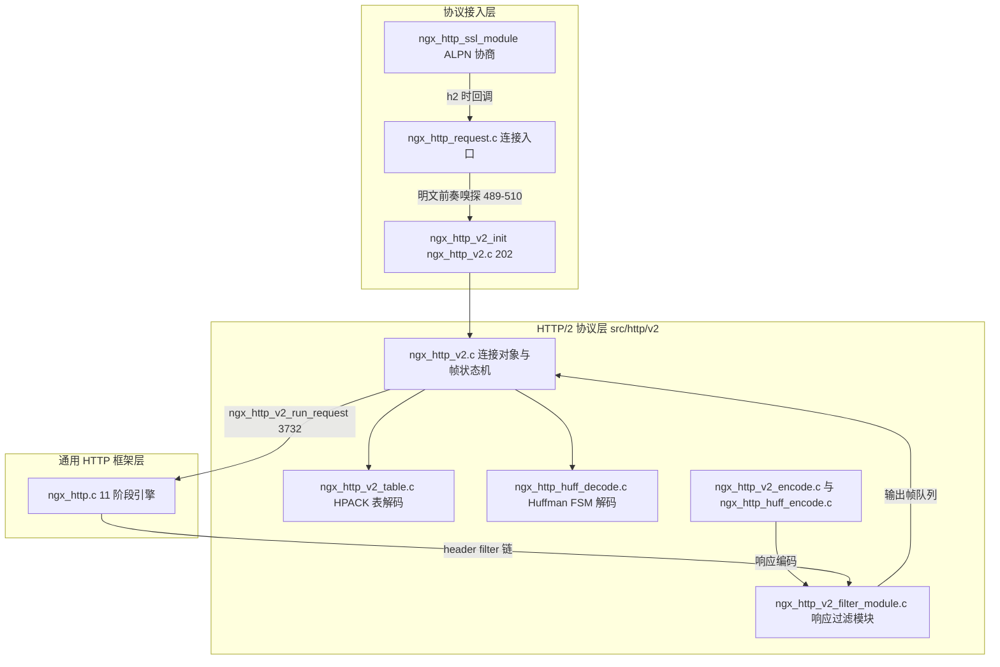
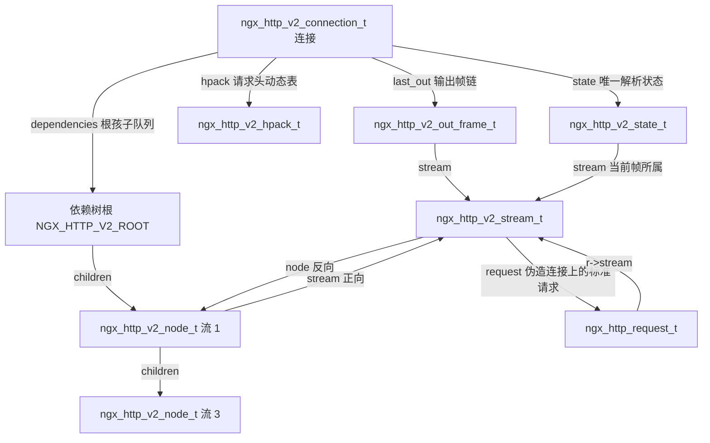
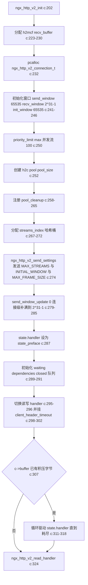
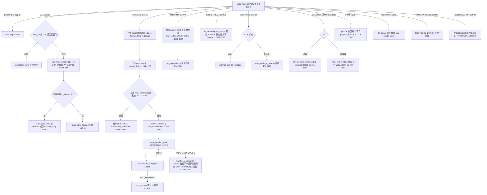
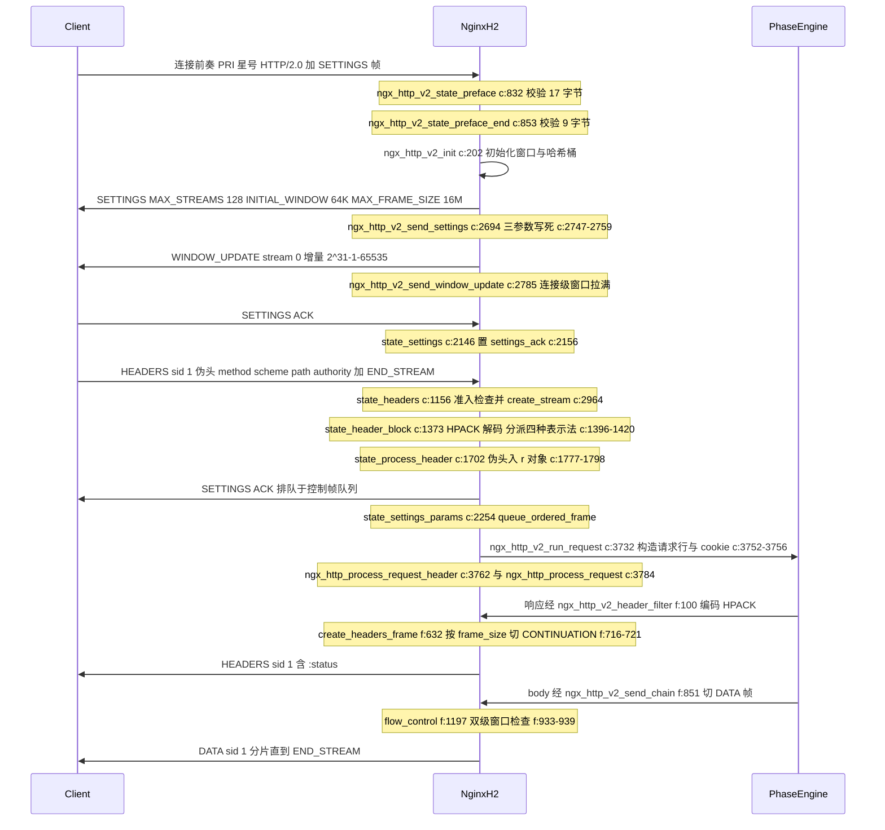
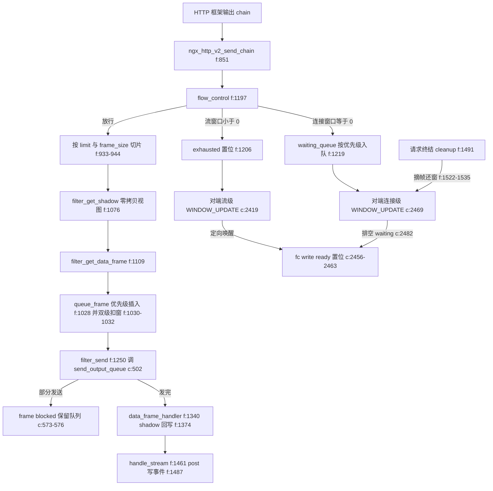

# HTTP/2 实现（帧/流/HPACK/流控）（基于 nginx-1.27.0 源码）

> **导读**：读完本文你将掌握——nginx HTTP/2 模块如何用一个"函数指针状态机 + 16 字节状态缓冲"消化乱序到达的字节流；如何伪造 `ngx_connection_t` 把每条流变成一个标准的 `ngx_http_request_t`，从而原封不动地复用 HTTP/1.1 的 11 阶段引擎；HPACK 动态表如何用"指针数组 + 4096 字节环形存储"实现零搬运的逐出；发送侧如何用 rank/rel_weight 双指标的优先级插入、连接/流双级窗口和 shadow buf 实现"窗口驱动"的 DATA 帧发送。本文不罗列概念，每个机制都落到"数据长什么样、代码怎么走、为什么这么设计"。
>
> **前置阅读建议**：先了解 HTTP/2 规范中的帧格式、HPACK、流依赖树（RFC 7540/7541）的基本概念；再读 nginx 事件框架（`ngx_event_t`、posted event）与 HTTP/1.1 请求解析入口 `ngx_http_request.c`。
>
> **涉及源码清单**（本文所有行号均来自实际读取）：
> - `src/http/v2/ngx_http_v2.c`（4916 行）：连接生命周期、帧状态机、请求构造
> - `src/http/v2/ngx_http_v2.h`（422 行）：全部核心数据结构
> - `src/http/v2/ngx_http_v2_module.c`（498 行）：指令、配置、`$http2` 变量
> - `src/http/v2/ngx_http_v2_filter_module.c`（1570 行）：响应头/体过滤、流控发送
> - `src/http/v2/ngx_http_v2_table.c`（363 行）：HPACK 静态/动态表
> - `src/http/v2/ngx_http_v2_encode.c`（62 行）：字符串与整数编码
> - `src/http/ngx_http_huff_encode.c`（254 行）：Huffman 编码
> - `src/http/ngx_http_huff_decode.c`（2714 行）：Huffman 解码（FSM 表占 25-2639 行）

---

## 1. 本模块在 nginx 中的位置与职责

HTTP/2 模块位于 HTTP 框架之下、协议接入层之上。它有两条进入路径：TLS 连接上经 ALPN 协商出 `h2`（`src/http/ngx_http_request.c:828-850`，`SSL_get0_alpn_selected` 返回 `h2` 后直接调 `ngx_http_v2_init`），以及明文连接上通过嗅探首字节是否匹配 `PRI * HTTP/2.0\r\n\r\nSM\r\n\r\n` 前奏来判断 h2c prior knowledge（`src/http/ngx_http_request.c:489-510`）。

进入 HTTP/2 世界后，协议层自行解析帧、维护流与窗口；但在"流"这一层，它构造出伪造连接和标准请求对象，把控制权交还给通用 HTTP 框架（11 阶段引擎、各种过滤模块），只在响应出口处再由 `ngx_http_v2_filter_module.c` 拦截，把 `ngx_http_headers_out_t` 重新编码为 HPACK 头块、把 body 过滤链吐出的 chain 切成 DATA 帧。



**图解**：上行数据（请求）的路径是 ENTRY → V2INIT → CORE → TABLE/HUFFD → 构造 `ngx_http_request_t` → PHASE；下行数据（响应）的路径是 PHASE → FILTER（把响应头/体重新组帧）→ CORE（挂入 `last_out` 输出队列）→ socket。CORE 是唯一持有真实 TCP 连接的地方，其余一切操作都通过伪造连接进行。

**一个重要的版本事实**：nginx 1.27.0 已经**移除了 server push**。`http2_push` 与 `http2_push_preload` 指令仍可解析但被标记为废弃（`src/http/v2/ngx_http_v2_module.c:167-179`），实际处理函数 `ngx_http_v2_obsolete`（`src/http/v2/ngx_http_v2_module.c:480-498`）只打印 warning 后忽略；filter 模块中已无任何 PUSH_PROMISE 发送代码（`grep push` 验证，`src/http/v2/ngx_http_v2_filter_module.c` 中无 push 相关逻辑）。若客户端发来 PUSH_PROMISE 帧，服务端直接以 PROTOCOL_ERROR 终结连接（`src/http/v2/ngx_http_v2.c:2276-2284`）。第 6.10 节将展开这一设计变迁。

---

## 2. 核心数据结构精讲

所有结构定义于 `src/http/v2/ngx_http_v2.h`。下面逐个"字段逐项表格 + 关系图"讲解。

### 2.1 ngx_http_v2_connection_t（每条 TCP 连接一个，h:124-171）

| 字段 | 类型 | 含义与要点 |
|---|---|---|
| `connection` | `ngx_connection_t *` | 真实 TCP 连接；读写事件 handler 在此切换 |
| `http_connection` | `ngx_http_connection_t *` | HTTP 框架的连接级上下文，用于取 srv/loc conf |
| `total_bytes` / `payload_bytes` | `off_t` | 洪泛检测分子/分母：`total_bytes/8 > payload_bytes + 1MB` 即杀连接（c:428-432） |
| `processing` | `ngx_uint_t` | 当前活跃流数，与 `http2_max_concurrent_streams` 比较（c:1278） |
| `frames` | `ngx_uint_t` | 已分配输出帧总数，上限 10000（c:2887、f:1125） |
| `idle` / `new_streams` / `refused_streams` | `ngx_uint_t` | 空闲事件计数、单次读事件新流数、累计拒绝流数（各自阈值见第 4 节） |
| `priority_limit` | `ngx_uint_t` | PRIORITY 帧配额，初始 `max(concurrent_streams,100)`（c:250），每建流加一次（c:3094） |
| `send_window` | `size_t` | 连接级**发送**窗口，初始 65535（c:241） |
| `recv_window` | `size_t` | 连接级**接收**窗口，初始即拉满 2^31-1（c:242） |
| `init_window` | `size_t` | 当前生效的 SETTINGS_INITIAL_WINDOW_SIZE，初始 65535（c:244） |
| `frame_size` | `size_t` | 对端声明的 MAX_FRAME_SIZE，初始 16384（c:246） |
| `waiting` | `ngx_queue_t` | 连接发送窗口耗尽时挂起流的等待队列 |
| `state` | `ngx_http_v2_state_t` | 字节流解析状态机（见 2.2） |
| `hpack` | `ngx_http_v2_hpack_t` | 请求头 HPACK 动态表（见 2.5） |
| `pool` | `ngx_pool_t *` | 连接级工作池，空闲时销毁重建（c:672-677、c:4630） |
| `free_frames` / `free_fake_connections` | 指针 | 控制帧池与伪造连接回收链 |
| `streams_index` | `ngx_http_v2_node_t **` | 流 ID 哈希桶，`index = (sid>>1) & mask`（h:126-127） |
| `last_out` | `ngx_http_v2_out_frame_t *` | **待发送输出帧单链表**（头插法，即表头是最新帧） |
| `dependencies` / `closed` | `ngx_queue_t` | 依赖树根的孩子队列 / 已关闭节点复用队列 |
| `closed_nodes` | `ngx_uint_t` | 可复用的关闭节点数，超过 32 开始复用（c:3128） |
| `last_sid` | `ngx_uint_t` | 客户端已打开的最大流 ID，GOAWAY 用它作 last-stream-id（c:2860） |
| `settings_ack` / `table_update` / `blocked` / `goaway` | 位域 | 对端是否 ACK、客户端是否改过 HEADER_TABLE_SIZE、解析重入标志、是否已发 GOAWAY |

### 2.2 ngx_http_v2_state_t（字节流解析状态，h:79-105）

| 字段 | 含义 |
|---|---|
| `sid`、`length`、`flags`、`padding` | 当前帧的流 ID、剩余 payload 长度、标志位、填充长度 |
| `incomplete` | 数据不足被 `state_save` 截断保存过（c:2597） |
| `keep_pool` | 头解析池是否已移交 stream（决定 `state_header_complete` 是否销毁它，c:1893-1898） |
| `parse_name` / `parse_value` / `index` | HPACK 子状态：正在解名字/解值/本字段需入动态表 |
| `header` | 已解出的 name/value 对 |
| `header_limit` | 本请求头块剩余预算 = `large_client_header_buffers.size × num`（c:1272-1273） |
| `field_state`、`field_start`、`field_end`、`field_rest` | Huffman FSM 状态、当前字段缓冲起止、剩余待收字节数 |
| `pool` | 1024 字节起步的头解析池（c:1264） |
| `stream` | 当前帧所属流（DATA/HEADERS 才非空） |
| `buffer[16]`、`buffer_used` | **跨读事件续传缓冲**：帧头不满 9 字节时暂存于此 |
| `handler` | 下一批字节到来时该调谁——整个状态机的灵魂 |

### 2.3 ngx_http_v2_stream_t（每条流一个，h:188-224）

| 字段 | 含义 |
|---|---|
| `request` | 关联的 `ngx_http_request_t`（伪造连接上创建） |
| `node` | 依赖树中的节点 |
| `queued` | 本流已排队未发完的输出帧数；>0 时 `fc->buffered` 置位 |
| `send_window` | 流级发送窗口，**有符号**——SETTINGS 缩窗可使其为负（h:195-199 注释明说） |
| `recv_window` | 流级接收窗口，初始 = `http2_body_preread_size`（c:3090） |
| `preread` | HEADERS 的 END_STREAM 之前到达的 body 预读缓冲（c:1116-1128） |
| `frames` / `free_frames` / `free_frame_headers` / `free_bufs` | 流级帧与 chain 回收池 |
| `queue` | 挂入 `h2c->waiting` 用的队列锚点 |
| `cookies` | cookie 头聚合数组（HTTP/2 允许 cookie 拆成多个头） |
| `waiting` / `blocked` / `exhausted` | 在连接窗口等待队列中 / 重入保护 / 流窗口耗尽 |
| `in_closed` / `out_closed` / `rst_sent` / `skip_data` | 流生命周期四标志 |
| `no_flow_control` | 缓冲式读 body 时对流级窗口"不设防"（c:3902） |

### 2.4 ngx_http_v2_node_t（依赖树节点，h:174-185）

| 字段 | 含义 |
|---|---|
| `id` | 流 ID |
| `index` | 哈希桶内链表 next |
| `parent` | 父节点或 `NGX_HTTP_V2_ROOT`（即 `(void*)-1`，c:49） |
| `queue` / `children` / `reuse` | 兄弟队列锚点 / 孩子队列头 / 关闭复用队列锚点 |
| `rank` | 树中深度（根孩子为 1） |
| `weight` | 1-256 的整数权重（线上传输值 +1，c:1236） |
| `rel_weight` | **浮点有效权重** = 父 rel_weight/256 × 本节点 weight（c:4849） |
| `stream` | 活跃流反向指针；NULL 表示这是"仅占位的关闭节点" |

### 2.5 ngx_http_v2_hpack_t（请求头动态表，h:109-121）

| 字段 | 含义 |
|---|---|
| `entries` | `ngx_http_v2_header_t*` 环形数组（初始 64 项，t:201） |
| `added` / `deleted` | 历史累计入表/逐出计数，二者差即表内项数 |
| `reused` | entry 结构体复用游标（entry 本体也循环使用，t:227-235） |
| `allocated` | entries 数组容量 |
| `size` / `free` | 当前协议层表上限（初始 4096，t:202-203）/ 剩余字节 |
| `storage` / `pos` | 4096 字节环形字节存储 / 写游标 |

### 2.6 ngx_http_v2_out_frame_t（输出帧，h:227-239）

| 字段 | 含义 |
|---|---|
| `next` | `last_out` 链表 next |
| `first` / `last` | 帧的 chain 范围（帧头 buf + 内容 buf） |
| `handler` | 发送完成回调，`NGX_AGAIN` 表示只发了一部分 |
| `stream` | 所属流；NULL 表示连接级控制帧 |
| `length` | 帧内容长度（不含 9 字节帧头） |
| `blocked` | 1 表示必须严格保序（如 HEADERS 与其 CONTINUATION、SETTINGS ACK 之前不能插队数据帧） |
| `fin` | END_STREAM 标记，发送完成后置 `stream->out_closed=1`（f:1450-1452） |

### 2.7 配置结构（ngx_http_v2_module.h:17-25 与 h:64-70）

`ngx_http_v2_main_conf_t` 只有 `recv_buffer_size`（默认 256K，module.c:306）与进程级复用的 `recv_buffer`；`ngx_http_v2_srv_conf_t` 含 `enable/pool_size/concurrent_streams/preread_size/streams_index_mask`（h:64-70，默认值 merge 于 module.c:336-355）；`ngx_http_v2_loc_conf_t` 只有 `chunk_size`（默认 8K，module.c:380）。



**图解**：三个层次——连接对象持有"字节流解析状态 + HPACK 表 + 输出队列"三大件；依赖树由 `node` 组成、通过 `stream` 指针与活跃流互指（关闭流后 `stream=NULL`，节点退化为占位节点）；每条流又通过伪造连接 `fc` 把一个标准 `ngx_http_request_t` 接入通用框架。注意 `last_out` 是**头插单链表**，遍历方向与新帧插入方向相反，这正是 6.3 节发送顺序的物理基础。

---

## 3. 初始化/连接建立流程

入口 `ngx_http_v2_init(ngx_event_t *rev)`（`src/http/v2/ngx_http_v2.c:202-325`）在事件回调里完成：分配连接级结构 → 发送我方 SETTINGS → 把连接接收窗口从默认 65535 拉满 → 挂好读写 handler → 若 SSL 缓冲/连接缓冲里已有积压字节，就地驱动状态机开始解析。



**图解**：两个不对称值得注意——(1) nginx 声明的 INITIAL_WINDOW_SIZE 就是 `http2_body_preread_size`（c:2752-2754），即**流的初始接收窗口与 body 预读缓冲等大**，保证对端在窗口内发的 body 一定装得进预读缓冲；(2) 连接级接收窗口初始就被 WINDOW_UPDATE 拉到 2^31-1（c:279-285），因为规范规定连接窗口起点是 65535，而 nginx 希望连接级几乎不构成限制。

对端 SETTINGS 的处理在 `ngx_http_v2_state_settings_params`（c:2173-2273）：INITIAL_WINDOW_SIZE 变化产生 `window_delta`，经 `ngx_http_v2_adjust_windows`（c:4731-4790）摊到所有活跃流，可能为负（缩窗）；处理完排队一个 0 长度 SETTINGS ACK（c:2254-2261，`queue_ordered_frame` 严格保序）。

---

## 4. 帧处理状态机

状态机的分发核心是 `ngx_http_v2_frame_states[]` 函数指针表（c:185-196）：`ngx_http_v2_state_head`（c:878-910）解析 9 字节帧头后按 type 直接跳表调用。整个状态机是**续传风格（CPS）**：每个 handler 返回 `u_char*`，NULL 表示连接已终结；字节不够时 `ngx_http_v2_state_save`（c:2574-2600）把不足 16 字节的残片存进 `state.buffer` 并记住续传 handler。



**图解**（逐分支要点）：

- **DATA（c:913-1050）**：先处理 PADDED（padding ≥ length 即 PROTOCOL_ERROR/SIZE_ERROR，c:922-950）；sid=0 直接连接错误（c:955-960）。流不存在（如已 RST）则静默丢弃 payload（c:986-993）——这是 stream error 与 connection error 的分界示范：对已关闭流发 DATA 只是流级问题，`ngx_http_v2_terminate_stream`（c:4361-4388）回 RST_STREAM 即可；而**窗口违规是连接级错误**（c:962-969、c:2469-2478）。
- **HEADERS（c:1156-1370）**：三重准入检查——`concurrent_streams`（c:1278-1284）、单次读事件新流数 `new_streams >= 2×concurrent_streams`（c:1286-1292）、SETTINGS 未 ACK 且预读窗口小于默认窗口时不许带 body 建流（c:1294-1304）。被拒流回 `RST_STREAM(REFUSED_STREAM)`，但累计拒绝超过 `max(concurrent_streams,100)` 时升级为连接错误（c:1357-1363）。keepalive 预算（超时/请求数/时长）耗尽时**边收边发 GOAWAY**（c:1339-1353）——这就是"优雅排空"的第一现场。
- **CONTINUATION**：nginx 不把 CONTINUATION 当独立帧处理，而是在头块解析的每个入口（`state_header_block`/`state_field_len`/`state_field_huff`/`state_field_raw`）检查"当前帧字节不足且未 END_HEADERS"时调 `ngx_http_v2_handle_continuation`（c:1908-1967）：向前偷看下一个帧头，若不是 CONTINUATION 或流 ID 不符则 PROTOCOL_ERROR（c:1936-1950），然后把下一帧的 payload **memmove 拼进当前解析缓冲**、累计 `state.length`（c:1952-1963）。独立的 `state_continuation` handler（c:2509-2517）只在"头块已完整后又见 CONTINUATION"时触发，必是协议错误。
- **connection error vs stream error**：connection error 一律走 `ngx_http_v2_connection_error`（c:2625-2635）→ `ngx_http_v2_finalize_connection`（c:4643-4728）：先补发 GOAWAY(status)，再遍历 `streams_index` 把每条活跃流的伪造连接标记 `fc->error=1` 并触发其读/写 handler，让各请求沿 HTTP 框架正常收尾；stream error 则是 `ngx_http_v2_terminate_stream`/`close_stream` 只回 RST_STREAM（c:4361-4388、c:4416-4433）。

---

## 5. 关键时序图

下图覆盖"连接前奏 + SETTINGS 协商 + 首请求 + 响应回传"的完整一跳，所有函数名标注真实调用点。



**图解**：注意三处"挤在同一轮事件循环"的行为——(1) 客户端的前奏与 SETTINGS、HEADERS 往往在同一个 TCP 段里，`ngx_http_v2_init` 末尾（c:307-324）直接把 `c->buffer` 中的积压字节喂给状态机，不等下一次读事件；(2) SETTINGS ACK 是在**收到**对端 SETTINGS 时排队、随下一个输出时机捎带发出的；(3) 请求头解码完成后 `run_request` 同步进入 11 阶段引擎，响应若在本次调用栈内产生，会立刻经 filter 变成 HEADERS/DATA 帧排队发送（`ngx_http_v2_read_handler` 末尾 c:441-444 统一冲刷 `last_out`）。

---

## 6. 源码逐段精读

本节为全文主体。每个函数按"签名 → 逐块逻辑 → 关键行 → 易错点"展开。

### 6.1 ngx_http_v2_init —— 连接对象与初始窗口布局

**签名**：`void ngx_http_v2_init(ngx_event_t *rev)`（c:202-325）。

逻辑分六块：

1. **接收缓冲惰性分配**：`h2mcf->recv_buffer` 是进程级共享缓冲（`http2_recv_buffer_size`，默认 256K，module.c:306），所有连接轮流用它做"读到数据→解析"的工作区（c:223-230）。这意味着**解析过程不把数据留在连接上**，一次读事件的字节必须在本次调用内消化完或存进 16 字节 `state.buffer`。
2. **窗口三件套初始化**（c:241-246）：`send_window=65535`（规范默认连接发送窗口）、`recv_window=2^31-1`、`init_window=65535`、`frame_size=16384`。
3. **配额**：`priority_limit = max(concurrent_streams, 100)`（c:250），每创建一条流再追加 `concurrent_streams`（c:3094），用于限制 PRIORITY 帧洪泛。
4. **池与哈希桶**：`h2c->pool` 大小 = `http2_pool_size`（c:252）；`streams_index` 桶数 = `http2_streams_index_size`（c:267-272）。清理钩子 `ngx_http_v2_pool_cleanup`（c:4904-4916）保证连接异常终止时残留的 `state.pool`/`h2c->pool` 被销毁。
5. **首帧排队**：`ngx_http_v2_send_settings`（c:2694-2764）与 `ngx_http_v2_send_window_update(h2c, 0, ...)`（c:279-285）。注意这两个函数只**排队**帧，真正写出发生在稍后的 `send_output_queue`。
6. **就地消化积压**（c:307-324）：TLS 握手阶段 ALPN 回调时 OpenSSL 缓冲里可能已有应用数据；明文路径 `ngx_http_request.c:498-503` 更是把完整前奏都嗅探过了。`do { p = h2c->state.handler(h2c, p, end); } while (p != end);` 是整个模块的运行时骨架。

**易错点**：`recv_window` 在此初始化为 `NGX_HTTP_V2_MAX_WINDOW` 而非规范的 65535，配合随后发出的 WINDOW_UPDATE 才自洽——若只看 c:242 而不看 c:279-285 会误以为 nginx 违反了规范。

### 6.2 ngx_http_v2_read_handler —— 事件主循环与洪泛检测

**签名**：`static void ngx_http_v2_read_handler(ngx_event_t *rev)`（c:328-449）。

```c
    h2c->blocked = 1;
    h2c->new_streams = 0;
    ...
    do {
        p = h2mcf->recv_buffer;
        end = ngx_cpymem(p, h2c->state.buffer, h2c->state.buffer_used);
        n = c->recv(c, end, available);
        ...
        do {
            p = h2c->state.handler(h2c, p, end);
            if (p == NULL) {
                return;
            }
        } while (p != end);
        h2c->total_bytes += n;
        if (h2c->total_bytes / 8 > h2c->payload_bytes + 1048576) {
            ngx_log_error(NGX_LOG_INFO, c->log, 0, "http2 flood detected");
            ngx_http_v2_finalize_connection(h2c, NGX_HTTP_V2_NO_ERROR);
            return;
        }
    } while (rev->ready);
```
（c:349-434，摘录有省略）

要点逐条：

- `blocked=1` 贯穿整个解析期（c:349）：期间任何代码调用 `ngx_http_v2_send_output_queue`（如请求体读取路径 c:3917-3922）都**不会**与外层发送竞争——它通过 `h2c->blocked` 实现轻量重入保护（c:609、c:4491 都依赖它）。
- 每次读事件先把上轮残片 `state.buffer` 拷到接收缓冲头部，再 `recv` 追加（c:392-395）——16 字节缓冲对齐了"帧头 9 字节 + 最大整数前缀"的最坏半包场景。
- 对端优雅关闭（`n==0`）只有在 `processing==0` 且无未完成解析时才是正常 EOF，否则日志记录 premature close（c:401-404）。
- **洪泛检测**（c:428-432）：`total_bytes/8 > payload_bytes + 1MB` 即"有效负载占比低于 1/8"时终结连接。它打击的是 PING/PRIORITY/WINDOW_UPDATE 等纯开销帧轰炸——注意这些帧的 payload 会计入 `total_bytes`，却几乎不贡献 `payload_bytes`（后者只在真实 body 与响应帧处累加，c:1102、c:2958、f:1425）。空闲期另有 `idle++ > 10×keepalive_requests` 的第二道闸（c:4617-4622）。
- 循环末尾统一冲刷输出队列（c:441-444），保证本轮处理中排队的 SETTINGS ACK/PING ACK/WINDOW_UPDATE 不积压。

**易错点**：`ngx_http_v2_state_save` 的残片上限是 `NGX_HTTP_V2_STATE_BUFFER_SIZE=16`（c:2586-2591），一旦超过即内部错误——因此所有"可能残缺"的解析状态（帧头、整数前缀）都必须保证增量小于 16 字节；HPACK 的字符串本体不走这个缓冲，而是用 `state.field_start` 动态缓冲跨帧续传（c:1545-1550）。

### 6.3 ngx_http_v2_send_output_queue —— 输出帧链的组装与回调

**签名**：`ngx_int_t ngx_http_v2_send_output_queue(ngx_http_v2_connection_t *h2c)`（c:502-614）。

- **组链**（c:523-538）：遍历 `last_out`（头插链，头是最新帧），把每帧的 chain 串起来，同时把帧链表反转到局部 `out`——最终 TCP 上的字节顺序等于 `out` 的遍历顺序，即"最老帧在前"。
- **一次 writev**（c:540）：`c->send_chain(c, cl, 0)` 尽量多发；随后 `ngx_handle_write_event` 与 tcp_nopush/nodelay 例行处理（c:546-568）。
- **逐帧回调**（c:570-582）：对 `out` 中每帧调 `frame->handler`。返回 `NGX_AGAIN`（部分发送）则置 `frame->blocked=1` 并 break——**该帧及其后所有帧**保留在队列里等下次写事件。这就是 `blocked` 字段在输出侧的语义：部分发送的帧是硬屏障。
- **重建队列**（c:584-592）：未完成的帧再次反转回 `last_out`（恢复"头=最新"约定）。
- **错误路径**（c:605-613）：置 `c->error=1`；若不在 `blocked` 解析区则把写事件投递到 posted 队列，让清理延迟到安全点。

**易错点**：帧的 `handler` 返回 NGX_OK 并不代表"字节已到网络"，只代表该帧的 chain 已全部提交给内核（`buf->pos == buf->last`，c:2775、c:2951）。控制帧（SETTINGS ACK、PING ACK、WINDOW_UPDATE、RST、GOAWAY）共用 `ngx_http_v2_frame_handler`（c:2943-2961），完成后帧结构回收入 `h2c->free_frames`。

### 6.4 三种排队函数 —— 输出调度的第一现场（h:242-292）

- `ngx_http_v2_queue_frame`（h:242-265）：**按优先级插入**。从头（最新）向尾（最老）扫描，直到遇到"rank 更小（树中更靠根）或同 rank 且 rel_weight 更大"的帧——即插在所有"优先级不低于自己"的数据帧之前。DATA 帧走这条路（f:1028）。
- `ngx_http_v2_queue_blocked_frame`（h:268-283）：跳过所有已有帧，插到**最老的帧之后**（队尾），但会停在第一个 `blocked` 帧或连接级帧之前。HEADERS 响应（f:612）、RST/GOAWAY/WINDOW_UPDATE/PING ACK（c:2330、c:2761、c:2807、c:2835、c:2863）走这条路——控制语义必须晚于已排队数据吗？不，它的语义是"插在最旧数据之后"，保证**先来的先走**，避免乱序。
- `ngx_http_v2_queue_ordered_frame`（h:286-292）：无条件插到队头（最旧位置）。目前只有 SETTINGS ACK 使用（c:2261）。

为什么 HEADERS 要 blocked 而 DATA 用优先级插入？因为 HEADERS 响应必须先于其 DATA（HTTP 语义），且 HPACK 编码依赖动态表状态；DATA 帧之间则纯粹按流优先级竞争带宽。

### 6.5 ngx_http_v2_state_data / state_read_data —— 接收侧流控与 body 通路

**签名**：`static u_char *ngx_http_v2_state_data(...)`（c:913-1050）、`ngx_http_v2_state_read_data(...)`（c:1053-1153）。

`state_data` 的检查顺序是精心安排的：

1. PADDED 处理：先验 `length==0`（SIZE_ERROR，c:924-930），再取 padding 字节并验 `padding >= size`（PROTOCOL_ERROR，c:937-947）。
2. sid==0 → PROTOCOL_ERROR（c:955-960）。
3. **连接窗口**：`size > h2c->recv_window` → FLOW_CTRL_ERROR 连接错误（c:962-969）；否则扣减，且当剩余不足 1/4 时立刻回 WINDOW_UPDATE 拉回满窗口（c:971-984）——这是"被动一半就补满"策略，几乎恒定维持 2^31-1 的连接窗口。
4. 找流：不存在则 `state_skip_padded` 丢弃（c:986-993）。
5. **流窗口**：`size > stream->recv_window` → `terminate_stream(FLOW_CTRL_ERROR)`（stream error，c:997-1012）。缓读模式下（`no_flow_control`）同样"不足 1/4 即补满"（c:1016-1029）。
6. `in_closed` 已置位却仍来 DATA → terminate_stream(STREAM_CLOSED)（c:1031-1045）。

`state_read_data` 是 body 的三个去向分流器（c:1053-1153）：

- 请求体过滤链已就绪（`r->request_body` 存在）→ `ngx_http_v2_process_request_body` 直通（c:1104-1113）；
- 头阶段未结束或上游还没开始读 → 拷进 `stream->preread` 临时缓冲，容量为 `http2_body_preread_size`，溢出即内部错误（c:1115-1138）；
- `skip_data`（流已被 RST/请求已终结）→ 静默丢弃但**窗口照扣照补**（c:1071-1076）——必须维持窗口会计平衡，否则连接会被拖死。

**易错点**：`stream->in_closed = h2c->state.flags & END_STREAM_FLAG` 只在"本帧即最后一块数据"时才置位（c:1097-1100）；DATA 帧可跨多个读事件续传（c:1143-1146 的 `state_save`），padding 的跳过发生在整帧收完后（c:1148-1150）。

### 6.6 ngx_http_v2_state_headers —— 新流的准入与请求对象装配

**签名**：`static u_char *ngx_http_v2_state_headers(...)`（c:1156-1370）。

- 帧长预检：padded/priority 标志预算不足或头块为空 → SIZE_ERROR（c:1183-1196）。
- `goaway` 已置位则直接 skip（c:1198-1202）——GOAWAY 之后的 HEADERS 静默丢弃而非 RST，符合规范"客户端不得再建流"的握手退避。
- 优先级字段解析（c:1227-1239）：`weight = pos[4] + 1`（线上 0-255 映射为 1-256）。
- 流 ID 合法性：必须奇数且严格大于 `last_sid`（c:1246-1252）；`depend == sid` 自依赖 → PROTOCOL_ERROR（c:1254-1260）。
- 资源装配：1024 字节头解析池（c:1264-1267）、`header_limit = large_client_header_buffers.size × num`（c:1272-1273）。
- **并发三闸**（c:1278-1304）+ 拒绝流路径 `rst_stream`（c:1357-1369），见第 4 节。
- 节点获取：`ngx_http_v2_get_node_by_id(h2c, sid, 1)`（c:1306-1315）——若命中已关闭节点（`node->parent != NULL` 说明挂在复用队列），先从 `closed` 队列摘下并 `closed_nodes--`，**保留其依赖树位置**，使新流继承旧流的优先级槽位。
- `ngx_http_v2_create_stream`（c:2964-3101）造伪连接与请求（见 6.8）。
- 依赖挂树：`if (priority || node->parent == NULL)` 才调 `ngx_http_v2_set_dependency`（c:1334-1337）——复用的关闭节点若客户端未声明优先级，保留原树位置。

### 6.7 ngx_http_v2_state_header_block —— HPACK 四种表示法的入口

**签名**：`static u_char *ngx_http_v2_state_header_block(...)`（c:1373-1470）。

首字节 `ch` 的高位模式分派（c:1396-1420）：

| 模式 | 判定 | 前缀 | 语义 |
|---|---|---|---|
| 索引头字段 | `ch >= 1<<7` | 7 位 | 整对从静态/动态表取（c:1444-1450） |
| 增量索引字面量 | `ch >= 1<<6` | 6 位 | `state.index=1`，解完后入动态表（c:1403-1406） |
| 动态表大小更新 | `ch >= 1<<5` | 5 位 | `ngx_http_v2_table_size`（c:1452-1458） |
| never-indexed 字面量 | `ch >= 1<<4` | 4 位 | 不入表（c:1413-1415） |
| 无索引字面量 | 其余 | 4 位 | 不入表（c:1417-1420） |

整数解析统一走 `ngx_http_v2_parse_int`（c:2638-2691）：前缀位全 1 时按 HPACK 变长整数续读，上限 4 字节——超过即 `NGX_DECLINED`（COMP_ERROR，c:1430-1436），数据不足是 `NGX_AGAIN`（保存续传）。

字面量的名字/值各有 H 位与 7 位长度前缀，由 `ngx_http_v2_state_field_len`（c:1473-1557）分派：`huff = *pos >> 7`（c:1501）；单字段超过 `large_client_header_buffers.size` 直接 ENHANCE_YOUR_CALM（c:1530-1535）——这是比 HTTP/1.1 更激进的洪泛防御。解码缓冲按最坏膨胀率预分配：`alloc = huff ? len*8/5+1 : len+1`（c:1543）。若该头属于"已拒绝流"（`state.stream==NULL`）且无需入表，直接 `state_field_skip` 跳过字节（c:1539-1541）。

### 6.8 ngx_http_v2_create_stream —— 伪造连接与 ngx_http_request_t 构造

**签名**：`static ngx_http_v2_stream_t *ngx_http_v2_create_stream(...)`（c:2964-3101）。

这是"复用 HTTP/1.1 框架"的全部秘密：

1. **伪连接**（c:2976-3042）：从 `free_fake_connections` 回收或新分配 `ngx_connection_t + 2×ngx_event_t + log + log_ctx`，然后 `ngx_memcpy(fc, h2c->connection, sizeof(ngx_connection_t))` **整结构体拷贝真实连接**，再覆盖 data/read/write/sent/log/buffered 等字段。此后每个流拿到一个"看起来像独立 TCP 连接"的对象，`fc->error`、`fc->timedout`、`fc->buffered` 等语义全部按流隔离。
2. **标准请求**（c:3044-3074）：`ngx_http_create_request(fc)` 创建 `ngx_http_request_t`；`r->http_protocol = "HTTP/2.0"`、`r->http_version = NGX_HTTP_VERSION_20`、`r->valid_location = 1`；`headers_in.connection_type` 预置 CLOSE（HTTP/2 无连接头概念）。
3. **流窗口初始化**（c:3089-3090）：`send_window = h2c->init_window`（对端 SETTINGS 决定）；`recv_window = h2scf->preread_size`。
4. **配额回收**（c:3092-3098）：`processing++`、`priority_limit += concurrent_streams`、删除连接级读超时定时器（活跃期由流级/框架超时接管）。

随后的 `ngx_http_v2_run_request`（c:3732-3789）补齐 HTTP/1.1 中由请求行解析器填的东西：`construct_request_line`（c:3557-3609）把 `:method :path` 拼成 `"%method %uri HTTP/2.0"` 的假请求行；`construct_cookie_header`（c:3641-3729）把散落的 cookie 头用 `"; "` 拼回单个 Cookie；`r->http_state = NGX_HTTP_PROCESS_REQUEST_STATE` 后调用 `ngx_http_process_request_header`（c:3762）与 `ngx_http_process_request`（c:3784，定义于 `src/http/ngx_http_request.c:2053`，其内部 c:2140 调 `ngx_http_handler` 进入 11 阶段引擎）。还有两处 HTTP/2 特有校验：声明了 content-length 却 END_STREAM 提前到达 → 400（c:3766-3774）；无 content-length 且流未关 → 视作 chunked（c:3776-3778）。

伪头处理在 `ngx_http_v2_pseudo_header`（c:3282-3328）：按名字长度分派到 `parse_path`（c:3331-3367，调 `ngx_http_parse_uri`/`ngx_http_process_request_uri` 填 `r->uri`）、`parse_method`（c:3370-3463，**栈上 16 项静态表线性匹配**常见方法并赋予 `r->method` 位掩码）、`parse_scheme`（c:3466-3509）、`parse_authority`（c:3512-3554，伪装成 host 头走标准 `ngx_http_process_host`）。普通头则走 `ngx_hash_find(cmcf->headers_in_hash, ...)` 命中各头预注册的 handler（c:1840-1847）——与 HTTP/1.1 完全同一条路。

### 6.9 HPACK 动态表 —— ngx_http_v2_table.c 全解

**静态表**：61 项常量数组（t:20-86），第 1 项 `:authority`、第 8 项 `:status: 200`……头文件里的 `NGX_HTTP_V2_STATUS_200_INDEX 8` 等宏（h:380-407）与其下标一一对应，响应编码端（f:163）直接用这些下标生成单字节索引。

**查找** `ngx_http_v2_get_indexed_header`（t:103-185）：

```c
    index--;
    if (index < NGX_HTTP_V2_STATIC_TABLE_ENTRIES) {
        h2c->state.header = ngx_http_v2_static_table[index];
        return NGX_OK;
    }
    index -= NGX_HTTP_V2_STATIC_TABLE_ENTRIES;
    if (index < h2c->hpack.added - h2c->hpack.deleted) {
        index = (h2c->hpack.added - index - 1) % h2c->hpack.allocated;
        entry = h2c->hpack.entries[index];
        p = ngx_pnalloc(h2c->state.pool, entry->name.len + 1);
        ...
        rest = h2c->hpack.storage + NGX_HTTP_V2_TABLE_SIZE - entry->name.data;
        if (entry->name.len > rest) {
            p = ngx_cpymem(p, entry->name.data, rest);
            p = ngx_cpymem(p, h2c->hpack.storage, entry->name.len - rest);
        }
```
（t:121-150，摘录有省略）

三个设计点：(1) 动态表下标 0 是最新项，`added - index - 1` 把"倒数第 index 项"映射为环形数组的物理下标；(2) 名字与值**先拷贝到 `state.pool`** 再交给解析器——因为环形存储随时会被后续入表覆盖，而 `state.header` 的生命周期可能跨越多个头字段；(3) `rest` 计算处理 name/value **跨越存储末尾回卷**的情况，两段拼接（t:144-150、t:168-174）。

**插入** `ngx_http_v2_add_header`（t:188-299）：懒初始化 64 项 entries + 4096 字节 storage（t:200-219）；`ngx_http_v2_table_account`（t:302-332）按 HPACK 规则"每项开销 = 32 + name.len + value.len"做预算——放得下直接扣减；单项超过整表则清空全部（`deleted=added`，返回 `NGX_DECLINED`，调用方随即放弃入表，t:221-225）；否则从最旧项开始逐出直到腾出空间（t:324-327）。entry 结构体本身也经 `reused` 游标循环复用（t:227-235），只有 entries 指针数组满 64 项才扩容并**旋转搬运指针**（t:268-294）。

**表大小更新** `ngx_http_v2_table_size`（t:335-363）：客户端 SETTINGS 或头块内的 dynamic table size update 走这里；超过 4096（nginx 不发 SETTINGS_HEADER_TABLE_SIZE 调整，硬上限即规范默认值）报错（t:341-346）；缩表时从最旧逐出直到 `free >= needed`（t:352-357）。

**响应侧反向操作**：nginx **不维护响应动态表**。当客户端发 SETTINGS_HEADER_TABLE_SIZE 时置 `h2c->table_update=1`（c:2242-2245），响应头过滤器随即在头块开头插入一个"大小更新为 0"的单字节（f:404-409），宣告响应不使用动态表——省去对端解码端的表维护成本。

### 6.10 server push 的移除（1.27.0 现状）

任务清单要求讲 `http2_push` 实现，但必须如实说明：**nginx 1.27.0 已删除 server push 功能**。证据链：`http2_push`/`http2_push_preload`/`http2_max_concurrent_pushes` 三个指令全部注册为 `ngx_http_v2_obsolete` 处理（module.c:104-109、module.c:167-179），该处理函数仅打印"the directive is obsolete, ignored"（module.c:480-498）；filter 模块（1570 行）中无任何 PUSH_PROMISE 构造代码（grep 验证仅命中 obsolete 指令表）；连接层收到 PUSH_PROMISE 帧直接 PROTOCOL_ERROR（c:2276-2284）；对客户端 ENABLE_PUSH 设置仅校验值 ≤1 后丢弃（c:2229-2240）。该功能自 1.25.1 起移除（历史版本中由 filter 模块解析 `Link: <...>; rel=preload` 头并发送 PUSH_PROMISE——此段代码在 1.27.0 源码中已不存在，具体历史实现细节此处不做行号断言）。对读者的实际影响：调优时应关注 `https://`+`103 Early Hints` 等替代方案，而非本模块源码。

### 6.11 响应头过滤 ngx_http_v2_header_filter

**签名**：`static ngx_int_t ngx_http_v2_header_filter(ngx_http_request_t *r)`（f:100-629，注册于 f:1563-1570 挂到 header filter 链顶端）。

- **非 HTTP/2 请求直通**：`if (!stream) return ngx_http_next_header_filter(r)`（f:131-135）——同一二进制里 HTTP/1.1 流量完全不受影响。
- **状态码索引化**（f:160-210）：200/204/206/304/400/404/500 用静态表单字节（如 `ngx_http_v2_indexed(8)` = `0x88`）；其余状态码用"增量索引名字 + 原文值"三字节（f:419-422）。
- **预编码常量**（f:118-129）：`nginx[5] = "\x84\xaa\x63\x55\xe7"` 是 "nginx" 的 Huffman 编码字节；`accept_encoding[12]` 是 "gzip, deflate" 的编码——启动期算好的 `NGINX_VER` 头块缓存于静态数组（f:443-464）。
- 头块预算 `len` 逐项累加（f:214-393），超出 `NGX_HTTP_V2_MAX_FIELD`（127+2^21-1，h:24-25）即 CRIT 错误返回 NGX_ERROR（f:369-381）。
- **fin 判定**（f:604-605）：`header_only` 或 `content_length_n==0` 时 HEADERS 帧自带 END_STREAM。
- 建帧后 `queue_blocked_frame`（f:612）+ `stream->queued=1`（f:614），并给请求挂 cleanup（f:616-622，见 6.15），最后调 `ngx_http_v2_filter_send` 立即冲刷（f:628）。

`ngx_http_v2_create_headers_frame`（f:632-734）把 HPACK 块按 `h2c->frame_size` 切片：第一片 HEADERS，后续每片前补 9 字节 CONTINUATION 帧头（f:716-721）；chain 结构为 [帧头buf, 数据buf, 帧头buf, 数据buf, ...]。

### 6.12 ngx_http_v2_send_chain —— DATA 帧切分与双级窗口

**签名**：`static ngx_chain_t *ngx_http_v2_send_chain(ngx_connection_t *fc, ngx_chain_t *in, off_t limit)`（f:851-1073）。它被挂为伪连接的 `fc->send_chain`（f:624），HTTP 框架所有输出从此改道。

```c
    if (size && ngx_http_v2_flow_control(h2c, stream) == NGX_DECLINED) {
        if (ngx_http_v2_filter_send(fc, stream) == NGX_ERROR) {
            return NGX_CHAIN_ERROR;
        }
        if (ngx_http_v2_flow_control(h2c, stream) == NGX_DECLINED) {
            fc->write->active = 1;
            fc->write->ready = 0;
            return in;
        }
    }
```
（f:900-911）

逐块逻辑：

1. **入口清理**：跳过空 buf（f:873-881）；流已 out_closed 却还有数据 → 错误（f:883-889）。
2. **流控闸门**（f:900-911）：窗口不足时先冲刷已排队帧（可能对端已补窗），仍不足则把伪连接写事件置为"未就绪"并**原样返回 `in`**——数据留存在 HTTP 框架的输出链里（这就是"窗口耗尽时 DATA 的缓冲位置"：不在 h2 输出队列，而在 body filter 链的未消费 chain 中）。流级耗尽置 `stream->exhausted=1`（f:1205-1208）；连接级耗尽则把流挂入 `h2c->waiting` 按优先级排序的等待队列（f:1210-1213，插入算法 f:1232-1246 与 queue_frame 同款 rank/rel_weight 比较）。
3. **窗口预算**（f:933-944）：`limit = min(conn send_window, stream send_window)`；每帧尺寸 `frame_size = min(http2_chunk_size, h2c->frame_size)`。
4. **零拷贝切片**（f:952-1008）：对内存 buf 或文件 buf 调 `ngx_http_v2_filter_get_shadow`（f:1076-1106）生成 shadow buf——同一块数据的不同偏移视图，通过 `buf->shadow` 指针回链原 buf。DATA 帧发送完成后 `data_frame_handler` 把 shadow 的 pos 同步回写原 buf（f:1374-1384），这样 HTTP 框架能正确感知"文件已发到哪"。
5. **建帧与扣窗**（f:1010-1034）：`ngx_http_v2_filter_get_data_frame`（f:1109-1194）组帧，END_STREAM 取决于最后一个 buf 的 `last_buf`；然后 `queue_frame`（优先级插入）、**同时扣减连接与流两级窗口**（f:1030-1032）、`stream->queued++`。
6. **trailers**（f:1010-1019、f:1036-1041）：`last_buf` 出现时尝试 `create_trailers_frame`（f:737-848），有 trailer 则把 END_STREAM 让给它。
7. 收尾（f:1053-1072）：剩余半包偏移重新 shadow 回 `in->buf`，再次 `filter_send` 冲刷，窗口仍不足则挂起写事件。

**易错点**：`frame_size` 每轮循环都可能被 limit 压缩为 0（f:953-955），此时只有 `last_buf` 帧会照发（f:1021 条件 `frame_size || cl->buf->last_buf`）——保证 END_STREAM 永不丢。

### 6.13 流控调度闭环 —— flow_control / filter_send / 各 handler

- `ngx_http_v2_flow_control`（f:1197-1216）：流窗口 ≤0 → `exhausted=1`；连接窗口 ==0 → 入 waiting 队列；其余放行。
- `ngx_http_v2_filter_send`（f:1250-1281）：`stream->blocked=1` 防重入后调 `send_output_queue`；仍有排队帧则给伪连接置 `NGX_HTTP_V2_BUFFERED` 位并返回 NGX_AGAIN（f:1271-1276）——HTTP 框架由此知道"还有数据没走完"。
- **唤醒路径一（流窗口）**：对端 WINDOW_UPDATE(流) → `state_window_update`（c:2451-2464）直接把伪连接写事件置 ready 并调 handler；SETTINGS 缩窗回补走 `adjust_windows`（c:4774-4785）同样唤醒。
- **唤醒路径二（连接窗口）**：WINDOW_UPDATE(0) → 排空 `h2c->waiting`，逐个唤醒直到连接窗口再次耗尽（c:2482-2503）。
- **唤醒路径三（帧发完）**：`ngx_http_v2_handle_stream`（f:1461-1488）在每帧发完后，若流既不 waiting 也不 exhausted，把伪连接写事件 post 到 posted 队列，驱动框架继续产出下一批 body。

### 6.14 帧发送完成回调 —— headers/data frame handler

`ngx_http_v2_headers_frame_handler`（f:1284-1337）：逐 chain 检查 `pos==last`，未发完返回 NGX_AGAIN；发完则按 tag 回收（帧头 buf 回 `free_frame_headers`，HPACK 数据 buf 回 `free_bufs`），累计 `r->header_size` 与 `h2c->payload_bytes`，最后 `handle_frame` + `handle_stream`。

`ngx_http_v2_data_frame_handler`（f:1340-1432）：多一步 shadow 回写（f:1374-1384）；**部分发送时若已跨过至少一个 chain，会先 `handle_stream` 再返回**（f:1388-1391）——让框架在长传输中途也有机会补窗/调整。`handle_frame`（f:1435-1458）做四件事：累计 `fc->sent`、`h2c->total_bytes`、`fin` 时置 `out_closed`、帧结构回收并 `queued--`。

### 6.15 ngx_http_v2_filter_cleanup —— 请求中途夭折时的窗口回收

**签名**：`static void ngx_http_v2_filter_cleanup(void *data)`（f:1491-1560，注册于 f:616-622 的 request cleanup）。

请求被提前终结（如客户端 RST、上游错误）但其输出帧仍在 `last_out` 排队时：从 `last_out` 中摘除属于本流的未 blocked 帧，**把对应字节量还给 `h2c->send_window`**（f:1515-1535、f:1559）；若连接窗口因此从 0 变正，顺带唤醒全部等待流（f:1537-1557）。没有这个钩子，被取消请求占用的连接窗口将永久泄漏。

### 6.16 关流与连接终结 —— close_stream / finalize_connection

`ngx_http_v2_close_stream`（c:4391-4499）：

- `queued>0`（帧还挂在输出队列）→ 只改伪连接读写 handler 为 `retry_close_stream_handler`（c:4409-4414），等帧发完由 `handle_frame` 的 `queued--` 到 0 后经 `handle_stream` 唤醒重试。
- 补发 RST_STREAM 的三分支（c:4416-4433）：双向未关 → RST(PROTOCOL_ERROR，超时场景) / RST(INTERNAL_ERROR)；仅出向已关 → RST(NO_ERROR)。
- 节点入 `closed` 复用队列（c:4440-4443）；请求池**延迟销毁**——注释明说日志阶段还要读解码后的请求头（c:4445-4464）；伪连接回收（c:4486-4487）；`processing--` 后若连接空闲则 post `handle_connection_handler`（c:4491-4498）。

`ngx_http_v2_finalize_connection`（c:4643-4728）是 connection error 的终点：补发 GOAWAY（c:4659-4665）→ 遍历 `streams_index`，对每条活跃流置 `fc->error`、`ev->eof=1` 并调用其读（或写）handler，让每个请求沿框架路径自行 finalize（c:4671-4711）→ 若仍有 `processing`（异步 finalize 还在路上）则置 `c->error=1` 等最后一根稻草；否则进入 lingering close（c:4720-4728）读干残余字节。GOAWAY 的另一处常规触发点是 keepalive 预算耗尽（c:1339-1353）与 `read_handler` 收到 `c->close` 信号（c:365-379）。

### 6.17 依赖树 —— set_dependency 与节点复用

`ngx_http_v2_set_dependency`（c:4793-4881）：

- 父节点查找失败/依赖 0 → 挂到根 `NGX_HTTP_V2_ROOT`，`rank=1`、`rel_weight = weight/256`（c:4800-4813）。
- **环预防**（c:4815-4846）：沿新父向上爬，若撞见 `node` 自己（把祖先变成孩子会成环），把 parent 改挂到 node 现有 parent 之下再继续。
- 排他标志（exclusive）实现为"把父的孩子队列整体过继给自己"（c:4859-4870）。
- 每次挂树后 `ngx_http_v2_node_children_update`（c:4884-4901）递归刷新子树 rank/rel_weight。

关闭节点的权重继承在 `ngx_http_v2_get_closed_node`（c:3149-3227）：把待回收节点的孩子按 `child->weight = node->weight × child->weight / 总孩子权重` 重新分配并整体上移一层（c:3183-3222），最小钳到 1 防止权重归零。节点回收策略：`closed_nodes < 32` 时直接新分配；否则复用最旧的关闭节点（c:3128-3136）——依赖树内存因此有界。

### 6.18 Huffman 编码 —— ngx_http_huff_encode

**签名**：`size_t ngx_http_huff_encode(u_char *src, size_t len, u_char *dst, ngx_uint_t lower)`（he:191-254）。

- 两张 256 项码表：`ngx_http_huff_encode_table`（he:20-86）与内嵌小写转换的 `_lc` 版（he:90-156，`lower` 时选它，he:199-200——**name 编码顺带转小写**，见 h:372-373 的 `ngx_http_v2_write_name` 传参 1）。每项是 `{code, len}`，如 '0'（0x30）为 `{0x0, 5}`、EOS 为 30 位全 1。
- 位流累积：把 code 左移到 32/64 位缓冲的高位，攒满一个机器字就 `ngx_http_huff_encode_buf` 大端写出（he:207-232，宏见 he:159-188）。
- **收益预判即放弃**：任何一次"将写出"前检查 `hlen + sizeof(buf) >= len`，超了立即 `return 0`（he:219-221、he:242-244）——表示"编码不划算"，调用方 `ngx_http_v2_string_encode`（e:17-40）随即退回原文模式。因此该函数的返回值语义是"0 = 不编码，否则为编码后长度"，且**保证永不膨胀**。
- 尾部填充：剩余位补 1（EOS 前缀填充，he:238），按字节对齐写出（he:240-251）。

### 6.19 Huffman 解码 —— 256×16 FSM

解码文件主体是 `ngx_http_huff_decode_codes[256][16]`（hd:25-2639）：**256 个状态 × 16 个 nibble 转移**。每项 `{next, emit, sym, ending}`（hd:13-18）。解码入口（hd:2642-2690）逐字节拆高低 4 位各调一次 `ngx_http_huff_decode_bits`（hd:2694-2714）：

```c
    code = ngx_http_huff_decode_codes[*state][bits];
    if (code.next == *state) {
        return NGX_ERROR;
    }
    if (code.emit) {
        *(*dst)++ = code.sym;
    }
    *ending = code.ending;
    *state = code.next;
```
（hd:2700-2711）

要点：(1) `next == 当前状态` 被保留为"非法码字"哨兵（规范中的错误码字恰好自环）；(2) `ending` 记录"当前是否落在码字边界"——流收完（`last=1`）时若 `ending==0` 说明码字被截断，报错（hd:2677-2687）并复位状态机（`*state=0`，hd:2686）；(3) 状态跨调用保持于 `h2c->state.field_state`（c:1579-1582 传入），因此 nibble 流可以在帧边界处无缝续解。该 FSM 由规范码表自动生成，查表一次完成"走边+出符号"，单字节两次查表、零分支预测压力。

### 6.20 请求体读取 —— read_request_body 与窗口补充

`ngx_http_v2_read_request_body`（c:3792-3935）替代了 HTTP/1.1 的 chunked 读取器：先跑一遍 body filter 链探测 `filter_need_buffering`（c:3818）；缓冲容量取 `min(client_body_buffer_size, 声明长度+1)`，无缓冲模式下抬到至少 `preread_size`（c:3828-3851）；`in_closed` 时直接消化 preread 缓冲（c:3862-3884）；否则**缓冲模式置 `no_flow_control=1` 并把流窗口一次性补满到 2^31-1**（c:3902-3925）——既然 nginx 全量缓冲，窗口就没有收紧的必要。非缓冲模式则维持"缓冲区多大、窗口多大"的闭环：`ngx_http_v2_read_client_request_body_handler`（c:4162-4265）在每轮消化后按 `buffer 大小 - 在途 h2c->state.length` 发 WINDOW_UPDATE（c:4249-4258），并防御负数窗口（c:4235-4247）。`ngx_http_v2_read_unbuffered_request_body`（c:4268-4358）是 `proxy_request_buffering off` 场景的变体，逻辑同构但返回 NGX_AGAIN 由上游模块驱动。

### 6.21 控制帧对象池 —— get_frame 与 frame_handler

**签名**：`static ngx_http_v2_out_frame_t *ngx_http_v2_get_frame(ngx_http_v2_connection_t *h2c, size_t length, ngx_uint_t type, u_char flags, ngx_uint_t sid)`（c:2869-2940）；`static ngx_int_t ngx_http_v2_frame_handler(...)`（c:2943-2961）。

所有**连接级小控制帧**（SETTINGS ACK/WINDOW_UPDATE/RST_STREAM/GOAWAY/PING）共用一个对象池，逻辑分三段：

1. **复用优先**（c:2877-2886）：从 `h2c->free_frames` 弹出回收帧，仅复位 `buf->pos = buf->start` 与 `frame->blocked=0`——buf 内容会被立即重写，无需清零。
2. **限量分配**（c:2887-2912）：`h2c->frames < 10000` 才允许从池分配新的 `frame + chain + 24 字节临时 buf`（`NGX_HTTP_V2_FRAME_BUFFER_SIZE`，c:47——9 字节帧头 + 最多 15 字节参数，恰好容纳 WINDOW_UPDATE/RST/PING/GOAWAY 的固定载荷与三参数 SETTINGS）；否则日志 "http2 flood detected" 并置 `h2c->connection->error=1`（c:2914-2919）。这是第三道洪泛闸门：即使帧都很小，无界分配也会耗尽内存。
3. **统一写帧头**（c:2931-2938）：`ngx_http_v2_write_len_and_type`（`length<<8|type` 一次 32 位写，h:363-364）+ flags + sid。

`frame_handler`（c:2943-2961）是这些帧的发送回调：`buf->pos != buf->last` 表示内核只收了一部分，返回 NGX_AGAIN 让 `send_output_queue` 置 blocked（c:573-576）；全部发完则帧结构头插回 `free_frames`，并把帧头+载荷计入 `total_bytes`（c:2958）——洪泛检测的分子因此也包括我方发出的控制帧。

**易错点**：DATA/HEADERS 帧不走这个池——filter 侧有流级 `stream->free_frames`（f:1119-1141），同样受 `h2c->frames < 10000` 约束；两个池的计数都累加到同一个 `h2c->frames`，上限是连接级的。

### 6.22 handle_continuation —— 跨帧头块的拼接细节

**签名**：`static u_char *ngx_http_v2_handle_continuation(ngx_http_v2_connection_t *h2c, u_char *pos, u_char *end, ngx_http_v2_handler_pt handler)`（c:1908-1967）。

被 `state_header_block`/`state_field_len`/`state_field_huff`/`state_field_raw`/`state_header_complete` 五处调用（如 c:1389、c:1485、c:1610），触发条件一致：`!(flags & END_HEADERS) && state.length < NGX_HTTP_V2_INT_OCTETS`（c:1386-1391）——即当前帧剩余字节不够解一个整数前缀，必须把下一帧的内容接上才可能继续。步骤：

1. **padding 前移**（c:1918-1926）：若 HEADERS 帧带 padding 且 padding 字节还压在待读数据前面，把 `min(padding, 剩余-length)` 个 padding 字节跳过后，用 `ngx_memmove` 把真正的 payload 挪到 pos 位置——保证后续拼接的目标布局连续。
2. **偷看下一帧头**（c:1928-1950）：`end - pos < len + 9` 则先保存续传；否则从 `pos + len` 处读 9 字节，校验 type 必须是 CONTINUATION（c:1936-1941）且流 ID 与当前一致（c:1945-1950），任一不符即 PROTOCOL_ERROR——严格实现规范第 4.3 节"头块期间不得插入其他帧"。
3. **拼接**（c:1952-1963）：把 9 字节帧头之后的 payload 区域腾出（先 `ngx_memcpy(pos, p, len)` 把当前 payload 挪过帧头位置），新帧 payload 长度累加进 `state.length` 与 `request->request_length`。
4. **续传**（c:1965-1966）：`state.handler = handler; return pos;`——返回"当前 payload 起点"，调用方的事件循环继续用同一 handler 消化。

**易错点**：`state.flags |= p[4]`（c:1943）把 CONTINUATION 的标志 OR 进来——这正确传播了 END_HEADERS 位，但也意味着 CONTINUATION 不能携带 PADDED/PRIORITY 语义（它们只在 HEADERS 上合法，nginx 未对 CONTINUATION 的多余标志位报错，此处行为待验证规范严格实现差异）。

### 6.23 state_process_header —— 头字段落地的三岔路

**签名**：`static u_char *ngx_http_v2_state_process_header(...)`（c:1702-1863）。

字段名/值解完后统一到这里，按序处理：

1. **两段式回调**（c:1720-1742）：`parse_name` 阶段只结算 name 并跳回 `state_field_len` 继续解 value（c:1734）；`parse_value` 阶段结算 value 后进入落地逻辑——一个字面量头要穿过这个函数两次。
2. **总预算扣减**（c:1744-1753）：`name.len + value.len` 累计不得超过 `state.header_limit`（初始 = large_client_header_buffers.size × num，c:1272-1273），超出 ENHANCE_YOUR_CALM。
3. **动态表登记**（c:1755-1762）：`state.index` 置位（增量索引字面量）才调 `ngx_http_v2_add_header`——never-indexed/无索引字面量与纯索引引用都不动表。
4. **伪头优先**（c:1777-1798）：`header->name.data[0] == ':'` 时 `ngx_http_v2_pseudo_header` 消费掉冒号（c:3285-3286）并按 method/scheme/path/authority 分派；返回 NGX_ABORT 表示错误已在内部 finalize，NGX_DECLINED 则 400。
5. **普通头**（c:1800-1848）：`invalid_header` 且 `ignore_invalid_headers` 时静默丢弃（c:1800-1809）；cookie 特殊聚合（c:1811-1817，见 6.25）；其余 `ngx_list_push` 进 `r->headers_in.headers`，手工预计算 `ngx_hash_key`（c:1833，源码留有"预计算索引头 hash"的 TODO 注释，c:1829-1832），再 `ngx_hash_find(headers_in_hash)` 命中预注册的 header handler（c:1840-1847）——`Host`/`Content-Length` 等由此直接写入 `r->headers_in` 的对应字段，与 HTTP/1.1 路径完全一致。

**易错点**：伪头允许在请求头块的**任意位置**到达（规范要求在前，nginx 宽容处理），但 `:path` 重复、`:method` 重复等各自返回 NGX_DECLINED（c:3334-3339、c:3405-3410），最终统一 400；而未知伪头也是 NGX_DECLINED（c:3323-3327）。

### 6.24 PING 与 GOAWAY 的极简处理

**PING**（c:2287-2333）：长度必须恰为 8（c:2293-2299）、sid 必须 0（c:2308-2313）；带 ACK 标志则直接 skip（c:2315-2317）——对端对我方 PING 的应答无需再回；否则**把收到的 8 字节 payload 原样拷进 ACK 帧载荷**（c:2326-2328），经 `queue_blocked_frame` 排队（c:2330）。这样实现零解析成本：opaque data 是回声而非状态。

**GOAWAY**（c:2336-2377）：长度 ≥8、sid 必须 0；仅在 `NGX_DEBUG` 编译下才解析并打印 last-stream-id 与 error code（c:2363-2374），随后无条件 `state_skip`（c:2376）。**nginx 收到 GOAWAY 不做任何状态变更**——既不停止处理存量流（规范允许），也不提前终结连接；真正的排空由服务端自身的 keepalive 预算（c:1339-1353）或 `finalize_connection`（c:4659-4665）驱动。这是一个有意的最小实现：对端 GOAWAY 的"后续流会被拒绝"承诺由对端自己保证，nginx 无需配合。

### 6.25 RST_STREAM 与流终结的三条路径

**收到 RST_STREAM**（c:2050-2129）：长度必须 4（c:2060-2066）；流不存在则静默完成（c:2088-2095）；存在则 `in_closed=out_closed=1`、伪连接 `fc->error=1`（c:2099-2103），按 error code 记日志（CANCEL/INTERNAL_ERROR 有专属文案，c:2105-2123），最后**直接调用伪连接读事件的当前 handler**（c:2125-2126）——这是关键技巧：不让 HTTP 框架轮询发现流死了，而是立即注入一次"读事件"，让 `ngx_http_request_t` 沿自己的读路径（等待 body/上游响应）自然 finalize。

服务端主动终结同样收敛到 RST_STREAM 的发送，共三条路径：

| 路径 | 函数 | 错误码 |
|---|---|---|
| 流级协议违规（窗口超限/半关闭收 DATA） | `ngx_http_v2_terminate_stream`（c:4361-4388） | FLOW_CTRL_ERROR/STREAM_CLOSED |
| 请求正常/异常收尾时流未闭合 | `ngx_http_v2_close_stream`（c:4416-4433） | 超时则 PROTOCOL_ERROR，否则 INTERNAL_ERROR；仅出向关则 NO_ERROR |
| 拒绝新流 | `state_headers` 的 rst_stream 标签（c:1357-1369） | REFUSED_STREAM |

`terminate_stream` 以 `rst_sent` 幂等保护（c:4368-4370），并发置 `skip_data=1` + `fc->error=1` 再触发读 handler（c:4378-4385）——与收到 RST 的处理对称。

### 6.26 SETTINGS 参数逐项与 adjust_windows

**签名**：`static u_char *ngx_http_v2_state_settings_params(...)`（c:2173-2273）；`static ngx_int_t ngx_http_v2_adjust_windows(...)`（c:4731-4790）。

循环每次消费 6 字节参数（c:2183-2252），五类：

| 参数 id | 校验 | 动作 |
|---|---|---|
| 0x4 INITIAL_WINDOW_SIZE | >2^31-1 → FLOW_CTRL_ERROR（c:2201-2208） | 记 `window_delta = value - init_window`（c:2210），循环外统一应用 |
| 0x5 MAX_FRAME_SIZE | 须在 [16384, 2^24-1]（c:2215-2224） | 直接 `h2c->frame_size = value`（c:2226） |
| 0x2 ENABLE_PUSH | >1 → PROTOCOL_ERROR（c:2231-2238） | 记录后丢弃（1.27.0 无 push） |
| 0x1 HEADER_TABLE_SIZE | 无校验 | 仅置 `table_update=1`（c:2242-2245），响应头块中回一个 size-update 0（f:404-409） |
| 其他（含 0x3 MAX_STREAMS） | — | 忽略（c:2247-2248） |

处理完立即排队 SETTINGS ACK（c:2254-2261）；`window_delta` 非零才更新 `init_window` 并调 `adjust_windows`（c:2263-2270）。`adjust_windows` 遍历全部哈希桶：正 delta 且加完会溢出 2^31-1 的流按 FLOW_CTRL_ERROR terminate（c:4754-4766）；否则 `send_window += delta`（负 delta 允许减到负数），并定向唤醒 `exhausted` 流（c:4768-4785）。

**易错点**：INITIAL_WINDOW_SIZE 的 delta 是"一次性差量"而非新值——它必须作用于**所有现存流**，而 `init_window` 保存的旧值决定了后续新流的起点（c:3089）；两者配合才使"缩窗对存量流生效、新流从新值开始"符合规范。

### 6.27 发送侧流控全景图

把 6.12/6.13/6.15 的调度闭环收拢成一张图：



**图解**：左列是数据下行路径，右列是三条窗口恢复路径。核心不变量是"窗口守恒"——每个扣减点（双级扣窗）都有唯一对应回补点（WINDOW_UPDATE 或 cleanup 归还），`exhausted` 与 `waiting` 两个标志分别追踪"流级等待"与"连接级等待"两种挂起态，互不重叠（`flow_control` 中流窗口检查在前，只有流窗口尚有余额时才可能进入连接级 waiting，f:1205-1213）。

---

## 7. 设计思想与权衡

### 7.1 CPS 状态机而非帧缓冲队列

nginx HTTP/1.1 是"攒一个缓冲区、状态机反复扫描"；HTTP/2 则是"函数指针即状态、16 字节残片缓冲"。对比：HEADERS 块可跨任意多帧、任意多个读事件，若缓存整块需 O(块长) 内存且易被恶意大块打爆；CPS 方案下内存峰值只有"当前字段长度 ≤ large_client_header_buffers.size"（c:1530-1535 强制）。代价是每个 handler 都要处理 `NGX_AGAIN` 续传，代码分支密集。

### 7.2 伪造连接：一次 memcpy 换整个框架

替代方案是给 HTTP/2 写一套平行的请求处理管线（许多轻量 HTTP/2 服务器这么做）。nginx 选择为每流 memcpy 一个 `ngx_connection_t`（c:3033），让 subrequest、log phase、各种 filter、upstream 全部原样工作。开销是每流约几百字节 + 一次结构拷贝，换来零改动的生态——这是 nginx 代码库里"复用边界"最典型的一次落子。代价清单：所有引用 `r->connection` 的代码必须区分 `fc` 与 `h2c->connection`；send_chain/buffered 语义要被 filter 重定义（f:624-626、f:1258）。

### 7.3 HPACK 动态表：指针环 + 字节环，淘汰即前进

对比常见实现（每项一个字符串对 + 双向链表 LRU），nginx 用两个计数器 `added/deleted` 表达"队头/队尾"，逐出只是 `deleted++`，O(1)；新项字节写入 4096 字节环形存储，永不 memmove 旧数据（t:237-266）。代价：查表需拷出（t:134-176），因为后续写入会覆盖。`32 字节开销`的会计（t:307）与"超表清空"策略（t:318-322）严格对应规范第 4.4 节。响应端干脆不用动态表（f:404-409），把解码端复杂度也省了——对短头为主的响应，动态表收益本来就有限。

### 7.4 优先级树：rank 整数 + rel_weight 浮点的工程化

规范只要求"依赖树 + 权重"，调度公平性未规定。nginx 预计算每个节点的 `rank`（深度）与 `rel_weight`（父有效权重/256×自身权重，c:4848-4849），使 `queue_frame`（h:242-265）与 `waiting_queue`（f:1232-1246）的比较退化为两次数值比较。exclusive 依赖、环预防（c:4815-4846）、关闭节点权重再分配（c:3201-3206）都是让树保持"浅 + 权重守恒"的手段。权衡：浮点累乘可能有精度漂移，但对调度而言可接受；PRIORITY 帧洪泛用 `priority_limit` 配额正面拦截（c:1985-1990）而非忽略。

### 7.5 双级窗口的三种耗尽处置

- 流耗尽：`exhausted=1`，数据留在框架输出链，窗口恢复时定向唤醒该流（c:2451-2464）。
- 连接耗尽：挂 `waiting` 优先级队列，连接窗口恢复时按优先级批量唤醒（c:2482-2503）。
- 请求死亡：cleanup 钩子归还窗口（f:1491-1560）。

三者共同保证"窗口守恒"这一不变量——任何减少窗口的路径（DATA 建帧 f:1030-1032）都有对应的归还路径（WINDOW_UPDATE 收到、帧被摘除）。

### 7.6 server push 的退场

push 需要在响应过滤层额外维护 PUSH_PROMISE 与对应推送流的完整生命周期，而浏览器端利用率低、与缓存交互复杂，nginx 最终在 1.25/1.27 线中将其移除并保留 obsolete 指令以兼容配置文件（module.c:480-498 的警告而非报错，属于"软着陆"设计）。这也简化了 1.27.0 的输出调度：`last_out` 中不再有跨流依赖的 PUSH_PROMISE 序列。

### 7.7 与 HTTP/1.1 框架复用边界清单

| 复用（同一份代码） | 替换/新增（HTTP/2 特有） |
|---|---|
| 11 阶段引擎（c:3784 → ngx_http_request.c:2053/2140） | 帧状态机与 HPACK（c:185-196、t:103-185） |
| `ngx_http_request_t`/`headers_in` 及各头 handler（c:1820-1847） | 伪连接 `fc` 构造（c:2976-3042） |
| request body filter 链（c:3818、c:4153） | body 读取器换为流窗口驱动（c:3792-3935） |
| header filter 链位置（f:1563-1570 顶端插桩） | 响应 HPACK 编码 + HEADERS/CONTINUATION 组帧（f:100-734） |
| `ngx_http_parse_uri`/`process_request_uri`（c:3351-3358） | `fc->send_chain` 换为 DATA 切片器（f:624、f:851） |
| `ngx_hash_find(headers_in_hash)`（c:1842） | 优先级树与双级窗口（c:4793-4881、f:1197-1216） |
| keepalive/lingering/client_header_timeout 等核心 conf（c:298-302、c:1272、c:662-664） | GOAWAY 承担 keepalive 语义（c:1339-1353） |

---

## 8. 配置项与调优映射

| 指令（默认值） | 定义处 | 作用于哪段代码 | 调优含义 |
|---|---|---|---|
| `http2 on/off`（off） | module.c:76-81、merge module.c:342 | 准入：明文嗅探 request.c:493、ALPN request.c:840、per-server 二次校验 c:3743-3750 | 指令关闭的 server{} 收到流即 421 |
| `http2_max_concurrent_streams`（128） | module.c:97-102 | SETTINGS 宣告 c:2747-2750；准入 c:1278-1292；new_streams 闸 c:1286；priority_limit c:250/3094 | 调大提高单连接并行度，同时放大 PRIORITY 配额 |
| `http2_body_preread_size`（64K） | module.c:132-137 | 流初始接收窗口 c:3090 与 SETTINGS 宣告 c:2752-2754；preread 缓冲 c:1121 | 决定"头之后到应用读 body 之前"能缓冲多少；同时是未缓冲读模式的窗口下限 c:3844 |
| `http2_pool_size`（4096） | module.c:90-95 | h2c->pool c:252，空闲期销毁重建 c:672-677/c:4630 | 控制帧/头解析池的起步块大小 |
| `http2_recv_buffer_size`（256K） | module.c:83-88 | 进程级读缓冲 c:389 | 单次读事件可解析的字节上限；调大利于大帧吞吐 |
| `http2_streams_index_size`（32） | module.c:139-144 | 哈希桶数 c:267；`(sid>>1)&mask` h:127 | 高并发长连接可增大降低哈希碰撞 |
| `http2_chunk_size`（8K） | module.c:160-165 | DATA 帧切分上限 f:943-944 | 调小降低队头阻塞粒度、增大开销；上限钳到 MAX_FRAME_SIZE module.c:472-474 |
| `http2_push` 等三个 push 指令 | module.c:104-179 | 仅 obsolete 警告 module.c:480-498 | 1.27.0 无效，应清理配置 |
| `http2_recv_timeout/idle_timeout/max_requests/max_field_size/max_header_size` | module.c:41-59、146-158 | 分别映射 `client_header_timeout`、`keepalive_timeout`、`keepalive_requests`、`large_client_header_buffers` | 语义迁移：头间超时=client_header_timeout（c:2617）；总头预算=large_client_header_buffers.size×num（c:1272） |

隐式不可配点：连接接收窗口恒为 2^31-1（c:242/c:279）；"1/4 满即补窗"阈值硬编码（c:973、c:1017）；帧对象池上限 10000（c:2887、f:1125）；关闭节点复用阈值 32（c:3128）；洪泛三阈值（c:428、c:1359、c:4617）。

---

## 9. 自测题

**Q1：为什么 `ngx_http_v2_stream_t.send_window` 必须是有符号类型？**
答：对端可通过 SETTINGS_INITIAL_WINDOW_SIZE **缩小**初始窗口（c:2210 计算 `window_delta = value - init_window`，c:2264 应用），使已建流的 `send_window` 变负（例如原窗口 64K、对端缩到 0 就会减出负值）。头文件注释明确说明了这一点（h:195-199），比较时 `(size_t) cast` 处处可见（如 f:938）。

**Q2：客户端在 SETTINGS ACK 之前发送带 body 的 HEADERS，什么条件下会被拒绝？**
答：`!h2c->settings_ack && !(flags & END_STREAM) && preread_size < NGX_HTTP_V2_DEFAULT_WINDOW` 时回 REFUSED_STREAM（c:1294-1304）——防止流初始窗口尚未协商、body 先灌满 64K 预读缓冲的局面；默认配置 preread_size 恰为 64K（=DEFAULT_WINDOW），因此只有显式调小该指令才会触发。

**Q3：`ngx_http_v2_queue_frame`、`queue_blocked_frame`、`queue_ordered_frame` 分别被哪些帧使用，语义差异是什么？**
答：queue_frame 用于 DATA（f:1028），按 rank/rel_weight 优先级插队；queue_blocked_frame 用于 HEADERS 响应（f:612）与所有控制帧（PING ACK c:2330、SETTINGS 请求 c:2761、WINDOW_UPDATE c:2807、RST c:2835、GOAWAY c:2863），插到第一个 blocked 帧或连接级帧之前、所有数据帧之后；queue_ordered_frame 仅 SETTINGS ACK（c:2261），无条件插队头。blocked 帧形成硬屏障，保护 HEADERS→CONTINUATION 与控制应答的顺序。

**Q4：HPACK 动态表如何用两个计数器实现"队头/队尾"，逐出为什么是 O(1)？**
答：`added/deleted` 分别是历史累计入表/逐出数，表内项数 = 两者之差（t:130）。逐出即 `deleted++`（t:325），第 n 新项的物理下标 = `(added - n - 1) % allocated`（t:131），不移动任何数据；entry 结构体也经 `reused` 游标循环复用（t:227-235）。唯一需要搬运的是 entries 指针数组扩容时的旋转拷贝（t:268-294）。

**Q5：为什么 `ngx_http_v2_get_indexed_header` 要把名字和值从 storage 拷贝到 `state.pool`？**
答：环形 storage 的写游标持续推进，旧项字节会在后续 `add_header` 中被覆盖（t:237-266）；而 `state.header` 的 name/value 指针要存活到 `state_process_header` 处理完（甚至进入 `r->headers_in`），必须转到生命周期独立的 `state.pool`（最终随 `stream->pool` 保留到日志阶段，c:4445-4464）。

**Q6：Huffman 解码表为何是 `[256][16]`？错误码字如何表示？"流未结束但码字残缺"如何检测？**
答：256 是 FSM 状态数（由规范码树编译生成），16 对应 4 位 nibble 的全部取值；每字节拆高低 nibble 各转移一次（hd:2656-2674）。错误码字用 `next == 自身` 表示，`decode_bits` 检测即报错（hd:2702-2704）。残缺检测靠 `ending` 标志：最后一次转移后若 `ending==0`（不在码字边界）且这是流的最后一段数据，`ngx_http_huff_decode` 报错（hd:2677-2684）。

**Q7：`ngx_http_huff_encode` 返回 0 意味着什么？它如何保证"永不膨胀"？**
答：返回 0 表示"Huffman 编码不划算"，调用方 `ngx_http_v2_string_encode` 退回原文编码（e:23-39）。保证机制是写前检查：攒满一个机器字准备写出时 `hlen + sizeof(buf) >= len` 即放弃（he:219-221），尾部填充前再做一次 `hlen + pending/8 >= len` 检查（he:242-244）。

**Q8：响应 body 发送中途流窗口耗尽，数据被"缓冲"在哪里？三条唤醒路径分别由什么触发？**
答：不在 h2 输出队列，而是 `send_chain` 直接把未消费的 `in` chain 原样返回给 HTTP 框架（f:906-910），同时置 `fc->write` 未就绪、`stream->exhausted=1`。唤醒路径：① 对端流级 WINDOW_UPDATE（c:2451-2464）或 SETTINGS 回补（c:4774-4785）定向唤醒；② 连接级 WINDOW_UPDATE 排空 `waiting` 队列（c:2482-2503）；③ 每帧发送完成后 `handle_stream` 对非 waiting/exhausted 流 post 写事件（f:1474-1487）。

**Q9：一个请求被客户端 RST_STREAM 后，它已排队的 DATA 帧和占用的连接发送窗口如何回收？**
答：请求 cleanup 钩子 `ngx_http_v2_filter_cleanup`（注册于 f:616-622）遍历 `last_out`，摘除属于该流且未 blocked 的帧，把帧长累加回 `h2c->send_window`（f:1515-1535、f:1559），并唤醒等待连接窗口的流（f:1537-1557）；流本身经 `skip_data=1` 让后续 DATA 静默丢弃但窗口会计照常（c:1071-1076）。

**Q10：为什么客户端发来的 PUSH_PROMISE 在 1.27.0 里是 PROTOCOL_ERROR，而 ENABLE_PUSH=1 却被容忍？**
答：服务端从未支持接收推送（推送只由服务端发起），收到 PUSH_PROMISE 属于协议角色违规，直接连接错误（c:2276-2284）。ENABLE_PUSH 声明的是客户端**愿意接收**推送的能力位，虽然 nginx 已不发送 PUSH_PROMISE，但该设置值合法（0/1）就不构成错误，仅校验后忽略（c:2229-2240）——宽容无关位、严惩结构性违规，是错误处理分级的一致思路。

---

### 附：本文引用文件与行号约定

- `c:` = `src/http/v2/ngx_http_v2.c`（共 4916 行）
- `h:` = `src/http/v2/ngx_http_v2.h`（共 422 行）
- `f:` = `src/http/v2/ngx_http_v2_filter_module.c`（共 1570 行）
- `t:` = `src/http/v2/ngx_http_v2_table.c`（共 363 行）
- `e:` = `src/http/v2/ngx_http_v2_encode.c`（共 62 行）
- `he:` = `src/http/ngx_http_huff_encode.c`（共 254 行）
- `hd:` = `src/http/ngx_http_huff_decode.c`（共 2714 行）
- 其余以完整相对路径标注（如 `src/http/ngx_http_request.c:828-850`）。

除上述文件外，`src/http/v2/ngx_http_v2_module.c`（498 行）与 `src/http/v2/ngx_http_v2_module.h`（28 行）亦在精读范围内；文中"1.27.0 已移除 server push"结论基于对 `ngx_http_v2_module.c:167-179`、`ngx_http_v2_module.c:480-498`、`ngx_http_v2.c:2276-2284` 及 filter 模块全文 grep 的直接验证。
