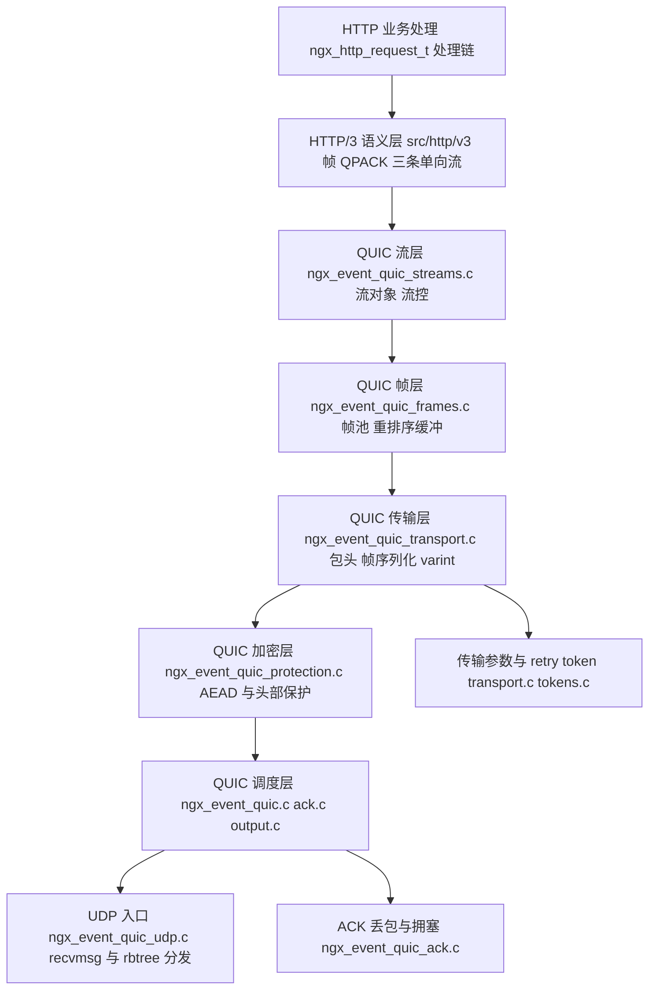
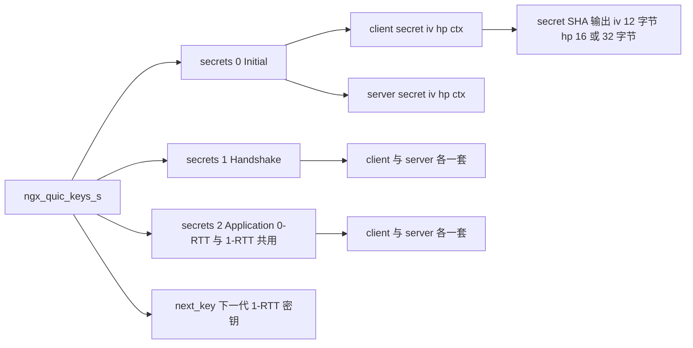
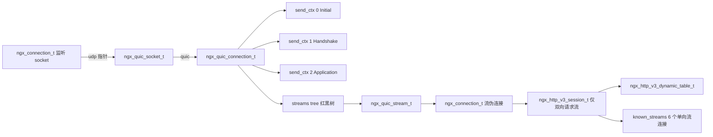
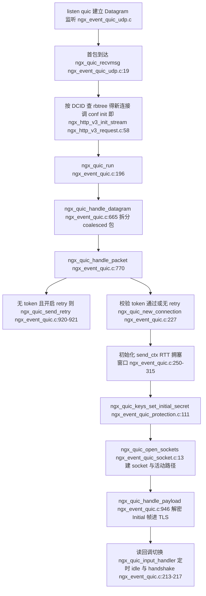
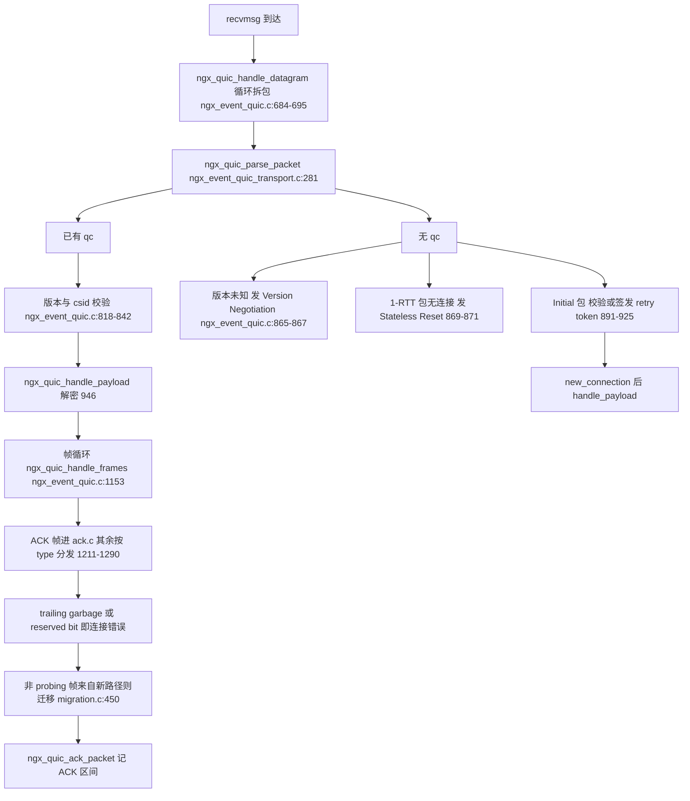
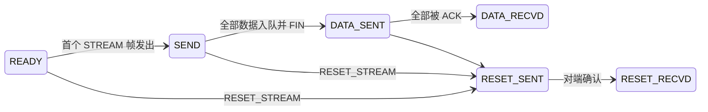
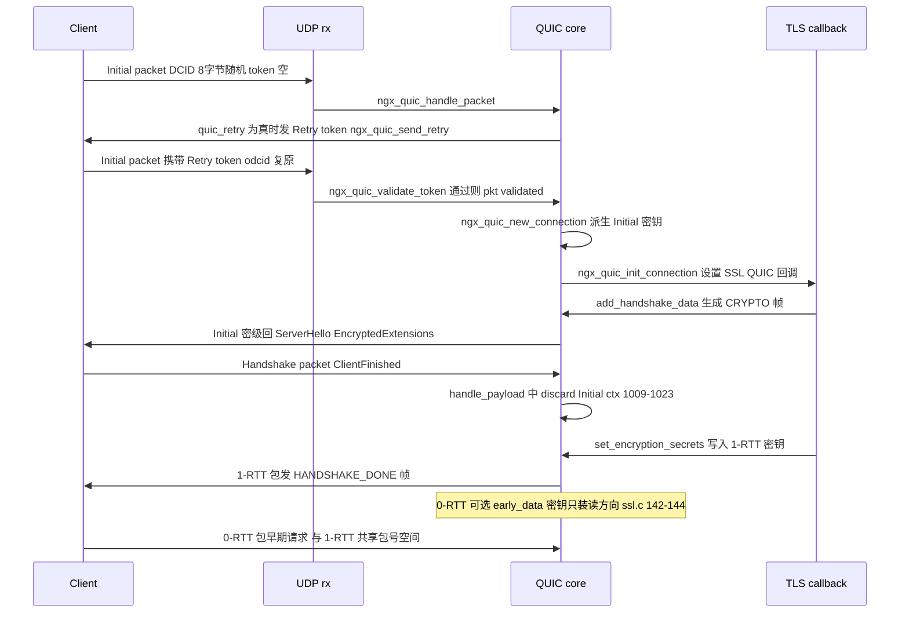
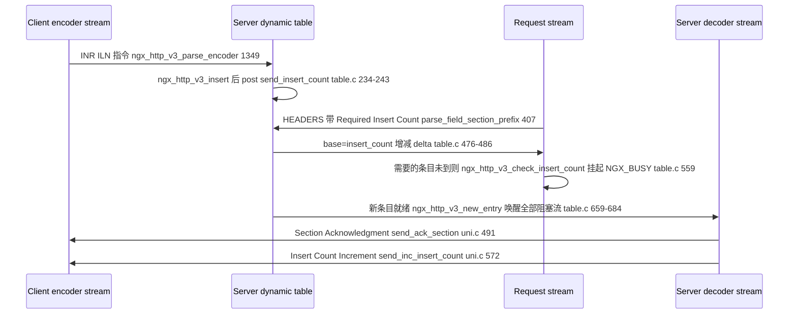

# HTTP/3 与 QUIC 实现（基于 nginx-1.27.0 源码）

> 导读：读完本文你将掌握——nginx 1.27.0 中 QUIC 传输层（`src/event/quic/`）与 HTTP/3 语义层（`src/http/v3/`）的完整分层结构；QUIC 包头与包号的解析与还原、加密密钥体系的建立与轮换；ACK/丢包/拥塞控制的具体算法；流管理与两级流控的实现；三条单向流的职责；QPACK 静态表/动态表/阻塞机制与 encoder/decoder 流交互；以及 HTTP/3 帧如何被转换成伪请求接入既有 HTTP 框架。
>
> 前置阅读建议：先了解 nginx 事件框架（`ngx_event_t`、posted event）、TLS 1.3 握手基本流程与 RFC 9000/9001/9204 的术语（packet number space、CID、密级、Required Insert Count）。文中所有行号均来自笔者对 nginx-1.27.0 源码的真实读取，个别未逐行核实的位置已标注"待验证"。
>
> 涉及源码清单：`src/event/quic/` 全部 31 个文件、`src/http/v3/` 全部 13 个文件、`src/http/modules/ngx_http_ssl_module.c`、`src/http/ngx_http_core_module.c`、`src/http/ngx_http.c`。

## 1. 本模块在 nginx 中的位置与职责

### 1.1 src/event/quic 文件清单

| 文件 | 职责 |
| --- | --- |
| ngx_event_quic.h | 对外 API：`ngx_quic_run`、`ngx_quic_open_stream`、`ngx_quic_stream_s` 流对象、`ngx_quic_conf_t` 配置 |
| ngx_event_quic.c | QUIC 连接生命周期核心：建连、datagram/包分发、帧处理总控、关闭、Finalize/Shutdown |
| ngx_event_quic_connection.h | 内部总头文件：`ngx_quic_connection_t`、send_ctx、path/socket/client id、拥塞与流统计结构 |
| ngx_event_quic_transport.c | 包头/帧/传输参数的解析与序列化（varint、长/短头、retry itag） |
| ngx_event_quic_transport.h | 包类型、帧类型、错误码、传输参数 ID、`ngx_quic_header_t`、各帧联合体 |
| ngx_event_quic_protection.c | Initial secret 推导、密级密钥存储/轮换、包加密（AEAD）与头部保护（HP）、retry 包加密 |
| ngx_event_quic_frames.c | 帧对象池、帧队列、`ngx_quic_buffer_t` 重排序缓冲、链表切分 |
| ngx_event_quic_streams.c | 流 id 分配/查找/创建、流级与连接级流控、RESET_STREAM、SEND/RECV 状态机 |
| ngx_event_quic_ack.c | ACK 处理、RTT 采样、丢包检测（PN/时间阈值）、拥塞窗口、PTO/丢失定时器、ACK 生成 |
| ngx_event_quic_output.c | 组包（多密级合并）、PADDING 策略、`sendmsg` 发送、GSO 分段、版本协商、Stateless Reset、CC 帧 |
| ngx_event_quic_ssl.c | TLS 1.3 QUIC 回调：secrets 注入、握手数据→CRYPTO 帧、ALPN/传输参数校验、`ngx_quic_init_connection` |
| ngx_event_quic_tokens.c | Retry token / NEW_TOKEN 的生成（AES-256-GCM）与校验、stateless reset token |
| ngx_event_quic_connid.c | 服务端 CID 生成、NEW_CONNECTION_ID/RETIRE 处理、client id 队列管理、BPF attach |
| ngx_event_quic_socket.c | `ngx_quic_socket_t`（监听 rbtree 节点）的创建/关闭/查找，`ngx_quic_open_sockets` |
| ngx_event_quic_migration.c | 路径管理：PATH_CHALLENGE/RESPONSE、NAT rebinding、连接迁移、MTU 探测 |
| ngx_event_quic_udp.c | UDP recvmsg 事件入口、按 DCID 在 rbtree 中分发到既有 QUIC 连接 |
| ngx_event_quic_bpf.c | eBPF 程序按 DCID 做 socket 分配（`NGX_QUIC_BPF`，配合 reuseport） |
| ngx_event_quic_bpf_code.c | 内嵌的 eBPF 字节码 |
| ngx_event_quic_openssl_compat.c/.h | OpenSSL < 3.1.4 等无 QUIC API 时的兼容 TLS 层实现 |
| 其余 .h（ack/connid/frames/migration/output/protection/socket/ssl/streams/tokens/transport） | 各子模块声明 |

### 1.2 src/http/v3 文件清单

| 文件 | 职责 |
| --- | --- |
| ngx_http_v3.h | ALPN 常量、帧/参数 ID、错误码、`ngx_http_v3_session_s`、宏（get_session/finalize 等） |
| ngx_http_v3.c | HTTP/3 会话（`ngx_http_v3_session_t`）创建、keepalive 定时器、flood 检测 |
| ngx_http_v3_module.c | `http3`、`http3_max_concurrent_streams`、`quic_retry` 等指令与 srv conf |
| ngx_http_v3_parse.c/.h | 渐进式状态机：变长整数、QPACK 字段、HTTP/3 帧、控制/encoder/decoder 流 |
| ngx_http_v3_encode.c | 编码端：varlen/prefix int、各字段表示（含 Huffman 调用） |
| ngx_http_v3_table.c/.h | QPACK 静态表（91 项）、动态表（插入/驱逐/查找/容量）、阻塞队列 |
| ngx_http_v3_uni.c | 三条单向流（控制/encoder/decoder）的建立、读处理、SETTINGS/GOAWAY/decoder 指令发送 |
| ngx_http_v3_request.c | 单向流分流、双端流→HTTP 请求：伪头部→`ngx_http_request_t`、cookie 合并、请求体读取 |
| ngx_http_v3_filter_module.c | 响应方向过滤链：头/体编码为 HEADERS/DATA 帧 |
| ngx_http_v3_module.c 变量 | `$http3` 变量（preconfiguration 添加） |

### 1.3 分层架构



图解：自下而上，`ngx_event_quic_udp.c` 只做一件事——收 UDP 报文并按 DCID 找到（或新建）QUIC 连接；`ngx_event_quic.c` 是调度中枢，把解密后的帧分发给流层/ACK 层；`src/http/v3` 只依赖流 API（`ngx_quic_open_stream`、`sc->recv` 等），对包、密钥一无所知。这种"QUIC 是传输层、HTTP/3 只是又一个协议适配器"的切分，与 HTTP/2 模块基于 `ngx_connection_t` 的做法同构，让 HTTP 业务代码完全复用。

## 2. 核心数据结构精讲

### 2.1 ngx_quic_connection_t（连接总控，ngx_event_quic_connection.h:183-289）

| 字段组 | 字段 | 含义 |
| --- | --- | --- |
| 密钥 | `keys`、`next_key` 间接持有 | `ngx_quic_keys_t`，三个密级各一对 client/server secret |
| 发送上下文 | `send_ctx[3]` | 三个包号空间：Initial/Handshake/0-RTT+1-RTT（connection.h:51-61 的宏 `ngx_quic_get_send_ctx`） |
| 流 | `streams` | 红黑树 `tree` + 队列 + 收发窗口计数（connection.h:137-164） |
| 路径 | `path`、`paths`、`free_paths` | 当前活动路径与路径队列（connection.h:101-123） |
| CID | `client_ids`、`sockets` | 客户端 CID 队列、服务端 socket 队列 |
| 拥塞 | `congestion` | in_flight/window/ssthresh/recovery_start（connection.h:167-172） |
| RTT | `avg_rtt`、`rttvar`、`min_rtt`、`first_rtt`、`latest_rtt` | RFC 9002 的 RTT 样本统计，`ngx_quic_init_rtt` 初始化（connection.h:68-73） |
| 事件 | `push`、`pto`、`close`、`path_validation`、`key_update` | 五个常驻定时器/posted 事件（ngx_event_quic.c:268-287 初始化） |
| 错误 | `error`、`error_level`、`error_ftype`、`error_reason`、`error_app` | 连接关闭错误信息 |
| 状态位 | `closing`、`draining`、`shutdown`、`key_phase`、`validated`、`client_tp_done` | 连接关闭机与密钥相位 |

`ngx_quic_send_ctx_t`（每个包号空间一个）关键字段：`crypto`（CRYPTO 帧重排序缓冲）、`pnum`（下一个发送包号）、`largest_pn`/`largest_ack`、`sent`/`frames`/`sending` 三个帧队列、`ranges`（最多 `NGX_QUIC_MAX_RANGES`=10 个 ACK 区间，transport.h:138）、`send_ack`/`ack_delay_start`（ACK 延迟发送控制）。

### 2.2 ngx_quic_stream_s（流对象，ngx_event_quic.h:89-111）

| 字段 | 含义 |
| --- | --- |
| `node` / `queue` | 同时挂在 qc->streams.tree（按 id 红黑树）与 free 队列 |
| `parent` / `connection` | QUIC 连接 ↔ 流伪连接（`sc->quic = qs`，streams.c:739） |
| `id` | 62 位流 id，低 2 位决定发起方与方向（见 4.4 节） |
| `sent`/`acked`、`send_max_data`/`send_offset`/`send_final_size` | 发送方向流控进度 |
| `recv_max_data`/`recv_offset`/`recv_window`/`recv_last`/`recv_final_size` | 接收方向流控进度 |
| `send`/`recv` | 两个 `ngx_quic_buffer_t`（size/offset/last_offset/chain/last_chain，ngx_event_quic.h:55-61） |
| `send_state`/`recv_state` | 发送/接收状态机（ngx_event_quic.h:35-52） |
| `cancelable:1`、`fin_acked:1` | 是否允许连接关闭时直接丢弃；FIN 已被对端确认 |

### 2.3 ngx_quic_header_t 与 ngx_quic_frame_t

`ngx_quic_header_t`（transport.h:368 行前定义，声明于 protection 引用处）承载一个待解析/已解析包：`flags`、`version`、`dcid`/`scid`/`odcid`、`token`、`level`、`pn`/`num_len`/`trunc`、`payload`、`plaintext`、`keys`、`path`、`need_ack`、`error` 等约 30 个字段。`ngx_quic_frame_t` 则是"帧"的内存形态：`type` + `level` + `pnum`/`send_time`/`plen`（发送记账）+ `u` 联合体（transport.h 中各 `ngx_quic_*_frame_t`）+ `data`（ngx_chain_t 挂载荷）。

### 2.4 密钥结构 ngx_quic_keys_s（protection.h:63-67）



图解：每个 `ngx_quic_secret_t`（protection.h:48-54）有四个成分——`secret`（HKDF 中间量）、`iv`（12 字节 nonce 基值）、`hp`（头部保护密钥）、两个 OpenSSL 上下文 `ctx`/`hp_ctx`。`next_key` 只用于 1-RTT 密钥更新（Key Phase 翻转），`ngx_quic_keys_switch` 把它转正（ngx_event_quic.c:1060 调用）。

### 2.5 HTTP/3 会话 ngx_http_v3_session_s（ngx_http_v3.h:123-143）

| 字段 | 含义 |
| --- | --- |
| `http_connection` | 借用 HTTP/2 引入的 `ngx_http_connection_t`，让 server{} 匹配逻辑复用 |
| `table` | `ngx_http_v3_dynamic_table_t`：capacity/size/elts/base/nelts/insert_count/ack_insert_count |
| `keepalive` | 空闲保活定时器（ngx_http_v3.c:37-39） |
| `blocked` / `nblocked` | 因 Required Insert Count 未达而阻塞的请求流队列 |
| `next_request_id` | GOAWAY 通告的"最后一个可接受的流 id" |
| `total_bytes` / `payload_bytes` | flood 检测分母分子（ngx_http_v3.c:102） |
| `known_streams[6]` | 三对（client/server × 控制/encoder/decoder）单向流索引（ngx_http_v3.h:48-54） |

### 2.6 结构关系总图



图解：nginx 复用 `ngx_connection_t` 三次——监听 socket、`ngx_quic_socket_t` 内嵌的 `ngx_udp_connection_t`、每条流的伪连接。`c->udp` 是否为空用来区分"尚未 QUIC 化的监听连接"与"QUIC 连接"（ngx_event_quic_connection.h:63-66 的 `ngx_quic_get_connection` 宏）。

## 3. 初始化流程



图解：QUIC 连接不是在 accept 时创建，而是在第一个合法 Initial 包被解出时创建。`ngx_quic_new_connection` 里三件事最重要：`ngx_quic_init_transport_params` 用本地配置填充将对外通告的 `qc->tp`（ngx_event_quic.c:290-292）；用 DCID 作为 HKDF 输入推导 Initial 密钥（protection.c:325-329 的调用）；`ngx_quic_open_sockets` 创建服务端 CID（20 字节随机，socket.c:137-138）并插入监听 rbtree。此后握手超时定时器 `qc->close`（handshake_timeout）挂在 `!qc->streams.initialized` 条件上（ngx_event_quic.c:215-217），直到第一个流被初始化才撤销（streams.c:633-635）。

## 4. 核心执行流程/状态机

### 4.1 每个数据报的接收路径



图解：这是一条严格线性的管线——同一连接上的任何包都必须走完"解析→鉴权→解密→分帧→记账"五步；分支只发生在"是否已有 qc"与"帧类型"两处。泛洪检查（ngx_event_quic.c:755-763）在 datagram 收尾处执行，ack_packet（1417-1419）在帧循环结束后调用；probing 帧分类（1197-1209）决定该包是否参与路径迁移判定。

### 4.2 连接关闭机

nginx 用两个布尔位近似 RFC 9000 的 closing/draining 状态：`ngx_quic_finalize_connection` 设置错误并 post `qc->close`（ngx_event_quic.c:616-634）；收到对端 CONNECTION_CLOSE 则直接置 `qc->draining`（ngx_event_quic.c:1398-1401），不再回 CC 包。closing 期间再收到的包只回 CONNECTION_CLOSE 且限速 `NGX_QUIC_CC_MIN_INTERVAL`=1 秒（output.c:33、855-860）。真正的资源释放要等流全部关闭：`ngx_quic_close_streams` 返回 NGX_AGAIN 表示还有活跃流，`ngx_quic_close_connection` 会推迟到流清理后重入（streams.c:173-233、1121-1191 中 `qc->closing` 时 post close 继续关连接）。

### 4.3 流发送状态机（RFC 9000 §3.1）



图解：SEND 系状态由 STREAM/FIN 帧的确认情况推进，RESET 系由 RESET_STREAM 帧触发并立即终止后续 STREAM 发送；两系互斥，nginx 的枚举与图一一对应（ngx_event_quic.h:35-52）。

接收方向对称：RECV → SIZE_KNOWN（收到 FIN）→ DATA_RECVD → DATA_READ，或任意态经 RESET_RECVD → RESET_READ。这些枚举在 ngx_event_quic.h:35-52。`ngx_quic_reset_stream` 发 RESET_STREAM 前会检查当前状态是否允许（reset 相关实现集中在 streams.c:236 起一带，具体行待验证），已到 DATA_RECVD 的流不能 reset。

### 4.4 流 id 编码规则

`id = (序列号 << 2) | 标志位`：bit0 `NGX_QUIC_STREAM_SERVER_INITIATED`（0x01）、bit1 `NGX_QUIC_STREAM_UNIDIRECTIONAL`（0x02）（ngx_event_quic.h:27-28）。服务端发起双向流：`(server_streams_bidi << 2) | 0x01`（streams.c:70-71）；服务端发起单向流：`| 0x03`（streams.c:91-93）。客户端请求流是 bit0=0 的双向流，HTTP/3 层用 `c->quic->id & 0x02` 判断是否单向（ngx_http_v3_request.c:91-96），用 `id >> 2` 换算请求序号（ngx_http_v3_request.c:200）。

## 5. 关键时序图

### 5.1 握手与密级推进（含 retry 与 0-RTT）



图解：三个包号空间对应三次密钥安装：Initial 密钥无需 TLS 参与（由 DCID 直接 HKDF，protection.c:111-187）；Handshake/1-RTT 密钥由 TLS 回调 `ngx_quic_set_read_secret`/`ngx_quic_set_write_secret`（或 OpenSSL 的 `ngx_quic_set_encryption_secrets`）注入（ssl.c:29-160）。收到第一个 Handshake 包即丢弃 Initial 上下文并关闭其临时 socket（ngx_event_quic.c:1016、1115-1121）。ALPN 与客户端传输参数在 `ngx_quic_add_handshake_data` 里一次性校验，任何缺失都会中断握手（ssl.c:196-225）。服务端 1-RTT 就绪后发送 HANDSHAKE_DONE 帧（transport.c:1479-1493）。0-RTT 数据落在第 3 号包号空间（connection.h:51-61），nginx 服务端是否接受取决于 TLS 层 early data 配置，OpenSSL 后端完整启用路径待验证。

### 5.2 QPACK encoder/decoder 流交互



图解：nginx 服务端在响应侧是 QPACK **encoder**（向客户端的 encoder 等价物发指令），在请求侧是 QPACK **decoder**（解析客户端 encoder 流指令、向客户端 decoder 流回执）。动态表插入会 `ngx_post_event(&dt->send_insert_count)`，在 posted 阶段把未确认的 insert_count 增量发往 decoder 流（table.c:253-278）。注意 nginx 自己编码时**不使用动态表**（表.c:417、429 的 `ack_section`/`inc_insert_count` 直接返回错误码，注释"we do not use dynamic tables"），但完整实现了对客户端动态表的解码与阻塞。

## 6. 源码逐段精读（主体）

### 6.1 变长整数与字节序工具（transport.c）

QUIC 一切整数字段都是 varint：前 2 位编码长度（1/2/4/8 字节）。服务端解析用 `ngx_quic_parse_int`（签名在 144-146 行，`len = 1 << (*p >> 6)` 的长度判定在 156 行）：

```c
src/event/quic/ngx_event_quic_transport.c:158-171
    value = *p++ & 0x3f;

    if ((size_t)(end - p) < (len - 1)) {
        return NULL;
    }

    while (--len) {
        value = (value << 8) + *p++;
    }

    *out = value;

    return p;
}
```

要点：`1 << (*p >> 6)` 一次算出后续字节数，越界直接返回 NULL，由调用方统一转成 `NGX_QUIC_ERR_FRAME_ENCODING_ERROR`。序列化方向 `ngx_quic_build_int`（transport.c:73-74 的位拼接宏起头）与两遍式 `ngx_quic_create_frame` 配合：先以 `p == NULL` 求长度，再真正写缓冲——这是 nginx 处理"帧长度需要写进包长度字段"的经典两次调用模式。HTTP/3 侧还有两套独立 varint：`ngx_http_v3_encode_varlen_int`（ngx_http_v3_encode.c:13-60）与带前缀位的 `ngx_http_v3_encode_prefix_int`（encode.c:63-99），解析侧对应 parse.c:97-179 与 182-244。前缀整数溢出保护很严格：第 8 字节仍有延续位时直接报 `NGX_HTTP_V3_ERR_EXCESSIVE_LOAD`（parse.c:220-226）。

易错点：transport 层 varint 是"长度前缀"（自描述），QPACK 前缀整数是"值前缀 + 连续 7 位组"（HPACK 遗产），两者不可混用；QPACK 侧必须知道 N 个前缀位才能解析，这也是所有 QPACK 状态机都把 prefix 位数硬编码进调用的原因（如 field_section_prefix 用 8 位，parse.c:435）。

### 6.2 包头与 coalesced 包（transport.c + ngx_event_quic.c）

首字节就区分一切：`NGX_QUIC_PKT_LONG 0x80`、`NGX_QUIC_PKT_TYPE 0x30`，长包四种类型 Initial/0-RTT/Handshake/Retry 的掩码值 0x00/0x10/0x20/0x30（transport.h:21-42）。短包头无 version/scid/token，只有 DCID + 受保护的包号（`NGX_QUIC_SHORT_DCID_OFFSET 1`，transport.c:15）。

发送侧 `ngx_quic_create_long_header`（函数头 618-621，625 行把 rem_len 算成 num_len + payload + 16 字节 tag）的字段序：

```c
src/event/quic/ngx_event_quic_transport.c:635-646
    *p++ = pkt->flags;

    p = ngx_quic_write_uint32(p, pkt->version);

    *p++ = pkt->dcid.len;
    p = ngx_cpymem(p, pkt->dcid.data, pkt->dcid.len);

    *p++ = pkt->scid.len;
    p = ngx_cpymem(p, pkt->scid.data, pkt->scid.len);

    if (pkt->level == ssl_encryption_initial) {
        ngx_quic_build_int(&p, 0);
```

注意 `rem_len` 把 16 字节 AEAD tag 也计入长度字段（protection.h:21 定义 `NGX_QUIC_TAG_LEN 16`），且 Initial 包强制写一个空 token varint（`ngx_quic_build_int(&p, 0)`）。短头创建在 transport.c:672-706，只写 flags+DCID+截断包号。

接收侧总入口 `ngx_quic_parse_packet`（transport.c:281 起，内部按长/短头分发）。一个 UDP 报文里可以串联多个不同密级的包（coalesced），`ngx_quic_handle_datagram` 的 while 循环逐个切分：每次循环把 `pkt.data = p; pkt.len = b->last - p;` 交给 `ngx_quic_handle_packet`，随后以 `pkt.raw->pos` 的推进量移动 `p`（ngx_event_quic.c:684-695 与循环尾部的推进逻辑，推进细节在该函数 740 行附近，具体偏移计算依赖解析结果，完整展开待验证）。这个设计的意义：握手期间 Initial+Handshake+1-RTT 三种包同报文传输，减少客户端发送次数。

### 6.3 包号编码与还原（output.c + protection.c）

发送侧按"与最大已确认包号的距离"决定包号截断长度（函数头 734-736，delta 计算在 739-740）：

```c
src/event/quic/ngx_event_quic_output.c:742-760（节选）
    if (delta <= 0x7F) {
        pkt->num_len = 1;
        pkt->trunc = ctx->pnum & 0xff;

    } else if (delta <= 0x7FFF) {
        pkt->num_len = 2;
        pkt->flags |= 0x1;
        pkt->trunc = ctx->pnum & 0xffff;
        ...
    } else {
        pkt->num_len = 4;
        pkt->flags |= 0x3;
        pkt->trunc = ctx->pnum & 0xffffffff;
    }
```

这是 RFC 9000 附录 A 的编码规则：delta ≤ 0x7F 时只发低 8 位，接收方可以从 largest_ack 附近无歧义还原；二/三/四字节分支还会把长度编号 0x1/0x2/0x3 折进首字节的包号长度位（748、753、758 行）。接收侧还原在 `ngx_quic_decrypt` 里：

```c
src/event/quic/ngx_event_quic_protection.c:1177-1191
    in.data = p;
    in.len = len - pnl;

    ad.len = p - pkt->data;
    ad.data = pkt->plaintext;

    ngx_memcpy(ad.data, pkt->data, ad.len);
    ad.data[0] = pkt->flags;

    do {
        ad.data[ad.len - pnl] = pn >> (8 * (pnl - 1)) % 256;
    } while (--pnl);

    ngx_memcpy(nonce, secret->iv.data, secret->iv.len);
    ngx_quic_compute_nonce(nonce, sizeof(nonce), pn);
```

流程分四步：(1) 头部保护样本取自"假定的 4 字节包号字段之后"的 16 字节（protection.c:1125-1133，`sample = p + 4`）；(2) `ngx_quic_parse_pn` 用 mask 的后 4 字节异或还原截断包号，并结合 `largest_pn` 做补全（还原段见 protection.c:1163-1168；该函数实现在 443-485 附近，完整位运算细节此处未逐行展开）；(3) 还原完整包号后，把"受保护前的明文头 + 完整包号"拼成 AEAD 关联数据 ad；(4) nonce = iv ⊕ pn（`ngx_quic_compute_nonce` 末两行在 protection.c:1088-1089，逐字节异或）。解密成功后还有两道协议校验：零载荷即 PROTOCOL_VIOLATION（protection.c:1207-1217），保留位非零同样报错（1219-1232）。

易错点：`ad.data[ad.len - pnl] = pn >> (8 * (pnl - 1)) % 256` 的括号优先级——`>>` 先于 `%` 是有意的（逐字节位移），若把 pn 转换写错会导致重传路径上 AEAD 校验失败。另外 Key Phase 位（0x04）只在短包存在，`ngx_quic_decrypt` 里比较 phase 不一致时若 `next_key` 已生成则换密钥解密并标记 `pkt->key_update = 1`，否则做试解密（protection.c:1143-1161）；成功后由 `ngx_quic_handle_payload` 翻转 `qc->key_phase` 并 post key_update 事件预生成下一代密钥（ngx_event_quic.c:1053-1069）。

### 6.4 Initial 密钥推导（protection.c:111-222）

```c
src/event/quic/ngx_event_quic_protection.c:125-147
    static const uint8_t salt[20] =
        "\x38\x76\x2c\xf7\xf5\x59\x34\xb3\x4d\x17"
        "\x9a\xe6\xa4\xc8\x0c\xad\xcc\xbb\x7f\x0a";
    ...
    digest = EVP_sha256();
    is_len = SHA256_DIGEST_LENGTH;

    if (ngx_hkdf_extract(is, &is_len, digest, secret->data, secret->len,
                         salt, sizeof(salt))
        != NGX_OK)
    {
        return NGX_ERROR;
    }
```

`secret` 就是客户端 Initial DCID（调用点 ngx_event_quic.c:325-329）。extract 出 intermediate secret 后，用 8 个 label 一次展开 client/server 各自的 secret/key/iv/hp：

```c
src/event/quic/ngx_event_quic_protection.c:173-187
    /* labels per RFC 9001, 5.1. Packet Protection Keys */
    ngx_quic_hkdf_set(&seq[0], "tls13 client in", &client->secret, &iss);
    ngx_quic_hkdf_set(&seq[1], "tls13 quic key", &client_key, &client->secret);
    ngx_quic_hkdf_set(&seq[2], "tls13 quic iv", &client->iv, &client->secret);
    ngx_quic_hkdf_set(&seq[3], "tls13 quic hp", &client->hp, &client->secret);
    ngx_quic_hkdf_set(&seq[4], "tls13 server in", &server->secret, &iss);
    ...
    for (i = 0; i < (sizeof(seq) / sizeof(seq[0])); i++) {
        if (ngx_quic_hkdf_expand(&seq[i], digest, log) != NGX_OK) {
            return NGX_ERROR;
        }
    }
```

`ngx_quic_hkdf_set` 宏（protection.h:88-91）只是填充 `ngx_quic_hkdf_t` 描述块，真正 EVP_PKEY HKDF 在 `ngx_quic_hkdf_expand`。八个展开共用一次循环，失败即整体清理（protection.c:215-218）。随后 `ngx_quic_crypto_init` 为两个方向各建 AEAD 上下文、`ngx_quic_crypto_hp_init` 建 HP 上下文（protection.c:193-211）。密级升级时 `ngx_quic_keys_set_encryption_secret` 重复同样的三段式展开（key/iv/hp，protection.c:693-699），但 label 不带 "tls13 in"，因为 secret 由 TLS 直接给出。

密码套件映射在 `ngx_quic_ciphers`（protection.c:50-108）：AES-128-GCM/SHA-256、AES-256-GCM/SHA-384、ChaCha20-Poly1305/SHA-256、（非 BoringSSL 加）AES-128-CCM；HP 分别对应 CTR 变体与 ChaCha20。ChaCha20 的 HP 没有 EVP 接口，BoringSSL 下走 `CRYPTO_chacha_20` 特判（protection.c:578-583、613-621）。

### 6.5 头部保护掩码（protection.c:603-639）

```c
src/event/quic/ngx_event_quic_protection.c:623-638
    ctx = s->hp_ctx;
    ...
    if (EVP_EncryptInit_ex(ctx, NULL, NULL, NULL, in) != 1) {
        ngx_ssl_error(NGX_LOG_INFO, log, 0, "EVP_EncryptInit_ex() failed");
        return NGX_ERROR;
    }

    if (!EVP_EncryptUpdate(ctx, out, &outlen, zero, NGX_QUIC_HP_LEN)) {
        ...
    }
```

HP 就是"用 sample 当 IV、hp 当 key 的 AES-CTR 加密 5 字节全零串"（`NGX_QUIC_HP_LEN 5`，protection.c:14）。掩码第 1 字节参与 flags 异或（protection.c:1141 的 `pkt->flags ^= mask[0] & ngx_quic_pkt_hp_mask(pkt->flags)`），后 4 字节参与包号异或。掩码位按长/短包取不同位宽（transport.h:44-47 的 `ngx_quic_pkt_hp_mask`）。

### 6.6 帧解析主分发（transport.c:738-1152）

`ngx_quic_parse_frame` 按 30 余种类型逐一解码，摘录 CRYPTO 分支（case 在 775 行）：

```c
src/event/quic/ngx_event_quic_transport.c:777-793（节选）
        p = ngx_quic_parse_int(p, end, &f->u.crypto.offset);
        if (p == NULL) {
            goto error;
        }

        p = ngx_quic_parse_int(p, end, &f->u.crypto.length);
        if (p == NULL) {
            goto error;
        }

        p = ngx_quic_read_bytes(p, end, f->u.crypto.length, &b->pos);
        ...
        b->last = p;
        break;
```

CRYPTO 帧 = offset varint + length varint + 定长字节串。ACK 帧更复杂（transport.c:804-845）：largest/delay/range_count/first_range 四个 varint，随后 range_count 组 gap/range——nginx 在解析阶段不保存区间值，只整体记录起止指针（`b->pos`/`b->last`）与 `ranges_length`（845 行），真正的区间处理延迟到 ack.c。这个"先定界后解释"的策略让 ACK 帧可以像普通缓冲一样被拷贝进重传帧。

每种帧能出现在哪种包里由一张位掩码表约束（`ngx_quic_frame_masks`，transport.c:1165-1197）：4 位 IH01 分别代表 Initial/Handshake/0-RTT/1-RTT，如 STREAM 帧掩码 0x3（0-RTT+1-RTT），HANDSHAKE_DONE 掩码 0x0（服务端只发不收）。违规即 `NGX_QUIC_ERR_PROTOCOL_VIOLATION`（transport.c:768-771）。

序列化分发 `ngx_quic_create_frame`（transport.c:1275-1352）默认把帧标记为 ack-eliciting（1284 行 `f->need_ack = 1`），只有 ACK、CONNECTION_CLOSE 显式清零（1291、1314）。STREAM 帧创建把 FIN/LEN/OFF 三个标志折叠进类型字节低 3 位（transport.c:1535-1547），正好对应 `NGX_QUIC_FT_STREAM` 到 `NGX_QUIC_FT_STREAM7` 的 8 个子类型。

### 6.7 帧对象池与重排序缓冲（frames.c）

帧对象来自两级 free list（`qc->free_frames`），载荷缓冲用"影子缓冲"引用计数避免拷贝：

```c
src/event/quic/ngx_event_quic_frames.c:37-43
    b = qc->free_bufs;

    if (b) {
        qc->free_bufs = b->shadow;
        p = b->start;

    } else {
```

37-43 是 free list 命中路径；43-61 的 else 分支在影子缓冲耗尽时经 `ngx_calloc_buf`/`ngx_pnalloc` 新分配（从略）。第二个摘录是初始化尾部：

```c
src/event/quic/ngx_event_quic_frames.c:63-72
    b->tag = (ngx_buf_tag_t) &ngx_quic_alloc_buf;
    b->temporary = 1;
    b->shadow = b;

    b->start = p;
    b->pos = p;
    b->last = p;
    b->end = p + NGX_QUIC_BUFFER_SIZE;

    ngx_quic_buf_set_refs(b, 1);
```

第一个 `ngx_buf_t` 是"主缓冲"（持数据），克隆（`ngx_quic_clone_buf`，frames.c:125-163）只复制头部并引用计数加一，多个帧可共享同一块 4096 字节数据（`NGX_QUIC_BUFFER_SIZE`，frames.c:13）。释放时引用减到 0 才归还主缓冲，影子头单独回 `free_shadow_bufs`（frames.c:94-122）。这在"一份数据被 PADDING 进多个包、或 ACK 丢失重传时"省下大量 memcpy。

`ngx_quic_buffer_t` 是乱序重组的核心：`ngx_quic_write_buffer(c, qb, in, len, offset)` 把任意 offset 的数据合并进有序链，必要时用 `ngx_quic_split_chain`（frames.c:165-193）在中间切出空洞段；`ngx_quic_read_buffer(c, qb, limit)` 从队首读走连续段（frames.c:425-470）。CRYPTO 流与每条流的 recv 缓冲都靠它。`ngx_quic_split_frame`（frames.c:318-391）则相反——把一个待发帧按长度切成两个，用于塞包时裁剪。

帧入发送队列只有一行：`ngx_quic_queue_frame` 把帧挂到对应密级 send_ctx 的 `frames` 队尾（frames.c:298-317），实际组包由 output 完成。

### 6.8 ACK 处理与 RTT 采样（ack.c）

```c
src/event/quic/ngx_event_quic_ack.c:195-208
    } else {
        qc->min_rtt = ngx_min(qc->min_rtt, latest_rtt);

        ack_delay = (ack->delay << qc->ctp.ack_delay_exponent) / 1000;

        if (c->ssl->handshaked) {
            ack_delay = ngx_min(ack_delay, qc->ctp.max_ack_delay);
        }

        adjusted_rtt = latest_rtt;

        if (qc->min_rtt + ack_delay < latest_rtt) {
            adjusted_rtt -= ack_delay;
        }
```

逐条对应 RFC 9002 §5.3（函数头 177-186；首个样本分支 187-193；EWMA 更新在 209-213）：首个样本直接初始化；此后 min_rtt 只减不增；ACK 延迟按对端通告的 `ack_delay_exponent` 还原（握手期不封顶，1-RTT 后封顶 max_ack_delay）；EWMA 用纯整数移位实现（÷8 与 ÷4）。采样触发条件在 `ngx_quic_handle_ack_frame`：只有"最大确认包号是新确认的且其中含 ack-eliciting 包"才采样（ack.c:116-128 的注释与判断）。

ACK 帧的每个区间经 `ngx_quic_handle_ack_frame_range`（ack.c:221 起）在 `ctx->sent` 队列中匹配帧：命中即调 `ngx_quic_congestion_ack` 归还 in_flight；匹配不到的区间直接以 `FRAME_ENCODING_ERROR` 拒绝（`first_range > largest` 检查在 ack.c:91-96）。确认后的流级清理也在这一步：STREAM 帧全部确认时推进流状态至 DATA_RECVD 并可能补发 MAX_STREAMS（ack.c:636-647 的 requeue 附近逻辑）。

丢包检测 `ngx_quic_detect_lost`（ack.c:435 起）使用两个阈值：包阈值 3 个序号（`NGX_QUIC_PKT_THR`，ack.c:16）、时间阈值 `ngx_quic_lost_threshold`（ack.c:50-59）——`max(latest_rtt, avg_rtt) * 1.125`，低于 1ms 时取 1ms（`NGX_QUIC_TIME_GRANULARITY`，ack.c:18）。被判丢失的帧从 `ctx->sent` 移回 `ctx->frames` 等待下次组包重发（ack.c:645-656 附近的重入队与 `ngx_post_event(&qc->push)`）。拥塞响应在 `ngx_quic_congestion_lost`：

```c
src/event/quic/ngx_event_quic_ack.c:693-704
    cg->recovery_start = ngx_current_msec;
    cg->window /= 2;

    if (cg->window < qc->tp.max_udp_payload_size * 2) {
        cg->window = qc->tp.max_udp_payload_size * 2;
    }

    cg->ssthresh = cg->window;

    ngx_log_debug3(NGX_LOG_DEBUG_EVENT, c->log, 0,
                   "quic congestion lost win:%uz ss:%z if:%uz",
                   cg->window, cg->ssthresh, cg->in_flight);
```

这是 NewReno 风格：进入恢复期（recovery_start 之前发送的包丢失才减窗，685-691 判断）、窗口减半、下限 2×MTU、同步 ssthresh。慢启动阶段（window < ssthresh）窗口按 ack-eliciting 字节数增长，增长点在 `ngx_quic_congestion_ack`（ack.c，未逐行展开，行为待验证为标准 RFC 9002 拥塞避免）。持久拥塞判定常量 `NGX_QUIC_PERSISTENT_CONGESTION_THR 3`（ack.c:21）。

### 6.9 丢失/PTO 定时器与 ACK 生成（ack.c:714-792、1153-1188）

`ngx_quic_set_lost_timer` 遍历前两个包号空间（应用层空间不在此处处理 1-RTT 丢失场景的细节），对 sent 队首帧算"最早可能丢失时刻"，对 sent 队尾帧算 PTO 时刻 `send_time + (pto << pto_count)`，取更早者挂到 `qc->pto` 定时器，handler 分别设为 `ngx_quic_lost_handler` 或 `ngx_quic_pto_handler`（ack.c:769-789）。PTO 基值 `ngx_quic_pto`（ack.c:795-805）= max_ack_delay + avg_rtt + 4×rttvar（RFC 9002 附录 A.8，公式行未完整展示，待验证），指数退避靠 `qc->pto_count`。

ACK 不立刻发：`ngx_quic_ack_packet` 标记 `ctx->send_ack` 并记录区间（ack.c 后半，`ngx_quic_send_ack` 处区间数超上限 `NGX_QUIC_MAX_RANGES`=10 时直接对最老包发 ACK_RANGE 补偿，ack.c:1124-1132）。真正发送在组包前由 `ngx_quic_generate_ack` 决定（ack.c:1153-1188）：应用层包号空间里若发送队列空、待确认包数未超 NGX_QUIC_MAX_ACK_GAP 阈值且自上次 ACK 未满 max_ack_delay，则把 ACK 延迟到 `qc->push` 定时器（1168-1178）；其余立即生成 ACK 帧。这是 ACK 延迟策略的最小实现。

### 6.10 组包与发送（output.c）

```c
src/event/quic/ngx_event_quic_output.c:130-149（节选）
    while (cg->in_flight < cg->window) {

        p = dst;

        len = ngx_quic_path_limit(c, path, path->mtu);

        pad = ngx_quic_get_padding_level(c);

        for (i = 0; i < NGX_QUIC_SEND_CTX_LAST; i++) {
        ...
            min = (i == pad && p - dst < NGX_QUIC_MIN_INITIAL_SIZE)
                  ? NGX_QUIC_MIN_INITIAL_SIZE - (p - dst) : 0;
```

三层循环语义（generate_ack 在 144-146；padding 放不下时 151-160 逐密级回滚；162 调 output_packet；171-176 统计总长并发送）：(1) 外层受拥塞窗口约束，一次 `ngx_quic_output` 可发多个 datagram；(2) 中层按密级把最多 3 个包拼进同一个 UDP 载荷；(3) `ngx_quic_output_packet` 为该密级组装帧直到 `min`（PADDING 目标）或 `len` 上限。`pad = ngx_quic_get_padding_level(c)` 决定哪个密级负责把报文垫到 1200 字节（`NGX_QUIC_MIN_INITIAL_SIZE`，ngx_event_quic.h:25）——服务器仅在确认地址前（`NGX_QUIC_PATH_MTUD` 之前的路径状态，connection.h:76-81）需要按 RFC 9000 §14.1 垫满。发送失败 EAGAIN 时全部包号回滚（`ngx_quic_revert_send`，output.c:236-249），10ms 后重试（output.c:35、182-189）；成功则 `ngx_quic_commit_send` 把 sending 队列转 sent 并累计 in_flight（output.c:202-233）。

单包组装尾部（output.c:1250-1283）：对 ack-eliciting 包按需补 PADDING 到 min，随后 `ngx_quic_encrypt` → `ctx->pnum++` → `ngx_quic_send`（内部 `ngx_sendmsg`，output.c:699-731）→ 挂 sent 队列。`ngx_quic_path_limit`（output.c:1304-1319）实现抗放大：未验证路径最多发送 `3 × received` 字节。GSO 支持（`NGX_HAVE_UDP_SEGMENT`）走 `ngx_quic_create_segments` 把同一密级的多个包拼成一次 sendmsg 的分段发送（output.c:51-56 声明，启用条件与细节待验证）。

### 6.11 流的创建与接收（streams.c）

流创建入口 `ngx_quic_create_stream`（streams.c:641-643）：先从 `qc->streams.free` 队列复用对象（660-670），否则新分配——

```c
src/event/quic/ngx_event_quic_streams.c:671-685
        qs = ngx_palloc(c->pool, sizeof(ngx_quic_stream_t));
        if (qs == NULL) {
            return NULL;
        }
    }

    ngx_memzero(qs, sizeof(ngx_quic_stream_t));

    qs->node.key = id;
    qs->parent = c;
    qs->id = id;
    qs->send_final_size = (uint64_t) -1;
    qs->recv_final_size = (uint64_t) -1;

    pool = ngx_create_pool(NGX_DEFAULT_POOL_SIZE, c->log);
```

每条流一个独立内存池和一套 `recv/send/send_chain` 函数指针（streams.c:754-756），从此上层 `ngx_connection_t` 操作与 TCP 完全同形。方向相关的初始状态按 id 低两位分发（streams.c:766-790）：服务端单向流的 `recv_state` 直接置 DATA_READ（对端只写不读），客户端单向流 `send_state` 置 DATA_RECVD。流创建后 `ngx_quic_do_init_streams` 触发 `conf->init` 即 `ngx_http_v3_init_stream`（streams.c:617-621），并撤销握手超时（633-635）。

收到 STREAM 帧时 `ngx_quic_handle_stream_frame`（streams.c:1223-1310）先做四道防线：单向服务端流直接 STREAM_STATE_ERROR（1235-1240）；`ngx_quic_control_flow` 校验流级窗口（1261）；FIN 一致性——`recv_final_size` 只能设定一次且 `recv_last` 不得超过（1274-1288）；随后 `ngx_quic_write_buffer` 重组、若恰好凑满 final size 则推进 DATA_RECVD（1290-1299），最后 `ngx_quic_set_event(qs->connection->read)` 唤醒读事件（1306-1308）。

流控窗口的维护分两级。流级：`ngx_quic_update_flow`（streams.c:1693 起）在应用读走数据后把 `recv_offset` 前移，当消耗超过窗口一半时发 MAX_STREAM_DATA；连接级：`ngx_quic_update_max_data`（streams.c:1777-1809）同样按 `recv_window` 半窗阈值发 MAX_DATA。窗口初值来自 `qc->streams.recv_window = qc->streams.recv_max_data`（ngx_event_quic.c:305-306），而 `initial_max_data` 由 `http3_stream_buffer_size` 等配置推导（transport.c 中 `ngx_quic_init_transport_params`，参数映射细节见第 8 节）。对端阻塞时会发 DATA_BLOCKED/STREAM_DATA_BLOCKED，nginx 的处理是被动回应一次窗口更新（streams.c:1363-1398）。

### 6.12 连接迁移与路径验证（migration.c）

```c
src/event/quic/ngx_event_quic_migration.c:35-49
ngx_int_t
ngx_quic_handle_path_challenge_frame(ngx_connection_t *c,
    ngx_quic_header_t *pkt, ngx_quic_path_challenge_frame_t *f)
{
    ...
    if (pkt->level != ssl_encryption_application || pkt->path_challenged) {
        ngx_log_debug0(NGX_LOG_DEBUG_EVENT, c->log, 0,
                       "quic ignoring PATH_CHALLENGE");
        return NGX_OK;
    }

    pkt->path_challenged = 1;
    ...
```

PATH_CHALLENGE 只允许出现在 1-RTT（43 行），每个 datagram 至多应答一次（49 行防重）。应答 `PATH_RESPONSE` 必须"从收到挑战的同一路径原样返回 8 字节"，且报文要垫到 1200 字节，但受抗放大限制约束（migration.c:62-77，`ngx_quic_path_limit` 的 1200 检查）。若挑战来自当前活动路径，还应额外回一个 PING（非 probing 帧，RFC 9000 §9.3.3，migration.c:83-100）。

真正的迁移判定在 `ngx_quic_handle_frames` 尾部：`pkt->path != qc->path && nonprobing` 才调 `ngx_quic_handle_migration`（ngx_event_quic.c:1403-1415）。`ngx_quic_set_path`（migration.c:299-401）为每个新四元组建 `ngx_quic_path_t` 并绑定一个未使用的客户端 CID；只有最高包号的非 probing 包才能触发切换（migration.c:469-471），旧路径降级为 BACKUP 或释放，NAT rebinding（新路径 + 旧 socket CID）时反向验证原路径（migration.c:481-487）。MTU 探测（PATH_MTUD 状态）在 `ngx_quic_handle_path_mtu`（migration.c:969-1003）按探测包号确认后推进。

### 6.13 CID 与 UDP 分发（connid.c + socket.c + udp.c）

服务端 CID 恒为 20 字节（`NGX_QUIC_SERVER_CID_LEN`，transport.h:55）。启用 BPF 时 CID 直接编码 socket cookie（`ngx_quic_bpf_attach_id`，connid.c:47-68），配合 `quic_retry` 之外的第二层 socket 负载均衡；无 BPF 时用随机数（`ngx_quic_create_server_id`，connid.c:27 起）。`ngx_quic_recvmsg` 每包按 DCID 查监听 rbtree（walk 循环 386-417，下为命中段 400-414）：

```c
src/event/quic/ngx_event_quic_udp.c:400-414
        qsock = (ngx_quic_socket_t *) node;

        rc = ngx_memn2cmp(key->data, qsock->sid.id, key->len, qsock->sid.len);

        c = qsock->udp.connection;

        if (rc == 0 && ls->wildcard) {
            rc = ngx_cmp_sockaddr(local_sockaddr, local_socklen,
                                  c->local_sockaddr, c->local_socklen, 1);
        }

        if (rc == 0) {
            c->udp = &qsock->udp;
            return c;
        }
```

rbtree key 是 CID 的 CRC32（socket.c:180），节点就是 `ngx_quic_socket_t` 内嵌的 `ngx_udp_connection_t`。找不到且报文足够长时按 1-RTT 处理并可能回 Stateless Reset（udp.c 分发逻辑与 output.c:792-840 配合；token = HKDF(sr_token_key, dcid)，tokens.c:18-39）。NEW_CONNECTION_ID/RETIRE_CONNECTION_ID 的账本管理在 connid.c:74-、344-，迁移需要新 CID 时由 `ngx_quic_next_client_id`（connid.c:319 起）取用。

### 6.14 Retry token 与地址验证（tokens.c）

明文布局见 `ngx_quic_new_token`（52-54 行为缓冲声明与 `ngx_quic_address_hash` 调用）：

```c
src/event/quic/ngx_event_quic_tokens.c:56-70
    p = in + 20;

    p = ngx_cpymem(p, &exp, sizeof(time_t));

    *p++ = is_retry ? 1 : 0;

    if (odcid) {
        *p++ = odcid->len;
        p = ngx_cpymem(p, odcid->data, odcid->len);

    } else {
        *p++ = 0;
    }

    len = p - in;
```

明文结构 = 20 字节地址哈希（SHA-1，`no_port` 时 NEW_TOKEN 不含端口、Retry 含端口，tokens.c:132-173）+ 过期时间 + is_retry 标志 + 可选 ODCID，整体用 `quic_host_key` 派生的密钥做 AES-256-GCM 加密（tokens.c:72-119），IV 前置。校验侧 `ngx_quic_validate_token`（tokens.c:176-309）依次：长度 sanity（203-211）、解密验 tag（218-246）、地址哈希比对（259-263）、过期判断（278-283）；全部通过才 `pkt->validated = 1` 并把 token 内嵌的 ODCID 还原出来（285-294），供传输参数 `retry_scid`/`original_dcid` 使用（ngx_event_quic.c:317-323、socket.c:38-42）。解不开的 token 分两种处理：Retry token 直接 `INVALID_TOKEN` 早期 CC；NEW_TOKEN 无效时若开了 retry 就再发一次 Retry（ngx_event_quic.c:899-916）。

### 6.15 TLS 集成点（ssl.c）

nginx 以 TLS provider 身份实现四个 QUIC 回调：read/write secret（ssl.c:52-160）、`ngx_quic_add_handshake_data`（ssl.c:165 起）、`ngx_quic_flush_flight`（QUIC 下为空操作）、`ngx_quic_send_alert`（转 CRYPTO 错误）。`ngx_quic_add_handshake_data` 在第一次被调用时做一次性校验（`qc->client_tp_done` 门控）：

```c
src/event/quic/ngx_event_quic_ssl.c:198-207
        SSL_get0_alpn_selected(ssl_conn, &alpn_data, &alpn_len);

        if (alpn_len == 0) {
            qc->error = NGX_QUIC_ERR_CRYPTO(SSL_AD_NO_APPLICATION_PROTOCOL);
            qc->error_reason = "unsupported protocol in ALPN extension";

            ngx_log_error(NGX_LOG_INFO, c->log, 0,
                          "quic unsupported protocol in ALPN extension");
            return 0;
        }
```

传输参数的校验紧随其后：

```c
src/event/quic/ngx_event_quic_ssl.c:211-221
        SSL_get_peer_quic_transport_params(ssl_conn, &client_params,
                                           &client_params_len);

        ngx_log_debug1(NGX_LOG_DEBUG_EVENT, c->log, 0,
                       "quic SSL_get_peer_quic_transport_params():"
                       " params_len:%ui", client_params_len);

        if (client_params_len == 0) {
            /* RFC 9001, 8.2.  QUIC Transport Parameters Extension */
            qc->error = NGX_QUIC_ERR_CRYPTO(SSL_AD_MISSING_EXTENSION);
```

随后客户端传输参数经 `ngx_quic_parse_transport_params` 解析（transport.c:1720-1840：禁止客户端携带 original_dcid/preferred_address/retry_scid/sr_token，1734-1743；reserved/unknown 参数按 id 值是否命中 31 取模特性判定，1770-1774）并经 `ngx_quic_apply_transport_params` 校验合法性（max_udp_payload_size、active_connection_id_limit≥2、ack_delay_exponent≤20、max_ack_delay<16384，ngx_event_quic.c:143-179）后落入 `qc->ctp`。CRYPTO 帧到达时 `ngx_quic_handle_crypto_frame` 把数据交给 `ngx_quic_crypto_input`（ssl.c:46-47 声明、363/381 两个调用点分别对应乱序缓冲命中与直接到达两条路径），内部 `SSL_provide_quic_data` + `SSL_do_handshake` 推进 TLS 状态机。服务端侧传输参数在 `ngx_quic_init_connection` 里 `SSL_set_quic_transport_params` 注入（ssl.c:566-584）。

### 6.16 HTTP/3 会话与三条单向流（ngx_http_v3.c + uni.c）

流初始化入口 `ngx_http_v3_init_stream`（ngx_http_v3_request.c:58-97）：`c->quic == NULL` 说明是监听连接，转 `ngx_quic_run` 并把 QUIC idle timeout 绑到 keepalive_timeout（71-77 行）；否则按 id 最低位分流——单向流进 `ngx_http_v3_init_uni_stream`，双向流进 `ngx_http_v3_init_request_stream`。会话对象 `h3c` 挂在 QUIC 连接（父连接）的 `data` 上，宏 `ngx_http_v3_get_session` 对子流透明取到（ngx_http_v3.h:81-83）。

单向流的第一个 varint 是流类型（parse.c:1862-1936 的 `ngx_http_v3_parse_uni` sw_type 分支），`ngx_http_v3_register_uni_stream`（uni.c:104-166）按类型登记进 `known_streams`（encoder/decoder/control 三个 case 在 115-135，重复登记在 153-157 拒绝）：

```c
src/http/v3/ngx_http_v3_uni.c:137-151
    default:

        ngx_log_debug1(NGX_LOG_DEBUG_HTTP, c->log, 0,
                       "http3 stream 0x%02xL", type);

        if (h3c->known_streams[NGX_HTTP_V3_STREAM_CLIENT_ENCODER] == NULL
            || h3c->known_streams[NGX_HTTP_V3_STREAM_CLIENT_DECODER] == NULL
            || h3c->known_streams[NGX_HTTP_V3_STREAM_CLIENT_CONTROL] == NULL)
        {
            ngx_log_error(NGX_LOG_INFO, c->log, 0, "missing mandatory stream");
            return NGX_HTTP_V3_ERR_STREAM_CREATION_ERROR;
        }

        index = -1;
    }
```

三条关键流的职责：(1) **控制流**（客户端→服务端）：承载 SETTINGS/GOAWAY/MAX_FIELD_SECTION_SIZE 等，服务端必须先收到它才允许创建第四条以后的流（142-148 的 mandatory 检查）；服务端自己的控制流在 `ngx_http_v3_init` 里第一时间创建并发 SETTINGS——只通告 MAX_TABLE_CAPACITY 与 BLOCKED_STREAMS 两项（uni.c:393-446，数值来自 `http3_max_table_capacity`/`http3_max_blocked_streams`）。(2) **encoder 流**（客户端→服务端）：客户端作为 QPACK encoder 发 INR/ILN/Set Capacity/Duplicate 四类指令，nginx 的解码分发在 `ngx_http_v3_parse_encoder`（parse.c:1349-1451，按首字节 0x80/0x40/0x20/其它分派）。(3) **decoder 流**（服务端→客户端）：nginx 对自己编码的头部从不引用动态表，因此只发出 Section Acknowledgment（0x80 前缀，uni.c:507-508）、Stream Cancellation（0x40 前缀，uni.c:548-549）、Insert Count Increment（0x00 前缀，uni.c:588-589）三类最小指令。控制流/encoder 流是"关键流"：读到 EOF 即 `CLOSED_CRITICAL_STREAM` 连接错误（uni.c:201-205），普通未知单向流则读空即弃（uni.c:207-209）。

请求方向流数量由 `h3c->goaway` 控制：`ngx_http_v3_init_request_stream` 在请求数达到 `keepalive_requests` 或连接时长超过 `keepalive_time` 时发 GOAWAY（帧值为"下一条请求流 id"：`h3c->next_request_id = c->quic->id + 0x04`，ngx_http_v3_request.c:217），之后新流直接 close（211-215）。优雅停机 `ngx_http_v3_shutdown` 走同一 GOAWAY 路径（151-176）。防泛洪双保险：流级 `ngx_http_v3_check_flood` 要求 payload 字节占比不低于 1/8（ngx_http_v3.c:102-108）；QUIC 级在 handle_datagram 里对"收发总量对编码字节数"做同样 8 倍检查（ngx_event_quic.c:755-763）。

### 6.17 QPACK 解码：字段区前缀与阻塞（parse.c + table.c）

`field_section_prefix` 解析完两个前缀后按符号与 delta 计算 base（471-475 先调 decode_insert_count 做环绕还原）：

```c
src/http/v3/ngx_http_v3_parse.c:476-486
    if (st->sign) {
        if (st->insert_count <= st->delta_base) {
            ngx_log_error(NGX_LOG_INFO, c->log, 0, "client sent negative base");
            return NGX_HTTP_V3_ERR_DECOMPRESSION_FAILED;
        }

        st->base = st->insert_count - st->delta_base - 1;

    } else {
        st->base = st->insert_count + st->delta_base;
    }
```

字段区前缀 = Required Insert Count（8 位前缀 varint）+ S 位 + Delta Base（7 位前缀）。`ngx_http_v3_decode_insert_count`（table.c:506-556）按 QPACK §4.5.1.1 做"环绕还原"：以 `2 × max_entries`（容量/32 的两倍）为模，把 wire 上的紧凑值换算成绝对 Required Insert Count。`base` 决定两种索引坐标系：post-base（比 base 新）与相对 base 的负偏移（`st->index = st->base - st->index - 1`，parse.c:731-733）。

动态查找失败不一定是错误——可能是对端动态表还没推过来。`ngx_http_v3_parse_lookup`（parse.c:60-61 声明，实现在 parse.c 后部）对动态索引越界返回 `NGX_BUSY`，请求解析随即挂起：`ngx_http_v3_check_insert_count` 把流挂入 `h3c->blocked` 队列并注册 cleanup（table.c:586-622，超过 `http3_max_blocked_streams` 即断连）。新动态条目一落地，`ngx_http_v3_new_entry` 清空阻塞队列并 post 各流读事件（table.c:659-684）。这就是 QPACK 的"队头阻塞解耦"：只有引用了未达条目的请求被延迟，其它流照常处理。

动态表本体（table.c）是 base+nelts 双端模型：`ngx_http_v3_insert`（196-250）尾部追加、`ngx_http_v3_evict`（350-382）头部驱逐并推进 `dt->base`、`ngx_http_v3_lookup`（470-503）按绝对索引取条目。容量变更 `ngx_http_v3_set_capacity`（281-327）先驱逐到目标容量再重分配指针数组，超过 `http3_max_table_capacity` 即拒绝。静态表 91 项硬编码于 table.c:28-155，与 RFC 9204 附录 A 逐项一致。条目大小 = name.len + value.len + 32（table.c:13）。

### 6.18 HTTP/3 帧 → 伪请求（ngx_http_v3_request.c）

双向流的读事件把 STREAM 载荷送进 `ngx_http_v3_process_request`（request.c:463 起）→ 头部阶段调 `ngx_http_v3_parse_headers`（parse.c:247-405）：

```c
src/http/v3/ngx_http_v3_parse.c:284-298
            st->type = st->vlint.value;

            if (ngx_http_v3_is_v2_frame(st->type)
                || st->type == NGX_HTTP_V3_FRAME_DATA
                || st->type == NGX_HTTP_V3_FRAME_GOAWAY
                || st->type == NGX_HTTP_V3_FRAME_SETTINGS
                || st->type == NGX_HTTP_V3_FRAME_MAX_PUSH_ID
                || st->type == NGX_HTTP_V3_FRAME_CANCEL_PUSH
                || st->type == NGX_HTTP_V3_FRAME_PUSH_PROMISE)
            {
                return NGX_HTTP_V3_ERR_FRAME_UNEXPECTED;
            }

            st->state = sw_length;
            break;
```

（请求头阶段的第一个帧必须是 HEADERS；保留帧 0x02/0x06/0x08/0x09 由 `ngx_http_v3_is_v2_frame` 拦截（parse.c:13-14），DATA/GOAWAY/SETTINGS/PUSH 相关帧也被显式拒绝，parse.c:286-295。）整个状态机是 sw_type→sw_length→sw_skip→sw_prefix→sw_verify→sw_field_rep：帧载荷用 `ngx_http_v3_parse_start_local/end_local` 截出局部缓冲逐段解析（parse.c:335-341、367-372），这保证"超长帧跨多个读事件"也能续上；`sw_verify` 阶段调用 `ngx_http_v3_check_insert_count` 完成动态表阻塞判定（parse.c:354-359），头部区解析完成后若 Required Insert Count 非零还要向客户端 decoder 流回执 Section Acknowledgment（parse.c:394-399）。逐字段解析出的 name/value 交给 `ngx_http_v3_process_header`（request.c:612-692）：以 `:` 开头进 `ngx_http_v3_process_pseudo_header`（746 起，:method 按 16 元表折成 `r->method` 位掩码，表在 request.c:34-55），普通头部走 `ngx_list_push(&r->headers_in.headers)` 并触发注册过的 header handler（668-687）；多个 Cookie 头在 `ngx_http_v3_construct_cookie_header`（1134-1222）里合并成单个 "; " 连接的值再回放 handler——因为上游框架假定 Cookie 是单头。头部校验 `ngx_http_v3_validate_header`（695-743）禁止大写、控制字符与 CR/LF 注入，沿用 HTTP/1.1 同款白名单。

伪头部齐备后 `ngx_http_v3_process_request_header`（1001 起）把 :path/:authority 填进 `r->uri`/`r->headers_in.server` 等标准槽位，随后一个"伪请求"（没有请求行首行的 `ngx_http_request_t`）进入通用流程：`ngx_http_process_request` → phase engine。请求体走 DATA 帧：`ngx_http_v3_read_request_body`（1225 起）先消费已缓冲的预读，`ngx_http_v3_request_body_filter`（1489 起、尾部 1694-1727 已核对）在收到 HEADERS trailer 帧时置 `last_buf` 结束 body——parse.c:1802-1804 正是把 "再次出现 HEADERS 帧" 解释为 trailer 的地方。

响应方向由 filter 模块拦截：`ngx_http_v3_header_filter`（ngx_http_v3_filter_module.c:82 起）把 `r->headers_out` 编码为 HEADERS 帧（`ngx_http_v3_encode_field_*` 系列，encode.c:121-304，Huffman 可用则优先），`ngx_http_v3_body_filter`（591-705）把 body 包成 DATA 帧；过滤链注册在 postconfiguration（842-849）。

### 6.19 配置如何进入代码（ssl module + v3 module）

```c
src/http/modules/ngx_http_ssl_module.c:1284-1292
            if (sscf->certificates) {

                if (addr[a].opt.quic && !(sscf->protocols & NGX_SSL_TLSv1_3)) {
                    ngx_log_error(NGX_LOG_EMERG, cf->log, 0,
                                  "\"ssl_protocols\" must enable TLSv1.3 for "
                                  "the \"listen ... %s\" directive in %s:%ui",
                                  name, cscf->file_name, cscf->line);
                    return NGX_ERROR;
                }

                continue;
            }
```

QUIC 监听强制 TLSv1.3（ssl module 配置期检查，1286-1292）。ALPN 候选集按 `http3`/`http3_hq` 组合拼接（449-469，`\x02h3` 或 `\x0Ahq-interop`，常量在 ngx_http_v3.h:22-24），协商失败回 `SSL_TLSEXT_ERR_ALERT_FATAL`（489-494）。`listen ... quic` 使监听 socket 变为 SOCK_DGRAM（ngx_http_core_module.c:4198-4202），并与 fastopen/backlog/accept_filter/deferred/ssl/http2/so_keepalive/proxy_protocol 全部互斥（4312-4353）。

## 7. 设计思想与权衡

**1) 伪连接而非新抽象。** 每条 QUIC 流被包装成 `ngx_connection_t`（streams.c:729-756），HTTP 层看到的仍是"每个连接一个请求"的旧世界。代价是每流一个内存池、两套事件；收益是 `ngx_http_request_t` 全链路零改动，SSL/TCP 相关逻辑（`sc->ssl = c->ssl`，streams.c:743）也自然继承。对比 wildgoose/其他实现把流塞进自研抽象再改写全部 HTTP 代码，nginx 的选择工程代价最小。

**2) 三个包号空间一个数组。** `send_ctx[3]` 把 Initial/Handshake/应用三层完全并行化：丢包检测、ACK 区间、CRYPTO 缓冲互不干扰（connection.h:51-61）。密级废弃就是整块 free（`ngx_quic_discard_ctx`，ngx_event_quic.c:1073-1126），包括关闭 Initial 期临时 socket（1115-1121）。对比把所有包塞进一个序号空间再用密级过滤的做法，这消除了跨密级确认的复杂性，代价是 ACK 帧要带密级语义。

**3) 收包全解密、不做解密缓冲。** 无可用密钥的包直接丢弃，依赖对端重传（ngx_event_quic.c:722-738 的注释引 RFC 9000 §12.2）。省下乱序缓冲内存与复杂度；在 Initial/Handshake 密钥已就绪、1-RTT 未就绪的窗口里可能多一次 RTT 等待——TCP+TLS1.3 的 nginx 同样依赖重传，行为一致。

**4) QPACK 只做解码器+最小编码器。** nginx 出方向不引用动态表（table.c:417/429 注释），省掉了 encoder 流指令、Section Ack 记账与块引用追踪的整整一半状态机；但客户端方向的动态表解码、阻塞队列、环绕 RC 解码全部完整实现。对比 HPACK 复用方案（如 h2 的 `ngx_http_v2_huff_decode`），v3 解析器直接调 `ngx_http_huff_decode` 复用同一 Huffman 表（parse.c:648-651），只重写了帧与索引语义。

**5) 无半关闭语义。** HTTP/3 请求流在 trailer HEADERS 处即视为请求结束（parse.c:1802-1804），`last_buf` 直接驱动 body 过滤链（request.c:1697-1710）；发送侧 DATA_SENT→DATA_RECVD 才允许关闭流（streams.c:1131-1143 的 close_stream 门控），没有 TCP 的 FIN-ACK 半关闭窗口。丢包对请求体的影响由 QUIC 层吸收：流内乱序由 `ngx_quic_buffer_t` 重组（frames.c:531-642），应用层永远只见连续字节。

**6) 连接迁移以路径为对象。** `ngx_quic_path_t` 独立于 socket/CID（connection.h:101-123），迁移=切活动路径+换客户端 CID+PATH_CHALLENGE 验证（migration.c:450-520），MTU 探测复用同一状态机（PATH_MTUD）。对比"只记录对端地址"的简化实现，nginx 能同时维持 backup 路径并正确处理 NAT rebinding。

**7) 防放大与防泛洪内建。** 未验证路径 3×received 发送上限（output.c:1304-1319）、总字节数 8×载荷比检查双处冗余（ngx_event_quic.c:755-763、ngx_http_v3.c:102-108）、ACK 区间上限 10 个（transport.h:138）——把 RFC 的"必须"直接落成常量，避免运行时参数漂移。

## 8. 配置项与调优映射

| 指令 | 默认 | 落点 | 调优建议 |
| --- | --- | --- | --- |
| `listen 443 quic reuseport;` | — | `lsopt.quic=1` 且 `SOCK_DGRAM`（ngx_http_core_module.c:4198-4202）；`reuseport` 需每个 worker 独立 socket（4156-4165） | 多 worker 必加 reuseport，否则单 socket 争抢；配合 `quic_bpf` 时由 eBPF 按 CID 分流 |
| `http3 on;` / `http3_hq on;` | off | `ngx_http_v3_srv_conf_t.enable/enable_hq`（ngx_http_v3_module.c:25-37），决定 ALPN 候选（ssl module:453-465） | hq 仅为互操作测试，生产勿开 |
| `http3_max_concurrent_streams` | 128 | `tp.initial_max_streams_bidi`（transport.c 中 `ngx_quic_init_transport_params`，经 connection.h:187-188 生效） | 客户端并发受此限制；过大会放大内存占用（每流一池） |
| `http3_stream_buffer_size` | 65536 | `quic.stream_buffer_size`（ngx_http_v3_module.c:46-51）→ 每流 recv 窗口基数 | 高延迟大带宽链路可调大；单连接流多时注意乘积 |
| `http3_max_table_capacity` / `http3_max_blocked_streams` | 4096 / 无显式默认（结构体创建时置 0 则不启用动态表） | SETTINGS 通告（uni.c:411-425）；`NGX_HTTP_V3_MAX_TABLE_CAPACITY` 上限 4096（ngx_http_v3.h:46） | 表容量影响 QPACK 解码收益与内存；blocked_streams 过大易被慢 encoder 拖住 |
| `quic_retry on;` | off | `conf->retry`（ngx_event_quic.h:67），生效于 ngx_event_quic.c:912-921 | 抗地址伪造/泛洪，代价是无 token 客户端多一 RTT |
| `quic_gso on;` | off | `conf->gso_enabled`（ngx_event_quic.h:68），GSO 分段路径（output.c:51-56） | 仅 Linux；显著降 sendmsg 次数 |
| `quic_host_key file;` | 随机 | `conf->host_key`（ngx_http_v3_module.c:67-72、330-393），派生 av_token_key/sr_token_key | 多 worker/多机须显式指定，否则 Stateless Reset/Retry token 跨进程不一致 |
| `quic_active_connection_id_limit` | 2 | `conf->active_connection_id_limit`（ngx_event_quic.h:76）→ 传输参数 | 迁移频繁的场景调大 |
| `ssl_protocols TLSv1.3;` | — | 强制校验（ssl module:1286-1292） | QUIC 监听必须含 TLSv1.3 |
| `keepalive_timeout` / `keepalive_requests` / `keepalive_time` | 75s/1000/1h | 分别是 QUIC idle timeout（ngx_http_v3_request.c:73）、GOAWAY 阈值（219-233） | 与 TCP 侧共享语义；空闲连接由 h3c->keepalive 定时器回收（ngx_http_v3.c:64-75） |

注：`listen ... quic` 不允许与 `ssl`、`http2` 等参数同写（ngx_http_core_module.c:4312-4353），需要 TCP 与 QUIC 双栈时写两条 listen。`quic_bpf` 是编译开关而非指令，行为见 connid.c:47-68。

## 9. 自测题

**Q1：nginx 把包号空间分成几份？0-RTT 包算哪一份？**
答：3 份——Initial、Handshake、"0-RTT+1-RTT"共用第 3 份。见 ngx_event_quic_connection.h:51-61 的注释与 `ngx_quic_get_send_ctx` 宏；send_ctx 数组初始化在 ngx_event_quic.c:250-262。

**Q2：服务端收到第一个 Handshake 包时会做什么与密钥相关的事？**
答：调用 `ngx_quic_discard_ctx(c, ssl_encryption_initial)` 丢弃 Initial 密钥、清空其 CRYPTO 缓冲与帧队列，并关闭 Initial 期创建的临时 socket（ngx_event_quic.c:1009-1023、1115-1121）。

**Q3：`quic_retry on` 时客户端第二次 Initial 带来的 token 里藏了什么？校验失败会怎样？**
答：明文为 20 字节地址哈希（SHA-1，含端口）+ 过期时间 + is_retry=1 + 原 DCID，AES-256-GCM 加密（tokens.c:52-70、72-119）。Retry token 无效直接回 `INVALID_TOKEN` 早期 CC；NEW_TOKEN 无效且开了 retry 则再发一次 Retry（ngx_event_quic.c:899-916）。

**Q4：为什么 Initial 包长度必须 ≥1200？nginx 在哪落实？**
答：RFC 9000 §14.1 要求地址验证前的报文达到最小 1200 字节以防放大攻击。nginx 用 `NGX_QUIC_MIN_INITIAL_SIZE`（ngx_event_quic.h:25）在组包时给选定密级补 PADDING（output.c:136-149），且 PATH_RESPONSE 报文同样垫 1200（migration.c:70-77）。

**Q5：丢包判定用哪两个阈值？拥塞窗口在丢包时如何变化？**
答：包阈值 3 个序号差（ack.c:16）与时间阈值 max(latest_rtt, avg_rtt)×1.125（ack.c:50-59）。丢包时若不在恢复期，窗口减半并设下限 2×max_udp_payload_size，同时更新 ssthresh 与 recovery_start（ack.c:685-704）。

**Q6：客户端在控制流到达之前创建第 4 条单向流，nginx 如何处理？**
答：`ngx_http_v3_register_uni_stream` 检查 encoder/decoder/control 三条必选流是否已登记，缺失即返回 `NGX_HTTP_V3_ERR_STREAM_CREATION_ERROR` 断开连接（uni.c:142-148）。

**Q7：nginx 服务端自己编码 HEADERS 时使用动态表吗？它向 decoder 流发哪些指令？**
答：不使用（table.c:417、429 注释 "we do not use dynamic tables"）；只可能发 Section Acknowledgment（0x80）、Stream Cancellation（0x40）、Insert Count Increment（0x00）三种最小回执（uni.c:491-610）。

**Q8：一条请求引用了动态表中尚未到达的条目，nginx 会怎么处理该请求与其它请求？**
答：`ngx_http_v3_parse_lookup` 返回 NGX_BUSY，`ngx_http_v3_check_insert_count` 把该流挂入 h3c->blocked 队列（超过 http3_max_blocked_streams 则断连），其它流不受影响；动态表有新条目时 `ngx_http_v3_new_entry` 全部唤醒（table.c:559-628、659-684）。

**Q9：TCP 版与 QUIC 版 nginx 在"客户端关闭请求发送侧"上的行为差异？**
答：TCP 半关闭（client shutdown(SHUT_WR)）在 HTTP/1.1 中表示请求体结束、响应仍可继续；HTTP/3 中流没有半关闭概念，请求体结束由 trailer HEADERS 帧或 FIN（final size）表达（parse.c:1802-1804、streams.c:1274-1288），且 nginx 在 final size 到齐时才推进 DATA_RECVD 并触发 `last_buf`（request.c:1694-1710）。

**Q10：为何 `listen ... quic` 建议 paired 一个 `reuseport`？nginx 如何把同一 5 元组的后续包路由到正确 worker？**
答：每个 worker 独立 UDP socket 才能并行收包；进入 worker 后由 `ngx_quic_recvmsg` 按包 DCID 查监听 rbtree 找到 `ngx_quic_socket_t` 再定位连接（udp.c:386-417，socket.c:167-195）；启用 eBPF 时由内核按 DCID 直接选 worker（connid.c:47-68），避免包被错误的 worker 收到后丢弃。
