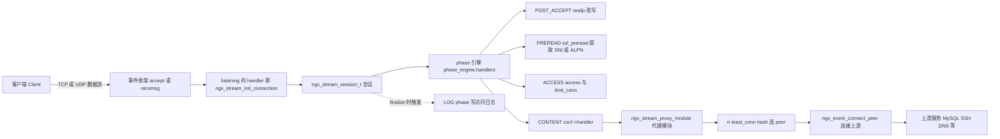
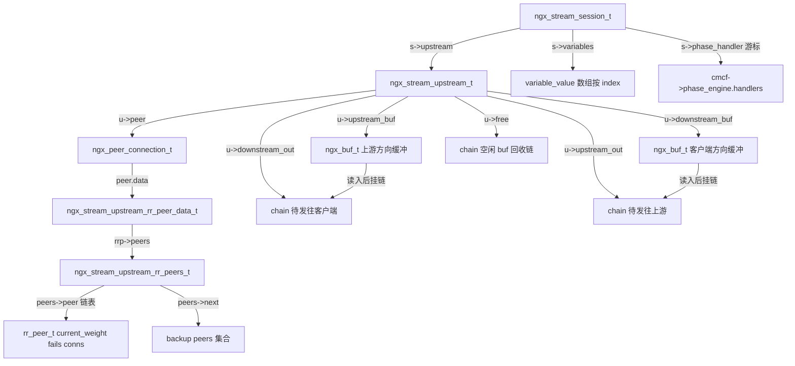
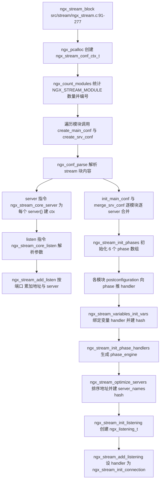
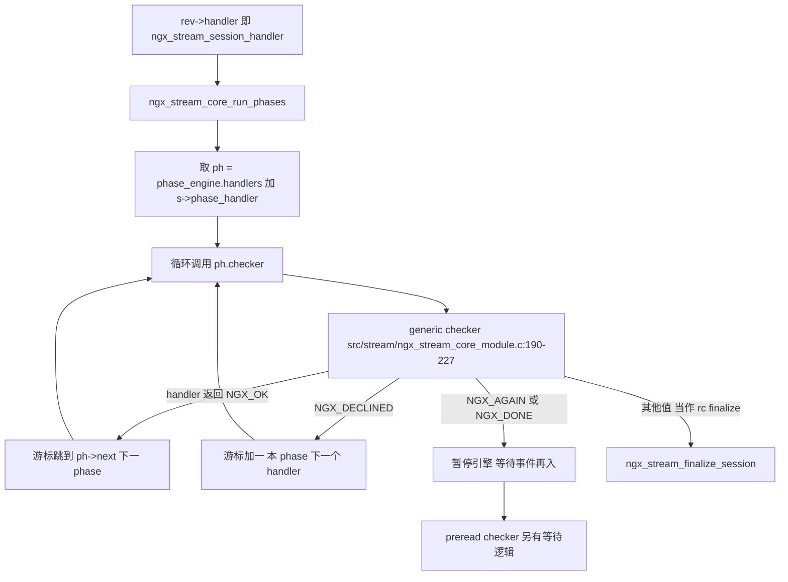
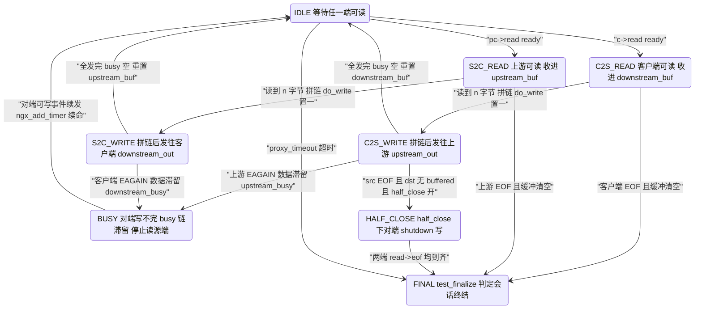
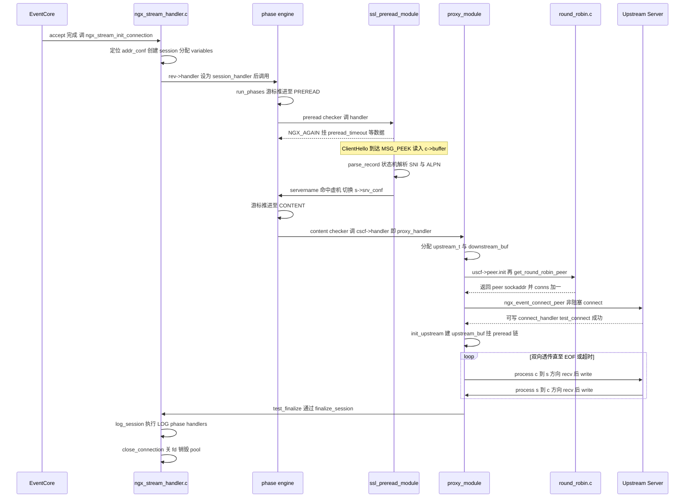
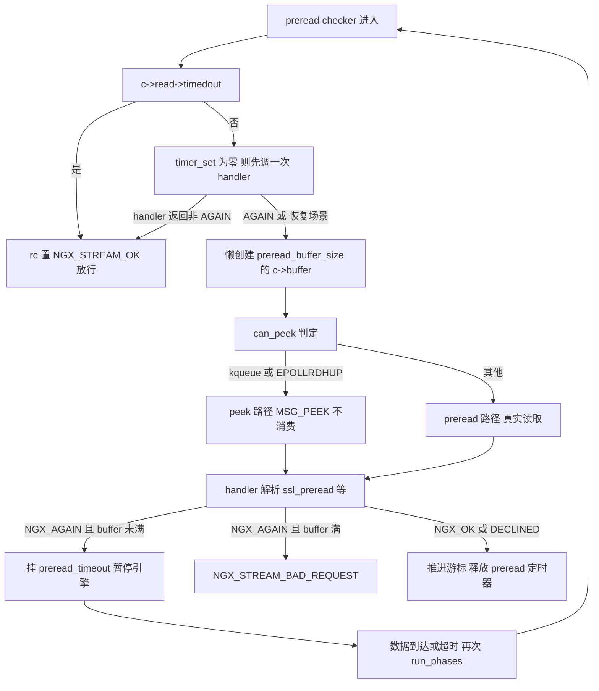

# stream 四层代理框架（基于 nginx-1.27.0 源码）

> **导读**：读完本文你将掌握——
> 1. `stream{}` 块从配置解析到 phase 引擎构建的完整初始化链路；
> 2. 一个 TCP/UDP 会话从 `accept` 进来后如何经过 7 个 phase，最终落入 `ngx_stream_proxy_module` 的双向透传循环；
> 3. `downstream_buf`/`upstream_buf` 两块单缓冲与 `*_out`/`*_busy`/`free` 三条链如何构成四层代理的"水位"反压；
> 4. `ssl_preread` 如何用 MSG_PEEK + 状态机从 ClientHello 里抠出 SNI/ALPN 做虚机路由；
> 5. UDP 会话如何靠 `proxy_requests`/`proxy_responses` 定界，与 TCP 在哪些代码点分叉；
> 6. stream 版 smooth weighted round-robin 与 http 侧的异同、`zone` 共享内存如何落地；
> 7. `ngx_stream_script`/`ngx_stream_variables` 与 http 变量引擎的同构实现；
> 8. PROXY protocol 的接收、透传与 realip 改写链路。
>
> **前置阅读建议**：本系列《02-事件驱动框架与连接管理》《14-阶段引擎与location匹配》《17-upstream上游机制》《18-负载均衡算法》《20-变量与脚本引擎》。stream 框架是 http 框架的"精简同构版"，对照阅读收益最大。
>
> **涉及源码清单**（本目录共 32 个文件，本文精读其中带 ★ 的）：
>
> | 文件 | 角色 |
> | --- | --- |
> | ★ src/stream/ngx_stream.c | stream{} 块解析、phase 引擎构建、监听端口组织 |
> | ★ src/stream/ngx_stream.h | 核心类型：session、phase、conf 上下文 |
> | ★ src/stream/ngx_stream_handler.c | 连接入口、会话生命周期、PROXY protocol 接收 |
> | ★ src/stream/ngx_stream_core_module.c | core 模块：phase checker、preread、虚机匹配 |
> | ★ src/stream/ngx_stream_proxy_module.c | 四层代理主体：连接、透传、UDP、SSL 上游 |
> | ★ src/stream/ngx_stream_upstream_round_robin.c | rr 负载均衡 |
> | ★ src/stream/ngx_stream_ssl_preread_module.c | TLS 预读提取 SNI/ALPN |
> | ★ src/stream/ngx_stream_script.c | 复杂值/脚本字节码 |
> | ★ src/stream/ngx_stream_variables.c | 变量注册、求值、hash |
> | 辅助精读 | ngx_stream_upstream.h、ngx_stream_upstream_round_robin.h、ngx_stream_script.h、ngx_stream_variables.h、ngx_stream_realip_module.c、ngx_stream_upstream_zone_module.c、ngx_stream_write_filter_module.c、ngx_stream_access_module.c（仅确认 phase 挂载点） |

---

## 1. 本模块在 nginx 中的位置与职责

`src/stream/` 是 nginx 的四层（传输层）代理框架，与 `src/http/` 平级，模块类型都是 `NGX_STREAM_MODULE`（`0x4d525453`，即 ASCII "STRM"，src/stream/ngx_stream.h:314）。它不解析任何应用层协议（除了 ssl_preread 对 TLS 握手头的"偷看"），只做字节流/数据报的转发，因此可以代理 MySQL、SSH、Redis、DNS、MQTT 等任意 TCP/UDP 协议。



**图解**：与 http 框架一样，stream 的监听 socket 由核心事件框架统一管理，区别只在 `ngx_listening_t.handler` 被设置为 `ngx_stream_init_connection`（src/stream/ngx_stream.c:1002）。accept 之后核心不再介入，控制权完全交给 stream 框架：先建会话，再跑 phase 引擎做路由/访问控制/预读解析，最终 CONTENT phase 调用由某个"内容模块"（通常是 proxy，也可以是 return/pass 等模块）注册的 `cscf->handler`。会话结束时手动触发 LOG phase（src/stream/ngx_stream_handler.c:308-311）。

### 1.1 与 http 框架的同构对照

两者的骨架完全同构：`ngx_stream_block` ↔ `ngx_http_block`，`ngx_stream_conf_ctx_t` ↔ `ngx_http_conf_ctx_t`，`ngx_stream_core_main_conf_t.phases[]` ↔ `ngx_http_core_main_conf_t.phases[]`，`phase_engine.handlers` 的构建算法逐行同源。差异在于"精简"：

**stream 的 phase 全集（以源码为准）**——枚举定义在 src/stream/ngx_stream.h:83-91：

| 序 | phase | checker | 典型挂载模块 |
| --- | --- | --- | --- |
| 0 | `NGX_STREAM_POST_ACCEPT_PHASE` | generic | realip（src/stream/ngx_stream_realip_module.c:340-345） |
| 1 | `NGX_STREAM_PREACCESS_PHASE` | generic | 预留（1.27.0 中核心树无默认挂载者） |
| 2 | `NGX_STREAM_ACCESS_PHASE` | generic | access（src/stream/ngx_stream_access_module.c:445）、limit_conn |
| 3 | `NGX_STREAM_SSL_PHASE` | generic | ssl 模块的握手处理 |
| 4 | `NGX_STREAM_PREREAD_PHASE` | **preread**（专用 checker） | ssl_preread（src/stream/ngx_stream_ssl_preread_module.c:707） |
| 5 | `NGX_STREAM_CONTENT_PHASE` | **content**（专用 checker） | proxy/return/pass 设置的 `cscf->handler` |
| 6 | `NGX_STREAM_LOG_PHASE` | 不进 engine，finalize 时手动执行 | log 模块 |

其中 phase 数组只初始化 6 个（POST_ACCEPT 到 LOG，不含 CONTENT），见 src/stream/ngx_stream.c:280-326。

**差异清单**：

1. **阶段数量**：stream 7 个 vs http 11 个（http 还有 POST_READ、SERVER_REWRITE、FIND_CONFIG、REWRITE、POST_REWRITE、POST_ACCESS、PRECONTENT 等，见本系列第 14 篇）。stream 没有 rewrite/found_config 概念——四层没有 URI。
2. **checker 种类**：stream 只有 3 个 checker：`ngx_stream_core_generic_phase`、`ngx_stream_core_preread_phase`、`ngx_stream_core_content_phase`（src/stream/ngx_stream.c:357-372 选择逻辑）；http 为每个阶段定制 checker。
3. **LOG phase 不在 engine 里**：engine 只构建 `NGX_STREAM_LOG_PHASE` 之前的 handler（src/stream/ngx_stream.c:341、354 的循环上界），LOG 在 `ngx_stream_finalize_session` 中手动循环调用（src/stream/ngx_stream_handler.c:314-329）；http 的 LOG 在 engine 末尾。
4. **CONTENT phase 固定一项**：构建 engine 时 `n = 1 /* content phase */`（src/stream/ngx_stream.c:339），只填 checker 不填 handler（src/stream/ngx_stream.c:363-368），执行时由 `ngx_stream_core_content_phase` 直接调 `cscf->handler(s)`（src/stream/ngx_stream_core_module.c:461）。
5. **会话级而非请求级**：engine 游标 `s->phase_handler` 每会话只从头跑一遍，没有 keepalive 子请求、没有 subrequest。
6. **preread 专用 checker**：这是 stream 独有的"等数据再继续"模式（见第 4 节），http 没有对应物。

---

## 2. 核心数据结构精讲

### 2.1 ngx_stream_session_t —— 四层会话（src/stream/ngx_stream.h:260-298）

| 字段 | 类型 | 含义 |
| --- | --- | --- |
| `signature` | `uint32_t` | 恒为 `NGX_STREAM_MODULE`("STRM")，防句柄误用 |
| `connection` | `ngx_connection_t *` | 客户端连接 |
| `received` | `off_t` | 从客户端累计收到的字节数（含 preread，见 handler.c:136-138） |
| `start_sec`/`start_msec` | `time_t`/`ngx_msec_t` | 会话起始时间，供 `$session_time` 使用 |
| `log_handler` | `ngx_log_handler_pt` | 错误日志附加信息回调，proxy 会换成 `ngx_stream_proxy_log_error` |
| `ctx` | `void **` | 各模块的会话级上下文数组（下标 `ctx_index`） |
| `main_conf`/`srv_conf` | `void **` | 指向虚机 server 的配置数组（初始来自 default_server，preread 阶段可被切换） |
| `virtual_names` | `ngx_stream_virtual_names_t *` | 本监听地址上的 server_name hash+regex |
| `upstream` | `ngx_stream_upstream_t *` | 代理模块的上游状态（只有 proxy 会创建） |
| `upstream_states` | `ngx_array_t` | `ngx_stream_upstream_state_t` 数组，记录每次 upstream 尝试 |
| `variables` | `ngx_stream_variable_value_t *` | 变量值缓存数组，按 index 索引 |
| `ncaptures`/`captures`/`captures_data` | PCRE 捕获组缓存 | regex server_name 与 map 使用 |
| `phase_handler` | `ngx_int_t` | phase engine 游标 |
| `status` | `ngx_uint_t` | 会话状态码（200/400/403/500/502/503，src/stream/ngx_stream.h:29-34） |
| `ssl`/`stat_processing`/`health_check`/`limit_conn_status` | 位域 | 状态标记 |

与 `ngx_http_request_t` 对比：没有 `request_line`/`headers_in`/`uri`/`args`，多出 `signature`（http 无此字段）；`upstream_states` 承担了 http 中 `r->upstream_states` 的角色。

### 2.2 ngx_stream_upstream_t —— 代理的上下游桥（src/stream/ngx_stream_upstream.h:117-146）

| 字段 | 类型 | 含义 |
| --- | --- | --- |
| `peer` | `ngx_peer_connection_t` | 上游 peer 连接抽象：`get`/`free`/`notify`/`set_session`/`save_session` 回调 + `sockaddr`/`tries` |
| `downstream_buf` | `ngx_buf_t` | 客户端→上游方向的搬运缓冲（`proxy_buffer_size`） |
| `upstream_buf` | `ngx_buf_t` | 上游→客户端方向的搬运缓冲（同一 `proxy_buffer_size`） |
| `free` | `ngx_chain_t *` | 已发送完毕、可复用的 buf 链（free list） |
| `upstream_out`/`upstream_busy` | `ngx_chain_t *` | 待发往上游的链 / 已交给 send 但未确认发完的链 |
| `downstream_out`/`downstream_busy` | `ngx_chain_t *` | 待发往客户端的链 / 客户端方向 busy 链 |
| `received` | `off_t` | 从上游收到的字节数 |
| `start_sec`/`start_time` | 时间基准 | 限速配额与 `connect_time`/`response_time` 统计 |
| `requests`/`responses` | `ngx_uint_t` | UDP 定界计数：客户端请求数 / 上游响应包数 |
| `upload_rate`/`download_rate` | `size_t` | 运行时求值的限速值（字节/秒），0 表示不限 |
| `ssl_name` | `ngx_str_t` | 上游 SNI/证书校验域名 |
| `upstream`/`resolved` | 指针 | 二选一：静态 upstream 块 或 运行时解析结果 |
| `state` | `ngx_stream_upstream_state_t *` | 当前尝试的统计槽（push 进 `s->upstream_states`） |
| `connected`/`proxy_protocol`/`half_closed` | 位域 | 连接已建立 / 待发 PROXY 头 / 已向对端 shutdown 写 |

### 2.3 rr 负载均衡三元组（src/stream/ngx_stream_upstream_round_robin.h:19-132）

| 结构 | 关键字段 | 说明 |
| --- | --- | --- |
| `ngx_stream_upstream_rr_peer_s`（单 peer） | `current_weight`/`effective_weight`/`weight`、`conns`/`max_conns`、`fails`/`accessed`/`checked`、`max_fails`/`fail_timeout`、`down`、`ssl_session`、`lock`(zone)、`next` | smooth WRR 的全部状态都在 peer 里 |
| `ngx_stream_upstream_rr_peers_s`（peer 集合） | `number`、`total_weight`、`tries`、`single:1`、`weighted:1`、`name`、`next`(backup 集合)、`peer`（链表头）、`shpool`/`rwlock`/`zone_next`(zone) | `single` 时 get/free 走零开销快速路径 |
| `ngx_stream_upstream_rr_peer_data_t`（会话级） | `config`、`peers`、`current`、`tried`、`data` | `tried` 位图：peer 数 ≤ 64 时用内嵌 `data` 一个 uintptr_t，否则按 word 分配 |

### 2.4 数据结构关系图



**图解**：一次透传的数据通路是——客户端数据 `recv` 进 `downstream_buf`，然后包装成 chain 挂到 `upstream_out`，由 `ngx_stream_top_filter`（默认 `ngx_stream_write_filter`，src/stream/ngx_stream_write_filter_module.c:303）写往上游；发送未完成的 buf 经 `ngx_chain_update_chains` 移入 `upstream_busy`，完成后回收进 `free`。反方向对称。`free` 链让 buf 结构体循环复用，但注意：每方向只有**一块**底层存储（`downstream_buf`/`upstream_buf`），`free` 复用的是 chain/buf 描述符，buf 的 `pos`/`last` 指回这块固定存储。

---

## 3. 初始化流程



**图解**：流程与 `ngx_http_block` 逐段对应，关键差异有三处。

1. **三段式地址组织**：`listen` 指令解析出 `ngx_stream_listen_opt_t` 后交给 `ngx_stream_add_listen`（src/stream/ngx_stream.c:388-439），它按 `(port, type, family)` 三元组把地址归并进 `ngx_stream_conf_port_t`；同一 `sockaddr` 上的多个 server 通过 `ngx_stream_add_server` 挂进 `ngx_stream_conf_addr_t.servers` 数组（src/stream/ngx_stream.c:628-663），重复 listen 直接报错。
2. **phase 引擎构建在配置期一次完成**：`ngx_stream_init_phase_handlers`（src/stream/ngx_stream.c:329-385）先把 CONTENT phase 占 1 项，然后按 phase 顺序把各模块 handler **逆序**拷入 engine（src/stream/ngx_stream.c:376-381），逆序是为了配合 postconfiguration 的 push 顺序——后注册的模块先出现在配置数组尾部，逆序拷贝后恰好先执行。PREREAD 项统一使用 `ngx_stream_core_preread_phase` checker。
3. **监听落盘**：`ngx_stream_optimize_servers`（src/stream/ngx_stream.c:666-710）先按"显式 bind 优先、wildcard 殿后"排序（src/stream/ngx_stream.c:870-901），多 server 的地址还要为 `server_name` 建 hash/通配/regex 三级结构（`ngx_stream_server_names`，src/stream/ngx_stream.c:713-867）。最终 `ngx_stream_add_listening`（src/stream/ngx_stream.c:989-1051）把 `pool_size` 定为 256、`log.handler` 设为 `ngx_accept_log_error`，`ls->type` 保留 `SOCK_DGRAM`——这就是 UDP 监听能走同一套事件框架的原因。

---

## 4. 核心执行流程/状态机

### 4.1 phase 引擎执行流



**图解**：`run_phases` 是一个 while 循环（src/stream/ngx_stream_core_module.c:168-187）：checker 返回 `NGX_OK` 表示"引擎该暂停了"（把控制权交还事件循环），返回值本身不终止循环；真正的推进由 checker 内部改写 `s->phase_handler` 完成。`generic` checker 的语义与 http 同名函数一致：`NGX_OK` 跳 phase、`NGX_DECLINED` 走下一个 handler、`NGX_AGAIN/NGX_DONE` 暂停、其余值当作 `ngx_stream_finalize_session` 的 rc（`NGX_ERROR` 折算成 500）。

### 4.2 s→c 与 c→s 双向透传事件切换状态机

proxy 模块连接建立后的稳态就是两张事件表（c=客户端连接，pc=上游连接）：

- `c->read`/`c->write` → `ngx_stream_proxy_downstream_handler`，`from_upstream = ev->write`（src/stream/ngx_stream_proxy_module.c:1321-1325）；
- `pc->read`/`pc->write` → `ngx_stream_proxy_upstream_handler`，`from_upstream = !ev->write`（src/stream/ngx_stream_proxy_module.c:1397-1401）。

即：**客户端可读 = 从客户端读 = c→s 方向**；**上游可读 = 从上游读 = s→c 方向**。方向由触发事件的连接决定，写哪端也由它决定（`do_write = ev->write`）。



**图解**：这是一个事件驱动的乒乓状态机。单次事件到来时 `ngx_stream_proxy_process(s, from_upstream, do_write)` 内部的 `for(;;)` 会尽量多做几轮"读→拼链→写"（src/stream/ngx_stream_proxy_module.c:1652-1755 的 `continue` 反复循环，直到 `recv` 返回 `NGX_AGAIN` 才 `break`）。反压点有两个：写端 `EAGAIN` 时数据留在 busy 链；源端缓冲 `size = b->end - b->last` 为 0 时干脆不读（自然反压到内核 TCP 窗口）。每一轮结束都调用 `ngx_stream_proxy_test_finalize` 检查是否两端 EOF/缓冲清空可以收会话。

### 4.3 UDP 会话与 TCP 的分叉点

UDP 没有连接、没有 EOF，"会话"是一个五元组上的逻辑概念。代码分叉点全列如下：

| 分叉点 | 位置 | 行为 |
| --- | --- | --- |
| listen 解析 | src/stream/ngx_stream_core_module.c:943-947 | `udp` 参数 → `lsopt.type = SOCK_DGRAM`；随后 1217-1253 行禁止 backlog/fastopen/ssl/proxy_protocol 等 TCP 专属参数 |
| 会话日志 | src/stream/ngx_stream_handler.c:149-151 | 日志前缀 `udp ` |
| peer 类型 | src/stream/ngx_stream_proxy_module.c:437 | `u->peer.type = c->type`，connect 对 DGRAM 走已 connect 的 UDP socket |
| tcp_nodelay | src/stream/ngx_stream_proxy_module.c:794、core_module.c:453 | 仅 `SOCK_STREAM` 才设置 |
| 超时语义 | src/stream/ngx_stream_proxy_module.c:1449-1485 | UDP 超时先查 `u->responses >= pscf->responses * u->requests`，达标则 200 正常收尾，否则 502；TCP 超时一律 200 |
| 会话定界 | src/stream/ngx_stream_proxy_module.c:1819-1855 | `test_finalize` UDP 分支：请求数达到 `proxy_requests` 则 `ngx_delete_udp_connection(c)` 删除五元组映射；响应包数达标且两端无 buffered 才 finalize |
| next_upstream | src/stream/ngx_stream_proxy_module.c:1913-1915 | UDP 换上游时清空 `u->upstream_out`（UDP 无半包状态可迁移） |
| 收尾状态 | src/stream/ngx_stream_proxy_module.c:1995-1999 | finalize 时 UDP 上游若发生读写错误才标记 `NGX_PEER_FAILED` |
| 关停 | src/stream/ngx_stream_proxy_module.c:1610-1623 | worker 退出时 UDP socket 被关，直接 finalize 会话 |

`proxy_responses` 的定界公式是 `u->responses >= pscf->responses * u->requests`：例如 DNS 场景配 `proxy_responses 1`，客户端发一个查询（requests=1）、上游回一个应答，条件即满足，`test_finalize` 在确认 `pc != NULL && !c->buffered && !pc->buffered` 后正常关闭（src/stream/ngx_stream_proxy_module.c:1829-1854）。默认 `responses = NGX_MAX_INT32_VALUE`（src/stream/ngx_stream_proxy_module.c:2137-2138），即永不主动定界，全靠 `proxy_timeout`。

### 4.4 preread 阶段的数据等待模型

`preread` checker（src/stream/ngx_stream_core_module.c:230-314）是 stream 独有的"暂停-恢复"模式：

1. 首次进入时 `c->read->timer_set` 为 0，先调一次 `ph->handler(s)`（此时可能还没数据，handler 返回 `NGX_AGAIN`）；
2. 创建 `preread_buffer_size`（默认 16KB，src/stream/ngx_stream_core_module.c:757-758）的临时 `c->buffer`；
3. 按 `ngx_stream_preread_can_peek` 结果走 MSG_PEEK 路径或真实读取路径；
4. handler 仍需更多数据时返回 `NGX_AGAIN`，checker 挂上 `preread_timeout`（默认 30s）定时器、把 `c->read->handler` 换回 `ngx_stream_session_handler` 并暂停引擎（src/stream/ngx_stream_core_module.c:274-287）；
5. 数据到达或超时后重新进入 `run_phases`，游标仍停在 preread 项：超时则 `rc = NGX_STREAM_OK` 直接放行（244-247 行），有数据则继续 peek/preread → handler。

`can_peek` 的条件链（src/stream/ngx_stream_core_module.c:317-343）：TLS 连接不 peek（数据已被 OpenSSL 消费语义干扰）；非 `NGX_USE_CLEAR_EVENT`（select/poll 这类水平触发的多路复用器）不 peek；只有 kqueue 或带 `EPOLLRDHUP` 的 epoll 才允许。原因：peek 不消费数据，依赖边缘触发的事件在数据未读尽时再次通知，且要能不读数据就感知 EOF（`pending_eof`），否则会丢 EOF 事件。

---

## 5. 关键时序图

以一个 TCP 会话走 ssl_preread + proxy_pass 为例：



**图解**：每一跳都能对应到源码——`init_connection` 在 src/stream/ngx_stream_handler.c:20-206；preread 暂停/恢复见 4.4 节；`proxy_handler` 在 src/stream/ngx_stream_proxy_module.c:392-592；`connect_handler`/`test_connect` 在 1514-1584；透传主循环在 1587-1801；收尾在 `ngx_stream_finalize_session`（src/stream/ngx_stream_handler.c:300-311）。值得注意：preread 期间引擎暂停过一次，所以 `s->phase_handler` 游标被保持，恢复后无需重跑前面的 phase。

---

## 6. 源码逐段精读

本节按执行顺序精读核心函数。引用格式为 `文件:起始行-结束行`。

### 6.1 ngx_stream_init_connection —— 会话的诞生（src/stream/ngx_stream_handler.c:20-206）

```c
void
ngx_stream_init_connection(ngx_connection_t *c)
{
    /* find the server configuration for the address:port */

    port = c->listening->servers;

    if (port->naddrs > 1) {
        /*
         * There are several addresses on this port and one of them
         * is the "*:port" wildcard so getsockname() is needed to determine
         * the server address.
         */
        if (ngx_connection_local_sockaddr(c, NULL, 0) != NGX_OK) {
```

（src/stream/ngx_stream_handler.c:20-57，摘录 12 行）

**逐块逻辑**：

1. **定位地址配置**：`port->naddrs > 1` 时说明该端口上绑了多个地址（含 wildcard），需要 `getsockname()` 拿到本次连接的实际目的地址，再在 `port->addrs` 里线性匹配（IPv4 比较 4 字节 `sin_addr`，IPv6 比较 16 字节，src/stream/ngx_stream_handler.c:84-100）；数组最后一个元素是 wildcard，所以循环只遍历 `naddrs - 1` 个，找不到就落在 wildcard 上。这是 `listen 80` + `listen 127.0.0.1:80` 共存时的虚地址分派。
2. **会话分配**：`ngx_pcalloc(c->pool, sizeof(ngx_stream_session_t))`（src/stream/ngx_stream_handler.c:119-123）——会话生命周期与连接池绑定，销毁时随 pool 一起释放。`ctx` 取自 `addr_conf->default_server->ctx`（125 行），即该地址上排序后的第一个 server（或显式 `default_server`）；`s->main_conf`/`s->srv_conf` 都来自这个 ctx（128-129 行）。
3. **变量数组预分配**：`s->variables` 按 `cmcf->variables.nelts` 分配（src/stream/ngx_stream_handler.c:167-169），每个变量占一个 `ngx_stream_variable_value_t`，之后所有变量读写都是 O(1) 数组访问——这正是 http 变量引擎的同构设计。
4. **入口 handler 选择**：默认 `rev->handler = ngx_stream_session_handler`（src/stream/ngx_stream_handler.c:180-181）；若 `addr_conf->proxy_protocol` 则换成 `ngx_stream_proxy_protocol_handler` 并挂 `proxy_protocol_timeout` 定时器（183-198 行）。
5. **accept mutex 收尾**：开 accept 锁的进程把读事件挂进 `ngx_posted_events` 延迟到本轮事件循环末尾执行（src/stream/ngx_stream_handler.c:200-203），避免在锁持有期间做重活；否则直接 `rev->handler(rev)` 同步进入 phase 引擎。

**易错点**：`s->received` 的初始值不是 0——如果事件框架在 accept 时已经带出数据（`c->buffer` 非空，如 AcceptEx），这些字节会计入 `received`（src/stream/ngx_stream_handler.c:136-138），保证日志统计不漏。

### 6.2 ngx_stream_proxy_protocol_handler —— 收 PROXY 头（src/stream/ngx_stream_handler.c:209-284）

```c
    n = recv(c->fd, (char *) buf, sizeof(buf), MSG_PEEK);

    err = ngx_socket_errno;
    ...
    p = ngx_proxy_protocol_read(c, buf, buf + n);

    if (p == NULL) {
        ngx_stream_finalize_session(s, NGX_STREAM_BAD_REQUEST);
        return;
    }

    size = p - buf;

    if (c->recv(c, buf, size) != (ssize_t) size) {
```

（src/stream/ngx_stream_handler.c:232-276，摘录 11 行）

**逐块逻辑**：用 `MSG_PEEK` 偷看最多 `NGX_PROXY_PROTOCOL_MAX_HEADER` 字节而不消费；`EAGAIN` 则挂定时器等（239-255 行）；解析成功后 `p - buf` 得到头部实际长度，再真正 `recv` 把头从内核缓冲里拿走（274-279 行）。解析结果存进 `c->proxy_protocol`（`ngx_proxy_protocol_t`，含 `src_addr`/`src_port`/`dst_addr`/`dst_port`/TLV），供 `$proxy_protocol_addr` 系列变量使用（src/stream/ngx_stream_variables.c:70-88）。收完头把 `log->action` 改回 "initializing session" 并直接调 `ngx_stream_session_handler` 进入 phase 引擎。

**易错点**：头部超时按 `NGX_STREAM_OK` finalize（src/stream/ngx_stream_handler.c:226-230）——会话状态记 200 而不是错误，因为这是客户端行为问题；解析失败才是 400。

### 6.3 三个 phase checker（src/stream/ngx_stream_core_module.c:168-314）

`ngx_stream_core_run_phases`（168-187 行）已见 4.1 节。重点看 preread checker 的完整分支：

```c
    if (c->read->timedout) {
        rc = NGX_STREAM_OK;
        goto done;
    }

    if (!c->read->timer_set) {
        rc = ph->handler(s);

        if (rc != NGX_AGAIN) {
            goto done;
        }
    }

    if (c->buffer == NULL) {
        c->buffer = ngx_create_temp_buf(c->pool, cscf->preread_buffer_size);
```

（src/stream/ngx_stream_core_module.c:244-262，摘录 12 行）

**逐块逻辑**：

- `timedout` 分支：`preread_timeout` 到点，按 200 放行到下一 phase——预读失败不阻断会话；
- `!timer_set` 分支：首次进入时先给 handler 一次机会（此时 buffer 还没建，ssl_preread 会返回 `NGX_AGAIN`，见 6.5 节）；从暂停中恢复且定时器还在时**跳过**这次调用，直接走下面的读取路径，由读取路径内部再调 handler；
- buffer 懒创建：只有确定要等数据时才分配 16KB。

恢复路径的收尾（src/stream/ngx_stream_core_module.c:274-287）：`NGX_AGAIN` 时 `ngx_handle_read_event` + 挂 `preread_timeout` + `c->read->handler = ngx_stream_session_handler`，返回 `NGX_OK` 暂停引擎。`NGX_OK`/`NGX_DECLINED` 的推进语义与 generic checker 相同（293-301 行），但多了 `NGX_DONE` 直接暂停的分支（303-305 行）——ssl 模块握手用它可以无缝接管。

**content checker**（src/stream/ngx_stream_core_module.c:440-464）：对 TCP 客户端连接设 `TCP_NODELAY`（453-459 行），然后一把调用 `cscf->handler(s)`。handler 是谁？`proxy_pass` 指令解析时写死：`cscf->handler = ngx_stream_proxy_handler`（src/stream/ngx_stream_proxy_module.c:2369-2371）。没有配置任何内容模块时，`merge_srv_conf` 会报 `no handler for server`（src/stream/ngx_stream_core_module.c:737-742）——这就是"stream server 必须有 proxy_pass/return 之一"的报错源头。

### 6.4 preread_peek 与 preread 双路径（src/stream/ngx_stream_core_module.c:346-437）

```c
    n = recv(c->fd, (char *) c->buffer->last,
             c->buffer->end - c->buffer->last, MSG_PEEK);
    ...
    if (n == 0) {
        return NGX_STREAM_OK;
    }

    c->buffer->last += n;

    rc = ph->handler(s);

    if (rc != NGX_AGAIN) {
        c->buffer->last = c->buffer->pos;
        return rc;
    }

    if (c->buffer->last == c->buffer->end) {
        ngx_log_error(NGX_LOG_ERR, c->log, 0, "preread buffer full");
        return NGX_STREAM_BAD_REQUEST;
    }
```

（src/stream/ngx_stream_core_module.c:356-389，摘录 13 行）

**peek 路径语义**：数据用 `MSG_PEEK` 复制进 `c->buffer` 供解析，但**不消费**内核缓冲；handler 给出最终结论（不再是 `NGX_AGAIN`）后把 `last` 回卷到 `pos`（381-384 行）——`c->buffer` 恢复"空"状态，后续 proxy 从内核直接读。handler 还要更多数据时，只有 buffer 写满才报 400，否则继续等。`n == 0` 或 `pending_eof` 直接放行（373-375、391-393 行）。

**非 peek 路径**（`ngx_stream_preread`，src/stream/ngx_stream_core_module.c:401-437）：`while (c->read->ready)` 循环里用 `c->recv` 真实读取，数据**留在** `c->buffer` 中；读完调 handler，`NGX_AGAIN` 且 buffer 满同样报 400（430-433 行）。这个分支里 buffer 的数据最终会被 proxy 转发：`ngx_stream_proxy_init_upstream` 检查 `c->buffer` 非空时，把它包装成 chain 挂到 `u->upstream_out` 头部（src/stream/ngx_stream_proxy_module.c:866-885），作为发往上游的第一段数据——preread 读走的字节不会被丢，这正是"preread 不破坏数据流"的保证。

### 6.5 ssl_preread：TLS 状态机抠 SNI/ALPN（src/stream/ngx_stream_ssl_preread_module.c）

**handler 主体**（src/stream/ngx_stream_ssl_preread_module.c:107-206）：

```c
    if (c->buffer == NULL) {
        return NGX_AGAIN;
    }

    ctx = ngx_stream_get_module_ctx(s, ngx_stream_ssl_preread_module);
    if (ctx == NULL) {
        ctx = ngx_pcalloc(c->pool, sizeof(ngx_stream_ssl_preread_ctx_t));
        ...
        ctx->pos = c->buffer->pos;
    }

    p = ctx->pos;
    last = c->buffer->last;

    while (last - p >= 5) {

        if ((p[0] & 0x80) && p[2] == 1 && (p[3] == 0 || p[3] == 3)) {
            /* SSLv2 ClientHello */
            ctx->version[0] = p[3];
            ctx->version[1] = p[4];
            return NGX_OK;
        }

        if (p[0] != 0x16) {   /* not a handshake */
```

（src/stream/ngx_stream_ssl_preread_module.c:131-167，摘录 14 行）

**逐块逻辑**：

1. `c->buffer == NULL` 返回 `NGX_AGAIN`——触发 preread checker 建缓冲并挂定时器（见 6.3）；
2. 模块 ctx 保存解析进度 `pos`，跨多次 preread 调用续传；
3. 记录层循环：先识别 SSLv2 格式 ClientHello（最高位 1、`p[2]==1` 表示 handshake）；标准 TLS 记录要求 `p[0] == 0x16`（handshake）且 `p[1] == 3`（TLS 主版本）；`len = (p[3] << 8) + p[4]` 后必须**整条记录到齐**才解析（src/stream/ngx_stream_ssl_preread_module.c:179-181），否则 `break` 返回 `NGX_AGAIN` 继续等。

**parse_record 状态机**（src/stream/ngx_stream_ssl_preread_module.c:209-499）状态枚举 216-236 行：`sw_start → sw_header → sw_version → sw_random(32B) → sw_sid_len → sw_sid → sw_cs_len → sw_cs → sw_cm_len → sw_cm → sw_ext → sw_ext_header → …`。状态机的推进骨架是统一的：

```c
    for ( ;; ) {
        n = ngx_min((size_t) (last - pos), size);

        if (dst) {
            dst = ngx_cpymem(dst, pos, n);
        }

        pos += n;
        size -= n;
        left -= n;

        if (size != 0) {
            break;
        }

        switch (state) {
```

（src/stream/ngx_stream_ssl_preread_module.c:248-263，摘录 10 行）

每次吃满当前字段的 `size` 字节后按状态切下一字段；`dst` 指向产出位置（版本号、SNI、ALPN 都靠它拷出）；`size != 0` 说明本字段没吃满，保存进度返回 `NGX_AGAIN`（492-498 行）。关键分支在 `sw_ext_header`（348-376 行）：

- `p[0]==0 && p[1]==0`：SNI 扩展（type 0）→ `sw_sni_len` → `sw_sni_host_head` 校验 name_type 必须为 0（host_name，386-390 行）、`ext` 长度合法性（394-399 行）→ `ngx_pnalloc` 分配 `ctx->host.data` 拷入域名（401-404 行）；
- `p[0]==0 && p[1]==16`：ALPN 扩展（type 16）→ 逐个 protocol 拷贝并以 `,` 连接（src/stream/ngx_stream_ssl_preread_module.c:418-469 的 `sw_alpn_len`/`sw_alpn_proto_len`/`sw_alpn_proto_data`）；
- `p[0]==0 && p[1]==43`：supported_versions → 强制把版本改写为 TLSv1.3（471-482 行），因为 ClientHello 顶层的 legacy_version 固定是 0x0303。

**路由落地**：解析出 SNI 后 `ngx_stream_ssl_preread_servername`（src/stream/ngx_stream_ssl_preread_module.c:502-547）调 `ngx_stream_validate_host`（src/stream/ngx_stream_core_module.c:467-556，小写化+非法字符过滤）与 `ngx_stream_find_virtual_server`（src/stream/ngx_stream_core_module.c:559-607，hash 命中 → regex 回退），命中后**切换会话配置**：

```c
    s->srv_conf = cscf->ctx->srv_conf;

    ngx_set_connection_log(c, cscf->error_log);
```

（src/stream/ngx_stream_ssl_preread_module.c:542-545，摘录 3 行）

`s->srv_conf` 整体指针替换，此后所有 `ngx_stream_get_module_srv_conf` 都取到新 server 的配置；连接日志也换成目标 server 的。这是 stream 版"虚机匹配"，时机在 PREREAD phase 而非 accept 时——与 http 的 FIND_CONFIG phase 对应。三个导出变量 `$ssl_preread_protocol`/`$ssl_preread_server_name`/`$ssl_preread_alpn_protocols`（src/stream/ngx_stream_ssl_preread_module.c:92-104）供 `map` 模块做路由，典型组合是 `map $ssl_preread_server_name $backend`。

### 6.6 ngx_stream_proxy_handler —— 代理入口（src/stream/ngx_stream_proxy_module.c:392-592）

**逐块逻辑**：

1. **上游状态初始化**：`u = ngx_pcalloc(c->pool, sizeof(ngx_stream_upstream_t))`（413-419 行）；`u->peer.log = c->log`、`log_error = NGX_ERROR_ERR`（425-426 行）。
2. **事件表布置**：客户端两个事件都指向 `ngx_stream_proxy_downstream_handler`（440-441 行）；此时上游还没连上，先不碰 pc。
3. **第一块缓冲**：`p = ngx_pnalloc(c->pool, pscf->buffer_size)` 后初始化 `u->downstream_buf` 的 start/end/pos/last 四指针（450-459 行）——c→s 方向的搬运缓冲就此诞生，`upstream_buf` 要等连接成功后才建（见 6.7）。
4. **预读事件转投**：若 `c->read->ready`（客户端数据已到），把读事件挂 `ngx_posted_events`（461-463 行），避免在 phase 引擎里同步读阻塞后续逻辑。
5. **上游三选一**：
   - `proxy_pass` 带变量：`ngx_stream_proxy_eval`（595-641 行）求值出 host，`ngx_parse_url(no_resolve=1)` 后填充 `u->resolved`；
   - `u->resolved` 有 `sockaddr`（字面量 IP）：直接 `ngx_stream_upstream_create_round_robin_peer` 建临时 peer 集（512-517 行）然后 connect；
   - `u->resolved` 只有域名：走 resolver（531-561 行），回调 `ngx_stream_proxy_resolve_handler`（1329-1394 行）解析成功后同样 `create_round_robin_peer` + connect；
   - 普通 `proxy_pass backend`（upstream 块或 host:port）：在 `umcf->upstreams` 数组里按 `host`+`port` 匹配已注册的 `uscf`（486-499 行），命中后执行 `uscf->peer.init(s, uscf)`（578-581 行）——这个 init 就是 `ngx_stream_upstream_init_round_robin_peer`（src/stream/ngx_stream_upstream_round_robin.c:46），它把 `peer.get/free/notify` 回调装上。
6. **重试上限**：`proxy_next_upstream_tries` 可以砍小 `u->peer.tries`（585-589 行）。

### 6.7 connect 与 init_upstream（src/stream/ngx_stream_proxy_module.c:697-937）

`ngx_stream_proxy_connect`（697-775 行）：

- push 一个 `ngx_stream_upstream_state_t` 统计槽，`connect_time`/`first_byte_time`/`response_time` 先置 -1（720-732 行）；
- `ngx_event_connect_peer(&u->peer)` 返回四态（734-756 行）：`NGX_ERROR` → 500；`NGX_BUSY`（无可用 peer）→ 502 日志 "no live upstreams"；`NGX_DECLINED`（get peer 失败）→ `next_upstream`；`NGX_OK/NGX_AGAIN/DONE` 进入后续——`NGX_AGAIN` 表示 connect 未完成，装 `ngx_stream_proxy_connect_handler` 并挂 `proxy_connect_timeout`（771-774 行）；同步成功则直接 `ngx_stream_proxy_init_upstream`。

`ngx_stream_proxy_connect_handler`（1514-1540 行）：超时 → `next_upstream`；`ngx_stream_proxy_test_connect`（1543-1584 行）用 `getsockopt(SO_ERROR)`（kqueue 走 `kq_errno`）确认连接真的成功；然后 `init_upstream`。

`ngx_stream_proxy_init_upstream`（778-937 行）按序做六件事：

```c
    if (pc->type == SOCK_STREAM
        && cscf->tcp_nodelay
        && ngx_tcp_nodelay(pc) != NGX_OK)
    {
        ngx_stream_proxy_next_upstream(s);
        return;
    }
```

（src/stream/ngx_stream_proxy_module.c:794-800，摘录 7 行）

1. 上游 TCP 连接设 `TCP_NODELAY`，失败按换上游处理（不是直接断会话）；
2. SSL 上游：若还欠 PROXY 头先同步发（808-814 行 → `ngx_stream_proxy_send_proxy_protocol`，942-1010 行，**必须一次发完**否则按协议报错 1001-1007 行），再走 `ngx_ssl_handshake` 异步握手，回调 `ngx_stream_proxy_ssl_handshake`（1114-1160 行）里做证书校验（`SSL_get_verify_result` + `ngx_ssl_check_host`）；
3. 记录 `u->state->connect_time`，若 peer 实现提供 `notify` 回调则发 `NGX_STREAM_UPSTREAM_NOTIFY_CONNECT`（846-851 行）——rr 用它提前清零 fails（src/stream/ngx_stream_upstream_round_robin.c:679-702）；
4. 分配 `u->upstream_buf`（853-864 行）——第二块搬运缓冲；
5. **preread 数据接力**（866-885 行）：`c->buffer` 有内容（非 peek preread 读到的字节）就 `ngx_chain_get_free_buf` 包成 chain、打上 proxy 模块 tag、`temporary = (pos != last)`、`flush = 1`，插到 `u->upstream_out` 头部；同样逻辑给 `proxy_protocol` 指令生成 v1 头 chain（887-922 行，`ngx_proxy_protocol_write` 把当前连接的原始地址写进头）；
6. 求值限速、`u->connected = 1`、上游两个事件指向 `ngx_stream_proxy_upstream_handler`，最后 `ngx_stream_proxy_process(s, 0, 1)`（c→s 方向先跑一轮，936 行）。

### 6.8 ngx_stream_proxy_process —— 透传主循环（src/stream/ngx_stream_proxy_module.c:1587-1801）

**方向参数化**（1627-1650 行）是整个函数的灵魂：

```c
    if (from_upstream) {
        src = pc;
        dst = c;
        b = &u->upstream_buf;
        limit_rate = u->download_rate;
        received = &u->received;
        packets = &u->responses;
        out = &u->downstream_out;
        busy = &u->downstream_busy;
        recv_action = "proxying and reading from upstream";
        send_action = "proxying and sending to client";

    } else {
        src = c;
        dst = pc;
        b = &u->downstream_buf;
        ...
    }
```

（src/stream/ngx_stream_proxy_module.c:1627-1650，摘录 14 行）

一份代码跑两个方向：s→c 用 `upstream_buf`+`downstream_out`，c→s 用 `downstream_buf`+`upstream_out`。`packets` 指向 `u->responses`（上游方向）或 `u->requests`（客户端方向），直接复用为 UDP 定界计数。

**主循环**（1652-1755 行）每轮两步：

- **写**（1654-1673 行）：`*out || *busy || dst->buffered` 任一非空才调 `ngx_stream_top_filter(s, *out, from_upstream)` 发送；随后 `ngx_chain_update_chains` 把发完的 buf 从 out/busy 挪进 `u->free` 复用。**水位复位**：`*busy == NULL` 时执行 `b->pos = b->last = b->start`——busy 链清空意味着"这块缓冲里所有字节都确认进了内核发送缓冲"，整块存储可以重新从头写入。这就是 stream 版的 busy_buffers 水位控制（与 http 的 `proxy_busy_buffers_size` 不同，stream 没有多缓冲池，水位就是"整块缓冲"）。
- **读**（1676-1750 行）：`size = b->end - b->last` 为剩余空间；`size && src->read->ready && !src->read->delayed` 才读。限速分支（1680-1694 行）按"本秒配额 = rate × (已过秒数 + 1) − 已收字节"计算，配额用尽就 `delayed = 1` + 挂延迟定时器并 `break`；`recv` 到 n 字节后取 free buf、`cl->buf->pos = b->last`（注意：**不拷贝**，buf 直接引用 `b` 的存储区间）、`last_buf = src->read->eof`、`flush = !eof`，挂到 out 链尾，`(*packets)++`、`*received += n`、`do_write = 1` 后 `continue` 回到写步骤——形成"读一笔立即写一笔"的乒乓。

**循环外的收尾**（1757-1800 行）：

1. `ngx_stream_proxy_test_finalize` 判定会话是否可以终结（见下）；
2. `ngx_handle_read_event(src->read, flags)`，`src->read->eof` 时带 `NGX_CLOSE_EVENT`；
3. `half_close` 分支（1772-1787 行）：源端 EOF、对端无 buffered、尚未半关时 `shutdown(dst->fd, NGX_WRITE_SHUTDOWN)` 并置 `u->half_closed = 1`——把 EOF 转发给对端，实现"客户端 FIN → 上游也收到 FIN"的字节流语义；
4. `ngx_handle_write_event(dst->write)` + 重挂 `proxy_timeout`（1794-1799 行）：注意定时器挂在 **c->write** 上，语义是"两端都无事可做多久算超时"。

### 6.9 ngx_stream_proxy_test_finalize / next_upstream / finalize（src/stream/ngx_stream_proxy_module.c:1804-2023）

**test_finalize TCP 分支**（1859-1872 行）：终结条件是 `pc == NULL`（从未连上）或两端 `read->eof` 且无 buffered——四个 or 条件任何一个"会话还活着"就 `NGX_DECLINED`。`half_close` 开启时更严格：必须两端都 EOF 且双向 buffered 清零（1867-1872 行），否则只做半关不关会话。

**next_upstream**（1892-1955 行）：

- 前置检查：`pc->buffered` 非零说明有数据已从上游读出但未发给客户端，换上游会破坏字节流，直接 500（1906-1911 行）；
- UDP 清空 `upstream_out`（1913-1915 行）；
- `u->peer.free(..., NGX_PEER_FAILED)` 释放当前 peer 并记失败（1917-1920 行）；
- 终止条件：`tries == 0` 或 `next_upstream off` 或超出 `next_upstream_timeout` → 502（1926-1932 行）；
- 否则关旧连接、把本状态的字节统计落账、`ngx_stream_proxy_connect` 重来（1934-1954 行）。

**finalize**（1958-2023 行）：撤销未完成的 resolver ctx（1974-1977 行）；补齐 `response_time`/字节统计；`peer.free` 时 UDP 且有读写错误才标 `NGX_PEER_FAILED`（1992-2003 行）；关上游连接后统一走 `ngx_stream_finalize_session`。

### 6.10 rr 负载均衡精读（src/stream/ngx_stream_upstream_round_robin.c）

**配置期构建** `ngx_stream_upstream_init_round_robin`（36-259 行）：把 `upstream{}` 里每个 `server` 的 `naddrs` 展开成平坦 peer 数组（95-117 行），主集合与 backup 集合分开统计 `n/w/t`（地址数/总权/可用 tries），`peers->single = (n == 1)` 决定运行期走快速路径。`proxy_pass host:port` 隐式 upstream 时启动期解析 DNS（`ngx_inet_resolve_host`，209-217 行），默认 `max_fails=1`、`fail_timeout=10`（248-249 行）。

**会话期初始化** `ngx_stream_upstream_init_round_robin_peer`（262-316 行）：为会话分配 `rrp`，`tried` 位图采用两级策略——peer 数 ≤ `8 * sizeof(uintptr_t)`（64 位机 64 个）直接用内嵌 `rrp->data`，否则按 word 分配（291-302 行）。`peer.get/free/notify` 装载在 304-307 行。

**选 peer** `ngx_stream_upstream_get_round_robin_peer`（440-527 行）：加 peers 写锁后，`single` 集合只检查 `down`/`max_conns`（458-470 行）；多 peer 走核心算法 `ngx_stream_upstream_get_peer`（530-605 行）——**smooth weighted round-robin**：

```c
        peer->current_weight += peer->effective_weight;
        total += peer->effective_weight;

        if (peer->effective_weight < peer->weight) {
            peer->effective_weight++;
        }

        if (best == NULL || peer->current_weight > best->current_weight) {
            best = peer;
            p = i;
        }
    ...
    rrp->tried[n] |= m;

    best->current_weight -= total;
```

（src/stream/ngx_stream_upstream_round_robin.c:574-598，摘录 11 行）

每轮给所有未试 peer 加权、选 `current_weight` 最大者、然后减去 `total` 使其相对归零——权重 5:1:1 的序列是 A A A A B C A A A A … 的平滑展开。`effective_weight++`（577-579 行）是失败恢复机制：每次成功选取都向原始 `weight` 回弹一格。选中的 peer 在 `tried` 位图置位（593-596 行），同会话重试时被跳过（552-557 行）。主集合全失败则切 `peers->next`（backup）并清零位图重选（498-520 行），最终 `NGX_BUSY`。

**释放** `ngx_stream_upstream_free_round_robin_peer`（608-676 行）：`NGX_PEER_FAILED` 时 `fails++`、`effective_weight -= weight / max_fails`（下限 0，655-657 行），连续失败达到 `max_fails` 后在 `fail_timeout` 窗口内被 get 跳过（563-568 行）；成功释放且 `accessed < checked`（说明有检查窗口经过）则清零 fails（659-666 行）。`conns` 计数支撑 `max_conns` 限流，`pc->tries--` 驱动重试。

**与 http 侧 rr 的异同**：

| 维度 | stream rr | http rr（见第 18 篇） |
| --- | --- | --- |
| smooth WRR 核心 | 相同算法（current_weight/effective_weight/total） | 相同 |
| tried 位图两级策略 | 相同（round_robin.h:126-132） | 相同 |
| backup 集合回退 | 相同（peers->next） | 相同 |
| slow_start | **字段存在但平滑选取路径未使用**（round_robin.h:38-39 声明，src/stream/ngx_stream_upstream_round_robin.c:530-605 无引用；其他 balancer 是否使用待验证） | 在选取路径中有完整的慢启动恢复 |
| zone 共享 | 同一套 `shpool`+`rwlock` 宏（round_robin.h:84-123） | 同构 |
| SSL session 缓存 | peer 内嵌 `ssl_session`，zone 下序列化进共享内存（707-869 行） | 同构 |

**zone 共享落地**（src/stream/ngx_stream_upstream_zone_module.c）：`zone` 指令用 `ngx_shared_memory_add` 注册共享区（102-113 行），`init_zone`（117-180 行）在 fork 出 worker 前把 `peers`/`peer` 深拷贝进 slab（183-257 行），多个 upstream 通过 `zone_next` 串成链；重启 reload 时 `shm.exists` 分支直接复用旧共享状态（131-146 行）——这就是多 worker 共享 fails/conns/SSL session 的机制。`noreuse = 1`（111 行）保证地址变更时不复用旧 zone。

### 6.11 变量与脚本引擎（src/stream/ngx_stream_script.c / ngx_stream_variables.c）

**复杂值两遍执行**——`ngx_stream_complex_value`（src/stream/ngx_stream_script.c:58-105）：

```c
    if (val->lengths == NULL) {
        *value = val->value;
        return NGX_OK;
    }
    ...
    while (*(uintptr_t *) e.ip) {
        lcode = *(ngx_stream_script_len_code_pt *) e.ip;
        len += lcode(&e);
    }
    ...
    while (*(uintptr_t *) e.ip) {
        code = *(ngx_stream_script_code_pt *) e.ip;
        code((ngx_stream_script_engine_t *) &e);
    }
```

（src/stream/ngx_stream_script.c:67-100，摘录 12 行）

与 http 完全同构：配置期 `ngx_stream_compile_complex_value`（139-240 行）数出 `$var` 与 `$1..$9` 捕获数量（149-161 行），无变量则退化为静态串（179-181 行）；有变量则把串切成"常量 copy 指令 + 变量取值指令"两种字节码，分别写入 `lengths`（求长度用）与 `values`（拷贝用）两个数组，`ngx_stream_script_add_code` 在数组 realloc 后要**回改已存的跳转/嵌套指针**（647-668 行的地址重定位）。运行期第一遍跑 lengths 数组算总长、`ngx_pnalloc` 一次分配，第二遍跑 values 数组填内容——零 realloc。变量指令 `ngx_stream_script_copy_var_len_code`（798-820 行）按 `e->flushed` 选择 `get_indexed_variable` 或 `get_flushed_variable`。

**变量三通道**（src/stream/ngx_stream_variables.c）：

1. **注册**：`ngx_stream_add_variable`（148-224 行）把变量名小写化后进 `variables_keys` hash key 集合，`NGX_STREAM_VAR_PREFIX` 标志（如 `proxy_protocol_tlv_`，86-88 行）改走 `prefix_variables` 数组（227-280 行）；
2. **索引绑定**：`ngx_stream_get_variable_index`（283-340 行）把配置里引用到的变量按出现顺序编入 `cmcf->variables` 数组，返回下标；`ngx_stream_variables_init_vars`（1235-1340 行）最后做"名字对齐"：遍历 indexed 变量在 keys 里找 handler 装上（1253-1279 行），找不到再匹配 prefix 变量（1284-1299 行），仍无 handler 报 `unknown "xxx" variable`（1302-1306 行），最后建 `variables_hash` 并释放 keys（1322-1337 行）；
3. **求值**：`ngx_stream_get_indexed_variable`（343-390 行）先查缓存（`not_found || valid` 直接返回，357-359 行），未命中调 `get_handler` 写入 `s->variables[index]`；`ngx_stream_variable_depth` 从 100 递减做递归环检测（145 行定义，363-368 行判空）；`get_flushed_variable`（393-410 行）额外把 `no_cacheable` 的值先失效再求——`$session_time`/`$msec`/`$status` 都标了 `NGX_STREAM_VAR_NOCACHEABLE`（src/stream/ngx_stream_variables.c:105-109、123-130）。

**regex 与捕获**：`ngx_stream_regex_exec`（1121-1187 行）把命名捕获写回 `s->variables[index]`（1159-1181 行），普通捕获对存进 `s->captures`/`captures_data`，供脚本字节码 `$1..$9`（`ngx_stream_script_copy_capture_code`，src/stream/ngx_stream_script.c:918-945）使用。`cmcf->ncaptures` 在 `init_main_conf` 里按 `(n + 1) * 3` 扩容（src/stream/ngx_stream_core_module.c:663-665），这正是 PCRE ovector 的对齐需求。

**proxy_protocol 变量族**：`$proxy_protocol_addr` 等通过 `offsetof(ngx_proxy_protocol_t, src_addr)` 把 `data` 参数变成字段偏移，运行时 `pp = s->connection->proxy_protocol` 后按偏移取值（src/stream/ngx_stream_variables.c:577-599）；`$proxy_protocol_tlv_xx` 是 prefix 变量，把变量名余下部分交给 `ngx_proxy_protocol_get_tlv` 解析（635-665 行）。

### 6.12 realip：POST_ACCEPT 阶段的地址改写（src/stream/ngx_stream_realip_module.c:96-173）

```c
    if (c->proxy_protocol == NULL) {
        return NGX_DECLINED;
    }

    if (ngx_cidr_match(c->sockaddr, rscf->from) != NGX_OK) {
        return NGX_DECLINED;
    }

    if (ngx_parse_addr(c->pool, &addr, c->proxy_protocol->src_addr.data,
                       c->proxy_protocol->src_addr.len)
        != NGX_OK)
    {
        return NGX_DECLINED;
    }

    ngx_inet_set_port(addr.sockaddr, c->proxy_protocol->src_port);
```

（src/stream/ngx_stream_realip_module.c:111-126，摘录 12 行）

**逐块逻辑**：realip handler 挂在 POST_ACCEPT phase（332-348 行），此时 PROXY 头已由 6.2 节的 handler 解析完。三重条件通过后，把头里的 `src_addr`/`src_port` 解析成 sockaddr，`ngx_stream_realip_set_addr`（132-173 行）做"保存旧值 → 整体替换 `c->sockaddr`/`c->socklen`/`c->addr_text`"三件事，旧值存进模块 ctx 供 `$realip_remote_addr`/`$realip_remote_port` 回溯（352-401 行）。改写发生在 phase 引擎最早期，因此 `$remote_addr`、access 模块的 CIDR 判断、geo 模块看到的都是改写后的地址——这就是"代理链信任边界"的实现。

### 6.13 ngx_stream_write_filter —— 底层写过滤器与写缓冲标志（src/stream/ngx_stream_write_filter_module.c:52-297）

proxy 模块调用 `ngx_stream_top_filter(s, *out, from_upstream)` 时，实际落入的函数由该模块在 postconfiguration 里固定（src/stream/ngx_stream_write_filter_module.c:300-306：`ngx_stream_top_filter = ngx_stream_write_filter`）。它维护**自己的**持久链——按方向分开的两条 saved chain：

```c
typedef struct {
    ngx_chain_t  *from_upstream;
    ngx_chain_t  *from_downstream;
} ngx_stream_write_filter_ctx_t;
```

（src/stream/ngx_stream_write_filter_module.c:13-16，摘录 4 行）

**逐块逻辑**：

1. **方向分派**（74-81 行）：`from_upstream` 表示数据流向客户端，写 `s->connection`；否则写 `s->upstream->peer.connection`。注意 from_downstream 的 `c` 在上游连接尚未建立时是 NULL——proxy 模块保证不会在上游连接前对 from_downstream 方向调 filter（第一次调用发生在 `init_upstream` 末尾，方向是 c→s）。
2. **累计链**（95-156 行）：遍历 saved chain 统计 `size`/`flush`/`sync`/`last` 标志，零长度或负长度 buf 直接报 ALERT + `ngx_debug_point()`（107-141 行）——这是不变式检查，说明上层不该把空 buf 塞进来；
3. **拼接新链**（160-228 行）：`in` 里的每个 link 用 `ngx_alloc_chain_link` 摘下 buf 后追加到 saved chain 尾部，同样做不变式检查；
4. **空链短路**（235-259 行）：`size == 0` 且无 `NGX_LOWLEVEL_BUFFERED` 时，若带 `last`/`flush`/`sync` 标志就整链 `ngx_free_chain` 释放并清 `NGX_STREAM_WRITE_BUFFERED`，返回 `NGX_OK`；
5. **真正发送**（261-277 行）：`chain = c->send_chain(c, *out, 0)`，`send_chain` 逐 buf 推进 `pos`；返回的 `chain` 是**未发完部分的链头**，已发完的 link 逐个 `ngx_free_chain`（271-275 行），`*out = chain` 收缩 saved chain；
6. **标志维护**（279-294 行）：

```c
    if (chain) {
        ...
        c->buffered |= NGX_STREAM_WRITE_BUFFERED;
        return NGX_AGAIN;
    }

    c->buffered &= ~NGX_STREAM_WRITE_BUFFERED;

    if (c->buffered & NGX_LOWLEVEL_BUFFERED) {
        return NGX_AGAIN;
    }
```

（src/stream/ngx_stream_write_filter_module.c:279-294，摘录 11 行）

**水位语义**：`NGX_STREAM_WRITE_BUFFERED`（定义于 src/stream/ngx_stream.h:347）是 `c->buffered` 的一个位，由 write filter 独占维护——saved chain 尚有未发字节时置位、清空时复位。proxy 的 `process` 循环用 `dst->buffered` 判断"是否还有数据在路上"（src/stream/ngx_stream_proxy_module.c:1656），而 `test_finalize` 的 `c->buffered` 检查（1861-1862 行）覆盖的就是这个位加 `NGX_LOWLEVEL_BUFFERED`（SSL 缓冲等底层标志）。两级 busy：proxy 的 `*_busy` 链跟踪"哪块存储还没释放"，filter 的 saved chain 跟踪"哪些 buf 还没发完"，前者由 `ngx_chain_update_chains`（按 `buf->pos == buf->last` 判定）同步自后者。

**易错点**：shared 连接（如 status zone 场景复用的连接）不允许处于写忙状态，`c->shared` 且 chain 非空直接报错（280-284 行）。

### 6.14 ngx_stream_proxy_resolve_handler —— 域名上游分支（src/stream/ngx_stream_proxy_module.c:1329-1394）

`proxy_pass example.com:3306` 这类带域名的直连目标（或 complex value 求值出的域名）走 resolver 异步路径，本回调在解析完成后接力：

```c
    if (ctx->state) {
        ngx_log_error(NGX_LOG_ERR, s->connection->log, 0,
                      "%V could not be resolved (%i: %s)",
                      &ctx->name, ctx->state,
                      ngx_resolver_strerror(ctx->state));

        ngx_stream_proxy_finalize(s, NGX_STREAM_INTERNAL_SERVER_ERROR);
        return;
    }

    ur->naddrs = ctx->naddrs;
    ur->addrs = ctx->addrs;
```

（src/stream/ngx_stream_proxy_module.c:1344-1355，摘录 12 行）

**逐块逻辑**：解析失败（`ctx->state` 非 0）直接 500——四层没有 HTTP 错误页，只能断开；成功则把 resolver 产出的地址数组整体搬进 `u->resolved`（**转移所有权**，无需拷贝），随后 `ngx_stream_upstream_create_round_robin_peer(s, ur)`（1375-1378 行）把多地址展开为会话级 peer 集合（每个地址一个 peer，`weight=1`、`max_fails=1`、`fail_timeout=10`，见 src/stream/ngx_stream_upstream_round_robin.c:374-407），`ngx_resolve_name_done` 释放 resolver ctx（1380-1381 行），重试上限裁剪后 `ngx_stream_proxy_connect`（1393 行）。与 6.6 节静态 upstream 路径的分工：静态路径 `uscf->peer.init` 指向共享的 `rrp`（多 worker 甚至多会话共用一份 peers），动态路径每次会话自建 `rrp`，`tried` 位图天然隔离。

**易错点**：`resolve_handler` 里没有 `pscf->next_upstream` 判断——域名解析失败不走 next_upstream，因为没有"另一个 peer"可选；而 connect 阶段失败才轮询已解析出的多个地址。

### 6.15 preread 阶段完整控制流

把 6.3/6.4/6.5 三段拼成一张可跟踪的流程图（含 ssl_preread 的两次暂停点）：



**图解**：ssl_preread 的 handler 有两个"要数据"返回点——`c->buffer == NULL` 时的首次 `NGX_AGAIN`（src/stream/ngx_stream_ssl_preread_module.c:131-133）与整条 TLS 记录未到齐时的 `NGX_AGAIN`（203-205 行），分别对应图中 D 与 I 两个循环入口。注意 L 节点：handler 成功后 preread checker 会先删定时器（src/stream/ngx_stream_core_module.c:289-291）再推进游标，避免残留的 `preread_timeout` 定时器在透传阶段误触发。

### 6.16 parse_record 状态推进表

`ngx_stream_ssl_preread_parse_record` 的 19 个状态（src/stream/ngx_stream_ssl_preread_module.c:216-236）按 ClientHello 字段顺序排列，每个状态消费固定或变长字节后切换。关键的"产出型"状态如下：

| 状态 | 消费字节 | 产出/跳转依据 | 代码行 |
| --- | --- | --- | --- |
| `sw_start` | 0 | 初始化：准备吃 4 字节 handshake 头 | 265-270 |
| `sw_header` | 4 | `p[0] != 1` 报"not a client hello"；`left = 握手体长度` | 272-283 |
| `sw_version` | 2 | 拷入 `ctx->version`（legacy 版本） | 285-289 |
| `sw_random` | 32 | 丢弃（dst=NULL） | 291-295 |
| `sw_sid_len`/`sw_sid` | 1 / `p[0]` | session_id 变长跳过 | 297-302 |
| `sw_cs_len`/`sw_cs` | 2 / `(p[0]<<8)+p[1]` | cipher_suites 变长跳过 | 309-313 |
| `sw_cm_len`/`sw_cm` | 1 / `p[0]` | `left==0` 时无扩展直接 `NGX_OK` | 321-336 |
| `sw_ext_header` | 4 | 按 type 分派：0=SNI、16=ALPN、43=supported_versions | 348-376 |
| `sw_sni_host_head` | 3 | name_type 必须 0；`ngx_pnalloc` 分配 `ctx->host.data` | 385-408 |
| `sw_sni_host` | host_name | 回填 `ctx->host.len` | 410-416 |
| `sw_alpn_proto_data` | proto_len | 多协议以 `,` 连接进 `ctx->alpn` | 451-469 |
| `sw_supver_len` | 1 | 版本改写 3.4（TLSv1.3） | 471-482 |

**逐块讲解**：状态机有两个保护不变式——其一，任何状态切换后 `if (left < size)` 校验（485-489 行），防止字段声明的长度越出握手体边界，越界即 `NGX_DECLINED`（放弃预读，按普通流转发）；其二，SNI/ALPN 的 `ctx->host.data == NULL` / `ctx->alpn.data == NULL` 前置检查（349、357 行）保证**只取第一个**同名扩展，重复扩展被当作普通扩展跳过。跨调用续传靠 `ctx->state/size/left/ext/dst` 五元组在 `NGX_AGAIN` 出口保存（492-498 行），下次进入从断点继续——这就是 6.5 节"整条记录到齐才解析"能分多次 preread 完成的原因。

### 6.17 一次完整透传迭代的手工推演

设客户端发来 64 字节、`proxy_buffer_size` 为默认 16384、上游已连接：

1. **事件进入**：`c->read` 触发 → `ngx_stream_proxy_downstream_handler` → `process_connection(ev, from_upstream=0)`（src/stream/ngx_stream_proxy_module.c:1321-1325）。`ev->timedout` 为 0，`from_upstream && !u->connected` 不成立，进入 `ngx_stream_proxy_process(s, 0, 0)`（1404-1511 行）。
2. **方向绑定**：`from_upstream=0` → `src=c, dst=pc, b=&u->downstream_buf, out=&u->upstream_out, busy=&u->upstream_busy`（1639-1650 行）。
3. **第一轮写**：`*out` 中可能还有 6.7 节挂入的 preread/PROXY 头链；`busy` 空且 `dst->buffered` 无 → 若 `*out` 非空则 filter 发送并回收（1654-1673 行）；若全空跳过写。
4. **读**：`size = 16384`，`src->read->ready` → `recv` 得 64 字节写入 `downstream_buf`（1698 行）。取 free buf，`cl->buf->pos = b->last`（指向刚写入的 64 字节区间，零拷贝）、`last_buf = 0`、`flush = 1`，挂到 `*out` 尾（1726-1745 行）。`u->requests++`（此处即 `(*packets)++`，1745 行），`s->received += 64`，`do_write = 1`，`continue`。
5. **第二轮写**：filter 把 64 字节 `send` 给上游；假设全部发出，`send_chain` 返回 NULL，saved chain 清空，`NGX_STREAM_WRITE_BUFFERED` 复位；`ngx_chain_update_chains` 把该 buf 挪进 `u->free`；`*busy == NULL` → `b->pos = b->last = b->start` 整块复位（1669-1672 行）。storage 可立即复用。
6. **再读**：`src->read->ready` 已被 epoll 清零或 `recv` 返回 `NGX_AGAIN` → `break`（1700-1702 行）。
7. **收尾**：`test_finalize(s, 0)`：TCP 分支四个条件（两端非 EOF）→ `NGX_DECLINED`（1859-1865 行）；`ngx_handle_read_event(c->read, 0)`；`half_close` 分支不满足（无 EOF）；`ngx_handle_write_event(pc->write)`；重挂 `proxy_timeout` 到 `c->write`（1794-1799 行）。控制权交还事件循环，等待下一跳。

**推演要点**：单次事件内循环次数取决于数据量与对端发送缓冲水位；步骤 5 的"整块复位"只有在 busy 清空时才发生，若上游写缓冲满，64 字节会滞留在 `upstream_busy` 且 `downstream_buf.pos/last` 保持前移，直到下轮 `c->write`（客户端方向）或本轮 `do_write` 续发成功——反压链条为：上游 socket 缓冲 → busy 链滞留 → `downstream_buf` 不复位 → `size` 归零不再读客户端 → 内核 TCP 接收窗口收缩，逐级回到发送方。

---

## 7. 设计思想与权衡

1. **同构而非复用**：stream 没有像 http 那样抽公共框架库，而是把 phase 引擎、变量引擎、rr 复制了一份再裁剪。代价是双份维护，收益是 http 侧不需要为四层场景留任何条件分支（http 的 phase 语义绑死了 request/URI），两侧都能保持最简形态。smooth WRR、tried 位图、zone 宏这些核心件两侧字节级同源，算法 bug 可以同步修。
2. **单缓冲而非缓冲池**：http proxy 有 `proxy_buffers N size` 的多缓冲池配合 `proxy_busy_buffers_size` 水位，因为 HTTP 响应有语义边界、需要攒包；stream 只做字节搬运，`proxy_buffer_size` 单缓冲 + busy 链足够——反压直接由"缓冲满就不读"传导到内核 TCP 窗口，零额外内存、零水位参数。权衡是单条大流（如文件传输）的吞吐受限于 `send/recv` 系统调用的块大小，调优手段只有调大 `proxy_buffer_size`。
3. **preread 的"偷看-放行"哲学**：预读阶段绝不消费字节（peek）或读后原样转发（非 peek + proxy 接力挂链），保证无论预读模块得出什么结论，字节流都无损。这让 ssl_preread、ssl terminator、proxy 三种角色可以叠加在同一个会话上。
4. **UDP 复用 TCP 代码骨架**：`process` 的方向参数化让 UDP 几乎零成本接入；代价是 `test_finalize`/`process_connection` 里要塞 UDP 特判（responses/requests 定界、shutdown 跳过）。没有为 UDP 单开模块是合理选择——定界逻辑与超时、重试本就交织。
5. **LOG phase 手动触发**：会话可能死在任何阶段（preread 超时、connect 失败、peer 挂掉），把日志从 engine 摘出来在 finalize 里保证"有始必有终"，语义比 http（正常请求才走到 LOG）更完备。
6. **checker 收敛为 3 个**：http 每阶段独立 checker 是为了 location 匹配等复杂跳转；stream 的控制流只有"推进/暂停/结束"三种，generic+preread+content 三个 checker 覆盖全部语义，引擎小到可以整体放在一个文件里。

---

## 8. 配置项与调优映射

| 指令 | 配置结构字段 | 代码路径与默认值 |
| --- | --- | --- |
| `listen addr:port [udp] [proxy_protocol] ...` | `ngx_stream_listen_opt_t` | src/stream/ngx_stream_core_module.c:888-1280；udp 校验 1217-1253 |
| `server_name` | `cscf->server_names` | src/stream/ngx_stream_core_module.c:1283-1381；hash 建于 ngx_stream.c:713-867 |
| `preread_buffer_size` | `cscf->preread_buffer_size`（默认 16384） | src/stream/ngx_stream_core_module.c:757-758，使用于 258 |
| `preread_timeout` | `cscf->preread_timeout`（默认 30s） | src/stream/ngx_stream_core_module.c:760-761，挂定时器 281 |
| `proxy_protocol_timeout` | `cscf->proxy_protocol_timeout`（默认 30s） | src/stream/ngx_stream_core_module.c:752-753 |
| `tcp_nodelay` | `cscf->tcp_nodelay`（默认 on） | src/stream/ngx_stream_core_module.c:453-459 与 proxy 794-800 |
| `proxy_pass` | `pscf->upstream` 或 `upstream_value` | src/stream/ngx_stream_proxy_module.c:2354-2410 |
| `proxy_connect_timeout` | `pscf->connect_timeout`（默认 60s） | src/stream/ngx_stream_proxy_module.c:2118-2119，挂定时器 774 |
| `proxy_timeout` | `pscf->timeout`（默认 10 分钟） | src/stream/ngx_stream_proxy_module.c:2121-2122，挂定时器 1795 |
| `proxy_buffer_size` | `pscf->buffer_size`（默认 16384） | src/stream/ngx_stream_proxy_module.c:2127-2128；分配于 450 与 853-864 |
| `proxy_upload_rate`/`proxy_download_rate` | `pscf->upload_rate/download_rate` | 求值 src/stream/ngx_stream_proxy_module.c:924-925；执行 1680-1717 |
| `proxy_requests`/`proxy_responses` | `pscf->requests/responses`（0 / INT32_MAX） | src/stream/ngx_stream_proxy_module.c:2134-2138；UDP 定界 1819-1855 |
| `proxy_next_upstream` 系列 | `pscf->next_upstream/tries/timeout` | src/stream/ngx_stream_proxy_module.c:1892-1955 |
| `proxy_protocol` | `pscf->proxy_protocol` | 生成头 src/stream/ngx_stream_proxy_module.c:887-922 |
| `proxy_half_close` | `pscf->half_close` | src/stream/ngx_stream_proxy_module.c:1772-1787、1867-1872 |
| `proxy_bind ... transparent` | `pscf->local` | src/stream/ngx_stream_proxy_module.c:2413-2507，使用 644-694 |
| `ssl_preread on` | `sscf->enabled` | src/stream/ngx_stream_ssl_preread_module.c:699-715 |
| `set_real_ip_from` | `rscf->from`（CIDR 数组） | src/stream/ngx_stream_realip_module.c:176-276 |
| `zone name size` | `uscf->shm_zone` | src/stream/ngx_stream_upstream_zone_module.c:102-113 |
| server 块内 `weight/max_conns/max_fails/fail_timeout/down/backup` | `ngx_stream_upstream_server_t` | 展开于 src/stream/ngx_stream_upstream_round_robin.c:95-117 |

**调优要点**：

- **MySQL/SSH 等长连接 TCP 代理**：`proxy_timeout` 必须大于业务最长空闲间隔（默认 10 分钟，MySQL wait_timeout 之外会被 nginx 先掐）；`proxy_buffer_size` 保持 16KB 即可，吞吐瓶颈不在此。
- **UDP（DNS/Syslog）**：`proxy_responses` 与请求-响应比匹配（DNS 配 1）；`proxy_timeout` 兼作"等最后一个响应"的上限；`proxy_requests` 设 1 可让五元组用完即删，防止 UDP 会话表膨胀。
- **preread 路由（SNI 分流）**：只配 `ssl_preread on` + `map $ssl_preread_server_name`，不要开启本侧 ssl terminator，二者互斥（preread 的价值是把原始 ClientHello 原样转发给后端）。
- **hash 大小**：`variables_hash_max_size`（默认 1024，src/stream/ngx_stream_core_module.c:657-658）与 `server_names_hash_max_size`（默认 512）按变量名/server_name 总量调。

### 典型部署到代码路径的映射

```nginx
stream {
    upstream mysql_pool {
        zone mysql_zone 64k;
        server 10.0.0.11:3306 weight=2 max_fails=3 fail_timeout=30s;
        server 10.0.0.12:3306 backup;
    }
    server {
        listen 13306;
        proxy_pass mysql_pool;
        proxy_timeout 1h;
    }
    server {
        listen 2222;
        proxy_pass ssh_backend:22;
    }
    map $ssl_preread_server_name $tls_backend {
        a.example.com 10.0.1.1:443;
        default        10.0.1.2:443;
    }
    server {
        listen 8443;
        ssl_preread on;
        proxy_pass $tls_backend;
    }
}
```

- `mysql_pool` 块：`ngx_stream_upstream_init_round_robin` 展平 peer（src/stream/ngx_stream_upstream_round_robin.c:95-117），`zone` 让三个 worker 共享 fails/conns（zone_module.c:117-180）；每次新连接 `get_round_robin_peer` 平滑加权选点，连接失败走 `next_upstream` 重试 backup。
- `listen 13306`：SOCK_STREAM 监听，accept → `init_connection` → 无 preread 需求（`c->read->ready` 时直接带着数据进 proxy），CONTENT 调 `proxy_handler`。
- `listen 8443` + `ssl_preread`：PREREAD phase 暂停等 ClientHello，`parse_record` 抠出 SNI，`map`（`ngx_stream_map_find`，src/stream/ngx_stream_variables.c:976-1034）求值 `$tls_backend`，`proxy_pass` 的 complex value 在 `ngx_stream_proxy_eval`（src/stream/ngx_stream_proxy_module.c:595-641）解析出地址后 `create_round_robin_peer` 建单元素 peer 集连接。

---

## 9. 自测题

**Q1：stream 的 phase 引擎一共包含哪几个阶段？哪些阶段的 handler 会被编进 `phase_engine.handlers`？**

答：7 个，按序为 POST_ACCEPT、PREACCESS、ACCESS、SSL、PREREAD、CONTENT、LOG（src/stream/ngx_stream.h:83-91）。engine 只编入 `NGX_STREAM_LOG_PHASE` 之前的 handler（src/stream/ngx_stream.c:341、354），CONTENT 固定占 1 项且只填 checker；LOG 不进 engine，由 `ngx_stream_finalize_session` → `ngx_stream_log_session` 手动循环调用（src/stream/ngx_stream_handler.c:308-329）。

**Q2：phase checker 返回 `NGX_OK` 时引擎会继续执行下一个 handler 吗？**

答：不会。`run_phases` 收到 `NGX_OK` 立即返回，控制权交还事件循环（src/stream/ngx_stream_core_module.c:183-185）；真正推进是 checker 内部把 `s->phase_handler` 改成 `ph->next` 后返回 `NGX_AGAIN`（206-209 行），循环继续的条件是 `ph[...].checker` 非空。

**Q3：preread 阶段 peek 与非 peek 两条路径分别适用于什么环境？preread 读走的数据会不会丢？**

答：peek 路径要求非 SSL 且事件机制为 kqueue 或带 EPOLLRDHUP 的边缘触发 epoll（src/stream/ngx_stream_core_module.c:317-343），用 `MSG_PEEK` 只看不取，结论出来后把 `c->buffer->last` 回卷（381-384 行），数据留在内核；非 peek 路径真实读入 `c->buffer`，proxy 连接上游后把这些字节包成 chain 挂到 `u->upstream_out` 头部发往上游（src/stream/ngx_stream_proxy_module.c:866-885）。两条路径都不丢字节。

**Q4：`proxy_buffer_size` 在 stream 中实际分配了几块？何时分配？与 http 的 `proxy_buffers` 有何不同？**

答：两块：c→s 的 `u->downstream_buf` 在 `proxy_handler` 里分配（src/stream/ngx_stream_proxy_module.c:450-459），s→c 的 `u->upstream_buf` 在 `init_upstream`（连接成功后）分配（853-864 行），大小同源。stream 没有多缓冲池，也没有 `proxy_busy_buffers` 指令；水位控制体现为"busy 链非空不重置缓冲、busy 清空则 `pos=last=start` 整块复位"（1669-1672 行）与"缓冲满则不读源端"的自然反压。

**Q5：写出 UDP 会话在 `test_finalize` 中的定界条件。**

答：依次满足：`pscf->requests` 已配置且 `u->requests >= pscf->requests`（否则等下一个请求包）；`u->responses >= pscf->responses * u->requests`（否则等响应包）；`pc != NULL` 且两端 buffered 都为空（src/stream/ngx_stream_proxy_module.c:1819-1837）。全部满足后日志 "udp done" 并以 200 finalize。requests 达标时还会 `ngx_delete_udp_connection(c)` 删除五元组映射。

**Q6：stream 版 smooth WRR 里 `effective_weight` 有哪两个方向的修正？各自在哪个函数？**

答：失败降权：`free_round_robin_peer` 在 `NGX_PEER_FAILED` 时执行 `effective_weight -= weight / max_fails`，下限 0（src/stream/ngx_stream_upstream_round_robin.c:635-657）；成功恢复：`ngx_stream_upstream_get_peer` 每次把 `effective_weight` 向原始 `weight` 回弹一格（577-579 行）。

**Q7：ssl_preread 如何判定 TLSv1.3？为什么要特殊处理？**

答：ClientHello 顶层 legacy_version 固定写 0x0303（TLSv1.2），真实版本在 supported_versions 扩展（type 43）里；`parse_record` 遇到该扩展即把 `ctx->version` 强制写为 3.4（src/stream/ngx_stream_ssl_preread_module.c:471-482），使 `$ssl_preread_protocol` 输出 "TLSv1.3"。

**Q8：`proxy_next_upstream` 在什么情况下会拒绝切换并直接 500？为什么？**

答：`pc->buffered` 非零时（src/stream/ngx_stream_proxy_module.c:1906-1911）：说明已从旧上游读出了字节但还没发给客户端，换上游会造成字节流错乱/重复，宁可放弃会话。

**Q9：`$proxy_protocol_addr` 变量的 `data` 参数存的是什么？求值时怎么用？**

答：存的是字段偏移 `offsetof(ngx_proxy_protocol_t, src_addr)`（src/stream/ngx_stream_variables.c:70-72）；求值时 `pp = s->connection->proxy_protocol`，用 `(char *) pp + data` 定位到字段读取（577-599 行）。这是一种"一个 get_handler 服务多个变量"的紧凑注册法。

**Q10：PROXY protocol 的接收侧与发送侧分别在哪个 phase/函数？realip 为什么必须挂 POST_ACCEPT？**

答：接收侧在 phase 引擎之前：`listen ... proxy_protocol` 使 `init_connection` 安装 `ngx_stream_proxy_protocol_handler`（src/stream/ngx_stream_handler.c:183-198），MSG_PEEK + 解析 + 消费头部（232-279 行）。发送侧在 proxy 模块 `init_upstream`：生成 v1 头挂 `u->upstream_out`（src/stream/ngx_stream_proxy_module.c:887-922），SSL 上游场景先同步发送再握手（808-814、942-1010 行）。realip 依赖 `c->proxy_protocol` 已解析完成，且必须在 access 模块按地址判定之前改写 `c->sockaddr`，所以挂到最早的 POST_ACCEPT phase（src/stream/ngx_stream_realip_module.c:332-348）。

---

> **待验证事项**：`ngx_stream_upstream_rr_peer_t.slow_start` 字段在核心树 rr 平滑选取路径中未见引用（src/stream/ngx_stream_upstream_round_robin.c:530-605），第三方 balancer（hash/random/least_conn）中是否使用未逐一核查；`NGX_STREAM_PREACCESS_PHASE` 在 1.27.0 核心模块中没有默认挂载者（保留给第三方模块）。文中未展开 `ngx_event_connect_peer` 内部（属事件框架，见第 2 篇）。
