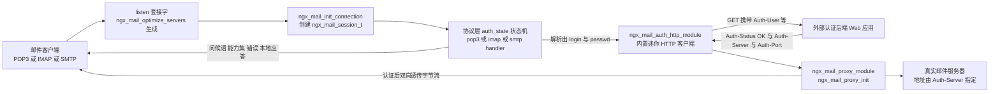
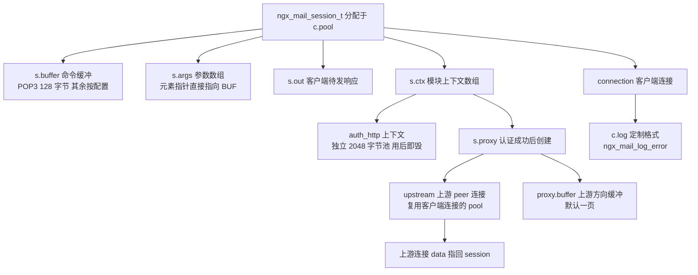
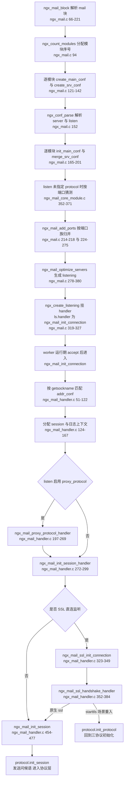
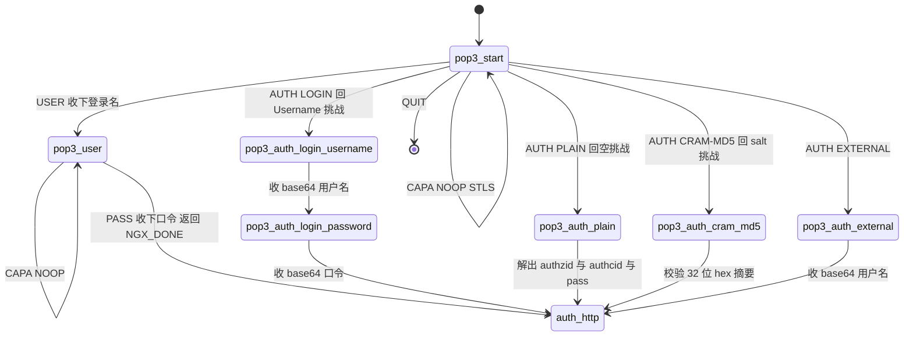
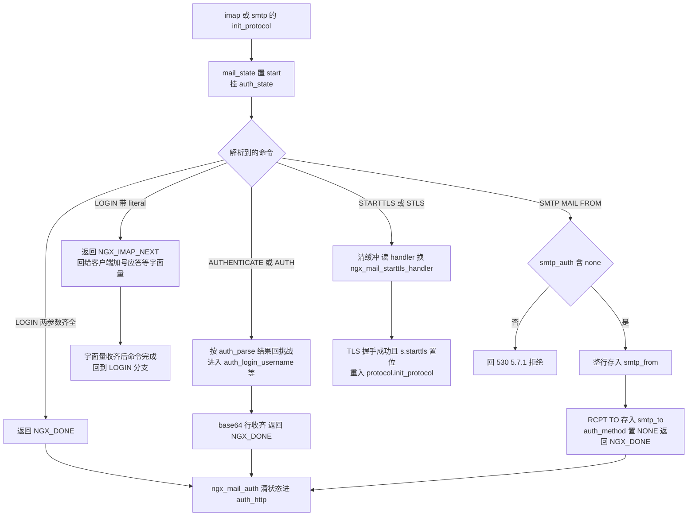
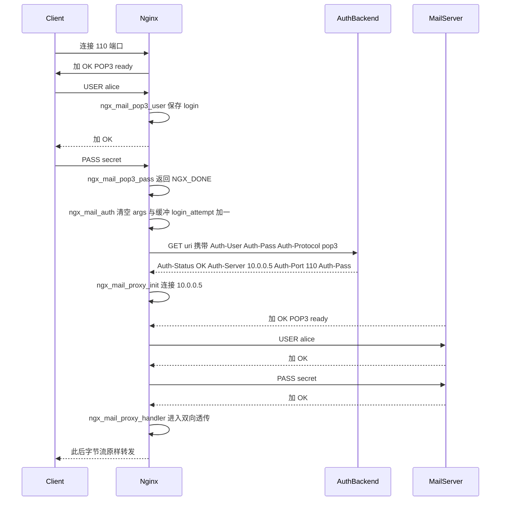
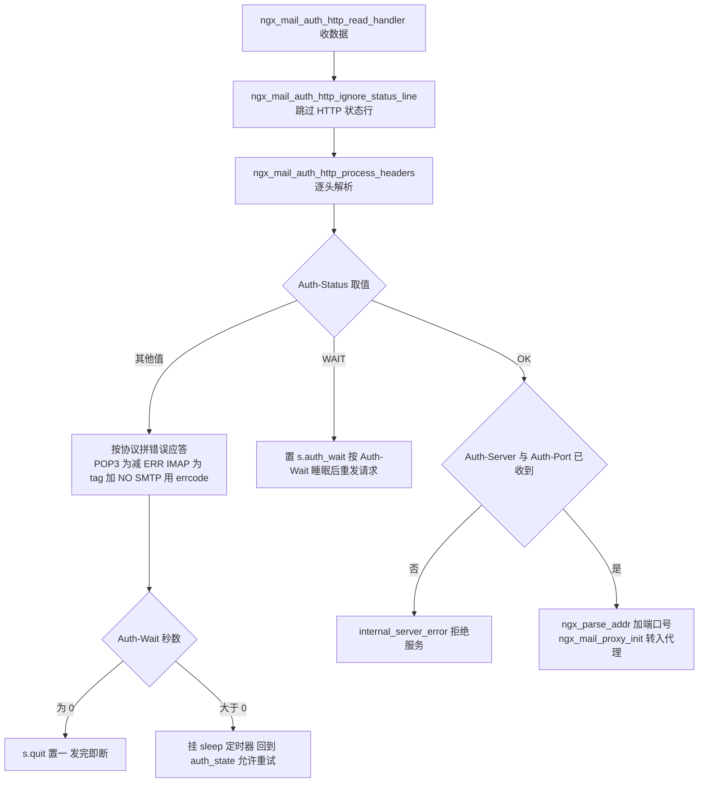

# mail 邮件代理（POP3/IMAP/SMTP）（基于 nginx-1.27.0 源码）

> **导读**：读完本文你将掌握 nginx mail 模块的完整执行路径：一条 POP3/IMAP/SMTP 连接如何从 `listen` 套接字进入 `ngx_mail_init_connection`，如何被三套手写状态机解析出 `login`/`passwd`，如何通过 `auth_http` 协议与外部认证后端交互拿到真实邮件服务器地址，以及 `ngx_mail_proxy_module` 如何在认证成功后建立上游连接、重放协议握手并进入双向字节流透传。你还将理解 STARTTLS 的精确切换点、IMAP literal 的解析与 LITERAL+ 安全检测、错误响应码体系，以及 mail 模块为何不直接复用 stream 框架。
>
> **前置阅读建议**：nginx 事件驱动模型（`ngx_event_t`、`ngx_connection_t`、事件 handler 切换）、内存池生命周期（`ngx_create_pool`/`ngx_destroy_pool`）、模块体系（`ngx_module_t`、`ctx_index`、conf 指针数组）、上游连接原语（`ngx_event_connect_peer`、`ngx_peer_connection_t`）。文中所有行号均来自本仓库 1.27.0 源码，均经实际读取确认。
>
> **涉及源码清单**（均位于 `src/mail/`，已全部通读）：`ngx_mail.c`（484 行）、`ngx_mail.h`（424 行）、`ngx_mail_handler.c`（1018 行）、`ngx_mail_parse.c`（975 行）、`ngx_mail_pop3_handler.c`（544 行）、`ngx_mail_imap_handler.c`（477 行）、`ngx_mail_smtp_handler.c`（935 行）、`ngx_mail_auth_http_module.c`（1659 行）、`ngx_mail_proxy_module.c`（1375 行）。辅助查阅：`ngx_mail_core_module.c`、`ngx_mail_pop3_module.c/.h`、`ngx_mail_imap_module.c/.h`、`ngx_mail_smtp_module.c/.h`、`ngx_mail_ssl_module.c/.h`。

---

## 1. 本模块在 nginx 中的位置与职责

mail 模块是一组 `NGX_MAIL_MODULE` 类型模块（模块类型常量 `NGX_MAIL_MODULE = 0x4C49414D`，即 "MAIL"，见 src/mail/ngx_mail.h:354），运行在核心事件框架之上、上游邮件服务器之下。它的职责边界非常清晰，可概括为"**认证前是协议端点，认证后是字节管道**"：

1. **协议端点**：完整实现 POP3/IMAP/SMTP 三种协议中与认证相关的子集（greeting、CAPA/CAPABILITY/EHLO、USER/PASS、LOGIN、AUTH、STLS/STARTTLS 等），命令解析在 `ngx_mail_parse.c`。
2. **认证外包**：nginx 自己不存任何口令。所有认证决策通过一个内置的迷你 HTTP 客户端（`ngx_mail_auth_http_module.c`）转发给外部认证后端，后端回吐"该用户应去哪台真实邮件服务器"。
3. **协议重放与透传**：认证成功后 `ngx_mail_proxy_module` 连接 Auth-Server/Auth-Port 指定的上游，用拿到的凭据替客户端完成一次协议登录握手，随后进入 `ngx_mail_proxy_handler` 双向拷贝循环，不再解释任何协议语义。



图解：客户端只会与"协议层"和"proxy 层"直接对话；`auth_http` 是中间的一跳，nginx 对外不暴露任何口令存储。整个模块只有一个入口 handler（`ngx_mail_init_connection`，由 `ls->handler` 挂接，src/mail/ngx_mail.c:326），三协议差异全部收敛进 `ngx_mail_protocol_t` 虚函数表。

## 2. 核心数据结构精讲

### 2.1 `ngx_mail_session_t`——每连接一份的会话对象

定义于 src/mail/ngx_mail.h:187-246，从连接池 `c->pool` 分配（src/mail/ngx_mail_handler.c:124-128），池销毁即全部回收。

| 字段 | 类型 | 含义与用法 |
|---|---|---|
| `signature` | `uint32_t` | 置为 `NGX_MAIL_MODULE`（"MAIL"），用于日志/调试辨识（ngx_mail_handler.c:130） |
| `connection` | `ngx_connection_t *` | 客户端连接；认证后与上游连接并存 |
| `out` | `ngx_str_t` | 待发往客户端的响应缓冲；`len==0` 表示写通道空闲 |
| `buffer` | `ngx_buf_t *` | 客户端命令缓冲。POP3 固定 128 字节（ngx_mail_pop3_handler.c:105）；IMAP/SMTP 由 `imap_client_buffer`/`smtp_client_buffer` 配置，默认一页 |
| `ctx` | `void **` | 各 mail 模块 per-session 上下文数组（ngx_mail_handler.c:468 分配） |
| `main_conf`/`srv_conf` | `void **` | 指向命中 `addr_conf` 的配置数组（ngx_mail_handler.c:132-133） |
| `proxy` | `ngx_mail_proxy_ctx_t *` | 认证成功后创建，见 2.4 |
| `mail_state` | `ngx_uint_t` | 协议状态机的当前状态，取值来自三个枚举之一 |
| `ssl`/`starttls` | 位域 | 分别表示"SSL 直连监听"与"已经历 STARTTLS 切换" |
| `blocked`/`quit` | 位域 | 写未完成时挂起读；`quit` 使 `ngx_mail_send` 发完即关连接 |
| `quoted`/`backslash`/`no_sync_literal` | 位域 | IMAP 解析器的跨事件解析状态 |
| `esmtp` | 位域 | 客户端用过 EHLO，影响 proxy 期向上游发 EHLO 还是 HELO |
| `auth_method` | 3 位 | `NGX_MAIL_AUTH_*` 常量（ngx_mail.h:298-304），写入 `Auth-Method` 头 |
| `auth_wait` | 位域 | 收到 `Auth-Status: WAIT` 后置位，sleep 后重发认证请求 |
| `login`/`passwd` | `ngx_str_t` | 认证凭据。注意 `login` 同时出现在错误日志中（ngx_mail_handler.c:1007） |
| `salt` | `ngx_str_t` | APOP/CRAM-MD5 挑战串，形如 `<随机数.时间戳@server_name>`（ngx_mail_handler.c:492-494） |
| `tag`/`tagged_line` | `ngx_str_t` | IMAP 命令 tag 与"tag + 应答"拼装缓冲 |
| `text` | `ngx_str_t` | IMAP 非标签行（如 `* CAPABILITY ...`、`* BYE`） |
| `smtp_helo`/`smtp_from`/`smtp_to` | `ngx_str_t` | SMTP 原始 HELO 名与整条 `MAIL FROM:...`/`RCPT TO:...` 原文，用于 AUTH_NONE 透传重放 |
| `cmd`/`args` | `ngx_str_t`/`ngx_array_t` | 解析产物：命令名（指向 `buffer` 内部，零拷贝）与参数数组 |
| `errors`/`login_attempt` | `ngx_uint_t` | 非法命令计数（对照 `max_errors`）与认证尝试计数（写入 `Auth-Login-Attempt`） |
| `state` | `ngx_uint_t` | 解析器自身的增量解析状态（switch 枚举值），配合 `tag_start`/`cmd_start`/`arg_start`/`literal_len` 实现跨 read 事件的续解 |

### 2.2 `ngx_mail_protocol_t`——三协议虚函数表

src/mail/ngx_mail.h:325-339。四个函数指针是整个框架的多态核心：

```c
struct ngx_mail_protocol_s {
    ngx_str_t                   name;
    ngx_str_t                   alpn;
    in_port_t                   port[4];
    ngx_uint_t                  type;

    ngx_mail_init_session_pt    init_session;
    ngx_mail_init_protocol_pt   init_protocol;
    ngx_mail_parse_command_pt   parse_command;
    ngx_mail_auth_state_pt      auth_state;

    ngx_str_t                   internal_server_error;
    ngx_str_t                   cert_error;
    ngx_str_t                   no_cert;
};
```

- `init_session`：发协议问候语（POP3 是 `+OK POP3 ready`，可能追加 salt；SMTP 之前还要反解客户端 IP）。
- `init_protocol`：创建/复用命令缓冲后挂上 `auth_state`。
- `parse_command`：即 `ngx_mail_{pop3,imap,smtp}_parse_command` 之一。
- `auth_state`：该协议的主循环 handler，挂到 `c->read->handler`。
- 三个错误串按协议预置（如 SMTP 是 `"451 4.3.2 Internal server error"`，src/mail/ngx_mail_smtp_module.c:51-53），供证书校验失败和内部错误直接引用（ngx_mail_handler.c:415、932）。
- `alpn` 是带长度前缀的 ALPN 名（如 `"\x04pop3"`，src/mail/ngx_mail_pop3_module.c:49），TLS 握手时用于协议协商。

### 2.3 三个 `mail_state` 枚举：客户端侧与上游侧两用

src/mail/ngx_mail.h:135-177 分别定义 `ngx_pop3_state_e`、`ngx_imap_state_e`、`ngx_smtp_state_e`。关键设计：**同一枚举既用于客户端认证状态机（`s->mail_state` 在三个 `*_auth_state` 中流转），也用于 proxy 模块向上游重放握手的阶段推进**（`ngx_mail_proxy_{pop3,imap,smtp}_handler` 中同样驱动 `s->mail_state`）。例如 `ngx_imap_start→ngx_imap_login→ngx_imap_user→ngx_imap_passwd` 在 proxy 侧表示"发 LOGIN 声明 → 发用户名 → 发密码 → 完成"。

### 2.4 上游与认证的私有上下文

`ngx_mail_proxy_ctx_t`（src/mail/ngx_mail.h:180-184）：`upstream`（`ngx_peer_connection_t`，连接后其 `connection->data` 指回 session）、`buffer`（上游→客户端方向的透传缓冲，`proxy_buffer` 配置，默认一页）、`proxy_protocol` 标志。

`ngx_mail_auth_http_ctx_t`（src/mail/ngx_mail_auth_http_module.c:37-60）：挂在 `s->ctx` 的 auth_http 槽位，含独立的 2048 字节内存池（ngx_mail_auth_http_module.c:171）、请求/响应 buf、`peer` 连接、响应解析状态与六个 `ngx_str_t`（`addr`/`port`/`err`/`errmsg`/`errcode`/`sleep`）。认证结束即 `ngx_destroy_pool` 整体销毁。

`ngx_mail_core_srv_conf_t`（src/mail/ngx_mail.h:112-132）：`protocol`、`timeout`（默认 60s，ngx_mail_core_module.c:190）、`resolver`/`resolver_timeout`、`max_errors`（默认 5，ngx_mail_core_module.c:194）、`server_name`（默认取主机名，ngx_mail_core_module.c:196-200）。

### 2.5 字段关系与内存布局



图解：一次会话内最多同时存在两块大缓冲（`s->buffer` 面向客户端命令、`s->proxy->buffer` 面向上游响应）加一个小的 `s->out`。`auth_http` 的池是短暂的：认证决策完成（无论成败）后立刻销毁，上游连接则直接挂到客户端连接的池上（ngx_mail_auth_http_module.c:217、ngx_mail_proxy_module.c:165），因此关闭客户端连接的池即可同时回收上游对象。

## 3. 初始化流程

初始化分两段：**配置期**把 `mail{}` 块翻译成监听套接字与两级配置数组；**运行期**在 worker 的 accept 回调里构造 session 并进入协议层。



几个值得注意的细节：

- **配置合并深度**：`ngx_mail_block` 先在 `mail{}` 级创建一份"空 srv_conf"（ngx_mail.c:111-114），用于和每个 `server{}` 的 srv_conf 做合并（191-199），这与 http 模块的三级合并略有不同——mail 只有 main/server 两级。
- **监听收敛**：同一端口上多个 `server{}` 的 `listen` 归并到一个 `ngx_listening_t`；若存在通配地址则只 bind 通配（ngx_mail.c:302-308），排序保证"显式 bind 优先、通配垫底"（`ngx_mail_cmp_conf_addrs`，ngx_mail.c:453-484）。
- **每连接 256 字节池**：`ls->pool_size = 256`（ngx_mail.c:327），连接池很小，因为 session 各成员都按需在 `c->pool` 上分配。
- **accept mutex**：多 worker 下新的读事件先入 posted 队列延迟处理（ngx_mail_handler.c:188-193），避免惊群后的无谓立即读。

## 4. 核心执行流程/状态机

### 4.1 公共 auth_state 骨架

三个协议的 `*_auth_state` 结构完全同构（POP3 见 src/mail/ngx_mail_pop3_handler.c:119-307）：

1. 超时或 `s->out` 未发完 → 置 `s->blocked = 1`，仅注册读事件后返回（138-148）；
2. `ngx_mail_read_command` 读并解析一条命令（152）；
3. 按 `s->mail_state` 与 `s->command` 双重分发：`mail_state` 决定"处于哪段对话"，`command` 决定"具体做什么"（169-263）；
4. 依据各命令函数的返回值分流：`NGX_DONE` → `ngx_mail_auth` 进入 auth_http（271-273）；`NGX_MAIL_PARSE_INVALID_COMMAND` → `errors++` 并回错误应答（279-285）；`NGX_OK` → 回 `+OK`/`OK completed`/`250` 并继续；
5. 若缓冲里还压着后续命令（pipelining），置 `blocked`，写完应答后由 `ngx_mail_send` 回调读 handler 继续处理（265-267 与 ngx_mail_handler.c:801-803）。

### 4.2 POP3 客户端认证状态机



解读：状态值存放在 `s->mail_state`；`auth_http` 不是协议枚举值，而是 `ngx_mail_auth()`（src/mail/ngx_mail_handler.c:903-922）发起的跨模块跳转。`ngx_pop3_passwd` 状态在客户端侧永远到不了（PASS 直接返回 `NGX_DONE`，ngx_mail_pop3_handler.c:237-238 只是压制编译告警），它真正的用途在 proxy 侧标记"PASS 已发出"。

### 4.3 IMAP/SMTP 的状态推进（flowchart 形式）



解读：IMAP 的 `NGX_IMAP_NEXT` 是三协议中最特别的返回值——literal 声明（如 `a01 LOGIN {5}` 后的 CRLF）到达时解析器无法继续，必须先回 `+ OK` 同步应答；若客户端声明的是 LITERAL+（`{5+}`）则不回挑战、不切事件，直接在当前缓冲里继续数完字面量（src/mail/ngx_mail_parse.c:556-577）。SMTP 侧 `MAIL FROM` 走的是另一条路：要求 `smtp_auth` 配置启用 `none`（ngx_mail_smtp_handler.c:747-751），nginx 把原命令行原封不动转发到上游，自己不解释地址合法性。

## 5. 关键时序图

### 5.1 POP3 USER/PASS 全链路（client → nginx → auth 后端 → 真实服务器）



解读：注意第二段"USER/PASS 重放"——客户端视角只发过一次 USER/PASS，向上游的重放由 `ngx_mail_proxy_pop3_handler`（src/mail/ngx_mail_proxy_module.c:226-363）驱动 `s->mail_state` 完成。对 CRAM-MD5/APOP 这类客户端不给明文口令的机制，nginx 靠认证后端回吐 `Auth-Pass` 明文口令来向上游重放（见 6.8 节对 `s->passwd.data = NULL` 的解释）。

### 5.2 auth 后端响应的处理决策



解读：`WAIT` 状态与 `Auth-Wait: N` 头共同实现"稍后重试"：`WAIT` 表示本次不判定成败，睡眠后原样重发请求；失败分支的 `Auth-Wait: N` 表示"告诉客户端错误后保留连接 N 秒，允许它再试一次"——两者在 `ngx_mail_auth_sleep_handler`（src/mail/ngx_mail_auth_http_module.c:858-914）的超时分支里走向完全不同（874-878 重发请求；880-900 恢复 `protocol->auth_state` 并把 `auth_method` 复位为 PLAIN）。

## 6. 源码逐段精读

本节是全文主体，按"配置期 → 连接接入 → 公共框架 → 认证原语 → 解析器 → 三协议 handler → auth_http → proxy"顺序逐函数分析。

### 6.1 `ngx_mail_block`：mail{} 块的装配线（src/mail/ngx_mail.c:66-221）

**签名**：`static char *ngx_mail_block(ngx_conf_t *cf, ngx_command_t *cmd, void *conf)`。它只在顶层 `mail { }` 指令（ngx_mail.c:30-40，`NGX_MAIN_CONF|NGX_CONF_BLOCK`）时被调用，`conf` 即 `cycle->conf_ctx` 中预留的槽位。

**逐块逻辑**：

1. **防重复**（79-81）：顶层槽位已有值说明 `mail{}` 出现两次，返回 `"is duplicate"`。
2. **建上下文骨架**（85-114）：`ngx_mail_conf_ctx_t` 只有 `main_conf`/`srv_conf` 两个 `void **` 数组；同时 `ngx_count_modules` 为所有 `NGX_MAIL_MODULE` 分配 `ctx_index`（94），后续 `s->ctx[module.ctx_index]` 的 O(1) 寻址全靠它（宏见 ngx_mail.h:364-376）。
3. **逐模块建配置**（121-142）：遍历 `cycle->modules`，凡 `type == NGX_MAIL_MODULE` 者调用其 `create_main_conf`/`create_srv_conf`。mail 模块的 ctx 都是 `ngx_mail_module_t`（ngx_mail.h:342-351），比 core 模块多出 `protocol` 字段——POP3/IMAP/SMTP 三个协议模块借此注册虚函数表。
4. **切换解析环境**（147-152）：保存 `pcf = *cf` 后把 `cf->ctx` 指向 mail 上下文、`module_type` 置 `NGX_MAIL_MODULE`，再 `ngx_conf_parse` 递归解析块内指令。结束后恢复 `*cf = pcf`（203）。
5. **合并**（165-201）：先逐模块 `init_main_conf`，再对每个 `server{}` 的 srv_conf 调 `merge_srv_conf(cf, ctx->srv_conf[mi], cscfp[s]->ctx->srv_conf[mi])`——注意第二参数是 mail 级的"空模板"，第三参才是 server 级真配置。
6. **监听收敛**（206-220）：`ngx_array_init(&ports, cf->temp_pool, ...)` 后逐条 `listen` 调 `ngx_mail_add_ports`（224-275，按 `端口+地址族` 归并），最后 `ngx_mail_optimize_servers`。

**易错点**：`ports` 数组在 `temp_pool` 上（206），配置解析完即释放；真正存活的 `ngx_mail_port_t` 在 `cf->pool` 上重建（350-355）。读代码时不要混淆这两个 pool 的生命周期。

### 6.2 `ngx_mail_optimize_servers`：从 listen 到 listening（src/mail/ngx_mail.c:278-380）

**核心片段**（节选）：

```c
if (addr[last - 1].opt.wildcard) {
    addr[last - 1].opt.bind = 1;
    bind_wildcard = 1;
}
...
    ls = ngx_create_listening(cf, addr[i].opt.sockaddr,
                              addr[i].opt.socklen);
    ls->addr_ntop = 1;
    ls->handler = ngx_mail_init_connection;
    ls->pool_size = 256;
```
（src/mail/ngx_mail.c:302-327，摘录有省略）

**逐块讲解**：对每个端口先 `ngx_sort`（291-292，比较函数见 6.3）；若末位是通配地址则强制其 `bind=1` 且置 `bind_wildcard`——之后循环里非 bind 的具体地址直接跳过（314-317），实现"绑定了 `*:110` 就忽略同端口具体地址"的语义。每生成一个 `ngx_listening_t` 都挂上 `ls->handler = ngx_mail_init_connection`，这就是 mail 的 accept 入口。随后按地址族调 `ngx_mail_add_addrs`（383-413，IPv4）或 `ngx_mail_add_addrs6`（418-448，IPv6）把 `addr_conf`（含 server 上下文指针、ssl/proxy_protocol 标志，ngx_mail.h:56-61）填进 `ls->servers`。

`ngx_mail_cmp_conf_addrs`（453-484）只有三条规则：通配永远排最后、显式 bind 排最前、其余保序。这保证 6.2 中"末位是通配"的假设成立。

**易错点**：`mport->naddrs = i + 1`（357）配合循环里的 `addr++; last--`（374-375），同一端口的多个地址可能拆成多个 `ngx_listening_t`（每个 bind 一个），`naddrs` 语义是"该 listening 覆盖前 i+1 个已排序地址"。

### 6.3 `ngx_mail_init_connection`：从 fd 到 session（src/mail/ngx_mail_handler.c:26-194）

**签名**：`void ngx_mail_init_connection(ngx_connection_t *c)`，accept 后由事件核心调用。

**逐块逻辑**：

1. **选 server 上下文**（49-122）：`port->naddrs > 1` 时必须 `ngx_connection_local_sockaddr`（61）拿本端地址，再在 `port->addrs` 里精确匹配；通配地址排在末位，循环 `for (i = 0; i < port->naddrs - 1; i++)` 未命中即落回通配（96-102）。这一步决定后续所有 `ngx_mail_get_module_srv_conf` 的取值。
2. **session 初始化**（124-142）：`ngx_pcalloc(c->pool, sizeof(ngx_mail_session_t))`，`s->signature = NGX_MAIL_MODULE`，`s->main_conf/srv_conf` 指向命中配置，`c->data = s` 双向勾连。
3. **日志上下文**（153-167）：`c->log->handler = ngx_mail_log_error`，此后每条错误日志自动带上 `while <action>, client: <ip>, login: ..., upstream: ...`（实现在 972-1018）。
4. **PROXY protocol 分支**（172-186）：`addr_conf->proxy_protocol` 时读 handler 换成 `ngx_mail_proxy_protocol_handler`，首包必须是 PROXY 头。
5. **posted events**（188-193）：开了 accept mutex 就把 `rev` 挂到 `ngx_posted_events` 延迟执行；否则立即 `rev->handler(rev)`。

### 6.4 `ngx_mail_proxy_protocol_handler` 与 SSL/STARTTLS 切换点（src/mail/ngx_mail_handler.c:197-449）

**PROXY protocol**（197-269）：用 `recv(..., MSG_PEEK)`（221）窥视首包，`ngx_proxy_protocol_read` 解析出真实客户端地址后回填 `c->sockaddr`，再 `ngx_mail_realip_handler` 同步日志字段（263），最后进入 `ngx_mail_init_session_handler`。EAGAIN 时挂 `cscf->timeout` 定时器（231-234）。

**SSL 直连路径**：`ngx_mail_init_session_handler`（272-299）发现 `s->ssl`（来自 listen 的 `ssl` 参数，ngx_mail_core_module.c:450-469 设置 `addr_conf->ssl`）就走 `ngx_mail_ssl_init_connection`（323-349）→ `ngx_ssl_handshake`，完成后 `ngx_mail_ssl_handshake_handler`（352-384）：

```c
    if (c->ssl->handshaked) {

        s = c->data;

        if (ngx_mail_verify_cert(s, c) != NGX_OK) {
            return;
        }

        if (s->starttls) {
            c->read->handler = cscf->protocol->init_protocol;
            c->write->handler = ngx_mail_send;

            cscf->protocol->init_protocol(c->read);
            return;
        }

        c->read->ready = 0;
        ngx_mail_init_session(c);
```
（src/mail/ngx_mail_handler.c:358-380）

**切换点判据**：`s->starttls` 只有 `ngx_mail_starttls_handler`（304-320）会置位（313 行 `s->starttls = 1`）。所以：

- **SSL 直连监听**（`listen ... ssl`）：握手完成走 `ngx_mail_init_session` → 发问候语，**问候语本身就是密文**；
- **STARTTLS 明文监听**：客户端先收明文问候语，发 `STLS`/`STARTTLS` 后，对应协议 handler 清空缓冲并把 `c->read->handler` 换成 `ngx_mail_starttls_handler`（POP3 见 ngx_mail_pop3_handler.c:410-413；IMAP 见 ngx_mail_imap_handler.c:467-470；SMTP 见 ngx_mail_smtp_handler.c:858-862），握手成功后因 `s->starttls==1` 走 `init_protocol` 重入状态机——**问候语不发第二次**，这正是与 SSL 直连路径的本质区别。

`ngx_mail_verify_cert`（387-449）：`ssl_verify` 开启时校验客户端证书；`verify==1` 还要求证书必须存在（424-446）。失败时不是直接断连，而是把 `protocol->cert_error`/`no_cert` 填入 `s->out`、置 `s->quit=1`，让客户端先收到协议层错误再关闭——协议优雅性优先。

`ngx_mail_starttls_only`（502-518）：`starttls only` 配置下，明文通道上的 USER/APOP/AUTH 等一律拒绝（各 handler 里反复出现的 `if (ngx_mail_starttls_only(s, c)) return NGX_MAIL_PARSE_INVALID_COMMAND;`）。

### 6.5 `ngx_mail_init_session`、`ngx_mail_salt` 与公共读写框架（src/mail/ngx_mail_handler.c:454-936）

**`ngx_mail_init_session`**（454-477）：`s->protocol = cscf->protocol->type`（466）——之后所有按协议分流的 switch 都依赖这个 3 位字段；分配 `s->ctx`（468）；`c->write->handler = ngx_mail_send`（474）；最后多态调用 `protocol->init_session`（476）。

**`ngx_mail_salt`**（480-497）：生成 `"<%ul.%T@%V>" CRLF` 形式的挑战（492-494），`ngx_random()` 与当前时间拼进 salt，供 APOP/CRAM-MD5。POP3 启用这两种认证时把它接在问候语后（ngx_mail_pop3_handler.c:42-60）：

```c
    if (pscf->auth_methods
        & (NGX_MAIL_AUTH_APOP_ENABLED|NGX_MAIL_AUTH_CRAM_MD5_ENABLED))
    {
        if (ngx_mail_salt(s, c, cscf) != NGX_OK) { ... }

        p = ngx_cpymem(s->out.data, pop3_greeting, sizeof(pop3_greeting) - 3);
        *p++ = ' ';
        p = ngx_cpymem(p, s->salt.data, s->salt.len);
```
（src/mail/ngx_mail_pop3_handler.c:42-58，摘录有省略）

**`ngx_mail_send`**（756-825）——写事件 handler：

- 超时 → 关连接（767-772）；`s->out.len == 0` → 仅刷新写事件（774-780）。
- `c->send` 成功后用**指针前移**而不是 memmove 消费数据（785-786）；发完且 `s->quit` → 关连接（796-798）。
- **关键协作点**：发完且 `s->blocked` → 直接回调 `c->read->handler(c->read)`（801-803），把 pipelining 压住的命令接续处理；没发完（`NGX_AGAIN`）走 `again:` 挂 `cscf->timeout` 写超时（815-824）。

**`ngx_mail_read_command`**（828-900）——读并解析一条命令：

```c
    rc = cscf->protocol->parse_command(s);

    if (rc == NGX_AGAIN) {

        if (s->buffer->last < s->buffer->end) {
            return rc;
        }

        l.len = s->buffer->last - s->buffer->start;
        ...
        s->quit = 1;

        return NGX_MAIL_PARSE_INVALID_COMMAND;
    }

    if (rc == NGX_MAIL_PARSE_INVALID_COMMAND) {

        s->errors++;

        if (s->errors >= cscf->max_errors) {
            ...
            s->quit = 1;
        }
```
（src/mail/ngx_mail_handler.c:858-888，摘录有省略）

两个防护都在这里：**命令超长**——只有当 `NGX_AGAIN` 且缓冲已满才判定（862-874），POP3 的 128 字节缓冲使其对超长行极其敏感；**非法命令过多**——`errors` 达到 `max_errors`（默认 5）即 `quit`（877-888）。`rc == NGX_IMAP_NEXT` 原样上抛（890-892），由 IMAP auth_state 特殊处理。

**`ngx_mail_auth`**（903-922）：认证凭据集齐后的统一跳板——清 `args`、复位缓冲（仅当已消费完）、`s->state = 0`、删读定时器、`login_attempt++`，最后 `ngx_mail_auth_http_init(s)`。注意它**不切换** `c->read->handler`——auth_http 会立刻接管客户端读事件（`ngx_mail_auth_http_block_read`，219 行）以防客户端在此期间发数据。

**`ngx_mail_close_connection`**（939-969）：SSL 连接先异步 shutdown（949-954），`c->destroyed = 1` 后 `ngx_close_connection` + `ngx_destroy_pool`。session 及其所有缓冲随池一次性回收。

### 6.6 通用认证原语（src/mail/ngx_mail_handler.c:523-753）

**`ngx_mail_auth_plain`**（523-579）：解 base64 后按 RFC 4616 的 `authzid \0 authcid \0 passwd` 切分：

```c
    p = plain.data;
    last = p + plain.len;

    while (p < last && *p++) { /* void */ }   /* 跳过 authzid */

    if (p == last) { ... invalid ... }

    s->login.data = p;

    while (p < last && *p) { p++; }           /* 找 authcid 结尾 NUL */

    ...
    s->login.len = p++ - s->login.data;
    s->passwd.len = last - p;
    s->passwd.data = p;

    return NGX_DONE;
```
（src/mail/ngx_mail_handler.c:547-578，摘录有省略）

三处结构校验分别针对"缺 authcid"、"缺 passwd"，返回 `NGX_MAIL_PARSE_INVALID_COMMAND`（值 20，ngx_mail.h:315）触发 `-ERR`/`BAD`/`500` 应答。成功返回 `NGX_DONE`。

**`ngx_mail_auth_login_username`**（582-608）/ **`ngx_mail_auth_login_password`**（611-641）：LOGIN 机制两步式，分别解码 `s->login`/`s->passwd`；password 步返回 `NGX_DONE`。

**`ngx_mail_auth_cram_md5_salt`**（644-670）：把 `s->salt`（含尾部 CRLF）**先去掉 2 字节再 base64**（658-662 `s->salt.len -= 2` ... `s->salt.len += 2`），拼上协议前缀（POP3 为 `"+ "`，SMTP 为 `"334 "`）构成挑战行。POP3 问候语里的 salt 带 CRLF、而挑战行不允许，这就是减 2 的原因。

**`ngx_mail_auth_cram_md5`**（673-719）：解码客户端应答 `"user hexdigest"`，按空格切分（698-705），**强制 `s->passwd.len == 32`**（707-711）——hex MD5 摘要长度，防止畸形输入穿透到后端。`s->auth_method = NGX_MAIL_AUTH_CRAM_MD5`（716）决定 auth_http 请求中 `Auth-Method: cram-md5`。

**`ngx_mail_auth_external`**（722-753）：解码后整段作为 `s->login`，方法置 EXTERNAL。

### 6.7 三协议命令行解析器（src/mail/ngx_mail_parse.c）

三个解析器都是**跨事件续解**的 switch 状态机：入口 `state = s->state` 恢复上次进度；正常推进中 `s->buffer->pos = p; s->state = state; return NGX_AGAIN;`；`done:` 出口负责 `s->buffer->pos = p + 1` 并决定**下一条命令**的起始状态。

**POP3（17-224）**：命令名固定 4 字母（49 行 `if (p - c == 4)`），逐字符 `ngx_toupper` 后与 USER/PASS/APOP/QUIT/CAPA/AUTH/NOOP/STLS 硬比较（51-90）——没有哈希表，8 条命令直接展开，代价是代码长，收益是零分配零查找。参数最多 2 个（131 行 `s->args.nelts <= 2`）。一个特例（150-154）：

```c
            case ' ':

                /*
                 * the space should be considered as part of the at username
                 * or password, but not of argument in other commands
                 */

                if (s->command == NGX_POP3_USER
                    || s->command == NGX_POP3_PASS)
                {
                    break;
                }
```
即 USER/PASS 的参数允许内嵌空格（用户名可能是 `user@example.com` 之外的怪形式），其他命令空格即分隔。`done:` 出口（203）`s->state = (s->command != NGX_POP3_AUTH) ? sw_start : sw_argument;`——AUTH 的 base64 续行不在"命令头"状态里解析，下一行直接从参数状态续起，AUTH 响应行如 `dGVzdAB0ZXN0AHRlc3Q=` 就不会命中 4 字母命令规则。

**IMAP（227-676）**：最复杂。tag 字符集限定 `[A-Za-z0-9-._]` 且长度上限 32（280 行 `if (p - s->tag_start > 31) goto invalid;`）；命令按长度 switch（309-414：4=NOOP、5=LOGIN、6=LOGOUT、8=STARTTLS、10=CAPABILITY、12=AUTHENTICATE），其余一律 invalid——**认证前 nginx 只认识这 6 条命令**。参数语义丰富：

- 双引号字符串（447-454）置 `s->quoted`，内部空格不分隔；
- 反斜杠转义（522-527、531-539）：`sw_argument` 遇 `\` 进 `sw_backslash`，收参时原位去转义（493-506 的 `dst/src` 双指针压缩）；
- literal 声明（455-460 进 `sw_literal`）：数字累积到 `s->literal_len`（541-545），`}` 进同步式、`+}` 进 LITERAL+（550-553）；同步式在 CRLF 后**返回 `NGX_IMAP_NEXT`** 让上层回 `+ OK`（569-574），LITERAL+ 则把 `no_sync_literal` 置 1 继续原地数（556-562）；
- 字面量计数（583-586）：

```c
        case sw_literal_argument:
            if (s->literal_len && --s->literal_len) {
                break;
            }
```
每字节递减，减到 0 时把 `arg_start..p+1` 作为一个参数压入 `s->args`。`{0}` 空字面量的边界行为此处会多吞 1 字节，属待验证的实现细节，生产配置中应避免依赖。

- **invalid 出口的安全检测**（640-675）：非法行回扫到 LF 丢弃后，还会检查该行是否以 `+}` 结尾（655-667）：

```c
            /* detect non-synchronizing literals */

            if ((size_t) (p - s->buffer->start) > sizeof("{1+}") - 1) {
                p--;

                if (*p == CR) {
                    p--;
                }

                if (*p == '}' && *(p - 1) == '+') {
                    s->quit = 1;
                }
            }
```
若客户端在**畸形命令里夹带 LITERAL+ 声明**，nginx 无法为它回同步挑战，继续读就是无限流，因此直接 `s->quit = 1`——这是针对 IMAP literal 资源耗尽攻击的防御，值得逐行记住。

**SMTP（679-900）**：与 POP3 同构，但命令集为 HELO/EHLO/QUIT/AUTH/NOOP/MAIL/RSET/RCPT/VRFY/EXPN/HELP（4 字母，711-764）加 8 字母 STARTTLS（766-782）；参数上限 10（822 行 `s->args.nelts <= 10`，为了 `MAIL FROM:<a@b> SIZE=123 BODY=8BITMIME` 这类 ESMTP 参数）。`done:` 出口同样对 AUTH 特判保持参数状态（879）。

**`ngx_mail_auth_parse`**（903-975）：三协议共用的 `AUTH` 子命令分派：`LOGIN` 带 1 参数 → `NGX_MAIL_AUTH_LOGIN`（nginx 回 `Username:` 挑战）、带 2 参数 → `NGX_MAIL_AUTH_LOGIN_USERNAME`（初始响应模式，立即解第一个参数）；`PLAIN` 带 2 参数 → 直接 `ngx_mail_auth_plain(s, c, 1)` 返回 `NGX_DONE`（942）；`CRAM-MD5`/`EXTERNAL` 类似。`starttls only` 时在此处统一拒绝（908-912）。

### 6.8 POP3 handler（src/mail/ngx_mail_pop3_handler.c）

**`ngx_mail_pop3_init_session`**（32-75）：见 6.5 的 salt 问候语；`c->read->handler = ngx_mail_pop3_init_protocol`（66）+ 读定时器（68）+ 主动 `ngx_mail_send`（74）。

**`ngx_mail_pop3_init_protocol`**（78-116）：**`s->buffer` 只在这里创建且固定 128 字节**（105）——POP3 命令天然短，128 字节足以容纳 `USER user@host.dom` 与 AUTH 续行，超长即按"too long command"断连。`s->mail_state = ngx_pop3_start` 后直接内联调一次 `auth_state`（115），流水线上无谓的事件循环往返被省掉。IMAP/SMTP 的对应函数（ngx_mail_imap_handler.c:57-98、ngx_mail_smtp_handler.c:376-405）逻辑相同，但缓冲来自 `iscf/sscf->client_buffer_size`（87、420）。

**`ngx_mail_pop3_auth_state`**（119-307）：见 4.1 骨架。分发表的完整映射：`ngx_pop3_start` 态下 USER/CAPA/APOP/AUTH/QUIT/NOOP/STLS 七条（172-208）；`ngx_pop3_user` 态只认 PASS/CAPA/QUIT/NOOP（210-234）——**状态即权限**，未带 USER 之前发 PASS 一律 invalid。AUTH 续行态（240-261）分别调 6.6 的原语。

**`ngx_mail_pop3_user`**（309-339）：`starttls only` 拒绝（315）、参数数必须恰为 1（320）、`s->login` 从缓冲拷贝到池（325-331，**必须拷贝**：`s->args` 复位后原指针失效）、`mail_state` 推进到 `ngx_pop3_user`（336）。`ngx_mail_pop3_pass`（342-366）对称处理 `s->passwd` 并返回 `NGX_DONE`。

**`ngx_mail_pop3_capa`**（369-398）：按 SSL 状态三选一——明文且 `starttls on` 回 `starttls_capability`（含 `STLS`）、`starttls only` 回 `starttls_only_capability`（仅 STLS 无 AUTH）、否则回普通能力集（396）。能力串在 `ngx_mail_pop3_module.c` 的 merge 阶段预拼好，运行期零拼装。

**`ngx_mail_pop3_stls`**（401-420）：仅当 `c->ssl == NULL` 且 `sslcf->starttls` 非零时接受；清空命令缓冲（410-411）是硬要求——TLS 握手后旧缓冲里的明文残余不能再被当作命令解析；随后切换读 handler 到 `ngx_mail_starttls_handler`（412）。注意返回 `NGX_OK` 时外层会回 `+OK`（auth_state 167 行预先 `ngx_str_set(&s->out, pop3_ok)`），即客户端先收到 `+OK` 再开始握手。

**`ngx_mail_pop3_apop`**（423-469）：要求 `NGX_MAIL_AUTH_APOP_ENABLED`（441-443），两个参数分别是用户名与 hex 摘要，`auth_method = NGX_MAIL_AUTH_APOP` 后 `NGX_DONE`。

**`ngx_mail_pop3_auth`**（472-544）：无参数时回 `auth_capability`（486-491，即 `AUTH PLAIN LOGIN ...` 行）；有参数走 `ngx_mail_auth_parse`，按机制回挑战并推进 `mail_state`（497-541）；CRAM-MD5 需显式启用（520-522），挑战由 6.6 的 salt 函数生成（524）。

### 6.9 IMAP handler（src/mail/ngx_mail_imap_handler.c）

**`ngx_mail_imap_init_session`**（36-54）：问候语 `* OK IMAP4 ready`（25 行常量），无 salt 拼接——CRAM-MD5 的 salt 延迟到 AUTHENTICATE 时才生成（395-401），因为 IMAP 的问候语不允许带挑战。

**`ngx_mail_imap_auth_state`**（101-300）：与 POP3 同骨架，外加两件 IMAP 特有的事：

其一，**tag 应答拼装**（250-275）。`tag` 变量默认 1，AUTHENTICATE 的挑战应答（`+ OK`）与续行态（202）及 `NGX_IMAP_NEXT`（225）置 0。需要 tag 时：

```c
    if (tag) {
        if (s->tag.len == 0) {
            ngx_str_set(&s->tag, imap_star);          /* "* " */
        }

        if (s->tagged_line.len < s->tag.len + s->text.len + s->out.len) {
            s->tagged_line.len = s->tag.len + s->text.len + s->out.len;
            s->tagged_line.data = ngx_pnalloc(c->pool, s->tagged_line.len);
            ...
        }

        p = s->tagged_line.data;

        if (s->text.len) {
            p = ngx_cpymem(p, s->text.data, s->text.len);
        }

        p = ngx_cpymem(p, s->tag.data, s->tag.len);
        ngx_memcpy(p, s->out.data, s->out.len);
```
（src/mail/ngx_mail_imap_handler.c:250-271）

输出顺序是 `text ++ tag ++ out`。LOGOUT 时 `text` 为 `* BYE CRLF`（含 CRLF，32 行），拼出来恰是两行：`* BYE\r\ntag01 OK completed\r\n`——一次 write 完成非标签行加标签行。tag 缺失（如服务器主动应答）用 `* ` 兜底（251-253）。

其二，**literal 续解的状态保全**（277-292）：`rc != NGX_IMAP_NEXT` 时才清 `args`；`s->state` 非 0（还停在 `sw_literal_argument`）则把 `s->arg_start = s->buffer->pos` 保住字面量起始指针，且**不清 tag**（290）——字面量收齐后 LOGIN 完成时 tag 还要用。

**`ngx_mail_imap_login`**（303-346）：恰 2 参数且第一参非空（316），两参都拷贝进池，返回 `NGX_DONE`。literal 版本的 LOGIN 经 `NGX_IMAP_NEXT` 中转后最终也落到这里。

**`ngx_mail_imap_authenticate`**（349-423）：与 POP3 的 auth 分派一致，差异是 CRAM-MD5 的 salt **惰性生成**（395-401 `if (s->salt.data == NULL)`），且启用位检查用 imap 模块的 `iscf->auth_methods`。

**`ngx_mail_imap_capability`**（426-455）：结果放 `s->text`（非 `s->out`），经 6.9 的 tag 拼装输出 `* CAPABILITY ...\r\ntag OK completed\r\n`。STARTTLS 三态选择同 POP3 CAPA。

**`ngx_mail_imap_starttls`**（458-477）：同 STLS——清缓冲（467-468）+ 换 handler 到 `ngx_mail_starttls_handler`（469）。

### 6.10 SMTP handler（src/mail/ngx_mail_smtp_handler.c）

**`ngx_mail_smtp_init_session`**（56-98）：SMTP 独有的**客户端 IP 反解**。无 `resolver` 配置时 `s->host = "[UNAVAILABLE]"`（64-68）；AF_UNIX 客户端用 `[TEMPUNAVAIL]`（70-76）；否则两段式解析——`ngx_resolve_addr`（PTR，80-97）成功后 `ngx_mail_smtp_resolve_addr_handler`（101-149）拿到主机名，再 `ngx_mail_smtp_resolve_name`（152-182）正向解析回来，`ngx_mail_smtp_resolve_name_handler`（185-245）里做**正向确认反向 DNS（FCrDNS）**：

```c
        for (i = 0; i < ctx->naddrs; i++) {
            if (ngx_cmp_sockaddr(ctx->addrs[i].sockaddr, ctx->addrs[i].socklen,
                                 c->sockaddr, c->socklen, 0)
                == NGX_OK)
            {
                goto found;
            }
        }

        s->host = smtp_unavailable;
```
（src/mail/ngx_mail_smtp_handler.c:228-237）

解析出的 `s->host` 用于 proxy 期 XCLIENT 的 `NAME=`。解析期间读事件被 `ngx_mail_smtp_block_reading`（248-277）挡住；读事件异常时正确取消对应 resolver 请求（262-273 按 handler 指针区分两类 ctx）。

**`ngx_mail_smtp_greeting`**（280-314）：`smtp_greeting_delay` 非零时读 handler 换成 `ngx_mail_smtp_invalid_pipelining`（305）并只挂定时器不发言；否则立即发 `220 <server_name> ESMTP ready`（greeting 串在 merge 期拼好，src/mail/ngx_mail_smtp_module.c:169-181）。

**`ngx_mail_smtp_invalid_pipelining`**（317-373）：**greeting delay 的本质是 pipelining 反滥用探测**。客户端在服务器发言前就发数据（大量群发软件如此）→ 丢弃已到数据并回 `503 5.5.0 Improper use of SMTP command pipelining` 后断连（361-369）；安静等到超时 → 置 `rev->timedout = 0` 消化掉定时器语义，正常发问候语（330-349）。

**`ngx_mail_smtp_auth_state`**（430-593）：骨架同前，SMTP 特有命令 HELO/EHLO/AUTH/QUIT/MAIL/RCPT/RSET/NOOP/STARTTLS（485-524）。STARTTLS 分支先置 `s->out = smtp_starttls`（516-519，即 `220 2.0.0 Start TLS`），客户端收到后才开始握手。

**`ngx_mail_smtp_helo`**（596-653）：保存 `s->smtp_helo`，**复位 `smtp_from`/`smtp_to`**（619-620，RFC 语义：新 HELO 开启新事务）；HELO 回 `sscf->server_name`（625，`250 host` 串）；EHLO 置 `s->esmtp = 1`（628）并按 SSL 状态回三版能力串（630-650）——这个 `esmtp` 位后续直接决定 proxy 向上游发 EHLO 还是 HELO（ngx_mail_proxy_module.c:599）。

**`ngx_mail_smtp_auth`**（656-736）：与 IMAP AUTHENTICATE 同构；CRAM-MD5 挑战前缀是 `"334 "`（716），salt 同样惰性生成（708-714）。

**`ngx_mail_smtp_mail`**（739-786）：`smtp_auth` 未启用 `none` 时拒绝 `530 5.7.1 Authentication required`（747-751）；已有 from 则 `503 5.5.1 Bad sequence`（755-758）；随后把**从 `s->cmd.data` 起到最后一个参数结尾的整段原文**存入 `s->smtp_from`：

```c
    arg = s->args.elts;
    arg += s->args.nelts - 1;

    cmd.len = arg->data + arg->len - s->cmd.data;
    cmd.data = s->cmd.data;

    s->smtp_from.len = cmd.len;
    s->smtp_from.data = ngx_pnalloc(c->pool, cmd.len);
    ...
    ngx_memcpy(s->smtp_from.data, cmd.data, cmd.len);
```
（src/mail/ngx_mail_smtp_handler.c:765-778）

即 `MAIL FROM:<a@b> SIZE=1 BODY=8BITMIME` 整行被原样保留——nginx 不解释 ESMTP 参数，透传时原文重放。`ngx_mail_smtp_rcpt`（789-825）对 `smtp_to` 同样处理，然后 `s->auth_method = NGX_MAIL_AUTH_NONE; return NGX_DONE;`（822-824）触发 auth_http（无凭据模式）。`ngx_mail_smtp_rset`（828-836）复位 from/to。

**`ngx_mail_smtp_starttls`**（839-869）：除常规清缓冲外多一步——**按 RFC 3207 丢弃从客户端获知的一切**：

```c
            /*
             * RFC3207 requires us to discard any knowledge
             * obtained from client before STARTTLS.
             */

            ngx_str_null(&s->smtp_helo);
            ngx_str_null(&s->smtp_from);
            ngx_str_null(&s->smtp_to);
```
（src/mail/ngx_mail_smtp_handler.c:849-856）

明文期拿到的 HELO 名、发件人、收件人全部作废，防止明文→密文的会话拼接攻击。POP3/IMAP 无此负担，因为没有等价的"已知状态"。

### 6.11 `ngx_mail_auth_http_module`：认证后端客户端（src/mail/ngx_mail_auth_http_module.c）

**`ngx_mail_auth_http_init`**（161-232）：`ngx_create_pool(2048, ...)`（171）→ 建 ctx → `ngx_mail_auth_http_create_request`（188）→ `ngx_mail_set_ctx`（195）→ 组 `ctx->peer` 并 `ngx_event_connect_peer`（204）。连接成功立即手动调一次写 handler（228-231）；`NGX_AGAIN` 则等写事件。客户端方向读事件被换成 `ngx_mail_auth_http_block_read`（219）——认证期间客户端发来的数据一律不许消费。

**`ngx_mail_auth_http_create_request`**（1131-1472）：`login`/`passwd` 先经 `ngx_mail_auth_http_escape`（1475-1500，用 `NGX_ESCAPE_MAIL_AUTH` 表做 URI 转义，1481）。请求头集合（1294-1463）：

- 固定头：`GET uri HTTP/1.0`、`Host:`（1304-1307）、`Auth-Method:`（1309-1314，取值查 `ngx_mail_auth_http_method` 表：PLAIN/LOGIN/LOGIN_USERNAME 都映射为 `"plain"`，148-156）、`Auth-User:`、`Auth-Pass:`（1316-1322）；
- `Auth-Salt:`（1324-1329）：仅非 PLAIN 机制且 salt 存在时发送，**并顺手 `s->passwd.data = NULL`**（1328）——因为 CRAM-MD5/APOP 场景下 `s->passwd` 里存的是摘要而非口令，先置空逼着后端必须回吐 `Auth-Pass` 明文口令，否则 DONE 分支的完整性检查（764-773，POP3/IMAP 无口令即 internal error）会拒绝；
- `Auth-Protocol:`（1331-1335，pop3/imap/smtp）、`Auth-Login-Attempt: %ui`（1337-1338）、`Client-IP:`（1340-1343）、`Client-Host:`（1345-1350，即 SMTP 反解出的主机名）；
- PROXY protocol 四头（1352-1370）、AUTH_NONE 时的 `Auth-SMTP-Helo/From/To`（1372-1391）、SSL 八头 `Auth-SSL*`（1395-1454）、`auth_http_header` 静态追加（1458-1460）、空行收尾（1463）。

**读侧状态机**：`ngx_mail_auth_http_read_handler`（299-352）分配 1024 字节响应缓冲（325）并调 `ctx->handler`。首个 handler 是 `ngx_mail_auth_http_ignore_status_line`（355-459）——只认 `"HTTP/"` 前缀然后跳过整行（381-441），随后切换到 `ngx_mail_auth_http_process_headers`（457）。头部行解析 `ngx_mail_auth_http_parse_header_line`（917-1097）是标准的 header 状态机，空行返回 `NGX_DONE`（1091-1096）。

**`ngx_mail_auth_http_process_headers`**（462-855）——响应协议的核心。识别的响应头与处理：

| 响应头 | 代码位置 | 处理 |
|---|---|---|
| `Auth-Status: OK` | 497-510 | 继续（等 Server/Port） |
| `Auth-Status: WAIT` | 512-520 | `s->auth_wait = 1` |
| `Auth-Status: 其他` | 522-571 | 存 `errmsg`，并按协议预拼错误应答：POP3 `-ERR <msg>`、IMAP `<tag> NO <msg>`、SMTP 暂存 `err` |
| `Auth-Server` | 574-584 | 存 `ctx->addr` |
| `Auth-Port` | 586-596 | 存 `ctx->port` |
| `Auth-User` | 598-617 | **覆写 `s->login`**（后端可做别名归一化） |
| `Auth-Pass` | 619-639 | **覆写 `s->passwd`**（CRAM-MD5/APOP 场景的关键） |
| `Auth-Wait: N` | 641-655 | `ctx->sleep = N` 秒 |
| `Auth-Error-Code` | 657-678 | 存 SMTP 错误码（如 `535 5.7.8`），缺省 `"535 5.7.0"`（158） |
| 其他 | 680-682 | 忽略 |

头部结束（`NGX_DONE`，685-838）后的分流：

1. **有错误**（691-736）：SMTP 用 `errcode + errmsg` 重组 `ctx->err`（696-718，如 `535 5.7.0 password mismatch`）；`sleep == 0` → `s->quit = 1` 发完即断（725-728）；否则挂 sleep 定时器（731-733）。
2. **auth_wait**（738-753）：睡眠后重发整个认证请求。
3. **无 Server/Port**（755-762）或 POP3/IMAP 无口令（764-773）→ internal error。
4. **正常**（775-835）：`ngx_parse_addr` 解析地址（782，失败即报"invalid server address"）、`ngx_atoi` 校验端口 1..65535（802-803）、拼 `peer->name` 为 `addr:port`（815-832），销毁 auth 池后 `ngx_mail_proxy_init(s, peer)`（835）。

**`ngx_mail_auth_sleep_handler`**（858-914）：定时器到点后，`s->auth_wait` → 复位标志重新 `ngx_mail_auth_http_init`（874-878）；失败重试路径 → 恢复 `rev->handler = cscf->protocol->auth_state`、`s->mail_state = 0`、`s->auth_method = NGX_MAIL_AUTH_PLAIN`（880-885），再 `ngx_mail_send` 把错误应答发出去，客户端可以在同一连接上再试认证。

### 6.12 `ngx_mail_proxy_module`：握手重放与透传（src/mail/ngx_mail_proxy_module.c）

**`ngx_mail_proxy_init`**（128-206）：分配 `s->proxy`（140），组 upstream peer（148-153），`ngx_event_connect_peer`（155）；给上游读挂 `cscf->timeout`（162，默认 60s 的握手窗口）；客户端读换 `ngx_mail_proxy_block_read`（167）——**认证到握手完成期间客户端只许憋着**；创建 `proxy_buffer`（172-177，`proxy_buffer` 指令，默认一页）；`s->out.len = 0`（181，此后发往客户端的数据走 proxy->buffer 而非 s->out）；按协议挂对应的 proxy handler 并复位 `mail_state`（183-199）。

**`ngx_mail_proxy_pop3_handler`**（226-363）——向上游重放 POP3：

| `s->mail_state` | 动作 | 下一状态 |
|---|---|---|
| `ngx_pop3_start` | 发 `USER <login>`（284-293） | `ngx_pop3_user` |
| `ngx_pop3_user` | 发 `PASS <passwd>`（303-312） | `ngx_pop3_passwd` |
| `ngx_pop3_passwd` | 见下 | 透传 |

每个状态前都先 `ngx_mail_proxy_read_response(s, 0)`（261）确认上游回了 `+OK`（999-1003）。进入透传的切换（317-336）非常讲究：

```c
    case ngx_pop3_passwd:
        s->connection->read->handler = ngx_mail_proxy_handler;
        s->connection->write->handler = ngx_mail_proxy_handler;
        rev->handler = ngx_mail_proxy_handler;
        c->write->handler = ngx_mail_proxy_handler;

        pcf = ngx_mail_get_module_srv_conf(s, ngx_mail_proxy_module);
        ngx_add_timer(s->connection->read, pcf->timeout);
        ngx_del_timer(c->read);

        c->log->action = NULL;
        ngx_log_error(NGX_LOG_INFO, c->log, 0, "client logged in");

        if (s->buffer->pos < s->buffer->last
            || s->connection->read->ready)
        {
            ngx_post_event(c->write, &ngx_posted_events);
        }

        ngx_mail_proxy_handler(s->connection->write);
```
（src/mail/ngx_mail_proxy_module.c:317-338）

四个 handler 全换成 `ngx_mail_proxy_handler`；客户端读定时器换成 `proxy_timeout`（默认 24 小时，1372），上游的 60 秒握手定时器删除（325）——**透传期只有客户端侧有超时**；日志 action 清空并记 `client logged in`。**pipelining 缓冲**：若 `s->buffer` 里压着客户端提前发来的命令、或读事件已就绪，把客户端写事件投递到 posted 队列（330-334），随后首次 `ngx_mail_proxy_handler` 调用就会把这些数据泵给上游——这就是"认证完成后立即补发 pipelined 数据"的机制。

**`ngx_mail_proxy_imap_handler`**（366-524）——IMAP 用三步重放：`<tag> LOGIN {<len>}`（433 行 `ngx_sprintf(line.data, "%VLOGIN {%uz}" CRLF, &s->tag, s->login.len)`）→ 等上游 `+` 续行（1016-1018）→ 发 `<login> {<passwd.len>}` → 等 `+` → 发 `<passwd>` → 等带 tag 的 `<tag> OK`（1021-1027）。用 literal 而非引号包裹，规避口令中引号/反斜杠的转义问题。IMAP 的读响应必须传 `s->mail_state`（401）——不同阶段期待的应答前缀不同（1006-1029）。

**`ngx_mail_proxy_smtp_handler`**（527-861）——最复杂，状态链由配置分支动态决定：

- `ngx_smtp_start`：发 `EHLO` 或 `HELO` + `server_name`（589-603），**选择依据是 `s->esmtp || pcf->xclient`**（599）——XCLIENT 是 ESMTP 扩展，必须先 EHLO；下一状态按优先级：`xclient` → `helo_xclient`，`AUTH_NONE` → `helo_from`，`proxy_smtp_auth` → `helo_auth`，否则 `helo`（605-616）。
- `ngx_smtp_helo_xclient`（620-680）：拼 `XCLIENT ADDR=<client_ip> LOGIN=<login> NAME=<host>`（642-663），IPv6 地址加 `IPV6:` 前缀（644-648）；`proxy_smtp_auth` 开启时**省略 LOGIN=**（655-658）——因为随后会真的 AUTH，报两次登录名反而矛盾。
- `ngx_smtp_xclient_helo`（682-713）：把客户端原始 `smtp_helo` 以 EHLO/HELO 重放给上游（696-699）。
- `ngx_smtp_helo_auth`/`ngx_smtp_xclient_auth`（715-758）：组 `AUTH PLAIN base64(\0login\0passwd)`（736 行 `ngx_sprintf(auth.data, "%Z%V%Z%V", ...)` 用 `%Z` 写 NUL 字节），要求 `s->passwd.data != NULL`（722-727）。
- `ngx_smtp_helo_from`/`ngx_smtp_xclient_from`（760-779）：原样发 `s->smtp_from`（含 `MAIL FROM:` 前缀整行）。
- `ngx_smtp_from`（781-799）：原样发 `s->smtp_to`。
- 收尾态（801-836）：非 AUTH_NONE 时把 `"235 2.0.0 OK"`（125 行常量）**预先放进 `s->proxy->buffer`**（812-813）——客户端在明文阶段发 AUTH 的应答由 nginx 本地伪造（毕竟真实 AUTH 发生在上游），随后一起泵给客户端；AUTH_NONE 时缓冲清空，上游对 MAIL/RCPT 的 250 应答原样回流。SMTP 的响应校验按状态查码（`ngx_mail_proxy_read_response` 1053-1088）：`220`（greeting）、`250`（helo/from）、`2x0`（xclient，含 220/250）、`235`（auth）、`ngx_smtp_to` 无条件通过（1086-1087）。

**`ngx_mail_proxy_read_response`**（954-1112）：读上游到 `s->proxy->buffer`；不足 4 字节继续等（979-981）；**必须以 CRLF 结尾**，缓冲打满仍无 CRLF 则判 `upstream sent too long response line`（983-993）。SMTP 多行应答（`p[3]=='-'`）的处理是反向扫描最后一行（1038-1051）：

```c
        if (p[3] == '-') {
            /* multiline reply, check if we got last line */

            m = b->last - (sizeof(CRLF "200" CRLF) - 1);

            while (m > p) {
                if (m[0] == CR && m[1] == LF) {
                    break;
                }

                m--;
            }

            if (m <= p || m[5] == '-') {
                return NGX_AGAIN;
            }
        }
```
从尾部回退找上一个 CRLF，若其后的行仍以 `-` 结尾就继续等——EHLO 能力多行应答得以整块通过。校验失败时：`proxy_pass_error_message off`（默认）只记日志断连（1095-1100）；开启则把原始应答经 `s->out` 转给客户端（1102-1109）。

**`ngx_mail_proxy_handler`**（1115-1283）——透传泵。核心是根据"事件来自哪条连接、读写方向"选择 `src/dst/buffer` 四元组（1150-1181）：客户端事件写方向 = 上游→客户端（用 `proxy->buffer`）；客户端事件读方向 = 客户端→上游（用 `s->buffer`）；上游事件方向对偶。主循环（1189-1240）是典型的"先写后读、写完归零"：

```c
    for ( ;; ) {

        if (do_write) {

            size = b->last - b->pos;

            if (size && dst->write->ready) {
                ...
                n = dst->send(dst, b->pos, size);
                ...
                if (n > 0) {
                    b->pos += n;

                    if (b->pos == b->last) {
                        b->pos = b->start;
                        b->last = b->start;
                    }
                }
            }
        }

        size = b->end - b->last;

        if (size && src->read->ready) {
            ...
            n = src->recv(src, b->last, size);

            if (n == NGX_AGAIN || n == 0) {
                break;
            }
            ...
            if (n > 0) {
                do_write = 1;
                b->last += n;
                continue;
            }
```
（src/mail/ngx_mail_proxy_module.c:1189-1237，摘录有省略）

**单向单缓冲**：每个方向只有一个页级缓冲，读满就停（`size == 0` 不再 recv），写空即复位指针（1208-1211）。这意味着 mail 的透传不是 stream 那种可选双缓冲，而是固定的小缓冲乒乓——内存每会话恒定，代价是每方向一次额外拷贝。结束条件（1244-1257）：任一方向 EOF 且对应缓冲排空、或两端同时 EOF，记 `proxied session done` 后 `ngx_mail_proxy_close_session`。收尾统一对四个事件做 `ngx_handle_*_event` 并只给**客户端连接**重挂 `proxy_timeout`（1259-1282）。

**PROXY protocol 转发**：`ngx_mail_proxy_write_handler`（864-890）在首次可写时先发 PROXY 头（`ngx_mail_proxy_send_proxy_protocol`，893-951），并要求**一次写完**（933-948，注释引 PROXY protocol 规范的原子性要求），发完才把 `s->proxy->proxy_protocol` 清零放行后续流程。

### 6.13 收尾三函数（src/mail/ngx_mail_proxy_module.c:1286-1334）

`ngx_mail_proxy_upstream_error`（1286-1304）：关上游；若 `s->out` 有货（auth_http 阶段的错误应答）则置 `quit` 发完即断，否则 internal error。`ngx_mail_proxy_internal_server_error`（1307-1319）与 `ngx_mail_proxy_close_session`（1322-1334）分别对应"上游挂了回协议错误"与"正常终结"，都通过 `ngx_close_connection` + 客户端池销毁完成级联回收。

## 7. 设计思想与权衡

**1. 为什么 mail 不复用 stream 模块。** stream（1.9.0 引入，晚于 mail）是 L4 字节代理：`preread` 阶段可选窥视若干字节后即进入无语义的双向拷贝。mail 的需求有四点 stream 给不了： 协议级会话语义——需要解析命令、维护 `mail_state`、限制 `max_errors`、对每条命令回协议应答； 认证凭据抽取——`login/passwd` 要交给外部后端，POP3 明文、IMAP literal、SMTP base64 续行各不相同； 协议内 TLS——STARTTLS 是应用层命令触发的切换，切换点前后共享同一 session 但 handler 全换； 上游握手重放——proxy 侧要替客户端完成一次带凭据的登录对话，这需要对上游响应做状态相关校验（`ngx_mail_proxy_read_response` 的 state 参数）。这些逻辑做成 stream 的 preread 脚本（njs/lua）理论上可行，但会把每认证一轮的状态机搬到解释器里，且失去 `Auth-User` 归一化、sleep 重试、literal 安全检测这类与协议紧耦合的能力。代价则是：mail 自带一套与 http/stream 平行的配置体系（`NGX_MAIL_MODULE`），模块无法跨域复用。

**2. 虚函数表而非 if-else。** `ngx_mail_protocol_t` 四指针加三错误串（ngx_mail.h:325-339）把协议差异压缩到四个函数与三个字符串，`ngx_mail_init_session`、`ngx_mail_read_command`、`ngx_mail_send`、SSL/STARTTLS 路径全部协议无关。新增一种协议只需实现一张表。

**3. 认证决策外置（auth_http）的取舍。** 收益：nginx 无口令库、可插任意后端、后端可改写用户名（`Auth-User` 回写）、可注入 `Auth-Pass` 支撑 CHAP 类机制的上游重放、`Auth-Wait` 提供防爆破节流。代价：每次认证一个同步 HTTP 往返（HTTP/1.0 短连接，`ngx_close_connection` 于 DONE 分支 689），后端抖动直接变成前端登录延迟；且 `Auth-Pass` 明文口令往返要求后端信道可信（生产应配 `auth_http` 到本机或内网 TLS 前端，注意 nginx 侧该请求本身不走 TLS，待验证是否有计划支持）。与 http 模块的 `auth_request` 相比，mail 这套是"协议翻译器"而非"访问控制"——它必须产出真实邮件服务器地址。

**4. 单缓冲协议端点 vs 页级透传。** 认证前 POP3 用 128 字节命令缓冲，天然限制请求尺寸；透传期每方向一页（`proxy_buffer` 默认 4096）。与 http proxy 的磁盘缓冲、stream 的 `proxy_buffer` 可双份相比，mail 的内存模型最省：`ls->pool_size = 256` 加上 session/两缓冲，单会话常驻约 10KB 量级。

**5. 安全设计清单。** `max_errors`（默认 5）断连防扫描（ngx_mail_handler.c:877-888）；`smtp_greeting_delay` 反 pipelining 滥用（ngx_mail_smtp_handler.c:317-373）；IMAP 非同步 literal 检测直接 `quit`（ngx_mail_parse.c:655-667）；CRAM-MD5 摘要长度强校验（ngx_mail_handler.c:707-711）；STARTTLS 后丢弃明文期知识（ngx_mail_smtp_handler.c:849-856）；口令默认不进日志（`NGX_DEBUG_MAIL_PASSWD` 门控，如 ngx_mail_pop3_handler.c:360-363）；认证期间客户端读被 block（auth_http 219、proxy 167）。

## 8. 配置项与调优映射

| 指令 | 控制的字段/路径 | 默认值 | 代码出处与调优建议 |
|---|---|---|---|
| `protocol pop3/imap/smtp` | `cscf->protocol` | 未设时按端口推断 | ngx_mail_core_module.c:46-52、625-654；端口推断见 352-371 |
| `timeout` | `cscf->timeout`：命令间隔/SSL 握手/上游握手窗 | 60s | ngx_mail_core_module.c:190；公网 SMTP 可稍调大 |
| `server_name` | 问候语与 EHLO/CRAM salt 中的域名 | 主机名 | ngx_mail_core_module.c:196-200 |
| `resolver`/`resolver_timeout` | SMTP 反解 | 无/30s | ngx_mail_core_module.c:191-192；不开 resolver 则 XCLIENT 的 NAME 为 `[UNAVAILABLE]`（ngx_mail_smtp_handler.c:64-68） |
| `max_errors` | `s->errors` 阈值 | 5 | ngx_mail_core_module.c:194；暴露公网建议保持小值 |
| `pop3_auth`/`imap_auth`/`smtp_auth` | `auth_methods` 位掩码 | POP3/IMAP 仅 plain，SMTP plain+login | ngx_mail_pop3_module.c:142-145、ngx_mail_imap_module.c:155-158、ngx_mail_smtp_module.c:160-164；SMTP 开 `none` 才放行 `MAIL FROM` 透传（ngx_mail_smtp_handler.c:747） |
| `pop3_capabilities` 等 | merge 期预拼能力串 | 各协议默认集 | ngx_mail_pop3_module.c:66、ngx_mail_imap_module.c:73、ngx_mail_smtp_module.c:73 |
| `imap_client_buffer`/`smtp_client_buffer` | `s->buffer` 大小 | 一页(4K) | ngx_mail_imap_module.c:151-153、ngx_mail_smtp_module.c:153-155；含大 literal 时调大可减少 `NGX_IMAP_NEXT` 后的读事件次数 |
| `auth_http` | 认证后端 URL | 无（缺失则配置报错） | ngx_mail_auth_http_module.c:1584-1630、缺省检查 1539-1545 |
| `auth_http_timeout` | 后端读写超时 | 60s | 同文件 1548 |
| `auth_http_header` | 请求附加头（如共享密钥） | 无 | 同文件 1633-1659、拼装 1458-1460 |
| `auth_http_pass_client_cert` | 是否回传客户端证书 | off | 同文件 110-115、1203-1217 |
| `starttls on/only`（`listen ... ssl`） | SSL 直连/STARTTLS 三态 | off | ngx_mail_ssl_module.c:38-40、72；`only` 时明文 AUTH 全拒（ngx_mail_parse.c:908-912） |
| `proxy_buffer` | `proxy->buffer` 透传缓冲 | 一页 | ngx_mail_proxy_module.c:1370-1371；大附件吞吐可升到 16-64K |
| `proxy_timeout` | 透传期客户端读超时 | 24h | 同文件 1372；按用户习惯（长连接 IMAP）权衡 |
| `xclient` | SMTP XCLIENT 注入 | on | 同文件 1367；上游不支持 XCLIENT 时必须关闭 |
| `proxy_smtp_auth` | 向上游重放 AUTH PLAIN | off | 同文件 1368、handler 715-758 |
| `proxy_protocol`（listen 与 proxy 两处） | 接收/转发 PROXY 头 | off | ngx_mail_core_module.c + ngx_mail_proxy_module.c:87-92、893-951 |
| `proxy_pass_error_message` | 上游非法应答是否透传给客户端 | off | 同文件 1366、read_response 1093-1111 |

一个明确的实现事实：`proxy` 指令（on/off）在 1.27.0 中仅被解析与合并（ngx_mail_proxy_module.c:45-50、1347、1365），运行路径中未见任何 `pcf->enable` 检查——只要 `auth_http` 返回 Auth-Server 就会发起代理（待验证是否为历史遗留开关）。因此"关闭代理"只能靠不给 `auth_http` 或后端不回 Server/Port。

## 9. 自测题

**Q1：`s->mail_state` 的枚举值（如 `ngx_pop3_user`）在客户端阶段和 proxy 阶段各表示什么？**
答：同一枚举两用。客户端阶段表示"认证对话进行到哪一步"（如已收 USER 待 PASS，见 ngx_mail_pop3_handler.c:336）；proxy 阶段表示"向上游重放握手的哪一步"（`ngx_pop3_start` 待发 USER、`ngx_pop3_user` 待发 PASS、`ngx_pop3_passwd` 表示握手完成，见 ngx_mail_proxy_module.c:295、314、317）。

**Q2：为什么 POP3 的 `USER` 参数里允许空格，而其他命令不允许？**
答：解析器特判（src/mail/ngx_mail_parse.c:150-154）：`sw_argument` 态遇空格时，仅当命令是 `NGX_POP3_USER`/`NGX_POP3_PASS` 才把空格并入参数继续，否则当作分隔符。这是为了容忍用户名中内嵌空格的怪异邮箱名。

**Q3：IMAP 同步 literal（`{5}`）与 LITERAL+（`{5+}`）在解析路径上分叉在哪里？**
答：`sw_literal` 态遇 `}` 进同步式、遇 `+` 置 `no_sync_literal`（src/mail/ngx_mail_parse.c:546-553）。同步式在 CRLF 后 `return NGX_IMAP_NEXT`（571-573），由 auth_state 回 `+ OK` 并等待下个事件；LITERAL+ 则不返回、原地进入 `sw_literal_argument` 继续数（556-562）。此外非法命令中夹带 `+}` 结尾会被判 `s->quit = 1`（655-667）。

**Q4：认证成功前客户端又发了一条命令，nginx 怎么处理？**
答：命令留在 `s->buffer` 中。auth_state 处理完当前命令后检测 `s->buffer->pos < s->buffer->last` 置 `s->blocked = 1`（ngx_mail_pop3_handler.c:265-267），仅注册读事件；`ngx_mail_send` 发完应答后回调 `c->read->handler` 续处理（ngx_mail_handler.c:801-803）。进入 proxy 后由 `ngx_mail_proxy_handler` 首次运行时把这些字节泵给上游（ngx_mail_proxy_module.c:330-334）。

**Q5：CRAM-MD5 认证时客户端只给了摘要，proxy 期向上游发 `PASS` 用的是什么？**
答：后端的 `Auth-Pass`。`ngx_mail_auth_http_create_request` 发送 `Auth-Salt` 后把 `s->passwd.data` 置 NULL（ngx_mail_auth_http_module.c:1324-1329）；后端必须回 `Auth-Pass` 明文口令，`process_headers` 用它覆写 `s->passwd`（619-639）；POP3/IMAP 下若没回口令则直接 internal error（764-773）。

**Q6：`listen ... ssl` 与 `starttls on` 的问候语有何不同？代码上由哪个分支区分？**
答：SSL 直连时问候语本身是密文，握手完成后走 `ngx_mail_init_session` 发问候（ngx_mail_handler.c:377-380）；STARTTLS 时先发明文问候，客户端发 STLS/STARTTLS 后经 `ngx_mail_starttls_handler`（`s->starttls = 1`，313）握手，完成后因 `s->starttls` 置位走 `protocol->init_protocol` 重入状态机而**不再发问候语**（366-375）。

**Q7：`ngx_mail_read_command` 如何区分"命令没读全"和"命令太长"？**
答：解析器返回 `NGX_AGAIN` 时，若 `s->buffer->last < s->buffer->end`（还有空位）则只是数据未到齐；缓冲已满仍 `NGX_AGAIN` 才判 `client sent too long command` 并 `quit`（ngx_mail_handler.c:860-875）。

**Q8：proxy 透传期，上游连接还有超时保护吗？**
答：没有独立超时。握手定时器（`cscf->timeout`）在切换到 `ngx_mail_proxy_handler` 时被删除（ngx_mail_proxy_module.c:325 `ngx_del_timer(c->read)`），此后只有客户端读挂 `proxy_timeout`（默认 24h，324/1372、1279-1282）。上游静默只能靠客户端超时或 EOF 兜底。

**Q9：SMTP 的 `MAIL FROM:<a@b> BODY=8BITMIME` 透传到上游时保真吗？**
答：保真。`ngx_mail_smtp_mail` 把从 `s->cmd.data` 到最后一个参数结尾的整段原文拷入 `s->smtp_from`（ngx_mail_smtp_handler.c:765-778），proxy 期原样重放（ngx_mail_proxy_module.c:774-775）。nginx 不解析、不校验 ESMTP 参数。

**Q10：POP3 会话的命令缓冲为什么是固定 128 字节？大了不行吗？**
答：POP3 命令行都极短（USER/PASS/AUTH 续行），128 字节是极限压缩；缓冲越大，单个恶意超长行占用的内存越多。超长即断连的逻辑在 ngx_mail_read_command 中。IMAP/SMTP 因为有 literal 与长参数需求才开放 `*_client_buffer` 配置。

---

## 附：一句话总结

mail 模块的全部精髓可以压缩成一条路径：**`ngx_mail_init_connection` 建 session → 协议虚函数表进入 `auth_state` → 解析器零拷贝抽出凭据 → `ngx_mail_auth` 一跳进 auth_http → 后端三行头（Auth-Status/Server/Port）决定去向 → `ngx_mail_proxy_init` 重放握手 → `ngx_mail_proxy_handler` 双页缓冲乒乓透传**。理解了每一步的状态承载者（`s->mail_state`、`s->state`、`ctx->state` 三个互不相同的"状态"字段分别属于协议对话、解析器续解、HTTP 响应解析），就掌握了这套 1999 年设计、至今未变的邮件代理架构。
