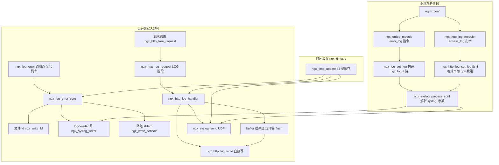
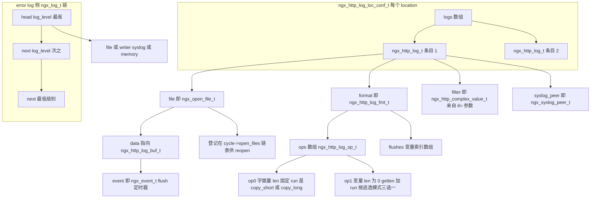
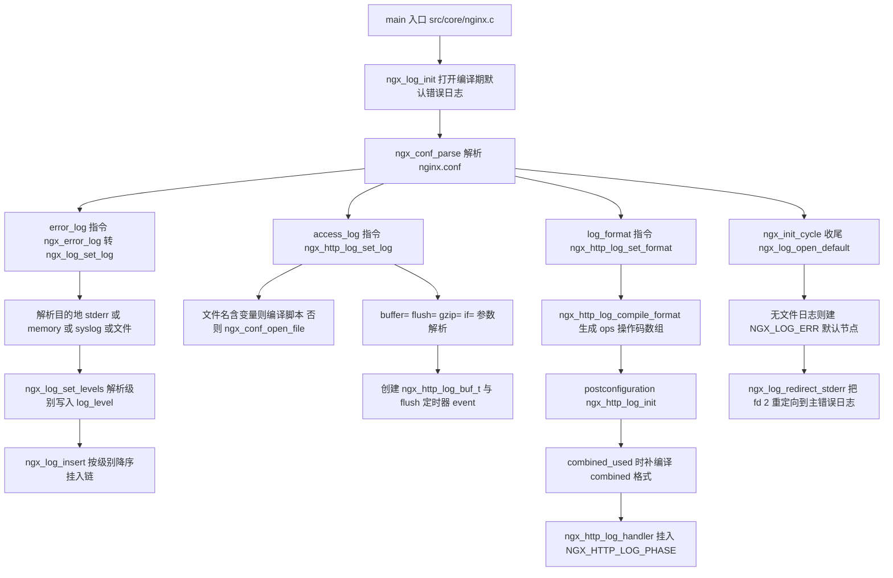
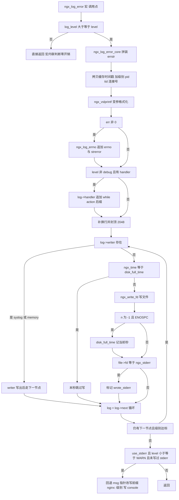
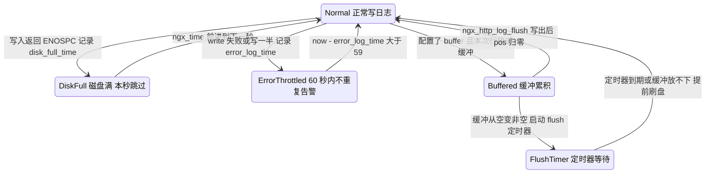
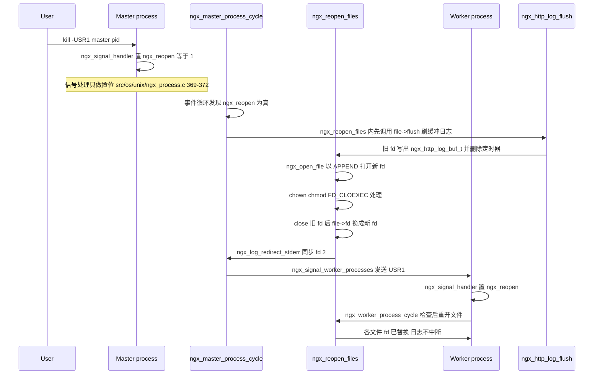
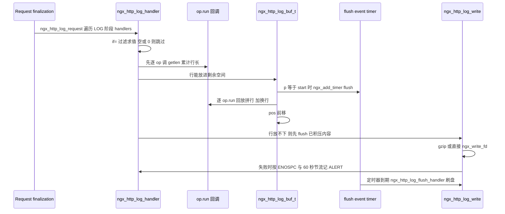

# 日志系统（error/access/syslog）（基于 nginx-1.27.0 源码）

> **导读**：读完本文你将掌握——
> 1. `ngx_log_t` 单链表如何承载 error_log 的继承与多路输出，为什么链表按级别降序排列后写入循环可以提前 break（src/core/ngx_log.c:161-196）；
> 2. `ngx_log_error_core` 从变参格式化到 `write()` 失败降级 stderr 的完整数据流，以及 `disk_full_time` 一秒节流的由来；
> 3. `--with-debug` 与 `ngx_log_debugN` 宏家族在编译期/运行期的双重过滤，`debug_connection` 如何按客户端地址打开调试级别（src/event/ngx_event_accept.c:527-565）；
> 4. access log 把 `log_format` 字符串编译成"操作码数组"（复用脚本引擎）后在 LOG 阶段零解析回放的机制，buffer + flush 定时器 + gzip 的协作；
> 5. syslog 的 UDP 套接字懒建、断线重连与 RFC 3164 头部拼装（src/core/ngx_syslog.c）；
> 6. USR1 reopen 信号从 master 到每个 worker 的完整时序，以及为什么 buffered access log 必须先 flush 再换 fd。
>
> **前置阅读建议**：先了解 nginx 模块结构体（`ngx_module_t`）、`ngx_cycle_t`/`ngx_pool_t` 生命周期、HTTP 11 个 phase 与 phase engine、`ngx_http_complex_value`/脚本引擎的基本概念。可参考本系列前几篇（配置解析、事件驱动、HTTP 处理流程）。
>
> **涉及源码清单**：
> - src/core/ngx_log.h（268 行，级别常量、`ngx_log_t`、调试宏家族）
> - src/core/ngx_log.c（752 行，`ngx_log_error_core` 与 error_log 配置链）
> - src/core/ngx_syslog.h / src/core/ngx_syslog.c（410 行，syslog writer）
> - src/core/ngx_times.c（464 行，时间缓存槽）
> - src/http/modules/ngx_http_log_module.c（1909 行，access log 模块）
> - 辅助：src/core/ngx_cycle.c（reopen）、src/os/unix/ngx_process.c 与 ngx_process_cycle.c（信号）、src/http/ngx_http_request.c（LOG 阶段触发点）、src/core/ngx_connection.h（连接日志切换宏）

---

## 1. 本模块在 nginx 中的位置与职责

nginx 的日志系统在源码上是两套相互独立的机制，共享同一个时间缓存与同一次变参格式化基础设施：

- **error log（错误日志）**：由 core 模块 `ngx_errlog_module` 提供 `error_log` 指令（src/core/ngx_log.c:34-44），核心写入口是全局函数 `ngx_log_error_core`。它被全代码库成千上万个 `ngx_log_error()` 调用点使用，输出格式固定为 `时间 [级别] pid#tid *conn 消息`。
- **access log（访问日志）**：由 HTTP 模块 `ngx_http_log_module` 提供 `access_log`/`log_format`/`open_log_file_cache` 指令（src/http/modules/ngx_http_log_module.c:165-190），挂在 `NGX_HTTP_LOG_PHASE` 上，请求结束时按格式串拼一行写盘。
- **syslog**：不是独立模块，而是一个"writer 插件"——`error_log syslog:...` 与 `access_log syslog:...` 都把 `ngx_log_t.writer` / `ngx_http_log_t.syslog_peer` 指向 src/core/ngx_syslog.c 里的函数，让日志走 UDP 或本地 unix domain socket。



图解：三条写入路径（error 文件、access 文件/buffer、syslog）最终都依赖 `ngx_times.c` 提供的五个缓存时间字符串（`ngx_cached_err_log_time`、`ngx_cached_http_log_time`、`ngx_cached_syslog_time` 等，src/core/ngx_times.c:31-35），保证每秒只做一次 `localtime` 类计算。配置解析阶段产生的两条主要产物分别是：全局的 `ngx_log_t` 继承链（error log）和每个 location 的 `ngx_http_log_t` 数组（access log）。

---

## 2. 核心数据结构精讲

### 2.1 `ngx_log_t`：error log 的链表节点

```c
struct ngx_log_s {
    ngx_uint_t           log_level;
    ngx_open_file_t     *file;
    ngx_atomic_uint_t    connection;
    time_t               disk_full_time;
    ngx_log_handler_pt   handler;
    void                *data;
    ngx_log_writer_pt    writer;
    void                *wdata;
    char                *action;
    ngx_log_t           *next;
};
```

（src/core/ngx_log.h:50-73）

| 字段 | 类型 | 作用 | 关键细节 |
|---|---|---|---|
| `log_level` | `ngx_uint_t` | 级别位图 | 普通级别 0-8 用"数值比较"（`>=`），debug 掩码 0x010~0x400 与 0x80000000 用"位与比较"（`&`），见 src/core/ngx_log.h:16-42 |
| `file` | `ngx_open_file_t *` | 目标文件描述符封装 | 由 `ngx_conf_open_file` 统一登记到 `cycle->open_files`，供 reopen 复用；指向 stderr 的节点 `name.len == 0`（src/core/ngx_conf_file.c:945-952） |
| `connection` | `ngx_atomic_uint_t` | 连接号 | 写成 `*%uA` 前缀（src/core/ngx_log.c:126-128），无锁写、无锁读，只用于标识不用于同步 |
| `disk_full_time` | `time_t` | 磁盘满节流时间戳 | 写入遇到 `NGX_ENOSPC` 时记下当前秒，同一秒内跳过写（src/core/ngx_log.c:172-187） |
| `handler` | `ngx_log_handler_pt` | 消息后缀回调 | 把"当前在做什么"追加到行尾，如 HTTP 的 `ngx_http_log_error`（src/http/ngx_http_request.c:3850） |
| `data` | `void *` | handler 的上下文 | 通常指向 `ngx_http_log_ctx_t`（请求/连接指针） |
| `writer` | `ngx_log_writer_pt` | 自定义写出函数 | syslog 与 debug 用 `memory:` 日志都通过它替换默认的 `ngx_write_fd`（src/core/ngx_log.c:635、654） |
| `wdata` | `void *` | writer 的上下文 | syslog 场景下是 `ngx_syslog_peer_t *` |
| `action` | `char *` | 动作短语 | `"reading request headers"` 等，由 handler 回调拼成 `while ...` 后缀 |
| `next` | `ngx_log_t *` | 链表下一节点 | 同一配置层级写多个 error_log 时按级别**降序**串联 |

### 2.2 `ngx_open_file_t`：受管理的打开文件

```c
struct ngx_open_file_s {
    ngx_fd_t              fd;
    ngx_str_t             name;
    void                (*flush)(ngx_open_file_t *file, ngx_log_t *log);
    void                 *data;
};
```

（src/core/ngx_conf_file.h:89-95）

| 字段 | 作用 |
|---|---|
| `fd` | 真实文件描述符；`ngx_reopen_files` 会原地替换它（src/core/ngx_cycle.c:1284） |
| `name` | 规范化全路径，作为去重键；空 name 代表 stderr |
| `flush` | 缓冲日志的刷盘回调；access log 的 buffer 把它设为 `ngx_http_log_flush`（src/http/modules/ngx_http_log_module.c:1528） |
| `data` | flush 的上下文；access log 场景是 `ngx_http_log_buf_t *` |

`ngx_conf_open_file`（src/core/ngx_conf_file.c:900-958）按全路径去重：同一个文件无论被多少条 `access_log`/`error_log` 引用，`cycle->open_files` 链表里只有一个条目——这是 reopen 与 flush 语义统一的前提。

### 2.3 `ngx_syslog_peer_t`：syslog 会话

（src/core/ngx_syslog.h:11-26）

| 字段 | 作用 |
|---|---|
| `facility` / `severity` | RFC 3164 的 PRI 值来源，`pri = facility * 8 + severity`（src/core/ngx_syslog.c:242） |
| `tag` | 进程标签，默认 `"nginx"`，配置期校验"仅字母数字下划线且不超过 32 字符"（src/core/ngx_syslog.c:190-213） |
| `hostname` | 指向 `cf->cycle->hostname`，`nohostname` 时不输出（src/core/ngx_syslog.c:70、244-247） |
| `server` | `ngx_addr_t`，`server=` 参数经 `ngx_parse_url` 解析，默认端口 514（src/core/ngx_syslog.c:126-140） |
| `conn` | 复用 `ngx_connection_t` 作为 UDP 发送载体，`fd` 初始为 -1（懒建） |
| `log` / `logp` | 本地日志副本：首次发送时从 `*logp`（指向 `cycle->new_log`）拷贝并挂上 `ngx_syslog_log_error` 回调（src/core/ngx_syslog.c:293-298） |
| `busy` | 位域标志，防重入 + cleanup 后封印（src/core/ngx_syslog.c:264-268、376-377） |
| `nohostname` | `nohostname` 参数置位 |

### 2.4 access log 侧的结构体群

| 结构体 | 位置 | 核心字段与作用 |
|---|---|---|
| `ngx_http_log_op_t` | src/http/modules/ngx_http_log_module.c:26-31 | 格式串编译产物：`len`（定长则非 0）、`getlen`（变长求长回调）、`run`（取值/拷贝回调）、`data`（变量索引或字面量） |
| `ngx_http_log_fmt_t` | 同上 34-38 | `name` + `flushes`（需要每次刷新缓存标记的变量索引数组）+ `ops`（操作码数组） |
| `ngx_http_log_main_conf_t` | 同上 41-44 | 全局 `formats` 数组（首元素固定为 combined）与 `combined_used` 标志 |
| `ngx_http_log_buf_t` | 同上 47-55 | `start/pos/last` 环形写指针、`event`（flush 定时器）、`flush`（毫秒）、`gzip`（压缩级别） |
| `ngx_http_log_script_t` | 同上 58-61 | 文件名含变量时编译出的 `lengths/values` 脚本对 |
| `ngx_http_log_t` | 同上 64-72 | 单条 access_log 的全部状态：`file`、`script`、`disk_full_time`、`error_log_time`、`syslog_peer`、`format`、`filter`（`if=` 条件） |
| `ngx_http_log_loc_conf_t` | 同上 75-83 | location 级配置：`logs` 数组、`open_file_cache` 三元组、`off` 标志 |

### 2.5 数据结构关系图



图解：access log 的每个 location 可挂多条 `ngx_http_log_t`（一次请求写多份日志、多目的地），每条共享同一个格式对象 `ngx_http_log_fmt_t`，格式对象内部是"操作码数组 + 变量刷新数组"的编译产物。error log 侧则是一串按级别降序的 `ngx_log_t` 节点，头节点级别最高。两条线通过 `ngx_open_file_t`/`ngx_syslog_peer_t` 与 reopen、syslog 机制交汇。

---

## 3. 初始化流程



图解：初始化分四条支线。（1）进程启动前 `ngx_log_init`（src/core/ngx_log.c:317-398）先用编译期 `NGX_ERROR_LOG_PATH` 打开一个"引导日志"，保证配置解析阶段的报错有处可写。（2）解析 `error_log` 时每条指令构造一个 `ngx_log_t` 并插入全局链，注意全局 `error_log` 的 head 是 `cycle->new_log` 这个"哑节点"（src/core/ngx_log.c:541-549），只有 `log_level == 0` 时才被复用为第一个真实节点（src/core/ngx_log.c:559-572）。（3）HTTP 侧 `log_format`/`access_log` 完成格式编译与缓冲区创建，`postconfiguration`（src/http/modules/ngx_http_log_module.c:1867-1909）把 handler 压入 LOG 阶段，若任何地方用到了默认 combined 格式则在此刻补编译（1879-1897，因为 combined 的 ops 是惰性生成的）。（4）cycle 收尾时 `ngx_log_open_default`（src/core/ngx_log.c:401-435）兜底：若配置里完全没有 error_log，就给一个默认 `NGX_LOG_ERR` 级别的文件日志，随后 `ngx_log_redirect_stderr`（438-460）把 stderr（fd 2）重定向过去，并清掉 `ngx_use_stderr`（src/core/nginx.c:367-378）。

---

## 4. 核心执行流程/状态机

### 4.1 error log 写入分支



图解：三处降级是本流程的精华。**第一**，宏内的 `>=` 判断（src/core/ngx_log.h:85-86）让低级别调用点在不用 debug 构建时几乎零成本。**第二**，`disk_full_time`（src/core/ngx_log.c:172-187）在 FreeBSD softupdates 下写满盘会阻塞很久，于是 ENOSPC 后同一秒内直接跳过写。**第三**，stderr 兜底（198-209）：如果这条日志级别不超过 WARN、也没写进任何 fd 为 stderr 的日志文件，就回退 `msg` 指针、把前缀改写成 `nginx: [level] ` 写到控制台——启动早期、配置错误、崩溃前的关键信息因此不丢。

### 4.2 access log 状态机（含节流）



图解：access log 的运行态本质上是"正常 / 磁盘满 / 告警节流"三态外加缓冲子系统。`disk_full_time` 与 `error_log_time` 两个时间戳（src/http/modules/ngx_http_log_module.c:67-68）分别做"一秒静默"与"一分钟最多一条 ALERT"的节流，对应 src/http/modules/ngx_http_log_module.c:442-467。缓冲子系统的关键转换是 `if (buffer->event && p == buffer->start) ngx_add_timer(...)`（341 行附近）：**只有缓冲从空变非空才启动定时器**，之后持续累积；放不下或到期则走 `ngx_http_log_flush` 写出并复位。

---

## 5. 关键时序图

### 5.1 USR1 reopen 完整链路



图解：三段式设计保证了**无丢失窗口**。master 先重开自己持有的文件（包括已被重定向的 stderr），再向 worker 广播 USR1；worker 的信号处理函数（src/os/unix/ngx_process.c:429-432）同样只置 `sig_atomic_t ngx_reopen` 标志，真正的 reopen 发生在事件循环里（src/os/unix/ngx_process_cycle.c:743-747），避免在信号上下文里调用非异步安全函数。重开的顺序极其讲究：先 `file->flush`（src/core/ngx_cycle.c:1193-1195）把 buffered access log 的残余字节写进**旧 fd**（旧 fd 仍指向被 logrotate 改名的旧文件），再打开新文件、把 `file->fd` 原地替换（1284 行）——这样"改名 + 新建 + 换 fd"期间所有 worker 依旧写旧 fd，无一行丢失。单进程模式（`ngx_single_process_cycle`，src/os/unix/ngx_process_cycle.c:326-330）与 cache manager 等辅助进程（1056、1128-1131 行）有各自对应的 reopen 检查点。

### 5.2 buffered access log 一次请求的写入



图解：请求侧只做"拼行 + 进缓冲"这一轻量动作；真正的磁盘 IO 被推迟到"缓冲满"或"flush= 定时器到期"两个时机。getlen/run 两遍走的是同一个 ops 数组，getlen 阶段还顺便把 `value->escape` 的判定结果缓存在变量值上（src/http/modules/ngx_http_log_module.c:964），run 阶段直接复用，避免二次扫描。

---

## 6. 源码逐段精读（篇幅主体）

### 6.1 级别常量与两级比较语义（src/core/ngx_log.h）

级别共 9 档，0 号 `NGX_LOG_STDERR` 保留：

```c
#define NGX_LOG_STDERR            0
#define NGX_LOG_EMERG             1
#define NGX_LOG_ALERT             2
#define NGX_LOG_CRIT              3
#define NGX_LOG_ERR               4
#define NGX_LOG_WARN              5
#define NGX_LOG_NOTICE            6
#define NGX_LOG_INFO              7
#define NGX_LOG_DEBUG             8

#define NGX_LOG_DEBUG_CORE        0x010
#define NGX_LOG_DEBUG_ALLOC       0x020
#define NGX_LOG_DEBUG_MUTEX       0x040
#define NGX_LOG_DEBUG_EVENT       0x080
#define NGX_LOG_DEBUG_HTTP        0x100
#define NGX_LOG_DEBUG_MAIL        0x200
#define NGX_LOG_DEBUG_STREAM      0x400
```

（src/core/ngx_log.h:16-32）

`NGX_LOG_DEBUG_CONNECTION` 是特殊的 0x80000000（src/core/ngx_log.h:41）——它不参与 `debug_levels[]` 命名（src/core/ngx_log.c:87-90），专供 `debug_connection` 指令按连接打开。`NGX_LOG_DEBUG_ALL` 是 0x7ffffff0（src/core/ngx_log.h:42），刻意不含最高位。

关键在于两种过滤语义的分裂（src/core/ngx_log.h:85-93）：

```c
#define ngx_log_error(level, log, ...)                                        \
    if ((log)->log_level >= level) ngx_log_error_core(level, log, __VA_ARGS__)
...
#define ngx_log_debug(level, log, ...)                                        \
    if ((log)->log_level & level)                                             \
        ngx_log_error_core(NGX_LOG_DEBUG, log, __VA_ARGS__)
```

`ngx_log_error` 用 `>=`：`log_level` 存的是"允许的最高级别"，数值越大越啰嗦。`ngx_log_debug` 用 `&`：debug 模块掩码是独立位图，`log_level` 同时承担"级别数值 + debug 位图"两个角色——这也解释了为什么 `error_log ... debug_http` 配置会把 `log_level` 设成 `NGX_LOG_DEBUG|0x100`（src/core/ngx_log.c:510-523 的 OR 逻辑，且要求先给出 debug 级别才允许加掩码，512-517 行校验 `log_level & ~NGX_LOG_DEBUG_ALL` 时若已有普通级别直接报"invalid log level"）。

易错点：`ngx_log_debug0..8` 家族在非 `--with-debug` 构建下整体展开为空（src/core/ngx_log.h:215-225），**连参数求值都不会发生**，所以把有副作用的表达式写进 debug 宏参数是隐蔽 bug；反之 `--with-debug` 时每次调用仍要过 `if ((log)->log_level & level)` 这道运行期闸门（src/core/ngx_log.h:134-165），这就是"debug 构建未开 debug 级别时几乎不慢"的原因。

### 6.2 `ngx_log_error_core`：一条错误日志的一生（src/core/ngx_log.c:95-210）

签名兼容三种编译器：C99 变参宏、GCC 变参宏、无变参宏（回退到 `va_list` 传参的声明，src/core/ngx_log.h:113-125）。以主流的变参宏版本为例。

**第一段：栈上缓冲与头部拼装（107-130 行）**

```c
    u_char       errstr[NGX_MAX_ERROR_STR];   /* 2048 字节，ngx_log.h:76 */

    last = errstr + NGX_MAX_ERROR_STR;

    p = ngx_cpymem(errstr, ngx_cached_err_log_time.data,
                   ngx_cached_err_log_time.len);

    p = ngx_slprintf(p, last, " [%V] ", &err_levels[level]);

    /* pid#tid */
    p = ngx_slprintf(p, last, "%P#" NGX_TID_T_FMT ": ",
                    ngx_log_pid, ngx_log_tid);

    if (log->connection) {
        p = ngx_slprintf(p, last, "*%uA ", log->connection);
    }

    msg = p;
```

（src/core/ngx_log.c:113-130）

时间戳直接整块 `memcpy` 自 `ngx_cached_err_log_time`——一个指向 64 槽缓存数组的 `volatile ngx_str_t`（src/core/ngx_times.c:31、49-50、150-155）。每条日志因此省掉一次 `localtime`；代价是日志时间可能有最多一个事件循环周期的滞后。`ngx_log_pid` 是 `ngx_pid` 的宏别名（src/os/unix/ngx_process.h:60），`ngx_log_tid` 在 Unix 非 thread 构建下恒为 0（src/os/unix/ngx_thread.h:61-65）。`msg` 记下"消息体起点"，它是后面 stderr 兜底改写前缀的基准。

**第二段：变参格式化与 errno（132-146 行）**

`ngx_vslprintf` 是 nginx 自研的 printf 子集（支持 `%V` ngx_str_t、`%P` pid、`%uA` 原子计数、`%O` off_t、`%M` uint 等），向 `last` 封顶写、绝不越界。`err != 0` 时 `ngx_log_errno` 追加 ` (errno: 描述)`：

```c
u_char *
ngx_log_errno(u_char *buf, u_char *last, ngx_err_t err)
{
    if (buf > last - 50) {

        /* leave a space for an error code */

        buf = last - 50;
        *buf++ = '.';
        *buf++ = '.';
        *buf++ = '.';
    }
    ...
    buf = ngx_strerror(err, buf, last - buf);

    if (buf < last) {
        *buf++ = ')';
    }

    return buf;
}
```

（src/core/ngx_log.c:287-314）

预留 50 字节给错误码文本，空间不足时以 `...` 截断用户消息——保证 errno 描述永远完整。

**第三段：handler 后缀与封顶（148-156 行）**

```c
    if (level != NGX_LOG_DEBUG && log->handler) {
        p = log->handler(log, p, last - p);
    }

    if (p > last - NGX_LINEFEED_SIZE) {
        p = last - NGX_LINEFEED_SIZE;
    }

    ngx_linefeed(p);
```

`log->handler` 是 HTTP 层注入的上下文补全器：连接日志的 handler（src/http/ngx_http_request.c:3850 起）追加 ` while ...`、` client: ..., server: ..., request: "..."` 等现场信息。注意 debug 级别不走 handler——高频 debug 消息不需要昂贵的现场拼装。

**第四段：链式写出与三处降级（158-196 行）**

```c
    wrote_stderr = 0;
    debug_connection = (log->log_level & NGX_LOG_DEBUG_CONNECTION) != 0;

    while (log) {

        if (log->log_level < level && !debug_connection) {
            break;
        }

        if (log->writer) {
            log->writer(log, level, errstr, p - errstr);
            goto next;
        }

        if (ngx_time() == log->disk_full_time) {
            /* FreeBSD softupdates 下写满盘可能长时间阻塞，本秒跳过 */
            goto next;
        }

        n = ngx_write_fd(log->file->fd, errstr, p - errstr);

        if (n == -1 && ngx_errno == NGX_ENOSPC) {
            log->disk_full_time = ngx_time();
        }

        if (log->file->fd == ngx_stderr) {
            wrote_stderr = 1;
        }

    next:

        log = log->next;
    }
```

（src/core/ngx_log.c:158-196）

这里集中了本函数最精妙的三处设计：

1. **提前 break 的前提是链有序**。`ngx_log_insert` 保证链按 `log_level` 降序（见 6.6 节），所以一旦走到第一个"级别不够"的节点，后面所有节点级别必然更低，直接 `break` 而不是 `continue`——典型生产配置里这条链只有一两跳。
2. **`debug_connection` 的旁路**。`debug_connection` 会把连接日志的 `log_level` 直接改成 `NGX_LOG_DEBUG_CONNECTION|NGX_LOG_DEBUG_ALL`（src/event/ngx_event_accept.c:564），数值上 0x80000000 远大于任何普通级别，`log_level < level` 恒假，所以这个局部变量其实用于防御——即便某实现把掩码语义改掉，debug_connection 的日志也不会被级别比较拦截。
3. **writer 分流**。syslog 与 `memory:` 日志没有 `file`，走 `log->writer`；注意它们**不受 disk_full_time 节流**，因为发送失败与否由 writer 自己负责。

**第五段：stderr 兜底（198-209 行）**

```c
    if (!ngx_use_stderr
        || level > NGX_LOG_WARN
        || wrote_stderr)
    {
        return;
    }

    msg -= (7 + err_levels[level].len + 3);

    (void) ngx_sprintf(msg, "nginx: [%V] ", &err_levels[level]);

    (void) ngx_write_console(ngx_stderr, msg, p - msg);
```

回退量 `7 + len(level) + 3` 正好等于 `"nginx: [" + level + "] "` 的字节数。`ngx_use_stderr` 在完成 stderr 重定向后被清零（src/core/nginx.c:378），即**正常运行期不再往控制台刷**；`wrote_stderr` 防止同一条日志在控制台出现两遍。

### 6.3 配置期级别解析：`ngx_log_set_levels`（src/core/ngx_log.c:478-538）

```c
    if (cf->args->nelts == 2) {
        log->log_level = NGX_LOG_ERR;
        return NGX_CONF_OK;
    }
```

`error_log file;` 不带级别时默认 `NGX_LOG_ERR`——这解释了官方文档"默认 error 级别"的说法。带级别时走两个循环：先在 `err_levels[]`（1..8）里精确匹配普通级别并**拒绝重复**（497-502 行的 duplicate 检查），再在 `debug_levels[]` 里匹配 debug 掩码做 OR（510-523 行）。结尾的规范化（533-535 行）很关键：

```c
    if (log->log_level == NGX_LOG_DEBUG) {
        log->log_level = NGX_LOG_DEBUG_ALL;
    }
```

纯 `debug` 级别被翻译成"全部模块掩码"，因为 `ngx_log_debug` 宏是按位与的，裸的 8 无法匹配任何掩码。

### 6.4 引导日志：`ngx_log_init`（src/core/ngx_log.c:317-398）

进程一启动，main 里就会调用 `ngx_log_init(prefix, error_log)`（`-e` 参数或编译期 `NGX_ERROR_LOG_PATH`）。要点：

- 两个静态全局 `ngx_log` 与 `ngx_log_file`（src/core/ngx_log.c:70-71）构成"未配置前的全局日志"，级别固定 `NGX_LOG_NOTICE`（324 行）；
- `NGX_ERROR_LOG_PATH` 为空串时直接用 stderr（333-336 行）；
- 相对路径拼 prefix（338-374 行），注意这里用 `malloc`/`ngx_free`——此时内存池尚不存在；
- 打开失败不退出：写一条 alert 到 stderr（Windows 上还写事件日志，384-388 行），fd 降级为 stderr 继续。**引导日志的容错哲学是"宁可降级不可致命"**。

### 6.5 默认兜底与 stderr 重定向（src/core/ngx_log.c:401-475）

```c
ngx_int_t
ngx_log_open_default(ngx_cycle_t *cycle)
{
    ...
    if (ngx_log_get_file_log(&cycle->new_log) != NULL) {
        return NGX_OK;
    }

    if (cycle->new_log.log_level != 0) {
        /* there are some error logs, but no files */

        log = ngx_pcalloc(cycle->pool, sizeof(ngx_log_t));
        ...
    } else {
        /* no error logs at all */
        log = &cycle->new_log;
    }

    log->log_level = NGX_LOG_ERR;

    log->file = ngx_conf_open_file(cycle, &cycle->error_log);
    ...
```

（src/core/ngx_log.c:401-428）

三种情况一条兜底规则：完全没配 error_log → 直接用哑节点；配了 syslog/memory 但没有文件目的地 → 新分配一个节点 `ngx_log_insert` 挂进链（430-432 行）；有文件日志 → 什么都不做。兜底级别是 `NGX_LOG_ERR` 而非引导期的 NOTICE——这是"默认配置降噪"的有意选择。

`ngx_log_redirect_stderr`（438-460 行）取链上第一个有 file 的日志的 fd，`ngx_set_stderr`（本质 `dup2` 到 fd 2）完成后，所有 `ngx_write_console(ngx_stderr, ...)` 与 libc 的 stderr 输出都汇入主错误日志。`cycle->log_use_stderr`（配置了 `error_log stderr;` 时置位，src/core/ngx_log.c:576-579）会让它直接返回，保留真 stderr。

### 6.6 链的构建与降序插入：`ngx_log_set_log` + `ngx_log_insert`（src/core/ngx_log.c:552-707）

`ngx_log_set_log` 是 `error_log`（经 ngx_error_log 包装）、`http/server/location error_log`（经 ngx_http_core_error_log，src/http/ngx_http_core_module.c:5028-5032）共用的人口。目的地的四路分支：

| 目的地 | 代码 | 效果 |
|---|---|---|
| `stderr` | 576-583 行 | `ngx_str_null(&name)` 后 `ngx_conf_open_file` 返回 fd 恒为 `ngx_stderr` 的条目；同时置 `log_use_stderr` |
| `memory:size` | 585-642 行 | 仅 `--with-debug`；分配环形缓冲，`writer = ngx_log_memory_writer` |
| `syslog:...` | 644-655 行 | `ngx_syslog_process_conf` 解析参数，`writer = ngx_syslog_writer`，`wdata = peer` |
| 普通路径 | 657-662 行 | `ngx_conf_open_file` 登记，多个配置引用同一文件共享同一个 `ngx_open_file_t` |

同一个 head 上重复出现 `error_log` 指令时，559-572 行的"哑节点复用"避免第一次调用浪费一次分配——head 传入时 `log_level == 0`（`ngx_pcalloc` 结果），直接当第一个节点用。

真正的魔法在插入函数：

```c
static void
ngx_log_insert(ngx_log_t *log, ngx_log_t *new_log)
{
    ngx_log_t  tmp;

    if (new_log->log_level > log->log_level) {

        /*
         * list head address is permanent, insert new log after
         * head and swap its contents with head
         */

        tmp = *log;
        *log = *new_log;
        *new_log = tmp;

        log->next = new_log;
        return;
    }

    while (log->next) {
        if (new_log->log_level > log->next->log_level) {
            new_log->next = log->next;
            log->next = new_log;
            return;
        }

        log = log->next;
    }

    log->next = new_log;
}
```

（src/core/ngx_log.c:676-707）

新节点级别比头节点高时，**整体交换两个结构体内容**而不是移动头指针——因为外部（例如 `cycle->new_log`、各 clcf）持有的是头地址，头地址必须永久不变。这是"以值交换换指针稳定"的经典手法。降序有序直接换来了 6.2 节的 `break` 提前退出。

`memory:` 的 writer 值得一读（src/core/ngx_log.c:712-739）：用 `ngx_atomic_fetch_add(&mem->written, len)` 抢占式分配环形位置，多进程/多线程并发写同一 memory 日志时不会互相踩踏内容区（但单条消息仍可能被并发交错，它本来就是调试用途）。cleanup 回调把 `wdata` 置 NULL 防止 use-after-free（742-750 行）。

### 6.7 时间缓存：`ngx_times.c` 的 64 槽设计（src/core/ngx_times.c:24-192）

```c
#define NGX_TIME_SLOTS   64

static ngx_uint_t        slot;
static ngx_atomic_t      ngx_time_lock;
...
static ngx_time_t        cached_time[NGX_TIME_SLOTS];
static u_char            cached_err_log_time[NGX_TIME_SLOTS]
                                    [sizeof("1970/09/28 12:00:00")];
static u_char            cached_http_time[NGX_TIME_SLOTS]
                                    [sizeof("Mon, 28 Sep 1970 06:00:00 GMT")];
static u_char            cached_http_log_time[NGX_TIME_SLOTS]
                                    [sizeof("28/Sep/1970:12:00:00 +0600")];
static u_char            cached_http_log_iso8601[NGX_TIME_SLOTS]
                                    [sizeof("1970-09-28T12:00:00+06:00")];
static u_char            cached_syslog_time[NGX_TIME_SLOTS]
                                    [sizeof("Sep 28 12:00:00")];
```

（src/core/ngx_times.c:24-58）

源码顶部的注释（15-22 行）把这个设计说得非常直白：更新者少且持锁，读者极多且无锁；64 个槽保证"读者被抢占超过 64 秒才会读到被覆写的槽"——实践中不可能。`ngx_time_update` 的流程：

1. `ngx_trylock` 失败立即返回（90-92 行）——多进程下定时器信号可能同时到，输者直接放弃；
2. 同秒快速路径：只更新 `msec` 就解锁（103-107 行）；
3. 秒变化才轮转 slot（109-118 行），重算五种字符串（125-180 行），时区偏移按三种编译条件取（130-147 行，`NGX_HAVE_GMTOFF` 路径下 `ngx_localtime` 顺便缓存 `cached_gmtoff`）；
4. `ngx_memory_barrier()` 后才发布新指针（182-189 行）——读者要么看到旧槽（内容完好）要么看到新槽，永远看不到写一半的槽。

worker 在每个事件循环前后调用 `ngx_time_update`（如 src/event/modules/ngx_epoll_module.c:805；src/os/unix/ngx_process_cycle.c:1156 处的 channel 处理也刷）。**信号上下文**里用的是另一个函数 `ngx_time_sigsafe_update`（src/core/ngx_times.c:218-273）：它只刷新 error/syslog 两个格式（http 格式在信号处理里重算不安全且无必要），且依赖预缓存的 `cached_gmtoff`，因为 `localtime_r` 不是异步信号安全函数（39-46 行注释）。主事件循环每秒由定时器信号触发它（src/os/unix/ngx_process.c:336）。这是"为什么 master/worker 的日志时间戳永远不会晚于一秒"的全部秘密。

### 6.8 syslog 实现：`ngx_syslog.c` 逐函数

**配置解析（40-89 行）**：`ngx_syslog_process_conf` 先置 `NGX_CONF_UNSET_UINT` 哨兵，调 `ngx_syslog_parse_args` 按**逗号分割**逐段匹配 `server=`/`facility=`/`severity=`/`tag=`/`nohostname`（92-234 行）。解析中的硬校验：

- `server=` 经 `ngx_parse_url`，默认端口 514（126-140 行），支持 `unix:` 前缀走本地 socket；
- facility 表 24 项（kern..local7，src/core/ngx_syslog.c:24-29），默认 23 即 local7（58-60 行）；
- severity 表用 nginx.conf 拼写 `error/warn` 而非 `err/warning`（32-34 行注释明说），默认 6 即 info（62-64 行）；
- tag 限 32 字符、只允许字母数字下划线（190-213 行，引用 RFC 3164）。

注意 103 行 `p = value[1].data + sizeof("syslog:") - 1;` 之后 110 行的 `*comma = '\0'`——**直接在配置词法缓冲区里原地将逗号改写为 NUL**，后续各段用 C 字符串语义访问，这是典型的 nginx 零拷贝手法（配置缓冲区生命周期覆盖整个解析期，安全）。

**会话初始化的懒原则（71-78 行）**：`peer->conn.fd = -1`，read/write 事件指向 dummy 事件——UDP 发送根本不需要事件引擎，dummy 只是为了误触事件回调时不解引用空指针。cleanup 挂进池（80-87 行），cycle 销毁时关 fd 并置 `busy = 1` 封印（371-387 行）。

**PRI 头部（237-251 行）**：

```c
    pri = peer->facility * 8 + peer->severity;

    if (peer->nohostname) {
        return ngx_sprintf(buf, "<%ui>%V %V: ", pri, &ngx_cached_syslog_time,
                           &peer->tag);
    }

    return ngx_sprintf(buf, "<%ui>%V %V %V: ", pri, &ngx_cached_syslog_time,
                       peer->hostname, &peer->tag);
```

时间来自 `ngx_cached_syslog_time`（`Sep 28 12:00:00` 格式，src/core/ngx_times.c:57-58、176-180），同样零计算。

**写入器（254-285 行）**：

```c
void
ngx_syslog_writer(ngx_log_t *log, ngx_uint_t level, u_char *buf,
    size_t len)
{
    ...
    peer = log->wdata;

    if (peer->busy) {
        return;
    }

    peer->busy = 1;
    peer->severity = level - 1;
    ...
```

三个细节：（1）`busy` 防重入——syslog 发送内部还会调用 `ngx_log_error`（失败告警），若无防分会递归进 writer；（2）`severity = level - 1` 把 nginx 的 1..8 级别平移到 syslog 的 0..7（emerg=0），聪明的坐标系转换；（3）`len -= NGX_LINEFEED_SIZE`（274 行）去掉 error 行尾换行、按 `NGX_SYSLOG_MAX_STR` 截断（276-278 行），发送后立即 `busy = 0`（284 行），**全函数同步完成，不排队不缓存**——丢消息比阻塞请求更可接受，这是 syslog "best effort" 的取舍。

**发送与重连（288-368 行）**：`ngx_syslog_send` 首次调用时从 `*logp`（`cycle->new_log`）浅拷贝一份日志结构并挂上专用 handler（293-298 行）——注意这是**每 peer 一份的运行时副本**，因为它要携带 peer 上下文。fd 无效时 `ngx_syslog_init_peer` 重建：`SOCK_DGRAM` 创建（333 行）、`ngx_nonblocking`（340 行）、`connect()`（346 行，UDP connect 只是绑定默认对端，不产生网络往返）、置 `write->ready = 1`（355-356 行注释：UDP 套接字永远可写）。

```c
    if (n == NGX_ERROR) {

        if (ngx_close_socket(peer->conn.fd) == -1) {
            ngx_log_error(NGX_LOG_ALERT, &peer->log, ngx_socket_errno,
                          ngx_close_socket_n " failed");
        }

        peer->conn.fd = (ngx_socket_t) -1;
    }

    return n;
```

（src/core/ngx_syslog.c:314-324）

这就是"重连"的全部内容：**没有重试定时器、没有状态机**。发送失败 → 关 fd → 置 -1 → 下一条日志到来时 300-304 行的懒初始化自然重试。每条日志最多多付一次 `socket()+connect()` 的代价，正常路径零额外开销。错误日志通过 `ngx_syslog_log_error`（390-410 行）附加 ` while logging to syslog, server: ...` 上下文。

### 6.9 access log 格式串编译：`ngx_http_log_compile_format`（src/http/modules/ngx_http_log_module.c:1580-1756）

这是 access log 高性能的根基。`log_format` 的参数序列（`name escape=... seg1 seg2 ...`）被逐字符扫描：

**escape 参数**（1595-1611 行）只允许出现在第一个格式段之前，三种取值 `default/json/none` 编译进常量。**变量解析**（1626-1675 行）支持 `$var` 与 `${var}`，名字符集为 `[A-Za-z0-9_]`（1655-1663 行）。命中内置变量表 `ngx_http_log_vars`（233-250 行）时直接绑定定长 op（`op->len = v->len; op->getlen = NULL;`，1677-1689 行）——`$time_local`、`$status` 等无需走通用变量机制；否则 `ngx_http_log_variable_compile`（915-947 行）取变量索引并把 `op->len` 置 0、按 escape 三选一挂 getlen/run 回调，同时把变量索引推进 `flushes` 数组（1697-1705 行）。

**字面量压缩**（1712-1745 行）是最见功力的部分：

```c
                if (len <= sizeof(uintptr_t)) {
                    op->run = ngx_http_log_copy_short;
                    op->data = 0;

                    while (len--) {
                        op->data <<= 8;
                        op->data |= data[len];
                    }

                } else {
                    op->run = ngx_http_log_copy_long;

                    p = ngx_pnalloc(cf->pool, len);
                    ...
                    ngx_memcpy(p, data, len);
                    op->data = (uintptr_t) p;
                }
```

不超过指针宽度（64 位平台 8 字节）的字面量被打包进 `op->data` 整数本身，`ngx_http_log_copy_short`（772-788 行）运行时按小端逐字节吐出——**连一次内存解引用都省了**；长字面量才堆分配。一次 combined 格式日志的回放因此退化成"十几次函数指针调用 + memcpy + sprintf"。

### 6.10 LOG 阶段执行主体：`ngx_http_log_handler`（src/http/modules/ngx_http_log_module.c:253-402)

逐分支精读：

**（a）off 短路（271-273 行）**：`access_log off;` 后整个 handler 直接返回。

**（b）if= 过滤（278-286 行）**：

```c
        if (log[l].filter) {
            if (ngx_http_complex_value(r, log[l].filter, &val) != NGX_OK) {
                return NGX_ERROR;
            }

            if (val.len == 0 || (val.len == 1 && val.data[0] == '0')) {
                continue;
            }
        }
```

求值结果为空串或字面 "0" 即跳过——这就是 `access_log ... if=$loggable` 的语义。注意 filter 在**每条 log 各自求值**（不同目的地可配不同条件）。

**（c）磁盘满节流（288-297 行）**：与 error log 同款一秒静默。

**（d）变量缓存刷新（299 行）**：`ngx_http_script_flush_no_cacheable_variables`（src/http/ngx_http_script.c:664-678）把 `flushes` 数组里登记的、标记为 `no_cacheable` 的变量置 `valid = 0`，强制在日志阶段**重新取值**。这就是"变量取值时机在 LOG 阶段"的实现核心——普通变量可能在请求早段被缓存，日志若直接读会拿到旧值（典型如 `$request_time` 结束才确定）。

**（e）两遍长度计算（301-310 行）**：先 `getlen` 累计行长（`op->len == 0` 表示变长），定长 op 直接加 `op->len`。

**（f）缓冲快路径（324-353 行）**：

```c
        buffer = log[l].file ? log[l].file->data : NULL;

        if (buffer) {

            if (len > (size_t) (buffer->last - buffer->pos)) {

                ngx_http_log_write(r, &log[l], buffer->start,
                                   buffer->pos - buffer->start);

                buffer->pos = buffer->start;
            }

            if (len <= (size_t) (buffer->last - buffer->pos)) {

                p = buffer->pos;

                if (buffer->event && p == buffer->start) {
                    ngx_add_timer(buffer->event, buffer->flush);
                }

                for (i = 0; i < log[l].format->ops->nelts; i++) {
                    p = op[i].run(r, p, &op[i]);
                }

                ngx_linefeed(p);

                buffer->pos = p;

                continue;
            }

            if (buffer->event && buffer->event->timer_set) {
                ngx_del_timer(buffer->event);
            }
        }
```

放得下 → 直接拷进缓冲（零系统调用）；放不下 → 先把已积压内容整块写盘、清空缓冲，再尝试放；**单行超过整个缓冲** → 删掉定时器，落到 360 行 `alloc_line` 的"单独分配 + 直接写"路径。`p == buffer->start` 判空启定时器的设计保证定时器只代表"当前积压批次的 flush 期限"，而非周期性空刷。

**（g）syslog 路径（312-320、369-394 行）**：行长预算里先加 syslog 头部长度，`ngx_pnalloc` 的行缓冲先由 `ngx_syslog_add_header` 写 PRI/HEADER，再回放 ops；`ngx_syslog_send` 失败只告 WARN 不重试（383-391 行）。

**（h）普通路径（360-398 行）**：从 `r->pool` 分配行缓冲（请求结束自动释放），回放 ops、补换行、`ngx_http_log_write`。

### 6.11 `ngx_http_log_write` 与错误降级（src/http/modules/ngx_http_log_module.c:405-468）

```c
    if (n == (ssize_t) len) {
        return;
    }

    now = ngx_time();

    if (n == -1) {
        err = ngx_errno;

        if (err == NGX_ENOSPC) {
            log->disk_full_time = now;
        }

        if (now - log->error_log_time > 59) {
            ngx_log_error(NGX_LOG_ALERT, r->connection->log, err,
                          ngx_write_fd_n " to \"%s\" failed", name);

            log->error_log_time = now;
        }

        return;
    }

    if (now - log->error_log_time > 59) {
        ngx_log_error(NGX_LOG_ALERT, r->connection->log, 0,
                      ngx_write_fd_n " to \"%s\" was incomplete: %z of %uz",
                      name, n, len);

        log->error_log_time = now;
    }
```

（src/http/modules/ngx_http_log_module.c:438-468）

三级行为矩阵：成功 → 静默；ENOSPC → 本秒静默 + 60 秒一条 ALERT；其他错误/写一半 → 60 秒一条 ALERT。**access log 丢失绝不影响请求本身**，也不会通过无限刷错误日志制造次生灾害。`log->script` 存在时走 `ngx_http_log_script_write`（471-581 行）：先用 root 目录测试（484-531 行，配合 `disable_symlinks`）再动态开文件（经 `open_log_file_cache`），**所有失败路径一律 `return len` 模拟成功**（含 489、505、513、520、528、537、557、565、571 行的注释 "simulate successful logging"）——动态文件名的日志（比如按 `$remote_addr` 分文件）权限出错时静默降级，因为此时往往连写错误日志的合理目的地都难确定。

### 6.12 gzip：一次一批、无持久压缩流（src/http/modules/ngx_http_log_module.c:586-690）

```c
    wbits = MAX_WBITS;
    memlevel = MAX_MEM_LEVEL - 1;

    while ((ssize_t) len < ((1 << (wbits - 1)) - 262)) {
        wbits--;
        memlevel--;
    }
```

小批量时主动缩小 `wbits`/`memlevel` 省 zlib 内存（601-604 行）。压缩输出上界取 `deflateBound()` 的保守公式加 18 字节 gzip 包装（611 行）。关键决策在 637-638 行：

```c
    rc = deflateInit2(&zstream, (int) level, Z_DEFLATED, wbits + 16, memlevel,
                      Z_DEFAULT_STRATEGY);
```

`wbits + 16` 让 zlib 输出**自带 gzip 头尾**——于是每批缓冲独立成完整 gzip 流。这样做牺牲了跨批压缩率，换来：多进程追加写同一个文件永远合法、logrotate 后任何单独分片可解压、进程崩溃只丢当批。每次 flush 都要 `ngx_create_pool` + `deflateInit2` + `deflateEnd` + `ngx_destroy_pool`（615-686 行），CPU 成本不低，这是"buffer + gzip"必须搭配较大 `buffer=` 的原因。注意 684-689 行：压缩失败也 `return len` 模拟成功——**压缩失败同样静默**（写盘失败则返回 -1 走 ALERT，675-682 行）。

### 6.13 缓冲配置解析：`ngx_http_log_set_log` 的参数机（src/http/modules/ngx_http_log_module.c:1237-1533）

- `off` 特判（1257-1266 行）；
- `syslog:` 前缀转 syslog peer（1285-1299 行）；
- 文件名含 `$` 时 `ngx_http_script_variables_count` > 0 → 编译成 script（1301-1332 行），否则 `ngx_conf_open_file`；
- 格式名缺省为 combined 并置 `combined_used`（1336-1346 行）；
- 参数循环：`buffer=`（ngx_parse_size）、`flush=`（ngx_parse_time）、`gzip[=1-9]`（默认级别 Z_BEST_SPEED=1，未配 buffer 时自动 64K 缓冲，1400-1431 行）、`if=`（`ngx_http_compile_complex_value`，1433-1454 行）；
- 一致性校验（1461-1497 行）：`flush` 无 `buffer` 报错；**缓冲日志不得使用变量文件名**（1470-1474 行）、**syslog 不得缓冲**（1476-1480 行）；同一文件二次配置若 size/flush/gzip 不一致报"conflicting parameters"（1482-1494 行）——因为 buffer 挂在 `ngx_open_file_t` 上是全局唯一的；
- 最终装配（1499-1530 行）：`buffer->event->handler = ngx_http_log_flush_handler`、`event->log = &cf->cycle->new_log`、`event->cancelable = 1`（1521 行——**worker 退出时该定时器可被取消，避免退出阶段阻塞**），并挂 `log->file->flush = ngx_http_log_flush`。

`ngx_http_log_flush`（718-759 行）是"flush 事件"与"reopen 前置"共用的唯一刷盘实现：先写（gzip 或直写）、告警（同样的 ALERT 语义）、`pos` 归零、删定时器。`len == 0` 早退（729-731 行）保证 reopen 时空缓冲零成本。

### 6.14 变量转义三兄弟与位图扫描（src/http/modules/ngx_http_log_module.c:950-1122）

default 模式的核心是静态位图 `escape[256/32]`（997-1013 行），每一位代表一个 ASCII 字符是否转义：可打印 ASCII 中仅空格、`"`、`'` 之外的控制字符与少数符号被转义为 `\xHH`（1033-1045 行）。`dst == NULL` 的调用约定让它身兼两职（1016-1031 行）：数转义个数（getlen 用）或实际转义（run 用）。

getlen 与 run 之间的**逃生旗标缓存**值得特别注意：

```c
static size_t
ngx_http_log_variable_getlen(ngx_http_request_t *r, uintptr_t data)
{
    ...
    value = ngx_http_get_indexed_variable(r, data);

    if (value == NULL || value->not_found) {
        return 1;
    }

    len = ngx_http_log_escape(NULL, value->data, value->len);

    value->escape = len ? 1 : 0;

    return value->len + len * 3;
}
```

（src/http/modules/ngx_http_log_module.c:950-967）

getlen 阶段把"是否含需转义字符"写进 `value->escape`；run 阶段（970-988 行）为 0 时走纯 memcpy，为 1 才逐字符转义——绝大多数值不含特殊字符，热路径零扫描。`not_found` 时 getlen 返回 1、run 写 `'-'`，正是日志里熟悉的占位符。json 模式复用 `ngx_escape_json`（1063、1087 行），none 模式直接长度透传（1092-1122 行）。

### 6.15 merge 与默认 access_log（src/http/modules/ngx_http_log_module.c:1177-1234）

```c
    if (conf->logs || conf->off) {
        return NGX_CONF_OK;
    }

    conf->logs = prev->logs;
    conf->off = prev->off;

    if (conf->logs || conf->off) {
        return NGX_CONF_OK;
    }

    conf->logs = ngx_array_create(cf->pool, 2, sizeof(ngx_http_log_t));
    ...
    log->file = ngx_conf_open_file(cf->cycle, &ngx_http_access_log);
    ...
    /* the default "combined" format */
    log->format = &fmt[0];
    lmcf->combined_used = 1;
```

继承规则：子级配置过 `access_log`（哪怕 `off`）则完全覆盖父级；未配置则继承；**连根都没配**时创建默认 `logs/access.log` + combined。`combined_used` 标志让 `ngx_http_log_init` 在 postconfiguration 阶段补编译 combined 格式串（1867-1897 行）——combined 的 ops 不在 `create_main_conf` 时编译（那里只建了空壳，1152 行），因为格式串编译需要 `cf` 上下文（变量索引注册必须在配置池里完成）。这是一个"惰性编译 + 事后修补"的组合设计。

### 6.16 USR1 reopen 链路逐行（辅助文件精读）

信号注册后（`SIGUSR1` → `ngx_signal_handler`），master 分支只做一件事（src/os/unix/ngx_process.c:369-372）：

```c
        case ngx_signal_value(NGX_REOPEN_SIGNAL):
            ngx_reopen = 1;
            action = ", reopening logs";
            break;
```

`ngx_reopen` 是 `sig_atomic_t`（src/os/unix/ngx_process_cycle.c:44），信号上下文里唯一的合法写入方式。master 主循环每轮检查（254-260 行）：

```c
        if (ngx_reopen) {
            ngx_reopen = 0;
            ngx_log_error(NGX_LOG_NOTICE, cycle->log, 0, "reopening logs");
            ngx_reopen_files(cycle, ccf->user);
            ngx_signal_worker_processes(cycle,
                                        ngx_signal_value(NGX_REOPEN_SIGNAL));
        }
```

注意 master 自己先重开（带 `ccf->user` 做属主修正），**然后**才通知 worker——worker 端同一信号同样走"置位 + 循环检查"（src/os/unix/ngx_process.c:429-432 与 src/os/unix/ngx_process_cycle.c:743-747，调用 `ngx_reopen_files(cycle, -1)`，worker 不改属主）。

`ngx_reopen_files`（src/core/ngx_cycle.c:1167-1288）遍历 `cycle->open_files` 列表：

1. 跳过无名条目（stderr，1189-1191 行）；
2. **先 flush**（1193-1195 行）：buffered access log 的残余写进旧 fd；
3. `ngx_open_file(name, NGX_FILE_APPEND, NGX_FILE_CREATE_OR_OPEN, ...)` 打开新 fd（1197-1198 行）；
4. 打开失败：EMERG 日志 + `continue`，**旧 fd 保留、继续用旧文件**（1204-1208 行）——降级不中断；
5. master 模式下修正属主与权限（1211-1260 行，`chown`/`chmod`，失败同样关闭新 fd 并 continue）；
6. `fcntl(F_SETFD, FD_CLOEXEC)`（1263 行）；
7. 关旧 fd（1278-1282 行）、`file[i].fd = fd` 原子换新（1284 行）；
8. 收尾 `ngx_log_redirect_stderr(cycle)`（1287 行）——若主错误日志换了 inode，fd 2 必须跟着走。

为什么是"先开新再关旧"而不是 `dup2`？因为新旧文件是不同路径（logrotate 已 rename），且失败时需要保留旧 fd 回退。为什么 flush 必须在换 fd 前？因为 buffered 日志的缓冲内容属于旧文件——flush 之后换 fd，才能保证"缓冲里的每一行都落在他被产生时所属的那个文件里"。

### 6.17 LOG 阶段的执行时机：为什么在"引擎末尾"之外

先看引擎的组装（src/http/ngx_http.c:469-486）：

```c
    for (i = 0; i < NGX_HTTP_LOG_PHASE; i++) {
        n += cmcf->phases[i].handlers.nelts;
    }
    ...
    for (i = 0; i < NGX_HTTP_LOG_PHASE; i++) {
        h = cmcf->phases[i].handlers.elts;
```

两个循环的边界都是 `i < NGX_HTTP_LOG_PHASE`——**LOG 阶段的 handler 根本不进入 phase engine**。引擎按 `next` 链顺序推进，但日志必须等"响应体发送完毕、连接状态落定"才有意义（`$body_bytes_sent`、`$request_time` 此时才定值），所以它的触发点被挪到了请求释放：

```c
    if (!r->logged) {
        log->action = "logging request";

        ngx_http_log_request(r);
    }
```

（src/http/ngx_http_request.c:3744-3748，位于 `ngx_http_free_request`）

`ngx_http_log_request`（3793-3808 行）只是一个简单循环，顺序调用 LOG 阶段 handlers（nginx 反转数组使注册顺序即执行顺序）。子请求默认不产生 access log，除非 `log_subrequest on;`（2586-2594 行），且用 `r->logged` 防重复（2594 行）。所以准确的说法是：LOG 阶段是**枚举上的最后一个 phase**（src/http/ngx_http_core_module.h:127），但它的执行时机绑定在请求生命周期终点而非引擎流内——这正是"变量在日志阶段取终值"的结构保证。

配套的还有连接日志切换宏（src/core/ngx_connection.h:206-214）：

```c
#define ngx_set_connection_log(c, l)                                         \
                                                                             \
    c->log->file = l->file;                                                  \
    c->log->next = l->next;                                                  \
    c->log->writer = l->writer;                                              \
    c->log->wdata = l->wdata;                                                \
    if (!(c->log->log_level & NGX_LOG_DEBUG_CONNECTION)) {                   \
        c->log->log_level = l->log_level;                                    \
    }
```

location 定型时调用（src/http/ngx_http_core_module.c:1316-1318，仅主请求）：连接日志的 file/next/writer/wdata 全部换成该 location 的 error_log 链，唯独 `NGX_LOG_DEBUG_CONNECTION` 已置位时保留原级别——否则 debug_connection 会在 location 切换时被普通级别覆盖掉。error_log 的层级继承则由 `ngx_http_core_merge_loc_conf` 完成（src/http/ngx_http_core_module.c:3771-3776：子级未配则取父级，最终兜底 `&cf->cycle->new_log`）。

---

## 7. 设计思想与权衡

**（1）链表 + 降序 + 提前 break：把"每条日志查 N 份配置"变成"写 1~2 次 fd"。**
替代方案一：每个模块各自持有自己的日志配置，日志函数逐个查询。代价是每个调用点都要遍历配置、且继承关系散落各处。nginx 的做法是把"某层级的全部 error_log 目的地"物化成一个按级别降序的链，调用点只拿一个 head 指针；级别过滤变成链上一次比较。头节点内容交换保证外部指针稳定，是这套方案能落地的前提（src/core/ngx_log.c:681-694）。

**（2）同步写、无内部队列：简单换可靠。**
日志写入全部发生在"产生它的那个事件循环"里，没有后台 flush 线程、没有共享环形队列。好处：进程崩溃前已调用 `ngx_log_error` 的内容一定已发出（write 直达内核）；多进程写同一文件天然安全（O_APPEND 语义）。代价：错误日志级别过低、量过大时会拖慢请求——nginx 用"级别过滤 + buffer 化 access log"两招缓解，而不引入异步复杂度。与之相对，access log 的 buffer 是**单文件单缓冲、由触发请求同步刷盘**（`ngx_http_log_write` 顺手刷），依然没有锁。

**（3）时间缓存 64 槽：用空间把"每条日志一次 localtime"降为"每秒一次"。**
替代方案：每条日志调 `localtime_r`（有锁、慢），或用线程局部缓存（nginx 单线程模型不需要）。64 槽 + 内存屏障发布指针，让读者端完全无锁（src/core/ngx_times.c:15-22 的注释是理解本设计的钥匙）。`ngx_time_sigsafe_update` 的存在提醒我们：这套缓存还必须能在信号上下文里安全更新，于是它砍到只剩两种格式并预缓存时区。

**（4）syslog 的"懒重连 + 每条消息一次尝试"：UDP 语义下拒绝一切状态机。**
没有指数退避、没有定时探测。断链的代价被摊薄到"下一条日志到来时重建 UDP socket"——UDP connect 是纯本地操作，代价近零。换来的是零定时器、零状态、零内存管理。如果换成 TCP syslog（rsyslog 的 RFC 5425），这套模型必须引入事件回调与缓冲队列，复杂度陡增——nginx 至今核心代码不做 TCP syslog 正是守住这条线（待验证：第三方 patch/商业版行为不在本仓库范围）。

**（5）access log 的"编译期已定、运行期零解析"：把 log_format 变成字节码。**
`ngx_http_log_compile_format` 一次性把格式串变成 ops 数组（内置变量定长直取、普通变量走 getlen/run、短字面量塞进指针本身），运行期只是一次函数指针顺序回放。代价是新变量必须走通用变量机制、不能像内置变量那样特化——于是 `$status` 之外才有了 `ngx_http_log_body_bytes_sent` 注释里那句 "more optimized for logging"（src/http/modules/ngx_http_log_module.c:884-887：同一变量存在两套实现，日志专用的那个省掉了通用的变量查找）。

**（6）日志失败的三段降级梯度：丢日志 > 阻塞请求 > 刷屏错误日志。**
ENOSPC 一秒静默（FreeBSD softupdates 的阻塞特性促使，两处同款注释）、错误告警 60 秒节流、gzip/脚本路径"模拟成功"。原则：**日志系统自身永远不能成为故障源**。这与许多"日志失败就 panic"的框架设计相反，是面向高并发网关场景的选择。

---

## 8. 配置项与调优映射

| 指令 | 代码入口 | 调优要点 |
|---|---|---|
| `error_log path [level]` | src/core/ngx_log.c:541-549 → `ngx_log_set_log` | 同一层级可写多条实现多目的地；缺省级别 ERR（484-487 行）；级别是链上降序的键，高级别放前面无影响但**同级多文件都会写** |
| `error_log syslog:server=...,facility=,severity=,tag=,nohostname` | src/core/ngx_syslog.c:40-89 | facility 默认 local7、severity 默认 info；severity 由写入时 nginx 级别覆盖（269 行），配置值仅是 PRI 兜底；tag 限 32 字符 |
| `error_log memory:size` | src/core/ngx_log.c:585-642 | 仅 `--with-debug`；调试专用，进程退出后内容不可读，需 gdb 附加查看 |
| `access_log path [format [buffer=size] [flush=time] [gzip[=N]] [if=condition]]` | src/http/modules/ngx_http_log_module.c:1237-1533 | 开 `buffer=` 后每请求零系统调用；`flush=` 必须配 `buffer=`；`gzip` 隐含 64K buffer、每批独立 gzip 流；`if=` 逐目的地求值 |
| `log_format name [escape=default\|json\|none] string ...` | 同上 1536-1577 | escape 只能作为第一个参数（1595-1611 行）；escape 决定变量回调三选一（928-942 行），与字面量无关 |
| `open_log_file_cache max=N [inactive=] [min_uses=] [valid=]` | 同上 1759-1864 | 仅对**变量文件名**日志生效（script 路径，561 行 `ngx_open_cached_file`）；`max=0` 报错必须给 max |
| `debug_connection address` | src/event/ngx_event.c:1154-1249 | 需 `--with-debug`；命中地址的连接日志级别改为 `NGX_LOG_DEBUG_CONNECTION|NGX_LOG_DEBUG_ALL`（src/event/ngx_event_accept.c:564） |
| `log_subrequest` | src/http/ngx_http_request.c:2586-2594 | 子请求默认不写 access log，开启后每个子请求各写一条 |
| 信号 `kill -USR1 master` | src/os/unix/ngx_process_cycle.c:254-260 | logrotate 标配；buffered 日志先 flush 旧 fd 再换新；reopen 失败保留旧 fd 继续写 |

调优速查：高 QPS 场景首选 `buffer=256k flush=5s`（降低 write 次数到 QPS/每批一行级别）；磁盘吃紧用 `gzip=1` + 大 buffer（压缩率靠批量）；排查问题时用 `error_log ... debug_http` + `debug_connection` 只对目标 IP 开全量 debug，避免全局 debug 的 IO 风暴；日志盘与数据盘分离并关注 ENOSPC 告警（60 秒一条 ALERT 是你的唯一线索）。

---

## 9. 自测题

**Q1：同一层级配置 `error_log /var/log/a.log info;` 与 `error_log /var/log/b.log warn;`，一条 WARN 日志会写到哪些文件？链表顺序如何？**

答案：两个都写。`ngx_log_insert` 按 `log_level` 降序排列（src/core/ngx_log.c:676-707），warn(5) > info(7) 是错的——warn 数值 5 小于 info 数值 7，所以 b.log(warn=5) 在前、a.log(info=7) 在后。写入循环先遇级别 5 的节点：`5 >= 5` 通过写入；下一节点 `7 >= 5` 通过写入；随后 break。若日志级别是 info(7)，则先节点 `5 >= 7` 为假直接 break——WARN 节点不写 INFO 日志，这就是降序链 break 的正确性来源。

**Q2：`ngx_log_error_core` 里 `msg` 指针为什么在格式化前保存？（src/core/ngx_log.c:130）**

答案：它是"消息体起点"，stderr 兜底分支要从这里回退 `7 + 级别串长 + 3` 字节重写 `nginx: [level] ` 前缀（198-209 行）。复用同一段缓冲避免了为控制台输出单独拼接。

**Q3：`--with-debug` 构建但 `error_log` 只配了 `warn` 级别，`ngx_log_debug1(NGX_LOG_DEBUG_HTTP, ...)` 的运行期开销是什么？**

答案：一次 `(log)->log_level & level` 位与判断（src/core/ngx_log.h:91-93、140-141），为假即返回。不会走 `ngx_vslprintf`，参数也不会被求值（宏展开）。只有 `debug_connection` 命中的连接被改成 `DEBUG_CONNECTION|DEBUG_ALL` 后才会真正格式化输出。

**Q4：buffered access log 在 logrotate（rename + USR1）期间会丢日志吗？缓冲内容写到哪个文件？**

答案：不丢，写到**旧文件**（已改名的那个）。`ngx_reopen_files` 先调 `file->flush`（src/core/ngx_cycle.c:1193-1195）把 `ngx_http_log_buf_t` 残余写进旧 fd，然后才打开新文件并替换 `file->fd`（1284 行）。flush 之后的请求自然写新 fd。

**Q5：`access_log ... buffer=64k flush=1s;` 中 flush 定时器何时被添加、何时被删除？**

答案：添加——当某次写入把缓冲从空变非空时（`p == buffer->start` 判断，src/http/modules/ngx_http_log_module.c:340-342）；删除——缓冲放不下新行走直接写路径时（355-357 行）或 `ngx_http_log_flush` 刷盘完成后（756-758 行）。空缓冲不启动定时器，避免周期性空刷。

**Q6：为什么 `ngx_http_log_variable_getlen` 要把结果写进 `value->escape`？（src/http/modules/ngx_http_log_module.c:964）**

答案：getlen 在长度统计时已经逐字节扫描过值内容，把"是否含需转义字符"缓存到变量值上，run 阶段（982 行）据此二选一：无转义走纯 memcpy，有才逐字符处理。省掉第二次全量扫描。

**Q7：syslog 发送失败后 nginx 会重试吗？"重连"是怎么实现的？**

答案：没有显式重试。`ngx_syslog_send` 失败后关闭 fd 并置 -1（src/core/ngx_syslog.c:314-322），下一条日志到来时 `ngx_syslog_init_peer` 在 300-304 行被懒触发重建 UDP socket（333-356 行）。每条日志一次尝试，不排队、不缓存、不退避。

**Q8：`ngx_time_update` 的 64 槽设计中，为什么读者不需要加锁也不会读到写了一半的字符串？**

答案：写者轮转到新槽写入、`ngx_memory_barrier()` 之后才把新槽指针发布给 volatile 全局变量（src/core/ngx_times.c:182-189）。读者持有的旧槽指针只要在 64 秒内使用完毕就永远不会被覆写；每秒一次切换，读者在两次事件循环内必然完成读取。

**Q9：为什么 LOG 阶段 handler 不进 phase engine，而放在 `ngx_http_free_request` 里执行？**

答案：phase engine 在组装时显式排除 LOG 阶段（src/http/ngx_http.c:473、486 的 `i < NGX_HTTP_LOG_PHASE`）。日志需要 `$body_bytes_sent`、`$request_time` 等终值，只有响应发送完成、请求释放时这些值才确定（src/http/ngx_http_request.c:3744-3748）。同时引擎是"处理中"的状态机，而日志是"结束后"的动作，语义上也不匹配。

**Q10：error log 写满盘（ENOSPC）后，同一秒内 nginx 的行为是什么？之后呢？**

答案：`ngx_write_fd` 返回 -1 且 errno 为 ENOSPC 时记 `log->disk_full_time = ngx_time()`（src/core/ngx_log.c:185-187）；同一秒内的后续日志在 172-181 行直接跳过写（防 FreeBSD softupdates 长阻塞）。下一秒恢复尝试，若仍满则再记、再跳——即每秒最多一次失败 write 的代价。access log 侧同款机制在 src/http/modules/ngx_http_log_module.c:288-297、447-449。
