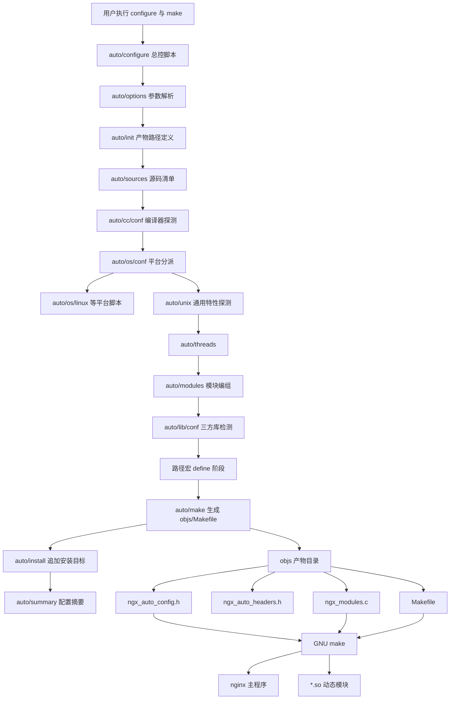
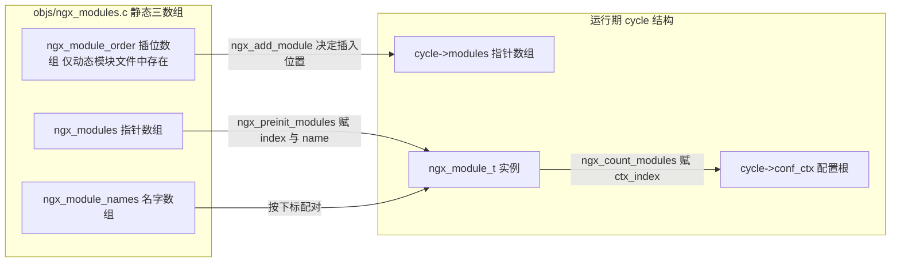
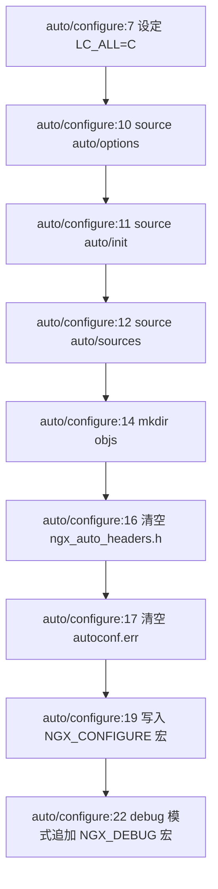
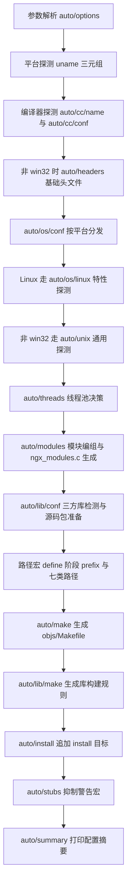
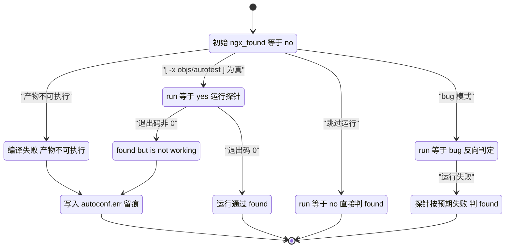
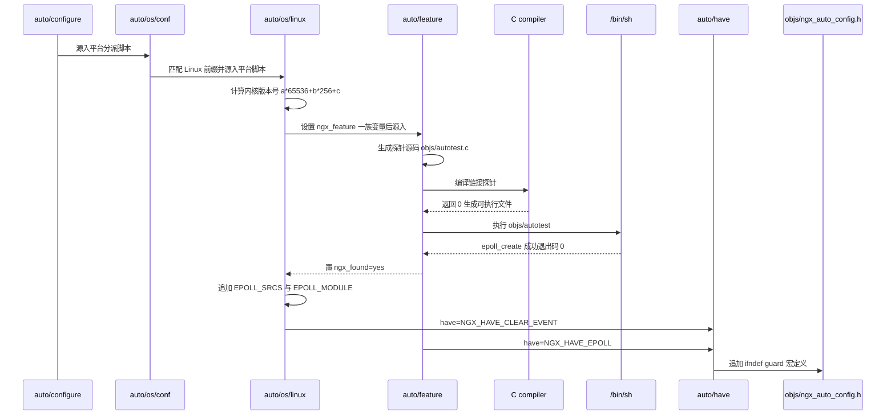

# 构建系统（configure/auto 脚本）（基于 nginx-1.27.0 源码）

> **导读**：读完本文你将掌握——nginx 为什么不用 autoconf/m4 而自研一套 POSIX shell 构建系统；`./configure` 从参数解析到生成 `objs/ngx_auto_config.h`、`objs/ngx_modules.c`、`objs/Makefile` 的完整数据流；`auto/feature` 这台"编译-运行"两段式特性测试引擎的每一个分支；`NGX_HAVE_EPOLL` 一个特性宏从探测、写入头文件、点亮 C 代码 `#if` 分支直到参与模块签名的完整生命周期；`auto/module` 对第三方模块的接入契约；静态模块与动态模块（`.so`、`--with-compat`）在构建产物上的差异；以及缺 devel 包、宏缺失、"module is not binary compatible" 等问题的源码级排查方法。
>
> **前置阅读建议**：先读《11-模块体系》了解 `ngx_module_t` 与 `ngx_modules[]` 在运行期的角色；再读《02-事件驱动框架》会对 epoll 探测一节更有体感。本文聚焦构建期，不展开运行期模块初始化的细节。
>
> **涉及源码清单**（本系列惯例：行号均来自 nginx-1.27.0 真实源码，已逐一读取核对）：
> - 主链路：`auto/configure`、`auto/options`、`auto/init`、`auto/sources`、`auto/cc/conf`、`auto/cc/name`、`auto/os/conf`、`auto/os/linux`、`auto/unix`、`auto/threads`、`auto/modules`、`auto/lib/conf`、`auto/make`、`auto/install`、`auto/summary`、`auto/stubs`
> - 宏与测试原语：`auto/feature`、`auto/have`、`auto/have_headers`、`auto/define`、`auto/nohave`、`auto/include`、`auto/headers`
> - 模块契约：`auto/module`
> - 消费侧 C 代码：`src/core/ngx_module.h`、`src/core/ngx_module.c`、`src/core/nginx.c`、`src/event/ngx_event.h`、`src/event/ngx_event.c`、`src/os/unix/ngx_linux_config.h`、`src/event/modules/ngx_epoll_module.c`

---

## 1. 本模块在 nginx 中的位置与职责

nginx 的"构建系统"不是一个独立的构建工具，而是源码树顶层的一组 **POSIX shell 脚本**（`auto/` 目录约 30 个文件），由唯一的入口 `auto/configure` 以 `.`（source）方式串联起来。它不做编译，只做三件事：

1. **探测**：用编译器实际编译并运行探针程序，确定平台、编译器、系统调用的可用性，把结论固化为 C 宏（写入 `objs/ngx_auto_config.h` / `objs/ngx_auto_headers.h`）；
2. **编组**：根据用户参数（`--with-http_ssl_module` 等）和探测结果，决定哪些模块、哪些源文件进入本次构建，生成模块数组文件 `objs/ngx_modules.c`；
3. **生成**：直接输出 `objs/Makefile`（以及根目录委托型 `Makefile`），真正的编译由 GNU make 执行。



**图解**：整个构建系统是一条单向数据流。左侧竖链是 `auto/configure` 按行序 source 的脚本序列（对应 `auto/configure:10-12` 与 `auto/configure:50-64`、`auto/configure:107-109` 的调用顺序），每个脚本只负责"往一堆全局 shell 变量里追加内容"；最后由 `auto/make` 把这些变量一次性渲染成 Makefile。产物层四个文件是构建系统与 C 代码世界的全部接口：两个头文件被每个 `.c` 经 `ngx_config.h` 间接包含，`ngx_modules.c` 被编译进主程序，Makefile 驱动编译。

与 CMake/Autoconf 的层级差异：nginx 没有中间表示（没有缓存文件、没有 `config.status`），**shell 变量即数据库，Makefile 即唯一的持久化结果**。这带来极强的可读性，也意味着修改任何 `--with` 参数都必须完整重跑 `./configure`。

---

## 2. 核心数据结构精讲

构建系统的"数据结构"分两层：**shell 层的约定变量**（auto 脚本之间的接口契约）与 **C 层的 `ngx_module_t`**（构建系统生成的数组在运行期的落点）。

### 2.1 产物路径变量（auto/init:6-13）

`auto/init` 在任何探测开始前固定六个产物路径，后续所有脚本通过它们读写：

| 变量 | 值 | 作用 |
|---|---|---|
| `NGX_MAKEFILE` | `objs/Makefile` | 自动生成的完整构建规则 |
| `NGX_MODULES_C` | `objs/ngx_modules.c` | 静态模块数组（auto/init:7） |
| `NGX_AUTO_HEADERS_H` | `objs/ngx_auto_headers.h` | "头文件存在性"宏（auto/init:9） |
| `NGX_AUTO_CONFIG_H` | `objs/ngx_auto_config.h` | "特性/路径"宏（auto/init:10） |
| `NGX_AUTOTEST` | `objs/autotest` | 特性测试探针的可执行名（auto/init:12） |
| `NGX_AUTOCONF_ERR` | `objs/autoconf.err` | 所有探测的过程日志（auto/init:13） |

其中 `objs/autotest` 是临时产物，每次探测后即被删除（`auto/feature:123` 的 `rm -rf $NGX_AUTOTEST*`），`objs/autoconf.err` 则永久保留，是排查编译问题的第一现场（见 §8.3）。

### 2.2 auto/module 的接口契约变量

`auto/module` 是第三方模块与构建系统之间**唯一的契约**：调用方（`auto/modules` 或模块自己的 `config` 脚本）先设置下列变量，再 `. auto/module`：

| 变量 | 必填 | 语义 |
|---|---|---|
| `ngx_module_type` | 是 | 模块类别：`CORE`/`HTTP`/`HTTP_FILTER`/`HTTP_INIT_FILTER`/`MAIL`/`STREAM`/`MISC`，决定追加进哪个 `*_MODULES` 组 |
| `ngx_module_name` | 是 | 模块符号名，可含多个（空格分隔），第一个用于动态模块命名（auto/module:14-19） |
| `ngx_module_incs` | 否 | 额外 include 目录 |
| `ngx_module_deps` | 否 | 额外依赖头文件，进入 Makefile 依赖列表 |
| `ngx_module_srcs` | 是 | 参与编译的源文件列表 |
| `ngx_module_libs` | 否 | 库开关关键字（`PCRE`/`OPENSSL`/`ZLIB`/`LIBXSLT`/`LIBGD`/`PERL`/`GEOIP`）或原样透传的链接参数 |
| `ngx_module_order` | 否 | filter 模块的运行期插位序列（仅动态模块使用，见 §6.10） |
| `ngx_module_link` | 是 | `YES`（静态编入）/`DYNAMIC`（编为 .so）/`ADDON`（--add-module 的静态外挂） |

### 2.3 ngx_module_t：构建产物的运行期落点

`objs/ngx_modules.c` 里每个 `&ngx_xxx_module` 指向一个 `ngx_module_t`（定义于 `src/core/ngx_module.h:227-262`）。构建系统虽然不生成这个结构体本身，但它的三个字段完全由构建产物决定：

| 字段 | 类型 | 由谁赋值 | 语义 |
|---|---|---|---|
| `ctx_index` | `ngx_uint_t` | `ngx_count_modules()`（src/core/ngx_module.c:82-153） | 同类模块中的序号，用于 `cycle->conf_ctx` 定位 |
| `index` | `ngx_uint_t` | `ngx_preinit_modules()`（src/core/ngx_module.c:30-31） | 全局模块数组下标 |
| `name` | `char *` | `ngx_preinit_modules()`（src/core/ngx_module.c:32） | 从 `ngx_module_names[]` 按下标取 |
| `version` | `ngx_uint_t` | 模块代码内 `NGX_MODULE_V1` 宏 | 必须等于主程序 `nginx_version` |
| `signature` | `const char *` | `NGX_MODULE_SIGNATURE` 宏拼接（src/core/ngx_module.h:205-217） | 34 位 `"0"/"1"` 串，编码全部特性宏 |
| `ctx` | `void *` | 各模块自己 | 类型上下文（如 `ngx_core_module_t`） |
| `commands` | `ngx_command_t *` | 各模块自己 | 指令表 |
| `type` | `ngx_uint_t` | 各模块自己 | `NGX_CORE_MODULE` 等，与 `ngx_module_type` 构建期取值呼应 |
| `init_master` ~ `exit_master` | 函数指针 | 各模块自己 | 八个生命周期钩子 |
| `spare_hook0..7` | `uintptr_t` | `NGX_MODULE_V1_PADDING`（src/core/ngx_module.h:224） | 预留 8 个钩子位，保持 ABI 槽位稳定 |

`signature` 是动态模块兼容性的核心：34 个 bit 中有相当一部分直接来自本文讨论的特性宏。例如 `src/core/ngx_module.h:56-60`：

```c
#if (NGX_HAVE_EPOLL)
#define NGX_MODULE_SIGNATURE_6   "1"
#else
#define NGX_MODULE_SIGNATURE_6   "0"
#endif
```

加载动态模块时，主程序把自己的 `NGX_MODULE_SIGNATURE` 与模块的逐字符比较，任何一个 bit 不同即拒绝加载（`src/core/ngx_module.c:177-182`）——这就是 `--with-compat` 存在的原因（§6.13）。

### 2.4 构建产物与运行期结构的关系



**图解**：静态构建时只有 `ngx_modules` 与 `ngx_module_names` 两个数组（`auto/modules:1506-1528`），`ngx_module_order` 仅出现在动态模块自己的 `objs/<模块名>_modules.c` 中（`auto/make:553-564`）。启动时 `ngx_preinit_modules()` 用下标把两个数组缝合；`load_module` 加载 .so 时再通过 `dlsym` 取出三个数组并走同样的缝合逻辑（`src/core/nginx.c:1620-1642`）。

---

## 3. 初始化流程

`auto/configure` 前 20 行完成"参数→环境→骨架"的初始化，然后才进入探测阶段。



**图解**：四个动作建立全局状态。第一，`LC_ALL=C`（`auto/configure:7-8`）保证 `uname`、`tr`、`sed` 等输出不受 locale 影响——探测脚本大量依赖文本匹配，这一行是隐性正确性保障。第二，`auto/options` 与 `auto/init`、`auto/sources` 的 source 顺序即"参数→骨架→源码清单"，三者都没有 `#!`，它们不是可执行脚本而是**代码片段**。第三，`mkdir -p $NGX_OBJS`（`auto/configure:14`）后立刻用 `echo >` 截断两个头文件（`auto/configure:16-17`），确保多次 configure 不残留旧宏。第四，`NGX_CONFIGURE` 宏把完整命令行烧进二进制，`nginx -V` 的输出来源于此。

`auto/init` 还有一段容易被忽略的兼容性探测——echo 的 `-n` 与 `\c` 能力（`auto/init:26-40`）：

```sh
if echo "test\c" | grep c >/dev/null; then

    if echo -n test | grep n >/dev/null; then
        ngx_n=
        ngx_c=

    else
        ngx_n=-n
        ngx_c=
    fi

else
    ngx_n=
    ngx_c='\c'
fi
```

结论写入 `ngx_n`/`ngx_c` 两个变量，此后所有 `echo $ngx_n "checking for ...$ngx_c"`（如 `auto/feature:6`）都能做到"不换行输出进度"。这是 1990 年代 shell 移植问题的活化石，也解释了为什么 configure 的输出中 `checking for xxx ...` 能追加在同一行。

最后 `auto/init:45-53` 在**源码根目录**生成一个极简的根 `Makefile`：

```sh
cat << END > Makefile

default:	build

clean:
	rm -rf Makefile $NGX_OBJS

.PHONY:	default clean
END
```

注意此时根 Makefile 的 `build` 目标**尚无规则**——它是空壳。真正的 `build` 规则要等到流程末尾由 `auto/install:199-205` 以追加方式补上：

```sh
cat << END >> Makefile

build:
	\$(MAKE) -f $NGX_MAKEFILE

install:
	\$(MAKE) -f $NGX_MAKEFILE install

modules:
	\$(MAKE) -f $NGX_MAKEFILE modules
```

也就是说，nginx 采用**两层 Makefile** 设计：根 Makefile 只做转发（`make -f objs/Makefile`），全部真实规则在 `objs/Makefile`。这样 `make clean` 只需删除 `objs` 与根 Makefile 自身（`auto/init:50`），源码目录恢复出厂状态；同时 `objs/Makefile` 可以整体重建而不碰根目录。

---

## 4. 核心执行流程/状态机

### 4.1 configure 全流程



**逐分支讲解**：

1. **平台分支**（`auto/configure:27-48`）：`NGX_PLATFORM` 未由 `--crossbuild` 指定时，`uname -s/-r/-m` 组成 `Linux:6.8.0:x86_64` 这样的三元组；`MINGW32_*|MINGW64_*|MSYS_*` 一律折叠为 `win32`（`auto/configure:38-42`），后续所有 `if [ "$NGX_PLATFORM" != win32 ]` 分支（`auto/configure:52`、`auto/configure:58`）据此跳过 POSIX 探测。
2. **编译器分支**：`auto/cc/conf:37` source `auto/cc/name`，后者用 feature 引擎先验证 `cc` 可用（不可用直接 `exit 1`，`auto/cc/name:17-22`），再靠 `$CC -v/-V` 输出文本识别 gcc/clang/icc/sunc 等 9 种编译器，分别加载对应的 CFLAGS 装配脚本（`auto/cc/conf:79-138`）。
3. **宏定义分支**（`auto/configure:66-79`）：`NGX_PREFIX` 有三种情形——为空则回落 `/usr/local/nginx`；等于 `!`（来自 `--prefix=` 空值，`auto/options:196`）则完全不定义 `NGX_PREFIX` 宏（编译期不固化前缀，运行期全靠 `-p` 参数）；否则 `have=NGX_PREFIX value="\"$NGX_PREFIX/\"" . auto/define` 写宏，**注意值末尾强制补了斜杠**。
4. **错误日志特例**（`auto/configure:91-93`）：`--error-log-path=stderr` 会在 `auto/options:627-628` 把路径清空，configure 据此定义 `NGX_ERROR_LOG_STDERR`，使 `ngx_error_log` 在无配置文件时也走 stderr。

### 4.2 单次特性测试的状态机

`auto/feature` 的执行过程可以精确建模为状态机——它是整台构建机器里唯一"有失败路径"的部件：



**图解**：四条出口对应四种 `ngx_feature_run` 语义（详见 §6.4）：`yes` 要求编译**且运行**都成功；`no`（默认）只看能否编译链接；`value` 在 `yes` 基础上把探针的 stdout 变成宏值；`bug` 反转判定——"程序按预期崩溃"才算特性存在（用于确认某平台 bug 在场，从而启用绕过代码）。所有失败路径统一汇聚到 `autoconf.err` 留痕分支，成功路径则通过 `auto/have` 系列脚本落盘为宏。`rm -rf $NGX_AUTOTEST*`（`auto/feature:123`）保证下一条探测从干净状态开始。

---

## 5. 关键时序图：NGX_HAVE_EPOLL 的诞生

以 Linux 平台最重要的一个特性宏 `NGX_HAVE_EPOLL` 为例，完整跟踪它从探测到落盘的每一跳：



**逐跳解读**：

1. `auto/os/conf:14-16` 按 `NGX_PLATFORM` 前缀 `Linux:*` 分派给 `auto/os/linux`；
2. `auto/os/linux:21-26` 先把 `uname -r` 换算成整数（如 `5.15.0` → `5*256*256+15*256+0`），供"内核小于某版本就不探测"的前置判断使用；
3. `auto/os/linux:37-50` 填好探测描述：

```sh
ngx_feature="epoll"
ngx_feature_name="NGX_HAVE_EPOLL"
ngx_feature_run=yes
ngx_feature_incs="#include <sys/epoll.h>"
ngx_feature_path=
ngx_feature_libs=
ngx_feature_test="int efd = 0;
                  struct epoll_event ee;
                  ee.events = EPOLLIN|EPOLLOUT|EPOLLET;
                  ee.data.ptr = NULL;
                  (void) ee;
                  efd = epoll_create(100);
                  if (efd == -1) return 1;"
. auto/feature
```

4. `auto/feature` 生成探针、编译、运行（`ngx_feature_run=yes` 要求真实执行）；
5. 探测成功后 `auto/os/linux:52-56` 一口气做四件事：`have=NGX_HAVE_CLEAR_EVENT . auto/have`（epoll 的边沿触发语义宏）、`CORE_SRCS="$CORE_SRCS $EPOLL_SRCS"`、`EVENT_MODULES="$EVENT_MODULES $EPOLL_MODULE"`、`EVENT_FOUND=YES`。其中 `EPOLL_MODULE=ngx_epoll_module`、`EPOLL_SRCS=src/event/modules/ngx_epoll_module.c` 定义于 `auto/sources:121-122`。

`EVENT_FOUND=YES` 是关键回写：`auto/modules:6-8` 只有在没有任何事件机制被发现时才兜底启用 select，`auto/modules:17-19` 对 poll 同理。也就是说，**探测脚本写回的布尔量决定了 auto/modules 的编组决策**，两层脚本通过这组全局变量通信。

---

## 6. 源码逐段精读

本章逐个剖析核心"函数"（shell 脚本无函数，以脚本/分支为单位），每段先给签名（变量出入）、再逐块讲逻辑、最后列易错点。

### 6.1 auto/configure——121 行的总控

**签名**：`#!/bin/sh`，无参数，依赖调用者 shell 传参（`for option` 在 auto/options 中遍历位置参数）。

**块 1：环境与骨架**（`auto/configure:7-19`）：

```sh
LC_ALL=C
export LC_ALL

. auto/options
. auto/init
. auto/sources

test -d $NGX_OBJS || mkdir -p $NGX_OBJS

echo > $NGX_AUTO_HEADERS_H
echo > $NGX_AUTOCONF_ERR

echo "#define NGX_CONFIGURE \"$NGX_CONFIGURE\"" > $NGX_AUTO_CONFIG_H
```

- `auto/options` 先跑：它必须最先执行，因为 `NGX_OBJS`（构建目录）由它定义（`auto/options:22`，可被 `--builddir` 覆盖，`auto/options:210`），后面所有脚本都要写 `$NGX_OBJS`。
- `echo > $NGX_AUTO_CONFIG_H` 用 `>` 截断写第一行，此后所有宏脚本一律用 `>>` 追加——**截断与追加的分工**保证了文件按 configure 执行序组织。
- `NGX_CONFIGURE` 的值来自 `auto/options:186` 的累积：每解析一个参数就把引号规整后的原文追加进 `$opt`，`auto/options:423` 终结为 `NGX_CONFIGURE="$opt"`。

**块 2：调试与平台**（`auto/configure:22-48`）：

```sh
if [ $NGX_DEBUG = YES ]; then
    have=NGX_DEBUG . auto/have
fi


if test -z "$NGX_PLATFORM"; then
    echo "checking for OS"

    NGX_SYSTEM=`uname -s 2>/dev/null`
    NGX_RELEASE=`uname -r 2>/dev/null`
    NGX_MACHINE=`uname -m 2>/dev/null`

    echo " + $NGX_SYSTEM $NGX_RELEASE $NGX_MACHINE"

    NGX_PLATFORM="$NGX_SYSTEM:$NGX_RELEASE:$NGX_MACHINE";

    case "$NGX_SYSTEM" in
        MINGW32_* | MINGW64_* | MSYS_*)
            NGX_PLATFORM=win32
        ;;
    esac
```

`NGX_DEBUG → NGX_DEBUG` 宏是 `--with-debug` 的全部产物；C 代码里 `NGX_LOG_DEBUG_HTTP` 等调试日志分支全部由它门控。交叉编译时（`--crossbuild=Linux:x86_64` 等）跳过 uname，`NGX_MACHINE` 强制 `i386`（`auto/configure:47`），这只影响缓存行取值等保守默认。

**块 3：探测主链**（`auto/configure:50-64`）：`. auto/cc/conf` → `. auto/headers`（仅非 win32）→ `. auto/os/conf` → `. auto/unix`（仅非 win32）→ `. auto/threads` → `. auto/modules` → `. auto/lib/conf`。顺序不可交换：`auto/unix` 的探测结论（如 `EVENT_FOUND`）是 `auto/modules` 编组的输入；`auto/modules` 里各模块对 `USE_PCRE/USE_OPENSSL` 的置位又是 `auto/lib/conf` 的输入。

**块 4：路径宏与收尾**（`auto/configure:85-105`、`auto/configure:107-121`）：`NGX_SBIN_PATH`、`NGX_CONF_PATH`、`NGX_PID_PATH`、`NGX_LOCK_PATH`、`NGX_ERROR_LOG_PATH`、`NGX_HTTP_LOG_PATH` 及五个 temp 路径逐一 `have=... value="\"...\"" . auto/define`。每个值都被手工包上一层 C 字符串引号——`auto/define` 不做任何转义，调用方负责。最后 `. auto/make`、`. auto/lib/make`、`. auto/install`、`. auto/stubs`、`. auto/summary` 依次收尾。

**易错点**：`auto/configure:96-97` 这类跨行写法 `have=... value="..."` 换行后再 `. auto/define`，意味着 `value` 里的引号层数极敏感；给带空格的路径赋值必须由调用者引号包裹，模块作者照抄时经常漏掉导致 Makefile 语法错误。

### 6.2 auto/options——650 行的参数解析器

**签名**：遍历所有位置参数 `for option`，把每个参数映射为一个全局布尔/字符串变量。

**块 1：值提取**（`auto/options:184-191`）：

```sh
for option
do
    opt="$opt `echo $option | sed -e \"s/\(--[^=]*=\)\(.* .*\)/\1'\2'/\"`"

    case "$option" in
        -*=*) value=`echo "$option" | sed -e 's/[-_a-zA-Z0-9]*=//'` ;;
           *) value="" ;;
    esac
```

第一个 sed 只处理"值中含空格"的参数：把 `--prefix=/opt/my nginx` 变形为 `--prefix='/opt/my nginx'` 存进 `$opt`，这就是 `nginx -V` 能原样回显含空格参数的原因。第二个 sed 从参数名里剥出 `value`：模式 `[-_a-zA-Z0-9]*=` 贪婪匹配到最后一个 `=` 之前。

**块 2：三态值设计**。模块开关不是简单布尔，而是 `NO / YES / DYNAMIC / NONE` 四值：`--with-http_xslt_module` → `HTTP_XSLT=YES`，`--with-http_xslt_module=dynamic` → `HTTP_XSLT=DYNAMIC`（`auto/options:243-244`）；`--without-http_gzip_module` → `HTTP_GZIP=NO`（`auto/options:264`）。`NONE` 用于"平台缺库也强制不用"（如 `EVENT_SELECT=NONE`，`auto/options:213`），`auto/modules:6-8` 的兜底逻辑 `if [ $EVENT_SELECT = NO -a $EVENT_FOUND = NO ]` 不会被 `NONE` 触发，实现"用户显式禁止"与"仅作备胎"的区分。

**块 3：外挂模块与兼容开关**（`auto/options:355-358`）：

```sh
        --add-module=*)                  NGX_ADDONS="$NGX_ADDONS $value" ;;
        --add-dynamic-module=*)          DYNAMIC_ADDONS="$DYNAMIC_ADDONS $value" ;;

        --with-compat)                   NGX_COMPAT=YES             ;;
```

两个变量都是**列表**（可多次出现、空格分隔），`--with-compat` 只是置一个布尔，真正的宏级效果发生在 `auto/modules:1479-1488`（见 §6.9）。

**块 4：未知参数零容忍**（`auto/options:415-418`）：`*)` 分支直接 `echo error; exit 1`。这与 GNU 风格的"忽略未知选项"相反——nginx 的哲学是拼错参数必须立刻失败，否则静默漏编模块。

**块 5：默认值回填**（`auto/options:620-638`）：所有路径用 `${VAR:-default}` 补默认值；`NGX_CONF_PREFIX` 由 `dirname $NGX_CONF_PATH` 派生（`auto/options:623`）——这就是为什么 `--conf-path=/etc/nginx/nginx.conf` 会连带确定配置前缀。

**易错点**：`--with-ipv6`（`auto/options:223-226`）不再设置任何变量，只往 `NGX_POST_CONF_MSG` 追加警告文本，该消息在 `auto/summary:82` 打印； deprecated 选项统一走这条"警告通道"而非报错。

### 6.3 auto/feature——特性测试引擎（全文 123 行逐段）

这是构建系统的 CPU，等价于 autoconf 的 `AC_TRY_COMPILE/AC_TRY_RUN` 合体，但更直白：**真编译、真运行、真取值**。

**签名**：输入 `ngx_feature`（人读名）、`ngx_feature_name`（宏名，可空）、`ngx_feature_run`（`yes/no/value/bug`）、`ngx_feature_incs`（测试代码 include 区）、`ngx_feature_path`（额外 -I）、`ngx_feature_libs`（额外 -l）、`ngx_feature_test`（测试语句）；输出 `ngx_found=yes/no`，副作用为写宏。

**块 1：宏名大写化与探测日志**（`auto/feature:15-20`）：

```sh
ngx_found=no

if test -n "$ngx_feature_name"; then
    ngx_have_feature=`echo $ngx_feature_name \
                   | tr abcdefghijklmnopqrstuvwxyz ABCDEFGHIJKLMNOPQRSTUVWXYZ`
fi
```

`ngx_have_feature` 是大写副本，`auto/have` 的 `have=` 参数接的就是它。name 允许小写传入，`tr` 统一规整——一个防御性细节。

**块 2：生成探针**（`auto/feature:28-39`）：

```sh
cat << END > $NGX_AUTOTEST.c

#include <sys/types.h>
$NGX_INCLUDE_UNISTD_H
$ngx_feature_incs

int main(void) {
    $ngx_feature_test;
    return 0;
}

END
```

模板把 `$ngx_feature_incs` 与 `$ngx_feature_test` 原样内插。探针默认附带 `<sys/types.h>` 与（条件展开的）`unistd.h`——`$NGX_INCLUDE_UNISTD_H` 变量由 `auto/headers:6` 探测到 unistd.h 后在 `auto/include:46` 以 `eval "NGX_INCLUDE_$ngx_name='#include <$ngx_include>'"` 方式注入。

**块 3：编译与执行**（`auto/feature:42-47`）：

```sh
ngx_test="$CC $CC_TEST_FLAGS $CC_AUX_FLAGS $ngx_feature_inc_path \
          -o $NGX_AUTOTEST $NGX_AUTOTEST.c $NGX_TEST_LD_OPT $ngx_feature_libs"

ngx_feature_inc_path=

eval "/bin/sh -c \"$ngx_test\" >> $NGX_AUTOCONF_ERR 2>&1"
```

三个值得注意的点：其一，`CC_TEST_FLAGS`/`CC_AUX_FLAGS` 携带了用户 `--with-cc-opt` 与平台必需宏（Linux 上是 `-D_GNU_SOURCE -D_FILE_OFFSET_BITS=64`，`auto/os/linux:16`），所以探测结论与真实编译环境一致；其二，`$NGX_TEST_LD_OPT` 把 `--with-ld-opt` 也纳入探测（`auto/cc/conf:145`），链接期问题在 configure 阶段就暴露；其三，`eval`+`/bin/sh -c` 双层执行并把 stdout/stderr 全部重定向进 `autoconf.err`。

**块 4：结果判定**（`auto/feature:50-67`）：

```sh
if [ -x $NGX_AUTOTEST ]; then

    case "$ngx_feature_run" in

        yes)
            # /bin/sh is used to intercept "Killed" or "Abort trap" messages
            if /bin/sh -c $NGX_AUTOTEST >> $NGX_AUTOCONF_ERR 2>&1; then
                echo " found"
                ngx_found=yes

                if test -n "$ngx_feature_name"; then
                    have=$ngx_have_feature . auto/have
                fi

            else
                echo " found but is not working"
            fi
        ;;
```

`-x` 判可执行，比"编译命令返回 0"更可靠（拦截某些驱动/包装脚本的假成功）。`yes` 分支里探针**必须以 0 退出**才算 found；"found but is not working" 是一种明确的中间态——头文件在、符号在，但运行即崩（典型如 glibc 与内核不匹配的 sendfile）。

**块 5：value 分支**（`auto/feature:69-85`）：

```sh
        value)
            # /bin/sh is used to intercept "Killed" or "Abort trap" messages
            if /bin/sh -c $NGX_AUTOTEST >> $NGX_AUTOCONF_ERR 2>&1; then
                echo " found"
                ngx_found=yes

                cat << END >> $NGX_AUTO_CONFIG_H

#ifndef $ngx_feature_name
#define $ngx_feature_name  `$NGX_AUTOTEST`
#endif

END
```

反引号执行探针，把**运行期输出**变成宏值。典型用户：探测页大小/缓存行/数据类型尺寸的脚本。`#ifndef` 包裹意味着外层脚本可以预先 `auto/define` 一个值抢占，探测结果仅作兜底。

**块 6：bug 分支与默认分支**（`auto/feature:87-109`）：`bug` 分支中"运行失败"才 `ngx_found=yes`——用于检测平台 bug 是否在场（例如某些内核的缺陷行为），是 nginx"防御性构建"的体现；默认分支（`*`，即 `run=no`）只要编译链接通过就算 found，绝大多数接口探测走这条路。

**块 7：失败留痕**（`auto/feature:113-123`）：

```sh
else
    echo " not found"

    echo "----------"    >> $NGX_AUTOCONF_ERR
    cat $NGX_AUTOTEST.c  >> $NGX_AUTOCONF_ERR
    echo "----------"    >> $NGX_AUTOCONF_ERR
    echo $ngx_test       >> $NGX_AUTOCONF_ERR
    echo "----------"    >> $NGX_AUTOCONF_ERR
fi

rm -rf $NGX_AUTOTEST*
```

失败的探测把**完整测试源码 + 完整编译命令**追加进 `autoconf.err`，加上块 3 已重定向的编译错误输出，一条探测在日志中留下四段式记录（分隔线、源码、命令、编译器报错）。排查"为什么我的系统没启用某特性"时，直接 `grep -A20 'checking for epoll' objs/autoconf.err` 即可。最后无条件清理探针（注意 `$NGX_AUTOTEST*` 通配会同时删掉 `.c` 与可执行文件）。

### 6.4 宏写入器家族：have/have_headers/define/nohave

四个脚本都只有十几行，却构成宏系统的全部 API：

`auto/have:6-12`（值为 1）：

```sh
cat << END >> $NGX_AUTO_CONFIG_H

#ifndef $have
#define $have  1
#endif

END
```

- `auto/have`：定义宏为 `1`（特性存在）；
- `auto/nohave`：定义宏为 `0`（`auto/nohave:9`）——显式写 0 而非不定义，配合 `#if (NGX_FOO)` 语义（未定义与 0 同为假）效果一致，但便于 `grep` 审计；
- `auto/define`：`#define $have  $value`（`auto/define:9`），值原样内插，用于路径宏（调用方已加引号）与数值宏（如 `NGX_CPU_CACHE_LINE`，`auto/os/conf:144`）；
- `auto/have_headers`：唯一写到 `$NGX_AUTO_HEADERS_H` 的脚本（`auto/have_headers:6`），专放"头文件存在"类宏（如 `NGX_LINUX`，`auto/os/linux:6`）。

`auto/include` 则是头文件探测的复合体（`auto/include:18-46`）：生成"只 include 一个头"的探针编译之，成功后同时做两件事——`have=NGX_HAVE_$ngx_name . auto/have_headers` 写入头宏，并把 `NGX_INCLUDE_$ngx_name='#include <...>'` 存进环境（`auto/include:46`），后者供 `auto/feature` 模板与 C 代码条件引用。`auto/headers:6-13` 用它探测 unistd.h、inttypes.h、limits.h 等 8 个基础头。

**易错点**：所有宏都是 `#ifndef` 卫兵。若同一宏被探测两次（例如 `auto/os/linux:53` 的 `NGX_HAVE_CLEAR_EVENT` 与 kqueue 路径的 `auto/unix:83`），后写者因 `#ifndef` 而失效——**先到先得**，这要求脚本调用顺序正确。

### 6.5 auto/cc/name + auto/cc/conf——编译器探测与 CFLAGS 装配

`auto/cc/name:6-24` 复用 feature 引擎做最基本的事：验证 `$CC` 能产出可执行文件，失败即报 `C compiler $CC is not found` 并退出。识别逻辑是文本匹配链（`auto/cc/name:27-70`）：`cl`→msvc、`wcl386`→owc、`bcc32`→bcc、`$CC -V` 输出含 `Intel(R) C`→icc、含 `gcc version`→gcc、含 `clang version` 或 `LLVM version`→clang……**顺序敏感**：clang 也可能报 gcc 兼容信息，所以 gcc 的判断在前。

`auto/cc/conf:6-18` 先固化与编译器无关的默认：

```sh
LINK="\$(CC)"

MAIN_LINK=
MODULE_LINK="-shared"

ngx_include_opt="-I "
ngx_compile_opt="-c"
ngx_pic_opt="-fPIC"
ngx_objout="-o "
ngx_binout="-o "
ngx_objext="o"
ngx_binext=
ngx_modext=".so"
```

这一段就是"链接顺序与产物形态"的种子：`LINK=$(CC)`——nginx 不直接调 ld，而是让编译器驱动链接；`MODULE_LINK="-shared"` 与 `ngx_modext=".so"`、`ngx_pic_opt="-fPIC"` 三者共同定义动态模块的产物形态（suncc 下改为 `-G`，`auto/cc/conf:51-54`）。`ngx_regex_cont`/`ngx_cont`/`ngx_tab`（`auto/cc/conf:26-31`）是 Makefile 续行符与制表符模板，后续 `auto/make` 拼多行依赖列表时靠它们生成合法的 `\` 换行。

CFLAGS 装配分两条路（`auto/cc/conf:39-78`）：用户显式给了 `CFLAGS` 则只做少量适配（如 ccc 的 `-I` 无空格、sunc 的 `MAIN_LINK` 清空与 `NGX_AUX` 选择）；否则按 `NGX_CC_NAME` 分发到 `auto/cc/gcc` 等专属脚本。以 gcc 为例，`auto/cc/gcc:141-143` 追加 `${NGX_GCC_OPT:--O} -W` 与 `-Wall -Wpointer-arith`，`auto/cc/gcc:169-172` 追加 `-Werror -g`——**默认构建是 -O + 全警告 + 告警即错 + -g**，这就是 nginx 官方二进制带符号的原因。

随后（`auto/cc/conf:144-145`）：

```sh
CFLAGS="$CFLAGS $NGX_CC_OPT"
NGX_TEST_LD_OPT="$NGX_LD_OPT"
```

`--with-cc-opt` 在**所有编译器探测之前**并入 CFLAGS，保证后续每个探针都带着用户自定义选项编译——若用户传了不兼容选项，第一个探测就会失败并打印其命令行。`--with-ld-opt` 则先被 feature 引擎验收（`auto/cc/conf:147-164`）：构造一条空测试，让链接器带着该选项走一遍，失败即 `exit 1`，把"坏 ld-opt"拦在 configure 而不是 make 阶段。

编译器能力探测（`auto/cc/conf:167-198`）：`-Wl,-E` 支持则 `MAIN_LINK="-Wl,-E"`（`auto/cc/conf:176-178`，让主程序导出符号表供动态模块解析 `ngx_modules` 等符号引用）；`__sync_bool_compare_and_swap` 等内建原子（`auto/cc/conf:184-198`，`run=yes` 真跑一遍 CAS+fetch_add）、C99/GCC 变参宏（`auto/cc/conf:205-229`）、`__builtin_bswap64`（`auto/cc/conf:232-239`）逐一落宏。这些宏直接决定 `src/core/ngx_atomic.h`、`ngx_string.c` 等走哪条实现路径。

### 6.6 auto/os/conf——平台分派与机器属性

```sh
case "$NGX_PLATFORM" in

    FreeBSD:*)
        . auto/os/freebsd
    ;;

    Linux:*)
        . auto/os/linux
    ;;

    SunOS:*)
        . auto/os/solaris
    ;;

    Darwin:*)
        . auto/os/darwin
    ;;

    win32)
        . auto/os/win32
    ;;
```

（`auto/os/conf:8-28`，节选）

未列出的平台（DragonFly/NetBSD/HP-UX/OSF1/GNU Hurd）在 `auto/os/conf:30-78` 内联处理，兜底 `*` 分支退化为纯 POSIX 集合（`auto/os/conf:80-84`）。平台脚本的标准动作是三件套：`have=NGX_XXX . auto/have_headers`（平台标识宏）、组装 `CORE_INCS/CORE_DEPS/CORE_SRCS`（如 `auto/os/linux:8-10`）、开始特性探测。

机器维度独立处理（`auto/os/conf:89-138`）：x86/amd64 定义 `NGX_HAVE_NONALIGNED`（允许非对齐访问，影响 `ngx_memcpy` 等快速路径）；sparc/ia64/aarch64 等定义 `NGX_ALIGNMENT=16`（`auto/os/conf:101-126`）；同时给出 `NGX_MACH_CACHE_LINE`（i386=32、x86_64=64、ppc64=128、s390x=256），未被 `--with-cpu-opt` 覆盖时经 `auto/os/conf:140-144` 固化为 `NGX_CPU_CACHE_LINE` 宏。这两个数值直接影响 slab 分配器的内存布局（见本系列《06-slab与共享内存锁》）。

### 6.7 auto/os/linux——epoll 一族与内核版本门槛

Linux 脚本的模式是"版本门槛 + 探测"双保险。先算版本（`auto/os/linux:21-26`）：

```sh
version=$((`uname -r \
    | sed -n -e 's/^\([0-9][0-9]*\)\.\([0-9][0-9]*\)\.\([0-9][0-9]*\).*/ \
                                                 \1*256*256+\2*256+\3/p' \
             -e 's/^\([0-9][0-9]*\)\.\([0-9][0-9]*\).*/\1*256*256+\2*256/p'`))

version=${version:-0}
```

两个 sed 表达式分别处理三段式与两段式版本号；解析失败回落 0。随后 `auto/os/linux:31-33`：内核小于 2.5.60（132412）就 `have=NGX_HAVE_POSIX_FADVISE . auto/nohave`——**用 nohave 显式否定**而不是跳过，保证宏一定有定义。

epoll 主探测的完整链路已在 §5 时序图给出。其子探测采用**级联**结构：EPOLLRDHUP（Linux 2.6.17/glibc 2.8，`auto/os/linux:59-72`）与 EPOLLEXCLUSIVE（Linux 4.5/glibc 2.24，`auto/os/linux:75-88`）只在 epoll 探测成功的 `if [ $ngx_found = yes ]` 块内测试，`run=no` 只验编译；eventfd 探测失败还有 syscall 号兜底（`auto/os/linux:107-113` 测试 `(void) SYS_eventfd`），成功则补 `NGX_HAVE_SYS_EVENTFD_H` 头宏（`auto/os/linux:102-104`）。

sendfile 的探测是 `run=yes` 的代表（`auto/os/linux:135-151`）：

```sh
CC_AUX_FLAGS="$cc_aux_flags -D_GNU_SOURCE"
ngx_feature="sendfile()"
ngx_feature_name="NGX_HAVE_SENDFILE"
ngx_feature_run=yes
ngx_feature_incs="#include <sys/sendfile.h>
                  #include <errno.h>"
ngx_feature_test="int s = 0, fd = 1;
                  ssize_t n; off_t off = 0;
                  n = sendfile(s, fd, &off, 1);
                  if (n == -1 && errno == ENOSYS) return 1"
. auto/feature

if [ $ngx_found = yes ]; then
    CORE_SRCS="$CORE_SRCS $LINUX_SENDFILE_SRCS"
fi
```

注意测试代码的语义：`sendfile(0,1,...)` 必然失败，但只要 errno 不是 ENOSYS（系统调用不存在）就认定支持——探测的是"符号可用且不被内核 ENOSYS 拒绝"，而不是"能成功传输"。成功后 `LINUX_SENDFILE_SRCS` 才加入编译清单，这就是"探测结果驱动源码选择"的典型。

BPF 一族展示探测的联动效应（`auto/os/linux:241-263`）：`NGX_HAVE_BPF` 探测成功不仅加源码 `src/core/ngx_bpf.c`，还把 `QUIC_BPF` 置 YES（`auto/os/linux:260-262`），后者在 `auto/modules:1362-1376` 决定是否编入 `ngx_quic_bpf_module`。SO_COOKIE 探测（`auto/os/linux:266-280`）写回 `SO_COOKIE_FOUND=YES`，与 `QUIC_BPF` 共同构成 QUIC 透传功能的启用条件（`auto/modules:1362`）。

### 6.8 auto/modules——模块编组与 ngx_modules.c 生成（1530 行，构建系统的"装配车间"）

**块 1：事件机制兜底**（`auto/modules:6-25`）：select/poll 各有一条 `EVENT_x = NO -a $EVENT_FOUND = NO` 才启用的逻辑——平台脚本（如 `auto/os/linux:56`）已把 epoll/kqueue 写进 `EVENT_FOUND`，所以 Linux 上 select/poll 默认不编；只有什么都没找到时才兜底 select，再兜底 poll。被选中的机制同时 `have=NGX_HAVE_SELECT`（`auto/modules:11`）并把 `$SELECT_MODULE` 追加进 `EVENT_MODULES`。

**块 2：HTTP 核心四模块**（`auto/modules:64-96`）：

```sh
    ngx_module_type=HTTP

    if :; then
        ngx_module_name="ngx_http_module \
                         ngx_http_core_module \
                         ngx_http_log_module \
                         ngx_http_upstream_module"
        ngx_module_incs="src/http src/http/modules"
        ...
        ngx_module_libs=
        ngx_module_link=YES

        . auto/module
    fi
```

`if :; then ... fi` 是恒真块，仅为了与后面的条件块排版对齐。一次调用注册四个模块——`auto/module` 的 YES 分支（`auto/module:96-97`）会把 `$ngx_module_name` 整串追加进 `HTTP_MODULES`，`ngx_modules[]` 数组里它们保持这个书写顺序，这正是运行期 `ngx_http_block` 按 `ngx_modules` 顺序扫描的依据。

**块 3：filter 顺序表**（`auto/modules:110-143` 的注释与 `auto/modules:145-176` 的 `ngx_module_order`）。这是整个文件最重要的数据：

```sh
    # the module order is important
    #     ngx_http_static_module
    #     ngx_http_gzip_static_module
    #     ngx_http_dav_module
    #     ngx_http_autoindex_module
    #     ngx_http_index_module
    #     ngx_http_random_index_module
    ...
    #     ngx_http_write_filter
    #     ngx_http_header_filter
    #     ngx_http_chunked_filter
    ...
    #     ngx_http_not_modified_filter
    #     ngx_http_slice_filter
```

HTTP 内容处理阶段（`ngx_http_static/gzip_static/dav/autoindex/index/random_index`）与输出过滤链（write→header→chunked→…→not_modified→slice）都依赖**模块在数组中的相对位置**：内容 handler 按数组序执行到第一个产出响应者为止；过滤链则在 `ngx_http_top_body_filter` 上按"数组中越靠前、越晚被串入"的方式形成调用序。`ngx_module_order` 变量就是这份顺序表的机器可读版，它只在动态模块场景被写进 `<mod>_modules.c` 的 `ngx_module_order[]`（见块 7）。

**块 4：HTTP_INIT_FILTER 分组**（`auto/modules:374-375`）：copy_filter、range_body_filter、not_modified_filter、slice_filter 被放进独立分组 `HTTP_INIT_FILTER_MODULES`，`auto/modules:1403-1405` 拼装时它们排在 HTTP_FILTER 之后——分组本身就是排序机制。

**块 5：模块对库的"拉取"**。每个模块块在被 source 前先 `have=` 自己需要的特性并置库开关：gzip filter（`auto/modules:244-247`）`have=NGX_HTTP_GZIP` 且 `USE_ZLIB=YES`；rewrite（`auto/modules:700-702`）置 `USE_PCRE=YES`；ssl（`auto/modules:713-715`）置 `USE_OPENSSL=YES`；v3（`auto/modules:441-443`）连坐 `USE_OPENSSL_QUIC=YES` 与 `HTTP_SSL=YES`。到 `auto/lib/conf:24-30` 时这些 USE 变量决定加载哪些库的检测脚本。依赖倒置：**模块声明需求，lib/conf 统一供货**。`auto/lib/conf:10-19` 还有一处硬校验——rewrite 启用而 PCRE 被显式禁用时直接报错退出。

**块 6：MAIL/STREAM 的动态打包**（`auto/modules:1411-1448`）：`--with-mail=dynamic` 时 `MAIL=DYNAMIC`，`auto/modules:1417-1424` 把**编组过程中已拼好的** `$MAIL_MODULES/$MAIL_SRCS` 重新作为输入调用一次 `auto/module`（link=DYNAMIC），整组模块被打包成单个 `ngx_mail_module.so`。stream 同理（`auto/modules:1436-1444`）。这意味着动态 mail 模块内部包含 pop3/imap/smtp 全部子模块，运行期 `load_module ngx_mail_module.so` 一次加载一组。

**块 7：外挂模块调度**（`auto/modules:1248-1275` 静态、`auto/modules:1278-1305` 动态）：

```sh
if test -n "$NGX_ADDONS"; then

    echo configuring additional modules

    for ngx_addon_dir in $NGX_ADDONS
    do
        echo "adding module in $ngx_addon_dir"

        ngx_module_type=
        ngx_module_name=
        ngx_module_incs=
        ngx_module_deps=
        ngx_module_srcs=
        ngx_module_libs=
        ngx_module_order=
        ngx_module_link=ADDON
```

关键设计：调度器先**清空全部契约变量**再设 `ngx_module_link=ADDON`（静态）或 `DYNAMIC`（`auto/modules:1293`），然后 source 模块目录下的 `config` 脚本。找不到 config 直接 `exit 1`（`auto/modules:1271-1272`）。清空动作防止上一个 addon 的残留值泄漏进下一个——多个 `--add-module` 串联时的隔离保障。`ngx_module_link` 预设意味着新式 config 脚本**不需要**自己判断静态/动态（详见 §8.4）。

**块 8：`modules` 总表拼装**（`auto/modules:1394-1408`）：

```sh
modules="$CORE_MODULES $EVENT_MODULES"


# thread pool module should be initialized after events
if [ $USE_THREADS = YES ]; then
    modules="$modules $THREAD_POOL_MODULE"
fi


if [ $HTTP = YES ]; then
    modules="$modules $HTTP_MODULES $HTTP_FILTER_MODULES \
             $HTTP_AUX_FILTER_MODULES $HTTP_INIT_FILTER_MODULES"
```

顺序即注释所言：核心 → 事件 → 线程池（必须晚于事件）→ HTTP 四组 → MAIL → STREAM → MISC。`ngx_modules[]` 数组的最终顺序由此决定，运行期所有按数组序的遍历（配置解析、阶段 handler、过滤链）都继承这个顺序。

**块 9：--with-compat 的宏面**（`auto/modules:1479-1488`）：

```sh
if [ $NGX_COMPAT = YES ]; then
    have=NGX_COMPAT . auto/have
    have=NGX_HTTP_GZIP . auto/have
    have=NGX_HTTP_DAV . auto/have
    have=NGX_HTTP_REALIP . auto/have
    have=NGX_HTTP_X_FORWARDED_FOR . auto/have
    have=NGX_HTTP_HEADERS . auto/have
    have=NGX_HTTP_UPSTREAM_ZONE . auto/have
    have=NGX_STREAM_UPSTREAM_ZONE . auto/have
fi
```

`--with-compat` 做的事是：无论对应模块是否编入，把这一串"影响 ngx_module_t 字段与 signature 的宏"全部置 1。对照 `src/core/ngx_module.h:135-139`（`NGX_THREADS || NGX_COMPAT` 决定 signature_22）与 `src/core/ngx_module.h:147-151`（`NGX_HTTP_SSL || NGX_COMPAT` 决定 signature_24），它的效果是**抹平特性宏差异，让同一份 .so 能加载到不同配置的主程序上**——代价是主程序必须为这些字段保留槽位（`ngx_module_t` 尾部 8 个 spare_hook，`src/core/ngx_module.h:254-261`）。

**块 10：ngx_modules.c 生成**（`auto/modules:1491-1530`）：

```sh
cat << END                                    > $NGX_MODULES_C

#include <ngx_config.h>
#include <ngx_core.h>

$NGX_PRAGMA

END

for mod in $modules
do
    echo "extern ngx_module_t  $mod;"         >> $NGX_MODULES_C
done

echo                                          >> $NGX_MODULES_C
echo 'ngx_module_t *ngx_modules[] = {'        >> $NGX_MODULES_C

for mod in $modules
do
    echo "    &$mod,"                         >> $NGX_MODULES_C
done
```

三段式：先 `>` 截断写文件头，随后为每个模块追加 `extern ngx_module_t ngx_xxx_module;` 声明（`auto/modules:1500-1503`），再生成 `ngx_modules[]` 数组体（`auto/modules:1505-1517`，以 `NULL` 结尾），最后生成 `ngx_module_names[]` 字符串数组（`auto/modules:1519-1528`）。注意静态版本**没有** `ngx_module_order[]`——静态顺序已由书写顺序定死，order 数组是动态模块专属（`auto/make:553-564`）。

### 6.9 auto/module——三种 link 模式的分支机（178 行）

**签名**：读取 §2.2 契约变量，按 `ngx_module_link` 三分支把信息"记账"到不同的全局集合。

**分支一：DYNAMIC**（`auto/module:12-31`）：

```sh
if [ "$ngx_module_link" = DYNAMIC ]; then

    for ngx_module in $ngx_module_name; do
        # extract the first name
        break
    done

    DYNAMIC_MODULES="$DYNAMIC_MODULES $ngx_module"

    eval ${ngx_module}_MODULES=\"$ngx_module_name\"

    if [ -z "$ngx_module_order" -a \
         \( "$ngx_module_type" = "HTTP_FILTER" \
         -o "$ngx_module_type" = "HTTP_AUX_FILTER" \) ]
    then
        eval ${ngx_module}_ORDER=\"$ngx_module_name \
                                   ngx_http_copy_filter_module\"
    else
        eval ${ngx_module}_ORDER=\"$ngx_module_order\"
    fi
```

三个精妙点：其一，`for ... break` 取列表首元素作为 .so 的命名模块（`objs/ngx_http_foo_module.so` 由此而来）；其二，`eval ${ngx_module}_MODULES=...` 利用 shell 间接展开，把**模块名**变成变量名前缀（`ngx_http_ssl_module_MODULES=...`），每个动态模块拥有独立命名空间，`auto/make` 再用同样的 eval 取回（`auto/make:505-510`）；其三，HTTP_FILTER/HTTP_AUX_FILTER 类型的动态模块若无显式 order，默认插位为"自己 + ngx_http_copy_filter_module"——copy_filter 是过滤链尾部的固定锚点，运行期 `ngx_add_module` 会把动态 filter 插在它之前（`src/core/ngx_module.c:213-241`），这是第三方 filter 能参与过滤链的全部秘密。

**DYNAMIC 分支的源码去重**（`auto/module:33-55`）：双重循环比对新旧 `$DYNAMIC_MODULES_SRCS`，已编过的源不重复编译而是记入 `${ngx_module}_SHRD`。场景：两个动态模块都依赖 `src/event/ngx_event_openssl.c` 这类共享源。`auto/make:506` 与 `auto/make:572` 把 SHRD 源也编进每个 .so（各带一份副本，避免符号缺失）。

**DYNAMIC 分支的 libs 语义**（`auto/module:65-92`）：

```sh
    libs=
    for lib in $ngx_module_libs
    do
        case $lib in

            LIBXSLT | LIBGD | GEOIP | PERL)
                libs="$libs \$NGX_LIB_$lib"

                if eval [ "\$USE_${lib}" = NO ] ; then
                    eval USE_${lib}=DYNAMIC
                fi
            ;;

            PCRE | OPENSSL | ZLIB)
                eval USE_${lib}=YES
            ;;

            MD5 | SHA1)
                # obsolete
            ;;

            *)
                libs="$libs $lib"
            ;;

        esac
    done
```

库关键字分三类：`LIBXSLT/LIBGD/GEOIP/PERL` 这类"第三方可选库"在动态模式下置 `USE_x=DYNAMIC`——**主程序不链它**，链接参数 `\$(NGX_LIB_$lib)` 留给 .so 自己；`PCRE/OPENSSL/ZLIB` 是核心基础设施，动态模块依赖它们时反而强制主程序启用（`USE=YES`），因为符号必须由主程序提供；其他任意文本原样透传进模块链接行。

**分支二：YES**（`auto/module:94-126`）：静态编入的记账动作——`eval ${ngx_module_type}_MODULES` 追加模块名（`auto/module:96-97`）、`SRCS/INCS/DEPS` 追加进 `${ngx_var}_*` 集合（`auto/module:99-107`，注意 `ngx_var` 由 `HTTP_*` 折叠为 `HTTP`，`auto/module:6-9`，因为源码集合按 HTTP_SRCS 组织而模块组还分 FILTER 等）。libs 分支（`auto/module:109-126`）与 DYNAMIC 不同：所有已知库关键字一律 `USE_x=YES`（静态模式库必须进主程序），未知文本追加进 `CORE_LIBS`（`auto/module:122`）——第三方模块要链 `-lmylib` 就写 `ngx_module_libs=-lmylib`。

**分支三：ADDON**（`auto/module:128-178`）：与 YES 几乎相同，差别有二：源码不进 `${ngx_var}_SRCS` 而是去重后进 `NGX_ADDON_SRCS`（`auto/module:133-150`），deps 进 `NGX_ADDON_DEPS`（`auto/module:156-158`）。这使得 addon 的编译规则在 `auto/make` 中走独立分支（依赖 `ADDON_DEPS`，对象名 `objs/addon/<目录名>/<源文件名>.o`，`auto/make:175-185`），与 nginx 自身源码的规则互不干扰。

**易错点**：ADDON 分支用 `ngx_module_type` 决定模块进哪个 `*_MODULES` 组，第三方 config 常忘设 `ngx_module_type`，此时模块会进 `""_MODULES`（空），既不报错也不出现在数组——一个安静的坑。

### 6.10 auto/make——Makefile 的装配线（674 行）

**块 1：目录与变量头**（`auto/make:8-15`、`auto/make:22-29`）：先 `mkdir -p` 创建 objs 下 15 个镜像子目录，再写入四个核心变量。`CFLAGS` 已经是 `auto/cc/conf` 装配完毕的成品，Makefile 里只是引用。

**块 2：依赖与 include 三元组**（`auto/make:57-72`）：

```sh
ngx_deps=`echo $CORE_DEPS $NGX_AUTO_CONFIG_H $NGX_PCH \
    | sed -e "s/  *\([^ ][^ ]*\)/$ngx_regex_cont\1/g" \
          -e "s/\//$ngx_regex_dirsep/g"`

ngx_incs=`echo $CORE_INCS $NGX_OBJS \
    | sed -e "s/  *\([^ ][^ ]*\)/$ngx_regex_cont$ngx_include_opt\1/g" \
          -e "s/\//$ngx_regex_dirsep/g"`

cat << END                                                    >> $NGX_MAKEFILE

CORE_DEPS = $ngx_deps


CORE_INCS = $ngx_include_opt$ngx_incs

END
```

sed 的作用：把空格分隔的列表变成"空格 + `\` + 换行 + 制表符"的 Makefile 续行格式（`ngx_regex_cont`），并把 `/` 换成平台目录分隔符（win32 反斜杠）。**关键在 `$NGX_AUTO_CONFIG_H` 被手动塞进 CORE_DEPS**：任何一次重新 configure 改动了特性宏，全部核心源文件都判过期——这就是"改了 configure 参数必须重编全量"的机制保证。HTTP/MAIL/STREAM 分组的 DEPS/INCS 同构生成（`auto/make:77-154`），`ALL_INCS` 单独导出供 addon 与 PCH 使用（`auto/make:41-49`）。

**块 3：链接目标**（`auto/make:226-238`）：

```sh
build:	binary modules manpage

binary:	$NGX_OBJS${ngx_dirsep}nginx$ngx_binext

$NGX_OBJS${ngx_dirsep}nginx$ngx_binext:	$ngx_deps$ngx_spacer
	\$(LINK) $ngx_long_start$ngx_binout$NGX_OBJS${ngx_dirsep}nginx$ngx_binext$ngx_long_cont$ngx_objs$ngx_libs$ngx_link$ngx_main_link
```

链接命令的要素全部在此行内：`$(LINK)` 即 `$(CC)`（`auto/cc/conf:6`）；`$ngx_objs` 是**全部目标文件 + ngx_modules.o**（`auto/make:209-211`）；`$ngx_libs` 为 `NGX_LD_OPT + CORE_LIBS`（`auto/make:214-217`，含 `-lpthread`、`-lcrypt`、`-lssl` 等系统库，来自 `auto/threads:19`、`auto/os/linux:232` 等）；`$ngx_link` 是 `CORE_LINK`（HTTP/MAIL/STREAM 模块动态打包时附加的模块级链接串）；`$ngx_main_link` 是 `-Wl,-E`（若平台支持，`auto/cc/conf:176-178`）。**链接顺序**遵循"目标文件在前、库在后"的单遍扫描约定：静态库 `.a` 与 `-l` 参数若引用了目标文件中的符号必须排在其后，这正是 `CORE_LIBS` 追加在 objs 之后的结构原因。`$ngx_deps`（`auto/make:205-207`）把全部 objs、modules.o、资源文件与 `LINK_DEPS` 都列为 prerequisites，任何一个变化都触发重链。

**块 4：逐源规则生成**（`auto/make:243-275`、`auto/make:280-319`、`auto/make:408-437`）：`ngx_modules.o` 一条规则（依赖 CORE_DEPS 与 ngx_modules.c）；随后对 `$CORE_SRCS`、`$HTTP_SRCS`、`$MAIL_SRCS`、`$STREAM_SRCS`、`$MISC_SRCS`、`$NGX_ADDON_SRCS` 逐个生成形如：

```sh
$ngx_obj:	\$(CORE_DEPS) \$(HTTP_DEPS)$ngx_cont$ngx_src
	$ngx_cc$ngx_tab$ngx_objout$ngx_obj$ngx_tab$ngx_src$NGX_AUX
```

的规则。perl 模块特判使用 `NGX_PERL_CFLAGS`（`auto/make:299-306`）。addon 源的对象路径固定为 `objs/addon/<源文件所在目录名>/<文件名>.o`（`auto/make:177` 的 `` `basename \`dirname $ngx_src\`` `` 组合），依赖项是 `ADDON_DEPS`（`auto/make:431`）。`auto/make:442-450` 还支持 addon 自带 `config.make`，用于注入自定义 Makefile 片段（自定义目标等）。

**块 5：动态模块段**（`auto/make:493-673`）。对 `$DYNAMIC_MODULES` 里每个模块（每个 .so）：

1. eval 取回该模块的 `_MODULES/_ORDER/_SRCS/_SHRD/_LIBS`（`auto/make:505-510`）；
2. 生成 `objs/<模块名>_modules.c`，包含三个数组（`auto/make:512-564`）——与静态版不同，这里多出 `ngx_module_order[]`：

```sh
    echo 'char *ngx_module_order[] = {'           >> $ngx_modules_c

    for mod in $ngx_module_order
    do
        echo "    \"$mod\","                      >> $ngx_modules_c
    done
```

3. 编译命令换成带 `$ngx_pic_opt` 的版本（`auto/make:495-501`，默认 `-fPIC`）且 include 用全量 `ALL_INCS`；
4. 链接目标 `ngx_obj=$NGX_OBJS$ngx_dirsep$ngx_module$ngx_modext`（`auto/make:602`，即 `objs/ngx_http_foo_module.so`），命令 `$(LINK) ... $(MODULE_LINK)`，其中 `MODULE_LINK=-shared`（`auto/cc/conf:9`）经 `auto/make:617-618` 拼入；win32 下补 `$CORE_LIBS`（`auto/make:604-606`）；
5. 目标结构（`auto/make:621-632`）：

```sh
modules:	$ngx_obj

$ngx_obj:	$ngx_deps$ngx_spacer
	\$(LINK) $ngx_long_start$ngx_binout$ngx_obj$ngx_long_cont$ngx_objs$ngx_libs$ngx_link$ngx_module_link
$ngx_long_end

$ngx_modules_obj:	\$(CORE_DEPS)$ngx_cont$ngx_modules_c
```

多个动态模块时会生成多条 `modules: xxx.so` 依赖行，make 自动归并。源码规则（`auto/make:634-673`）区分 `src/*`（nginx 自带源，对象与静态版共用同一路径）与外部源（`objs/addon/...`），因此**同一个 nginx 自带源文件被静态编入主程序的同时，也可以作为某动态模块（如 stream=dynamic）的组成部分再次编进 .so**，两份符号互不冲突（主程序版本优先解析）。

`auto/install:182-194` 为每个动态模块追加安装规则，目标目录 `$NGX_MODULES_PATH`（默认 `$prefix/modules`），并保留旧版本为 `.so.old` 后再拷贝。

### 6.11 auto/lib/conf、auto/threads、auto/install、auto/summary、auto/stubs

- `auto/lib/conf:6-21`：按 `USE_PCRE/USE_OPENSSL/USE_ZLIB/...` 分发到各库检测脚本；`--with-pcre=DIR` 指向源码包时还会生成"就地构建库"的 Makefile 规则（`auto/lib/pcre/make` 中 `$PCRE/Makefile: $NGX_MAKEFILE` 依赖关系，使 make 时先配置 PCRE），这是 nginx"vendor 源码构建"能力的入口。
- `auto/threads:15-21`：`--with-threads` 定义 `NGX_THREADS`、追加 `$THREAD_POOL_DEPS/$THREAD_POOL_SRCS` 并 `-lpthread`。win32 直接报错退出（`auto/threads:7-14`）。
- `auto/install:98-159`：生成 manpage 目标（sed 替换 `%%PREFIX%%` 等占位符）与 install 目标；install 脚本的防呆设计值得注意——`test -f ... || cp` 保留既有 nginx.conf（`auto/install:147-148`），同时总是写 `.default` 副本（`auto/install:149`）。
- `auto/summary:46-53`：打印 prefix/二进制/配置等最终路径；`auto/summary:82` 打印累积的 `NGX_POST_CONF_MSG`（deprecated 警告）。
- `auto/stubs:6-7`：定义 `NGX_SUPPRESS_WARN` 与 `NGX_SMP` 两个恒 1 宏，历史上用于编译器警告抑制与 SMP 感知，现已成占位。

### 6.12 消费侧：ngx_modules.c 如何被点亮（src/core/ngx_module.c）

**`ngx_preinit_modules()`**（`src/core/ngx_module.c:25-39`）在 `ngx_init_cycle` 最早期执行：

```c
for (i = 0; ngx_modules[i]; i++) {
    ngx_modules[i]->index = i;
    ngx_modules[i]->name = ngx_module_names[i];
}

ngx_modules_n = i;
ngx_max_module = ngx_modules_n + NGX_MAX_DYNAMIC_MODULES;
```

`ngx_modules`/`ngx_module_names` 正是构建系统生成的数组（extern 声明在 `src/core/ngx_module.h:282-286`）。`NGX_MAX_DYNAMIC_MODULES` 为 128（`src/core/ngx_module.c:13`），即**静态构建时预留给 load_module 的槽位上限**。

**`ngx_count_modules()`**（`src/core/ngx_module.c:82-153`）按 `type` 给同类模块分配 `ctx_index`，并处理 `old_cycle`（reload）的序号保持（`src/core/ngx_module.c:133-146`）。末尾 `cycle->modules_used = 1`（`src/core/ngx_module.c:150`）是动态加载的闸门：此后 `load_module` 报 "is specified too late"（`src/core/nginx.c:1592-1594`）——配置解析进入 http 块后再加载模块，其 ctx_index 无法再纳入计数。

**`ngx_add_module()`**（`src/core/ngx_module.c:156-276`）是动态模块的准入门：

```c
    if (module->version != nginx_version) {
        ngx_conf_log_error(NGX_LOG_EMERG, cf, 0,
                           "module \"%V\" version %ui instead of %ui",
                           file, module->version, (ngx_uint_t) nginx_version);
        return NGX_ERROR;
    }

    if (ngx_strcmp(module->signature, NGX_MODULE_SIGNATURE) != 0) {
        ngx_conf_log_error(NGX_LOG_EMERG, cf, 0,
                           "module \"%V\" is not binary compatible",
                           file);
        return NGX_ERROR;
    }
```

三道检查：版本号、34 位 signature（§2.3）、重名查重（`src/core/ngx_module.c:184-191`，防同一个 .so 被两次 load_module）。通过后按 `order` 数组定位插入点（`src/core/ngx_module.c:213-241`）：在 order 列表中找到模块名之后**第一个已存在的模块**，用 `ngx_memmove` 把它插到其前面（`src/core/ngx_module.c:243-252`）——这就是 §6.9 所述"filter 插在 copy_filter 之前"的执行者。对 CORE 模块还会立即调用其 `create_conf`（`src/core/ngx_module.c:254-273`）。

### 6.13 消费侧：ngx_load_module 与 --with-compat 的对偶

`load_module` 指令注册于 `src/core/nginx.c:149-151`，处理函数 `ngx_load_module()`（`src/core/nginx.c:1581-1660`）的流程：

```c
    handle = ngx_dlopen(file.data);
    if (handle == NULL) {
        ngx_conf_log_error(NGX_LOG_EMERG, cf, 0,
                           ngx_dlopen_n " \"%s\" failed (%s)",
                           file.data, ngx_dlerror());
        return NGX_CONF_ERROR;
    }

    cln->handler = ngx_unload_module;
    cln->data = handle;

    modules = ngx_dlsym(handle, "ngx_modules");
    ...
    names = ngx_dlsym(handle, "ngx_module_names");
    ...
    order = ngx_dlsym(handle, "ngx_module_order");
```

`dlsym` 取出的三个符号正是 `auto/make:514-564` 生成到 `<mod>_modules.c` 的三个数组——**构建期的产物与运行期的加载协议一一对应**。随后循环对每个模块补 `name` 并调用 `ngx_add_module`（`src/core/nginx.c:1638-1648`）。

`--with-compat` 的完整逻辑就此闭环：主程序与模块**双方**都要 `--with-compat`，使 signature 中由 `NGX_HTTP_GZIP/NGX_HTTP_SSL/NGX_THREADS` 等贡献的 bit（`src/core/ngx_module.h:135-139`、`src/core/ngx_module.h:147-151`、`src/core/ngx_module.h:199-203`）取同一值；未加 compat 的主程序加载 compat 模块（或反之）必然 signature 失配。这就是官方文档强调"动态模块必须与主程序用完全相同的 configure 参数（或都加 --with-compat）构建"的源码级原因。

### 6.14 宏点亮的最后一公里：C 代码里的 #if

以 `NGX_HAVE_EPOLL` 收尾，看宏如何改变编译产物：

- `src/os/unix/ngx_linux_config.h:87-89`：`#if (NGX_HAVE_EPOLL) #include <sys/epoll.h> #endif`——头文件级点亮；
- `src/event/ngx_event.h:300-302`：老内核缺 `EPOLLRDHUP` 定义时 `#define EPOLLRDHUP 0` 兜底；
- `src/event/ngx_event.h:347-361`：

```c
#elif (NGX_HAVE_EPOLL) && !(NGX_TEST_BUILD_EPOLL)

#define NGX_READ_EVENT     (EPOLLIN|EPOLLRDHUP)
#define NGX_WRITE_EVENT    EPOLLOUT

#define NGX_LEVEL_EVENT    0
#define NGX_CLEAR_EVENT    EPOLLET
#define NGX_ONESHOT_EVENT  0x70000000
```

事件框架的抽象事件值（`NGX_READ_EVENT` 等）按编译期探明的最优复用器映射到具体系统常量——**探测宏在这里变成二进制里的字面量**；
- `src/event/ngx_event.c:1302-1314`：运行期默认事件机制选择仍以 `epoll_create(100)` 实测一次，成功才置 `module = &ngx_epoll_module`——构建期探测（能否编译）与运行期探测（能否真的工作）双保险；
- `src/core/ngx_module.h:56-60`：宏进入模块 signature bit 6，跨二进制一致性由此保证；
- `NGX_TEST_BUILD_EPOLL`（`auto/modules:43-51` 的一串 `have=`）则在 `src/event/modules/ngx_epoll_module.c:13-70` 提供一套假 epoll 声明与恒 -1 桩实现，让任何平台都能"编过" epoll 模块用于交叉验证。

---

## 7. 设计思想与权衡

**为什么不用 autoconf/m4？** 三个理由。其一，nginx 的探测哲学是"运行行为优先"：几乎所有探测都编译**并执行**探针（`ngx_feature_run=yes/value`），而 autoconf 的 `AC_CHECK_FUNCS` 默认只看链接符号，对"头文件在但行为坏"的平台（sendfile 的 ENOSYS、kqueue 的 NetBSD udata 类型差异，`auto/unix:132-149`）无能为力。其二，可维护性：`auto/feature` 全文 123 行，语义一目了然，m4 宏展开的调试成本远高于此。其三，可移植的最低要求仅为 POSIX sh + make + cc，嵌入式/交叉环境友好。

**shell 变量即全局数据库的权衡**。所有 auto 脚本共享一个变量命名空间（`CORE_SRCS`、`EVENT_MODULES`、`USE_PCRE`……），靠 source 顺序形成隐式数据流。优点是零序列化成本、天然的" later-wins "覆盖语义；缺点是契约只有命名约定兜底——`auto/module` 的做法（分支内 eval 动态变量名、调度前清空变量）可以视为在没有模块系统的 shell 里手工实现了一层封装。第三方模块作者面对的"契约变量表"（§2.2）就是这层封装的公开 API。

**两段式 Makefile**。根 Makefile 只委托（`auto/install:199-219`），真实规则全在 `objs/Makefile`：好处是 clean 语义干净（`rm -rf Makefile objs` 即完全复位）、objs 可以整体删除重建；代价是根目录 `make` 多一层跳转，且手改 `objs/Makefile` 的任何成果都会在下一次 configure 中丢失——nginx 官方立场是 Makefile 是生成物，不应手改。

**"探测一次、定死运行时"的静态哲学**。epoll 的例子贯穿了这一哲学：构建期编译探测（`auto/os/linux:37-50`）→ 宏写入 → 事件映射常量化（`src/event/ngx_event.h:347-361`）→ signature 记账。相比运行期 `dlsym` 探测 epoll_create（glibc 的做法），静态方式零运行开销，代价是二进制不可移植（这正是 signature 机制要解决的兼容性边界问题）。nginx 的折中：核心热路径（事件、sendfile、原子操作）全部静态定死；扩展点（HTTP/MAIL/STREAM 模块）开放动态加载，且用 signature 把动态加载的 ABI 风险量化为 34 个 bit 的显式契约。

**与替代方案对比**：CMake 拥有成熟的依赖图与工具链抽象，但 nginx 需要"编译并运行探针取值"（`value` 语义）与逐平台 CFLAGS 精细控制，CMake 的 `try_run` 交叉编译时默认失败，反而更麻烦；Bazel 类远程构建与 nginx"vendor 三方库源码"（`--with-pcre=DIR` 就地编译，`auto/lib/pcre/make:86-94`）的模型天然冲突。nginx 的选择本质上是为它最常见的部署场景——在目标机器上现场编译——优化的。

---

## 8. 配置项与调优映射

### 8.1 构建期参数 → 变量 → 宏/Makefile 的映射表

| configure 参数 | 内部变量 | 落点 |
|---|---|---|
| `--prefix=PATH` | `NGX_PREFIX` | 宏 `NGX_PREFIX`（auto/configure:69/77）；`--prefix=`（空值）经 `!` 标记跳过定义（auto/options:196，auto/configure:72-74） |
| `--with-debug` | `NGX_DEBUG=YES` | 宏 `NGX_DEBUG`（auto/configure:22-24），门控全部 debug 日志 |
| `--with-cc-opt` | `NGX_CC_OPT` | 并入 `CFLAGS`（auto/cc/conf:144），随所有探针生效 |
| `--with-ld-opt` | `NGX_LD_OPT` | 先被探测验收（auto/cc/conf:149-163），再进链接行（auto/make:214-217） |
| `--with-threads` | `USE_THREADS` | 宏 `NGX_THREADS` + `-lpthread`（auto/threads:16-20） |
| `--with-compat` | `NGX_COMPAT` | 宏族（auto/modules:1479-1488）→ signature 位（src/core/ngx_module.h:135-203） |
| `--add-module` | `NGX_ADDONS` | addon config 以 link=ADDON 记账（auto/modules:1256-1268） |
| `--add-dynamic-module` | `DYNAMIC_ADDONS` | link=DYNAMIC → `.so`（auto/modules:1282-1296） |
| `--with-http_v3_module` | `HTTP_V3` | 连坐 `USE_OPENSSL_QUIC`/`HTTP_SSL`（auto/modules:441-443） |
| `--test-build-epoll` | `NGX_TEST_BUILD_EPOLL` | 宏 + 桩实现（auto/modules:43-51；src/event/modules/ngx_epoll_module.c:13-70） |

### 8.2 运行期唯一相关的 nginx.conf 指令

构建系统直接对应的运行期指令只有一个：`load_module`（注册于 src/core/nginx.c:149-151）。使用约束：

1. 必须写在主配置顶层（main 上下文）；
2. 必须出现在 `http{}/mail{}/stream{}` 块之前，否则 `cf->cycle->modules_used` 已置位，报 `"load_module" is specified too late`（src/core/nginx.c:1592-1594）；
3. 路径相对 `prefix` 解析（`ngx_conf_full_name`，src/core/nginx.c:1600）。

其余"指令"均在构建期完成：`auto/summary:46-53` 打印的 prefix/日志路径等，实际是 configure 固化进二进制的默认值，运行期可被 `-p/-c/-e` 命令行覆盖。

### 8.3 常见编译问题排查（源码定位法）

**问题 1：缺 devel 包（最常见）。** 症状：configure 输出 `checking for ... not found`，或某 `--with-xxx_module` 被静默跳过；make 阶段 `fatal error: xxx.h: No such file or directory`。定位三步：
1. `grep 'NGX_HAVE_XXX' objs/ngx_auto_config.h` 看宏是否定义；
2. `grep -A20 'checking for epoll' objs/autoconf.err`——`auto/feature:116-120` 把探针源码与编译命令完整留档，能直接看到"找不到头文件"还是"链接缺符号"；
3. 安装对应 devel 包（如 `pcre2-devel`/`openssl-devel`/`zlib-devel`）或用 `--with-cc-opt=-I/path` 指向自备头文件。

**问题 2：特性宏缺失导致能力降级。** 例：`objs/ngx_auto_config.h` 无 `NGX_HAVE_EPOLL`，则 `auto/modules:6-8` 兜底 select，性能骤降。排查：看 `objs/autoconf.err` 中 epoll 条目的编译器报错（多半是内核头过老）；确认 `sys/epoll.h` 是否存在（探测即 `#include <sys/epoll.h>`，auto/os/linux:40）。

**问题 3：`the HTTP rewrite module requires the PCRE library`。** 触发条件是 `USE_PCRE=DISABLED -a HTTP_REWRITE=YES`（auto/lib/conf:10-11）；解法：去掉 `--without-pcre`，或 `--without-http_rewrite_module`。

**问题 4：`module "xxx.so" is not binary compatible`。** 源码即 `src/core/ngx_module.c:177-182` 的 signature 比对。解法：主程序与模块使用同一套 configure 参数重编，或双方都加 `--with-compat`（见 §6.13）。

**问题 5：`module "xxx.so" version ... instead of ...`。** src/core/ngx_module.c:170-175——.so 与主程序不是同一份源码树编出的。重新配对版本。

**问题 6：动态模块加载 `dlopen failed: undefined symbol`。** .so 内未包含所依赖的静态符号。检查模块 `config` 的 `ngx_module_libs` 是否漏了必需库关键字（auto/module:65-92 的映射），或模块依赖的 nginx 源文件没列进 `ngx_module_srcs`。

**问题 7：改了 configure 参数重编后行为没变。** `objs/ngx_auto_config.h` 在 `CORE_DEPS` 中（auto/make:57-59），正常重编会全量触发；若用增量方式手工清理了 objs 中的部分 .o，务必 `make clean` 或删除整个 objs 重来。

### 8.4 实操：把第三方模块编译进 nginx

以模块 `ngx_http_foo_module`（目录 `/path/ngx_http_foo_module`，含 `config` 与 `ngx_http_foo_module.c`）为例。

**第 0 步：编写模块的 config 脚本**（这是与构建系统的全部契约）：

```sh
# /path/ngx_http_foo_module/config
ngx_addon_name=ngx_http_foo_module

if test -n "$ngx_module_link"; then
    # nginx 1.9.13+ 标准契约：auto/modules 已预设 ngx_module_link
    ngx_module_type=HTTP
    ngx_module_name=ngx_http_foo_module
    ngx_module_incs=
    ngx_module_deps=
    ngx_module_srcs="$ngx_addon_dir/ngx_http_foo_module.c"
    ngx_module_libs=
    ngx_module_order=

    . auto/module
else
    # 极老版本兼容分支，现代 nginx 不会走到
    HTTP_MODULES="$HTTP_MODULES ngx_http_foo_module"
    HTTP_SRCS="$HTTP_SRCS $ngx_addon_dir/ngx_http_foo_module.c"
fi
```

要点：`ngx_module_link` 由调度器预设（静态 ADDON，auto/modules:1263；动态 DYNAMIC，auto/modules:1293），config 只需声明 `ngx_module_type/name/srcs` 等；filter 模块要控制插位时填 `ngx_module_order`（默认插到 copy_filter 前，auto/module:23-31）。

**方式 A：静态编入主程序**

```sh
cd /path/nginx-1.27.0
./configure --add-module=/path/ngx_http_foo_module --prefix=/opt/nginx
make -j4 && make install
```

内部过程：调度进 `auto/modules:1252-1274` → config 以 ADDON 记账（源码进 `NGX_ADDON_SRCS`，auto/module:150）→ 模块符号进入 `HTTP_MODULES` 并最终写进 `objs/ngx_modules.c` → 对象文件落在 `objs/addon/ngx_http_foo_module/ngx_http_foo_module.o`（auto/make:175-185）→ 与 nginx 自身符号一起链进主程序。**无需 --with-compat**（无动态加载问题）。

**方式 B：编译为动态模块**

```sh
# 主程序与模块一次性构建（推荐）
./configure --with-compat --prefix=/opt/nginx \
            --add-dynamic-module=/path/ngx_http_foo_module
make -j4 && make modules && make install
```

- `make modules`（根 Makefile 委托到 objs/Makefile 的 modules 目标，auto/install:207-208）只构建 .so；
- 产物：`objs/ngx_http_foo_module.so`（命名取 `ngx_module_name` 首词，auto/module:14-19；后缀 `ngx_modext=".so"`，auto/cc/conf:18）；
- 安装位置：`$prefix/modules/ngx_http_foo_module.so`（auto/install:182-194）。

若模块单独构建：主程序必须先以**相同参数**（至少 `--with-compat` 且核心特性集一致）configure 并编译，然后模块目录单独 `./configure --with-compat --add-dynamic-module=... && make modules`。

**第 1 步：在 nginx.conf 顶层加载**

```nginx
# 必须在 http{} 之前
load_module modules/ngx_http_foo_module.so;

http {
    ...
}
```

**第 2 步：验证**

```sh
/opt/nginx/sbin/nginx -V    # NGX_CONFIGURE 宏回显 configure 参数
/opt/nginx/sbin/nginx -t    # 加载失败时按 §8.3 问题 4/5/6 定位
```

**常见坑**：filter 型模块忘了 `ngx_module_order` 且模块名未出现在 nginx 内建 order 表中，默认插到 copy_filter 前（auto/module:27-28）通常正确，但若需要插在 header_filter 与 chunked_filter 之间这类精确位置，必须显式提供 order 列表；模块源码引用了 OpenSSL 等库时在 config 里设 `ngx_module_libs=OPENSSL`（触发 auto/module:78-80 的 `USE_OPENSSL=YES` 强制主程序启用）而不是手写 `-lssl`。

---

## 9. 自测题

**Q1：`auto/options` 中模块开关有哪四种取值？`NONE` 与 `NO` 的语义差异体现在哪里？**

答：`YES`（静态启用）、`NO`（默认关闭）、`DYNAMIC`（`=dynamic` 后缀，编为 .so）、`NONE`（显式禁用，来自 `--without-xxx_module`）。差异体现在事件模块的兜底逻辑：`auto/modules:6-8` 只在 `EVENT_SELECT = NO -a EVENT_FOUND = NO` 时兜底启用 select，`NONE` 不会触发兜底，从而实现"用户禁止"优先于"自动备胎"。

**Q2：`auto/feature` 的 `ngx_feature_run` 有哪四种取值？各自的成功判据是什么？**

答：`yes`——编译成功且探针运行退出码为 0（auto/feature:54-66）；`no`（默认）——仅编译链接成功（auto/feature:102-109）；`value`——同 `yes`，且把探针 stdout 用反引号捕获写进宏值（auto/feature:75-81）；`bug`——反向判定，探针运行失败才算 found（auto/feature:87-100），用于探测平台 bug 是否在场。

**Q3：写出 `NGX_HAVE_EPOLL` 从探测到生效经过的全部关键位置。**

答：`auto/os/linux:37-50` 填探测变量并 source `auto/feature`；`auto/feature:42-47` 编译探针、`auto/feature:56` 运行探针；`auto/os/linux:53-56` 置 `NGX_HAVE_CLEAR_EVENT`、追加 `EPOLL_SRCS`/`EPOLL_MODULE`、置 `EVENT_FOUND=YES`；宏写入 `objs/ngx_auto_config.h`（auto/have:6-12）；`src/os/unix/ngx_linux_config.h:87-89` 据此 include `<sys/epoll.h>`；`src/event/ngx_event.h:347-361` 把抽象事件值映射为 EPOLLIN/EPOLLET 等；`src/core/ngx_module.h:56-60` 进入模块 signature bit 6；`src/event/ngx_event.c:1302-1314` 运行期再以 `epoll_create` 实测选择默认事件机制。

**Q4：`auto/module` 的 `ngx_module_link` 三种取值分别把信息记到哪些集合？**

答：`DYNAMIC`——模块名进 `DYNAMIC_MODULES`，明细进以模块名为前缀的 eval 变量（`${mod}_MODULES/_ORDER/_SRCS/_SHRD/_LIBS`），源码去重共享（auto/module:12-55）；`YES`——进 `${ngx_module_type}_MODULES` 与 `${ngx_var}_SRCS/INCS/DEPS`，库关键字置 `USE_x=YES`（auto/module:94-126）；`ADDON`——同 YES 但源码进 `NGX_ADDON_SRCS`、deps 进 `NGX_ADDON_DEPS`（auto/module:128-178），编译规则走 addon 专属分支。

**Q5：动态模块 `.so` 导出哪三个数组？运行期如何消费？**

答：`ngx_modules`（指针数组）、`ngx_module_names`（名字数组）、`ngx_module_order`（插位数组），生成于 auto/make:514-564。运行期 `ngx_load_module`（src/core/nginx.c:1620-1636）依次 `dlsym` 三个符号，对每个模块补 name 后调 `ngx_add_module`（src/core/nginx.c:1642）做版本/signature/重名检查并按 order 插入 `cycle->modules`。

**Q6：为什么 HTTP filter 模块需要 `ngx_module_order`？默认插位是什么？**

答：HTTP 输出过滤链的串接顺序取决于模块在数组中的相对位置（`auto/modules:110-143` 注释）。动态 filter 在配置解析期才加入，`ngx_add_module` 按 order 列表定位插入点（src/core/ngx_module.c:213-252）。HTTP_FILTER/HTTP_AUX_FILTER 类型未显式给 order 时默认为"自身 + ngx_http_copy_filter_module"（auto/module:23-31），即插在 copy_filter 之前——copy_filter 是过滤链的固定尾部锚点。

**Q7：`--with-compat` 改变了什么？为什么主程序和模块必须同时使用？**

答：它把 `NGX_HTTP_GZIP/NGX_HTTP_DAV/NGX_HTTP_REALIP/NGX_HTTP_HEADERS/NGX_HTTP_UPSTREAM_ZONE` 等一组特性宏无条件置 1（auto/modules:1479-1488），配合 `NGX_THREADS||NGX_COMPAT`、`NGX_HTTP_SSL||NGX_COMPAT` 等门控（src/core/ngx_module.h:135-151、199-203）使模块 signature 中这些 bit 恒定。signature 在加载时逐字符比对（src/core/ngx_module.c:177-182），双方不一致即拒绝；只有两侧都用 compat 才能抹平特性集差异。

**Q8：为什么 `objs/ngx_auto_config.h` 出现在 `CORE_DEPS` 中？**

答：auto/make:57-59 把它手动加入核心依赖列表，使每个核心源文件的编译规则都依赖该头文件。任何一次重新 configure 产生的宏变化都会使全部 .o 过期强制重编，杜绝"宏改了、旧目标残留"的脏构建。

**Q9：`./configure --with-ld-opt=-lfoo` 若链接器不接受会发生什么？在哪一步失败？**

答：在 configure 阶段即失败。auto/cc/conf:149-163 用 feature 引擎构造一次带该选项的空链接测试，`ngx_found=no` 则打印 `the invalid value in --with-ld-opt=...` 并 `exit 1`——坏的 ld-opt 不会活到 make 阶段。

**Q10：根目录 `Makefile` 与 `objs/Makefile` 的关系是什么？`make clean` 实际删除什么？**

答：根 Makefile 由 auto/init:45-53 生成骨架（`default: build`），真实 build/install/modules 规则由 auto/install:199-208 追加，均为 `$(MAKE) -f objs/Makefile` 委托；全部编译规则在 `objs/Makefile`（auto/make）。`make clean` 执行 `rm -rf Makefile $NGX_OBJS`（auto/init:50），删除根 Makefile 自身与整个 objs 目录，源码树完全复位。

---

> **自查记录**：九个小节齐全；mermaid 共 6 幅（§1 架构图、§2 数据结构图、§3 初始化流程 flowchart、§4 全流程 flowchart 与特性状态机、§5 时序图），所有代码块闭合，节点/边标签双引号包裹且不含 `{ } |` 或换行，sequenceDiagram participant 均为英文；全部行号引用出自本文实际读取的文件；个别无法从本机验证的生成产物内容（如实际 objs/Makefile 渲染结果）已标注为源码推导而非实测。