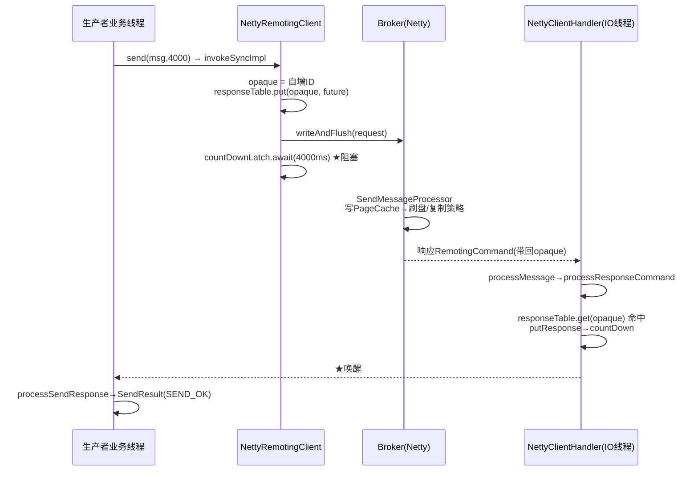
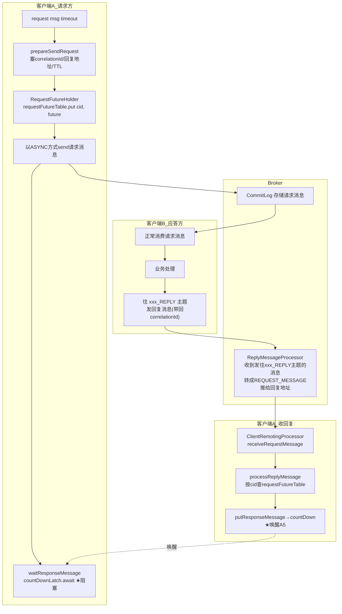
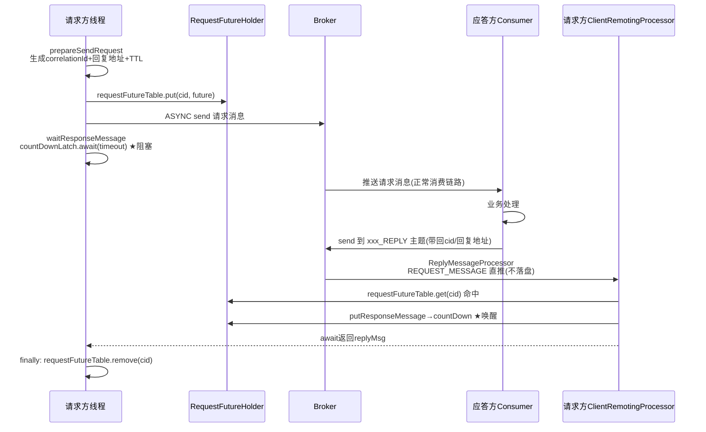
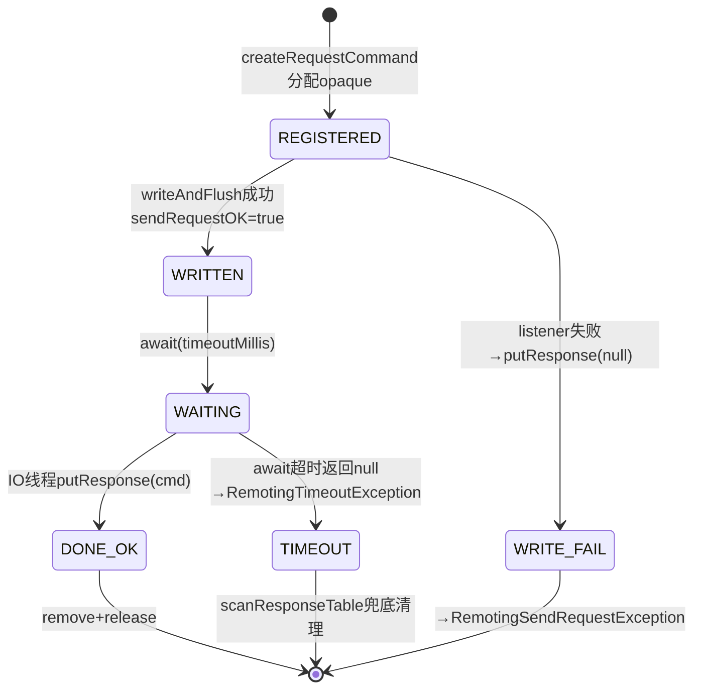
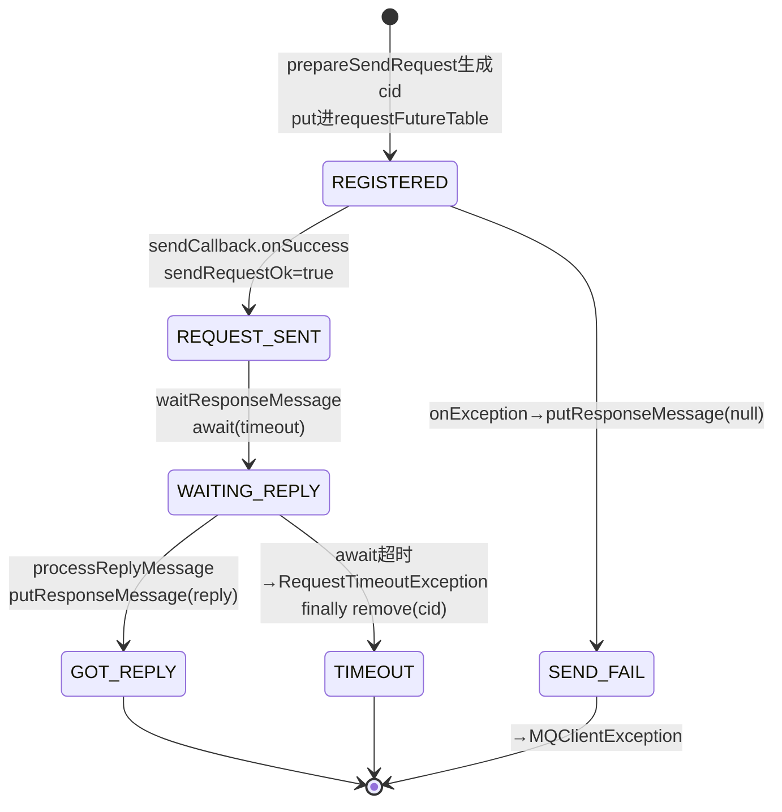

# RocketMQ 同步等待唤醒机制深度分析：ResponseFuture 与 RequestResponseFuture

> 基于 RocketMQ 4.9.8 源码。本文聚焦两条最容易混淆的"阻塞-唤醒"链路：
> 1. **同步发送（sync send）**：生产者线程如何在 Remoting 层等到 Broker 的 ACK —— `ResponseFuture` + `opaque`
> 2. **请求-应答（Request-Reply）**：生产者如何等到消费端发回的**业务回复消息** —— `RequestResponseFuture` + `correlationId`

---

## 一、引言：两个"等"，等的不是同一个东西

`producer.send(msg, 4000)` 返回 `SendResult`，`producer.request(msg, 4000)` 返回 `Message`。两者都是同步阻塞调用，但阻塞的位置、等待的对象、唤醒的线程完全不同：

| 维度 | 同步发送 send() | 请求-应答 request() |
|---|---|---|
| 等什么 | Broker 的 RemotingCommand ACK（SEND_OK 等） | **消费端业务代码**发出的回复消息 |
| 关联键 | `opaque`（Netty 请求自增 ID） | `correlationId`（UUID，放消息 property） |
| 挂在哪 | remoting 层 `responseTable` | client 层 `RequestFutureHolder.requestFutureTable` |
| 阻塞点 | `ResponseFuture.countDownLatch.await` | `RequestResponseFuture.countDownLatch.await` |
| 谁唤醒 | Netty IO 线程 `processResponseCommand` | 本机消费回调链 `ClientRemotingProcessor.processReplyMessage` |
| 发送方式 | SYNC 一次 RPC | **以 ASYNC 方式发出请求消息**，再在另一条链路上等回复 |
| 典型耗时 | 亚毫秒~毫秒级（含刷盘/复制策略） | 毫秒~秒级（包含消费端处理时间） |

一句话：`send()` 等的是"Broker 收到了"，`request()` 等的是"对端处理完了"。

---

## 二、特性一：同步发送的 opaque 匹配机制

### 2.1 整体架构

```mermaid
flowchart LR
    subgraph 生产者线程
        A[producer.send msg, 4000] --> B[sendDefaultImpl 选队列+重试]
        B --> C[sendKernelImpl]
        C --> D[MQClientAPIImpl.sendMessageSync]
        D --> E[NettyRemotingClient.invokeSync]
        E --> F[invokeSyncImpl<br/>注册 ResponseFuture]
        F --> G["countDownLatch.await 4000ms<br/>★生产者线程阻塞"]
        G --> H[processSendResponse<br/>组装 SendResult]
    end

    subgraph Netty IO 线程
        I[NettyClientHandler<br/>channelRead0] --> J[processMessage 按 type 分发]
        J --> K[processResponseCommand<br/>按 opaque 查表]
        K --> L["putResponse → countDown<br/>★唤醒生产者线程"]
    end

    subgraph Broker
        M[SendMessageProcessor<br/>写 CommitLog PageCache] --> N[执行刷盘/复制策略]
        N --> O["writeAndFlush 响应<br/>响应带回 opaque"]
    end

    F -- writeAndFlush 请求 --> M
    O --> I
    L -.唤醒.-> G
```



### 2.2 第一步：注册在途请求（埋点）

`NettyRemotingAbstract.invokeSyncImpl`（NettyRemotingAbstract.java:409-435）：

```java
public RemotingCommand invokeSyncImpl(final Channel channel, final RemotingCommand request,
    final long timeoutMillis) throws ... {
    final int opaque = request.getOpaque();                       // :412 唯一请求 ID

    final ResponseFuture responseFuture =
        new ResponseFuture(channel, opaque, timeoutMillis, null, null); // :415 callback=null → 同步路径
    this.responseTable.put(opaque, responseFuture);               // :416 注册
    final SocketAddress addr = channel.remoteAddress();
    channel.writeAndFlush(request).addListener(new ChannelFutureListener() {  // :418 异步写出
        @Override
        public void operationComplete(ChannelFuture f) throws Exception {
            if (f.isSuccess()) {
                responseFuture.setSendRequestOK(true);            // 只标记写出结果
                return;
            } else {
                responseFuture.setSendRequestOK(false);
            }
            responseTable.remove(opaque);                         // :428 写失败直接清理
            responseFuture.setCause(f.cause());
            responseFuture.putResponse(null);                     // 唤醒（带 null，让上层抛异常）
        }
    });

    RemotingCommand responseCommand = responseFuture.waitResponse(timeoutMillis);  // :435 阻塞
    if (null == responseCommand) {
        if (responseFuture.isSendRequestOK()) {
            throw new RemotingTimeoutException(...);              // :438 写成功但 4000ms 没等到响应
        } else {
            throw new RemotingSendRequestException(...);          // :441 连写都失败
        }
    }
    return responseCommand;
}
```

关键设计点：

- **`opaque` 的来源**：`RemotingCommand.createRequestCommand` 里由 `RequestIdGenerator`（AtomicInteger）自增分配，请求/响应共用同一个值，这是整条链路的关联键
- **`responseTable`**（NettyRemotingAbstract.java:75）：`ConcurrentMap<Integer, ResponseFuture>`，所有在途同步/异步请求都挂在这。注意它是**连接级共享**的——同一个客户端对多个 Broker 的在途请求全在同一张表里，靠 opaque 区分
- 写请求本身就是异步的（`writeAndFlush` + listener），同步语义完全靠后面的 `await` 实现

### 2.3 第二步：生产者线程阻塞

`ResponseFuture.waitResponse`（ResponseFuture.java:70-73）：

```java
public RemotingCommand waitResponse(final long timeoutMillis) throws InterruptedException {
    this.countDownLatch.await(timeoutMillis, TimeUnit.MILLISECONDS);  // ← 生产者线程卡在这
    return this.responseCommand;
}
```

`ResponseFuture` 的完整字段（ResponseFuture.java:27-40）值得逐个理解：

| 字段 | 作用 |
|---|---|
| `opaque` | 关联键 |
| `processChannel` | 发出请求的 channel，回调时区分来源 |
| `timeoutMillis` / `beginTimestamp` | 超时判定（你传的 4000 就是这里的 timeoutMillis） |
| `invokeCallback` | 异步调用走回调；**同步传 null，走 latch** |
| `countDownLatch` | 同步等待的阻塞点 |
| `once`（SemaphoreReleaseOnlyOnce） | 释放信号量（见 2.6 流控） |
| `executeCallbackOnlyOnce` | CAS 保证回调只执行一次 |
| `responseCommand` / `sendRequestOK` / `cause`（volatile） | 结果三件套，由 IO 线程写、生产者线程读 |

### 2.4 第三步：响应到达，IO 线程按 opaque 唤醒

响应回到客户端：`NettyClientHandler.channelRead0` → `processMessage`，按 `RemotingCommand.getType()` 分发（NettyRemotingAbstract.java:161），RESPONSE 类型进入：

```java
public void processResponseCommand(ChannelHandlerContext ctx, RemotingCommand cmd) {   // :289
    final int opaque = cmd.getOpaque();                               // :290 响应带回的 opaque
    final ResponseFuture responseFuture = responseTable.get(opaque);  // :291 查表
    if (responseFuture != null) {
        responseFuture.setResponseCommand(cmd);
        responseTable.remove(opaque);                                 // :295 用完即删

        if (responseFuture.getInvokeCallback() != null) {
            executeInvokeCallback(responseFuture);                    // :298 异步路径：执行回调
        } else {
            responseFuture.putResponse(cmd);                          // :300 同步路径
            responseFuture.release();                                 // :301 释放信号量
        }
    } else {
        log.warn("receive response, but not matched any request, " + ...);  // :304 迟到/已清理
    }
}
```

`putResponse`（ResponseFuture.java:75-78）：

```java
public void putResponse(final RemotingCommand responseCommand) {
    this.responseCommand = responseCommand;   // 先存结果（happens-before 由 latch 保证）
    this.countDownLatch.countDown();          // ← 唤醒生产者线程
}
```

被唤醒的生产者线程从 `waitResponse` 返回，`invokeSyncImpl` 返回非 null 响应，回到：

```java
// MQClientAPIImpl.sendMessageSync :487-496
RemotingCommand response = this.remotingClient.invokeSync(addr, request, timeoutMillis);
return this.processSendResponse(brokerName, msg, response, addr);   // 响应码→SendStatus，组装 SendResult
```

### 2.5 时序图



### 2.6 兜底与配套机制

**超时请求清理** —— `scanResponseTable`（NettyRemotingAbstract.java:385-407），由 `Timer` 每秒驱动一次：

```java
if ((rep.getBeginTimestamp() + rep.getTimeoutMillis() + 1000) <= System.currentTimeMillis()) {
    rep.release();
    it.remove();                          // 移除超时 future
}
```

超时后的迟到响应到达时 `responseTable.get(opaque)` 为 null，只打 warn，不会 NPE、不会内存泄漏。

**信号量流控** —— `invokeSyncImpl` 只用了"半信号量"：`SemaphoreReleaseOnlyOnce once` 在构造 `ResponseFuture` 前通过 `acquire` 获得，唤醒/清理路径统一 `release()`，防止信号量泄漏导致客户端发不出请求。

**异步调用的孪生路径** —— `invokeAsyncImpl`（:466 附近）同样注册 responseTable，但带 `InvokeCallback`；响应到达时走 `executeInvokeCallback`（在回调线程池里执行，且 CAS 保证只执行一次）。`send(msg, callback)` 走的就是这条路。

### 2.7 应用场景

- 一切同步 API 的底座：`producer.send()`、`consumer` 的位点提交、`mqadmin` 命令、`BrokerOuterAPI` 心跳/注册，全部经由 `invokeSync` + `ResponseFuture`
- 生产上绝大多数订单/交易类消息用同步发送拿 SEND_OK 判断成败，超时参数（如 4000ms）就是这个 latch 的等待上限
- 排障时理解"超时了但 Broker 其实写成功了"：latch 超时抛 `RemotingTimeoutException`，但请求可能已写入 CommitLog——上层重试可能造成重复消息，这就是"发送超时要按 unknown 状态处理"的根源

### 2.8 应用示例

```java
DefaultMQProducer producer = new DefaultMQProducer("sync_group");
producer.start();
try {
    SendResult result = producer.send(message, 4000);   // 阻塞点在 ResponseFuture.countDownLatch
    System.out.println(result);                          // SEND_OK / FLUSH_DISK_TIMEOUT / ...
} catch (RemotingTimeoutException e) {
    // latch 4000ms 超时。注意：消息可能已写入 Broker！
    // 幂等消费是必须的，不能假设"超时=没写进去"
} catch (MQBrokerException e) {
    // Broker 明确拒绝（响应码 != SUCCESS），此时可以确定没写进去
}
```

---

## 三、特性二：Request-Reply 请求应答机制

### 3.1 解决什么问题

MQ 天生是单向的：生产者发完就走。但很多场景需要"问一句、答一句"的 RPC 语义，又想保留 MQ 的削峰、解耦、可观测能力：

- 上下游解耦了，但偶尔需要同步查询下游状态
- 利用 MQ 的堆积能力做"可排队的 RPC"（下游过载时请求排队而不是打垮下游）
- 跨语言/跨机房的服务调用复用 MQ 基础设施

RocketMQ 4.5+ 内置了 Request-Reply：`producer.request(msg, timeout)` 直接返回**消费端处理完回复的 Message**。

### 3.2 整体架构：两条腿走路

Request-Reply 的精髓在于：**请求消息走正常的"发送"腿，回复消息走"消费"腿，两条腿用 correlationId 缝合。**



关键角色：

| 组件 | 职责 |
|---|---|
| `RequestResponseFuture` | 请求方的等待凭据（latch + 回调 + 结果） |
| `RequestFutureHolder` | 单例持有 `requestFutureTable`（cid → future），并定时扫描超时请求 |
| `prepareSendRequest` | 给请求消息打上三个 property：correlationId、回复地址（clientId）、TTL |
| `ClientRemotingProcessor` | 请求方进程内"被动服务"，接收 Broker 推来的回复消息 |
| `ReplyMessageProcessor` | Broker 侧组件，拦截发往 `xxx_REPLY` 主题的消息，反查路由直接推给请求方客户端 |

### 3.3 发送侧：注册 + 异步发送 + 阻塞

`DefaultMQProducerImpl.request(msg, timeout)`（DefaultMQProducerImpl.java:1369-1398）：

```java
public Message request(final Message msg, long timeout) throws ... {
    long beginTimestamp = System.currentTimeMillis();
    prepareSendRequest(msg, timeout);                                    // :1372 打标
    final String correlationId = msg.getProperty(MessageConst.PROPERTY_CORRELATION_ID);

    try {
        final RequestResponseFuture requestResponseFuture =
            new RequestResponseFuture(correlationId, timeout, null);     // :1376 同步版，callback=null
        RequestFutureHolder.getInstance().getRequestFutureTable()
            .put(correlationId, requestResponseFuture);                  // :1377 注册

        long cost = System.currentTimeMillis() - beginTimestamp;
        this.sendDefaultImpl(msg, CommunicationMode.ASYNC, new SendCallback() {  // :1380 注意：ASYNC！
            @Override
            public void onSuccess(SendResult sendResult) {
                requestResponseFuture.setSendRequestOk(true);            // 只标记，不唤醒
            }
            @Override
            public void onException(Throwable e) {
                requestResponseFuture.setSendRequestOk(false);
                requestResponseFuture.putResponseMessage(null);          // 写失败：放null并唤醒
                requestResponseFuture.setCause(e);
            }
        }, timeout - cost);

        return waitResponse(msg, timeout, requestResponseFuture, cost);  // :1394 阻塞等回复
    } finally {
        RequestFutureHolder.getInstance().getRequestFutureTable().remove(correlationId);  // :1396
    }
}
```

`prepareSendRequest`（:1565-1570）打的三个 property 是整个机制的契约：

```java
String correlationId = CorrelationIdUtil.createCorrelationId();          // UUID，缝合两腿的钥匙
MessageAccessor.putProperty(msg, MessageConst.PROPERTY_CORRELATION_ID, correlationId);
MessageAccessor.putProperty(msg, MessageConst.PROPERTY_MESSAGE_REPLY_TO_CLIENT, requestClientId); // 回复发给我(哪个客户端)
MessageAccessor.putProperty(msg, MessageConst.PROPERTY_MESSAGE_TTL, String.valueOf(timeout));     // 请求有效期
```

**为什么要用 ASYNC 发请求？** 因为发送结果和回复到达是两个独立事件：发送本身也包在总超时预算内（`timeout - cost`），发送回调只负责置位 `sendRequestOk`；真正的阻塞发生在 `waitResponseMessage`。这样总耗时可控且精确归因超时原因：

```java
// waitResponse :1514-1526
Message responseMessage = requestResponseFuture.waitResponseMessage(timeout - cost);
if (responseMessage == null) {
    if (requestResponseFuture.isSendRequestOk()) {
        throw new RequestTimeoutException(..., "send request message to <topic> OK, but wait reply message timeout");  // 发成功、没等到回复
    } else {
        throw new MQClientException("send request message to <topic> fail", cause);  // 发送阶段就失败
    }
}
```

### 3.4 `RequestResponseFuture` 结构精读（RequestResponseFuture.java:24-39）

```java
public class RequestResponseFuture {
    private final String correlationId;                       // 关联键
    private final RequestCallback requestCallback;            // 异步模式回调；同步模式为 null
    private final long beginTimestamp = System.currentTimeMillis();
    private final Message requestMsg = null;                  // 注意：恒为 null（4.9.8 中的无用字段）
    private long timeoutMillis;
    private CountDownLatch countDownLatch = new CountDownLatch(1);  // 同步等待点
    private volatile Message responseMsg = null;              // 回复消息
    private volatile boolean sendRequestOk = true;            // 请求消息是否发成功
    private volatile Throwable cause = null;                  // 失败原因
```

核心方法只有三个（:56-64）：

```java
public Message waitResponseMessage(final long timeout) throws InterruptedException {
    this.countDownLatch.await(timeout, TimeUnit.MILLISECONDS);  // 同步阻塞
    return this.responseMsg;
}

public void putResponseMessage(final Message responseMsg) {
    this.responseMsg = responseMsg;
    this.countDownLatch.countDown();                            // 唤醒
}

public void executeRequestCallback() {                          // 异步模式统一出口
    if (requestCallback != null) {
        if (sendRequestOk && cause == null) requestCallback.onSuccess(responseMsg);
        else requestCallback.onException(cause);
    }
}
```

### 3.5 应答侧：消费请求并回复

```java
// 应答方就是一个普通 PushConsumer，只是消费后往 REPLY 主题回消息
consumer.registerMessageListener((MessageListenerConcurrently) (msgs, context) -> {
    Message msg = msgs.get(0);
    String payload = new String(msg.getBody());               // 请求内容
    // ... 业务处理 ...
    Message reply = new Message(msg.getTopic() + "_REPLY",     // 约定：原主题 + "_REPLY"
        "reply payload".getBytes());
    // 关键：把请求里的 correlationId、回复地址带回去
    String correlationId = msg.getUserProperty(MessageConst.PROPERTY_CORRELATION_ID);
    String replyTo = msg.getUserProperty(MessageConst.PROPERTY_MESSAGE_REPLY_TO_CLIENT);
    MessageAccessor.putProperty(reply, MessageConst.PROPERTY_CORRELATION_ID, correlationId);
    MessageAccessor.putProperty(reply, MessageConst.PROPERTY_MESSAGE_REPLY_TO_CLIENT, replyTo);
    producer.send(reply);
    return CONSUME_SUCCESS;
});
```

### 3.6 Broker 侧：ReplyMessageProcessor 转发

Broker 上 `ReplyMessageProcessor` 拦截发往 `xxx_REPLY` 主题的消息：

1. 从消息 property 里取出 `REPLY_TO_CLIENT`（请求方的 clientId）与 `correlationId`
2. 通过 `ProducerManager/ConsumerManager` 查到该 clientId 对应的 Channel
3. 把消息封装成 `REQUEST_MESSAGE` 类型的 RemotingCommand，**不走存储**（不写 CommitLog），直接 `writeAndFlush` 推给请求方客户端
4. 请求方客户端的 `ClientRemotingProcessor.receiveRequestMessage` 收到后进入本地处理

这就是"回复消息不过存储、点对点直达"的机制——REPLY 主题只是约定，真正起路由作用的是消息 property 里的回复地址。

### 3.7 唤醒时刻：processReplyMessage

`ClientRemotingProcessor.processReplyMessage`（ClientRemotingProcessor.java:279-294）：

```java
private void processReplyMessage(MessageExt replyMsg) {
    final String correlationId = replyMsg.getUserProperty(MessageConst.PROPERTY_CORRELATION_ID);
    final RequestResponseFuture requestResponseFuture =
        RequestFutureHolder.getInstance().getRequestFutureTable().get(correlationId);  // :281 按cid查表
    if (requestResponseFuture != null) {
        requestResponseFuture.putResponseMessage(replyMsg);   // :283 存结果 + countDown ★唤醒
        RequestFutureHolder.getInstance().getRequestFutureTable().remove(correlationId); // :285

        if (requestResponseFuture.getRequestCallback() != null) {
            requestResponseFuture.getRequestCallback().onSuccess(replyMsg);  // 异步模式回调
        }
    } else {
        log.warn("receive reply message, but not matched any request, CorrelationId: ...");
    }
}
```

**注意 :283 和 :287 的顺序**：先 `putResponseMessage`（唤醒同步等待者）再执行回调。对同步模式（callback=null）无影响；对异步模式，latch 无人等待，等价的"通知"由 callback 完成，两者都只会发生一次。

### 3.8 超时清理：RequestFutureHolder

`RequestFutureHolder` 是单例，内部一个定时任务每秒扫描 `requestFutureTable`：

```java
// 伪代码（RequestFutureHolder.scanRequestFutureTable）
for (entry : requestFutureTable) {
    if (entry.getValue().isTimeout()) {
        remove(entry.getKey());
        future.setCause(new RequestTimeoutException(...));
        future.executeRequestCallback();      // 异步模式：回调 onException
        // 同步模式：latch 不 countDown，等调用方自己 await 超时返回 null
    }
}
```

同步模式下调用线程的 `await(timeout)` 到点返回 null → `waitResponse` 抛 `RequestTimeoutException`，finally 里再 remove 一次（幂等）。这就是 request-reply 版的 `scanResponseTable`。

### 3.9 端到端时序图



---

## 四、两大机制对照总表

| 对比项 | ResponseFuture（remoting 层） | RequestResponseFuture（client 层） |
|---|---|---|
| 所在模块 | remoting（Broker/Client 通用） | client（仅请求方客户端） |
| 关联键 | opaque（int 自增，RemotingCommand 帧） | correlationId（UUID，消息 property） |
| 注册表 | `NettyRemotingAbstract.responseTable` | `RequestFutureHolder.requestFutureTable` |
| 请求发出方式 | writeAndFlush 后同步 await | **ASYNC 发送** + 单独 latch 等回复 |
| 响应载体 | RemotingCommand（协议帧） | Message（业务回复消息，不落 CommitLog） |
| 唤醒执行者 | Netty IO 线程 | 处理 REQUEST_MESSAGE 的线程 |
| 超时守护 | `scanResponseTable`（1s 一轮） | `RequestFutureHolder` 定时扫描 |
| 超时异常 | RemotingTimeoutException | RequestTimeoutException |
| 失败语义 | 发送失败/超时，消息状态未知 | 可区分"发送失败"与"等到回复超时" |
| 回调支持 | InvokeCallback（invokeAsync） | RequestCallback（异步 request 重载） |
| 信号量 | 有（半信号量限流） | 无 |

**层次关系**：Request-Reply 是**架在**发送/消费链路之上的编排层——它的"发送请求消息"这一步内部照样会走 `invokeAsyncImpl` + `ResponseFuture`（带 InvokeCallback）。即：ResponseFuture 负责"这一次网络调用"级别的等待，RequestResponseFuture 负责"一次业务问答"级别的等待，两层嵌套。

---

## 五、mermaid 流程图：两个 latch 的生命周期

### 5.1 同步发送 ResponseFuture 生命周期



### 5.2 RequestResponseFuture 生命周期



---

## 六、陷阱清单（生产必读）

1. **同步发送超时 ≠ 消息没写进去**。latch 超时时消息可能已在 Broker 的 PageCache 甚至已落盘。上层重试会造成重复消息——消费端必须幂等；事务/严谨场景建议查消息（按 msgId queryMessage）确认状态而不是盲目重发。

2. **send 超时参数是"单次尝试"的预算**。`sendDefaultImpl` 重试时传的是 `timeout - costTime`，总预算被各次尝试摊薄；到 `invokeSyncImpl` 时 latch 等的又是再减去序列化/寻路开销后的剩余值。

3. **request() 的 timeout 身兼三职**：请求消息发送预算 + 回复等待预算 + 写进消息体的 TTL property。应答方可以根据 TTL 判断请求是否还有意义（太老的请求直接不处理）。

4. **request() 必须先 `createReplyTopic`**。`prepareSendRequest`（:1572-1575）发现本地没有 REPLY 主题路由时会主动向 NameServer 申请创建 `${topic}_REPLY`。若环境禁止自动建主题会直接失败。

5. **request-reply 的回复不走存储**。ReplyMessageProcessor 直接把回复推给请求方，**回复消息不会持久化**。如果请求方此刻恰好宕机/重启，回复永久丢失，调用方只会拿到 RequestTimeoutException。不能把它当可靠的最终一致机制使用。

6. **`RequestResponseFuture.requestMsg` 恒为 null**（RequestResponseFuture.java:28 `private final Message requestMsg = null;`）——4.9.8 中的死字段，排障时别指望从 future 里拿回请求内容。

7. **异步 request 的回调可能被"请求失败"和"超时扫描"两条路径触发**，`executeRequestCallback` 内部没有 once 保护（对比 ResponseFuture 的 CAS `executeCallbackOnlyOnce`），靠调用方各自 remove 后判空规避；重入风险低但存在，自定义 RequestCallback 里不要再做重活。

8. **responseTable 是全局单表**。客户端对多 Broker 的在途请求共用一张 map，opaque 全局唯一所以无冲突；但这也意味着 `scanResponseTable` 清理任何一个 future 都不影响其他连接——没有连接级的隔离（Broker 侧同样）。

9. **"receive response, but not matched any request" 日志**大量出现时，说明大量请求已超时但响应仍在路上，通常是 Broker 端慢（如同步刷盘超时）而客户端超时设得太短。

---

## 七、运维调试手册

### 7.1 日志关键字

| 日志 | 含义 | 排查方向 |
|---|---|---|
| `receive response, but not matched any request` | 迟到响应找不到 future | 客户端超时设置过短 / Broker 处理慢 |
| `receive reply message, but not matched any request, CorrelationId: xxx` | 回复到达但请求方已超时清理 | 应答方处理耗时 > 请求方 timeout |
| `remove timeout request, ...`（scanResponseTable） | 有请求超时被清理 | 统计频率评估 RT 设置 |
| `send a request command to channel <addr> failed` | writeAndFlush 失败 | 网络断连/TCP 缓冲区满 |

### 7.2 断点位置

| 目的 | 类:行 |
|---|---|
| 看同步发送的注册/阻塞 | NettyRemotingAbstract.java:415-435（put→await） |
| 看响应唤醒 | NettyRemotingAbstract.java:289-302（processResponseCommand） |
| 看 request 的打标 | DefaultMQProducerImpl.java:1565-1575（prepareSendRequest） |
| 看 request 的注册与阻塞 | DefaultMQProducerImpl.java:1376-1394 |
| 看回复唤醒 | ClientRemotingProcessor.java:279-294（processReplyMessage） |
| 看超时清理 | NettyRemotingAbstract.java:385-407（scanResponseTable） |

### 7.3 实用命令

```bash
# 观察客户端在途请求堆积（超时频率高时）
# 客户端日志 grep:
#   remove timeout request  →  单位时间条数即超时 QPS

# request-reply 排障：确认 REPLY 主题存在且路由正常
sh mqadmin topicRoute -n localhost:9876 -t MyTopic_REPLY

# 应答方消费滞后会导致 request 超时，查消费堆积
sh mqadmin consumerProgress -n localhost:9876 -g reply_server_group
```

### 7.4 关键参数

| 参数 | 默认 | 说明 |
|---|---|---|
| `sendMsgTimeout` | 3000ms | send 同步等待上限（latch await 的入参） |
| request(msg, timeout) 的 timeout | 用户指定 | 同时写进消息 TTL property |
| `remotingClientSemaphore*` | 2/32 | 半/全信号量，限在途请求数 |

---

## 八、设计得与失

**得：**

1. **两层 future 的分层非常干净**：remoting 层只关心"一次 RPC"，client 层编排"一次业务问答"，request-reply 复用发送/消费全部基础设施，没有侵入存储
2. **关联键设计简单可靠**：opaque 用协议帧字段、correlationId 用消息 property，各自贴着所在层的"信封"走，无需全局注册中心
3. **失败语义精确**：两个机制都能区分"发出失败"与"等待超时"（sendRequestOK 位 + 分别的异常类型），给上层的重试决策提供了足够信息
4. **回复直达不落盘**：ReplyMessageProcessor 点对点推送，避免回复消息也走一遍 CommitLog 的开销

**失：**

1. **回复不可靠**：不持久化 + 请求方重启即丢，request-reply 只适合"可重试的查询类"语义，不能当可靠 RPC
2. `RequestResponseFuture.requestMsg` 死字段、`executeRequestCallback` 缺 once 保护，细节打磨不如 remoting 层
3. 同步发送的"超时但已写入"状态二义性无法在协议内消除，只能靠业务幂等兜底——这是所有异步系统的通病，但对使用者始终是隐患
4. `responseTable`/`requestFutureTable` 都是全局单表 + 定时扫描，百万级在途请求时会成为扫描瓶颈（一般场景无碍）

---

## 九、一句话总结

`ResponseFuture` 用 `opaque` 在 **remoting 层**缝合"一次网络请求/响应"，让 `send()` 的调用线程阻塞等待 Broker 的 ACK；`RequestResponseFuture` 用 `correlationId` 在 **client 层**缝合"一次业务问答"，让 `request()` 的调用线程等待消费端发回的回复消息——前者是后者的地基，后者是前者的业务编排。

---

## 相关文档

- 上一篇：[RocketMQ mmap内存映射与刷盘机制源码深度分析.md](RocketMQ%20mmap内存映射与刷盘机制源码深度分析.md)（appendMessage 只写 PageCache、落盘时机）
- 关联：[RocketMQ网络通信Remoting模块源码深度分析.md](RocketMQ网络通信Remoting模块源码深度分析.md)（Netty 线程模型全貌）
- 关联：[RocketMQ Batch消息与Request-Reply源码深度分析.md](RocketMQ%20Batch消息与Request-Reply源码深度分析.md)（Request-Reply 的 API 与 Batch 视角）
- 关联：[RocketMQ消费者消费流程源码深度解析.md](RocketMQ消费者消费流程源码深度解析.md)（应答方消费链路）
